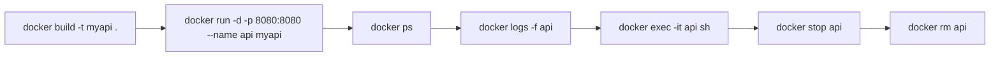
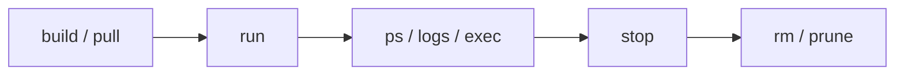
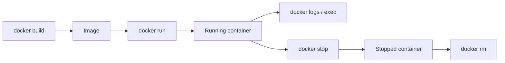
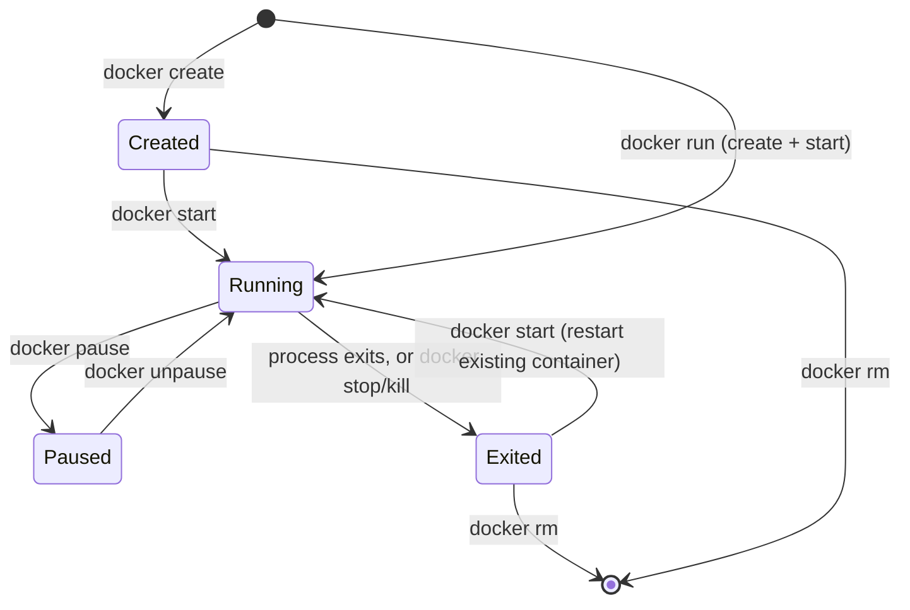
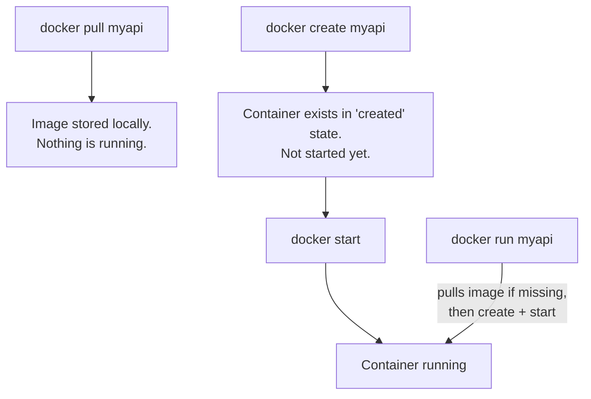
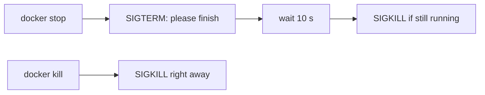

# Docker 03 - CLI Essentials

> [!summary] TL;DR
> A small set of `docker` subcommands covers nearly all day-to-day work: build or pull an image, run it as a container, inspect and debug what's running, then stop and clean up. Everything else is a variation on these five steps.

> [!abstract] Core idea
> - `pull` only fetches an image; `run` creates **and starts** a container from one, pulling it first if it's missing locally.
> - `ps` shows running containers only; `ps -a` shows every container, including stopped ones, until you `rm` them.
> - `stop` asks nicely (SIGTERM, then SIGKILL after a grace period); `kill` doesn't ask.
> - `exec` runs a new process inside an already-running container; it does nothing if the container isn't running.
> - Nothing is actually deleted until you clean it up — stopped containers, unused images, and dangling volumes all quietly consume disk until pruned.

### Whiteboard version



Build or pull, run, look at it, poke at it if something's wrong, stop it, remove it. Every CLI session is some subset of this loop.

## Start here: the basics 🟢

> [!info] How to read this note (pick your level)
> - 🟢 **New to this?** Read "From zero" below, then sections 1, 2 and 10 (why, mental model and the cheat sheet). Stop there, that is a full first pass.
> - 🟡 **Know the basics?** Add sections 3, 4, 5 and 6 (how it works, a worked example, options and trade-offs).
> - 🔴 **Interview / SDE-3 prep?** Add sections 7, 8 and 9 (production, deep dive and interview questions). Headings are tagged 🟢🟡🔴 so you always know where you are.

**From zero, in 60 seconds** 🟢

You talk to Docker by typing `docker` commands in a terminal.
You only need about a dozen to do almost everything.
They follow the life of a container: get an image, run it, look inside, stop it, clean up.



A **container** goes through states: created, running, stopped, removed.
Most mistakes come from mixing these up, like expecting a stopped container to be gone.

The rest of this note is just these 3 questions:
1. What are the five groups of commands?
2. What states does a container move through?
3. What does a real build-run-debug-clean session look like?


**The problem in one story.**
You have a Dockerfile and want to see your Go API actually running.
You need to build it, start it, look at its logs, open a shell inside it, and stop it cleanly.
Each of those is one `docker` command.
This note is the small set of commands you use every day.

**Words you need first**

| Word | Plain meaning | Tiny example |
| --- | --- | --- |
| CLI | A program you control by typing commands | `docker ps` |
| Daemon | A background service doing the real work | `dockerd` receives CLI requests |
| Image | The packaged app you start containers from | `myapi:dev` |
| Container | A running (or stopped) instance of an image | Started by `docker run` |
| Port mapping | Connecting a host port to a container port | `-p 8080:8080` |
| Signal | A message the OS sends a process | `SIGTERM` = please shut down |
| Exit code | A number a process returns when it ends | `0` = success, `137` = killed |

**Picture it**



**Analogy.** A TV remote: a few buttons (play, pause, stop, info) cover nearly everything you do.
Where it breaks: the remote talks to one TV; the `docker` CLI is a client that can talk to any Docker daemon, even a remote one.

**How the rest of this note builds up**

- First, why the CLI matters and the client → daemon mental model (sections 1-2).
- Then container lifecycle states, `pull` vs `run` vs `create` + `start`, and `stop` vs `kill` (section 3).
- Then a full build-and-run worked example (section 4).
- Finally variants, trade-offs and the SDE-3 production and debugging details.

> [!tip] Remember
> build → run → logs/exec → stop → rm covers most of daily Docker work.

## 1. Why it exists 🟢

Without a small, memorized set of commands, every container interaction becomes a search: "how do I see what's running," "how do I get a shell inside it," "how do I actually stop this thing versus just closing the terminal." A team member who only knows `docker run` and `docker stop` will, the first time a container hangs on shutdown or a service silently fails to start, either guess at flags or restart their whole machine — both slower and less informative than `docker logs` and `docker inspect`, which exist exactly for this.

Concretely: a container exits immediately after `docker run myapi` with no visible error, because the terminal that started it closed before the process finished logging. `docker ps -a` shows the container still exists, exited, with a non-zero code; `docker logs <id>` then prints the crash that already happened, in full, without needing to reproduce it.

## 2. Mental model 🟢

The CLI commands fall into five groups, matching the lifecycle diagram above:

1. **Get an image** — `pull`, `build`, `images`.
2. **Start a container** — `run`, or `create` + `start` separately.
3. **See what's running** — `ps`, `inspect`, `logs`, `stats`, `top`.
4. **Get inside or move things** — `exec`, `attach`, `cp`.
5. **Stop and clean up** — `stop`, `kill`, `rm`, `rmi`, `system prune`.

Everything else in the CLI is a flag variation within one of these five groups.

## 3. How it works 🟡

### Container lifecycle states

**In plain words:** a container is like an app on your phone: installed (created), open (running), closed (stopped), and uninstalled (removed).



A stopped container is not gone — it is in the `Exited` state, still occupying disk (its writable layer, its logs) and still visible to `docker ps -a`, until explicitly removed with `docker rm`.

### `pull` vs. `run` vs. `create` + `start`

**In plain words:** pull only downloads. run does everything at once: download if needed, create, and start.



`docker pull` only downloads layers; it never starts anything.

`docker run` is a convenience that does `pull` (if the image isn't already local), `create`, and `start` in one step — which is why `docker run node` with no other flags does start a container, briefly: it creates and starts it, and if that container's main process needs a terminal (like a shell with nothing piped to it) and gets none, it exits immediately rather than hanging around.

### `stop` vs. `kill`

**In plain words:** stop politely asks the app to finish and gives it 10 seconds. kill ends it at once.



`docker stop <container>` sends `SIGTERM` to the container's PID 1, then waits a grace period (10 seconds by default, `docker 27`'s documented default) before escalating to `SIGKILL` if the process hasn't exited.

`docker kill <container>` sends `SIGKILL` (or another signal you specify) immediately, with no grace period — the process has no chance to flush buffers, close connections, or run cleanup code.

Prefer `stop` for anything that should shut down gracefully (see [[Graceful Shutdown and Health Checks]]); reach for `kill` only when a container is hung and `stop` has already timed out.

## 4. Worked example 🟡

A representative session building, running, inspecting, and cleaning up a small Go API image. **Representative output (Docker Engine 27, Compose v2 syntax where relevant; no daemon was run to produce these — commands and output are illustrative and internally consistent).**

### Build and run

```bash
docker build -t myapi:v1 .
docker images
docker run -d -p 8080:8080 --name api --restart unless-stopped myapi:v1
```

```text
REPOSITORY   TAG   IMAGE ID       CREATED          SIZE
myapi        v1    e4f8a1b2c3d4   10 seconds ago   329MB
```

`-d` detaches (runs in the background); `-p 8080:8080` publishes host port 8080 to the container's port 8080 (see [[Docker 05 - Networking and Port Publishing]]); `--name api` gives it a fixed name instead of a random one; `--restart unless-stopped` restarts it automatically on crash or host reboot, unless it was explicitly stopped.

**The `docker run` flags worth knowing by heart:**

| Flag | What it does |
| --- | --- |
| `-d` | Detached: run in the background, print the container ID, return the prompt immediately |
| `-it` | Allocate a TTY (`-t`) and keep stdin open (`-i`) — needed for an interactive shell as the main process |
| `--name <n>` | Fixed, human-chosen container name instead of a random one |
| `--rm` | Remove the container automatically the moment it exits — the right default for short-lived, one-off runs |
| `-p host:container` | Publish a container port to a host port (see [[Docker 05 - Networking and Port Publishing]]) |
| `-v host:container` or `-v name:container` | Mount a bind mount or named volume into the container (see [[Docker 06 - Volumes and Bind Mounts]]) |
| `-e KEY=value` / `--env-file <f>` | Set one environment variable, or load many from a file |
| `--network <n>` | Attach to a specific Docker network instead of the default bridge (see [[Docker 05 - Networking and Port Publishing]]) |
| `--restart <policy>` | Restart policy on exit/reboot: `no` (default), `on-failure`, `unless-stopped`, `always` |

### See what's running

```bash
docker ps
```

```text
CONTAINER ID   IMAGE        COMMAND       STATUS          PORTS                    NAMES
a1b2c3d4e5f6   myapi:v1     "./server"    Up 2 minutes    0.0.0.0:8080->8080/tcp   api
```

```bash
docker ps -a
```

```text
CONTAINER ID   IMAGE        COMMAND       STATUS                      PORTS                    NAMES
a1b2c3d4e5f6   myapi:v1     "./server"    Up 2 minutes                0.0.0.0:8080->8080/tcp   api
f9e8d7c6b5a4   myapi:v0     "./server"    Exited (1) 3 hours ago                              api-old
```

`ps` shows only the running container; `ps -a` additionally shows `api-old`, which crashed (exit code 1) three hours ago and is still sitting on disk, unremoved.

### Logs, exec, inspect

**In plain words:** logs shows what the app printed, exec opens a shell inside the box, inspect shows all its settings.

```bash
docker logs -f --tail 50 api
```

```text
2026/11/07 10:02:11 server listening on :8080
2026/11/07 10:04:33 handled GET /healthz in 1.2ms
```

`-f` follows new output live; `--tail 50` starts from the last 50 lines instead of the beginning.

```bash
docker exec -it api sh
```

Opens an interactive shell *inside the already-running* `api` container — this fails with "container is not running" if `api` had crashed, which is the signal to use `docker logs` instead.

```bash
docker inspect --format '{{.State.Health.Status}} {{.NetworkSettings.IPAddress}}' api
```

```text
healthy 172.17.0.2
```

`--format` (Go template syntax) extracts one field instead of the full JSON dump, which is useful in scripts.

```bash
docker cp api:/app/debug.log ./debug.log
docker stats --no-stream api
docker top api
```

```text
CONTAINER   CPU %   MEM USAGE / LIMIT   NET I/O
api         0.42%   18.3MiB / 512MiB    1.2kB / 850B
```

```text
UID    PID     PPID    C    STIME   TTY   TIME       CMD
root   48213   48190   0    10:02   ?     00:00:00   ./server
```

`cp` copies a file out of (or into) a container's filesystem without needing a shell; `stats` shows live resource usage, and `--no-stream` prints one snapshot instead of continuously updating; `top` lists the processes actually running inside the container (as seen from the host's process table), useful for confirming `./server` is PID 1 and nothing has spawned an unexpected child process.

### Stop, remove, clean up

**In plain words:** stopped containers and old images pile up and eat disk. These commands clear them out.

```bash
docker stop api
docker rm api-old
docker rmi myapi:v0
docker system prune -f
docker image prune -a -f
docker volume prune -f
```

```text
Total reclaimed space: 1.47GB
```

`system prune` removes stopped containers, unused networks, dangling images, and build cache; `image prune -a` additionally removes any image not referenced by a running container, not just dangling ones; `volume prune` removes volumes no container references — run this one deliberately, since an unreferenced volume may still hold data you meant to keep (see [[Docker 06 - Volumes and Bind Mounts]]).

### Registry commands

```bash
docker tag myapi:v1 myregistry.example.com/myapi:v1
docker login myregistry.example.com
docker push myregistry.example.com/myapi:v1
```

`tag` creates an additional name for an existing local image (no new layers); `push` uploads any layers the registry doesn't already have, by digest.

## 5. Variants and comparison 🟡

| Need | Command | Notes |
| --- | --- | --- |
| Start and run in one step | `docker run <image>` | Pulls if missing, then create + start |
| Just download, don't start | `docker pull <image>` | No container is created |
| Create without starting | `docker create <image>` then `docker start <id>` | Useful for pre-provisioning, rarely needed day to day |
| See running containers | `docker ps` | Add `-a` for stopped ones too |
| Graceful stop | `docker stop <id>` | SIGTERM, then SIGKILL after the grace period |
| Immediate stop | `docker kill <id>` | SIGKILL (or `--signal`) right away, no grace period |
| Run a command in a live container | `docker exec -it <id> <cmd>` | Fails if the container isn't running |
| Attach to the main process's own stdio | `docker attach <id>` | Connects to PID 1 directly; detach with `Ctrl-P Ctrl-Q`, not `Ctrl-C` |
| Follow logs | `docker logs -f --tail N <id>` | Reads the container's captured stdout/stderr |
| One-off resource snapshot | `docker stats --no-stream` | Omit `--no-stream` for a live updating view |

## 6. Trade-offs and when not to use 🟡

- `docker attach` connects directly to the container's main process input/output — pressing `Ctrl-C` there can send SIGINT to that process and stop it, whereas `docker exec -it <id> sh` opens an *additional*, independent process you can exit freely without affecting the main one. Default to `exec` for interactive debugging.
- `docker kill` is faster but skips any cleanup code (closing DB connections, flushing writes) the application would have run on SIGTERM; reserve it for containers that are already unresponsive to `stop`.
- `docker system prune` is destructive to anything unreferenced — build cache, stopped containers, dangling images — and cannot be scoped finely; on a shared CI build host, pruning too eagerly can force every subsequent build to start from a cold cache.
- `docker cp` does not resolve symlinks across the container boundary the way a bind mount would; for ongoing, live file access, a mounted volume (next note) is the better tool.

## 7. In production 🔴

- **Real systems:** CI pipelines script this exact command sequence (`build` → `run` a temporary container to execute tests → `logs`/`exec` for debugging a failure → `rm` to clean up) on every pull request.
- **Failure modes → fixes:**
  - Container exits immediately with no error visible → the terminal closed, or the main process needs a TTY/stdin it wasn't given; check `docker ps -a` for the exit code and `docker logs` for what the process printed before exiting, rather than assuming it never started.
  - App unreachable on the published port → the app is listening on `127.0.0.1` inside the container instead of `0.0.0.0`; `docker logs` usually shows the bind address, and `0.0.0.0:8080->8080/tcp` in `docker ps` confirms the port mapping exists even when the app itself is unreachable (see [[Docker 05 - Networking and Port Publishing]]).
  - `docker stop` seems to "hang" for exactly 10 seconds every time → the process doesn't handle SIGTERM at all (common for shell-form `CMD`, which doesn't make the app PID 1); fix the Dockerfile's `CMD`/`ENTRYPOINT` form rather than reaching for `kill` as the routine fix.
  - Disk silently fills up on a long-lived CI/build host → stopped containers, dangling images, and build cache accumulate; schedule `docker system prune` (or `image prune -a`) regularly, not only when the disk is already full.
- **What to monitor:** `docker ps -a` count of exited-but-not-removed containers, `docker system df` for reclaimable space, and container restart counts (a `--restart unless-stopped` container restarting repeatedly is crash-looping, not recovering).

## 8. Deep dive 🔴

**Why `docker ps -a` matters more than it looks.** Every `docker run` that exits leaves a container record behind — logs, exit code, and its (now-empty-ish) writable layer all remain on disk. A host that runs many short-lived containers (one-off scripts, CI test runs) without ever removing them accumulates thousands of exited containers over weeks, each holding onto some disk even though none are "running." `docker run --rm` auto-removes the container the moment it exits, which is the right default for any container whose logs you don't need to inspect after the fact.

**Why `docker exec` can run things the original `CMD` never imagined.** `exec` starts a brand-new process inside the container's existing namespaces — it doesn't re-run or interact with PID 1 at all. This means a container whose `CMD` is a single static binary with no shell (a `scratch`-based image, common for Go) will fail `docker exec -it <id> sh` with "executable file not found," not because `exec` is broken, but because there genuinely is no `sh` binary inside that image's filesystem to run. Debugging a distroless or `scratch` image typically means temporarily attaching an ephemeral debug container to the same namespaces (`docker run --rm -it --pid container:<id> --net container:<id> busybox sh`) rather than `exec`-ing into the image itself.

**`--format` as a scripting primitive.** `docker inspect` returns a large JSON document; `--format` applies a Go template to it, letting scripts extract one field (an IP address, a health status, a mount path) without a separate `jq` dependency. This is the same templating used across `docker ps --format`, `docker images --format`, and similar list commands, so learning the syntax once covers most CLI scripting needs.

## 9. Interview questions 🔴

> [!question]- What's the actual difference between `docker pull` and `docker run`?
> `pull` only downloads an image's layers; it starts nothing. `run` pulls the image if it isn't already local, then creates and starts a container from it in one step.

> [!question]- Why does `docker ps` show nothing right after a container exits, but `docker ps -a` still shows it?
> `ps` lists only running containers. An exited container still exists on disk (its metadata, logs, and writable layer) until `docker rm` removes it — `ps -a` includes it in that `Exited` state.

> [!question]- `docker stop` vs. `docker kill`: what actually happens differently?
> `stop` sends SIGTERM and waits a grace period (10s by default) before sending SIGKILL if the process hasn't exited, giving it a chance to clean up. `kill` sends SIGKILL (or a chosen signal) immediately, with no grace period and no chance for cleanup code to run.

> [!question]- Trap: a container exits right after `docker run -it node`, with no error. What's the first thing you check, not the first thing you guess?
> Check `docker ps -a` for the exit code and `docker logs <id>` for what was printed — don't assume the image is broken or that "node just doesn't work." Many such exits are simply a process that needed a TTY/stdin it wasn't given, or a shell-form entrypoint that exited because nothing kept it running.

> [!question]- Why would `docker exec -it <id> sh` fail even though the container is clearly running?
> If the image has no shell binary at all — common for `scratch`- or distroless-based images shipping a single static binary — there's nothing for `exec` to run. `exec` starts a new process inside the container's namespaces; it can't conjure a binary the image never shipped.

> [!question]- What's the risk of running `docker system prune` on a shared CI host without thinking about it?
> It removes all stopped containers, dangling images, unused networks, and build cache indiscriminately. On a shared host this can wipe build cache other jobs were relying on (forcing slow, cold rebuilds) or remove a stopped container someone was about to debug via its logs.

## 10. Cheat sheet 🟢

- `pull` downloads only; `run` = pull-if-missing + create + start.
- `ps` = running only; `ps -a` = everything, including exited containers still on disk.
- `stop` = SIGTERM then SIGKILL after a grace period; `kill` = SIGKILL immediately, no cleanup chance.
- `exec -it <id> sh` for interactive debugging of a running container; it needs a shell binary to exist in the image.
- `logs -f --tail N` for history plus live tail; `inspect --format` for scripting one field out of the JSON.
- `docker run --rm` auto-removes the container on exit — good default for anything short-lived.
- Clean up regularly: `system prune`, `image prune -a`, `volume prune` — each is destructive and unscoped, so run deliberately on shared hosts.

## Links

- **Before this:** [[Docker 02 - Images, Layers and Containers]]
- **Next:** [[Docker 05 - Networking and Port Publishing]], [[Docker 06 - Volumes and Bind Mounts]]
- **Compare with:** [[Docker 07 - Docker Compose for Local Development]] (the same lifecycle, declared for several containers at once)

### Watch on YouTube

- [Ep-4: Docker CLI Essentials + Understanding Docker Images/ @DockerInc #docker](https://www.youtube.com/watch?v=hEQUHKNnSCo) · DevOps Codex · 22 min · 47 views
- [Docker CLI Explained / run, exec, logs & inspect (Daily Docker Commands) / Cloud & Devops](https://www.youtube.com/watch?v=pry-Vs4Ew6Y) · DheerajTechInsight · 31 min · 1,482 views
