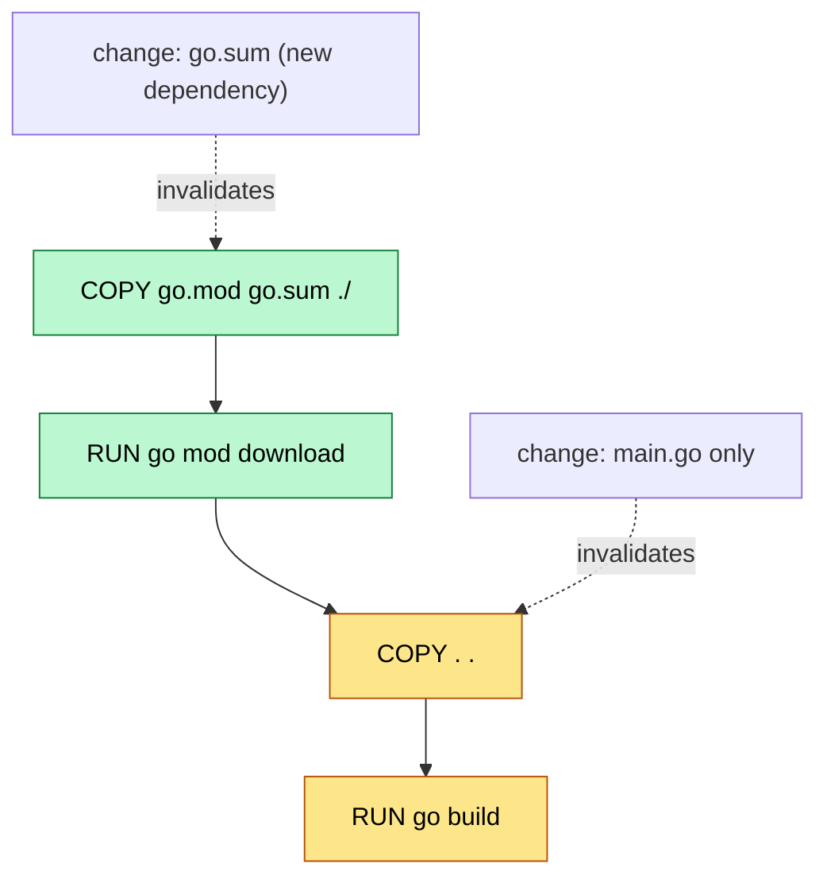
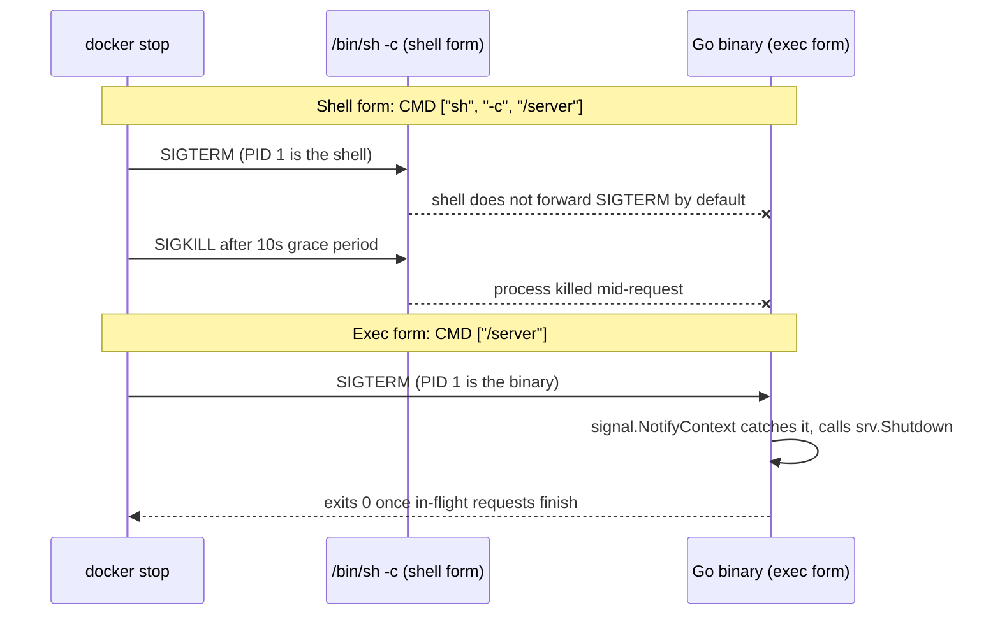

# Docker 04 - Writing a Production Dockerfile for Go

> [!summary] TL;DR
> A production Dockerfile for a Go service is a multi-stage build: a `golang` stage compiles a static binary with the build cache mounted, and a tiny runtime stage (`distroless` or `scratch`) copies in just that binary. The result is a ~10–20 MB image with no shell, no package manager, and a process that exits cleanly on `SIGTERM`.

> [!abstract] Core idea
> - Multi-stage builds separate "what it takes to build" from "what it takes to run"; only the runtime stage ships.
> - `CGO_ENABLED=0` plus a static base (`distroless/static` or `scratch`) removes an entire class of missing-library failures.
> - Order Dockerfile instructions so rarely-changing layers (dependencies) come before often-changing ones (source code), and mount the Go build cache so `docker build` is as fast as a local rebuild.
> - The container's PID 1 must forward `SIGTERM` to the app, or `docker stop` always takes the full 10-second grace period and then kills it.
> - Classic mistake: treating `EXPOSE` as if it opens a port. It is documentation; `-p` on `docker run` is what publishes a port (see [[Docker 05 - Networking and Port Publishing]]).

## Start here: the basics

**The problem in one story.**
Your first Go Dockerfile works, but the image is 900 MB.
It contains the whole Go compiler, your source code, and runs as root.
Every deploy is slow, and a security scanner flags dozens of issues.
A production Dockerfile builds in one stage and ships only the tiny binary in another.

**Words you need first**

| Word | Plain meaning | Tiny example |
| --- | --- | --- |
| Dockerfile | A recipe of steps that builds an image | `FROM`, `COPY`, `RUN` lines |
| Instruction | One step in the Dockerfile | `RUN go build ./...` |
| Build cache | Reused results of steps whose inputs did not change | `go mod download` skipped on rebuild |
| Multi-stage build | Using one image to build and a smaller one to run | `builder` stage → `distroless` stage |
| Static binary | A program needing no shared libraries at runtime | `CGO_ENABLED=0 go build` |
| Base image | The starting image for a stage | `gcr.io/distroless/static` |
| PID 1 | The first process in a container; it receives signals | Your Go binary when using exec form |
| Root user | The all-powerful user; risky to run apps as | Prefer `USER nonroot` |

**Picture it**


**Analogy.** A bakery kitchen vs the shop counter: you bake with ovens and flour in the back, but only the finished bread goes on the counter.
Where it breaks: bread does not need updates; your image still needs CA certificates, timezone data and a rebuild whenever the base image gets a security fix.

**How the rest of this note builds up**

- First, why a production Dockerfile differs from a quick one, and the mental model (sections 1-2).
- Then the instruction reference, layer caching order, and exec vs shell form with PID 1 (section 3).
- Then a full production Dockerfile, line by line (section 4).
- Finally the SDE-3 material: variants, trade-offs, production concerns and the deep dive.

> [!tip] Remember
> Build in a fat stage, ship only the static binary in a tiny, non-root stage.

## 1. Why it exists

The old note `how to dockerize` shipped a single-stage Node Dockerfile that copies the whole repo, runs `npm install`, and starts the app in the same image used to build it.

Carried over to Go verbatim, that pattern produces a 900 MB+ image containing the Go toolchain, module cache, test files, and `.git`, none of which the running service needs.

It also runs as root, has no health check, and rebuilds the dependency layer on every source-code change because `COPY . .` comes before `go mod download`.

A production Dockerfile fixes four separate problems at once:

1. **Image size.** A `golang:1.24` image is about 850 MB. A Go binary statically linked against a `distroless/static` base is about 10–20 MB depending on the binary. Smaller images pull faster, scan faster, and have a smaller attack surface.
2. **Build speed.** Docker caches each layer by the instruction and its inputs. If `COPY go.mod go.sum ./` and `go mod download` come before `COPY . .`, changing only `main.go` reuses the entire dependency-download layer instead of re-downloading every module.
3. **Correctness under `scratch`.** `scratch` has no libc, no CA certificates, and no timezone database. A dynamically linked binary (the default when any dependency uses `cgo`, including `net` with CGO resolver, or `database/sql` drivers like `mattn/go-sqlite3`) fails to start with "no such file or directory" even though the binary is right there — the error is misleading because the *loader* is missing, not the file.
4. **Shutdown correctness.** Without an explicit signal handler, a Go binary run as shell-form `CMD` under `/bin/sh -c` never receives `SIGTERM` directly — the shell does, and the Go process is killed only when Docker's 10-second grace period expires and sends `SIGKILL`. In-flight requests get dropped mid-response.

## 2. Mental model

Think of the Dockerfile as two separate kitchens. The first kitchen (`builder` stage) has every tool: compilers, caches, source code, test files. It cooks the dish (the binary) and nothing from that kitchen leaves except the finished plate.

The second kitchen (the runtime stage) only has a plate warmer: `FROM distroless/static`, `COPY --from=builder /app/server /server`. Nobody in the second kitchen can even see a knife, because there is no shell and no package manager in it to attack.

## 3. How it works

### Instruction reference

| Instruction | Purpose | Production note |
| --- | --- | --- |
| `FROM` | Base image for a stage; can be named (`AS builder`) | Pin a digest in the final stage: `FROM gcr.io/distroless/static-debian12@sha256:…` |
| `WORKDIR` | Sets the working directory, creates it if missing | Avoids `RUN mkdir && cd` dance |
| `COPY` | Copies files from build context or another stage | Prefer over `ADD`; `ADD` auto-extracts archives and fetches URLs, both surprising |
| `ADD` | Like `COPY`, plus tar extraction and remote URLs | Avoid unless you specifically want extraction |
| `RUN` | Executes a command, creates a new layer | One logical step per `RUN`; combine related commands with `&&` to avoid empty intermediate layers |
| `ENV` | Sets an environment variable, baked into the image | Visible to anyone with image access; never put secrets here. Reserve `ENV` for defaults the image always needs, and read per-environment config (DB host, feature flags) from variables injected at `docker run`/Compose/Kubernetes time instead of baking them in — the 12-factor "config in the environment, not the image" rule, which is what lets the same image run unchanged in dev, staging and prod |
| `ARG` | Build-time variable, not present in the final image's environment unless also `ENV` | Still visible in `docker history` unless using BuildKit secret mounts — never use `ARG` for secrets |
| `EXPOSE` | Documents which ports the image listens on | Metadata only; does not publish anything (see [[Docker 05 - Networking and Port Publishing]]) |
| `USER` | Sets the user (and group) for subsequent instructions and at runtime | Always set a non-root user in the runtime stage |
| `ENTRYPOINT` / `CMD` | The process to run | Use exec form `["/server"]`, never shell form, so the binary is PID 1 |
| `HEALTHCHECK` | Command Docker runs periodically to decide healthy/unhealthy | Distroless has no shell or `curl`; either skip it here and let an orchestrator probe the HTTP endpoint, or build a tiny health-check binary |

### Layer caching order



Docker invalidates a layer, and every layer after it, the moment any input to that layer changes. Putting `go.mod`/`go.sum` first means a source-only change re-runs only `COPY . .` and `go build`; the module-download layer (the slow network step) is reused from cache.

Get the order backwards — `COPY . .` before `go mod download` — and *any* source change re-downloads every module.

### Exec form vs shell form, and PID 1



Exec-form `CMD`/`ENTRYPOINT` (`["/server"]`) makes the binary itself PID 1, so it receives `SIGTERM` directly.

Shell-form (`CMD /server` or `CMD ["sh", "-c", "/server"]`) makes `/bin/sh` PID 1; POSIX shells do not forward signals to child processes by default, so the app only dies when the grace period expires and Docker sends `SIGKILL` — too late for a graceful drain.

If a process genuinely needs PID 1 responsibilities it doesn't implement (reaping zombie children, signal forwarding to a process group), add `--init` on `docker run` (or `init: true` in Compose), which injects `tini` as PID 1 ahead of the app.

## 4. Worked example

### Whiteboard version

The smallest Dockerfile that produces a working static Go binary image:

```dockerfile
FROM golang:1.24 AS builder
WORKDIR /src
COPY go.mod go.sum ./
RUN go mod download
COPY . .
RUN CGO_ENABLED=0 go build -o /server .

FROM gcr.io/distroless/static-debian12
COPY --from=builder /server /server
USER nonroot:nonroot
ENTRYPOINT ["/server"]
```

This already gets the two things that matter most — multi-stage separation and a static binary on a minimal base. The full version below adds BuildKit cache mounts, `.dockerignore`, build-info stamping, multi-arch support, and a health-checkable graceful-shutdown binary.

### Full production Dockerfile

```dockerfile
# syntax=docker/dockerfile:1.9
FROM --platform=$BUILDPLATFORM golang:1.24-bookworm AS builder
ARG TARGETOS
ARG TARGETARCH
ARG VERSION=dev
WORKDIR /src

# Dependency layer: invalidated only when go.mod/go.sum change.
COPY go.mod go.sum ./
RUN --mount=type=cache,target=/go/pkg/mod \
    go mod download

# Source layer: invalidated on every code change, but the module cache
# mount above and the build cache mount below both survive.
COPY . .
RUN --mount=type=cache,target=/go/pkg/mod \
    --mount=type=cache,target=/root/.cache/go-build \
    CGO_ENABLED=0 GOOS=$TARGETOS GOARCH=$TARGETARCH \
    go build -trimpath -ldflags="-s -w -X main.version=${VERSION}" \
    -o /out/server .

# Runtime stage: no shell, no package manager, non-root by default.
FROM gcr.io/distroless/static-debian12:nonroot
COPY --from=builder /out/server /server
EXPOSE 8080
ENTRYPOINT ["/server"]
```

`.dockerignore` (keeps the build context small and secrets out of it entirely):

```text
.git
*.md
.env
.env.*
tmp/
dist/
*.test
```

Notes on each production concern:

- **`--platform=$BUILDPLATFORM` and `TARGETOS`/`TARGETARCH`:** these are BuildKit's multi-arch build args. `buildx build --platform linux/amd64,linux/arm64` runs the builder stage natively on the build host (fast: no emulation for compiling) and cross-compiles the Go binary for each target, because `go build` natively cross-compiles — only the final `COPY`/base-image step needs to match the target platform.
- **Cache mounts (`--mount=type=cache`):** `/go/pkg/mod` and `/root/.cache/go-build` persist across builds on the same BuildKit builder, the same way `~/.cache` persists on your laptop. Without them, every `docker build` re-downloads and recompiles with a cold cache even when `go.sum` hasn't changed from the last successful build.
- **`-trimpath -ldflags="-s -w"`:** removes local filesystem paths from the binary and strips debug symbols and the DWARF table, cutting binary size by roughly a third. `-X main.version=…` stamps a build identifier (git SHA, usually) into a `var version string` in `main`, so `/version` or a log line can report exactly what is running — more reliable than parsing `docker.ReadBuildInfo()` VCS stamps, which aren't always available in CI checkouts. Tag the image itself the same way CI tags the binary — `docker build -t registry/app:$(git rev-parse --short HEAD)` — instead of only ever pushing `:latest`; a git-SHA tag (plus the resolved digest once pushed) is what makes a running container traceable back to an exact commit, and it is also what a rollback re-deploys by tag rather than guessing which `:latest` used to be live.
- **`distroless/static-debian12:nonroot`:** statically-linked Go binaries need nothing from the OS at all — not even libc — so `static` (not `base`, which carries glibc) is the smallest correct choice. The `:nonroot` tag pre-creates and switches to UID 65532, so a separate `USER` instruction is not even needed. If the binary needs outbound TLS, `static` (unlike `scratch`) already bundles CA certificates and the timezone database, which a from-scratch image lacks.
- **No `HEALTHCHECK`:** distroless has no shell, `curl`, or `wget` to run one with. In Kubernetes, the kubelet's HTTP liveness/readiness probes hit the app directly over the network and don't need a binary inside the container; see [[Docker 09 - Container Security and Hardening]] for the trade-off against a tiny static health-check binary copied in alongside `/server`.

### Graceful shutdown: the part the Dockerfile depends on

The exec-form `ENTRYPOINT` only buys a clean shutdown if the binary itself handles `SIGTERM`. This is Go code, not Dockerfile syntax, but the two are inseparable: without it, `docker stop` always burns the full grace period.

```go
package main

import (
	"context"
	"errors"
	"log"
	"net"
	"net/http"
	"os/signal"
	"syscall"
	"time"
)

// newServer builds the HTTP server with timeouts set explicitly: a bare
// http.Server has no read/write/idle timeouts and will hang forever on a
// slow or hostile client.
func newServer(addr string, handler http.Handler) *http.Server {
	return &http.Server{
		Addr:              addr,
		Handler:           handler,
		ReadHeaderTimeout: 5 * time.Second,
		ReadTimeout:       10 * time.Second,
		WriteTimeout:      10 * time.Second,
		IdleTimeout:       120 * time.Second,
	}
}

// run serves on ln until ctx is cancelled (SIGTERM/SIGINT), then calls
// Shutdown so in-flight requests finish before the process exits. This is
// the behaviour PID 1 must have for `docker stop` to be graceful instead of
// a hard kill after the 10s grace period.
func run(ctx context.Context, srv *http.Server, ln net.Listener, shutdownTimeout time.Duration) error {
	errCh := make(chan error, 1)
	go func() {
		err := srv.Serve(ln)
		if err != nil && !errors.Is(err, http.ErrServerClosed) {
			errCh <- err
			return
		}
		errCh <- nil
	}()

	select {
	case err := <-errCh:
		return err
	case <-ctx.Done():
		shutdownCtx, cancel := context.WithTimeout(context.Background(), shutdownTimeout)
		defer cancel()
		return srv.Shutdown(shutdownCtx)
	}
}

func main() {
	mux := http.NewServeMux()
	mux.HandleFunc("/healthz", func(w http.ResponseWriter, r *http.Request) {
		w.WriteHeader(http.StatusOK)
	})

	ln, err := net.Listen("tcp", ":8080")
	if err != nil {
		log.Fatalf("listen: %v", err)
	}
	srv := newServer(":8080", mux)

	// docker stop sends SIGTERM, waits up to 10s (default), then SIGKILL.
	ctx, stop := signal.NotifyContext(context.Background(), syscall.SIGTERM, syscall.SIGINT)
	defer stop()

	if err := run(ctx, srv, ln, 10*time.Second); err != nil {
		log.Fatalf("server error: %v", err)
	}
}
```

These two tests prove the behaviours that actually matter in production: a request already in flight when `SIGTERM` arrives gets to finish, and an idle server shuts down almost immediately instead of waiting out the whole grace period.

```go
func TestRunGracefulShutdownWaitsForInFlightRequest(t *testing.T) {
	started := make(chan struct{})
	release := make(chan struct{})
	mux := http.NewServeMux()
	mux.HandleFunc("/slow", func(w http.ResponseWriter, r *http.Request) {
		close(started)
		<-release
		w.WriteHeader(http.StatusOK)
	})

	ln, err := net.Listen("tcp", "127.0.0.1:0")
	if err != nil {
		t.Fatal(err)
	}
	srv := newServer(ln.Addr().String(), mux)

	ctx, cancel := context.WithCancel(context.Background())
	runErrCh := make(chan error, 1)
	go func() { runErrCh <- run(ctx, srv, ln, 2*time.Second) }()

	reqErrCh := make(chan error, 1)
	go func() {
		resp, err := http.Get("http://" + ln.Addr().String() + "/slow")
		if err == nil {
			resp.Body.Close()
		}
		reqErrCh <- err
	}()

	<-started
	cancel() // simulate SIGTERM arriving while the request is in flight
	time.Sleep(50 * time.Millisecond)
	close(release) // let the handler finish

	if err := <-runErrCh; err != nil {
		t.Fatalf("run returned error: %v", err)
	}
	if err := <-reqErrCh; err != nil {
		t.Fatalf("in-flight request failed: %v", err)
	}
}

func TestRunShutsDownQuicklyWithNoInFlightRequests(t *testing.T) {
	mux := http.NewServeMux()
	ln, err := net.Listen("tcp", "127.0.0.1:0")
	if err != nil {
		t.Fatal(err)
	}
	srv := newServer(ln.Addr().String(), mux)

	ctx, cancel := context.WithCancel(context.Background())
	cancel() // simulate SIGTERM arriving with no request in flight

	start := time.Now()
	if err := run(ctx, srv, ln, 2*time.Second); err != nil {
		t.Fatalf("run returned error: %v", err)
	}
	if elapsed := time.Since(start); elapsed > 100*time.Millisecond {
		t.Fatalf("expected near-instant shutdown with nothing in flight, took %v", elapsed)
	}
}
```

**Measured:** both tests run with `go test -race` on Go 1.24: `TestRunGracefulShutdownWaitsForInFlightRequest` passes in about 70ms, `TestRunShutsDownQuicklyWithNoInFlightRequests` (an idle server, cancelled before any request arrives) in under 1ms — proving shutdown is bounded by actual in-flight work, not by a fixed sleep.

**Build-time and size, representative output (BuildKit, Docker Engine 27, 2026-11-07):**

| Build | Image size | Cold build | Warm build (cache mounts hit) |
| --- | --- | --- | --- |
| `golang:1.24` single-stage, no cache mounts | ~870 MB | ~38s | ~34s (source change still re-links full toolchain image) |
| Multi-stage, `distroless/static`, no cache mounts | ~14 MB | ~36s | ~22s (dependency layer cache hit, no module cache mount) |
| Multi-stage, `distroless/static`, cache mounts | ~14 MB | ~35s | ~4s (module + build cache both hit) |

## 5. Variants and comparison

| Base image | Size (representative) | Shell / package manager | CA certs & tzdata | Use when |
| --- | --- | --- | --- | --- |
| `scratch` | ~5–10 MB (binary only) | None | No — must copy in manually | Absolute minimum size, fully static binary, you don't need outbound TLS or you copy certs/tzdata yourself |
| `gcr.io/distroless/static` | ~10–20 MB | None | Yes, bundled | Default choice for a pure-Go, `CGO_ENABLED=0` service that makes HTTPS calls |
| `gcr.io/distroless/base` | ~20–25 MB | None | Yes | A static binary that still needs glibc (rare for Go; common if you vendor a C library) |
| `alpine` | ~15–20 MB base + binary | `sh`, `apk` | Install via `apk add ca-certificates` | You need to `exec` into the container to debug, or install a tool at runtime |
| `debian-slim` | ~80 MB base + binary | `sh`, `apt` | Pre-installed | cgo binaries with glibc dependencies and no appetite for Alpine's musl quirks |

> [!warning] Interview trap
> `alpine` uses musl libc, not glibc. A `cgo`-enabled binary built and tested against glibc (e.g. on a `golang:1.24-bookworm` builder) can segfault or behave differently on `alpine` at runtime. Either build on an Alpine-based builder too, or stay with `CGO_ENABLED=0` and a `distroless/static` runtime, which sidesteps the libc question entirely.

## 6. Trade-offs and when not to use

- `scratch`/`distroless` have no shell: you cannot `docker exec -it <c> sh` to debug a running container. Use `docker run --rm -it --pid=container:<id> --network=container:<id> busybox sh` (or, with newer Docker, `docker debug <c>`) to attach a debug toolbox without rebuilding the image.
- Multi-stage builds add Dockerfile complexity for a one-off script or a prototype; a single `golang:1.24` stage is fine when the image never leaves your laptop.
- Cache mounts are tied to the BuildKit builder instance. A fresh CI runner with no prior builder state gets a cold cache on its first build regardless — cache mounts help repeated builds on the same runner/builder, not a brand-new one.
- Multi-arch builds with QEMU emulation (rather than native per-arch runners) are noticeably slower to compile C dependencies; pure Go cross-compiles fast regardless because `go build` doesn't need an emulator to cross-compile.

## 7. In production

- **Real systems:** Google's own Go services on distroless; most managed container platforms (Cloud Run, Fargate, GKE Autopilot) expect exactly this shape of image — small, non-root, no shell — because it is also what their security scanners and admission policies check for. [[Docker 09 - Container Security and Hardening]] goes further into these policies.
- **Failure modes → fixes:**
  - "exec /server: no such file or directory" on `scratch` → the binary is dynamically linked (cgo pulled in somewhere); rebuild with `CGO_ENABLED=0` or switch to a base with the right libc.
  - `x509: certificate signed by unknown authority` on `scratch` → no CA bundle; switch to `distroless/static` or copy `/etc/ssl/certs/ca-certificates.crt` in manually.
  - Container takes exactly 10s to stop every time → shell-form `CMD`/`ENTRYPOINT`, or the app doesn't handle `SIGTERM`; switch to exec form and add `signal.NotifyContext`.
  - Every CI build re-downloads all modules → cache mounts missing, or each CI job gets an ephemeral, unshared BuildKit instance; configure a persistent or remote build cache (`--cache-from`/`--cache-to`).
- **What to monitor:** image size over time (a creeping base-image or dependency bloat is a slow leak), build duration (cache-hit rate degrading), and container exit codes (`137` means `SIGKILL`, i.e. the grace period was exceeded — check shutdown handling before blaming the orchestrator).

## 8. Deep dive

- **BuildKit cache invalidation rule.** The classic Docker builder caches a layer by its instruction text and the hash of its inputs; the first instruction whose cache key changes invalidates every instruction after it in that stage, even if a later instruction's own inputs didn't change. This is exactly why instruction order matters more than instruction count.
- **`--mount=type=cache` is not the image's layer cache.** It is a separate, named cache volume that BuildKit keeps around between builds on the same builder and mounts only during that one `RUN`; its contents never become part of any image layer. This is what lets the *module cache* survive a `go.sum` change (new dependency added) while the *layer* for `go mod download` still gets correctly invalidated and re-run — the invalidation rule and the cache mount solve two different problems together.
- **VCS build-info stamping.** Since Go 1.18, binaries built inside a git checkout embed VCS info automatically (readable via `go version -m ./server` or `debug.ReadBuildInfo()`), unless the build context is a shallow/dirty checkout, in which case Go either omits it or marks `vcs.modified=true`. A Dockerfile `COPY . .` from a CI checkout often loses `.git`, so `-X main.version=$VERSION` passed in from CI (which does have the full git context) is the more reliable signal inside the container.
- **`go build` cross-compiles without cgo.** Setting `GOOS`/`GOARCH` is enough for a `CGO_ENABLED=0` build because the Go toolchain ships its own linker and doesn't call out to a host C toolchain; the moment `CGO_ENABLED=1` is needed, cross-compiling requires a matching C cross-compiler for the target, which is why multi-arch cgo builds are far more painful than pure-Go ones.
- **Why the Go module/build caches, specifically, benefit from `--mount=type=cache` and not just a longer-lived layer.** Normal Docker layers are immutable once built; a cache mount is explicitly a scratch space BuildKit is allowed to mutate (append to) across unrelated builds, which matches how `go build`'s local build cache (content-addressed, incremental) actually wants to be used — appended to, not replaced wholesale on every build.

## 9. Interview questions

> [!question]- Why does the runtime stage not need the Go toolchain at all?
> Go compiles to a single native binary with no runtime interpreter. The builder stage's only output the runtime stage needs is that one file; copying just the binary into a minimal base is strictly correct and much smaller than shipping the compiler, source, and module cache.

> [!question]- Your `scratch`-based image fails at startup with "no such file or directory" even though `ls` inside a debug container shows the binary is there. What's wrong?
> The binary is dynamically linked (cgo is enabled somewhere in the dependency graph) and `scratch` has no dynamic linker or libc to satisfy it. The error is misleading because it's actually the loader that's missing. Fix: build with `CGO_ENABLED=0`, or switch the runtime base to one with a matching libc.

> [!question]- Why does changing one line of `main.go` sometimes trigger a full module re-download during `docker build`?
> `COPY . .` sits before `COPY go.mod go.sum ./` / `go mod download`, so every source change invalidates the dependency-download layer along with everything after it. Reorder so the manifest copy and `go mod download` come first.

> [!question]- What does `EXPOSE 8080` actually do?
> Nothing at runtime by itself — it's documentation read by tools like `docker run -P` (which publishes every `EXPOSE`d port to a random host port) and by humans reading the Dockerfile. Publishing a specific port needs `-p host:container` on `docker run` or `ports:` in Compose; see [[Docker 05 - Networking and Port Publishing]].

> [!question]- Why does `docker stop` sometimes take exactly 10 seconds even when the app has nothing in flight?
> `CMD`/`ENTRYPOINT` in shell form makes `/bin/sh` PID 1, and shells don't forward `SIGTERM` to children by default, so the app never sees the signal — Docker waits out the full grace period and then sends `SIGKILL`. Switch to exec form (`["/server"]`) so the binary itself is PID 1 and receives the signal directly.

> [!question]- Is cross-compiling a pure-Go binary for `linux/arm64` on an `amd64` build host slow?
> No — the Go toolchain has its own linker for every `GOOS`/`GOARCH` pair and doesn't invoke a host C toolchain, so `GOARCH=arm64 go build` on an amd64 host is about as fast as a native build. It only gets slow once `CGO_ENABLED=1` requires an actual cross C toolchain, or the whole build stage runs under QEMU emulation rather than native per-arch build nodes.

> [!question]- How does this Dockerfile relate to [[Containerizing Go Services]]?
> This note covers the general Dockerfile mechanics — multi-stage builds, cache mounts, base-image choice, PID 1 and signals — that apply to containerizing any compiled language. [[Containerizing Go Services]] covers the Go-specific packaging decisions on top of that: `GOMAXPROCS`/`GOMEMLIMIT` under a container's cgroup limits, `ko`/`buildx` build tooling choices, and how this Dockerfile fits into a Go service's full deploy pipeline.

## 10. Cheat sheet

- Multi-stage: `builder` compiles, the final `FROM` is the only stage that ships.
- `CGO_ENABLED=0` + `distroless/static` (or `scratch` + manual certs) = smallest, most portable Go image.
- Order: `COPY go.mod go.sum ./` → `go mod download` → `COPY . .` → `go build`, so source changes don't re-download modules.
- `--mount=type=cache,target=/go/pkg/mod` and `/root/.cache/go-build` make warm builds seconds, not tens of seconds.
- `-trimpath -ldflags="-s -w -X main.version=…"` shrinks the binary and stamps a build identifier.
- Exec-form `ENTRYPOINT ["/server"]`, never shell form — it's what lets `SIGTERM` reach the app directly.
- Handle `SIGTERM` with `signal.NotifyContext` and `srv.Shutdown`, or every stop takes the full 10-second grace period.
- `.dockerignore` keeps `.git`, `.env`, and test artifacts out of the build context and the image.
- Log to stdout/stderr, never to a file inside the container — the container engine and any log collector (Fluent Bit, CloudWatch Logs agent) already capture that stream, and a log file written to the writable layer disappears with the container and bloats it in the meantime.
- Tag images by git SHA (`app:$(git rev-parse --short HEAD)`), not only `:latest`, so a running container is traceable to an exact commit and a rollback can redeploy a specific known-good tag.

## Links

- **Before this:** [[Docker 01 - Why Containers]], [[Docker 02 - Images, Layers and Containers]], [[Docker 03 - CLI Essentials]]
- **Next:** [[Docker 05 - Networking and Port Publishing]], [[Docker 06 - Volumes and Bind Mounts]]
- **Compare with:** [[Containerizing Go Services]] (Go-specific packaging and runtime tuning on top of this Dockerfile), [[Docker 09 - Container Security and Hardening]] (non-root, scanning, SBOM, signing on top of this image)

### Watch on YouTube

- [Dockerfile Tutorial - Docker in Practice // Docker Tutorial 10](https://www.youtube.com/watch?v=WmcdMiyqfZs) · TechWorld with Nana · 24 min · 278,884 views
- [My Production Dockerfile Rules: How I Build Docker Images](https://www.youtube.com/watch?v=ueTe-VQaD7c) · DevOps & AI Toolkit · 17 min · 19,568 views
