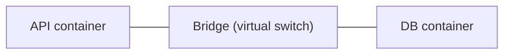
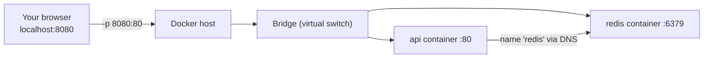
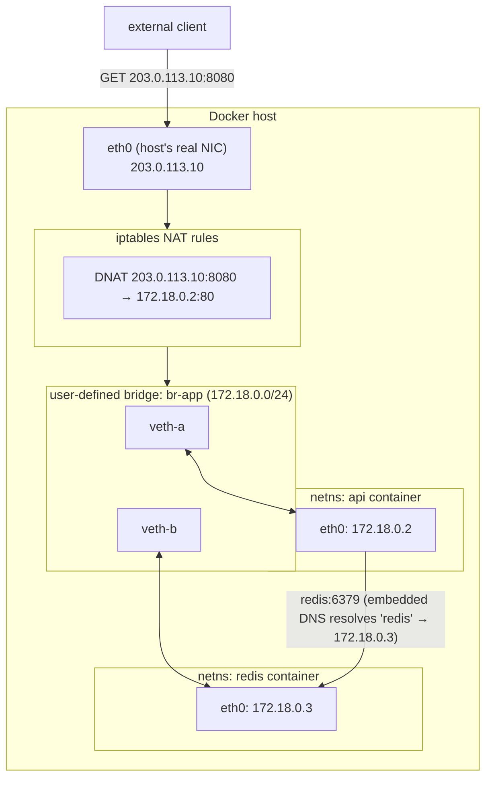
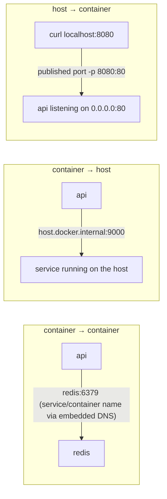
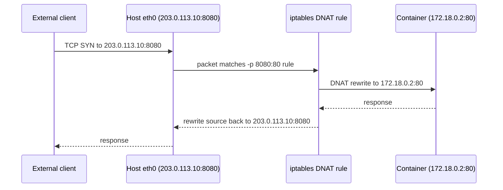
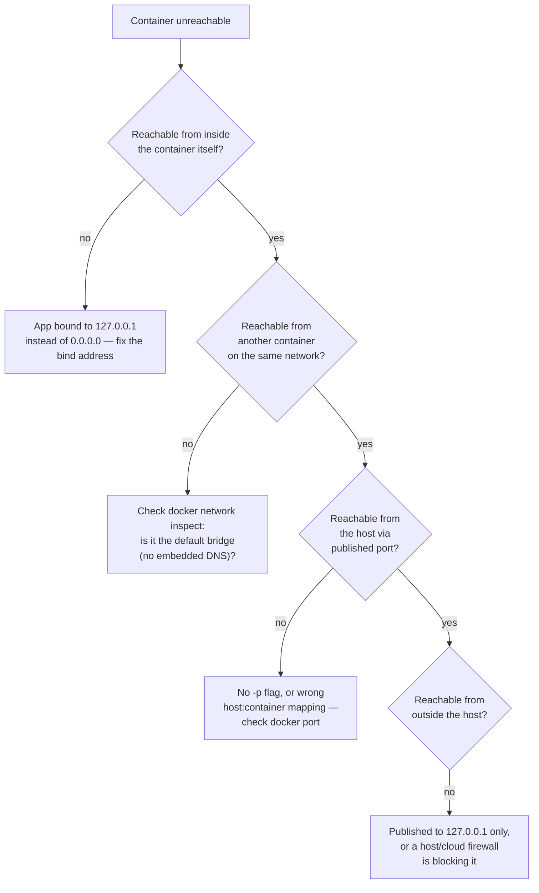

# Docker 05 - Networking and Port Publishing

> [!summary] TL;DR
> Every container gets its own network namespace with its own loopback and interfaces; a virtual ethernet pair connects it to a bridge on the host, and iptables NAT rules connect that bridge to the outside world. "Publishing" a port (`-p host:container`) is a specific NAT rule that forwards a host port to a container port — it is not the same as a container being reachable by default.

> [!abstract] Core idea
> - A container's `localhost` is its own network namespace — it never means "another container," even one on the same host.
> - The default `bridge` network has no name-based DNS; a user-defined network (or anything Compose creates) does, through Docker's embedded DNS server.
> - `-p HOST:CONTAINER` creates a NAT rule from a host port to a container port; `EXPOSE` in the Dockerfile is only documentation.
> - The app inside the container must listen on `0.0.0.0`, not `127.0.0.1`, or no published port — however correctly mapped — will ever reach it.
> - Classic mistake: binding a database's published port to `0.0.0.0:5432` instead of `127.0.0.1:5432`, making it reachable from the whole network, not just the host.

## Start here: the basics 🟢

> [!info] How to read this note (pick your level)
> - 🟢 **New to this?** Read "From zero" below, then sections 1, 2 and 10 (why, mental model and the cheat sheet). Stop there, that is a full first pass.
> - 🟡 **Know the basics?** Add sections 3, 4, 5 and 6 (how it works, a worked example, options and trade-offs).
> - 🔴 **Interview / SDE-3 prep?** Add sections 7, 8 and 9 (production, deep dive and interview questions). Headings are tagged 🟢🟡🔴 so you always know where you are.

**From zero, in 60 seconds** 🟢

Each container gets its own private little network, with its own address. Outsiders can't see it by default.
Docker connects containers on one machine through a virtual switch called a **bridge**. Containers on the same bridge can talk to each other.



To let the outside world reach a container, you **publish a port**: "send anything that hits port 8080 on this machine into the container's port 8080".


A common bug: the app inside listens only on localhost, so the forwarded traffic finds nobody home.

The rest of this note is just these 3 questions:
1. How are containers wired together on one host?
2. Which network type (bridge, host, none) fits which job?
3. How does port publishing work, and how do you debug "can't connect"?


**The problem in one story**

You run your Go API in one container and Redis in another, on your laptop.
The API tries `localhost:6379` and gets "connection refused".
You open `localhost:8080` in your browser and nothing answers either.
Both programs are running. They just cannot see each other yet.
This note explains how containers get connected, and why it is "off" by default.

**Words you need first**

| Word | Plain meaning | Tiny example |
| --- | --- | --- |
| IP address | A number that identifies a machine on a network | `172.18.0.2` |
| Port | A numbered door on a machine; each program listens on one | Postgres listens on `5432` |
| `localhost` / loopback | "This same machine", address `127.0.0.1` | `curl localhost:8080` |
| `0.0.0.0` | "Listen on every network interface I have" | `:8080` in Go means `0.0.0.0:8080` |
| DNS | The phone book that turns names into IP addresses | `redis` → `172.18.0.3` |
| Network namespace | A Linux feature giving a process its own private network view | Each container has one |
| NAT | Rewriting addresses on packets as they pass through a router | Host `:8080` → container `:80` |
| Bridge | A virtual network switch inside the host | `docker0` |

**Picture it**



**Analogy**

Each container is an apartment with its own door; the bridge is the hallway; `-p` is the doorman told "send visitors for 8080 to apartment api".
Where it breaks: real apartments share one street address per building, but here each container also has its own private IP that neighbours can dial directly.

**How the rest of this note builds up**

- First, why isolation is the default and the mental model of host, bridge and containers.
- Then the network drivers and the three directions of traffic: container→container, container→host, host→container.
- Then port publishing (`-p`), its bind-address trap, and a debugging checklist plus worked example.
- Finally the SDE-3 deep dive: namespaces, veth pairs, iptables NAT and Docker's embedded DNS.

> [!tip] Remember
> Containers are isolated by default: use a user-defined network for names, `-p` for the host, and listen on `0.0.0.0`.

## 1. Why it exists 🟢

A container that cannot talk to anything is useless, and a container that can talk to everything is a security incident. Docker's networking model exists to give every container its own isolated network view by default, while still making deliberate connections — container-to-container, container-to-host, host-to-container — explicit and auditable.

The old note on this topic (`Docker Network`) demonstrated the course's "create your own network" exercise but never explained *why* the exercise exists.

The reason: the default `bridge` network Docker creates automatically has no embedded DNS, so `ping redis` fails on it even when a `redis` container is running right next to your app. Switching to a user-defined bridge network (which Compose does for you automatically) is what turns on name resolution.

Without understanding that one fact, the "just use Compose, it works" advice looks like magic.

## 2. Mental model 🟢

Picture the Docker host as an apartment building:

- Each container is its own apartment with its own front door (network namespace) and its own internal wiring.
- A short cable (a veth pair) runs from each apartment to a shared hallway junction box (the bridge, usually named `docker0` or a per-network bridge like `br-xxxx`).
- The building's main electrical panel (iptables NAT rules) decides which signals from the street (the host's external interface) get forwarded into which apartment.
- That forwarding only happens for the specific rules you've installed — that's what `-p` does.

## 3. How it works 🟡

### The host, the bridge, and two containers

**In plain words:** each container has a virtual cable plugged into the bridge. The bridge connects them to each other and, through the host, to the internet.



Each container's `eth0` lives inside its own network namespace and is one end of a virtual ethernet (veth) pair; the other end is attached to the bridge.

The bridge acts as a virtual switch connecting every container on that network, and the host's iptables rules (in the `DOCKER` and `POSTROUTING` chains) handle both NAT for outbound traffic and port forwarding for published ports.

### Network drivers

**In plain words:** a few network modes: bridge (the normal one), host (no wall at all), none (no network), and overlay (across many machines).

| Driver | What it does | Use when |
| --- | --- | --- |
| `bridge` (default, unnamed) | Containers get private IPs on `docker0`; no embedded DNS | Rarely — only legacy single-container use without Compose |
| `bridge` (user-defined) | Same isolation, plus embedded DNS resolving container names and `--network-alias` | The default choice for one host running several containers that must find each other by name |
| `host` | Container shares the host's network namespace directly; no NAT, no port mapping needed | Maximum network performance, or a tool that needs to see host-level network traffic; loses network isolation entirely |
| `none` | No networking at all | A batch job or CLI tool that must not reach the network |
| `overlay` | A virtual network spanning multiple Docker hosts, built on VXLAN | Docker Swarm multi-host clusters (Kubernetes uses its own CNI model instead; see [[IP Addressing, Subnets, NAT and VPC Basics]] for the underlying concepts) |
| `macvlan` | Container gets its own MAC address and appears as a physical device on the LAN | Legacy apps that expect to own a real network identity (e.g. must be directly reachable by IP from other LAN devices, not just the host) |

### Container-to-container, container-to-host, host-to-container

**In plain words:** containers on the same user-made network find each other by name. Reaching the host or being reached from it needs special names or published ports.



- **Container → container** on the same user-defined network: use the other container's name (or Compose service name) as the hostname. Docker's embedded DNS server, reachable at `127.0.0.11` inside every container on a user-defined network, resolves it to that container's current IP — which matters because the IP can change on restart; the name doesn't.
- **Container → host**: `localhost` inside a container is the container itself, never the host. To reach a process running directly on the host (not in a container), use the special DNS name `host.docker.internal`, which Docker Desktop provides out of the box and which can be added on Linux with `--add-host=host.docker.internal:host-gateway`.
- **Host → container**: requires a published port. Without `-p`, the container is only reachable from other containers on the same Docker network, not from the host's own `localhost` or from outside.

### Publishing a port

**In plain words:** -p 8080:80 means "host port 8080 goes to container port 80". Docker adds a forwarding rule on the host to do it.



`-p 8080:80` on `docker run` (or `ports: ["8080:80"]` in Compose) installs exactly this DNAT rule: traffic hitting the host on port 8080 gets rewritten to the container's internal IP on port 80. Three forms matter:

| Form | Meaning |
| --- | --- |
| `-p 8080:80` | Binds to all host interfaces (`0.0.0.0:8080`) → container port 80 |
| `-p 127.0.0.1:8080:80` | Binds only to the host's loopback interface — unreachable from the network, only from the host itself |
| `-p 80` or `-P` (all `EXPOSE`d ports) | Docker picks a random free host port (`docker port <container>` to find out which) |

`EXPOSE 80` in a Dockerfile does **none** of this on its own — it only documents intent and changes what `-P` publishes.

A port not published at all is still reachable by *other containers on the same network* at its container-internal port, which is sufient for most inter-service traffic and is one reason not to publish a database's port to the host at all in production.

> [!warning] Interview trap
> `-p 8080:80` with no explicit bind address publishes to **every** interface on the host, not just loopback.
>
> On a cloud VM with a public IP and no firewall, that line alone makes the container reachable from the internet, bypassing any `ufw`/`iptables` rules you think are blocking that port — Docker inserts its own rules ahead of most host firewall configurations.
>
> Bind explicitly to `127.0.0.1:` for anything that should stay local, and put a real firewall or security group in front of anything that shouldn't.

### Debugging checklist

**In plain words:** walk the path step by step: is the app running, is it listening on 0.0.0.0, is the port published, is anything else using the port.



## 4. Worked example 🟡

Trace a real debugging session: a Go API container cannot be reached from the host on port 8080.

```bash
# 1. Is the container even running, and what does Docker think it published?
docker ps --filter name=api
# CONTAINER ID   IMAGE   PORTS                    NAMES
# 7e2a1c9f0b11   api     0.0.0.0:8080->8080/tcp   api

# 2. Published mapping looks right. Check what the app is actually bound to,
#    from inside the container's own network namespace.
docker exec api sh -c "cat /proc/net/tcp | awk '{print \$2}'"
# 0100007F:1F90   <- hex: 7F000001 = 127.0.0.1, 1F90 = 8080

# 3. Found it: the app bound to 127.0.0.1:8080 inside the container, which
#    only accepts connections from within that same network namespace.
#    The published port forwards to the container's external-facing
#    address, which can never reach a loopback-only listener.
```

The fix is one line in the Go service, not in Docker at all:

```go
// Wrong: only reachable from inside the container's own namespace.
http.ListenAndServe("127.0.0.1:8080", mux)

// Right: reachable from the bridge, and therefore from the published port.
http.ListenAndServe("0.0.0.0:8080", mux)
// or, equivalently, an empty host:
http.ListenAndServe(":8080", mux)
```

**A debugging network inspect, representative output (Docker Engine 27, 2026-11-07):**

```json
{
  "Name": "br-app",
  "Driver": "bridge",
  "IPAM": { "Config": [{ "Subnet": "172.18.0.0/24", "Gateway": "172.18.0.1" }] },
  "Containers": {
    "7e2a1c9f0b11": { "Name": "api", "IPv4Address": "172.18.0.2/24" },
    "9b40d8e2aa77": { "Name": "redis", "IPv4Address": "172.18.0.3/24" }
  }
}
```

`docker network inspect br-app` confirms both containers share a subnet; `docker exec api nslookup redis` resolving to `172.18.0.3` confirms the embedded DNS is working.

`netshoot` (`docker run --rm -it --network container:api nicolaka/netshoot`) attaches a full network-debugging toolbox (`tcpdump`, `curl`, `dig`) into the same network namespace as a running container, which is the standard way to debug a distroless container that has no shell of its own.

## 5. Variants and comparison 🟡

| Approach | How it works | Use when | Cost |
| --- | --- | --- | --- |
| Default `bridge` | Automatic, unnamed network every container joins unless told otherwise | Never deliberately — kept for backward compatibility | No name-based DNS; must use `--link` (deprecated) or IPs |
| User-defined `bridge` | `docker network create app-net`, then `--network app-net` on each container | Default choice for a single host running several related containers | One extra setup command; trivial |
| Compose default network | Compose creates a user-defined bridge per project automatically | Local development with `docker compose up` | None — this is the easy path |
| Compose with split networks | Declare two or more networks under `networks:` and attach each service to only the ones it needs (e.g. `frontend` for the API and reverse proxy, `backend` for the API and database) | Isolating a database so only the API can reach it, even though both sit in the same Compose file | One more block of YAML; a service left off a network genuinely cannot reach anything on it, which is the point |
| `host` | No isolation; container shares the host's interfaces directly | A network tool that must observe host-level traffic, or squeezing out the last bit of latency | No port mapping, no isolation, cannot run two containers on the same port |
| `overlay` (Swarm) | VXLAN-based virtual network across multiple hosts | Docker Swarm clusters | More setup; largely superseded by Kubernetes CNI networking for new multi-host deployments |

## 6. Trade-offs and when not to use 🟡

- Bridge networking adds a few microseconds of NAT/veth overhead per packet versus `host` networking — irrelevant for almost all applications, worth measuring before trading away isolation for it.
- Publishing a port is an all-or-nothing decision per `-p` line; fine-grained access control (allow service A, deny service B) needs a firewall, security group, or service mesh in front, not Docker networking alone.
- `macvlan` makes a container a first-class citizen on the physical LAN, which also means it bypasses the host's own firewall rules for that container — a real security trade-off, not just a convenience.
- Container-to-container names only resolve on networks with embedded DNS (user-defined or Compose-created); mixing in the default `bridge` network silently breaks name resolution with no obvious error beyond "connection refused" or "no such host."

## 7. In production 🔴

- **Real systems:** Compose and Docker Swarm both default to user-defined bridge/overlay networks precisely so service discovery by name works out of the box; Kubernetes solves the same container-to-container reachability problem with its own CNI-based pod network model instead of Docker's bridge driver — see [[IP Addressing, Subnets, NAT and VPC Basics]] for the shared concepts (subnets, NAT, routing) that both build on.
- **Failure modes → fixes:**
  - "connection refused" to a published port → app is bound to `127.0.0.1` instead of `0.0.0.0` inside the container.
  - "no such host" resolving a container name → the containers are on the default `bridge` network, not a user-defined one; `docker network inspect bridge` to confirm, then recreate on a user-defined network.
  - Database reachable from the whole internet → `-p 5432:5432` published without a bind address on a host with a public IP and no firewall; bind to `127.0.0.1:5432:5432` or don't publish the port at all, let only other containers on the same network reach it.
  - Port already in use on the host → another process or container already bound that host port; `-P` or a different explicit host port sidesteps it.
- **What to monitor:** which ports are actually published and to which interface (`docker ps`, periodically diffed against an intended list), connection counts per container (a sudden spike on a DB's published port can mean it's exposed more broadly than intended), and DNS resolution failures logged by the app (an early signal of a container having landed on the wrong network).

## 8. Deep dive 🔴

- **Network namespaces and veth pairs.** A Linux network namespace gives a process (here, a container) its own loopback interface, routing table, and set of network interfaces, completely separate from the host's. A veth pair is two virtual interfaces that always come in twos and are wired together like a virtual patch cable; Docker creates one, puts one end inside the container's namespace (renamed `eth0` from the container's point of view) and attaches the other end to the bridge in the host's root namespace.
- **The bridge itself.** `docker0` (or a per-network `br-xxxx`) is a Linux kernel virtual switch (implemented via the kernel's bridge module). It forwards Ethernet frames between the veth ends attached to it exactly like a physical switch forwards between its physical ports — which is why two containers on the same bridge can reach each other's container-internal IPs directly, no NAT required for that hop.
- **NAT via iptables.** Outbound traffic from a container (to the internet) gets source-NATed: the container's private IP is rewritten to the host's IP so return traffic can route back. Published ports use destination NAT (DNAT): incoming traffic on the host's port gets its destination rewritten to the container's internal IP and port. Both are ordinary Linux `iptables`/`nftables` rules that Docker manages in its own chains (`DOCKER`, `DOCKER-USER` for your own rules that should survive Docker restarts).
- **Embedded DNS internals.** Every container on a user-defined network gets `/etc/resolv.conf` pointed at `127.0.0.11`, Docker's embedded DNS server running inside the container's own namespace. It answers for container names and any `--network-alias`, forwards everything else to the host's configured upstream resolvers, and updates its records live as containers join, leave, or get new IPs on that network — which is exactly what makes `redis` a stable hostname across container restarts even though the underlying IP is not.
- **Why `host` mode has no port mapping.** With `--network host`, the container doesn't get its own network namespace at all — it uses the host's directly, so "container port 8080" and "host port 8080" are the same port; `-p` becomes meaningless and Docker ignores it, but it also means two containers in `host` mode can't both bind the same port, just like two processes on bare metal couldn't.

## 9. Interview questions 🔴

> [!question]- Why can't two containers on the default `bridge` network reach each other by name?
> The default, unnamed `bridge` network predates Docker's embedded DNS feature and never got it added for backward-compatibility reasons. User-defined bridge networks (and anything Compose creates) do have it. Always create or let Compose create a user-defined network.

> [!question]- A container's Dockerfile has `EXPOSE 8080` and you ran it without `-p`. Can you reach it from the host?
> No. `EXPOSE` is documentation, not a port mapping. Without `-p` (or `-P` to auto-publish every `EXPOSE`d port), the host cannot reach it at all, though other containers on the same Docker network still can, at the container's internal port.

> [!question]- What's wrong with `http.ListenAndServe("localhost:8080", ...)` inside a container that publishes `-p 8080:8080`?
> `localhost` inside the container resolves to the container's own loopback, reachable only from within that same network namespace. Docker's published-port traffic arrives at the container's external bridge-facing address, not its loopback, so it never reaches a `localhost`-bound listener. Bind to `0.0.0.0` (or just `:8080`) instead.

> [!question]- `-p 5432:5432` with no bind address on a cloud VM — what's the actual exposure?
> It publishes to every interface on the host (`0.0.0.0`), which on a VM with a public IP means the database is reachable from the internet, not just from the host or its local network — and Docker's own iptables rules for this often take effect ahead of a host firewall you might assume is blocking it. Bind explicitly to `127.0.0.1:` or don't publish the port at all.

> [!question]- When would you choose `--network host` over the default bridge?
> When you need raw network performance with zero NAT overhead, or a tool that must observe the host's actual network traffic (packet capture, a network scanner). The cost is giving up all network isolation and the ability to run two containers on the same port.

> [!question]- How does `host.docker.internal` differ from a container's own name resolution?
> Container names resolve through Docker's embedded DNS server and only work between containers on the same user-defined network. `host.docker.internal` is a special DNS entry (built in on Docker Desktop, added manually with `--add-host` on Linux) that lets a container reach a process running directly on the host, outside any container.

## 10. Cheat sheet 🟢

- `localhost` inside a container always means that container, never the host or another container.
- User-defined bridge (or Compose's default network) gives embedded DNS at `127.0.0.11`; the plain default `bridge` does not.
- `-p HOST:CONTAINER` installs an iptables DNAT rule; `EXPOSE` in the Dockerfile is metadata only.
- The app must listen on `0.0.0.0` inside the container, or no published port can ever reach it.
- `-p 8080:80` with no bind address publishes to every host interface, not just loopback — use `-p 127.0.0.1:8080:80` for anything that should stay local.
- `docker network inspect <net>` shows which containers share a subnet; `nslookup`/`netshoot` debug name resolution from inside.
- `--network host` removes NAT and isolation entirely and makes `-p` a no-op.

## Links

- **Before this:** [[Docker 01 - Why Containers]], [[Docker 02 - Images, Layers and Containers]]
- **Next:** [[Docker 06 - Volumes and Bind Mounts]], [[Docker 07 - Docker Compose for Local Development]]
- **Compare with:** [[IP Addressing, Subnets, NAT and VPC Basics]] (the general networking concepts Docker's model builds on), [[DNS - Resolution, Records and Caching]] (how name resolution works in general, versus Docker's embedded DNS specifically), [[Forward and Reverse Proxies - L4 vs L7]] (routing traffic into containers from outside the host)

### Watch on YouTube

- [Free Docker Fundamentals Course - Docker networking - modes and port exposure](https://www.youtube.com/watch?v=zJD7QYQtiKc) · LearnCantrill · 5 min · 38,517 views
- [Docker port mapping in hindi / exposing and publishing port / docker networking deep dive - part 4](https://www.youtube.com/watch?v=oiUztkraZao) · PK Nara / RPN Services · 6 min · 835 views
