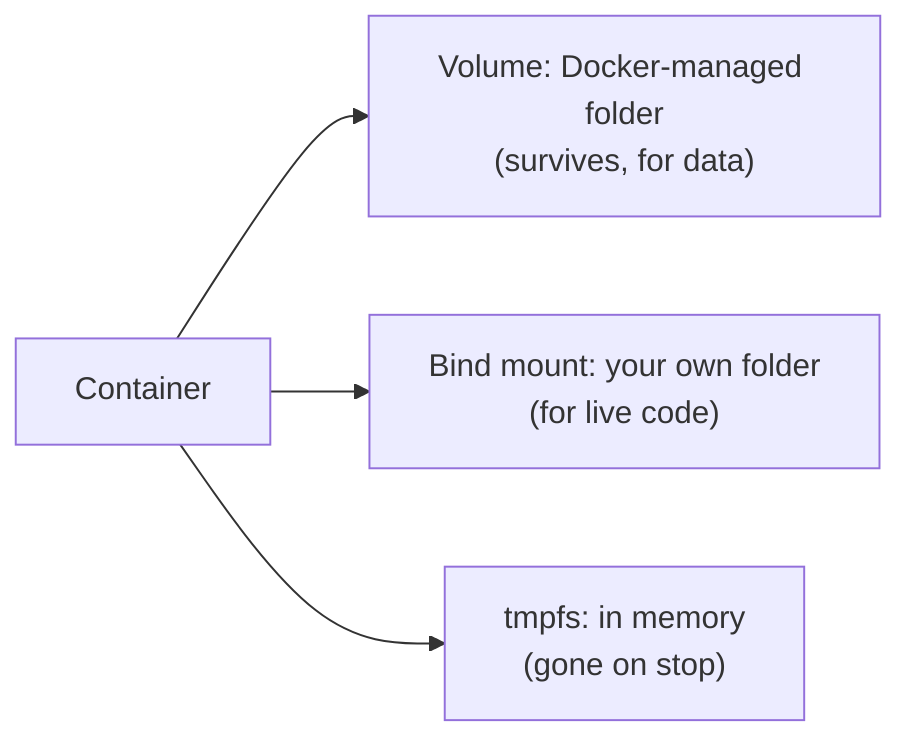
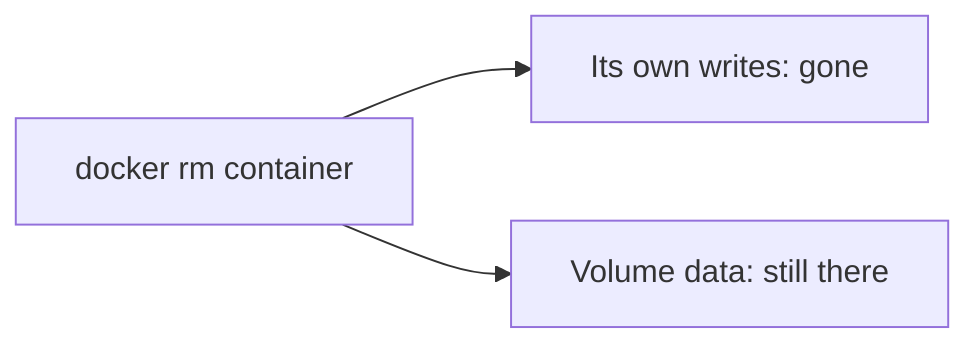
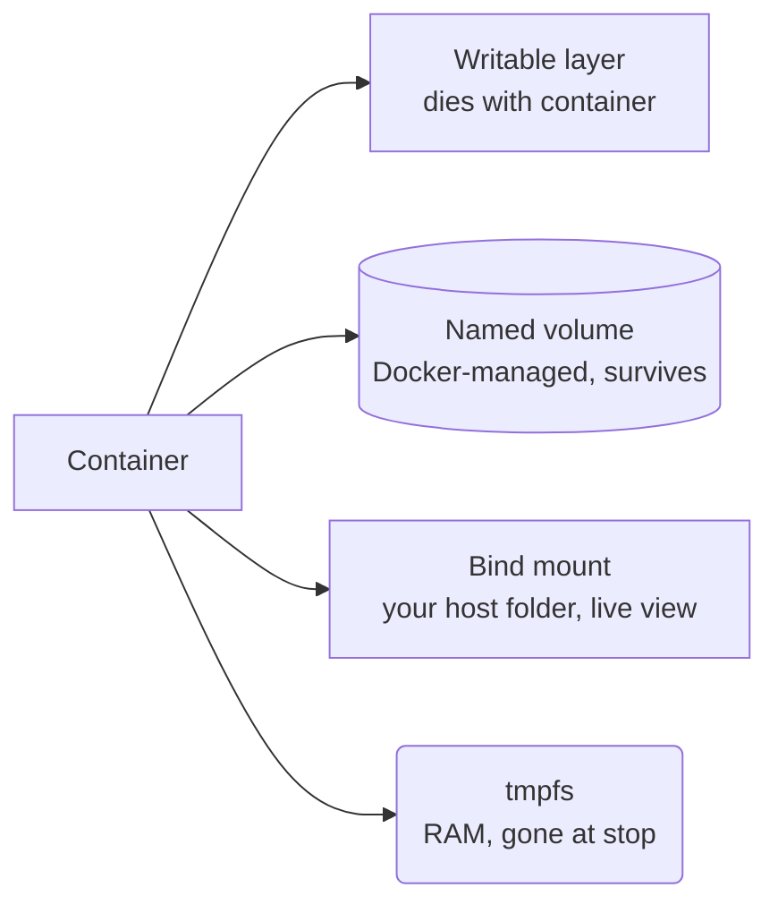
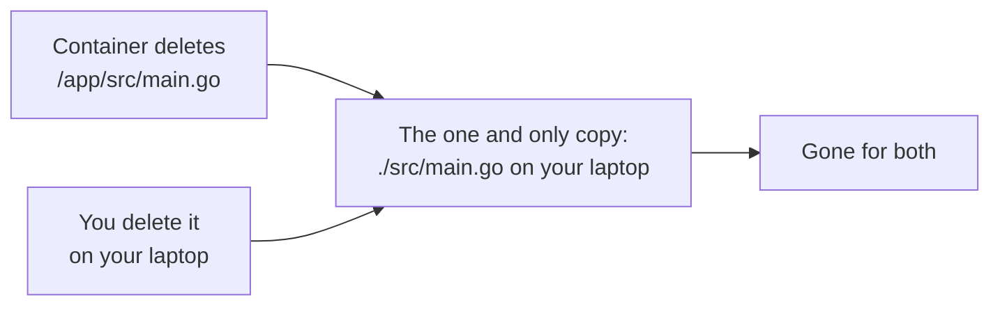
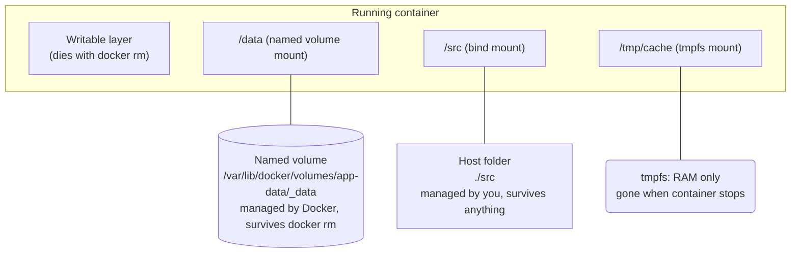
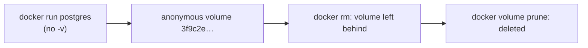
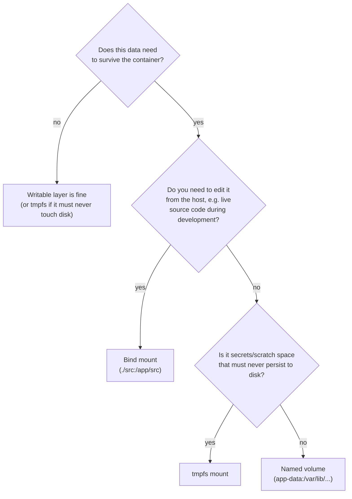

# Docker 06 - Volumes and Bind Mounts

> [!summary] TL;DR
> A container's writable layer dies with the container. Volumes, bind mounts, and tmpfs are three different ways to give a container storage that survives, is shared with the host, or never touches a disk at all — and picking the wrong one for the job is how people lose a database overnight.

> [!abstract] Core idea
> - The container's own writable layer is ephemeral: `docker rm` deletes it, and with it any data written only there.
> - A **named volume** is storage Docker manages (default: `/var/lib/docker/volumes/...`), independent of any one container's lifecycle.
> - A **bind mount** is a live, two-way window into an existing host folder — not a backup, and not Docker-managed.
> - **tmpfs** is memory-backed, never touches disk, and disappears the moment the container stops.
> - Classic mistake: believing a bind mount is a backup. Deleting a file inside the container deletes it on the host too, in both directions, in real time.

## Start here: the basics 🟢

> [!info] How to read this note (pick your level)
> - 🟢 **New to this?** Read "From zero" below, then sections 1, 2 and 10 (why, mental model and the cheat sheet). Stop there, that is a full first pass.
> - 🟡 **Know the basics?** Add sections 3, 4, 5 and 6 (how it works, a worked example, options and trade-offs).
> - 🔴 **Interview / SDE-3 prep?** Add sections 7, 8 and 9 (production, deep dive and interview questions). Headings are tagged 🟢🟡🔴 so you always know where you are.

> [!note] Before this note
> - [[Docker 01 - Why Containers]]: a container is meant to be thrown away and replaced from the same image at any time.
> - [[Docker 02 - Images, Layers and Containers]]: a container is the image's read-only layers plus one thin writable layer, and `docker rm` deletes that writable layer.

**From zero, in 60 seconds** 🟢

Anything a container writes inside itself is lost when the container is deleted.
That is fine for temp files, but terrible for a database.
So Docker gives you three kinds of outside storage.



A **volume** is storage Docker manages for you. Use it for databases.
A **bind mount** links a folder on your computer into the container. Use it for code you edit while developing.



The rest of this note is just these 3 questions:
1. How long does each kind of storage live?
2. How do you write the mount options?
3. Which one should you pick, and how do you back it up?


**The problem in one story**

You run Postgres in a container and add a week of test data.
A newer Postgres image comes out, so you delete the old container and start a new one.
The new database is empty. The tables lived inside the old container and were deleted with it.
This note is about where container data should live so it survives.

**Words you need first**

| Word | Plain meaning | Tiny example |
| --- | --- | --- |
| Filesystem | How files and folders are organised on a disk | `/var/lib/postgresql/data` |
| Mount | Attaching a folder or disk so it appears at a path | Plug a USB drive, it shows at `/mnt/usb` |
| Writable layer | The container's own scratch storage on top of the image | Files written with no mount land here |
| Ephemeral | Temporary; deleted when its owner goes away | Writable layer dies on `docker rm` |
| RAM | Fast memory that is wiped when power or the process stops | tmpfs stores files in RAM |
| UID / GID | The numeric user and group IDs Linux uses for file ownership | `1000:1000` |
| Backup | A separate, second copy of data | A `.tar.gz` of the data folder |
| Named volume | Storage Docker creates and looks after, found by a name | `pg-data` |
| Bind mount | A folder on your own computer shown live inside the container | `./src` → `/app/src` |
| tmpfs | Storage that lives only in memory | `/tmp/cache` |
| Anonymous volume | A volume Docker made for you with a random name | `3f9c2e…` in `docker volume ls` |
| Hot reload | The app restarts by itself when you save a code file | Save `main.go`, the server reloads |

**Picture it**



**Analogy**

The container is a hotel room: anything left in the room is cleared at checkout (writable layer); a named volume is a locker the hotel keeps for you; a bind mount is a door into your own house; tmpfs is a note on a whiteboard.
Where it breaks: a real door into your house does not let the guest delete your furniture remotely and instantly, but a bind mount does exactly that.

**How the rest of this note builds up**

- First, why the writable layer is disposable and the mental model of the four storage kinds.
- Then `-v` vs `--mount`, anonymous volumes, and a decision tree for picking one.
- Then worked examples: Compose mounts, `down` vs `down -v`, backup/restore, UID mismatches.
- Finally the SDE-3 deep dive on kernel bind mounts, volume drivers and user-namespace remapping.

> [!tip] Remember
> Data you care about goes on a named volume; a bind mount is a live window, never a backup.

## 1. Why it exists 🟢

Every container starts from its image's read-only layers plus one new, empty writable layer (see [[Docker 02 - Images, Layers and Containers]]). Anything the running process writes — log files, uploaded files, a database's data directory — lands in that writable layer.

`docker rm` deletes the container and that writable layer together, intentionally: containers are meant to be disposable and replaceable from the same image at any time.

That is exactly backwards for stateful data. A Postgres container that stores its actual table files only in its writable layer loses the entire database the moment someone runs `docker rm` to replace it with a newer image — which is routine during a deploy.

Docker's storage options exist to put data *outside* the container's own lifecycle, so the container can be destroyed and recreated freely while the data survives.

The old note on this topic (`DOCKER Volums`) got the mental model backwards in exactly the way that causes real incidents: it described a bind mount as "a backup if the docker is deleted" — but a bind mount is a live view of a host folder, not a copy.

Deleting a file from inside the container deletes it from the host folder too, instantly, in both directions. There is no snapshot, no second copy, and no protection against `rm -rf` run inside the container.



### Real-life example: the vanishing test orders 🟢

Imagine you are testing the order flow of a food-delivery app like Zomato on your laptop.
You spent an afternoon filling a Postgres container with 500 test restaurants and orders.
You upgrade to a newer Postgres image by removing the old container and starting a new one.
If the data sat in the container's writable layer, all 500 rows are gone. If it sat on a named volume, the new container picks it up as if nothing happened.
Picking the right storage is what decides which of those two afternoons you have.

## 2. Mental model 🟢

- The container's **writable layer** is a sheet of paper taped to a whiteboard: erase the whiteboard (`docker rm`) and the paper goes with it.
- A **named volume** is a filing cabinet in a separate room that Docker manages — the container has a key to one specific drawer, and that drawer exists independently of any particular container holding the key.
- A **bind mount** is not a cabinet at all; it's a window cut directly into a specific room of the host's own filesystem — whatever is on the other side of that window is what you see and change, with no Docker management in between.
- **tmpfs** is a whiteboard that was never paper in the first place: it's RAM, and it's gone the instant the container stops, by design.

## Common beginner mistakes 🟢

- **Running a database with no volume** → its data lives in the writable layer and dies on `docker rm` → mount a named volume at the data folder.
- **Treating a bind mount as a backup** → it is the same single copy, so a delete inside deletes on your laptop too → take real backups (a tar file of the volume, or a database export).
- **Typing `docker compose down -v` out of habit** → `-v` deletes every named volume, including your database → use plain `down`; keep `-v` for a deliberate reset.
- **Mistyping a volume name with a slash in `-v`** → Docker treats it as a folder path and quietly creates an empty folder → use `--mount type=volume,...` so mistakes fail loudly.
- **Ignoring "permission denied" on a bind mount** → the user ID inside the container does not own the folder → `chown` the folder or run with `--user $(id -u):$(id -g)`.

## 3. How it works 🟡

> 🟢 → 🟡 **You now know** that a container's own files die with it, and that volumes, bind mounts and tmpfs keep data outside it. **Next we open the box**: how long each one lives, how to write the mount flags without surprises, the hidden volumes some images create, and a simple way to choose.

### Three kinds of storage, three different lifetimes

**In plain words:** volume lives until you delete it, bind mount is your own folder, tmpfs vanishes when the container stops.

**Step by step (one container, four places to write):**
1. The app writes `/var/log/app.log` with no mount there. It lands in the writable layer and dies on `docker rm`.
2. Postgres writes to `/data`, mounted from the named volume `app-data`. It survives `docker rm`; only `docker volume rm` deletes it.
3. You edit `./src/main.go` on your laptop. Because `./src` is bind-mounted at `/src`, the container sees the change at once.
4. The app writes a temp key to `/tmp/cache`, a tmpfs mount. It sits in RAM and disappears as soon as the container stops.



| Mount type | Backed by | Survives `docker rm`? | Managed by |
| --- | --- | --- | --- |
| Writable layer (no mount) | Container's own storage driver (overlay2) | No | Docker, tied to one container |
| Named volume | A Docker-managed directory on the host | Yes | Docker (`docker volume` commands) |
| Bind mount | Any existing host path you choose | Yes (it's just a host folder) | You, directly |
| tmpfs | RAM | No — gone at container stop, not just removal | Neither; never persisted at all |

### `-v` vs `--mount` syntax

**In plain words:** two ways to write the same thing. --mount is longer but clearer and fails loudly on typos.

**Step by step:**
1. `-v app-data:/data`: the left side has no slash, so Docker reads it as a volume name.
2. `-v ./app-data:/data`: the left side looks like a path, so Docker bind-mounts that folder, creating it empty if missing.
3. One stray `./` turned your volume into an empty folder, with no error.
4. `--mount type=volume,source=app-data,target=/data` says the type out loud, so this mix-up cannot happen.

```bash
# Named volume, short syntax: "app-data" is a volume name (no slash in it)
docker run -v app-data:/var/lib/postgresql/data postgres:17

# Bind mount, short syntax: a path (starts with / or ./) means "this exact host folder"
docker run -v "$(pwd)/src:/app/src" myapp

# --mount: longer but explicit and unambiguous about which kind you mean
docker run --mount type=volume,source=app-data,target=/var/lib/postgresql/data postgres:17
docker run --mount type=bind,source="$(pwd)/src",target=/app/src myapp
docker run --mount type=tmpfs,target=/tmp/cache,tmpfs-size=100m myapp
```

`-v` decides volume vs bind mount purely by whether the source looks like a path or a plain name.

That is a common source of surprise when a typo turns an intended volume name into an unintended relative-path bind mount to a folder that doesn't exist yet (Docker creates it, silently, as an empty directory).

`--mount` requires the `type=` to be explicit, which is why Docker's own docs recommend it for anything beyond a quick throwaway `docker run`.

### Anonymous volumes and image-declared `VOLUME`

**In plain words:** if an image declares a VOLUME, Docker quietly makes a random unnamed volume each time. These pile up and are easy to lose.

**Step by step:**
1. The `postgres` image's Dockerfile says `VOLUME /var/lib/postgresql/data`.
2. You run `docker run postgres:17` with no `-v`. Docker still creates a volume named something like `3f9c2e…` and mounts it there.
3. You `docker rm` the container. The volume stays, but nothing points to it now.
4. Later, `docker volume prune` deletes every unattached volume, including that one, and the data is gone.



A Dockerfile can declare `VOLUME /var/lib/postgresql/data`, which causes every container from that image to get an **anonymous volume** mounted there automatically, even with no `-v` flag at all.

This is how official images like `postgres` and `mongo` guarantee their data directory is never silently left in the ephemeral writable layer if you forget to mount something yourself.

The cost:

- Anonymous volumes have a random name (visible with `docker volume ls`).
- They are easy to forget about.
- `docker volume prune` deletes any volume not currently attached to a running or stopped container — including an anonymous one from a container you already removed, if you didn't first copy the data out.

### Choosing the right one

**In plain words:** data to keep means volume, code you are editing means bind mount, secrets or scratch that must not hit disk means tmpfs.

**Step by step:**
1. Ask: must this data outlive the container? No → leave it in the writable layer.
2. Yes, and I edit it from my laptop (like source code) → bind mount.
3. Yes for the container's life, but it must never touch disk (like a decrypted secret) → tmpfs.
4. Anything else worth keeping (a database) → named volume.



- **Database data directory** → named volume. Docker manages the location, backup tooling can target it by name, and it isn't accidentally edited by a stray host-side script.
- **Live source code during local development** → bind mount. You want every host-side save to appear in the running container immediately (often combined with a file watcher, a tool that notices saved files, for hot reload).
- **Secrets or scratch space that must never be written to disk** → tmpfs. Useful for things like a decrypted credential a process needs only in memory for its own lifetime.
- **Production stateless services** → neither, usually. Keep the container itself fully stateless and push persistence to a managed database or object store, or, on Kubernetes, a `PersistentVolumeClaim` (a request for durable storage that Kubernetes fulfils for you) backed by cloud block storage (network disks such as AWS EBS or Google Persistent Disk) — a volume on a single Docker host disappears if that host dies.

## 4. Worked example 🟡

### Whiteboard version

```bash
docker volume create pg-data
docker run -d --name db -v pg-data:/var/lib/postgresql/data postgres:17
docker rm -f db                         # container gone, data isn't
docker run -d --name db2 -v pg-data:/var/lib/postgresql/data postgres:17
# db2 sees the same tables db had
```

### A Compose service with the right mount for each need

```yaml
services:
  api:
    build: .
    volumes:
      - ./src:/app/src          # bind mount: live code for hot reload in dev
    ports:
      - "8080:8080"

  db:
    image: postgres:17
    environment:
      POSTGRES_PASSWORD: devpass
    volumes:
      - pg-data:/var/lib/postgresql/data   # named volume: survives container replacement

volumes:
  pg-data:
```

Running `docker compose down` stops and removes the containers and the default network but **leaves `pg-data` in place** — the next `docker compose up` reattaches to the same data.

Running `docker compose down -v` additionally removes every named volume declared in the file, which deletes the database data permanently.

This single flag is the most common cause of "I ran one Compose command and lost my local database," and it is also, deliberately, the fastest way to get a clean slate when that's what you actually want.

### Backing up and restoring a named volume

**In plain words:** start a throwaway container that mounts the volume and zips it into a file. Reverse it to restore.

Because a named volume isn't a host path you can just `cp`, the standard pattern is a disposable container that mounts the volume and writes a tar archive (one file bundling a whole folder) to a bind-mounted host folder:

```bash
# Back up: mount the volume read-only, tar it into a host folder.
docker run --rm \
  -v pg-data:/data:ro \
  -v "$(pwd)/backups:/backup" \
  busybox tar czf /backup/pg-data-2026-11-07.tar.gz -C /data .

# Restore into a fresh, empty volume.
docker volume create pg-data-restored
docker run --rm \
  -v pg-data-restored:/data \
  -v "$(pwd)/backups:/backup" \
  busybox tar xzf /backup/pg-data-2026-11-07.tar.gz -C /data
```

The throwaway `busybox` (a tiny image with basic Unix tools) container never runs the actual database; it only exists long enough to copy bytes, and `--rm` removes it immediately after.

This is the generic mechanism — see [[Replication]] for Postgres-specific backup strategies (`pg_dump`, which exports the database as SQL, and WAL archiving, which saves Postgres's change log continuously) that are usually a better fit for a real production database than tarring the raw data directory.

### Ownership mismatches on bind mounts

**In plain words:** the user ID inside the container may differ from yours outside, so files show up as owned by "someone else".

```bash
$ docker run --rm -v "$(pwd)/data:/data" alpine chown -R 1000:1000 /data
$ ls -ln data
# -rw-r--r-- 1 1000 1000 … seed.json
```

A bind mount preserves the host filesystem's UID/GID exactly as-is; it does not remap them.

If the container process runs as UID 999 (common for official database images) and the host folder is owned by your own user (commonly UID 501 or 1000), the container sees permission-denied errors writing to a folder that looks, from the host's `ls -l`, like it should be writable — because "writable" depends on whose UID is asking.

The fix is either:

1. `chown` (change the owner of) the host folder to match the container's UID ahead of time, or
2. run the container with `--user $(id -u):$(id -g)` so it writes as your own UID in the first place.

## 5. Variants and comparison 🟡

| Option | How it works | Use when | Cost |
| --- | --- | --- | --- |
| Named volume | Docker-managed directory, referenced by name | Database data, anything the app itself owns the lifecycle of | Opaque location by default; needs the backup-via-throwaway-container pattern |
| Bind mount | Direct host path mounted into the container | Local dev source code, config files you edit on the host | UID/permission mismatches; host path must exist and be stable across environments |
| Anonymous volume | Like a named volume, but auto-created with a random name, often from a Dockerfile `VOLUME` | Guaranteeing an image's data directory is never silently ephemeral | Easy to lose track of; `volume prune` can delete one you still needed |
| tmpfs | RAM-backed mount, no disk at all | Secrets, scratch space that must not persist | Gone on container stop, not just removal; limited by available RAM |
| Kubernetes `PersistentVolumeClaim` | A volume abstraction backed by real cloud block storage, decoupled from any one host | Production stateful workloads on Kubernetes | More setup; not a Docker-native concept, see [[Containerizing Go Services]] for where container packaging ends and orchestrator-level storage begins |

## 6. Trade-offs and when not to use 🟡

- Named volumes on a single Docker host are tied to that host's disk; they don't replicate and don't survive the host dying. Production stateful data belongs in a managed database or a cloud-backed persistent volume, not a bare Docker volume on one machine.
- Bind mounts on macOS and Windows go through Docker Desktop's filesystem-sharing layer (gRPC FUSE or VirtioFS, the bridges that pass files between macOS/Windows and Docker's Linux VM), which is measurably slower than native Linux bind mounts — large `node_modules`-style directories with thousands of small files are the worst case; excluding them from the bind mount (installing dependencies inside the image instead) is the usual fix.
- tmpfs size is bounded by available host RAM and counts against the container's memory limit if one is set; a tmpfs mount sized larger than the container's memory limit will hit `OOM` (out of memory) behaviour under load rather than simply filling up disk.
- Keeping containers stateless and pushing all persistence to managed services (RDS-style databases, S3-style object storage) avoids the volume-lifecycle question entirely for anything that must survive a host failure, not just a container restart.

## 7. In production 🔴

> 🟡 → 🔴 **You now know** the lifetime of each storage type, the `-v` vs `--mount` trap, anonymous volumes, backups and UID mismatches. **Next is the advanced part**: how real teams lose data with these tools, what to watch, and what a bind mount and a volume really are at the kernel level.


- **Real systems:** Postgres, MySQL, and MongoDB's official images all declare `VOLUME` for their data directories specifically so a forgotten `-v` flag doesn't silently store the database only in the ephemeral writable layer. Compose-based local development stacks universally use named volumes for databases and bind mounts for live source code.
- **Failure modes → fixes:**
  - `docker compose down -v` run out of habit deletes every named volume in the file → make `down` (without `-v`) the team default, and reserve `-v` for deliberate resets; document it loudly in the project README.
  - Permission-denied writing to a bind-mounted folder → UID mismatch between the host folder's owner and the container's user; `chown` the folder or run the container with `--user`.
  - "My data disappeared after a redeploy" → the container wrote to a path with no volume or bind mount attached at all, so it only ever lived in the writable layer that the redeploy's `docker rm` destroyed.
  - Slow file-watching/hot-reload in a bind-mounted dev container on macOS → filesystem-sharing overhead; exclude large dependency directories from the bind mount, or switch to a Docker Desktop VirtioFS-backed mount (the modern default) if still on the older gRPC FUSE backend.
- **What to monitor:** disk usage under `/var/lib/docker/volumes`, orphaned anonymous volumes (`docker volume ls -f dangling=true`), and — for any volume backing a database — whether backups of it are actually being taken and tested, not just assumed because "it's a volume, it persists."

## 8. Deep dive 🔴

- **Why a bind mount isn't a backup, precisely.** A bind mount is a kernel-level bind mount (the same Linux `mount --bind` mechanism used outside Docker too): the container's view at the mount point *is* the host directory, not a copy synced to it. There is exactly one copy of the data on disk. Deleting a file through the container's view and deleting it through the host's own filesystem browser are the same operation on the same inode (the disk record Linux keeps for one file).
- **Where named volumes actually live.** By default, `/var/lib/docker/volumes/<name>/_data` on the Docker host (Linux; Docker Desktop's case differs because the "host" from the volume's point of view is the Linux VM Docker Desktop runs, not macOS/Windows directly — see [[Docker 01 - Why Containers]] for that VM). A custom volume driver can back a volume with anything else (NFS, a way to share folders over the network; a cloud block-storage API), which is how some orchestration layers extend volumes beyond a single local disk without changing anything from the container's point of view.
- **`compose down` vs `down -v` precisely.** `down` removes containers, networks, and (by default) anonymous volumes created for that run, but explicitly preserves named volumes declared in `volumes:` so a routine redeploy doesn't wipe data. `down -v` additionally removes every named volume the Compose file declares — a deliberate, rarely-wanted operation that should never be a muscle-memory habit alongside `down`.
- **UID mapping and rootless/user-namespace Docker.** With Docker's rootless mode or user namespace remapping enabled (see [[Docker 09 - Container Security and Hardening]]), the UID a process sees *inside* the container is deliberately not the same UID the host sees for the same file — the kernel remaps it. Bind-mount ownership questions get an extra layer of indirection in that mode: what looks like UID 999 inside the container may show up as a much higher, remapped UID when you `ls -l` the bind-mounted host folder directly.

## 9. Interview questions 🔴

> [!question]- Is a bind mount a backup of the data inside the container?
> No. A bind mount is a live, two-way view of one specific host folder — there is exactly one copy of the data. Deleting a file from inside the container deletes it on the host too, instantly. A real backup needs a separate copy, taken deliberately (the throwaway-container-plus-tar pattern, or a database-native backup tool).

> [!question]- You ran `docker rm -f db` to replace a Postgres container with a newer image. Why is the data still there, or why isn't it?
> It depends entirely on whether the data directory was mounted onto a named volume or a bind mount. If it was only ever in the container's own writable layer (no mount at all), `docker rm` deletes it along with the container. If it was on a named volume or bind mount, the data lives independently of that one container and the next container mounting the same volume/path sees it unchanged.

> [!question]- What's the difference between `docker compose down` and `docker compose down -v`?
> `down` removes containers and networks but preserves named volumes, so a redeploy keeps your data. `down -v` additionally deletes every named volume the Compose file declares — it's the command for a deliberate full reset, not routine use.

> [!question]- A container writes to a bind-mounted folder and gets "permission denied" even though the folder looks world-readable from the host. Why?
> Bind mounts preserve the host filesystem's UID/GID exactly; they don't remap ownership. If the container process runs as a UID that doesn't match the host folder's owning UID, writes fail regardless of what `ls -l` seems to say about permissions from the host user's own perspective. Fix by matching UIDs (`chown` the folder, or `--user` on `docker run`).

> [!question]- Why do official database images like `postgres` declare `VOLUME` in their Dockerfile?
> So that even a user who forgets to pass `-v` still gets an anonymous volume for the data directory automatically, rather than silently storing the database only in the ephemeral writable layer that disappears on `docker rm`. The trade-off is that anonymous volumes are easy to lose track of and `docker volume prune` can delete one whose container was already removed.

> [!question]- When would tmpfs be the right choice over a named volume?
> When the data must never touch disk at all — a decrypted secret held only for a process's lifetime, or scratch space where persistence would be a security or correctness problem rather than a convenience. It's also the fastest option since it's pure RAM, but it vanishes the moment the container stops, not just when it's removed.

## 10. Cheat sheet 🟢

- Writable layer: ephemeral, dies with `docker rm`. Named volume: Docker-managed, survives it. Bind mount: your own host folder, live two-way view, not a backup. tmpfs: RAM, gone at container stop.
- `-v name:/path` is a volume if `name` has no slash, a bind mount if it looks like a path; `--mount type=...` is explicit and preferred for anything beyond a quick test.
- Database data → named volume. Live dev source → bind mount. Secrets/scratch → tmpfs.
- Official DB images declare `VOLUME` so forgetting `-v` still gets an anonymous volume, not silent data loss.
- Back up a named volume with a throwaway container mounting it read-only plus a bind-mounted host folder for the tar output.
- `docker compose down` keeps named volumes; `down -v` deletes them — never make `-v` a habit.
- Bind-mount ownership mismatches (UID on host ≠ UID in container) cause permission errors that `ls -l` on the host doesn't explain by itself.
- Production stateful data belongs on managed storage or an orchestrator's persistent volumes, not a bare Docker volume on one host.

## Self-check 🟢🟡

🟢 Easy

> [!question]- Where should a Postgres container keep its data?
> On a named volume, so it survives `docker rm` and image upgrades.

> [!question]- Is a bind mount a backup?
> No. It is the same single copy of the files; deleting on one side deletes on both.

> [!question]- When does tmpfs data disappear?
> As soon as the container stops; it only ever lived in RAM.

🟡 Medium

> [!question]- What is the difference between `docker compose down` and `docker compose down -v`?
> `down` keeps named volumes; `down -v` deletes them, wiping the database.

> [!question]- `-v ./pg-data:/var/lib/postgresql/data` starts with an empty database. Why?
> The `./` made it a bind mount to a new empty folder instead of the named volume `pg-data`.

> [!question]- The container gets "permission denied" writing to a bind-mounted folder. What is the usual cause and fix?
> The container's user ID does not own the host folder; `chown` the folder or run with `--user $(id -u):$(id -g)`.

## Links

- **Before this:** [[Docker 01 - Why Containers]], [[Docker 02 - Images, Layers and Containers]]
- **Next:** [[Docker 07 - Docker Compose for Local Development]]
- **Compare with:** [[Containerizing Go Services]] (where container-local storage choices end and a Go service's own data-layer concerns begin), [[Replication]] (database-native backup and replication, a better fit than tarring a raw data directory for anything that matters in production)

### Watch on YouTube

- [Docker Volumes explained in 6 minutes](https://www.youtube.com/watch?v=p2PH_YPCsis) · TechWorld with Nana · 6 min · 351,473 views
