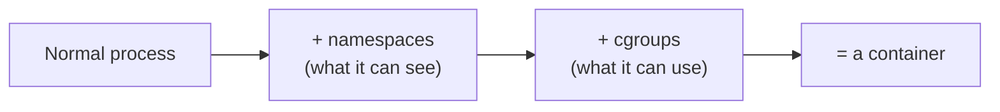
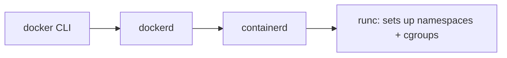
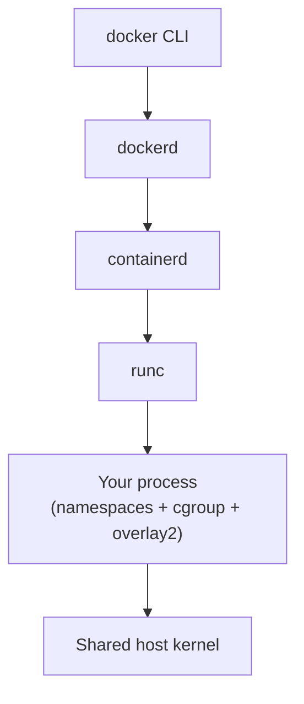
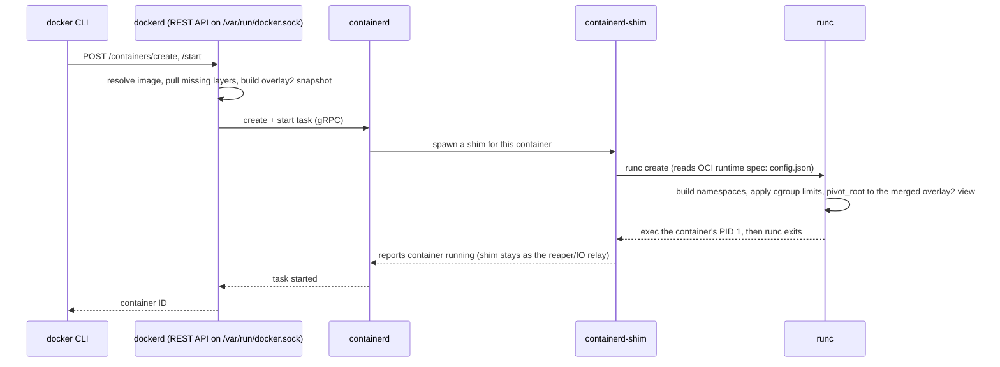
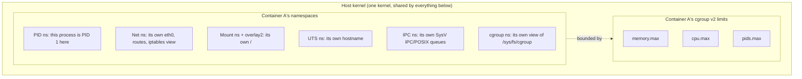
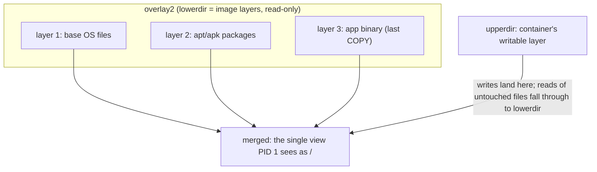

# Docker 08 - How Docker Works Under the Hood

> [!summary] TL;DR
> A container is an ordinary Linux process wrapped in namespaces (so it sees its own filesystem, network, and process tree), bounded by cgroups (so it can't exceed its share of CPU and memory), and run from an overlay filesystem image (so many containers share the same base layers). Docker is the CLI and daemon that drive this through containerd and runc — it does not invent its own isolation mechanism.

> [!abstract] Core idea
> - `docker run` is a chain of handoffs: CLI → dockerd's REST API → containerd → a per-container shim → runc, which does the actual kernel work and then exits.
> - Isolation is **namespaces** (what the process can see) plus **cgroups v2** (what it can use); the kernel itself is shared with the host, not virtualized.
> - The filesystem a container sees is **overlay2**: read-only image layers stacked under one writable layer, merged into a single view.
> - Classic mistake: thinking a container is a lightweight VM. It is one Linux process tree with restricted visibility — there is no second kernel underneath it.

## Start here: the basics 🟢

> [!info] How to read this note (pick your level)
> - 🟢 **New to this?** Read "From zero" below, then sections 1, 2 and 10 (why, mental model and the cheat sheet). Stop there, that is a full first pass.
> - 🟡 **Know the basics?** Add sections 3, 4, 5 and 6 (how it works, a worked example, options and trade-offs).
> - 🔴 **Interview / SDE-3 prep?** Add sections 7, 8 and 9 (production, deep dive and interview questions). Headings are tagged 🟢🟡🔴 so you always know where you are.

**From zero, in 60 seconds** 🟢

A container is just a normal Linux program with blinders on.
Linux has a feature called **namespaces**: it can make a program see only its own files, its own network and its own process list.
Another feature, **cgroups**, puts a cap on how much CPU and memory that program may use.



The files it sees come from the image layers stacked on top of each other.
Docker itself is mostly a friendly front end. It passes the job down to smaller tools that do the real work.



The rest of this note is just these 3 questions:
1. What happens when you type docker run?
2. What do namespaces, cgroups and overlay files each do?
3. Why does a container get OOM-killed, and how do builds cache steps?


**The problem in one story**

You type `docker run nginx` and a "machine" is up in under a second.
A virtual machine would take far longer to boot.
So what is actually running? Not a tiny computer: just a normal Linux program.
The kernel has been told to hide the rest of the system from it and to cap what it can use.

**Words you need first**

| Word | Plain meaning | Tiny example |
| --- | --- | --- |
| Kernel | The core of the OS that manages CPU, memory, files and devices | Linux kernel |
| Process | A running program, with an ID (PID) | `nginx` as PID 4321 |
| Virtual machine (VM) | Emulated hardware running its own full OS and kernel | A VirtualBox guest |
| Daemon | A background program that waits for requests | `dockerd` |
| Namespace | A kernel feature limiting what a process can *see* | Own process list, own network |
| cgroup | A kernel feature limiting what a process can *use* | Max 512 MiB RAM |
| Filesystem layer | One read-only slice of files in an image | "Go binary added" layer |

**Picture it**



**Analogy**

A container is like an office worker in a cubicle with frosted walls and a meter on the power socket: they only see their desk (namespaces) and can only draw so much power (cgroups).
Where it breaks: every cubicle sits in the same building on the same foundations (one kernel), so a crack in the foundation affects everyone, unlike separate buildings (VMs).

**How the rest of this note builds up**

- First, why a process plus kernel tricks beats a VM for start time, and the mental model of one shared kernel.
- Then the `docker run` call chain: CLI → dockerd → containerd → shim → runc.
- Then the three mechanisms: namespaces, cgroups v2 and overlay2, with a Go cgroup-memory parser and BuildKit caching.
- Finally the SDE-3 deep dive: OCI specs, the shim, rootless Docker and `--privileged`.

> [!tip] Remember
> A container is one Linux process with a restricted view (namespaces) and a budget (cgroups) on a shared kernel.

## 1. Why it exists 🟢

A VM needs a hypervisor, a full guest kernel, and minutes to boot because it virtualizes hardware.

A process just needs the kernel to lie to it convincingly: "you are PID 1, you are the only thing on this network, this is the whole filesystem."

Linux has had the primitives for that lie since kernel 2.6.24 introduced cgroups (2008) and user namespaces matured around 3.8 (2013). Docker (2013) packaged those primitives behind one CLI and one image format.

That is the entire reason containers start in milliseconds and VMs take seconds to minutes: a container skips boot, kernel init, and guest-OS overhead entirely, because there is no guest OS.

## 2. Mental model 🟢

Picture one Linux host with one running kernel. Each container is a normal process tree that the kernel has been told to show a restricted view of reality:

- its own root filesystem (via a mount namespace plus overlay2),
- its own `eth0` and routing table (a network namespace),
- its own PID 1 (a PID namespace, so it can't see or signal host processes),
- and a leash on how much CPU, memory, and PIDs it may use (a cgroup).

Nothing here is an emulated CPU or a second kernel — a container escape is dangerous precisely because the kernel really is shared.

## 3. How it works 🟡

### The call chain for `docker run`

**In plain words:** your command passes through four programs. The last one, runc, actually asks Linux to build the walls and then steps aside.



`runc` itself exits once the container's process is running — it is not a supervisor.

`containerd-shim` is the long-lived process per container: it keeps stdin/stdout/stderr open, reports exit status, and crucially lets `dockerd` (or even the whole Docker Engine) restart without killing running containers, since the shim — not dockerd — is the container's actual parent.

### Namespaces: what the process can see

**In plain words:** each namespace hides one kind of thing: other processes, other network cards, other files, other users.



| Namespace | Isolates | Without it |
| --- | --- | --- |
| `pid` | Process IDs and the process tree | The container would see (and could signal) every host process |
| `net` | Network interfaces, routes, iptables | The container would share the host's single `eth0` and port space |
| `mnt` | The mount table (paired with overlay2 for the root filesystem) | The container would see the host's entire filesystem |
| `uts` | Hostname and domain name | `hostname` inside the container would change the host's |
| `ipc` | SysV IPC and POSIX message queues | Containers could signal each other's IPC objects |
| `user` | UID/GID mapping (container root can map to an unprivileged host UID) | Root in the container would be root on the host |
| `cgroup` | The view of `/sys/fs/cgroup` itself | The container would see the host's full cgroup tree |

A container is **all seven namespaces plus a cgroup**, applied to one process before it execs `PID 1`. `docker run --network host` or `--pid host` simply skips creating that one namespace and reuses the host's — which is why those flags weaken isolation.

### cgroups v2: what the process can use

**In plain words:** cgroups are limits. Go over the memory limit and Linux kills the process; go over CPU and it just gets slowed down.

cgroups v2 (the unified hierarchy, default since Docker Engine switched over around 20.10 on cgroup-v2 hosts) exposes controllers as files under `/sys/fs/cgroup/<path>`:

- `memory.max` — a hard ceiling; crossing it invokes the kernel OOM killer *inside that cgroup*, killing the container's process instead of some unrelated host process.
- `memory.current` — live usage, read the same way `docker stats` does.
- `cpu.max` — `"<quota> <period>"` microseconds, e.g. `50000 100000` caps the container at half a CPU core.
- `pids.max` — caps the number of processes/threads, the standard defense against a fork bomb inside one container.

### overlay2: what filesystem the process sees

**In plain words:** Linux lays the read-only image layers on top of each other and puts one writable layer on top. The container sees one normal folder.



Reading a file walks top-down through the stacked layers until one of them has it.

Writing triggers **copy-up**: the file is copied into `upperdir` first, then modified there — the underlying image layer is never touched.

That is what makes one image shareable as the read-only base for many running containers at once, and what "the writable layer is ephemeral" (`docker rm` discards `upperdir`) actually means mechanically.

## 4. Worked example 🟡

### Whiteboard version

The event that actually triggers an OOM kill is a cgroup's `memory.current` crossing its `memory.max` — not host-wide memory pressure. A tiny parser of those two files shows the real check the kernel (and `docker stats`) perform.

```go
pct := float64(current) / float64(max) * 100
if pct >= 100 {
    // kernel invokes the OOM killer inside this cgroup
}
```

### Full example: reading cgroup v2 memory accounting

**In plain words:** Go code that reads the container's own memory limit and usage straight from Linux files.

```go
// Package cgroup parses cgroup v2 memory accounting files, the same
// files a container runtime reads to decide when to OOM-kill a
// container. Real paths: /sys/fs/cgroup/memory.max and
// /sys/fs/cgroup/memory.current inside the container's cgroup.
package cgroup

import (
	"errors"
	"strconv"
	"strings"
)

// ErrNoLimit means the cgroup has no memory ceiling ("max" in the file).
var ErrNoLimit = errors.New("cgroup: no memory limit set")

// ParseMax parses the content of a cgroup v2 memory.max file: either the
// literal string "max" (no limit) or a byte count.
func ParseMax(content string) (int64, error) {
	s := strings.TrimSpace(content)
	if s == "max" {
		return 0, ErrNoLimit
	}
	return strconv.ParseInt(s, 10, 64)
}

// UsagePercent reports how close current usage is to the limit, as the
// kernel's OOM killer would see it. It returns an error if there is no
// limit, since "percent of unlimited" is meaningless.
func UsagePercent(currentContent, maxContent string) (float64, error) {
	cur, err := strconv.ParseInt(strings.TrimSpace(currentContent), 10, 64)
	if err != nil {
		return 0, err
	}
	max, err := ParseMax(maxContent)
	if err != nil {
		return 0, err
	}
	if max == 0 {
		return 0, errors.New("cgroup: zero memory limit")
	}
	return float64(cur) / float64(max) * 100, nil
}
```

Test (`go test -race`, Go 1.24):

```go
package cgroup

import (
	"errors"
	"testing"
)

func TestParseMax(t *testing.T) {
	cases := []struct {
		in      string
		want    int64
		wantErr error
	}{
		{"max\n", 0, ErrNoLimit},
		{"536870912\n", 536870912, nil},
		{"268435456", 268435456, nil},
	}
	for _, c := range cases {
		got, err := ParseMax(c.in)
		if !errors.Is(err, c.wantErr) && (err == nil) != (c.wantErr == nil) {
			t.Fatalf("ParseMax(%q): err = %v, want %v", c.in, err, c.wantErr)
		}
		if err == nil && got != c.want {
			t.Fatalf("ParseMax(%q) = %d, want %d", c.in, got, c.want)
		}
	}
}

func TestUsagePercent(t *testing.T) {
	pct, err := UsagePercent("429496729\n", "536870912\n") // 80% of 512 MiB
	if err != nil {
		t.Fatalf("UsagePercent: %v", err)
	}
	if pct < 79.9 || pct > 80.1 {
		t.Fatalf("UsagePercent = %.2f, want ~80", pct)
	}
}

func TestUsagePercentNoLimit(t *testing.T) {
	if _, err := UsagePercent("100", "max"); !errors.Is(err, ErrNoLimit) {
		t.Fatalf("UsagePercent with no limit: err = %v, want ErrNoLimit", err)
	}
}
```

`docker stats`' MEM% column is exactly `UsagePercent` above, read live from the container's cgroup instead of from a test string.

### BuildKit's cache invalidation, traced

**In plain words:** each build step gets a fingerprint. If the fingerprint matches last time, the step is skipped. Change one input and every later step reruns.

BuildKit (the default `docker build` backend since Docker Engine 23.0, replacing the legacy builder) hashes each instruction together with its inputs.

The **first instruction whose hash changes invalidates every layer below it**, regardless of which lines changed:

```dockerfile
FROM golang:1.24
WORKDIR /src
COPY go.mod go.sum ./   # cache hit unless go.mod/go.sum changed
RUN go mod download     # cache hit unless the line above missed
COPY . .                # near-always misses: any source file changed
RUN go build -o app .   # always reruns once COPY . . misses
```

Reordering `COPY go.mod go.sum ./` before `COPY . .` means an application-code change only invalidates the last two steps, not a 30-second `go mod download` — the mechanism behind the cache-friendly instruction order in [[Docker 04 - Writing a Production Dockerfile for Go]].

## 5. Variants and comparison 🟡

| Option | How it works | Use when | Cost |
| --- | --- | --- | --- |
| Docker Engine (dockerd + containerd + runc) | REST API + gRPC chain described above | General-purpose container workloads, the default on most CI and dev machines | One more daemon (`dockerd`) layered over containerd |
| containerd directly (via `ctr`/`nerdctl`) | Skips dockerd; Kubernetes' default CRI runtime | Kubernetes nodes, where no `docker` CLI UX is needed | Fewer convenience features than the Docker CLI |
| Podman | Talks to runc/crun directly, no long-running daemon; defaults to rootless | Environments wanting no root daemon and a Docker-CLI-compatible tool | Smaller ecosystem for some Compose/BuildKit features |
| gVisor (`runsc`) | User-space kernel intercepts syscalls instead of using the host kernel directly | Running less-trusted workloads with stronger isolation | Syscall interception overhead; some syscalls unsupported |
| Kata Containers | Each container gets a lightweight VM (its own kernel) via a container-shaped API | Strong isolation needed, e.g. multi-tenant untrusted code | VM-level boot/memory overhead, closer to a VM than a container |

## 6. Trade-offs and when not to use 🟡

- The kernel is shared: a kernel vulnerability or a container running as root with the right capability can affect the host. Containers isolate much less than a VM by default (see [[Docker 09 - Container Security and Hardening]]).
- cgroup limits cap resource *use*, not resource *contention side effects* — two containers can still contend for the same disk I/O or network bandwidth unless those are also limited.
- Overlay2's copy-up means the first write to a large untouched file (e.g. modifying one byte of a big binary that lives in a lower layer) copies the whole file into `upperdir` before writing — expensive for large files written in place.
- For workloads needing kernel-level isolation from other tenants, a namespace-only container is the wrong boundary — reach for a microVM (Kata, Firecracker) or gVisor instead.

## 7. In production 🔴

- **Real systems:** Kubernetes nodes run containerd (or CRI-O) directly, with no Docker daemon in the loop at all, even when the images are still built with `docker build`; AWS Fargate runs each task inside its own Firecracker microVM, and Google Cloud Run sandboxes each instance with gVisor — both give a stronger tenant-isolation boundary than bare namespaces, by the two different mechanisms this note's §5 comparison lists (microVM vs user-space kernel); Docker Desktop on macOS/Windows runs a lightweight Linux VM and all containers' namespaces live inside that one VM's kernel, not the host OS's.
- **Failure modes → fixes:**
  - A container OOM-kills intermittently under normal-looking load → compare `memory.current` against `memory.max` over time (`docker stats`, or the cgroup files directly) before assuming an application memory leak.
  - `docker build` keeps re-running `go mod download` on every file change → reorder Dockerfile instructions so `go.mod`/`go.sum` are copied and downloaded before the rest of the source.
  - A container escape or `--privileged` abuse → it works because the kernel is genuinely shared; drop capabilities and avoid `--privileged` and host namespaces entirely (see [[Docker 09 - Container Security and Hardening]]).
  - dockerd restarts kill running containers unexpectedly → check that `containerd` and its shims are actually surviving the restart (`live-restore` should be enabled); if shims are also dying, something is cleaning up PIDs that shouldn't be.
- **What to monitor:** per-container cgroup memory/CPU usage vs limits (`docker stats`, or scrape `/sys/fs/cgroup/.../memory.current` via cAdvisor/Prometheus); OOM-kill events (`dmesg`, kernel `oom_kill` counter); image pull and layer-cache hit rate in CI.

## 8. Deep dive 🔴

- **The OCI specs are what make this interoperable.** The **OCI Image Specification** defines a content-addressed manifest + config + layer tarballs format — any OCI-compliant image (built by `docker build`, `buildah`, or `nerdctl`) can run on any OCI-compliant runtime. The **OCI Runtime Specification** defines `config.json`: the namespaces, cgroup paths, mounts, and the entrypoint a conforming runtime (runc, crun, gVisor's runsc, Kata) must set up. Docker, containerd, Podman and Kubernetes all consume the same two specs, which is why an image built once runs unmodified across all of them.
- **Why the shim exists.** Before containerd's shim architecture, a single long-lived daemon process (`dockerd`) was the direct parent of every container, so restarting or upgrading the daemon killed every running container with it. The shim is the actual parent process (and PID 1's reaper for zombies), so `containerd` and `dockerd` can be upgraded and restarted — with `live-restore` enabled — without touching running workloads.
- **Rootless Docker** runs `dockerd` itself as an unprivileged user, using user namespaces to remap container "root" (UID 0 inside) to an unprivileged UID on the host. It needs `slirp4netns` or similar for networking (since an unprivileged user can't create arbitrary bridges), which costs some network throughput versus the default root-daemon setup.
- **Why `docker run --privileged` is so dangerous:** it disables most of this chapter's protections at once — it grants all Linux capabilities, disables the seccomp and AppArmor profiles, and mounts host devices, effectively handing the container the same reach as a root process on the host.

## 9. Interview questions 🔴

> [!question]- Is a container a lightweight virtual machine?
> No. A VM virtualizes hardware and runs its own kernel under a hypervisor. A container is an ordinary host process restricted by Linux namespaces (what it can see) and cgroups (what it can use), running on the one shared host kernel — there is no second kernel.

> [!question]- Walk through what happens between `docker run` and the container's first line of output.
> The CLI calls dockerd's REST API, which resolves the image (pulling missing layers) and builds an overlay2 snapshot, then hands off to containerd over gRPC. containerd spawns a per-container shim, which calls runc. runc reads the OCI runtime spec, creates the namespaces, applies the cgroup limits, `pivot_root`s into the merged overlay2 filesystem, and execs PID 1 — then runc itself exits, leaving the shim as the long-lived parent.

> [!question]- What does a cgroup actually enforce, and what does a namespace enforce? Give one failure each would cause if missing.
> A cgroup enforces resource ceilings (memory, CPU, PIDs); without `memory.max`, one container's leak can exhaust host RAM and OOM-kill unrelated processes. A namespace enforces visibility (filesystem, network, process tree); without a PID namespace, a container process could see and signal every host process.

> [!question]- Why does `COPY go.mod go.sum ./` before `COPY . .` speed up Docker builds?
> BuildKit invalidates a layer's cache, and every layer below it, from the first instruction whose inputs changed. Copying `go.mod`/`go.sum` first means `go mod download` only reruns when dependencies change, not on every source-code edit — only the later `COPY . .` and `go build` layers miss on an ordinary code change.

> [!question]- What is overlay2's copy-up, and why does it matter for performance?
> Writing to a file that currently lives only in a read-only lower layer first copies that whole file into the container's writable upper layer, then applies the write there. Modifying even one byte of a large file that hasn't been written to yet pays the cost of copying the entire file first.

> [!question]- Why do Kubernetes nodes typically run containerd directly, with no `dockerd`?
> The Kubernetes kubelet talks to a container runtime through the CRI (Container Runtime Interface); containerd implements CRI natively, so dockerd — which adds the Docker-specific REST API, build, and CLI UX nobody on a node needs — is an unnecessary extra hop. Images are still built with `docker build` (or `buildx`/`buildah`) and pushed to a registry that containerd pulls from directly.

## 10. Cheat sheet 🟢

- Chain: CLI → dockerd (REST) → containerd (gRPC) → shim (per container, long-lived) → runc (builds the container, then exits).
- Isolation = namespaces (pid, net, mnt, uts, ipc, user, cgroup) for visibility + cgroups v2 (memory.max, cpu.max, pids.max) for resource limits.
- The kernel is shared, never virtualized — that's why `--privileged` and host namespaces are dangerous.
- overlay2: read-only image layers (lowerdir) + one writable layer (upperdir) merged into the view PID 1 sees; writes trigger copy-up.
- BuildKit invalidates a layer and everything below it from the first changed instruction — order Dockerfiles so rarely-changing steps come first.
- OCI Image Spec (the artifact) and OCI Runtime Spec (`config.json`) are why one image runs unmodified on Docker, containerd, Podman, and Kubernetes.
- Rootless Docker remaps container root to an unprivileged host UID via user namespaces; it costs some network throughput (slirp4netns) for the security gain.
- A container is a process, not a VM — no guest kernel, no boot, which is also why it starts in milliseconds.

## Links

- **Before this:** [[Docker 02 - Images, Layers and Containers]], [[Docker 03 - CLI Essentials]]
- **Next:** [[Docker 09 - Container Security and Hardening]]
- **Compare with:** [[Docker 04 - Writing a Production Dockerfile for Go]] (BuildKit cache ordering in practice), [[Kubernetes Fundamentals]] (containerd as the node runtime)

### Watch on YouTube

- [How Docker Works Under the Hood: A Container Is Just a Process](https://www.youtube.com/watch?v=6_bq2iT3riA) · Beneath the Abstraction · 4 min · 8 views
- [How Docker REALLY Works Under the Hood (Containers Explained)  #docker #devops #programming](https://www.youtube.com/watch?v=DaBxnaCwJ2s) · DevOps Corner · 8 min · 148 views
