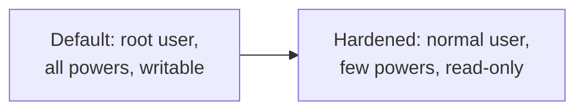
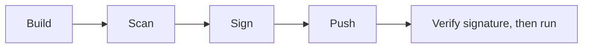
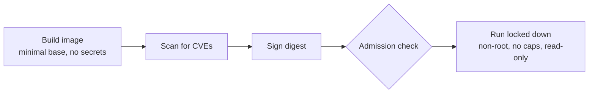
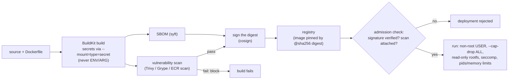
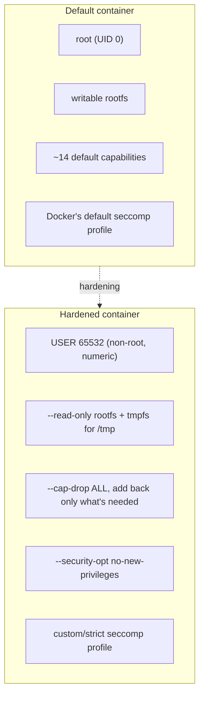
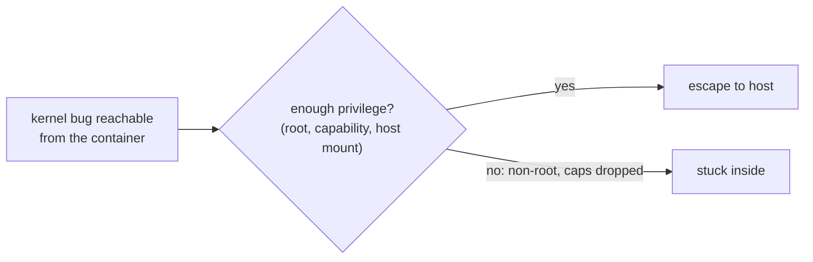

# Docker 09 - Container Security and Hardening

> [!summary] TL;DR
> A container shares its kernel with the host, so its security boundary is only as strong as the Linux permissions you actually take away from it: run as a non-root user, drop capabilities, make the root filesystem read-only, scan and sign the image, and never bake a secret into a layer. None of this is automatic — Docker's defaults are permissive.

> [!abstract] Core idea
> - Shrink what the process can do: non-root `USER`, `--cap-drop ALL`, `no-new-privileges`, a read-only root filesystem, seccomp.
> - Shrink what the image contains: a minimal base (distroless/scratch), pinned by digest, scanned for CVEs, with no secrets in any layer.
> - Prove what you're running: sign images (cosign) and enforce that signature at admission, not just at build time.
> - Classic mistake: believing a non-root `USER` alone makes a container safe. Mounting `/var/run/docker.sock` into *any* container — root or not — hands it root on the host, because the Docker socket itself is an unauthenticated root API.

## Start here: the basics 🟢

> [!info] How to read this note (pick your level)
> - 🟢 **New to this?** Read "From zero" below, then sections 1, 2 and 10 (why, mental model and the cheat sheet). Stop there, that is a full first pass.
> - 🟡 **Know the basics?** Add sections 3, 4, 5 and 6 (how it works, a worked example, options and trade-offs).
> - 🔴 **Interview / SDE-3 prep?** Add sections 7, 8 and 9 (production, deep dive and interview questions). Headings are tagged 🟢🟡🔴 so you always know where you are.

> [!note] Before this note
> - [[Docker 08 - How Docker Works Under the Hood]]: a container is a normal process with namespaces and cgroups, sharing the host's one kernel, so its walls are thinner than a VM's.
> - [[Docker 04 - Writing a Production Dockerfile for Go]]: a multi-stage build ships a static Go binary on a tiny `distroless` base, started with exec-form `ENTRYPOINT`.

**From zero, in 60 seconds** 🟢

A container shares the same Linux core (kernel) with the machine it runs on.
So if an attacker breaks out of a weak container, they may land on the host.
Docker's defaults are loose. You must tighten them yourself.



The main moves are simple: don't run as root, remove powers the app doesn't need, make files read-only, and never bake passwords into the image.
Also scan images for known holes and sign them, so you know what you are running.



The rest of this note is just these 3 questions:
1. How do you keep a bad image out (scan, sign, verify)?
2. How do you make the image itself smaller and safer?
3. Which runtime settings take powers away from the container?


**The problem in one story**

An attacker finds a bug in one library your Go API uses and gets code running inside its container.
What happens next depends on what that container was allowed to do.
If it runs as root with every permission and a writable disk, the attacker can dig in and maybe reach the host.
If it runs as a limited user with nothing extra, the attacker is stuck in a small, locked room.

**Words you need first**

| Word | Plain meaning | Tiny example |
| --- | --- | --- |
| root | The all-powerful admin user on Linux, UID 0 | `USER root` |
| Linux capability | One slice of root's power that can be granted alone | `NET_BIND_SERVICE` to bind port 80 |
| Syscall | A request a program makes to the kernel | `open`, `mount`, `ptrace` |
| CVE | A public ID for a known security bug | `CVE-2024-xxxx` in a base-image package |
| Image digest | A hash that names exact image content forever | `@sha256:3f1a...` |
| Tag | A movable label pointing at some image | `golang:1.24`, `:latest` |
| Secret | A password, token or key the app needs | `DB_PASSWORD` |
| Docker socket | The file the Docker daemon's root API listens on | `/var/run/docker.sock` |
| Least privilege | Give a program only the powers it truly needs, nothing more | No root, no extra capabilities |
| seccomp | A kernel filter that blocks certain syscalls for a process | Block `mount` and `reboot` |
| Read-only root filesystem | The container cannot change its own files; only chosen folders are writable | `--read-only --tmpfs /tmp` |
| SBOM | A full list of every package and version inside an image | Made by `syft` |
| Image signing | A digital stamp proving which pipeline built this exact image | `cosign sign` |
| Admission control | A gatekeeper that checks an image before the cluster agrees to run it | "Reject unsigned images" |

**Picture it**



**Analogy**

Hardening is like giving a contractor a keycard that opens only the one room they work in, instead of a master key.
Where it breaks: a keycard cannot fix a weak wall; if the shared kernel has a bug, least privilege only reduces the damage, it does not remove the hole.

**How the rest of this note builds up**

- First, why Docker's defaults are permissive and the "assume it gets compromised" mental model.
- Then the supply chain: minimal bases, digest pinning, scanning, SBOMs and signing.
- Then runtime hardening: non-root, capabilities, `no-new-privileges`, read-only rootfs, seccomp, AppArmor and the Docker socket, with a Go Dockerfile checker.
- Finally the SDE-3 deep dive: escape chains, rootless internals, keyless signing and admission policy.

> [!tip] Remember
> Assume the process will be compromised, and take away every permission it never needed.

## 1. Why it exists 🟢

Because a container is a process restricted by namespaces and cgroups on a kernel it shares with the host (see [[Docker 08 - How Docker Works Under the Hood]]), the isolation is real but it is not a security perimeter (a wall you can trust to keep an attacker in) by default.

Docker's own defaults favor convenience: a container runs as root inside unless told otherwise, with a writable root filesystem, every Linux capability Docker grants by default (around 14, including `NET_RAW`, which allows crafting raw network packets, and `SYS_CHROOT`, which allows changing the root folder), and no seccomp restriction beyond Docker's default profile.

Each of those defaults is a door left open:

- root inside a container that also holds a kernel exploit or a mounted host path is root with a path outward;
- a writable filesystem means malware dropped at runtime persists across a restart of that same container;
- an unpinned `:latest` tag means the image you tested is not provably the image that shipped.

### Real-life example: a payments service under attack 🟢

Think of the service that handles UPI payments inside an app like PhonePe or Paytm.
Say one of its hundreds of open-source libraries has a hidden bug, and an attacker uses it to run code inside the container.
If the container runs as root with a writable disk and the Docker socket mounted, the attacker can plant a backdoor and start new containers on the host.
If it runs as a normal user, with no extra powers, a read-only disk and a signed, scanned image, the attacker is stuck inside one small locked room with very little to do.
Hardening is about making sure you are in the second story, not the first.

## 2. Mental model 🟢

Treat a container like a process you don't fully trust, because its code came from a dependency tree you don't fully audit — then ask what that process should be *allowed* to do if it were compromised.

A compromised process with no root, no capabilities, a read-only filesystem, and a seccomp filter blocking `mount`/`ptrace`/`kexec_load` (attach disks, spy on other processes, load a new kernel) can still run your application logic. But it can't install a rootkit (hidden malware that keeps root access), escalate privileges (climb from a normal user to root), or pivot to the host (jump from the container onto the machine itself) — because the permissions to do those things were never granted, not because an antivirus caught it afterward.

Hardening is removing permissions the application never needed in the first place.

## Common beginner mistakes 🟢

- **Leaving out the `USER` line** → the container runs as root by default → add `USER 65532` (or another numeric non-root user).
- **Putting a password in `ENV` or `ARG`** → anyone who can pull the image can read it from its history → pass secrets at run time, or use BuildKit `--mount=type=secret` at build time.
- **Mounting `/var/run/docker.sock` into a container "to build images"** → that container now controls the whole host → use a rootless builder such as kaniko or buildah.
- **Using `--privileged` to fix a permission error** → it removes nearly every protection at once → find the one capability needed and add only that.
- **Scanning once and never again** → new CVEs are found after an image ships → rebuild and rescan on a schedule, even with no code change.

## 3. How it works 🟡

> 🟢 → 🟡 **You now know** that Docker's defaults are loose and that hardening means taking away powers the app never needed. **Next we open the box**: the checks an image passes on its way to production, how to make the image itself safer, and which run-time settings take powers away.

### The secure supply chain, end to end

**In plain words:** every image goes through checks before it runs: scanned for known bugs, signed by your build, and checked again at deploy.

**Step by step (one image's journey):**
1. CI builds `orders` from the Dockerfile. A private token is passed as a build secret, so it never lands in a layer.
2. A scanner (Trivy) lists known bugs in the image's packages. One "critical" finding fails the build.
3. If clean, CI signs the image's digest with cosign and pushes it to the registry.
4. At deploy time a gatekeeper checks: is this digest signed by our pipeline, and was it scanned? If not, it is rejected.
5. The image runs with a normal user, no extra powers and a read-only disk.



Each stage removes one way an attacker could win:

1. Scanning catches known CVEs before deploy.
2. Signing proves the image in the registry is the exact one the pipeline built, not something swapped in afterward.
3. Admission control makes the signature and scan mandatory rather than advisory.
4. The runtime flags shrink what a still-successful compromise can do next.

### Hardening the image itself

**In plain words:** fewer things inside means fewer things to attack. Use tiny base images, a non-root user and pinned versions.

**Step by step:**
1. Start `FROM` a tiny base like `distroless/static`: no shell, no `curl`, no package manager for an attacker to use.
2. Pin it by digest (`@sha256:…`), so the base you tested is the one you ship.
3. Generate an SBOM, the full parts list of the image, so you can answer "are we affected?" the day a new CVE appears.
4. Scan that list against public CVE databases on every build.

- **Minimal base images.** `distroless` (no shell, no package manager) and `scratch` (nothing but your static binary) remove the tools an attacker would use after landing a shell — there's no `sh`, `curl`, or `apt` to pivot with. Alpine is smaller than Debian/Ubuntu but still a full Linux userland (the normal set of programs and tools around the kernel) with a shell and `apk`; it trades some attack surface for debuggability.
- **Pin by digest, not by tag.** `FROM golang:1.24` can silently point at a different image tomorrow if the tag is retagged upstream; `FROM golang:1.24@sha256:<64 hex chars>` is the exact, immutable content you tested. Tags are mutable pointers; digests are content addresses.
- **Scanning and SBOMs.** Trivy and Grype scan an image's installed packages against CVE databases and report known vulnerabilities by severity; `syft` generates a Software Bill of Materials — the full list of packages and versions in the image — which is what a scanner consumes and what an incident response team needs when a new CVE drops for a package they may or may not be running.

### Hardening the runtime

**In plain words:** when you start the container, take away powers: no root, no extra Linux privileges, read-only files, limits on memory and processes.

**Step by step (one `docker run`, five locks):**
1. `USER 65532` in the image: the app is a normal user, not root.
2. `--cap-drop ALL`: remove every leftover root power; a Go web API on port 8080 needs none.
3. `--security-opt no-new-privileges`: the app can never gain powers later, even through a special program inside the image.
4. `--read-only --tmpfs /tmp`: the disk is locked; only `/tmp` in memory is writable.
5. `--pids-limit 100 --memory 256m`: a runaway or hijacked process cannot fill the machine.



- **Non-root `USER`.** `USER 65532` (the conventional "nonroot" UID used by distroless images) means a process that breaks out of the application logic still isn't root inside the container, so capabilities it was never granted stay out of reach even if it finds a bug.
- **`--cap-drop ALL`.** Linux capabilities split up what "root" traditionally meant into named grants — `NET_BIND_SERVICE` (bind ports below 1024), `CHOWN`, `SETUID`, and so on. Dropping all of them and adding back only the one or two an app genuinely needs (most Go web services need none) removes dozens of privilege-escalation primitives at once.
- **`no-new-privileges`.** Blocks a process from gaining more privileges than it started with via `setuid`/`setgid` binaries (programs marked to run as their owner, often root, whoever starts them) or file capabilities — closing a class of escalation that capability-dropping alone doesn't.
- **Read-only root filesystem (`--read-only`)**, with an explicit `tmpfs` mount for any directory the app genuinely needs to write to (like `/tmp`). This means a compromise can't persist a backdoor into the image's own filesystem.
- **seccomp.** A BPF filter (a tiny rule program the kernel runs on every syscall) on which syscalls a process may make at all. Docker's default profile already blocks dangerous syscalls like `mount`, `ptrace`, `kexec_load`, and `reboot`; a custom, stricter profile (generated by tracing the application's actual syscalls) narrows this further for a specific workload.
- **AppArmor (or SELinux).** A mandatory access control (MAC) layer, separate from seccomp: instead of filtering *which syscalls* a process may make, it restricts *what a given syscall may touch* — which paths a process may read, write or execute, and which capabilities it may use them with — via a named profile loaded into the kernel.
  - Docker loads a default `docker-default` AppArmor profile on Debian/Ubuntu hosts automatically; `--security-opt apparmor=<profile>` swaps in a custom, tighter one (or `unconfined` to disable it, which should be rare and deliberate).
  - RHEL/Fedora-family hosts use SELinux instead, enforced the same way via `--security-opt label=...`; Kubernetes exposes the equivalent through a Pod's `appArmorProfile`/`seLinuxOptions`.
- **Rootless Docker** (see [[Docker 08 - How Docker Works Under the Hood]]) moves this hardening up a level: even the daemon itself doesn't run as host root, so a daemon compromise doesn't hand over the whole host.
- **The Docker socket is the sharpest edge.** Mounting `/var/run/docker.sock` into a container — a common CI/CD pattern for "build images from inside a pipeline container" — hands that container the ability to start *new* containers with `--privileged` and arbitrary host mounts, through an API with no further authentication.
  - A non-root `USER` inside that container changes nothing: the socket itself is root-equivalent.
  - Use a rootless build tool (`buildx` with a rootless builder, `kaniko`, `buildah`) instead of socket-mounting when images must be built inside a pipeline container.

### Non-root user vs dropped capabilities vs rootless Docker: the three people confuse 🟡

| Setting | What it takes away | What it does not cover |
| --- | --- | --- |
| Non-root `USER` | Root's powers for the app process inside the container | Capabilities still granted, the Docker socket if mounted |
| `--cap-drop ALL` | Every named slice of root power (bind low ports, change owners, raw packets) | Who runs the Docker daemon itself |
| Rootless Docker | Root on the host for the Docker daemon and container "root" | Bugs in your app or image; you still need the other two |

## 4. Worked example 🟡

### Whiteboard version

The check a reviewer does by eye on every Dockerfile: is there a `USER` line, is the base pinned, is a secret sitting in plain `ENV`?

```dockerfile
FROM app@sha256:<digest>   # pinned, not :latest
USER 65532                 # not root
```

### Full example: a Dockerfile hardening checker

**In plain words:** a small Go tool that reads a Dockerfile and flags the three common mistakes automatically.

**What this code does, in plain words:** it reads the Dockerfile line by line. It warns when the base image uses `:latest` without a digest, when the file says `USER root` or has no `USER` line at all, and when a variable named like a password or token is set with `ENV` or `ARG`. The tests feed one bad and two other Dockerfiles and check the right warnings appear.

A static checker that encodes those same three checks in Go — the kind of pre-commit or CI gate a team runs before Trivy even looks at the built image.

```go
// Package dockerlint checks a Dockerfile's text against a small set of
// hardening rules: it is a teaching tool, not a replacement for a real
// scanner like Trivy, Grype or Hadolint.
package dockerlint

import (
	"regexp"
	"strings"
)

// Finding is one hardening rule that the Dockerfile failed.
type Finding struct {
	Rule   string
	Detail string
}

var floatingTagRE = regexp.MustCompile(`(?i)^FROM\s+\S+:(latest)\s*$`)
var pinnedRE = regexp.MustCompile(`(?i)@sha256:[0-9a-f]{64}`)
var userRootRE = regexp.MustCompile(`(?i)^USER\s+(root|0)\s*$`)
var secretEnvRE = regexp.MustCompile(`(?i)^(ENV|ARG)\s+\w*(PASSWORD|SECRET|TOKEN|API_KEY)\w*\s*=`)

// Check scans a Dockerfile's lines and returns every rule it breaks.
// It flags: a floating "latest" tag with no digest pin, an explicit
// USER root (or no USER at all, which defaults to root), and a secret
// baked into ENV or ARG instead of injected at runtime or via a
// BuildKit --mount=type=secret.
func Check(dockerfile string) []Finding {
	lines := strings.Split(dockerfile, "\n")
	var findings []Finding
	sawUser := false
	sawDigestPin := pinnedRE.MatchString(dockerfile)

	for _, raw := range lines {
		line := strings.TrimSpace(raw)
		if line == "" || strings.HasPrefix(line, "#") {
			continue
		}
		if floatingTagRE.MatchString(line) && !sawDigestPin {
			findings = append(findings, Finding{
				Rule:   "unpinned-base-image",
				Detail: line + " — pin by digest (@sha256:...), not just a tag",
			})
		}
		if userRootRE.MatchString(line) {
			findings = append(findings, Finding{
				Rule:   "runs-as-root",
				Detail: line + " — switch to a numeric non-root USER, e.g. 65532",
			})
		}
		if strings.HasPrefix(strings.ToUpper(line), "USER ") {
			sawUser = true
		}
		if secretEnvRE.MatchString(line) {
			findings = append(findings, Finding{
				Rule:   "secret-in-build-arg",
				Detail: line + " — secrets in ENV/ARG land in image layers and `docker history`",
			})
		}
	}
	if !sawUser {
		findings = append(findings, Finding{
			Rule:   "no-user-instruction",
			Detail: "no USER instruction: the container runs as root by default",
		})
	}
	return findings
}
```

Test (`go test -race`, Go 1.24):

```go
package dockerlint

import "testing"

func hasRule(fs []Finding, rule string) bool {
	for _, f := range fs {
		if f.Rule == rule {
			return true
		}
	}
	return false
}

func TestCheckFlagsInsecureDockerfile(t *testing.T) {
	df := `FROM golang:latest
ENV DB_PASSWORD=hunter2
RUN go build -o app .
CMD ["./app"]
`
	findings := Check(df)
	for _, rule := range []string{"unpinned-base-image", "secret-in-build-arg", "no-user-instruction"} {
		if !hasRule(findings, rule) {
			t.Errorf("expected rule %q, got %+v", rule, findings)
		}
	}
}

func TestCheckPassesHardenedDockerfile(t *testing.T) {
	df := `FROM gcr.io/distroless/static@sha256:aaaaaaaaaaaaaaaaaaaaaaaaaaaaaaaaaaaaaaaaaaaaaaaaaaaaaaaaaaaaaaaa
COPY --chown=65532:65532 app /app
USER 65532
ENTRYPOINT ["/app"]
`
	findings := Check(df)
	if len(findings) != 0 {
		t.Errorf("expected no findings on hardened Dockerfile, got %+v", findings)
	}
}

func TestCheckFlagsExplicitRootUser(t *testing.T) {
	df := `FROM gcr.io/distroless/static@sha256:aaaaaaaaaaaaaaaaaaaaaaaaaaaaaaaaaaaaaaaaaaaaaaaaaaaaaaaaaaaaaaaa
USER root
CMD ["/app"]
`
	findings := Check(df)
	if !hasRule(findings, "runs-as-root") {
		t.Errorf("expected runs-as-root, got %+v", findings)
	}
}
```

**Build-time secret injection**, the right way to hand a build a credential it needs (a private module proxy token) without it ever landing in a layer:

```dockerfile
# syntax=docker/dockerfile:1
FROM golang:1.24@sha256:<digest> AS build
WORKDIR /src
COPY go.mod go.sum ./
RUN --mount=type=secret,id=goproxy_token \
    GOPROXY=https://$(cat /run/secrets/goproxy_token)@proxy.example.com go mod download
COPY . .
RUN CGO_ENABLED=0 go build -trimpath -ldflags="-s -w" -o /app .

FROM gcr.io/distroless/static-debian12@sha256:<digest>
COPY --from=build --chown=65532:65532 /app /app
USER 65532
ENTRYPOINT ["/app"]
```

Built with `docker build --secret id=goproxy_token,src=./token.txt`. 

The secret is mounted only into the one `RUN` layer that needs it, at a path that BuildKit never commits to any image layer — unlike `ARG`/`ENV`, which both end up readable in the final image's history or environment.

**Run with the hardened flags** (the manual equivalent of a Kubernetes `securityContext`, the block in a pod's file that sets these same locks):

```bash
docker run \
  --read-only \
  --tmpfs /tmp \
  --cap-drop ALL \
  --security-opt no-new-privileges \
  --pids-limit 100 \
  --memory 256m \
  myapp@sha256:<digest>
```

Kubernetes expresses the same hardening declaratively:

```yaml
securityContext:
  runAsNonRoot: true
  runAsUser: 65532
  readOnlyRootFilesystem: true
  allowPrivilegeEscalation: false
  capabilities:
    drop: ["ALL"]
  seccompProfile:
    type: RuntimeDefault
```

## 5. Variants and comparison 🟡

| Option | How it works | Use when | Cost |
| --- | --- | --- | --- |
| Distroless / scratch base | No shell, no package manager, often just the binary + CA certs | Static Go binaries with no runtime shell-out needs | Harder to debug interactively (no `docker exec ... sh`) |
| Alpine base | musl libc, package manager (`apk`), has a shell | Need a shell/tools occasionally, want small size | Still has a shell and package manager an attacker can use |
| Image scanning (Trivy/Grype) | Matches installed packages against CVE databases | Every build, gating merge/deploy on severity thresholds | False positives on CVEs that don't apply to your usage; needs triage |
| Image signing (cosign) | Signs the image digest with a key or keyless (OIDC, a standard login identity such as "this GitHub workflow") identity | Supply-chain integrity, admission-controller enforcement | Key/identity management; breaks if signing infra is down |
| Rootless Docker | The daemon itself runs unprivileged via user namespaces | Multi-tenant build hosts, shared CI runners | Some networking and privileged-port limitations |
| gVisor / Kata (stronger isolation) | Intercept syscalls (gVisor) or run a microVM per container (Kata) | Untrusted or multi-tenant workloads needing a harder boundary than namespaces | Performance overhead; narrower syscall/feature support |

## 6. Trade-offs and when not to use 🟡

- A read-only root filesystem breaks any app that writes to arbitrary paths at runtime (some logging libraries, some caches) — audit write paths first and mount `tmpfs` for the ones that are legitimate.
- `--cap-drop ALL` can break an app that genuinely needs one capability (e.g., binding port 80 directly needs `NET_BIND_SERVICE`) — add that one back rather than running privileged or staying root.
- Scanning and signing add pipeline time and a dependency on external services (CVE feeds, a signing/transparency log, a public append-only record of signatures) — budget for that latency and have a documented break-glass path (an approved emergency bypass) if the scanner or signing service is down.
- Distroless images trade debuggability for attack surface; for a workload under active development where interactive debugging matters daily, Alpine with a locked-down runtime config can be the pragmatic middle ground.
- None of this replaces patching: a perfectly hardened container running a base image with a six-month-old known CVE is still vulnerable to that CVE.

## 7. In production 🔴

> 🟡 → 🔴 **You now know** the scan → sign → verify supply chain, how to shrink the image, the five run-time locks, and how to inject build secrets safely. **Next is the advanced part**: how real platforms enforce this as policy, what breaks in production, and how container escapes, rootless mode and keyless signing actually work.


- **Real systems:** Google's distroless images are the base for a large share of Go and Java production images across the industry; Kubernetes' Pod Security Standards (`restricted` profile) codify almost exactly the runtime flags above as a cluster-wide policy; GitHub's own container registry and most major clouds (ECR, GCR/Artifact Registry) support cosign-verified signatures and attach vulnerability scan results to pushed images automatically.
- **Failure modes → fixes:**
  - A container is compromised and the attacker tries to read `/var/run/docker.sock` → never mount the Docker socket into application containers; use a rootless builder in CI instead.
  - A new CVE is published for a base-image package already running in production → rebuild on a cadence (weekly, or on CVE alert) even with no application code change, since the base image's packages still need patching.
  - A secret leaks because it was passed as `ARG` or `ENV` → audit `docker history <image>` for every image built this way (both show up there) and move the secret to BuildKit's `--mount=type=secret` or runtime injection.
  - An admission controller is bypassed because signature verification was advisory, not enforced → make signature and scan-pass checks a hard admission gate (e.g., Kyverno or OPA Gatekeeper policies), not just a dashboard warning.
- **What to monitor:** new critical/high CVEs against images currently running (not just at build time — CVEs are discovered after images ship); containers still running as root or with unexpected capabilities (via a runtime tool like Falco, which watches syscalls live and alerts on suspicious behaviour); unsigned or unverified images reaching production; base-image age/staleness.

## 8. Deep dive 🔴

- **Why shared-kernel isolation needs defense in depth.** A container escape usually chains two things: a kernel bug reachable from inside a namespace, and enough privilege (root, a dangerous capability, a mounted host path) to exploit it. Dropping capabilities and running non-root doesn't patch the kernel bug, but it removes the privilege half of the chain, which is why hardening still matters even on a fully patched host.


- **Rootless Docker's actual mechanism.** The daemon maps container UID 0 to an unprivileged host UID via `/etc/subuid`/`/etc/subgid` ranges and a user namespace; networking (since an unprivileged process can't create bridges or hold raw sockets for NAT) goes through a userspace network stack like `slirp4netns` or `RootlessKit`, at some throughput cost versus the default root daemon's native bridge networking.
- **Keyless signing.** Cosign's keyless mode signs using a short-lived certificate issued by Sigstore's Fulcio against an OIDC identity (e.g., a GitHub Actions workflow identity), and records the signature in Rekor, a public transparency log — so verification checks "was this signed by workflow X in repo Y" rather than managing a long-lived private key per team.
- **Admission policy is what turns scanning/signing from advisory to enforced.** Scanning a build and signing an image are no-ops for security if nothing downstream checks them before running the container — Kubernetes admission controllers (Kyverno, OPA Gatekeeper) or a registry's own policy engine are what actually reject an unsigned or critically-vulnerable image at deploy time.
- **`securityContext` in Kubernetes is the same checklist, declaratively.** `runAsNonRoot`, `readOnlyRootFilesystem`, `capabilities.drop`, `allowPrivilegeEscalation: false`, and `seccompProfile` map one-to-one onto the `USER`, `--read-only`, `--cap-drop`, `no-new-privileges`, and seccomp flags covered above — hardening a Dockerfile and hardening a Pod spec are the same five decisions in two different syntaxes.

## 9. Interview questions 🔴

> [!question]- Does running a container as a non-root user make it safe?
> No, by itself it only removes root's privileges inside the container. Mounting the Docker socket into that same container, for example, still hands it an unauthenticated root-equivalent API regardless of its own UID. Non-root `USER` is one layer of several (capabilities, read-only filesystem, seccomp, no socket mounts) that together reduce the blast radius of a compromise.

> [!question]- Why pin a base image by digest instead of by tag?
> A tag like `:1.24` is a mutable pointer that can be repointed to a different image by whoever controls the registry namespace; a digest (`@sha256:...`) addresses the exact content. Pinning by digest means the image you scanned, signed, and tested is provably the image that runs in production.

> [!question]- Where do Docker secrets go wrong most often, and what's the fix?
> Putting a secret in `ENV` or `ARG` bakes it into the image's layers and its history/config, retrievable by anyone who can pull or inspect the image — even after a later layer "overwrites" the variable. The fix is BuildKit's `--mount=type=secret` for build-time secrets (mounted only into the one RUN step, never committed to a layer) and runtime env injection or a secrets manager for running containers.

> [!question]- What's the difference between scanning and signing an image, and why do you need both?
> Scanning finds known vulnerabilities in the image's packages at a point in time. Signing proves the image in the registry is exactly the one your pipeline built and scanned — without it, an attacker with registry write access could swap in a different, unscanned image under the same tag. Scanning checks what's inside; signing checks it hasn't been swapped since.

> [!question]- What does `--cap-drop ALL` protect against that a non-root user doesn't?
> Linux capabilities are fine-grained privileges (`SETUID`, `NET_RAW`, `SYS_PTRACE`, and more) that even a non-root process can hold via file capabilities or a setuid binary found inside the container. Dropping all of them removes those specific escalation and sandbox-escape primitives regardless of the process's UID.

> [!question]- Your container needs to bind port 80. Does that force it to run as root?
> No. Add back only the `NET_BIND_SERVICE` capability (`--cap-drop ALL --cap-add NET_BIND_SERVICE`) while keeping a non-root `USER` — that's the specific permission needed to bind a privileged port, not full root.

## 10. Cheat sheet 🟢

- Non-root `USER` (numeric, e.g. 65532), `--cap-drop ALL` + add back only what's needed, `no-new-privileges`, `--read-only` rootfs with `tmpfs` for required writes, seccomp.
- Minimal base (distroless/scratch, or Alpine if a shell is genuinely needed), pinned by `@sha256:` digest.
- Scan every build (Trivy/Grype/ECR) and generate an SBOM (syft); sign the digest (cosign) and verify it at admission, not just on a dashboard.
- Secrets never in `ENV`/`ARG` (they land in layers and `docker history`); use BuildKit `--mount=type=secret` at build time, runtime injection or a secrets manager at run time.
- Mounting `/var/run/docker.sock` into any container is root on the host — use a rootless builder (buildx rootless, kaniko, buildah) in pipelines instead.
- Rootless Docker remaps container root to an unprivileged host UID via user namespaces, at some networking throughput cost.
- Kubernetes' `securityContext` is the same five decisions (non-root, read-only fs, dropped capabilities, no privilege escalation, seccomp) expressed declaratively.
- Hardening reduces blast radius; it doesn't replace patching a known CVE in a base image.

## Self-check 🟢🟡

🟢 Easy

> [!question]- What user does a container run as if the Dockerfile has no `USER` line?
> Root. Add a non-root `USER`, such as `65532`.

> [!question]- Why must a password never go in `ENV` or `ARG`?
> It is saved in the image and can be read by anyone who pulls it, for example with `docker history`.

> [!question]- What does a read-only root filesystem stop?
> An attacker cannot save a backdoor into the container's own files.

🟡 Medium

> [!question]- Your Go API runs as non-root but has `/var/run/docker.sock` mounted. Is it safe?
> No. The socket lets it start new privileged containers, which is root on the host.

> [!question]- What is the difference between scanning and signing an image?
> Scanning finds known bugs inside it; signing proves it is the exact image your pipeline built and nobody swapped it.

> [!question]- An app must bind port 80. How do you allow it without root?
> `--cap-drop ALL --cap-add NET_BIND_SERVICE` with a non-root `USER`.

## Links

- **Before this:** [[Docker 08 - How Docker Works Under the Hood]], [[Docker 04 - Writing a Production Dockerfile for Go]]
- **Next:** [[Kubernetes Fundamentals]]
- **Compare with:** [[Secrets Management]] (runtime secret storage and rotation beyond the build), [[Authentication vs Authorization]] (least privilege as a general principle, applied here to a process instead of a user)

### Watch on YouTube

- [Docker Container Security in 30 Minutes / Trivy Vulnerability Scanning & Hardening / Hands-On Projec](https://www.youtube.com/watch?v=wh9c9peM1sk) · The Cloud Threat Defender · 32 min · 304 views
- [Container Security Explained](https://www.youtube.com/watch?v=b_euX_M82uI) · IBM Technology · 6 min · 86,273 views
