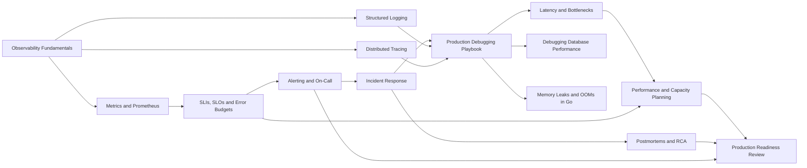

# 14 Observability & SRE MOC

> [!summary] What this folder covers
> How to see inside a running system with logs, metrics and traces, how to set reliability targets and alert on them, and how to respond to, debug and learn from production incidents. After this folder you can run on-call for a Go backend and explain SRE practice in an interview.

## Before and after

- **Before this:** [[13 DevOps & Cloud MOC]]
- **After this:** nothing; this is a starting point

## Learning path

1. [[Observability Fundamentals]] · basic. The three signals, what each one answers, and how to move from a metric spike to a trace to a log line.
2. [[Structured Logging]] · basic. Why logs should be key-value events with request and trace IDs rather than free text.
3. [[Metrics and Prometheus]] · basic. Counters, gauges and histograms, PromQL, and why label cardinality decides your bill.
4. [[Distributed Tracing with OpenTelemetry]] · intermediate. Spans, context propagation with `traceparent`, and reading a waterfall across services.
5. [[SLIs, SLOs, SLAs and Error Budgets]] · intermediate. Turning "is it reliable?" into a number and spending the error budget deliberately.
6. [[Alerting and On-Call]] · intermediate. Paging on symptoms with multi-window burn-rate alerts, runbooks and a sustainable rotation.
7. [[Incident Response]] · intermediate. Severity, roles such as the incident commander, and communication while the system is down.
8. [[Production Debugging Playbook]] · intermediate. A repeatable order of questions, from "what changed?" to mitigation, before root cause.
9. [[Latency, Percentiles and Bottleneck Analysis]] · intermediate. Why averages lie, how tails amplify under fan-out, and the USE and RED methods.
10. [[Postmortems and Root Cause Analysis]] · intermediate. Blameless write-ups, contributing factors and action items that actually get done.
11. [[Debugging Database Performance]] · advanced. Find the slow query, read its plan, and rule out locks and pool exhaustion.
12. [[Debugging Memory Leaks and OOMs in Go]] · advanced. Goroutine and heap leaks, diffing pprof snapshots, and `GOMEMLIMIT` inside containers.
13. [[Performance Engineering and Capacity Planning]] · intermediate. The bottleneck loop and sizing a system against forecast load and its SLO.
14. [[Production Readiness Review]] · advanced. The capstone checklist that gates a service before it takes real traffic.

### Incident Playbooks

What to do when a specific production problem hits. Each playbook covers the first 5 minutes, a diagnosis flowchart, the exact commands and PromQL, the fixes and prevention.

- [[Playbook - High Latency]]
- [[Playbook - Error Rate Spike (5xx)]]
- [[Playbook - Database Overload and Connection Exhaustion]]
- [[Playbook - Memory Leak and OOMKilled]]
- [[Playbook - CPU Saturation]]
- [[Playbook - Queue and Kafka Consumer Lag]]
- [[Playbook - Cache Outage and Stampede]]
- [[Playbook - Bad Deploy and Rollback]]
- [[Playbook - Disk Full and Log Floods]]
- [[Playbook - Third-Party Dependency Outage]]
- [[Playbook - TLS Certificate and DNS Failures]]
- [[Playbook - Traffic Spike and DDoS]]
- [[Playbook - Data Inconsistency and Duplicate Processing]]

## Concept map

## Interview focus

- What are the three pillars of observability, and when do you reach for each one? See [[Observability Fundamentals]].
- What is the difference between an SLI, an SLO and an SLA, and how does an error budget work? See [[SLIs, SLOs, SLAs and Error Budgets]].
- Why should you alert on symptoms and burn rate rather than on CPU usage? See [[Alerting and On-Call]].
- Why is p99 latency more useful than the average, and what happens to tail latency under fan-out? See [[Latency, Percentiles and Bottleneck Analysis]].
- How does a trace ID travel across services? See [[Distributed Tracing with OpenTelemetry]].
- Why is high label cardinality dangerous in Prometheus? See [[Metrics and Prometheus]].
- Walk me through debugging a sudden spike in 5xx errors in production. See [[Production Debugging Playbook]].
- How would you find a memory leak in a Go service that keeps getting OOM-killed? See [[Debugging Memory Leaks and OOMs in Go]].
- What makes a postmortem blameless, and what goes into one? See [[Postmortems and Root Cause Analysis]].

## Sources worth reading

- Google, *Site Reliability Engineering* and *The Site Reliability Workbook* (free at sre.google), especially the chapters on SLOs, alerting on SLOs, and postmortem culture.
- Charity Majors, Liz Fong-Jones and George Miranda, *Observability Engineering* (O'Reilly).
- Brendan Gregg, "The USE Method" and *Systems Performance*.
- The OpenTelemetry documentation (opentelemetry.io) and the Prometheus documentation (prometheus.io/docs).
- Jeff Dean and Luiz André Barroso, "The Tail at Scale" (Communications of the ACM, 2013).
