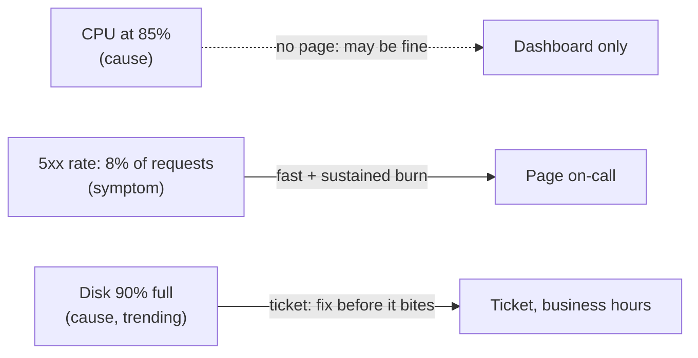
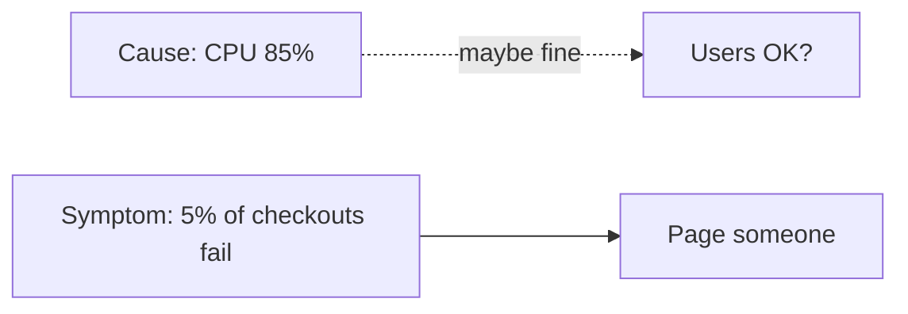
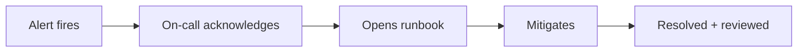
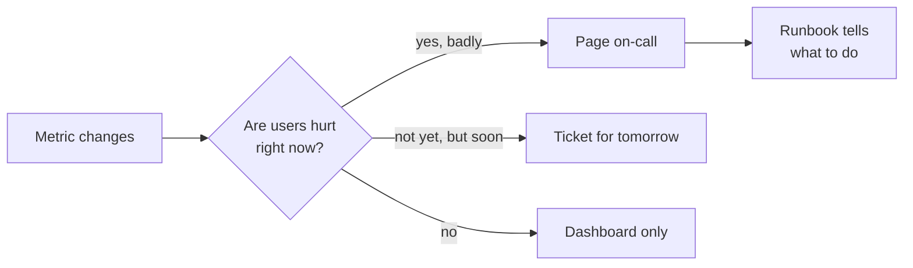
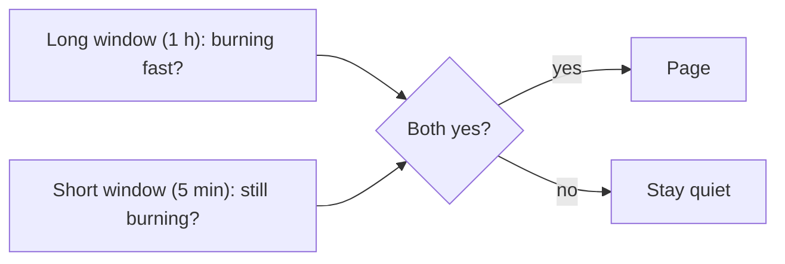
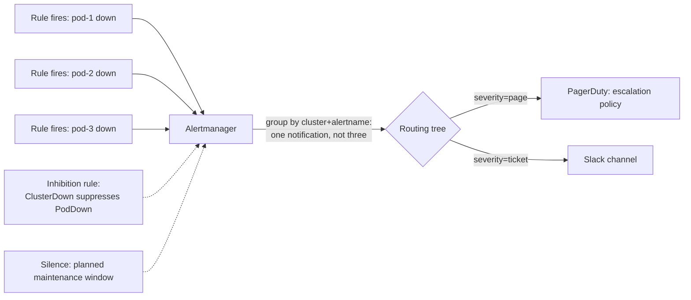
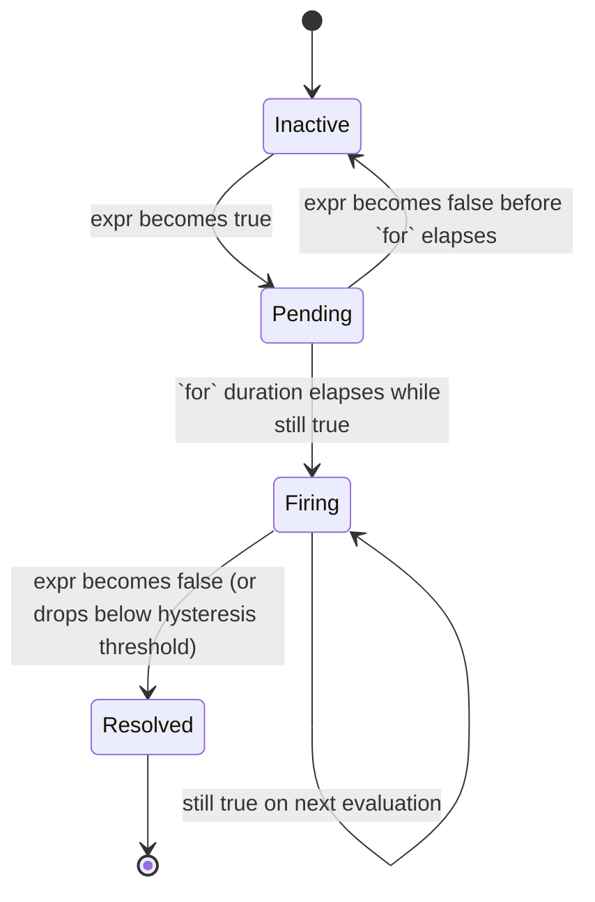

# Alerting and On-Call

> [!summary] TL;DR
> Alert on **symptoms users feel** (high error rate, slow responses, exhausted error budget), not on **causes** (high CPU, a full disk) — a cause can be fine on its own and a symptom is what actually needs a human. A good alert fires fast on real problems, stays quiet on blips, and hands the on-call engineer a runbook instead of a mystery.

> [!abstract] Core idea
> - Symptom alerts page; cause alerts, at most, open a ticket or show up on a dashboard.
> - A **multi-window, multi-burn-rate** alert on the SLO's error budget is the single best general-purpose symptom alert: it pages fast on a severe burn and stays quiet on noise, because it requires two windows to agree.
> - Every alert needs an owner, a severity, and a runbook URL — an alert with nowhere to send the responder is a problem for 3 a.m. you, created by daytime you.
> - Paging hygiene (reviewing and deleting alerts, tracking page volume) is as much a part of the discipline as writing the alerts in the first place.

### Whiteboard version



CPU at 85% might be a batch job finishing on schedule — nobody should be woken up for it. A sustained 8% error rate means real users are getting real failures right now — that pages. A slowly filling disk is real but not urgent at 3 a.m. — that's a ticket for tomorrow.

## Start here: the basics 🟢

> [!info] How to read this note (pick your level)
> - 🟢 **New to this?** Read "From zero" below, then sections 1, 2 and 10 (why, mental model and the cheat sheet). Stop there, that is a full first pass.
> - 🟡 **Know the basics?** Add sections 3, 4, 5 and 6 (how it works, a worked example, options and trade-offs).
> - 🔴 **Interview / SDE-3 prep?** Add sections 7, 8 and 9 (production, deep dive and interview questions). Headings are tagged 🟢🟡🔴 so you always know where you are.

**From zero, in 60 seconds** 🟢

An **alert** is a message that wakes a human up to fix something.
If alerts fire for things that don't matter, people start ignoring them. Then they miss the one that does.
So alert on what users feel (errors, slowness), not on internal causes (high CPU).



A good alert asks: would a person need to act on this right now, at 3 am?
Every paging alert links to a **runbook**: a short page saying what to check and what to do.



The rest of this note is just these 3 questions:
1. What makes an alert rule good?
2. How do burn-rate alerts catch real problems fast without crying wolf?
3. How do you run on-call and keep alerts clean over time?


**The problem in one story.**
Your phone buzzes at 3 a.m. with "CPU is high".
You get up, look around, and nothing is broken for any customer.
After a month of this you start ignoring the buzz.
Then one night the site really is down, and you ignore that buzz too.
Good alerting means the phone only buzzes when a real user is hurting.

**Words you need first**

| Word | Plain meaning | Tiny example |
| --- | --- | --- |
| Alert | An automatic rule that notices something and tells a person | "error rate over 5% for 5 minutes" |
| Page | An alert loud enough to wake someone up | Phone call from PagerDuty |
| Ticket | A non-urgent alert handled in work hours | "Disk will be full in 10 days" |
| On-call | The engineer whose turn it is to answer pages | One person per week per team |
| Symptom | Something users feel | Checkout returns errors |
| Cause | Something inside the system that might lead to a symptom | CPU at 90% |
| SLO / error budget | A reliability target, and the failures you are allowed under it | 99.9% success = 0.1% may fail |
| Runbook | A short "what to do when this fires" page | Steps to check and roll back |

**Picture it**



**Analogy.** A smoke alarm should go off for a fire, not for toast. If it screams at every slice of toast, people pull out the battery.
Where it breaks: a smoke alarm has one sensor; a service alert can (and should) require two time windows to agree before it fires.

**How the rest of this note builds up**

- First, why noisy alerts hurt (section 1) and the "would a human need to act at 3 a.m.?" test (section 2).
- Then alert anatomy, burn-rate alerts, Alertmanager routing, runbooks and on-call practice (section 3).
- Then a Go burn-rate decision function with tests (section 4) and alternatives and trade-offs (sections 5-6).
- Finally the SDE-3 deep dive: cutting pages without missing outages, choosing burn-rate multipliers, per-tenant alerts and alerts-as-code (sections 7-8).

> [!tip] Remember
> Page on what users feel, ticket on what will hurt later, and give every page a runbook.

## 1. Why it exists 🟢

A service alerts on "CPU > 80%" and "disk > 85%" and "GC pause > 100ms." All three fire during a Tuesday afternoon batch job that runs every week, is fully expected, and causes zero user impact.

The on-call engineer gets paged, checks dashboards, finds nothing wrong, goes back to sleep (or doesn't), and next week ignores the page entirely — which is exactly the moment a real outage's page gets ignored too.

**Measured (illustrative):** teams that migrate from cause-based thresholds to symptom-based, SLO-burn alerting commonly report their page volume dropping by an order of magnitude while they catch the same or more real incidents, because they stop paging on things that were never actually breaking anything for a user — this is the standard motivation cited in the SRE workbook's alerting chapter, not a number measured in this vault.

## 2. Mental model 🟢

Ask of every potential alert: **"if a human saw this happen right now, at 3 a.m., would they need to act before morning?"** If the answer only matters in aggregate over days (disk slowly filling, a non-critical dependency slowly degrading), it's a ticket.

If a user is being actively harmed right now, it's a page. Everything else — "this is interesting, keep an eye on it" — is a dashboard, not an alert at all.

## 3. How it works 🟡

### Alert anatomy

**In plain words:** every alert needs a condition, how long it must hold, how serious it is, and a link to what to do.

Every alert rule (Prometheus `alerting rule` shown, but the fields generalize) needs:

```yaml
- alert: HighErrorRate
  expr: >
    sum(rate(http_requests_total{job="checkout",code=~"5.."}[5m]))
    /
    sum(rate(http_requests_total{job="checkout"}[5m]))
    > 0.05
  for: 10m
  labels:
    severity: page
    owner: checkout-team
  annotations:
    summary: "Checkout 5xx rate above 5% for 10m"
    runbook: "https://runbooks.internal/checkout-high-error-rate"
```

- **`expr`**: the PromQL condition.
- **`for`**: how long the condition must hold continuously before firing — this is the main defense against flapping on a single noisy scrape.
- **`severity` label**: routes to the right notification channel (page vs ticket vs Slack).
- **`owner` label**: who gets paged — never "whoever's on call for the whole org."
- **`runbook` annotation**: a URL with the first five minutes of triage already written down. An alert without one makes the page itself the bottleneck.

### Static thresholds vs multi-window multi-burn-rate

**In plain words:** instead of a fixed line, ask "how fast are we spending our error budget?". Check a short and a long window together so blips don't page you.



A flat threshold ("page if error rate > 1% for 5 minutes") has an unavoidable trade-off: a short window pages fast but flaps on noise; a long window is stable but pages slowly on a real, fast-moving outage.

The fix, from the Google SRE workbook, is to alert on **burn rate against the error budget**, checked across **two windows of different lengths that must both agree**:

```text
burn_rate = (bad_event_fraction_over_window) / (1 - SLO_target)
```

A burn rate of 1 means "exhaust the 30-day budget exactly at 30 days" (sustainable). A burn rate of 14.4 means "exhaust the 30-day budget in about 50 hours (~2 days) if it keeps up" — and because the fast-tier alert below only needs a 1-hour window to see that rate, it still pages within the hour (page promptly, not 50 hours later).

The two-window requirement is what kills flapping: a 5-minute spike alone doesn't page unless the 1-hour window *also* shows elevated burn, which means a real, sustained problem, not one bad scrape.

**The standard 99.9%/30-day policy (Google SRE workbook, ch. 5):**

| Severity | Burn rate | Long window | Short window | Budget consumed if sustained |
| --- | --- | --- | --- | --- |
| Page | 14.4× | 1h | 5m | 2% of 30-day budget in 1h |
| Page | 6× | 6h | 30m | 5% of 30-day budget in 6h |
| Ticket | 1× | 3d | 6h | 10% of 30-day budget in 3d |

**Real PromQL** for the fast page condition (99.9% SLO, so the allowed bad fraction is 0.001):

```promql
(
  sum(rate(http_requests_total{job="checkout",code=~"5.."}[1h]))
  /
  sum(rate(http_requests_total{job="checkout"}[1h]))
) > (14.4 * 0.001)
and
(
  sum(rate(http_requests_total{job="checkout",code=~"5.."}[5m]))
  /
  sum(rate(http_requests_total{job="checkout"}[5m]))
) > (14.4 * 0.001)
```

And the slow-burn ticket condition, over 3 days and 6 hours:

```promql
(
  sum(rate(http_requests_total{job="checkout",code=~"5.."}[3d]))
  /
  sum(rate(http_requests_total{job="checkout"}[3d]))
) > (1 * 0.001)
and
(
  sum(rate(http_requests_total{job="checkout",code=~"5.."}[6h]))
  /
  sum(rate(http_requests_total{job="checkout"}[6h]))
) > (1 * 0.001)
```

A Prometheus rule for the fast tier, with the `for:` kept short since the two-window `and` already does the debouncing:

```yaml
groups:
  - name: checkout-slo-burn
    rules:
      - alert: CheckoutErrorBudgetFastBurn
        expr: >
          (sum(rate(http_requests_total{job="checkout",code=~"5.."}[1h])) /
           sum(rate(http_requests_total{job="checkout"}[1h])) > 0.0144)
          and
          (sum(rate(http_requests_total{job="checkout",code=~"5.."}[5m])) /
           sum(rate(http_requests_total{job="checkout"}[5m])) > 0.0144)
        for: 2m
        labels:
          severity: page
          owner: checkout-team
        annotations:
          summary: "Checkout burning its 30d error budget at 14.4x (exhausts in ~50h / ~2d)"
          runbook: "https://runbooks.internal/checkout-fast-burn"
```

### Precision, recall, flapping and hysteresis

**In plain words:** precision = how many alerts were real. Recall = how many real problems got an alert. Flapping is an alert switching on and off; a buffer zone stops it.

An alert's **precision** is "of the times it fired, how many were real problems"; its **recall** is "of the real problems, how many did it catch." Pushing threshold tighter raises recall but hurts precision (more false pages); the multi-window design above is specifically chosen to keep both high at once.

**Flapping** — an alert repeatedly firing and resolving within minutes — is usually a threshold sitting exactly at the noise floor; fix it with `for:`, a wider window, or **hysteresis** (fire at one threshold, only resolve once it drops back below a lower one, so a value oscillating around a single line doesn't retrigger every few seconds).

### Alertmanager: grouping, inhibition, silences, routing

**In plain words:** one alert pipe that bundles related alerts, hides follow-on noise, mutes during maintenance, and sends each alert to the right team.



- **Grouping** collapses many related firing alerts (three pods in the same cluster) into one notification instead of paging three times for one incident.
- **Inhibition** suppresses a lower-level alert when a higher-level one covering it is already firing (don't page "pod down" ×20 when "cluster down" already paged).
- **Silences** mute a specific alert for a time window, used for planned maintenance — always time-boxed, never left in place indefinitely.
- **Routing tree** matches on labels (`severity`, `team`, `service`) to pick the receiver: PagerDuty for `severity=page`, a Slack channel for `severity=ticket`, with a default receiver as a catch-all so a mis-labeled alert still reaches someone.

### Alert lifecycle



`Pending` is what `for:` buys you: a condition must hold continuously through the whole duration before it's allowed to actually notify anyone, which is what turns a single noisy scrape into a non-event.

### Runbooks

A runbook linked from every paging alert should contain, at minimum:

1. **Symptom** — what the alert means in plain language.
2. **Dashboards** — direct links to the exact panels relevant to this alert, not "go check Grafana."
3. **Likely mitigations** — rollback, feature-flag off, scale out, failover, block an abusive client (see [[Production Debugging Playbook]] for the general mitigation menu).
4. **Escalation** — who to pull in and how, if the on-call engineer can't resolve it alone within a stated time.

An alert that pages without a runbook forces the responder to reconstruct, from scratch, at 3 a.m., knowledge that the alert's author already had when they wrote the threshold.

### On-call practice

- **Rotation and escalation policy.** A primary responder, a secondary as backup if the primary doesn't acknowledge within a few minutes, and a defined escalation chain beyond that — never a single point of failure for who gets paged.
- **Handoff.** The outgoing on-call briefs the incoming one on anything still simmering: a known flaky alert, an in-progress mitigation, a change that's still being watched.
- **Follow-the-sun.** Multi-region teams rotate the "business hours" on-call window to a team in a different timezone instead of waking one team at 3 a.m. every time.
- **Page budget and toil.** Track pages per on-call shift per person; a rotation that's paged 20 times a night is an alerting-quality problem (see hygiene below), not a staffing problem to solve by hiring more people to suffer the same bad alerts.
- **MTTD / MTTA / MTTR.** Mean time to detect, to acknowledge, and to resolve. **Mean** MTTR is a famously misleading summary: one 8-hour (480-minute) outage and nineteen 5-minute ones average to `(480 + 19×5) / 20 ≈ 28.75 minutes` across the 20 incidents — which hides that the one bad outage actually ran 96× as long as every other incident — look at the distribution (p50/p90 of resolution time), not the mean, the same percentile lesson as request latency.

### Blackbox probes and the dead-man's-switch

**In plain words:** a probe tests your service from outside like a user. A dead-man's-switch is an alert that should always fire; if it stops, your alerting is broken.

A **blackbox/synthetic probe** calls your service from outside, the way a real user would, catching failures your own metrics can't see (DNS misconfiguration, a certificate that expired, a load balancer silently dropping all traffic). The **dead-man's-switch** (often literally named `Watchdog`) is an alert that is *always* firing by design, routed to a receiver that pages if the notification stream itself ever stops — it exists purely to prove the alerting pipeline is alive, because an alerting system that's down looks identical to "everything is fine."

### Async-system alerts

Queue- and job-based systems need their own symptom alerts, since they don't have per-request latency:

- **Oldest-message / oldest-job age** exceeding a threshold — a job sitting unprocessed is the queue equivalent of a slow request.
- **Consumer lag** (how far behind the consumer is from the latest produced offset) growing instead of holding steady.
- **DLQ (dead-letter queue) growth** — messages that failed processing and were set aside; a flat line is healthy, any sustained growth is a symptom.
- **Missed cron heartbeat** — a scheduled job that should run every N minutes pushes a heartbeat metric each time it completes; alert if that metric is stale by more than N minutes, which also catches "the scheduler itself died" that a per-run alert never would.

### Paging hygiene

A weekly or biweekly review of the last period's pages, asking **for every page: was this actionable?** Alerts that paged but required no action get tuned (wider window, different threshold) or deleted outright. An alerting system is a living thing that needs active pruning, not a one-time setup — an alert that made sense for last year's traffic pattern can be pure noise for this year's.

## 4. Worked example 🟡

### Go: multi-window burn-rate decision logic

**In plain words:** the burn-rate math as a small Go function, so you can test an alert rule before trusting it.

The arithmetic behind the PromQL above, as a small, tested Go function — useful for a CLI dry-run of a proposed policy, or a unit test proving a new SLO's thresholds behave as expected before shipping them as Prometheus rules. It compiles and passes `go vet` and `go test -race` on Go 1.24.4.

```go
// Package alertburn implements the decision logic behind a multi-window,
// multi-burn-rate SLO alert, matching the Google SRE workbook's two-tier
// page/ticket policy for a 99.9% (30-day) SLO.
package alertburn

// Severity is what a burn-rate evaluation should produce.
type Severity int

const (
	SeverityNone Severity = iota
	SeverityTicket
	SeverityPage
)

func (s Severity) String() string {
	switch s {
	case SeverityPage:
		return "page"
	case SeverityTicket:
		return "ticket"
	default:
		return "none"
	}
}

// Window is one burn-rate condition: both its short and long lookback must
// exceed burn rate threshold for the alert to fire. The short window makes
// it fire fast; the long window makes it stop firing fast once the problem
// clears, instead of paging for hours on a five-minute blip.
type Window struct {
	Severity  Severity
	Threshold float64 // multiples of the sustainable burn rate
	ShortBurn float64 // burn rate measured over the short lookback
	LongBurn  float64 // burn rate measured over the long lookback
}

// Evaluate returns the highest severity among windows whose both burn rates
// clear their threshold. Google's SRE workbook recommends exactly these two
// windows for a 30-day, 99.9% SLO:
//   - page:   14.4x burn rate, sustained over 1h AND over 5m
//   - ticket:  1x burn rate, sustained over 3d AND over 6h
func Evaluate(windows []Window) Severity {
	best := SeverityNone
	for _, w := range windows {
		if w.ShortBurn >= w.Threshold && w.LongBurn >= w.Threshold {
			if w.Severity > best {
				best = w.Severity
			}
		}
	}
	return best
}

// StandardWindows builds the Google SRE workbook's 3-window policy for a
// 99.9%/30-day SLO from measured burn rates. In production each burn rate
// comes from a PromQL query over the matching range (see this note's
// "How it works" section for the exact expressions). The ticket tier's
// short window is 6h, so it reuses the same burn6h input as the page tier's
// long window — they're the same measured quantity.
func StandardWindows(burn1h, burn5m, burn6h, burn30m, burn3d float64) []Window {
	return []Window{
		{Severity: SeverityPage, Threshold: 14.4, ShortBurn: burn5m, LongBurn: burn1h},
		{Severity: SeverityPage, Threshold: 6, ShortBurn: burn30m, LongBurn: burn6h},
		{Severity: SeverityTicket, Threshold: 1, ShortBurn: burn6h, LongBurn: burn3d},
	}
}
```

```go
package alertburn

import "testing"

func TestEvaluate_FastBurnPages(t *testing.T) {
	// Both the 5m and 1h windows are burning at 20x: well over the 14.4x
	// page threshold, so this should page, not ticket.
	windows := StandardWindows(20, 20, 0, 0, 0)
	got := Evaluate(windows)
	if got != SeverityPage {
		t.Fatalf("Evaluate = %v, want page", got)
	}
}

func TestEvaluate_SlowBurnTicketsOnly(t *testing.T) {
	// A sustained 1.2x burn over 3d/6h is above the 1x ticket threshold
	// but far below the page thresholds.
	windows := StandardWindows(0, 0, 1.2, 0, 1.2)
	got := Evaluate(windows)
	if got != SeverityTicket {
		t.Fatalf("Evaluate = %v, want ticket", got)
	}
}

func TestEvaluate_ShortSpikeAloneDoesNotPage(t *testing.T) {
	// A 5m spike at 20x with a quiet 1h window (0.5x) does not clear the
	// long-window condition, which is exactly the point: a blip that
	// recovers must not sustain a page.
	windows := StandardWindows(0.5, 20, 0, 0, 0)
	got := Evaluate(windows)
	if got != SeverityNone {
		t.Fatalf("Evaluate = %v, want none (long window not breached)", got)
	}
}

func TestEvaluate_NothingBurningIsNone(t *testing.T) {
	if got := Evaluate(StandardWindows(0, 0, 0, 0, 0)); got != SeverityNone {
		t.Fatalf("Evaluate = %v, want none", got)
	}
}
```

**Tested:** `go vet ./...` clean; `go test -race ./...` → `ok alertburn 1.5s`, all four tests pass (Go 1.24.4, scratch module, 2026-11-07).

## 5. Variants and comparison 🟡

| Approach | How it decides to page | Catches blips? | Catches slow burns? |
| --- | --- | --- | --- |
| Static threshold, single window | One condition, one `for:` | No — a long `for:` to avoid flapping also delays real pages | No — a threshold tuned for fast incidents misses a slow, steady 2× burn over days |
| Multi-window multi-burn-rate | Two windows of different lengths must both agree | Yes — short window alone can't page | Yes — a separate, slower tier (1× over 3d/6h) exists specifically for this |
| Cause-based threshold (CPU, disk, queue depth alone) | Infra metric crosses a line | N/A — doesn't measure user impact at all | No — a resource can be "fine" for days before it becomes a symptom, or "high" and never become one |
| Blackbox/synthetic probe | External health check fails | Yes, for anything reachable externally | No — not continuous enough to measure slow budget burn |

## 6. Trade-offs and when not to use 🟡

- Burn-rate alerting requires an SLO to already exist (see [[SLIs, SLOs, SLAs and Error Budgets]]); it's not a replacement for having one, it's built on top of one.
- A brand-new, low-traffic service doesn't have enough request volume for burn-rate math to be statistically meaningful over a 5-minute window — a handful of real-user requests can swing the ratio wildly. Widen the short window or fall back to a coarser static threshold until traffic grows.
- More alert tiers (page/ticket, multiple windows) means more rules to maintain and more combinations to reason about; a tiny, low-stakes internal tool may not justify more than one simple threshold.
- Alerting purely on the SLO's top-line SLI can miss a localized problem (one region, one tenant) that's too small to move the aggregate burn rate — pair burn-rate alerts with narrower, lower-severity alerts scoped by cohort for that case.

## 7. In production 🔴

- **Real systems:** Prometheus + Alertmanager is the de facto open-source stack for exactly this pipeline; PagerDuty and Opsgenie implement the escalation-policy and on-call-schedule layer on top of whatever fires the alert; Grafana's unified alerting and Datadog Monitors implement the same rule/routing model against different backends.
- **Failure modes → fixes:**
  - Alert fires but nobody owns it → every alert rule needs an `owner` label set at creation time, enforced in code review of the alerting rules file, not discovered during an incident.
  - Alertmanager itself goes down silently → the dead-man's-switch Watchdog alert exists exactly to catch this.
  - Escalation never reaches a human (everyone's phone is on silent) → test the escalation policy periodically, the same way you'd test a backup by restoring it.
  - Alert volume creeping up over months → the paging-hygiene review catches this before on-call burnout does.
- **What to monitor:** pages per week per rotation, percentage of pages judged actionable in the hygiene review, MTTA (time to acknowledge) and its distribution, and the count of silences currently active (a growing pile of silences is usually alerts nobody fixed, muted instead).

## 8. Deep dive 🔴

- **Cutting pages by 80% without missing outages (a common interview prompt).** Start from the paging-hygiene review: for every alert that fired in the last quarter, classify it as "actionable" or not. Delete or widen the window on every alert where a human looked, found nothing wrong, and closed it — this alone typically removes most noise.

  Then replace surviving cause-based thresholds with symptom-based, multi-window burn-rate alerts against each service's SLO, and add inhibition rules so a dependency outage pages once (at the dependency) instead of N times (once per dependent service).

  The combination addresses both "too many alerts fire" and "we delete something we needed" — the burn-rate math still catches a real fast or slow outage even after the noisy thresholds are gone.
- **Choosing the burn-rate multipliers.** `14.4×` isn't arbitrary: it's chosen so that a sustained outage at that rate consumes 2% of a 30-day budget in exactly the 1-hour long window, which is small enough that false positives are cheap but the 5-minute short window still lets it page within minutes.

  Different SLO targets or window lengths change the multiplier; the workbook's chapter 5 derives the formula rather than hardcoding "14.4" as magic.
- **Multi-tenant and per-cohort alerting.** A top-line burn-rate alert averages across all traffic; a single large, broken tenant can be invisible if its traffic share is small relative to total volume. A second tier of alerts scoped `by (tenant)` with a much higher bar (page only if one tenant's own burn rate is extreme) catches this without multiplying noise for the common case.
- **Alert-as-code.** Treating alerting rules as version-controlled YAML (Prometheus rule files, reviewed in pull requests, linted with `promtool check rules`) is what makes the owner/runbook/severity discipline enforceable at scale instead of relying on everyone remembering to fill them in by hand in a UI.

## 9. Interview questions 🔴

> [!question]- Why alert on symptoms instead of causes?
> A cause (high CPU, a growing queue) may or may not ever become a user-facing problem — it can resolve itself, or be expected (a scheduled batch job). A symptom (elevated error rate, high latency, fast error-budget burn) means a user is being harmed right now. Paging on causes trains the on-call engineer to ignore pages, because most of them require no action.

> [!question]- Design a multi-window burn-rate alert for a 99.9%/30-day SLO. What are the windows and why two?
> Page at 14.4× burn over both a 1-hour and a 5-minute window; a second, lower page tier at 6× over 6h/30m; a ticket tier at 1× over 3d/6h. Two windows are required together because a short window alone flaps on noise, and a long window alone is too slow to page on a genuinely fast outage — requiring both to agree gives fast detection with low false-positive risk.

> [!question]- What does `for: 10m` on a Prometheus alert rule actually do, and what's the risk of setting it too long?
> It requires the alert's expression to stay true continuously for that whole duration before the alert transitions from `pending` to `firing` — it's the primary tool against flapping on a single noisy scrape. Set too long, it delays a real, fast-moving outage's page by that same duration, which is why burn-rate alerting prefers a short `for:` paired with a long evaluation window inside the expression itself, rather than one long `for:`.

> [!question]- How would you alert on a Kafka consumer or background job queue, where there's no per-request latency?
> Use job-shaped symptom alerts: oldest-unprocessed-message age, consumer lag relative to the latest offset, DLQ growth rate, and a missed-heartbeat alert for scheduled jobs (stale heartbeat metric rather than "the job didn't run," which can't be observed directly if the scheduler itself died).

> [!question]- What's a dead-man's-switch alert, and why does it need to always be firing?
> It's an alert deliberately configured to always be true, routed through the same notification pipeline as every other alert, so that if the pipeline itself breaks (Alertmanager crashes, a notification integration silently fails), the switch's expected, constant notification stops arriving — which is itself the page. Without it, "no alerts fired" is indistinguishable from "everything is fine" and from "the alerting system is dead."

> [!question]- Trap: a service has had zero pages for six months. Is that good?
> Not necessarily — it might mean the service genuinely has no symptom-worthy problems, or it might mean the alerts are miscalibrated (thresholds too loose, an SLO target set too generously, or a broken notification route) and real problems are going undetected. A senior answer checks the dead-man's-switch is firing, confirms the SLO burn history actually shows near-zero burn (not just "no pages"), and only then calls it good.

## 10. Cheat sheet 🟢

- Page on symptoms (error rate, latency, budget burn); ticket or dashboard on causes (CPU, disk, queue depth alone).
- Multi-window multi-burn-rate: both a short and a long window must agree — fast detection without flapping.
- Standard 99.9%/30d tiers: page at 14.4× (1h/5m) and 6× (6h/30m); ticket at 1× (3d/6h).
- Every alert needs `expr`, `for:`, `severity`, `owner`, and a `runbook` URL.
- Alertmanager: group (fewer notifications), inhibit (suppress redundant lower-level alerts), silence (time-boxed only), route by label.
- Look at the MTTR distribution, not the mean — one bad outage skews the average past meaning.
- Dead-man's-switch: an alert that's always firing, to prove the pipeline itself is alive.
- Review pages regularly; delete or tune every alert that fired without requiring action.

## Links

- **Before this:** [[SLIs, SLOs, SLAs and Error Budgets]], [[Metrics and Prometheus]]
- **Next:** [[Incident Response]], [[Production Debugging Playbook]]
- **Compare with:** [[Observability Fundamentals]] (the signals an alert is built from), [[Postmortems and Root Cause Analysis]] (what happens after a page leads to a real incident)

### Watch on YouTube

- [DevOps Alerting and On-Call: Reduce Noise and Respond Faster](https://www.youtube.com/watch?v=orG2ybDD2dU) · Joshua Moses / Cybertrace Foundation · 8 min · 11 views
- [Humane On Call  Alerting doesn't have to be painful by Mario Fernandez](https://www.youtube.com/watch?v=X59Sfaey5N4) · Devoxx · 43 min · 1,631 views
