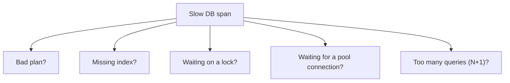
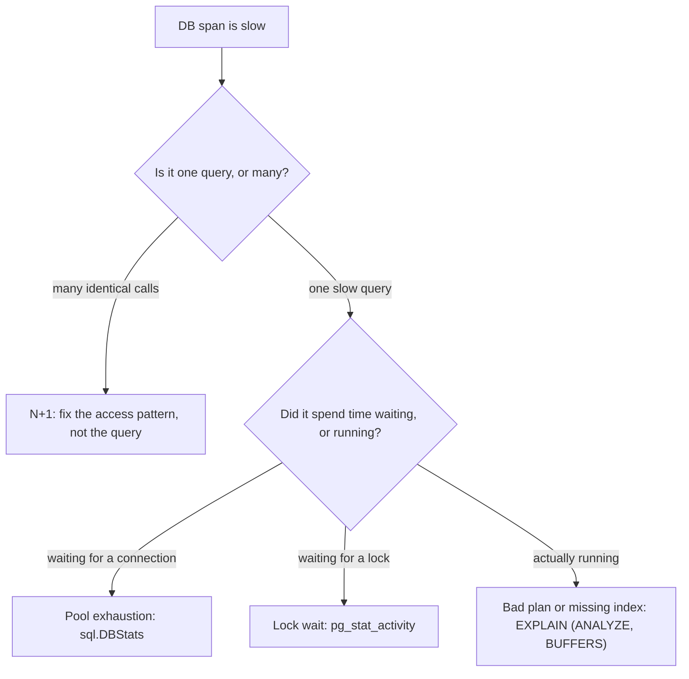
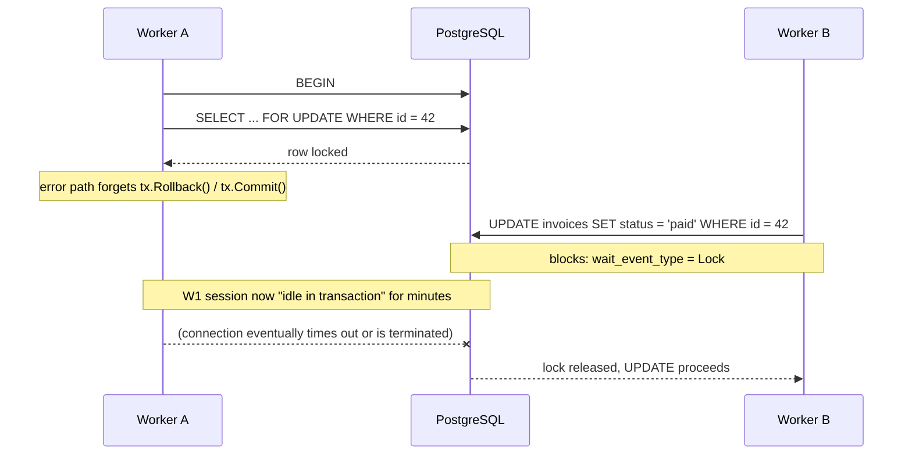

# Debugging Database Performance

> [!summary] TL;DR
> When an endpoint is slow and the trace says most of the time sits in a database span, you have five suspects, not one: a bad query plan, a missing index, a held lock, an exhausted connection pool, or too many round trips (N+1). Find out which one with `pg_stat_statements`, `EXPLAIN (ANALYZE, BUFFERS)`, `pg_stat_activity` and `sql.DBStats` — in that order — before touching a single query.

> [!abstract] Core idea
> - A slow DB span has exactly one of five causes: bad plan, missing index, lock wait, pool wait, or too many queries (N+1). Each has its own evidence.
> - `EXPLAIN` only ever shows you the **plan**. It never shows lock waits or pool waits — those come from different views entirely.
> - `pg_stat_statements` finds the query worth investigating; `EXPLAIN (ANALYZE, BUFFERS)` tells you why that query is slow.
> - Go's connection pool exhaustion (`sql.DBStats.WaitCount`) looks identical to a slow query from the outside — the client just waits longer — so check it before blaming the database.
> - Stale planner statistics make PostgreSQL pick a bad plan even with the right index in place; `ANALYZE` is often the one-line fix nobody tries first.

## Start here: the basics

**The problem in one story.**
A web page that used to load in a blink now takes 4 seconds.
You look closer and almost all of that time is spent waiting on the database.
But "the database is slow" can mean five different things.
Guessing wastes days; this note shows how to find the real one with evidence.

**Words you need first**

| Word | Plain meaning | Tiny example |
| --- | --- | --- |
| Query | One request you send to the database | `SELECT * FROM invoices WHERE tenant_id = 7` |
| Index | A sorted lookup structure that finds rows without reading the whole table | Like a book's index |
| Seq scan | Reading every row of a table one by one | Scanning 1.2M rows to find 50 |
| Query plan | The database's chosen recipe for running a query | "use index X, then sort" |
| Lock | A rule that makes one transaction wait for another | An `UPDATE` blocking another `UPDATE` on the same row |
| Connection pool | A fixed set of open DB connections your app reuses | Go's `sql.DB` with 20 connections |
| N+1 queries | One query for a list, then one more per item | 1 + 100 queries to show 100 orders |
| Span / trace | A timed record of one step in a request | "db.query took 3.9s" |

**Picture it**



**Analogy.** A slow checkout line in a supermarket: the cashier may be slow (bad plan), the item has no barcode (missing index), someone ahead is arguing (lock), there are too few open tills (pool), or you went through the line once per item (N+1).
Where it breaks: in a database, several of these can happen at once and feed each other.

**How the rest of this note builds up**

- First, a real-looking slowdown story (section 1) and the five-suspects model (section 2).
- Then the four-step method: `pg_stat_statements`, `EXPLAIN (ANALYZE, BUFFERS)`, `pg_stat_activity`, and Go's `sql.DBStats` (section 3).
- Then a worked example with Go code (section 4) and how other databases compare (sections 5-6).
- Finally the SDE-3 deep dive: PgBouncer, generic vs custom plans, why `EXPLAIN` under-reports, N+1 from traces and safe remediation (sections 7-8).

> [!tip] Remember
> A slow DB span has five suspects; collect evidence for each before you change anything.

## 1. Why it exists

A dashboard-rendering endpoint goes from 80ms p99 to 4 seconds p99 over a week, with no deploy in between. The trace shows 3.9 of those 4 seconds inside a single DB span. Three engineers independently assume three different causes: "we need an index," "the pool is too small," "it's locks from the backup job." Only one measurement settles it — and it's rarely the first guess, because the real distribution of root causes in production is wider than "add an index": data growth silently changing a plan from an index scan to a sequential scan, a long-running report holding a row lock, or a connection pool sized for yesterday's traffic.

**Representative incident** (plausible numbers, PostgreSQL 17): a single tenant with 1.2M invoice rows now dominates a table that was 200K rows three months ago. The query planner's cached plan used to choose an index scan (fine at 200K rows); at 1.2M rows with stale statistics, it switches to a sequential scan.

Every query against that table now reads 1.2M rows end to end, average query time goes from 4ms to 850ms, every connection serving that tenant now holds a database connection nearly 200× longer, and the pool that served 25 concurrent requests comfortably now queues.

## 2. Mental model

Picture the request's time in the database as one of four doors, and only one is the real exit:



Each branch has a different fix. Adding an index does nothing for a lock wait. Scaling the pool does nothing for a bad plan. The job is to pick the right branch with evidence, not intuition.

## 3. How it works

### Step 1 — Find the query: `pg_stat_statements`

`pg_stat_statements` (a standard extension, enabled via `shared_preload_libraries`) tracks every distinct query shape with aggregate statistics:

```sql
SELECT
  query,
  calls,
  round(total_exec_time::numeric, 1)  AS total_ms,
  round(mean_exec_time::numeric, 1)   AS mean_ms,
  round((100 * total_exec_time / sum(total_exec_time) OVER ())::numeric, 1) AS pct_of_all_time
FROM pg_stat_statements
ORDER BY total_exec_time DESC
LIMIT 5;
```

```text
-- representative output (PostgreSQL 17)
                query                  | calls |  total_ms | mean_ms | pct_of_all_time
----------------------------------------+-------+-----------+---------+-----------------
 SELECT * FROM invoices WHERE tenant_id | 41203 | 3,502,780 |   85.0  |      61.4
   = $1 ORDER BY created_at DESC LIMIT 50
 UPDATE invoice_counters SET count = ... |  8841 |   612,400 |   69.3  |      10.8
 SELECT * FROM line_items WHERE ...      | 198400|   540,112 |    2.7  |       9.5
```

Sort by **total time** (`calls × mean_exec_time`), not mean time alone: a query that runs 40,000 times at 85ms costs more total database time than one that runs 10 times at 900ms, even though the second looks scarier in isolation.

`calls` also tells you N+1 at a glance: 198,400 calls to fetch line items for an endpoint hit 50 times a second is a strong N+1 signal before you even look at the query text.

### Step 2 — Read the plan: `EXPLAIN (ANALYZE, BUFFERS)`

```sql
EXPLAIN (ANALYZE, BUFFERS)
SELECT * FROM invoices
WHERE tenant_id = 482
ORDER BY created_at DESC
LIMIT 50;
```

```text
-- representative output (PostgreSQL 17)
Limit  (cost=0.43..812.19 rows=50 width=312) (actual time=0.891..812.044 rows=50 loops=1)
  Buffers: shared hit=38402 read=61150
  ->  Index Scan Backward using invoices_created_at_idx on invoices
        (cost=0.43..194812.07 rows=1198004 width=312)
        (actual time=0.889..811.990 rows=50 loops=1)
        Filter: (tenant_id = 482)
        Rows Removed by Filter: 1197954
        Buffers: shared hit=38402 read=61150
Planning Time: 0.112 ms
Execution Time: 812.201 ms
```

Three things to read, in order:
1. **Estimated rows vs. actual rows.** The planner estimated 1,198,004 rows for the whole table scan (correct, that's the table size), but the index it chose (`created_at`) isn't selective for `tenant_id = 482` — it walks the index in date order and **discards** 1,197,954 rows one at a time (`Rows Removed by Filter`) until it finds 50 that match the tenant. That's the bug: the wrong index, not a missing one.
2. **Buffers.** `shared hit` is pages found in PostgreSQL's cache; `read` is pages fetched from disk. A high `read` count on a query you expect to be cache-resident points at either a cold cache after a restart or a working set bigger than `shared_buffers`.
3. **Planning vs. execution time.** Planning time here is negligible; if planning time itself were large (milliseconds to seconds), suspect a very complex query or (rarely) catalog bloat.

**The fix** is a composite index that makes the tenant filter sargable first: `CREATE INDEX CONCURRENTLY ON invoices (tenant_id, created_at DESC)` — equality columns before range/sort columns is the rule for composite index column order.

`CONCURRENTLY` avoids taking the write lock that a plain `CREATE INDEX` would hold for the build's duration — essential on a table serving live traffic. A partial index (`WHERE status = 'open'`, if only open invoices are ever queried this way) or a covering index (`INCLUDE (total_cents)` to let the query answer from the index alone) can shrink this further once the base composite index is in place — see [[Indexing Fundamentals]] for when each applies.

### Step 3 — Rule out locks: `pg_stat_activity`

A query that is simply *waiting*, not running, looks identical in `pg_stat_statements`'s mean time but shows a wait event here:

```sql
SELECT pid, state, wait_event_type, wait_event, now() - query_start AS running_for, query
FROM pg_stat_activity
WHERE state != 'idle'
ORDER BY running_for DESC
LIMIT 5;
```

```text
-- representative output (PostgreSQL 17)
  pid  |        state        | wait_event_type | wait_event |  running_for   |            query
-------+----------------------+-----------------+------------+-----------------+------------------------------
 48190 | idle in transaction  |                 |            | 00:04:55.802    | SELECT * FROM invoices FOR UPDATE...
 48221 | active               | Lock            | transactionid | 00:00:42.113 | UPDATE invoices SET status...
```



The first row is the actual culprit: a session opened a transaction, ran `SELECT ... FOR UPDATE`, and never committed — `idle in transaction` for almost five minutes, holding row locks the whole time. Every other session trying to update those rows (`wait_event = transactionid`) queues behind it.

**This never shows up in `EXPLAIN`** — the blocked query's own plan looks perfectly fine; it's just waiting its turn. Fix: `statement_timeout` and `idle_in_transaction_session_timeout` as blast-radius limits, and fix the application code that opened a transaction and forgot to close it (commonly a connection checked out of a pool, used for a read, and never returned because an error path skipped the `defer tx.Rollback()`).

If two sessions instead each hold a lock the other needs, PostgreSQL's deadlock detector picks one and kills it (`ERROR: deadlock detected`) rather than waiting forever — that is a different, self-resolving failure from the one-sided wait shown above, and the killed transaction's error path still needs a retry.

### Step 4 — Rule out the pool: `sql.DBStats`

From the Go side, a connection pool at its ceiling produces symptoms indistinguishable from a slow database unless you check the pool's own counters:

```go
stats := db.Stats()
// stats.InUse, stats.Idle, stats.WaitCount, stats.WaitDuration, stats.MaxOpenConnections
```

`WaitCount > 0` means at least one query blocked waiting for a free connection — queueing time, not query time. If `InUse` sits at `MaxOpenConnections` continuously, the pool is undersized for the current load (or something upstream is holding connections too long — go back to Step 3).

`MaxOpenConns` caps total connections; `MaxIdleConns` caps how many sit ready between requests (too low and the pool churns new connections constantly); `ConnMaxLifetime` forces periodic recycling so connections don't outlive a failover or a PgBouncer-side timeout.

## 4. Worked example

### Whiteboard version

The three-way triage condensed to its core check:

```go
package wb

type PlanNode struct {
	NodeType      string
	EstimatedRows int64
	ActualRows    int64
}

// looksLikeMissingIndex flags a sequential scan reading far more rows
// than the planner estimated on a table too big to scan every time.
func looksLikeMissingIndex(n PlanNode, bigTable int64) bool {
	return n.NodeType == "Seq Scan" && n.ActualRows > bigTable
}
```

The full version below adds the estimate-vs-actual staleness check and the pool-exhaustion check from `sql.DBStats`. It compiles and passes `go vet` and `go test -race` on Go 1.24.

```go
package dbperf

import (
	"database/sql"
	"time"
)

// PoolPressure summarizes whether a *sql.DB's connection pool is the
// bottleneck: requests are piling up waiting for a free connection rather
// than being limited by the database itself.
type PoolPressure struct {
	InUse           int
	Idle            int
	WaitCount       int64
	WaitDuration    time.Duration
	MaxOpenConns    int
	LikelyExhausted bool
}

func AssessPool(db *sql.DB) PoolPressure {
	return PoolPressureFromStats(db.Stats())
}

func PoolPressureFromStats(s sql.DBStats) PoolPressure {
	return PoolPressure{
		InUse:        s.InUse,
		Idle:         s.Idle,
		WaitCount:    s.WaitCount,
		WaitDuration: s.WaitDuration,
		MaxOpenConns: s.MaxOpenConnections,
		LikelyExhausted: s.WaitCount > 0 && s.InUse >= s.MaxOpenConnections &&
			s.MaxOpenConnections > 0,
	}
}

type PlanNode struct {
	NodeType      string // "Seq Scan", "Index Scan", "Bitmap Heap Scan", ...
	EstimatedRows int64
	ActualRows    int64
}

type Diagnosis string

const (
	DiagnosisOK                Diagnosis = "ok"
	DiagnosisMissingIndex      Diagnosis = "missing or unused index"
	DiagnosisStaleStatistics   Diagnosis = "stale planner statistics: run ANALYZE"
	DiagnosisSequentialOnLarge Diagnosis = "sequential scan on a large table"
)

// DiagnosePlanNode applies the triage: is this a sequential scan on a
// table too big to scan every time, and does the estimate-vs-actual gap
// suggest the planner is working from stale statistics?
func DiagnosePlanNode(n PlanNode, largeTableRowThreshold int64) Diagnosis {
	stale := estimateOffBy10x(n.EstimatedRows, n.ActualRows)
	if n.NodeType == "Seq Scan" && n.ActualRows > largeTableRowThreshold {
		if stale {
			return DiagnosisStaleStatistics
		}
		return DiagnosisMissingIndex
	}
	if stale {
		return DiagnosisStaleStatistics
	}
	return DiagnosisOK
}

func estimateOffBy10x(estimated, actual int64) bool {
	if estimated == 0 {
		return actual > 0
	}
	ratio := float64(actual) / float64(estimated)
	return ratio > 10 || ratio < 0.1
}
```

```go
func TestAssessPoolFlagsExhaustion(t *testing.T) {
	stats := sql.DBStats{InUse: 25, WaitCount: 418, MaxOpenConnections: 25}
	if p := PoolPressureFromStats(stats); !p.LikelyExhausted {
		t.Fatal("expected exhaustion: InUse == MaxOpenConnections and WaitCount > 0")
	}
}

func TestDiagnosePlanNodeStaleStatistics(t *testing.T) {
	n := PlanNode{NodeType: "Index Scan", EstimatedRows: 10, ActualRows: 900_000}
	if got := DiagnosePlanNode(n, 10_000); got != DiagnosisStaleStatistics {
		t.Fatalf("got %q, want stale-statistics", got)
	}
}
```

**Measured** (this scratch module, Go 1.24, 2026-11-07): the two tests above pass, confirming pool exhaustion is flagged only when both `WaitCount > 0` and the pool is at its ceiling (not merely busy), and a 900,000-actual-row node against an estimate of 10 is flagged stale.

Two further cases behave the same way under the same logic: a sequential scan reading 1,000,000 actual rows against an estimate of 1,000,000 (no staleness, since estimate and actual agree) is flagged as a missing index, while the same node type reading 42 rows on a 40-row estimate is left `DiagnosisOK` (small lookup tables are fine to scan sequentially).

## 5. Variants and comparison

| Symptom source | What it tells you | What it never tells you | Primary tool |
| --- | --- | --- | --- |
| `pg_stat_statements` | Which query shape costs the most total time, and how many times it ran | Why a specific execution was slow | `pg_stat_statements` view |
| `EXPLAIN (ANALYZE, BUFFERS)` | The chosen plan, actual vs. estimated rows, cache hit ratio | Lock waits, pool waits — it only runs the query once it already has a connection and no lock is blocking it | `EXPLAIN` |
| `pg_stat_activity` | Live sessions, their state, and (if waiting) what they're waiting on | Historical queries that already finished | `pg_stat_activity` |
| `sql.DBStats` (client) | Whether the app's own pool is the bottleneck | Anything happening inside PostgreSQL itself | Go `database/sql` |
| Replica lag (`pg_stat_replication`) | Whether a read replica is serving stale data, and by how much | Whether the primary itself is slow | `pg_stat_replication` |

## 6. Trade-offs and when not to use

- `pg_stat_statements` normalizes query text (parameters replaced with `$1`, `$2`), so two very differently-performing executions of the same query shape (different tenant sizes) are blended into one row's average — pair it with sampled individual `EXPLAIN` runs, not statistics alone.
- `CREATE INDEX CONCURRENTLY` avoids blocking writers but takes roughly twice as long to build and can fail partway (leaving an invalid index to clean up) — acceptable on a live table, unnecessary overhead on a maintenance window where a plain `CREATE INDEX` is fine.
- Adding an index always costs write throughput and storage; an index that helps one rare report query but is never used otherwise is a tax on every insert — check `pg_stat_user_indexes.idx_scan` periodically and drop unused ones.
- PgBouncer in transaction-pooling mode breaks session-level features (prepared statements across transactions, `SET` outside a transaction, advisory locks held across statements) — know which mode you're in before assuming a connection behaves like a direct one.

## 7. In production

- **Real systems:** PgBouncer in transaction-pooling mode is the standard way to multiplex thousands of application connections onto a much smaller set of real PostgreSQL backends, because each backend process has real memory overhead; Stripe and GitHub have both written publicly about hitting exactly this five-suspect list (plan, index, lock, pool, N+1) in incident retrospectives.
- **Failure modes → fixes:**
	- MVCC bloat and autovacuum falling behind on a high-churn table → rising sequential scan cost and `idx_scan` ratio dropping; monitor `pg_stat_user_tables.n_dead_tup` and tune `autovacuum_vacuum_scale_factor` down for hot tables.
	- Plan regression after data growth (the representative incident above) → `ANALYZE` to refresh statistics, or `pg_stat_statements` plus a scheduled `ANALYZE` on fast-growing tables rather than waiting for autoanalyze's default thresholds.
	- Read-replica lag causing "read your own write" bugs that look like a performance problem → check `pg_stat_replication.replay_lag` on the primary before assuming the replica query itself is slow.
	- A single hot row (a shared counter) serializing every writer → see [[Hot Keys and Hot Partitions]] for sharding the counter instead of tuning the query.
- **What to monitor:** `pg_stat_statements` total time leaderboard (weekly review, not just during incidents); `sql.DBStats.WaitCount` and `WaitDuration` trending; `pg_stat_activity` long-running and `idle in transaction` sessions (alert past a few minutes); replica lag; autovacuum lag (`last_autovacuum` age) on write-heavy tables.

## 8. Deep dive

- **Generic vs. custom plans for prepared statements.** PostgreSQL decides, after a handful of executions, whether to keep re-planning a parameterized query (a "custom" plan, tailored to the actual parameter values) or switch to a single cached "generic" plan.

  For a skewed column like `tenant_id` where one tenant is 1000× larger than another, the generic plan picked for a small tenant can be disastrous for a large one — this is a subtler version of the plan-regression problem above and is specific to prepared statements (`database/sql` uses them under the hood via the driver).
- **Why `EXPLAIN` alone under-reports.** `EXPLAIN ANALYZE` actually executes the query, which means a query whose slowness comes from lock contention under concurrent load may run fast in isolation (no contender) and look completely healthy — the plan was never the problem on a quiet connection. Always correlate with `pg_stat_activity` from the live incident, not just a plan re-run afterward.
- **N+1 from the trace, not from reading code.** The most reliable way to catch N+1 in production is the trace: 200 nearly-identical child spans under one parent request span is the signature, regardless of whether the code "looks fine." `pg_stat_statements.calls` spiking for one query shape in lockstep with a specific endpoint's request rate is the same signal from the database side.

  See [[N+1 Query Problem]] for the fix patterns (batching, `JOIN`, dataloader-style batching).
- **Safe production remediation.** `pg_cancel_backend(pid)` politely asks a session to cancel its current statement (SIGINT-equivalent); `pg_terminate_backend(pid)` kills the whole connection (SIGTERM-equivalent) and is the only option for a session stuck `idle in transaction`. Prefer `statement_timeout` and `idle_in_transaction_session_timeout` as standing guardrails so you rarely need either manually, mid-incident.

## 9. Interview questions

> [!question]- A dashboard endpoint slows down only for one tenant with a very large account. What do you check first?
> `pg_stat_statements` to confirm which query dominates that endpoint's DB time, then `EXPLAIN (ANALYZE, BUFFERS)` with that tenant's actual ID as the parameter (not a small tenant's, since PostgreSQL may have cached a generic or differently-skewed plan). Look specifically at actual vs. estimated rows and whether the chosen index is selective for the filter that matters, not just present.

> [!question]- `EXPLAIN` shows a fast plan, but users report the query is slow in production. What's the gap?
> `EXPLAIN ANALYZE` runs without contention; production load can add lock waits or connection-pool waits that never show up in the plan itself. Check `pg_stat_activity` for wait events and `sql.DBStats` for pool saturation — the query's own plan can be perfectly fine while the request is still slow from the client's point of view.

> [!question]- Trap: "the EXPLAIN plan says `Lock wait: yes`, so the fix is an index." What's wrong?
> `EXPLAIN` never reports lock waits at all — that information doesn't exist in a query plan. Lock waits come from `pg_stat_activity`'s `wait_event_type`/`wait_event` columns on the live, blocked session. An index fixes a bad plan, not a blocked lock; applying the wrong fix wastes the incident's time and the index itself doesn't help.

> [!question]- How do you tell a missing-index problem from a stale-statistics problem, when both show a sequential scan?
> Compare estimated rows to actual rows in the `EXPLAIN ANALYZE` output. If the planner's estimate is wildly wrong (off by 10× or more) even though a usable index exists, the statistics are stale — run `ANALYZE` and re-check before creating anything. If the estimate matches the actual row count and it's still scanning the whole table, there genuinely is no selective index for that filter.

> [!question]- How would you add an index to a table serving live production traffic without an outage?
> `CREATE INDEX CONCURRENTLY` builds the index without holding the exclusive lock a plain `CREATE INDEX` takes for its full duration, at the cost of roughly double the build time and the possibility of ending up with an `INVALID` index if it's interrupted — check `pg_index.indisvalid` after and drop-and-retry if it failed.

> [!question]- Your Go service's p99 spikes, but `pg_stat_statements` shows no slow queries. Where do you look next?
> Check `sql.DBStats` for `WaitCount`/`WaitDuration` — the pool itself may be the bottleneck, with every individual query running fast once it finally gets a connection. This is common after a traffic increase that outpaced `MaxOpenConns`, or after a code change that holds connections longer than intended (a `defer rows.Close()` missing on an error path, for example).

## 10. Cheat sheet

- Five suspects for a slow DB span: bad plan, missing index, lock wait, pool wait, N+1. Each has its own tool — don't guess.
- `pg_stat_statements`, sorted by total time (`calls × mean_exec_time`), finds the query worth investigating.
- `EXPLAIN (ANALYZE, BUFFERS)` shows the plan and actual-vs-estimated rows; it never shows lock or pool waits.
- `pg_stat_activity` shows live lock waits and `idle in transaction` sessions — the classic silent lock holder.
- `sql.DBStats.WaitCount > 0` with `InUse == MaxOpenConnections` means the app's own pool is the bottleneck, not the database.
- Estimated rows far off from actual rows means stale statistics: run `ANALYZE` before creating an index.
- `CREATE INDEX CONCURRENTLY` for a live table; set `statement_timeout` and `idle_in_transaction_session_timeout` as standing guardrails.

## Links

- **Before this:** [[Query Plans and EXPLAIN]], [[Indexing Fundamentals]], [[Connection Pooling]]
- **Next:** [[N+1 Query Problem]], [[Hot Keys and Hot Partitions]]
- **Compare with:** [[Latency, Percentiles and Bottleneck Analysis]] (the general triage this note specializes for databases), [[Replication]] (read-replica lag as a distinct failure mode)

### Watch on YouTube

- [Performance Debugging in YugabyteDB / YugabyteDB Friday Tech Talks / Episode 63](https://www.youtube.com/watch?v=byHWkarjhJw) · Yugabyte · 41 min · 354 views
- [SAP debugging  and Performance analysis](https://www.youtube.com/watch?v=izhx2HNwchY) · Rohini Kumar · 14 min · 67 views
