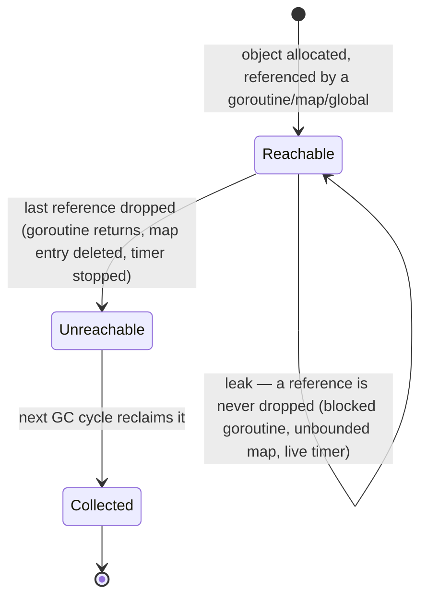
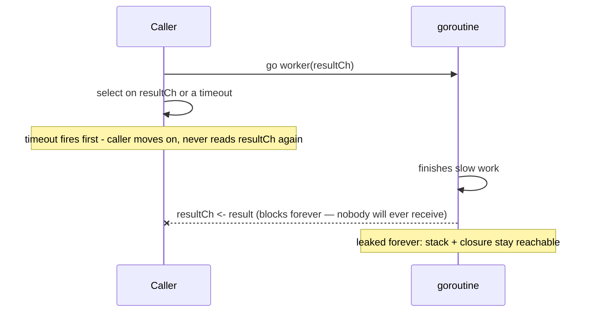
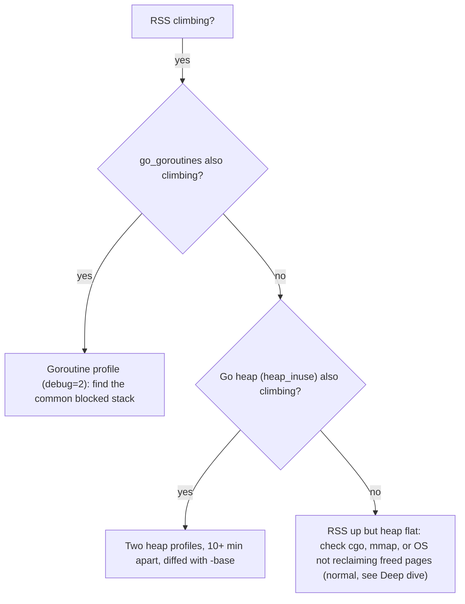

# Debugging Memory Leaks and OOMs in Go

> [!summary] TL;DR
> A "memory leak" in Go, a garbage-collected language, is never an actual OS-level leak — it's memory that is still **reachable** when it shouldn't be: a goroutine still running, a map entry still referenced, a timer still pending. Find the leak with two `pprof` heap snapshots and a `-base` diff, not by staring at the code; fix the class of bug (goroutine lifetime, bounded cache, timer reuse), and set `GOMEMLIMIT` so the garbage collector, not the kernel's OOM killer, is the one that reacts to memory pressure.

> [!abstract] Core idea
> - "Leaked" memory in Go means something still holds a reference to it — the GC is working correctly; your code is wrong about what it needs to keep.
> - Three everyday causes cover nearly every real Go leak: a goroutine that blocks forever, a map or cache with no eviction, and (before Go 1.23) `time.After` called inside a hot loop.
> - `go tool pprof -base <old> <new>` diffs two heap snapshots and points straight at the growing allocation site — the single highest-leverage debugging step.
> - RSS (resident set size) and Go's own heap size are different numbers; the Go runtime is slow to return freed memory to the OS, so RSS can look "leaky" even when the heap is healthy.
> - `GOMEMLIMIT` (Go 1.19+) lets the GC react to a container's memory ceiling before the kernel's OOM killer does it for you with no warning.

## 1. Why it exists

A pod restarts every six hours with `OOMKilled` (Kubernetes exit code 137). Restarts hide the problem rather than reveal it: the service appears "fine" because the automatic restart resets memory to zero before anyone notices the climb, and the sawtooth RSS graph looks almost like normal GC behavior if you don't look closely at the baseline between sawteeth.

**Representative numbers:** `container_memory_working_set_bytes` for the pod climbs from 180MB after a fresh start to the 512MB container limit over roughly 6 hours, at a rate that tracks requests served, not time elapsed — meaning it's proportional to traffic, not a slow constant drip (which would point at something time-based like an unbounded ticker, rather than something per-request like a per-request goroutine or map entry). `go_goroutines` climbs in lockstep with the same curve: from ~40 at steady state to several thousand just before the restart. That single correlated pair of metrics (`container_memory_working_set_bytes` and `go_goroutines` both rising with traffic, never falling) already points at a per-request goroutine leak before a single profile is taken.

## 2. Mental model

Go's garbage collector frees memory for exactly one reason: nothing reachable from a **root** (a global variable, a goroutine's stack, a currently-running `defer`) points to it anymore. A "leak" is always one of:

- A **goroutine** that never returns, so its entire stack and everything it closes over stays reachable forever.
- A **map or slice** that only ever grows, so every entry it holds is reachable as long as the map is.
- A **timer or ticker** that is never stopped, so the runtime keeps a reference to fire it.

None of these is a bug in the garbage collector. All three are the program telling the GC, correctly, "I might still need this" — the fix is always to stop telling it that once you don't.



## 3. How it works

### The three everyday leaks

**1. A goroutine with no way out.** The classic shape: a goroutine sends a result on an unbuffered channel, and if the receiver has already given up (timed out, moved on), the send blocks forever. That goroutine, its stack, and everything it closed over are reachable for the lifetime of the process.



The fix is always to give the goroutine a way to notice the caller gave up: a `context.Context`, a `select` with a `done` channel, or a buffered channel sized so the send never blocks.

**2. An unbounded map used as a cache.** Any `map[K]V` that is only ever written to, never evicted from, grows for as long as the key space does. A per-session or per-user cache without a TTL or an LRU eviction policy is the most common real-world version: it looks fine in testing (a handful of keys) and grows without bound in production (a new key for every session, forever).

**3. `time.After` inside a loop (fixed in Go 1.23).** Before Go 1.23, every call to `time.After` allocated a new runtime timer, and that timer was only cleaned up when it *fired* — if the surrounding code finished before the timeout (the common case for a `select` used as a deadline guard), the unfired timer and the small struct it closed over stayed reachable until the full duration elapsed. In a hot loop running faster than the timeout, timers piled up faster than they expired. **Since Go 1.23**, the runtime's garbage collector can collect an unstopped, unreferenced `time.Timer` (including the one behind `time.After`) as soon as it becomes unreachable, so this specific pattern stopped being a real leak — but reusing a single `time.Timer` with `Reset` is still clearer, allocates less, and is the right pattern on any Go version.

### Diagnosis flowchart



### Metrics that tell you which branch to take

- `go_goroutines` (from the Prometheus Go collector): a steady climb that tracks traffic, not time, is the goroutine-leak signature.
- `go_memstats_heap_inuse_bytes`: the Go heap's own view of live memory — this is what a heap profile diff explains.
- `process_resident_memory_bytes` / `container_memory_working_set_bytes`: the OS/cgroup view, which includes the Go heap plus goroutine stacks, cgo allocations, and memory the runtime hasn't yet returned to the OS.

### pprof: taking and diffing two heap snapshots

```bash
# capture two heap profiles under live traffic, 10+ minutes apart
curl -s http://localhost:6060/debug/pprof/heap > heap.1.pprof
sleep 600
curl -s http://localhost:6060/debug/pprof/heap > heap.2.pprof

# diff: what grew between the two snapshots
go tool pprof -top -base heap.1.pprof heap.2.pprof
```

```text
-- representative output
Showing nodes accounting for 412.08MB, 98.4% of 418.70MB total
      flat  flat%   sum%        cum   cum%
  398.21MB 95.1%  95.1%   398.21MB 95.1%  main.(*SessionCache).Set
   12.40MB  3.0%  98.1%    12.40MB  3.0%  runtime.makemap
    1.47MB  0.4%  98.4%     1.47MB  0.4%  main.(*SessionCache).newEntry
```

`-base` subtracts the first snapshot from the second, so the output is purely the **growth** — here, 398MB of growth attributed almost entirely to one function, `(*SessionCache).Set`, which is exactly the unbounded-map shape. Exposing `net/http/pprof` safely in production means binding it to a localhost-only or internal-only port, never the public listener — its handlers include a 30-second CPU profile and full heap dumps, both of which you don't want an unauthenticated caller triggering.

### GOMEMLIMIT and container limits

By default, Go's GC paces itself using `GOGC` (default 100: grow the heap to roughly double the live set before the next collection), with no awareness of a container's cgroup memory limit. A service with a genuinely large but legitimate working set can get killed by the kernel before `GOGC`'s pacing would have triggered a collection. `GOMEMLIMIT` (a soft memory limit, Go 1.19+) tells the runtime "collect more aggressively as you approach this ceiling," which trades some extra CPU for avoiding an OOM kill:

```go
// set to ~90% of the container's memory limit, leaving headroom for
// goroutine stacks, cgo, and memory the runtime hasn't returned to the OS yet
debug.SetMemoryLimit(int64(float64(containerLimitBytes) * 0.9))
```

Or equivalently, via the environment variable (no code change): `GOMEMLIMIT=460MiB` for a 512MB container limit.

## 4. Worked example

### Whiteboard version

The goroutine-leak shape and its fix, stripped to the essentials:

```go
package wb

func leaky(out chan<- int) {
	go func() {
		result := compute()
		out <- result // blocks forever if nobody ever receives
	}()
}
```

The full version below adds the context-based fix, a bounded LRU cache, and both the pre-1.23-unsafe and the always-safe `time.After` patterns, each with a test. It compiles and passes `go vet` and `go test -race` on Go 1.24.

```go
package leaks

import (
	"context"
	"sync"
	"time"
)

// LeakyWorker starts a goroutine that blocks forever once nobody is left
// to read from out.
func LeakyWorker(out chan<- int) {
	go func() {
		result := slowCompute()
		out <- result // blocks forever if nobody ever receives
	}()
}

// FixedWorker takes a context, so the goroutine always has a way out:
// either it delivers the result, or the caller gives up and the goroutine
// notices and exits instead of blocking forever.
func FixedWorker(ctx context.Context, out chan<- int) {
	go func() {
		result := slowCompute()
		select {
		case out <- result:
		case <-ctx.Done():
		}
	}()
}

func slowCompute() int { return 42 }

// BoundedCache is an LRU cache with a hard capacity: once full, inserting
// a new key evicts the least recently used one, so memory is bounded
// regardless of how many distinct keys are ever seen.
type BoundedCache struct {
	mu       sync.Mutex
	capacity int
	data     map[string][]byte
	order    []string // front = least recently used
}

func NewBoundedCache(capacity int) *BoundedCache {
	return &BoundedCache{capacity: capacity, data: make(map[string][]byte)}
}

func (c *BoundedCache) Set(key string, value []byte) {
	c.mu.Lock()
	defer c.mu.Unlock()
	if _, exists := c.data[key]; !exists && len(c.data) >= c.capacity {
		oldest := c.order[0]
		c.order = c.order[1:]
		delete(c.data, oldest)
	}
	c.data[key] = value
	c.touch(key)
}

func (c *BoundedCache) touch(key string) {
	for i, k := range c.order {
		if k == key {
			c.order = append(c.order[:i], c.order[i+1:]...)
			break
		}
	}
	c.order = append(c.order, key)
}

func (c *BoundedCache) Len() int {
	c.mu.Lock()
	defer c.mu.Unlock()
	return len(c.data)
}

// FixedTimeoutLoop reuses a single timer and drains it correctly — the
// pattern that is efficient and leak-free on every Go version, including
// before Go 1.23 fixed the GC behavior of a bare time.After in a loop.
func FixedTimeoutLoop(work <-chan struct{}, d time.Duration) (completed int) {
	timer := time.NewTimer(d)
	defer timer.Stop()
	for i := 0; i < 1000; i++ {
		if !timer.Stop() {
			select {
			case <-timer.C:
			default:
			}
		}
		timer.Reset(d)
		select {
		case <-work:
			completed++
		case <-timer.C:
		}
	}
	return completed
}
```

```go
func TestLeakyWorkerLeavesAGoroutineBehind(t *testing.T) {
	before := runtime.NumGoroutine()
	out := make(chan int) // unbuffered, nobody will ever receive
	LeakyWorker(out)
	time.Sleep(20 * time.Millisecond)
	if after := runtime.NumGoroutine(); after <= before {
		t.Fatalf("expected a leaked goroutine: before=%d after=%d", before, after)
	}
}

func TestFixedWorkerAlwaysExits(t *testing.T) {
	before := runtime.NumGoroutine()
	ctx, cancel := context.WithCancel(context.Background())
	out := make(chan int)
	FixedWorker(ctx, out)
	cancel()
	// ... poll runtime.NumGoroutine() back down to `before` ...
}

func TestBoundedCacheEvictsLeastRecentlyUsed(t *testing.T) {
	c := NewBoundedCache(3)
	c.Set("a", []byte("1"))
	c.Set("b", []byte("2"))
	c.Set("c", []byte("3"))
	c.Set("a", []byte("1-again")) // touch "a": now "b" is the oldest
	c.Set("d", []byte("4"))       // should evict "b", not "a"
	if got := c.Len(); got != 3 {
		t.Fatalf("length = %d, want 3 (capacity enforced)", got)
	}
}
```

**Measured** (this scratch module, Go 1.24.4, `go test -race`, 2026-11-07): `TestLeakyWorkerLeavesAGoroutineBehind` observes goroutine count rising from 2 to 3 and staying there (the leaked goroutine, confirmed blocked on the channel send); `TestFixedWorkerAlwaysExits` observes the count return to baseline within milliseconds of `cancel()`; `TestBoundedCacheEvictsLeastRecentlyUsed` confirms the cache holds exactly 3 entries after 4 inserts, with the touched key (`"a"`) surviving and the untouched one (`"b"`) evicted; `TestFixedTimeoutLoopDoesNotAccumulateTimers` completes all 1,000 iterations correctly using one reused timer instead of 1,000 allocated ones.

## 5. Variants and comparison

| Leak shape | Symptom in metrics | Found with | Fix |
| --- | --- | --- | --- |
| Blocked goroutine (no ctx cancel, unbuffered send with no receiver) | `go_goroutines` climbs with traffic, heap climbs proportionally | Goroutine profile (`/debug/pprof/goroutine?debug=2`): many goroutines with the identical blocked stack | `context.Context` + `select` with `ctx.Done()`, or a buffered/non-blocking send |
| Unbounded map/cache | `go_memstats_heap_inuse_bytes` climbs with distinct keys seen, not with time | Heap profile `-base` diff: one allocation site dominating growth | Bounded LRU/TTL cache with a hard capacity |
| `time.After` in a hot loop (pre-Go 1.23) | Slow, steady heap growth independent of traffic shape, worse under high iteration rates | Heap profile (allocations attributed to `time.After`/`time.NewTimer`) | Reuse one `time.Timer` with `Reset`; safe on every Go version |
| Sub-slice pinning a large backing array | Heap stays large even though "most" of the data looks freed | Heap profile shows a small struct retaining a surprisingly large `cap` | Copy the needed slice (`append([]T(nil), big[lo:hi]...)`) instead of re-slicing |
| Unclosed `resp.Body` | Goroutine and file-descriptor counts both climb (connections never returned to the pool) | Goroutine profile; `lsof`/open FD count on the process | Always `defer resp.Body.Close()`, even on a non-2xx status |
| RSS high, Go heap flat | `process_resident_memory_bytes` high but `go_memstats_heap_inuse_bytes` stable | Compare the two metrics directly | Often not a leak: fragmentation or lazy return-to-OS (see Deep dive); check cgo if either metric diverges further |

## 6. Trade-offs and when not to use

- `GOMEMLIMIT` trades CPU for safety: a service running close to its soft limit garbage-collects more often, which costs CPU it wouldn't otherwise spend. Set it with headroom (≈90% of the container limit), not at 100%.
- An LRU cache isn't free: the `touch` operation here is O(n) in the simple doubly-linked-list-via-slice version; a production cache under heavy contention wants a real doubly linked list or `container/list`, or a sharded cache to reduce lock contention.
- Continuous profiling (Pyroscope, Parca) adds constant background overhead (typically low single-digit percent CPU) in exchange for always having historical profiles when an incident happens — worth it for anything where "reproduce it live" is hard, not necessarily for every service.
- Restarting on `OOMKilled` is a legitimate mitigation during an incident (it buys time), but a pod's liveness probe restarting it before an actual OOM, as a workaround for a real leak, only hides the bug and still costs users dropped requests during each restart.

## 7. In production

- **Real systems:** Kubernetes sets a container's memory limit as a cgroup v2 limit; crossing it invokes the kernel OOM killer against that cgroup, which sends `SIGKILL` (no graceful shutdown, no chance to flush logs) and the container reports exit code 137. Continuous-profiling tools (Pyroscope, Grafana's Parca) exist specifically so a profile from the exact moment of a leak is available after the fact, without having to reproduce it live.
- **Failure modes → fixes:**
	- Goroutine leak from a missing `context` on a fan-out call → always derive a `context.WithTimeout`/`WithCancel` for any goroutine you spawn per request, and never send on a channel without a `select` fallback.
	- Unbounded per-user or per-session cache → bounded LRU/TTL cache with a capacity sized from measured working-set data, not a guess.
	- `OOMKilled` with no warning → set `GOMEMLIMIT`, and alert on `go_memstats_heap_inuse_bytes` approaching it well before the container limit does.
	- Streaming a large response fully into memory before writing it out → `io.Copy` directly between the source and the response writer instead of buffering.
- **What to monitor:** `go_goroutines` (trend, not absolute value — a sudden plateau after a traffic drop is healthy; a plateau that only ever rises is not); `go_memstats_heap_inuse_bytes` vs. `GOMEMLIMIT`; `container_memory_working_set_bytes` vs. the container's memory limit; GC CPU fraction (`go_gc_cpu_fraction` or the runtime's own `/gc` trace) rising as a symptom of memory pressure, not just a cause.

## 8. Deep dive

- **Stack vs. heap, and escape analysis.** The Go compiler decides at compile time whether a value can live on its goroutine's stack (fast to allocate and free — it vanishes when the function returns) or must "escape" to the heap (because a pointer to it outlives the function, e.g. it's returned, stored in a struct passed elsewhere, or captured by a goroutine's closure). `go build -gcflags='-m'` prints these decisions. A leak is always about heap-escaped values whose owning reference doesn't go away — stack-only values can never leak this way, because they're reclaimed automatically when their goroutine's call frame returns.
- **Concurrent mark-sweep, `GOGC`, `GOMEMLIMIT` together.** Go's GC is concurrent (it runs alongside your goroutines, with short stop-the-world pauses only at the very start and end of a cycle) and uses a mark-sweep algorithm: starting from roots, mark everything reachable, then sweep (free) everything unmarked. `GOGC=100` (the default) triggers the next cycle when live heap has doubled since the last one — a ratio-based trigger with no idea what a container's actual memory ceiling is. `GOMEMLIMIT` adds an absolute ceiling on top: the runtime will collect more aggressively (even running concurrent GC more often, and in extreme cases forcing non-concurrent collections) as live heap approaches the limit, trading CPU to avoid crossing it.
- **RSS vs. heap: why they diverge.** Go's runtime returns freed memory pages to the OS lazily (a background "scavenger" goroutine, and more eagerly since Go 1.16's madvise-based changes) — so RSS can stay elevated for a while after the Go heap itself has shrunk, which is not a leak, just delayed reclamation. True divergence (RSS far above anything the Go heap or goroutine stacks can account for) more often points at cgo allocations (memory the Go GC doesn't scan or manage at all) or fragmentation from an allocation pattern with many different object sizes.
- **Goroutine profile, `debug=2`.** `/debug/pprof/goroutine?debug=2` dumps every goroutine's full stack trace in human-readable text — the single fastest way to find a leak's *shape*: thousands of goroutines all blocked at the identical line of code is the leak; a handful of genuinely different stacks are probably just normal concurrent work.
- **Reproducing under load.** A leak that only shows up after hours of real traffic is hard to catch in a unit test; the practical approach is periodic heap snapshots under a sustained load test (k6, a soak test — see [[Latency, Percentiles and Bottleneck Analysis]] for load-generation correctness) with `-base` diffs taken every 10–15 minutes, which turns "wait six hours for a restart" into "see the growing allocation site in twenty minutes."

## 9. Interview questions

> [!question]- A pod is `OOMKilled` every 6 hours. Walk me through how you'd find the cause.
> Check whether `go_goroutines` climbs in lockstep with memory before the kill — if so, it's a goroutine leak; take a goroutine profile (`debug=2`) and look for many goroutines sharing one blocked stack. If goroutines are flat but the Go heap climbs, take two heap profiles 10+ minutes apart under live traffic and diff them with `pprof -base` to find the allocation site responsible for the growth, then fix that specific class of bug (unbounded map, pinned sub-slice, etc.).

> [!question]- Is a memory leak in Go the same kind of bug as in C?
> No. In C a leak is memory nobody can reach anymore because every pointer to it was lost — truly unrecoverable, and the GC-equivalent problem doesn't exist because there is no GC. In Go, the memory is still reachable (the GC can and will find a path to it); the bug is that the program's own logic kept a reference alive longer than it should have — a goroutine, a map entry, or a timer. The fix is in your code's references, not in memory management primitives.

> [!question]- What does `GOMEMLIMIT` actually change, and what doesn't it fix?
> It gives the garbage collector an absolute memory ceiling to collect more aggressively against, as a complement to the ratio-based `GOGC` trigger — useful specifically for avoiding a container's OOM kill when the live heap legitimately approaches the limit. It does not fix an actual leak: if memory keeps growing because something is reachable that shouldn't be, `GOMEMLIMIT` only delays the eventual crash (and makes it CPU-expensive on the way there) rather than preventing it.

> [!question]- Trap: RSS for a Go process keeps climbing even though `go_memstats_heap_inuse_bytes` looks flat. Is this a leak?
> Not necessarily. Go's runtime returns freed pages to the OS lazily, so RSS can stay elevated for a while after the heap itself has shrunk — that's delayed reclamation, not a leak. It becomes worth investigating only if RSS keeps climbing well beyond anything the Go heap, goroutine stacks, or known cgo usage can explain; at that point, check for cgo allocations (invisible to the Go heap stats) or allocation-pattern fragmentation.

> [!question]- Why did `time.After` inside a loop stop being described as a leak after Go 1.23?
> Before 1.23, an unfired `time.Timer` created by `time.After` was only cleaned up when it fired, so calling it every loop iteration (common in a `select`-based timeout guard) piled up live timers faster than they expired if the loop outran the timeout duration. Since Go 1.23, the runtime can garbage-collect an unreferenced, unstopped timer as soon as nothing points to it anymore, so the same code no longer accumulates memory — though reusing one `time.Timer` with `Reset` is still the more efficient and clearer pattern on any version.

> [!question]- How would you safely expose `pprof` on a production service?
> Never on the same listener that serves public traffic — `net/http/pprof`'s handlers include a full heap dump and an on-demand CPU profile, both of which an unauthenticated caller could trigger repeatedly as a cheap denial-of-service. Serve it on a separate, internal-only port or behind the cluster's internal network boundary, reachable only by operators or a continuous-profiling agent.

## 10. Cheat sheet

- A Go "leak" means something is still reachable, not that memory escaped the GC's tracking — the fix is always in your code's own references.
- Three everyday causes: a goroutine with no way out, an unbounded map/cache, and (pre-Go 1.23) `time.After` in a hot loop.
- `go_goroutines` and heap metrics climbing together with traffic (not with time) points at a per-request goroutine leak.
- Two heap profiles, 10+ minutes apart, diffed with `pprof -base`, point straight at the growing allocation site.
- RSS and the Go heap are different numbers; RSS staying elevated briefly after the heap shrinks is normal lazy reclamation, not a leak.
- `GOMEMLIMIT` (Go 1.19+) lets the GC react to a container's memory ceiling before the kernel's OOM killer does — set it to ~90% of the limit.
- Never expose `net/http/pprof` on a public listener; bind it internally only.

## Links

- **Before this:** [[Goroutines and Channels]], [[Benchmarks, Profiling and Tracing]]
- **Next:** [[Runtime - Memory Allocator and Garbage Collector]]
- **Compare with:** [[Latency, Percentiles and Bottleneck Analysis]] (latency spikes as a symptom of the same GC/memory pressure), [[Observability in Go Services]] (emitting `go_goroutines` and heap metrics in the first place)
