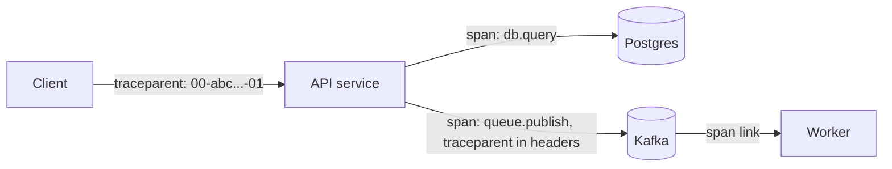
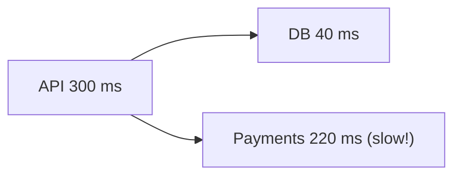
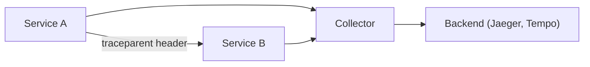
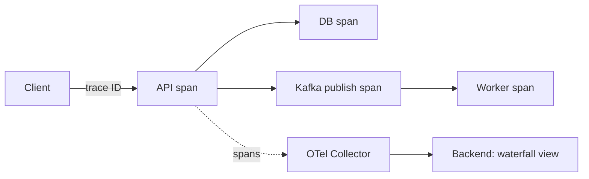
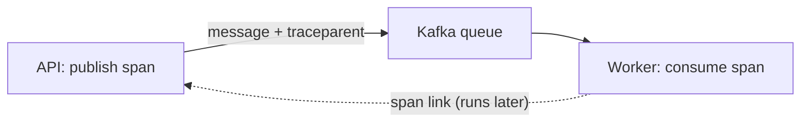
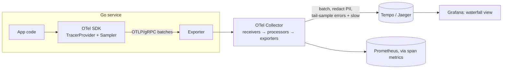

# Distributed Tracing with OpenTelemetry

> [!summary] TL;DR
> A **trace** is the end-to-end story of one request as it crosses services, each hop recorded as a **span**. OpenTelemetry (OTel) is the vendor-neutral standard for creating, propagating and exporting those spans so a vendor's backend (Jaeger, Tempo, Honeycomb) can render them as one waterfall instead of scattered logs.

> [!abstract] Core idea
> - A trace is a tree of spans; a span is one unit of work with a start time, a duration, and a parent.
> - The W3C `traceparent` header carries the trace and span IDs across process boundaries, so every hop's spans attach to the same tree.
> - An OTel SDK creates spans; an OTel Collector receives, processes (batch, sample, redact) and exports them to a backend.
> - Reading a waterfall means finding the critical path: the longest chain of spans, not the longest single span.
> - Classic mistake: a span name or attribute built from a raw ID (`GET /users/48213`) explodes cardinality in the tracing backend just as it does for metrics.

### Whiteboard version

Request hits the API, which calls Postgres and then publishes to Kafka for a worker to pick up:



Three spans (`db.query`, `queue.publish`, and the worker's consume span) all carry the same trace ID, `abc...`. One trace ID, one `GET /trace/abc...` query in the backend, one waterfall with every hop.

## Start here: the basics 🟢

> [!info] How to read this note (pick your level)
> - 🟢 **New to this?** Read "From zero" below, then sections 1, 2 and 10 (why, mental model and the cheat sheet). Stop there, that is a full first pass.
> - 🟡 **Know the basics?** Add sections 3, 4, 5 and 6 (how it works, a worked example, options and trade-offs).
> - 🔴 **Interview / SDE-3 prep?** Add sections 7, 8 and 9 (production, deep dive and interview questions). Headings are tagged 🟢🟡🔴 so you always know where you are.

> [!note] Before this note
> - [[Observability Fundamentals]]: an app leaves three kinds of clues (logs, metrics, traces), and sampling keeps only some traces to save money.
> - [[Structured Logging]]: every log line can carry a `trace_id` field, so you can jump from a trace to its log lines.

**From zero, in 60 seconds** 🟢

One click in an app can pass through 10 services. When it is slow, which one is to blame?
A **trace** is the full story of that one request. Each step inside it is a **span**, with a start time and an end time.



The services pass a trace ID along in a header, so all the spans join up into one picture.
**OpenTelemetry** (OTel) is the free, shared standard for making and sending these spans, so you aren't tied to one vendor.



The rest of this note is just these 3 questions:
1. What is inside a span?
2. How does the trace ID travel between services?
3. How do you read the waterfall chart to find the slow part?


**The problem in one story.**
A user clicks "Pay" and waits 3 seconds.
That one click touched an API, a database, a queue and a worker.
Each service has its own logs, so nobody can see the whole journey.
Tracing stamps the request with one ID and records every step, so you can see where the 3 seconds went.

**Words you need first**

| Word | Plain meaning | Tiny example |
| --- | --- | --- |
| Request | One call from a client to a service | `POST /pay` |
| Trace | The full story of one request across all services | One ID like `abc123` |
| Span | One timed step inside a trace, with a parent | "db.query took 40 ms" |
| Propagation | Passing the trace ID along to the next service | Sending a `traceparent` HTTP header |
| OpenTelemetry (OTel) | A vendor-neutral standard and SDK for traces | `otel.Tracer("api")` in Go |
| Collector | A middle service that receives, filters and forwards spans | Drops 90% of healthy traces |
| Sampling | Keeping only some traces to save cost | Keep 1 in 100 |
| Cardinality | How many distinct values a label has | User IDs = millions |
| Root span | The first, top span of a trace; it has no parent | `POST /pay`, 420 ms |
| Waterfall | The trace drawn as stacked time bars, one per span | long bar = slow step |
| Critical path | The chain of steps that actually decided the total time | API → `db.update_invoice` |
| `traceparent` | The standard HTTP header that carries the trace ID and parent span ID | `00-4bf9...-00f0...-01` |
| Span link | A "related to" pointer between spans that do not run inside each other | Kafka worker points back to the publisher |
| Baggage | Small extra key-values that travel with the request to every service | `tenant.id=acme` |

**Picture it**



**Analogy.** A parcel with a tracking number: every depot scans it, so you can see where it sat and for how long.
Where it breaks: a parcel is scanned at every depot, but traces are usually sampled, so many requests are never recorded at all.

**How the rest of this note builds up**

- First, why logs and metrics alone can't follow one request (section 1) and the tree-of-spans model (section 2).
- Then span anatomy, the `traceparent` header, the SDK-Collector-backend pipeline and reading a waterfall (section 3).
- Then a Go worked example with HTTP and Kafka propagation (section 4), plus variants and trade-offs (sections 5-6).
- Finally the SDE-3 deep dive: Collector monitoring, span metrics, Go context pitfalls, exemplars, baggage and 128-bit trace IDs (sections 7-8).

> [!tip] Remember
> One trace ID travels with the request; every hop adds a span, and the waterfall shows where time went.

## 1. Why it exists 🟢

A checkout request in a 12-service system times out. Logs show "timeout" in three different services, at three different timestamps, with no shared ID. Without a trace you grep five log streams trying to reconstruct the order of events by eyeballing timestamps that may themselves be skewed by clock drift (each server's clock slowly running a little fast or slow).

With tracing, one `trace_id` ties every span together, and the waterfall shows the request spent 180 ms in the API, 20 ms in a Redis lookup (Redis is a fast in-memory store), then 3.4 s blocked on a single `db.query` span to Postgres (the main database) — the actual bottleneck, found by sorting one view instead of correlating five.

**Measured (synthetic, this note):** the `InvoiceOps` webhook example below produces one root span and four child spans for a single request; `go test` confirms the count.

### Real-life example: a slow Zomato checkout 🟢

Think of placing an order on Zomato.
One tap on "Place order" may touch a cart service, a price service, a coupon service, a payment service and a restaurant service.
If checkout suddenly takes 5 seconds, each team's own logs say "we look fine".
A trace of one slow checkout shows all five steps as bars on one timeline, and the coupon check alone takes 4 seconds.
Now one team knows the problem is theirs, in minutes instead of hours of meetings.

## 2. Mental model 🟢

A trace is a tree, not a list. Each span has:

- a **trace ID** (shared by every span in the trace),
- a **span ID** (unique to this span),
- a **parent span ID** (empty for the root),
- a **name**, **start time**, **duration**, **attributes** (key/value), **events** (timestamped notes), and a **status** (unset, OK, or error).

Walking the tree from the root down and reading each span's `[start, start+duration]` interval reconstructs exactly what ran, in what order, and how long each piece took — the same information logs give you, but pre-joined by causality instead of by grepping an ID.

**Analogy:** a trace is a call stack that survived a network hop. A normal stack trace shows which function called which, in one process. A distributed trace shows which service called which, with wall-clock durations, across as many processes as the request touched.

## Common beginner mistakes 🟢

- **Starting a goroutine with `context.Background()`** → the new span has no parent, so the trace breaks in two → pass the request's `ctx` into the goroutine.
- **Putting a raw ID in the span name** (`GET /users/48213`) → millions of unique names swamp the tracing backend → name it by route (`GET /users/{id}`) and put the ID in an attribute only if needed.
- **Keeping only 1% of traces, chosen at the start** → the rare slow request you need was probably thrown away → tail-sample in the Collector and always keep errors and slow traces.
- **Forgetting to flush on shutdown** → the last batch of spans is lost when the service exits → call `TracerProvider.Shutdown` (or `ForceFlush`) before exit.
- **Thinking traces replace logs** → many requests have no trace at all because of sampling → keep structured logs with the `trace_id` field too.

## 3. How it works 🟡

> 🟢 → 🟡 **You now know** that a trace is a tree of timed spans that share one trace ID. **Next we open the box**: what fields a span holds, how the trace ID hops between services in a header, how spans travel to the backend, and how to read the waterfall to find the slow part.

### Span anatomy and span kind

**In plain words:** a span is one timed step: a name, start and end time, a parent, and some labels. "Kind" says if it is a server, a client, or a queue step.

**Step by step:**
1. The API receives `POST /pay`. It starts the root span: new trace ID `abc`, span ID `s1`, no parent, kind `SERVER`.
2. The API calls the database. It starts span `s2` with parent `s1` and kind `CLIENT`, and adds an attribute `db.system=postgresql`.
3. The database call fails. The code records the error and sets the span status to `Error`.
4. Each span ends with a duration, say `s2` took 40 ms and `s1` took 300 ms.

| Field | Meaning |
| --- | --- |
| `trace_id` | 128-bit ID, same for every span in the trace |
| `span_id` | 64-bit ID, unique to this span |
| `parent_span_id` | the span that started this one (empty = root) |
| `kind` | `SERVER`, `CLIENT`, `PRODUCER`, `CONSUMER`, or `INTERNAL` — tells the backend how to draw the edge |
| `attributes` | key/value facts: `http.status_code`, `db.system`, bounded-cardinality only, named per OTel's semantic conventions (a shared attribute-naming spec, e.g. `http.request.method` not `method`) so dashboards and backends built against one instrumented service work against any other |
| `events` | timestamped notes inside the span, e.g. a retry or a cache miss |
| `status` | `Unset`, `Ok`, or `Error` (`SetStatus` + `RecordError`) |

### Propagation: the traceparent header

**In plain words:** one HTTP header carries the trace ID and the parent span ID to the next service. That is the whole trick.

**Step by step:**
1. Service A is inside span `00f0...` of trace `4bf9...`. It calls service B.
2. Before sending, A writes the header `traceparent: 00-4bf9...-00f0...-01`.
3. B reads the header. Its new span gets the same trace ID, and its parent is `00f0...`.
4. The same string can ride in gRPC metadata (gRPC is a fast service-to-service call system) or a Kafka message header.
5. For queue work that runs later, the worker makes a **link** back to the publisher's span instead of a parent.



OTel's default propagator is the **W3C Trace Context** format:

```text
traceparent: 00-4bf92f3577b34da6a3ce929d0e0e4736-00f067aa0ba902b7-01
             │  │                                │                │
             │  32-hex trace ID                  16-hex span ID   flags (01 = sampled)
             version
```

Every outbound call (HTTP header, gRPC metadata, or a Kafka message header) carries this string. The receiving service's instrumentation reads it, and any span it starts becomes a child of that span ID instead of the start of a new trace.

**Baggage** (the `baggage` header) carries arbitrary key/value context the same way — for example a `tenant.id` to tag every downstream span — but baggage is not telemetry; it must be kept small since it travels on every request.

For asynchronous work (a Kafka consumer, a cron-triggered job, meaning one started by a timer), the consumer does not share a timeline with the producer, so OTel uses a **span link** instead of a parent/child edge: the consumer's span links back to the producer's span ID, and tracing UIs draw it as a cross-reference rather than claiming the consumer "contains" the producer's wait time.

### The pipeline: SDK, Collector, backend

**In plain words:** your code makes spans with the SDK, a collector gathers and filters them, and a backend stores and shows them.

**Step by step:**
1. Your code calls the OTel API: `tracer.Start(ctx, "db.update_invoice")`.
2. The SDK (the engine you set up once at startup, called the **TracerProvider**) decides whether to record it, using its **Sampler**.
3. Finished spans are grouped into batches and sent by an **exporter** over **OTLP** (OpenTelemetry's wire format) to the Collector.
4. The Collector batches, hides personal data, and keeps all error and slow traces plus a small share of the rest.
5. It sends them to Tempo or Jaeger, and Grafana draws the waterfall.



- **API vs SDK:** the OTel **API** (`otel.Tracer(...)`, `trace.SpanFromContext`) is what instrumented libraries and your own code call. The **SDK** (`sdktrace.NewTracerProvider`) is what you wire up once at startup — it decides sampling, batching and export. Code that only imports the API has zero behavior until an SDK is registered with `otel.SetTracerProvider`.
- **Instrumentation libraries** wrap a transport so you don't hand-write spans for routine calls: `otelhttp` (HTTP client and server middleware), `otelgrpc` (gRPC interceptors), `otelsql` / `otelpgx` (SQL driver wrapper that emits `db.query` spans).
- **Sampling.** Head sampling (`ParentBased(TraceIDRatioBased(0.1))`) decides whether to even record a trace, at the root, before any work happens — cheap, but a 3.4 s outlier has only a 10% chance of being kept. Tail sampling, run in the Collector, buffers whole traces briefly and keeps every trace with an error or a latency over a threshold, dropping the boring 99%.

  Production systems almost always want tail sampling for anything that isn't 100%-sampled.
- **The Collector** sits between services and backends so services only ever talk OTLP to one place. Its pipeline is receivers (OTLP gRPC/HTTP) → processors (`batch`, `memory_limiter`, `tail_sampling`, attribute redaction for PII) → exporters (per backend).

  Running it as a per-node **agent** keeps the hop local and cheap; running it as a central **gateway** centralizes sampling decisions and redaction policy. Most fleets run both: agent for collection, gateway for tail sampling.

### Reading a waterfall

**In plain words:** bars stacked by time. Long bars are slow steps; gaps between bars are time spent waiting somewhere you didn't measure.

**Step by step:**
1. Look at the top bar, the root span: `POST /webhooks/razorpay` took 420 ms.
2. Find which child bars fill most of it: `db.update_invoice` took 320 ms. That is the critical path.
3. Look for gaps where no child bar runs. That time was spent on something with no span.
4. Look for the same short bar repeated many times, like `db.query` ×40. That is a loop calling the database once per item.

```mermaid
gantt
    title POST /payments/webhooks/razorpay (critical path in bold via color)
    dateFormat x
    axisFormat %L ms
    section root
    POST /webhooks/razorpay   :a1, 0, 420
    section children
    verify_signature          :a2, 0, 15
    db.check_webhook_event    :a3, 20, 40
    db.update_invoice         :crit, a4, 65, 320
    queue.publish_invoice_status :a5, 390, 30
```



The root span (420 ms) is explained almost entirely by `db.update_invoice` (320 ms): that is the critical path. A gap between the end of one span and the start of the next (not shown here) that isn't covered by any child span means time the parent spent on something unsampled — often a GC pause (Go's garbage collector briefly slowing the program), a lock wait, or a connection-pool queue (waiting for a free database connection).

Repeated, near-identical child spans (`db.query` ×40) is the N+1 pattern (1 query for a list, then 1 more query per item in it): look for a loop calling the database once per item instead of batching.

## 4. Worked example 🟡

**In plain words:** Go code building a real span tree for a webhook handler, so you can see parents and children in action.

The full version below builds InvoiceOps's real webhook span tree (`verify_signature → db.check_webhook_event → db.update_invoice → queue.publish_invoice_status`, kept from the old Go OpenTelemetry Metrics Tracing note) with a real `TracerProvider`, context threading, error recording, and a span exported in-memory for the test to assert on.

It compiles and passes `go vet` and `go test -race` on Go 1.24.4 with `go.opentelemetry.io/otel` v1.31.0.

**What this code does, in plain words:** `NewProvider` sets up the tracing engine and says "keep every trace". `HandleWebhook` starts one root span for the whole webhook, then calls four helper steps. Each helper starts its own child span from the same `ctx`, so all four hang under the root. When a step fails, the root span records the error and is marked `Error`.

```go
// Package tracing shows the shape of an OpenTelemetry-instrumented request
// path: a TracerProvider, a span tree across a webhook handler, and a
// recorded error.
package tracing

import (
	"context"
	"errors"
	"fmt"

	"go.opentelemetry.io/otel"
	"go.opentelemetry.io/otel/attribute"
	"go.opentelemetry.io/otel/codes"
	sdktrace "go.opentelemetry.io/otel/sdk/trace"
	"go.opentelemetry.io/otel/trace"
)

// NewProvider wires a TracerProvider to the given exporter. In production the
// exporter is OTLP over gRPC to an OTel Collector; here it is swappable so
// tests can use an in-memory recorder.
func NewProvider(exp sdktrace.SpanExporter) *sdktrace.TracerProvider {
	return sdktrace.NewTracerProvider(
		sdktrace.WithBatcher(exp),
		sdktrace.WithSampler(sdktrace.ParentBased(sdktrace.TraceIDRatioBased(1))),
	)
}

var tracer = otel.Tracer("invoiceops/webhooks")

// ErrDuplicateEvent is returned when a webhook event id was already processed.
var ErrDuplicateEvent = errors.New("duplicate webhook event")

// HandleWebhook mirrors InvoiceOps's razorpay webhook path:
// verify_signature -> db.check_webhook_event -> db.update_invoice -> queue.publish.
// Each step gets its own child span so a slow or failing step shows up on the
// waterfall without reading a single log line.
func HandleWebhook(ctx context.Context, payload []byte, sig string, seen map[string]bool) error {
	ctx, span := tracer.Start(ctx, "POST /payments/webhooks/razorpay",
		trace.WithAttributes(attribute.Int("payload.size_bytes", len(payload))))
	defer span.End()

	if err := verifySignature(ctx, payload, sig); err != nil {
		span.RecordError(err)
		span.SetStatus(codes.Error, "signature verification failed")
		return err
	}
	eventID := fmt.Sprintf("evt_%x", len(payload)) // stand-in for a parsed field
	dup, err := checkWebhookEvent(ctx, seen, eventID)
	if err != nil {
		span.RecordError(err)
		span.SetStatus(codes.Error, "event lookup failed")
		return err
	}
	if dup {
		span.SetAttributes(attribute.Bool("webhook.duplicate", true))
		return ErrDuplicateEvent
	}
	if err := updateInvoice(ctx, eventID); err != nil {
		span.RecordError(err)
		span.SetStatus(codes.Error, "invoice update failed")
		return err
	}
	return publishInvoiceStatus(ctx, eventID)
}

func verifySignature(ctx context.Context, payload []byte, sig string) error {
	_, span := tracer.Start(ctx, "verify_signature")
	defer span.End()
	if sig == "" {
		return errors.New("missing signature header")
	}
	return nil
}

func checkWebhookEvent(ctx context.Context, seen map[string]bool, eventID string) (bool, error) {
	_, span := tracer.Start(ctx, "db.check_webhook_event",
		trace.WithAttributes(attribute.String("db.system", "postgresql")))
	defer span.End()
	return seen[eventID], nil
}

func updateInvoice(ctx context.Context, eventID string) error {
	_, span := tracer.Start(ctx, "db.update_invoice",
		trace.WithAttributes(attribute.String("db.system", "postgresql")))
	defer span.End()
	return nil
}

func publishInvoiceStatus(ctx context.Context, eventID string) error {
	_, span := tracer.Start(ctx, "queue.publish_invoice_status",
		trace.WithAttributes(attribute.String("messaging.system", "kafka")))
	defer span.End()
	return nil
}
```

The test proves the span tree shape and that `TracerProvider.Shutdown`/`ForceFlush` is what actually delivers spans — a service that exits without flushing silently drops its last batch:

```go
package tracing

import (
	"context"
	"testing"

	"go.opentelemetry.io/otel"
	"go.opentelemetry.io/otel/sdk/trace/tracetest"
)

func TestHandleWebhook_SpanTreeAndStatus(t *testing.T) {
	exp := tracetest.NewInMemoryExporter()
	tp := NewProvider(exp)
	defer tp.Shutdown(context.Background())
	prevTP := otel.GetTracerProvider()
	otel.SetTracerProvider(tp)
	defer otel.SetTracerProvider(prevTP)
	tracer = otel.Tracer("invoiceops/webhooks")

	seen := map[string]bool{}
	if err := HandleWebhook(context.Background(), []byte("payload-1"), "sig", seen); err != nil {
		t.Fatalf("HandleWebhook: %v", err)
	}
	tp.ForceFlush(context.Background()) // without this, Shutdown alone would still flush, but a live service must call it on exit

	spans := exp.GetSpans()
	if len(spans) != 5 { // 4 child spans + the request root span
		t.Fatalf("got %d spans, want 5", len(spans))
	}
	names := map[string]bool{}
	for _, s := range spans {
		names[s.Name] = true
	}
	for _, want := range []string{"verify_signature", "db.check_webhook_event", "db.update_invoice", "queue.publish_invoice_status"} {
		if !names[want] {
			t.Errorf("missing span %q", want)
		}
	}
}

func TestHandleWebhook_DuplicateEventSkipsUpdate(t *testing.T) {
	exp := tracetest.NewInMemoryExporter()
	tp := NewProvider(exp)
	defer tp.Shutdown(context.Background())
	prevTP := otel.GetTracerProvider()
	otel.SetTracerProvider(tp)
	defer otel.SetTracerProvider(prevTP)
	tracer = otel.Tracer("invoiceops/webhooks")

	seen := map[string]bool{"evt_9": true}
	err := HandleWebhook(context.Background(), []byte("payload-9"), "sig", seen)
	if err != ErrDuplicateEvent {
		t.Fatalf("got err %v, want ErrDuplicateEvent", err)
	}
}
```

**Tested:** `go vet ./...` clean; `go test -race ./...` → `ok otelring 1.4s`, both tests pass (Go 1.24.4, `go.opentelemetry.io/otel` / `otel/sdk` / `otel/trace` v1.31.0, scratch module, 2026-11-07).

Full logging and metrics instrumentation for a Go service — `log/slog` setup, Prometheus `client_golang`, and the rest of the SDK wiring (resource attributes, OTLP exporter config, graceful shutdown) — is canonical in [[Observability in Go Services]]. This note only owns the tracing-specific concepts above.

## 5. Variants and comparison 🟡

| Approach | How it works | Use when | Cost |
| --- | --- | --- | --- |
| Manual spans (OTel API) | You call `tracer.Start`/`span.End` around the code you want measured | Business logic, queue handoffs, anything a library can't see | Developer time; precise naming |
| Auto-instrumentation libraries (`otelhttp`, `otelgrpc`, `otelsql`) | Wrap a transport once; every call through it gets a span | Routine HTTP/gRPC/SQL calls | Near-zero code; less control over names |
| Head sampling | Sampling decision made at the root span, before execution | High, uniform traffic where a fixed percentage is enough | Cheapest; loses most rare slow/error traces |
| Tail sampling (Collector) | Buffer the whole trace briefly, decide after it finishes | You must keep every error and p99 trace | More Collector memory; added latency before export |
| Logs with correlation IDs only (no tracing) | `trace_id` in log lines, reconstructed by grep across services | Very small systems, 1–2 services | No automatic waterfall; manual correlation |

### Tracing vs logs vs profiling 🟡

| | Tracing | Logs | Profiling |
| --- | --- | --- | --- |
| Answers | Which service or step was slow for this request? | What exactly happened in this event? | Which line of code uses the CPU or memory? |
| Scope | One request, across many services | One event, in one service | One process, across all requests |
| Kept | A sample of requests | Usually most lines | Short samples, often always-on |

## 6. Trade-offs and when not to use 🟡

- Tracing adds a header to propagate and a span to create on every call; in a single-process monolith (one app that does everything in one program), a request-scoped structured logger with a request ID gives most of the same debugging value for much less machinery.
- 100% sampling at high QPS (queries per second) is expensive to store; most of what you keep is traces that look exactly like every other trace. Tail sampling earns its complexity once traffic is high enough that 100% sampling isn't affordable.
- A trace shows one request's path, not aggregate behavior. "Is p99 latency trending up this week?" is a metrics question (see [[Metrics and Prometheus]]), not a tracing one — traces are for "why was *this* request slow," metrics are for "is the service healthy."
- Spans with unbounded attributes (a raw user ID, a full URL with query string) blow up the tracing backend's storage and indexing the same way an unbounded metric label blows up a time-series database.

## 7. In production 🔴

> 🟡 → 🔴 **You now know** span fields, how `traceparent` carries the trace across services and queues, the SDK → Collector → backend path, and how to read a waterfall. **Next is the advanced part**: what breaks in real fleets (broken traces, lost spans, clock skew), what to monitor on the Collector, and the deeper details interviewers probe.


- **Real systems:** Jaeger (CNCF, originally Uber) and Grafana Tempo are the two common open-source trace backends behind an OTel Collector; Honeycomb and Datadog APM accept OTLP directly. Google's Dapper paper (2010) and Twitter's Zipkin predate OTel and established the trace/span/propagation model OTel standardized.
- **Failure modes → fixes:**
  - Broken trace (a span with no parent appears as its own root) → a hop didn't propagate `traceparent` — check for a goroutine started with `context.Background()` instead of the request's `ctx`, or a queue client that didn't forward headers.
  - Missing spans for the slow path → head sampling dropped the trace before anyone knew it would be slow; switch to tail sampling on error/latency.
  - PII in attributes (an email in `user.email`) → add a Collector attribute-processor redaction rule and fix the call site.
  - Clock skew between hosts makes a child span appear to start before its parent → fix NTP (the network time protocol that keeps server clocks in sync); most backends also clamp this visually but it signals a real infrastructure problem.
- **What to monitor:** Collector queue length and dropped-span count (`otelcol_processor_dropped_spans`), export error rate, sampling rate actually achieved vs configured, and span count per trace (a sudden jump often means a new N+1).

## 8. Deep dive 🔴

- **Span metrics without tail sampling.** The Collector's `spanmetrics` connector (a Collector part that turns spans into metrics) derives RED metrics (rate, errors, duration histogram) from every span before sampling drops it, so you keep accurate latency percentiles even at 1% trace sampling — metrics and traces are sampled independently.
- **Context propagation pitfalls in Go.** A goroutine spawned with `go worker(ctx)` carries the span correctly only if `ctx` (not a fresh `context.Background()`) is passed in; a very common bug is firing a background goroutine from inside an HTTP handler after the handler's span already ended, orphaning the child span's parent.
- **Exemplars.** A Prometheus histogram bucket can carry an **exemplar**: one sampled trace ID for a request that landed in that bucket. Grafana renders this as a small dot on the latency graph you can click straight into the matching trace — the mechanical link between [[Metrics and Prometheus]] and this note.
- **Baggage vs attributes.** Baggage travels with the request on the wire (so every downstream service can read it) and must be explicitly copied onto spans as attributes if you want it indexed; it is not free telemetry and a large baggage value inflates every hop's request size.
- **Why 128-bit trace IDs.** At 128 bits, the birthday-bound collision probability (the chance that any two of many random IDs happen to match) across even an extremely high-traffic system over years is negligible, which matters because a collision would silently merge two unrelated requests into one trace.

## 9. Interview questions 🔴

> [!question]- What's the difference between a span's parent/child relationship and a span link?
> Parent/child means the child's execution is logically contained within the parent's (a DB call inside a handler). A span link cross-references two spans that are causally related but don't share a timeline — the classic case is a Kafka consumer linking back to the producer span, since the consumer runs long after the producer's span ended.

> [!question]- Why is head sampling risky for debugging rare slow requests?
> The sampling decision is made at the root, before anyone knows the request will be slow or fail. At 1% sampling, a p99.9 outlier has only a 1% chance of being kept. Tail sampling defers the decision until the whole trace is available and can keep every error and every trace over a latency threshold.

> [!question]- A trace shows a 400 ms gap between two sibling spans with nothing running in between. What does that mean, and what would you check?
> That gap is unsampled time the parent span spent on something with no child span: a GC pause, a mutex wait, a connection-pool checkout queue, or a blocked channel send. Check `go tool pprof` for GC/scheduler activity and the pool's wait-time metric alongside the trace.

> [!question]- Your instrumentation library is adding spans automatically, but one trace still breaks into two disconnected traces at a queue boundary. Why, and what's the fix?
> Async handoffs (queues, cron) don't share a live context the way a synchronous call does, so the default propagator can't attach a child span across the gap. The fix is to extract the `traceparent` from the queued message's headers on the consumer side and explicitly create the consuming span as a span **link** (or child, if you treat it as strictly synchronous processing) rather than relying on automatic context propagation.

> [!question]- Why does OTel split the API from the SDK?
> So library authors (database drivers, HTTP frameworks) can add spans by depending only on the lightweight API, with zero behavior and zero vendor lock-in, while the application wires up exactly one SDK implementation (sampler, exporter, processors) at startup. Without this split, every instrumented library would need to agree on one concrete tracing backend.

> [!question]- Trap: does adding tracing remove the need for structured logs?
> No. Traces show timing and causality across services; they're expensive to query for "every request where `tenant=42` saw an error last week" and sampling means some requests have no trace at all. Structured logs (see [[Structured Logging]]) remain the record of individual events and are usually retained longer and sampled less aggressively than traces.

## 10. Cheat sheet 🟢

- Trace = tree of spans; span = name + start + duration + parent + attributes + events + status.
- `traceparent: 00-<trace-id>-<span-id>-<flags>` carries the tree across process boundaries; `baggage` carries extra context, not telemetry.
- API (what you call) vs SDK (what you configure: sampler, processors, exporter) — no SDK registered means spans go nowhere.
- Head sampling decides at the root, cheaply, before the outcome is known; tail sampling (in the Collector) decides after, so it can keep every error and slow trace.
- Async work (queues, cron) uses span **links**, not parent/child, because there's no live timeline to attach to.
- Exemplars connect a metric's histogram bucket to one representative trace.
- Never put a raw ID, email, or full URL in a span name or attribute — same cardinality rule as metric labels.
- `TracerProvider.Shutdown`/`ForceFlush` on exit is what actually exports the last batch; skipping it silently drops spans.

## Self-check 🟢🟡

🟢 Easy

> [!question]- What is a span?
> One timed step inside a trace, with a name, a start, a duration and a parent.

> [!question]- What do all spans of one request share?
> The same trace ID.

> [!question]- Which header carries the trace from one service to the next?
> `traceparent`, the W3C Trace Context header.

🟡 Medium

> [!question]- Why does a Kafka worker use a span link instead of a parent?
> It runs later, on its own timeline, so it is "related to" the publisher, not "inside" it.

> [!question]- Head or tail sampling to keep every error trace?
> Tail sampling in the Collector, because it decides after it has seen the whole trace.

> [!question]- A trace splits into two separate traces after a goroutine. Likely cause?
> The goroutine was started with `context.Background()` instead of the request's `ctx`.

## Links

- **Before this:** [[Observability Fundamentals]], [[Structured Logging]]
- **Next:** [[SLIs, SLOs, SLAs and Error Budgets]], [[Production Debugging Playbook]]
- **Compare with:** [[Metrics and Prometheus]] (aggregate health vs one request's path), [[Observability in Go Services]] (the full Go SDK/logging/metrics wiring), [[Benchmarks, Profiling and Tracing]] (in-process CPU/goroutine profiling vs cross-service tracing)

### Watch on YouTube

- [Distributed tracing with OpenTelemetry and Cloud Trace](https://www.youtube.com/watch?v=NQeK8Kbu6UM) · Google Cloud Tech · 4 min · 16,941 views
- [Distributed Tracing Integration with OpenTelemetry and Knative - Daniel Oh & James Falkner, Red Hat](https://www.youtube.com/watch?v=48uWe9Y3CwQ) · CNCF (Cloud Native Computing Foundation) · 33 min · 568 views
