# Playbook - Bad Deploy and Rollback

> [!summary] TL;DR
> A bad deploy is the most common cause of an incident, so it is the first thing you check and the first thing you undo. The rule is simple: if the problem started right after a change, **roll back first and investigate afterwards**. This note gives you the exact commands, the PromQL to prove the deploy is guilty, and the traps that make a rollback itself fail.

> [!abstract] Core idea
> - **Mitigate before you understand.** Users do not care why checkout is broken. A rollback that takes 2 minutes beats a root cause that takes 2 hours.
> - **Prove the link with a timeline.** Overlay deploy markers on the error graph. If errors start within a few minutes of the rollout and only on the new version, the deploy is guilty.
> - **Rolling back code is easy. Rolling back state is not.** Database migrations, queue messages and cache entries written by the new version can break the old version.
> - **Design for rollback before you deploy.** Small changes, canaries, feature flags and expand/contract migrations make "undo" a safe, boring operation.

### Whiteboard version

The one-page decision you must be able to draw from memory:

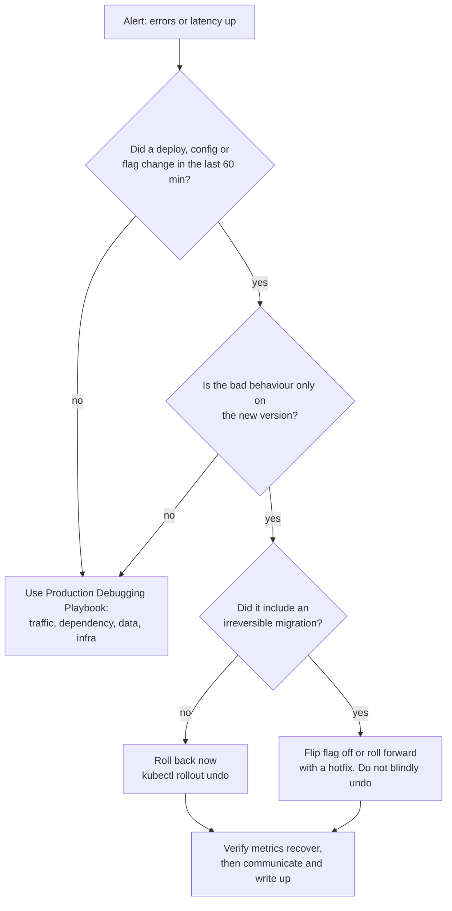

## Start here: the basics 🟢

> [!info] How to read this note (pick your level)
> - 🟢 **New to this?** Read "From zero" below, then sections 1, 2 and the cheat sheet (10). Stop there, that is a full first pass.
> - 🟡 **Know the basics?** Add section 3 (the five steps), 4 (worked example), 5 and 6.
> - 🔴 **Interview / SDE-3 prep?** Add 7, 8 and 9. Headings are tagged 🟢🟡🔴 so you always know where you are.

> [!note] Before this note
> - [[Production Debugging Playbook]]: check "what changed" first, and stop the damage before hunting the cause.
> - [[Incident Response]]: one person leads, and you post short updates on a fixed schedule.
> - [[Deployment Strategies - Rolling, Blue-Green, Canary]]: a new version can replace old pods a few at a time (rolling), switch all at once (blue-green), or go to a small share first (canary).

**From zero, in 60 seconds** 🟢

Your team ships new code to the live website. That is a **deploy**.
Minutes later, errors jump up. Users can't pay.
You don't know why yet. That is fine.
You put the old, working code back first. That is a **rollback**.
Users are happy again in about 2 minutes.
Now, calmly, you find the bug in the new code.

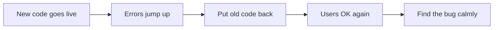

One catch: if the new code already changed saved data (like the database layout), the old code may not understand it. Then "just go back" is not safe.

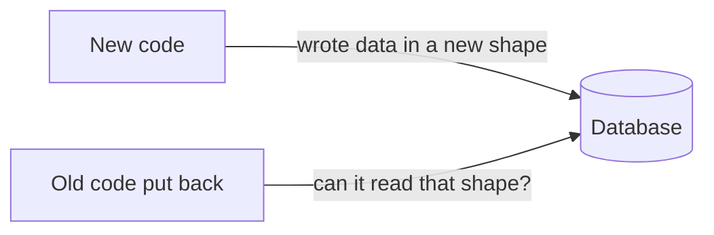

The rest of this note is just these 3 questions:
1. Is the deploy really the cause?
2. What is the fastest safe way to undo it?
3. How do you make undo safe *before* the next deploy?

**The problem in one story.**
At 14:02 your team ships a new version of the checkout service.
At 14:05 errors jump from 0.1% to 9%.
You could spend an hour reading code to find the bug.
Or you could put the old version back in 2 minutes and read the code afterwards.
This playbook is about doing the second one safely.

**Words you need first**

| Word | Plain meaning | Tiny example |
| --- | --- | --- |
| Deploy | Replacing running code with a new version | `v42` replaces `v41` |
| Rollback | Putting the previous version back | `kubectl rollout undo` |
| Roll forward | Fixing by shipping another new version | Hotfix `v43` |
| Canary | Sending a small share of traffic to the new version first | 5% of users get `v42` |
| Feature flag | A switch that turns code on or off without a deploy | `new_discount=false` |
| Migration | A change to the database schema | Adding a column |
| Mitigate | Stop the user pain, even before you know the cause | Roll back first |
| CrashLoopBackOff | Kubernetes waiting longer and longer before restarting a pod that keeps crashing | new pods die on start |
| ImagePullBackOff | Kubernetes cannot download the new container image | wrong image tag |
| Ready | A pod has passed its readiness check and may get traffic | 0/3 Ready after a rollout |
| Hotfix | A quick code fix shipped straight to production | `v43` fixes one null check |
| Business metric | A number about the business, not the servers | orders per minute |

**Picture it**

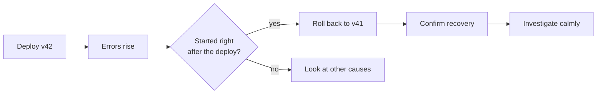

**Analogy.** If the new recipe makes customers sick, you go back to the old recipe tonight and study the new one tomorrow.
Where it breaks: food already served can't be un-served; data already written by the new version (migrations, messages, cache) may not work with the old code.

**How the rest of this note builds up**

- First, why bad deploys are the top incident cause (section 1) and the "mitigate before you understand" model (section 2).
- Then the five-step playbook: prove the deploy is guilty, check the rollout, read pod evidence, mitigate, confirm (section 3).
- Then a worked incident (section 4) and ways to undo a release, rollback versus roll forward, and trade-offs (sections 5-6).
- Finally the SDE-3 deep dive: rollback readiness, how `kubectl rollout undo` works, and why state makes rollback hard (sections 7-8).

> [!tip] Remember
> If it broke right after a change, undo the change first and ask why later.

## 1. Why it exists 🟢

Every deploy is a bet that the new code behaves better than the old code in a place you cannot fully test: production traffic, production data, production dependencies. Most of the time the bet pays. Sometimes it does not.

**Symptoms of a bad deploy:**

- Error rate (5xx) jumps within minutes of a rollout.
- Latency rises, often p99 first, then p50.
- Pods enter `CrashLoopBackOff`, `ImagePullBackOff`, or never become `Ready`.
- A single feature breaks (for example, "Pay now" returns 500) while the rest of the site works.
- Business metrics fall quietly while technical metrics look fine: orders per minute drop, but no errors are logged.

**User impact, with numbers (illustrative).** A shop does 600 orders/minute at an average of 40 USD. A bad deploy makes 30% of checkouts fail. Every minute of delay costs 600 x 0.30 x 40 = 7,200 USD in lost orders.

If detection takes 6 minutes and the rollback takes 4, the incident costs about 72,000 USD. If an automated canary had caught it at 5% of traffic, the cost would be a few thousand.

> [!tip] Remember
> The cost of a bad deploy is (users affected) x (minutes until mitigation). Both factors shrink with canaries, fast alerts and one-command rollback.

### Real-life example: a discount that breaks checkout 🟢

Imagine a shopping app like Myntra releasing a new discount feature at noon.
For carts without a discount code, the new code hits an empty value and checkout fails for 3 in 10 people.
Servers look healthy and CPU is normal, but orders per minute drop sharply.
The on-call sees the drop line up with the deploy, rolls back in three minutes, and orders recover; the bug is fixed calmly afterwards.

## 2. Mental model 🟢

**Analogy: replacing a part in a running machine.** You swap one gear and the machine starts to rattle. The first response is to put the old gear back, not to study the rattle while the machine keeps running.

The analogy breaks down when the new gear changed something other gears now depend on (data formats, schemas). Then putting the old gear back can jam the machine in a different way.

Think of every release as three independent things that can each go wrong:

| Layer | Example change | Rollback difficulty |
| --- | --- | --- |
| Code (container image) | New handler logic | Easy: redeploy the previous image |
| Config | New env var, new timeout, new flag value | Easy if config is versioned, hard if edited by hand |
| State | DB migration, new message schema, cache format | Hard: data already written cannot be un-written |

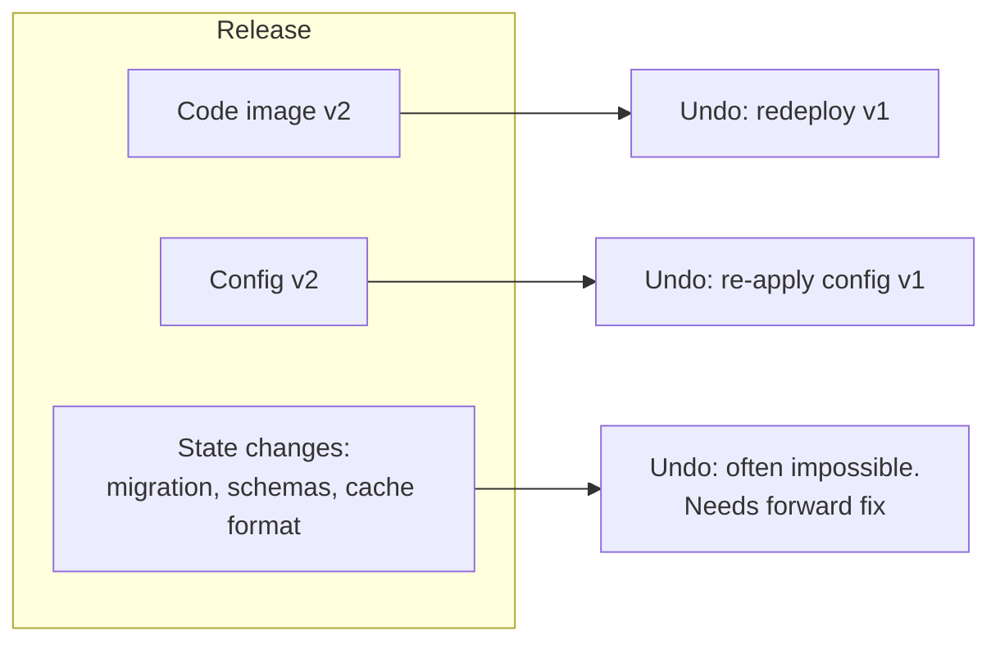

> [!tip] Remember
> Ask "what state did v2 write?" before you press undo. Code undoes cleanly. State does not.

## Common beginner mistakes 🟢

- **Debugging the new code while users fail** → every minute costs orders → roll back or flip the flag first.
- **Trusting "rollout complete"** → Kubernetes only checks pods started, not that answers are right → watch error rate and business metrics after every deploy.
- **Rolling back past a database migration** → old code may not understand the new schema → keep migrations backward-compatible (expand first, remove later).
- **Treating config changes as safe** → a setting change breaks things just like code → deploy config with the same care and a rollback plan.
- **Graphs without a version label** → you cannot compare old vs new → tag metrics with a short version label.

## 3. How it works 🟡

> 🟢 → 🟡 **You now know** that a bad deploy's cost is users hurt times minutes until you undo it. **Next we open the box**: the first five minutes, how to prove the deploy is guilty, how to read the rollout and the new pods, the ways to mitigate, and how to confirm recovery.

### The first 5 minutes

**In plain words:** a short checklist so you don't panic. Look at what changed, undo it, then check that things got better.

Follow this checklist in order. Do not skip step 1 even if you "know" what it is.

1. **Confirm the problem and its blast radius.** Open the service dashboard. Which signal moved: errors, latency, saturation, or business metric? Is it all endpoints or one? All regions or one? All users or one tenant? Write the answer in the incident channel in one line.
2. **Check what changed.** Look at the deploy log, CI/CD history, Helm/Argo history, feature flag audit log and config repo. Anything in the last 60 minutes is a suspect.
3. **Mitigate first.** In order of speed: flip a feature flag off, roll back the deploy, shift traffic away from the canary, scale or fail over. Pick the fastest safe one.
4. **Communicate.** Post: what is broken, who is affected, what you are doing, when the next update will come. Assign an incident commander if more than one person is involved (see [[Incident Response]]).
5. **Verify.** After mitigation, confirm the same graphs that alerted have recovered. Do not trust "the command succeeded".

> [!warning] Common mistake
> Spending the first 20 minutes reading code to find the bug while errors continue. The bug can be found after users are safe. Mitigation and diagnosis are two separate jobs, and mitigation comes first.

### The diagnosis flowchart

**In plain words:** not every problem after a deploy is caused by the deploy. This map helps you tell "it was our new code" from "something else broke at the same time".

**Step by step:**
1. Did errors start within minutes of the rollout? Suspect the deploy.
2. Are only new-version pods failing while old ones are fine? The deploy is guilty.
3. Did something else change at the same time (dependency, traffic, config)? Check it before blaming the code.

Not every post-deploy problem is the deploy. This flowchart separates "bad deploy" from look-alikes.

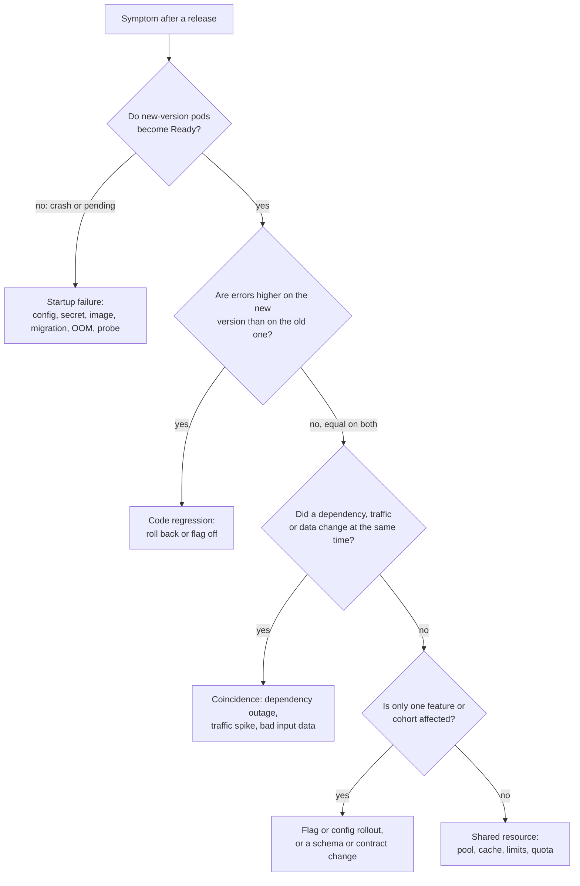

### Step 1: Prove the deploy is guilty

**In plain words:** if the new version fails and the old version, running at the same time, does not, the new version is guilty. The queries below just compare the two.

**Step by step:**
1. Split errors by `version` label: say `v42` 12% errors, `v41` 0.1%.
2. Line up the error graph with the deploy marker.
3. Same jump on both versions? It is not the deploy.

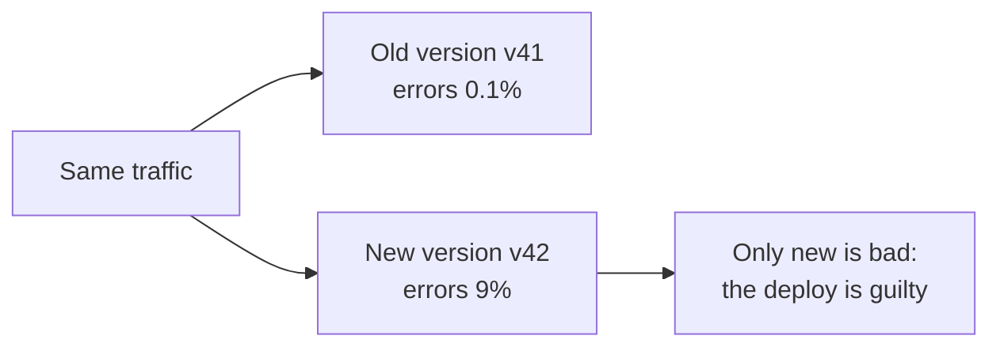

The strongest evidence is a comparison between versions running at the same time. This needs a `version` label (or the image tag) on your metrics, which is a strong reason to add it.

Error ratio per version (5 minute window):

```promql
sum by (version) (rate(http_requests_total{job="orders-api", status=~"5.."}[5m]))
/
sum by (version) (rate(http_requests_total{job="orders-api"}[5m]))
```

p99 latency per version:

```promql
histogram_quantile(0.99,
  sum by (le, version) (rate(http_request_duration_seconds_bucket{job="orders-api"}[5m])))
```

**What the result means:**

| You see | Meaning |
| --- | --- |
| New version error ratio is 12%, old is 0.1% | Deploy is guilty. Roll back |
| Both versions are at 12% | Not the deploy. Look at a shared dependency |
| New version has no series at all | New pods are not serving: readiness or startup problem |
| Error ratio rose before the rollout began | Coincidence. Find the real cause |

Find which image is running where:

```bash
kubectl get pods -n prod -l app=orders-api \
  -o custom-columns=NAME:.metadata.name,IMAGE:.spec.containers[0].image,READY:.status.containerStatuses[0].ready,RESTARTS:.status.containerStatuses[0].restartCount
```

### Step 2: Check the rollout itself

**In plain words:** sometimes the new code never even started properly. These commands show whether the new copies came up healthy.

**Step by step:**
1. `kubectl rollout status` and `kubectl get pods`: are new pods Ready?
2. Look for `CrashLoopBackOff` or `ImagePullBackOff`.
3. `kubectl get events` shows failed probes or scheduling problems.

```bash
kubectl rollout status deployment/orders-api -n prod
kubectl rollout history deployment/orders-api -n prod
kubectl get rs -n prod -l app=orders-api
kubectl describe deployment orders-api -n prod
```

- `rollout status` blocks until done or fails. "Waiting for deployment "orders-api" rollout to finish: 2 of 6 updated replicas are available..." means new pods are not becoming Ready.
- `rollout history` lists revisions. Each revision is a ReplicaSet.
- `get rs` shows old and new ReplicaSets and their counts. A new ReplicaSet with `DESIRED 3 READY 0` is a stuck rollout.
- `describe deployment` shows events and the `ProgressDeadlineExceeded` condition when the rollout stalls (the default deadline is 600 seconds).

PromQL for stuck rollouts (kube-state-metrics):

```promql
kube_deployment_status_replicas_unavailable{deployment="orders-api"} > 0
```

```promql
increase(kube_pod_container_status_restarts_total{pod=~"orders-api-.*"}[10m]) > 2
```

### Step 3: Read the new pod's evidence

**In plain words:** look at the new copy's logs and crash reasons. They often name the bug directly.

**Step by step:**
1. `kubectl logs` on a new pod, and `--previous` if it restarted.
2. `kubectl describe pod` for the crash reason (OOMKilled, exit code).
3. Look for one error repeated, like a nil value or a missing config key.

```bash
kubectl get pods -n prod -l app=orders-api
kubectl describe pod <new-pod> -n prod
kubectl logs <new-pod> -n prod --tail=200
kubectl logs <new-pod> -n prod --previous
kubectl get events -n prod --sort-by=.lastTimestamp | tail -20
```

**Reading the status column:**

| Status | Likely cause | First check |
| --- | --- | --- |
| `ImagePullBackOff` | Wrong tag, registry auth, image not pushed | `describe pod` events; check the tag exists |
| `CrashLoopBackOff` | App exits on start: bad config, missing secret, failed migration | `logs --previous` |
| `CreateContainerConfigError` | Referenced Secret or ConfigMap key missing | `describe pod` |
| `Running` but `0/1 Ready` | Readiness probe failing | probe path, port, dependency in the probe |
| `OOMKilled` (in `describe`, last state) | New code uses more memory than the limit | compare memory working set to limit |
| `Pending` | Not enough CPU or memory requested on nodes | `describe pod` scheduling events |

Memory check for an OOM suspicion:

```promql
container_memory_working_set_bytes{pod=~"orders-api-.*", container="orders-api"}
/ on (pod, container)
kube_pod_container_resource_limits{resource="memory", pod=~"orders-api-.*", container="orders-api"}
```

A ratio near 1.0 means the container is close to being killed. See [[Debugging Memory Leaks and OOMs in Go]].

### Step 4: Mitigate

**In plain words:** pick the quickest safe way to stop the pain: undo the deploy, flip a switch off, or move traffic away.

**Step by step:**
1. Feature flag for the new code? Turn it off (seconds).
2. Otherwise `kubectl rollout undo` (minutes).
3. Canary still running? Send all traffic back to the old version.
4. Post an update saying what you did.

Pick the fastest option that is safe:

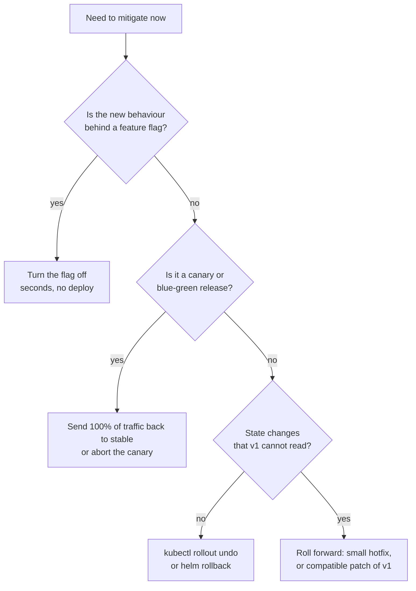

**Kubernetes Deployment:**

```bash
kubectl rollout undo deployment/orders-api -n prod
kubectl rollout undo deployment/orders-api -n prod --to-revision=12
kubectl rollout status deployment/orders-api -n prod
```

`rollout undo` re-applies the Pod template of the previous revision. It rolls out using the same strategy and limits (`maxSurge`, `maxUnavailable`) as a normal update. Note that it only reverts the Pod template, not other Deployment fields such as replicas, and not any ConfigMap or Secret the template points to by name.

**Helm:**

```bash
helm history orders-api -n prod
helm rollback orders-api 12 -n prod --wait
```

**Argo CD (GitOps):** reverting through the UI or CLI can be overwritten by auto-sync. The durable fix is `git revert` of the offending commit in the config repo, merged to main. Pause auto-sync during the incident if you must patch live state.

**Feature flags:** flip the kill switch, then confirm the flag provider's change reached all instances (SDK polling or streaming delay is typically seconds, but check your provider).

**Freeze further deploys.** Announce a deploy freeze so a second change does not land on top of the incident.

> [!tip] Remember
> Roll back with the same tool that rolled out. A manual `kubectl` change under GitOps will be reverted by the controller within minutes.

### Step 5: Confirm recovery

**In plain words:** don't trust the undo button. Watch the graphs go back to normal before you say "fixed".

**Step by step:**
1. Watch error rate and p99 return to the pre-deploy level.
2. Check business metrics too, like orders per minute.
3. Keep watching for one full traffic cycle before saying "fixed".

- The same error and latency graphs return to baseline (give them at least 2 to 3 full rate windows, so 10 to 15 minutes for a `[5m]` window).
- Readiness is green: `kube_deployment_status_replicas_available == kube_deployment_spec_replicas`.
- Business metric recovers (orders per minute back to normal).
- Queues drained: retries and backlog created during the incident are processed.

## 4. Worked example 🟡

### A real-world-style incident: the null discount

**System:** a Go `orders-api` on Kubernetes with 6 replicas behind an ALB, Postgres, and a Kafka topic `order-events`. Canary deploys are not configured; rollouts are plain rolling updates. Times are illustrative.

| Time | Event |
| --- | --- |
| 14:02 | CI/CD deploys `v2.41.0`. It adds a new discount rule and a migration that adds a `NOT NULL` column `discount_code`. Rolling update begins |
| 14:05 | Rollout completes. All 6 pods Ready |
| 14:07 | Alert `OrdersErrorRatioHigh` fires: 5xx ratio at 18% (the alert uses a short 1 minute window) |
| 14:08 | On-call opens the dashboard. Errors only on `POST /orders`. Reads are fine |
| 14:09 | Version comparison query: v2.41.0 at 18%, but v2.40.3 pods are gone, so no comparison. Deploy marker lines up with the first error at 14:06 |
| 14:10 | Check logs: `null value in column "discount_code" of relation "orders" violates not-null constraint` (older Postgres versions omit the `of relation` part) |
| 14:11 | Incident declared, Slack updated: "Checkout failing for orders without a discount code, deploy 14:02, rolling back" |
| 14:12 | On-call checks rollback safety. The migration only added a column. The old code does not insert into it, so v2.40.3 inserts would fail on `NOT NULL` too |
| 14:13 | **Insight:** a plain rollback would still fail, because the column is `NOT NULL` with no default and v2.40.3 does not know about it |
| 14:14 | Mitigation chosen: run `ALTER TABLE orders ALTER COLUMN discount_code DROP NOT NULL;` then roll back |
| 14:16 | Migration applied (`DROP NOT NULL` is a metadata-only change that needs only a brief lock). `kubectl rollout undo` started. Note that the `DROP NOT NULL` alone already fixes the errors for v2.41.0 too; the rollback is the extra step that removes the unproven new discount rule |
| 14:19 | Rollout complete. Errors fall to baseline by 14:22 |
| 14:30 | Failed orders (about 1,100 in 17 minutes) are identified from logs and customers are emailed with a retry link |

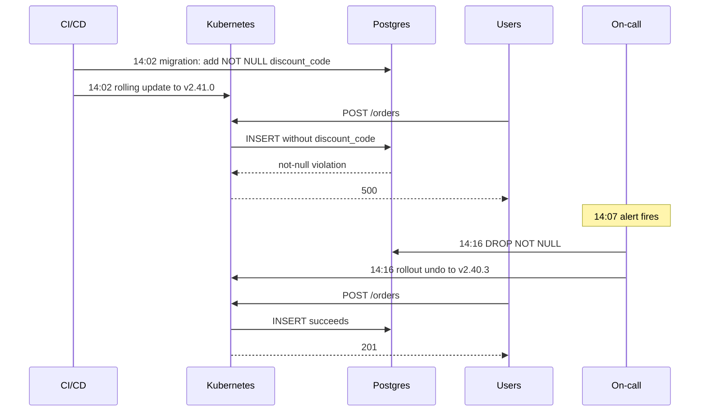

**Root cause:** the migration was not backward compatible. v2.41.0 was supposed to always send a code, but a code path for orders without discounts forgot to.

**Proper fix:** the expand/contract pattern. Release 1 adds the column as `NULL`able and the code writes it. Release 2, after all code writes it and old rows are backfilled, adds `NOT NULL`. Details in [[Zero-Downtime Schema Migrations]].

**What would have caught it earlier:** a canary at 5% (error ratio on canary versus stable), and an integration test that creates an order with no discount.

> [!tip] Remember
> The rollback itself needs a compatibility check. "Can the previous version still run against the current database?" is the single most important question before undo.

## 5. Variants and comparison 🟡

### Ways to undo a bad release

**In plain words:** there are several "undo" buttons. Some are instant (a feature switch), some take minutes (redeploy old code). The table compares them.

| Method | Speed | Needs | Best for | Watch out for |
| --- | --- | --- | --- | --- |
| Feature flag off | Seconds | Code wrapped in a flag | Behaviour changes, new features | Flag provider outage; stale SDK cache |
| Canary abort | Seconds to a minute | Progressive delivery (Argo Rollouts, Flagger, service mesh) | Anything exposed to a small share first | Only protects if canary traffic is representative |
| Blue-green swap back | Seconds | Both stacks kept running | Stateless services, big changes | Double cost; shared DB still needs compatibility |
| `kubectl rollout undo` | 1 to 5 minutes | Revision history retained (`revisionHistoryLimit`, default 10) | Plain Deployments | Does not undo ConfigMaps, Secrets or state |
| `helm rollback` | 1 to 5 minutes | Release history | Helm-managed apps | Hooks and CRDs behave differently on rollback |
| `git revert` + pipeline | 5 to 30 minutes | A working CI/CD | GitOps, audit trail | Slowest. Use alongside a faster mitigation |
| Roll forward with hotfix | 15+ minutes | A fix you trust | Irreversible state changes | Tempting but risky under pressure |

### Rollback versus roll forward

**In plain words:** going back to old code vs shipping a quick fix on top. Go back when you can; fix forward only when going back would break saved data.

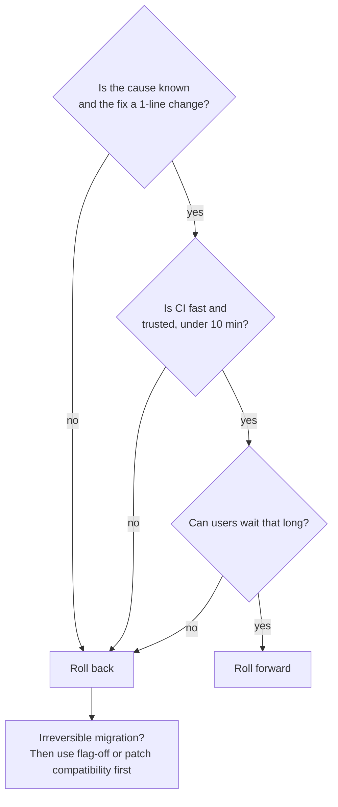

**Default to rollback.** Roll forward only when rollback is impossible or provably riskier.

## 6. Trade-offs 🟡

- **Fast rollback needs discipline up front.** Keeping every migration backward compatible for one release costs extra releases (expand, then contract). That is the price of safe undo.
- **Canaries delay full rollout.** A 30-minute bake time slows delivery, but it limits blast radius to a few percent of users.
- **Feature flags add code paths.** Each flag is a branch that needs testing and later cleanup. Stale flags become their own incident cause.
- **Auto-rollback can flap.** If the abort metric is noisy, the system keeps rolling back good releases. Use enough traffic and a sensible window.
- **When not to roll back:** the old version has a known security hole, the change was a required data migration that was already applied, or the incident is not caused by the deploy. Rolling back during an unrelated incident wastes time and adds risk.

> [!warning] Common mistake
> Assuming "rollback" is always safe. It is safe for stateless code. It is dangerous when v2 has written messages, rows or cache entries that v1 cannot parse.

## 7. In production 🔴

> 🟡 → 🔴 **You now know** how to prove a deploy is guilty, undo it safely, and choose between rolling back and fixing forward. **Next is the advanced part**: being rollback-ready before you need it, how rollbacks themselves fail, and the internals (how `rollout undo` works, mixed-version windows, version labels).


### What to check for rollback readiness (before you need it)

- Every deploy is traceable to a commit and a person. Add a `version` label to metrics and logs.
- `revisionHistoryLimit` is not zero; keep at least 5 to 10 revisions.
- Previous images are retained in the registry (no aggressive tag cleanup).
- Alerts compare versions or at least show deploy markers on graphs.
- A one-line rollback command is in the runbook and has been rehearsed.
- Readiness and liveness probes are accurate, so a bad version never receives traffic.

You can embed the commit in a Go binary and read it from a running container:

```bash
go build -o app ./cmd/api
go version -m ./app | grep -E "vcs.revision|vcs.time"
```

Since Go 1.18, the toolchain embeds `vcs.revision` and `vcs.time` when built inside a Git checkout (the default `-buildvcs=auto`; it is skipped in builds without `.git`, such as some Docker builds that do not copy it, so check yours). Expose them via `/version` or a metric.

### Failure modes of the rollback itself

**In plain words:** even the undo can fail. These are the common ways it goes wrong and how to avoid them.

| Failure | Why | Fix |
| --- | --- | --- |
| Old image gone from registry | Cleanup policy deleted old tags | Retain last N production images |
| Old pods crash on start | New config or secrets already changed | Version config with the code; keep old keys until contract phase |
| Old code cannot read new rows or messages | Format changed | Expand/contract; tolerant readers |
| Cache poisoned by v2 | v2 stored entries in a new shape | Version cache keys, or flush the affected keys |
| Queue has v2 messages | Consumers on v1 fail, then DLQ | Pause consumers; see [[Dead Letter Queues and Poison Messages]] |
| GitOps reverts your manual fix | Controller sync | Revert in Git; pause auto-sync |
| Rollback stalls | `maxUnavailable` or capacity too tight | Check `describe deployment` and node capacity |

### Prevention

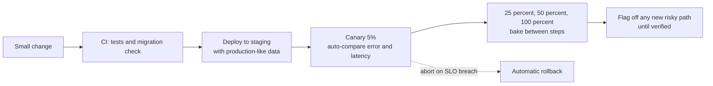

## 8. Deep dive 🔴

### How `kubectl rollout undo` works

**In plain words:** Kubernetes keeps a list of old versions. "Undo" just tells it to run the previous one again.

A Deployment owns ReplicaSets. Each Pod template change creates a new ReplicaSet and a new revision number. `undo` copies the Pod template of the target revision into the Deployment spec, which creates (or scales up) the matching ReplicaSet and scales down the current one under the rolling update rules.

If the old ReplicaSet was pruned by `revisionHistoryLimit`, there is nothing to undo to.

Only Pod template changes create revisions. Changing `replicas` alone does not, which is why rollback never restores a replica count.

### Why a green rollout can still be wrong

**In plain words:** Kubernetes says "done" when the new copies start. It does not check that they give correct answers.

Kubernetes reports success when new pods pass readiness. A readiness probe that only checks "process is up" will pass while the code is broken on real requests. Make readiness check real dependencies (carefully; a shared dependency in a readiness probe can take down every pod at once) and rely on SLO-based canary analysis for correctness.

### Config and secret changes are deploys

**In plain words:** changing a setting is just as risky as changing code. Treat it the same way.

A ConfigMap edit does not trigger a rollout unless you hash it into the Pod template (a common pattern is a checksum annotation in Helm). Pods that read the config at start keep the old value until restarted, so config problems can appear hours after the "change", on the next restart. Always log config version at startup.

### Mixed-version windows

**In plain words:** during a rollout, old and new code run side by side for a while. Both must work with the same data.

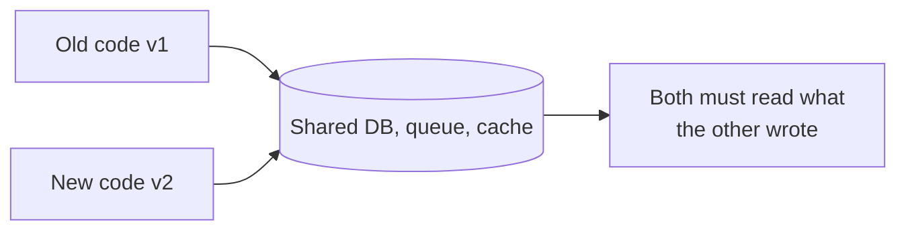

During a rolling update both versions serve traffic at once. Anything the two versions share (database schema, message formats, cache keys, API responses seen by one client across two requests) must work with both. This is why breaking changes are shipped in two steps.

### Metrics that need a `version` label

**In plain words:** tag your graphs with the version name so you can see old vs new side by side. Keep the tag short so it doesn't blow up storage.

Adding a high-cardinality label such as a commit SHA to every series multiplies series count. Use a small label (release tag), keep it on a few core metrics, or expose a separate `build_info{version="..."} 1` gauge and join:

```promql
sum by (version) (rate(http_requests_total{status=~"5.."}[5m]) * on (pod) group_left (version) build_info)
```

This join works only if `build_info` carries a `pod` label matching the request metric; check your label names.

## 9. Interview questions 🔴

> [!question]- Production errors spike right after a deploy. What do you do in the first five minutes?
> Confirm impact and blast radius on the dashboard. Check what changed in the last hour. Compare error rate by version. If the new version is guilty and there is no irreversible migration, roll back (`kubectl rollout undo`) or flip the flag. Post an update, then verify the graphs recover. Root cause comes after mitigation.

> [!question]- When is rolling back the wrong move?
> When v2 made irreversible state changes that v1 cannot handle (a `NOT NULL` column without default, a new message format, destructive migration), when the cause is not the deploy, or when the old version has a known security flaw. Then use a flag, a compatible patch, or a fast roll forward.

> [!question]- How do you make rollbacks safe by design?
> Expand/contract migrations, tolerant readers for messages, versioned cache keys, config versioned with the code, small changes, feature flags for risky behaviour, canary releases with SLO-based auto-abort, and retained previous images and revisions.

> [!question]- How do you prove a deploy caused the incident and not a coincidence?
> Compare the new and old versions running at the same time (error ratio by version), check that the first error is after the rollout started and not before, and check shared dependencies and traffic at the same time. If both versions are equally bad, it is not the deploy.

> [!question]- `kubectl rollout undo` finished but errors continue. Why?
> The undo reverted only the Pod template. Common causes: database or message state from v2, a changed ConfigMap or Secret, a poisoned cache, a feature flag, or the cause was never the deploy. Check logs of the old pods, and verify that the old version actually runs against the current schema.

> [!question]- What does a canary give you that a rolling update does not?
> A rolling update replaces pods as they become Ready and judges only by probes. A canary sends a small share of traffic to the new version, compares its error and latency against stable, and aborts automatically. It limits the blast radius to that share.

## 10. Cheat sheet 🟢

- Problem after a change: **roll back first, investigate after.**
- Prove it: error ratio and p99 **by version**; deploy marker before first error.
- Undo: `kubectl rollout undo deployment/X`, `helm rollback X REV`, flag off, canary abort, `git revert` under GitOps.
- Before undo ask: **can v1 run against current DB, queue and cache?**
- Pod states: `ImagePull` is the tag, `CrashLoop` is config or migration, `0/1 Ready` is the probe, `OOMKilled` is memory limit.
- Verify with the graphs that alerted, over 10 to 15 minutes, plus the business metric.
- Freeze deploys during the incident.
- Prevent: canary + SLO abort, expand/contract migrations, flags, `version` label.

## Self-check 🟢🟡

🟢 Easy

> [!question]- Errors jumped two minutes after a deploy. What do you do first?
> Roll back (or flip the feature flag off), then investigate.

> [!question]- What is a canary release?
> Sending the new version to a small share of traffic first, like 5%.

> [!question]- Rollback or roll forward: which is usually the default?
> Rollback; roll forward only when going back would break saved data.

🟡 Medium

> [!question]- Kubernetes says the rollout succeeded, but orders dropped. How?
> It only checks pods started and passed probes, not that they give correct answers.

> [!question]- Why can rolling back after a migration be dangerous?
> The old code may not work with the new database schema.

> [!question]- 400 orders/min, a bad deploy fails 25% of them for 10 minutes. How many orders lost?
> 400 × 0.25 × 10 = 1,000.

## Links

- Before this: [[Production Debugging Playbook]], [[Incident Response]], [[Deployment Strategies - Rolling, Blue-Green, Canary]]
- Safe change: [[Rollback and Safe Migrations]], [[Zero-Downtime Schema Migrations]], [[Feature Flags]]
- Runtime: [[Kubernetes Fundamentals]], [[CI-CD Pipelines (GitHub Actions for Go)]], [[Debugging Memory Leaks and OOMs in Go]]
- Signals and process: [[Metrics and Prometheus]], [[Alerting and On-Call]], [[Postmortems and Root Cause Analysis]]
- Messaging fallout: [[Dead Letter Queues and Poison Messages]]
- Next playbook: [[Playbook - Disk Full and Log Floods]]

### Post-incident checklist

1. Write the timeline: detect, mitigate, resolve, with timestamps.
2. Record time to detect, time to mitigate and users affected.
3. Find the root cause and the contributing causes (missing canary, missing test, slow alert).
4. Handle the leftovers: failed orders, DLQ messages, bad cache entries, inconsistent rows.
5. Create actions with owners and dates: one to prevent, one to detect faster, one to mitigate faster.
6. Hold a blameless review: [[Postmortems and Root Cause Analysis]].
7. Rehearse the rollback command so the next one takes 2 minutes.

### Watch on YouTube

- [Deployment in Kubernetes: A Comprehensive Guide to Rollout, Update, and Rollback](https://www.youtube.com/watch?v=-uO400iEuKo) · DevOps Pro · 8 min · 13,710 views
- [Rollback A Deployments in Kubernetes Using ArgoCD](https://www.youtube.com/watch?v=f40Dl1_V6lE) · Valaxy Technologies · 11 min · 1,259 views
