# Playbook - CPU Saturation

> [!summary] TL;DR
> CPU saturation means work arrives faster than the CPUs can run it, so requests queue and latency climbs. First confirm whether the CPU is actually busy or is being throttled by a container limit, check what changed, then mitigate by scaling out, rolling back, or shedding load. After that, take a 30-second CPU profile to see which function burns the time. The distinction between real CPU use, throttling, steal time and garbage collection decides the fix.

> [!abstract] Core idea
> - High CPU does not always mean a problem; high CPU plus rising latency or run-queue wait does.
> - In containers, a pod can be slow with low CPU use because the kernel is throttling it at its limit. Check throttling before anything else.
> - Four different causes look alike: real work growth, a hot code path (bug or bad input), throttling, and noisy neighbours (steal time).
> - A CPU profile (`pprof`) answers "which function" in 30 seconds; `top -H` and `pidstat` answer "which thread or process".
> - Mitigate by adding capacity or removing load first; fix the code after.

## Start here: the basics 🟢

> [!info] How to read this note (pick your level)
> - 🟢 **New to this?** Read "From zero" below, then sections 1, 2 and the cheat sheet (10). Stop there, that is a full first pass.
> - 🟡 **Know the basics?** Add section 3 (what the CPU numbers mean), 4 (first 5 minutes and the incident), 5 and 6.
> - 🔴 **Interview / SDE-3 prep?** Add 7, 8 and 9. Headings are tagged 🟢🟡🔴 so you always know where you are.

**From zero, in 60 seconds** 🟢

The **CPU** is the part of a computer that does the actual thinking work.
It can only do so much work per second.
When requests come in faster than it can handle them, they wait in a line.
The line grows, so every request gets slower, not just the extra ones.
That is **CPU saturation**: the CPU is full and work is waiting.
There is a sneaky version too: the CPU is not full, but a rule (a **limit**) pauses your app anyway.

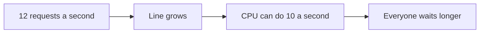

You fix it in two moves: first make the line shorter (add machines, or turn away some work), then find the slow code.

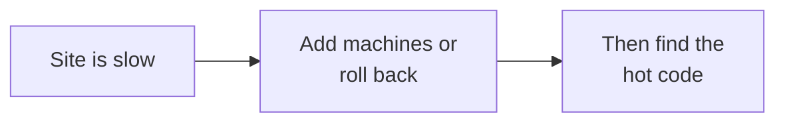

The rest of this note is just these 3 questions:
1. Is the CPU really full, or is something pausing it?
2. What changed to make it busy?
3. Which piece of code is eating the CPU?

**The problem in one story.**
A shop has one cashier who serves 10 customers a minute.
On a sale day 12 customers a minute arrive.
The line grows, and everyone waits longer, not only the extra two.
A server with saturated CPU is that cashier: requests queue and the site slows down.

**Words you need first**

| Word | Plain meaning | Tiny example |
| --- | --- | --- |
| CPU core | One unit that runs one thread at a time | A 4-core machine runs 4 at once |
| Utilisation | Share of time the CPU is busy | 85% busy |
| Saturation | More work is waiting than the CPU can run | Run queue keeps growing |
| Latency | How long one request takes | p99 = 800 ms |
| Container CPU limit | A cap on how much CPU a pod may use | `limits.cpu: 2` |
| Throttling | The kernel pausing a container that hit its limit | Pod slow at 50% CPU |
| Profile (pprof) | A sample of which functions use the CPU | `json.Marshal` = 40% |
| Thread / goroutine | A unit of work the scheduler runs | Go runs goroutines on threads |

**Picture it**

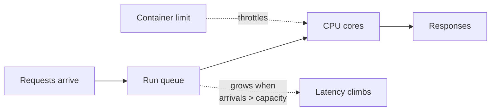

**Analogy.** The cashier queue above: add cashiers (scale out), send some customers away (shed load), or make each checkout faster (fix hot code).
Where it breaks: a container limit is like a manager forcing the cashier to take a break each minute, even with an empty line elsewhere in the store.

**How the rest of this note builds up**

- First, why queues form (section 1) and the four look-alike situations (section 2).
- Then what CPU numbers mean, how container limits throttle, `GOMAXPROCS`, and load average (section 3).
- Then the first 5 minutes and a real-style incident (section 4), plus diagnosis flowchart, PromQL and profile reading (section 5).
- Finally fixes and trade-offs (section 6) and the SDE-3 deep dive: alerts, always-on profiling, CFS throttling, steal time and single-thread bottlenecks (sections 7-8).

> [!tip] Remember
> Check throttling and what changed first; add capacity or shed load before you fix the code.

## 1. Why it exists 🟢

A CPU is like a single cashier. If customers arrive slower than the cashier can serve, no queue forms. When arrivals exceed service speed, a queue forms and every customer waits longer, not only the extra ones. That is why latency climbs sharply as CPU use approaches 100 percent.

**Symptoms:**
- p99 latency rises first, then p50; timeouts and 5xx follow.
- Load average above the number of cores; `vmstat` shows a long run queue.
- Health checks start to fail because the process is too busy to answer, so Kubernetes restarts pods, which concentrates traffic on the rest.
- Autoscaler maxes out at its replica limit.
- Batch jobs run late; queue consumers fall behind (consumer lag grows).

**User impact:**
- Slow pages and timeouts first, then errors.
- A **retry storm**: clients retry slow calls, which adds load and makes the CPU problem worse.

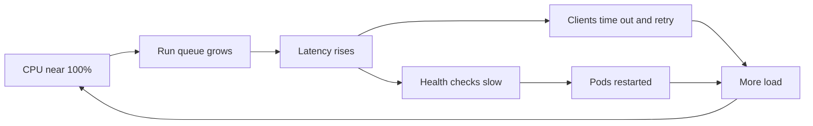

> [!tip] Remember
> Saturation is about waiting, not about the percentage. Look for the queue, not only the usage.

## 2. Mental model 🟢

A CPU core is a cashier; the run queue is the line; throttling is a manager who says "you only get 2 hours of cashier time per shift" even though the shop is open; steal time is another shop borrowing your cashier.

Where it breaks down: a real CPU can be time-sliced across thousands of threads, so the queue is invisible per request. You see it as latency, not as a line.

### The four situations

**In plain words:** four different problems all look like "CPU is high". The table tells them apart by one clue each.

| Situation | CPU usage looks like | Key evidence | Fix |
| --- | --- | --- | --- |
| Real load growth | Rises with traffic | Requests per second up; profile is flat and broad | Scale out, add capacity |
| Hot code path or bug | One function dominates | Profile shows one stack at the top | Fix code or roll back |
| CFS throttling | Usage pinned at the limit, latency high | `throttled_periods / periods` high | Raise or remove the limit, fix `GOMAXPROCS` |
| Steal or noisy neighbour | Host shows high `%st` | `vmstat` `st` column above 5 percent | Move node, bigger instance, dedicated host |

> [!warning] Common mistake
> Reading "CPU 50 percent" on a pod with a 1-core limit as healthy. If the pod is throttled, the node looks half idle while the pod has used 100 percent of its quota and is being paused.

## 3. How it works 🟡

### CPU time and what each number means

**In plain words:** tools like `top` split CPU time into buckets: your code, the system, waiting for disk, and so on. Each bucket points to a different cause.

On Linux, CPU time per core is split into states. `top` and `mpstat` show them.

| State | Meaning | High value means |
| --- | --- | --- |
| `us` | User code | Your app is doing computation |
| `sy` | Kernel code | Many syscalls, context switches, network or disk I/O handling |
| `wa` | Waiting for I/O | Disk or network storage is slow (not a CPU problem) |
| `st` | Stolen by hypervisor | Noisy neighbour or oversold host |
| `si`, `hi` | Interrupts | Heavy network traffic on few cores |
| `id` | Idle | Spare capacity |

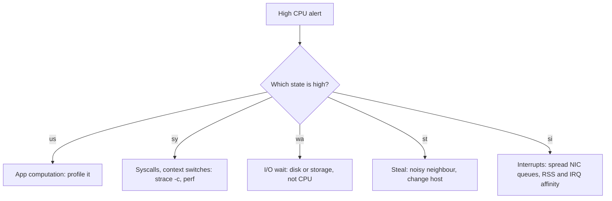

### How container CPU limits throttle you

**In plain words:** A CPU **limit** in Kubernetes is enforced by the kernel's CFS (Completely Fair Scheduler) **bandwidth control**. Time is cut into periods of 100 ms by default. A limit of 500m CPU gives the container 50 ms of CPU time per period across all its threads.

When the budget is used up, every thread in the container is paused until the next period.

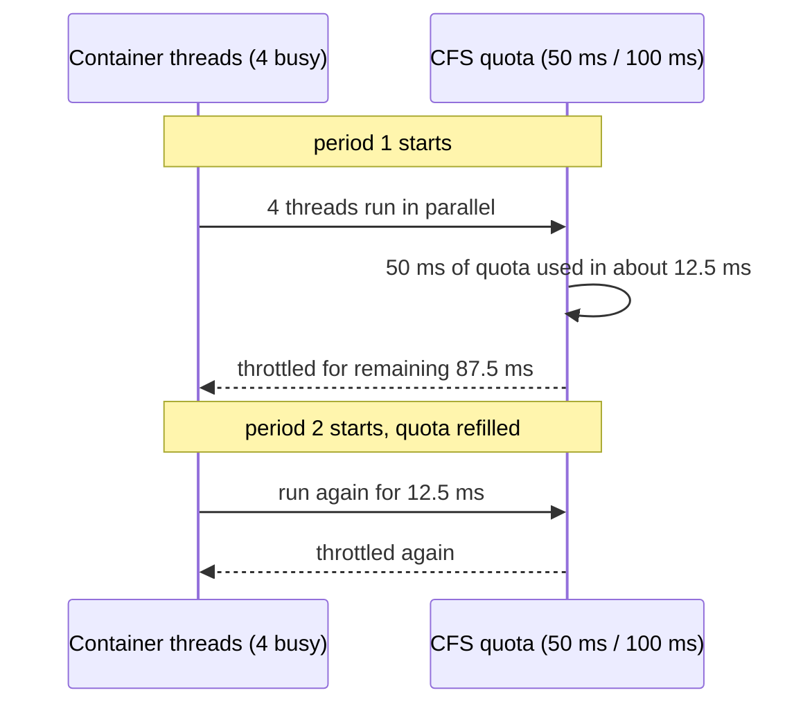

**Example with numbers:** a limit of 500m and 4 threads running at once uses 50 ms of quota in about 12.5 ms of wall time, then stalls for 87.5 ms. A request that needs 30 ms of CPU can take over 100 ms. The average CPU graph still shows only 50 percent.

**Why it matters:** Latency spikes with low CPU usage almost always means throttling. Many teams therefore set CPU requests but no CPU limits; that is a trade-off covered later.

### Go and GOMAXPROCS

**In plain words:** Go decides how many things to run at once. If it guesses more than your container is allowed, your app gets paused a lot.

Go starts as many running threads as `GOMAXPROCS`. Before Go 1.25 it defaulted to the number of CPUs on the node, not the container limit. A pod limited to 2 CPUs on a 64-core node would run 64 scheduler threads and get throttled constantly.

Since Go 1.25 the runtime reads the cgroup CPU limit and sets `GOMAXPROCS` accordingly. On older versions use `go.uber.org/automaxprocs` or set `GOMAXPROCS` by hand. See [[Runtime - Goroutine Scheduler (GMP)]].

### Load average versus utilisation

**In plain words:** "busy %" tells how full the CPU is. "Load" tells how many things are waiting. Waiting is what users feel.

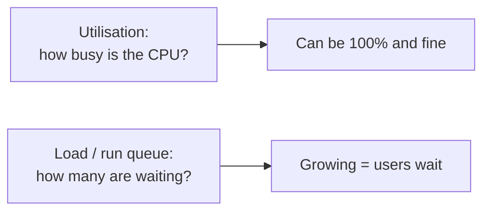

**Load average** counts tasks that are running or waiting (on Linux it also includes uninterruptible I/O waits). A load of 8 on an 8-core machine means fully busy; 16 means a queue of 8. It lags the real situation because it is an exponential average over 1, 5 and 15 minutes.

**PSI** (Pressure Stall Information) is more direct: `/proc/pressure/cpu` reports the share of time tasks were stalled waiting for CPU.

> [!tip] Remember
> Look at throttling and run-queue wait. A pod can be starved while the average CPU looks fine.

## 4. Worked example 🟡

### First 5 minutes

1. **Confirm and size the blast radius.** Which service, which pods or nodes? Is CPU high on all replicas, one pod, or one node? Check user-facing latency and error rate, not only CPU.
2. **Check what changed.** Deploy, config or flag change, traffic spike (a marketing event, a crawler, a retry storm), a slow downstream (causes retries), a cron or batch job started.
3. **Mitigate first.** Roll back a suspect release, scale out replicas, shed load (rate limit, block a bad client or bot), turn off a heavy feature flag, or pause the batch job.
4. **Communicate.** State impact, mitigation in progress, and the next update time in the incident channel; page more people if the autoscaler is already at its max.

```bash
# 1. Where is CPU going (pods, then nodes)
kubectl top pod -n prod --containers -l app=search --sort-by=cpu
kubectl top node

# 2. What changed
kubectl rollout history deployment/search -n prod
kubectl get events -n prod --sort-by=.lastTimestamp | tail -20

# 3. Mitigate: scale out, or roll back
kubectl scale deployment/search -n prod --replicas=20
kubectl rollout undo deployment/search -n prod
```

### Real-world-style incident timeline

**In plain words:** a made-up but realistic incident, minute by minute, so you can see the steps in order.

An illustrative scenario: a search API in Go, 8 pods, CPU limit 2 cores each.

| Time | Event |
| --- | --- |
| 10:00 | A release adds a "did you mean" feature that runs an O(n squared) fuzzy-match loop over every word of the user query |
| 11:20 | A crawler sends long queries. p99 goes from 80 ms to 4 s. CPU on all pods hits the 2-core limit |
| 11:23 | Alert: `HighLatencyP99` fires. On-call paged |
| 11:26 | `kubectl top` shows all 8 pods at 2000m. HPA already scaled to its max of 8 |
| 11:28 | Release at 10:00 is the only change. Rollback started; extra replicas added by hand |
| 11:34 | Rollback done, CPU 35 percent, p99 back to 90 ms |
| 12:10 | 30-second CPU profile on a canary with the new build shows 78 percent in the `fuzzyMatch` function |
| Next day | Fuzzy match rewritten with a better algorithm; query length capped; HPA max raised; alert on throttling added |

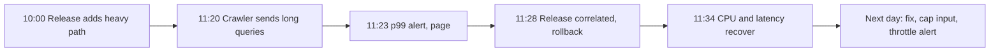

> [!tip] Remember
> In this example the hot spot is plain algorithmic cost. Go's `regexp` uses RE2 and runs in linear time in the input size, so it cannot backtrack catastrophically; in other runtimes (Java, Python, Node, PCRE) nested quantifiers can. In Go, a hot path is more likely a JSON encode loop, a giant loop over a big list, or a CPU-bound hash.

### Whiteboard version

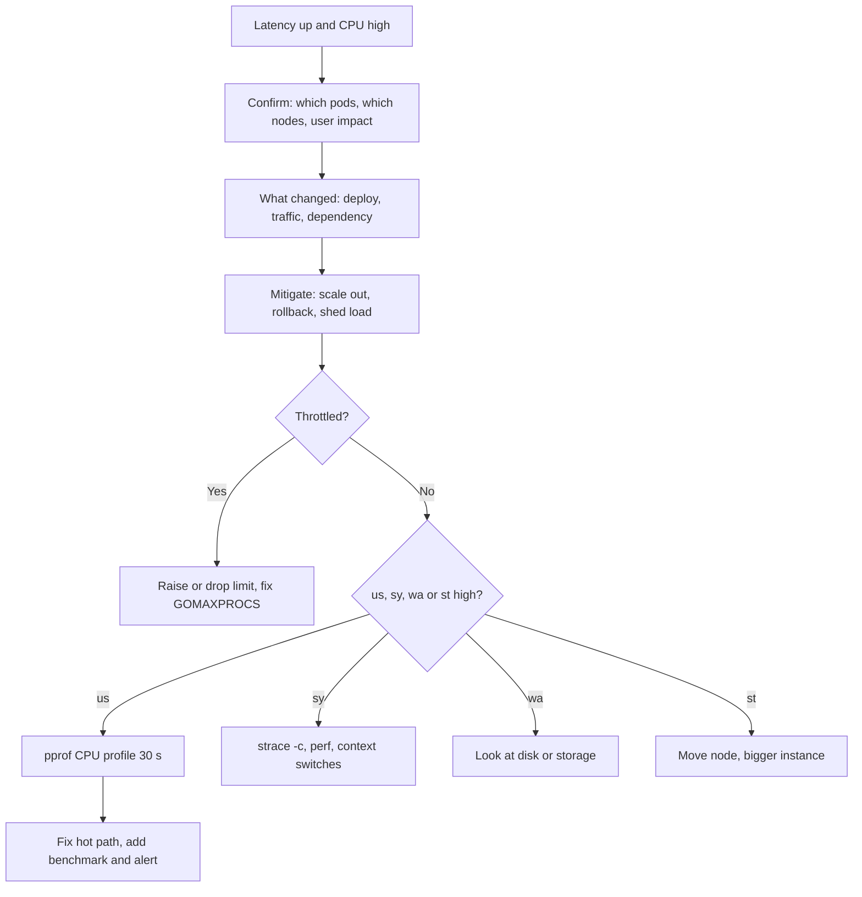

## 5. Variants and comparison 🟡

### Diagnosis flowchart: from symptom to cause

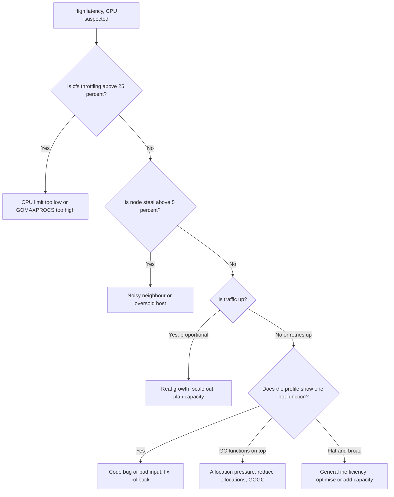

### Investigation steps for each likely cause

**In plain words:** one row per suspect: where to look, what to type, and what the answer means.

| Cause | Where to look | Command or query | What the result means |
| --- | --- | --- | --- |
| Which process or thread | Node or container | `top -H -p PID`, `pidstat -u -t 1` | One thread at 100 percent is a single-thread bottleneck; many equal threads is parallel load |
| CPU state breakdown | Node | `mpstat -P ALL 1`, `vmstat 1` | High `us` is app; high `sy` is kernel; high `wa` is I/O; high `st` is steal |
| Run queue | Node | `vmstat 1`: column `r` | `r` consistently above core count means a queue |
| CFS throttling | Container | `cat /sys/fs/cgroup/cpu.stat` (`nr_throttled`, `throttled_usec`) | Rising `nr_throttled` means the limit is biting |
| Hot function (Go) | Profile | `go tool pprof 'http://localhost:6060/debug/pprof/profile?seconds=30'` | `top` shows where CPU time goes; `-http=:8080` for a flame graph |
| Garbage collection | Go runtime | `GODEBUG=gctrace=1`; `rate(go_gc_duration_seconds_count[5m])` | Frequent GCs and GC functions in the profile mean allocation pressure |
| Native or non-Go | Any process | `perf top -p PID`, `perf record -F 99 -g -p PID -- sleep 30` | Shows hot native functions and kernel stacks |
| Syscalls | Process | `strace -c -p PID` (short, it slows the process) | Counts which syscalls dominate |
| Context switches | Node | `pidstat -w 1` | Very high `cswch/s` points to lock contention or too many threads |

### Dashboards and PromQL

**In plain words:** ready-made queries for your graphs. Each one answers one question: how busy, how paused, which pod.

```promql
# CPU used per pod, in cores
sum by (pod) (rate(container_cpu_usage_seconds_total{container!="", container!="POD"}[5m]))

# CPU used versus limit (above 0.9 means near saturation)
sum by (pod) (rate(container_cpu_usage_seconds_total{container!=""}[5m]))
/
sum by (pod) (kube_pod_container_resource_limits{resource="cpu"})

# Share of CFS periods that were throttled (alert above 0.25)
sum by (pod) (rate(container_cpu_cfs_throttled_periods_total{container!=""}[5m]))
/
sum by (pod) (rate(container_cpu_cfs_periods_total{container!=""}[5m]))

# Node CPU busy percentage
100 * (1 - avg by (instance) (rate(node_cpu_seconds_total{mode="idle"}[5m])))

# Node steal percentage
100 * avg by (instance) (rate(node_cpu_seconds_total{mode="steal"}[5m]))

# Load per core (above 1 means queued work)
node_load1 / count by (instance) (node_cpu_seconds_total{mode="idle"})

# Go GC time share (requires client_golang metrics)
rate(go_gc_duration_seconds_sum[5m])
```

### Reading the CPU profile

**In plain words:** a profile is a list of which functions used the most CPU. The top few lines usually name the problem.

```bash
# Print the top functions by cumulative time (non-interactive)
go tool pprof -top -cum 'http://localhost:6060/debug/pprof/profile?seconds=30'

# Flame graph in the browser
go tool pprof -http=:8080 'http://localhost:6060/debug/pprof/profile?seconds=30'

# Compare "before" and "after" profiles
go tool pprof -base before.pb.gz after.pb.gz
```

| Term | Meaning |
| --- | --- |
| `flat` | Time spent inside the function itself |
| `cum` | Time in the function plus everything it calls |
| Big `flat` in `runtime.mallocgc`, `runtime.gcBgMarkWorker` | Allocation and GC pressure |
| Big `flat` in `syscall.*` | Blocking on kernel calls |
| Big `flat` in `encoding/json` | Serialisation cost, consider a faster codec or caching |

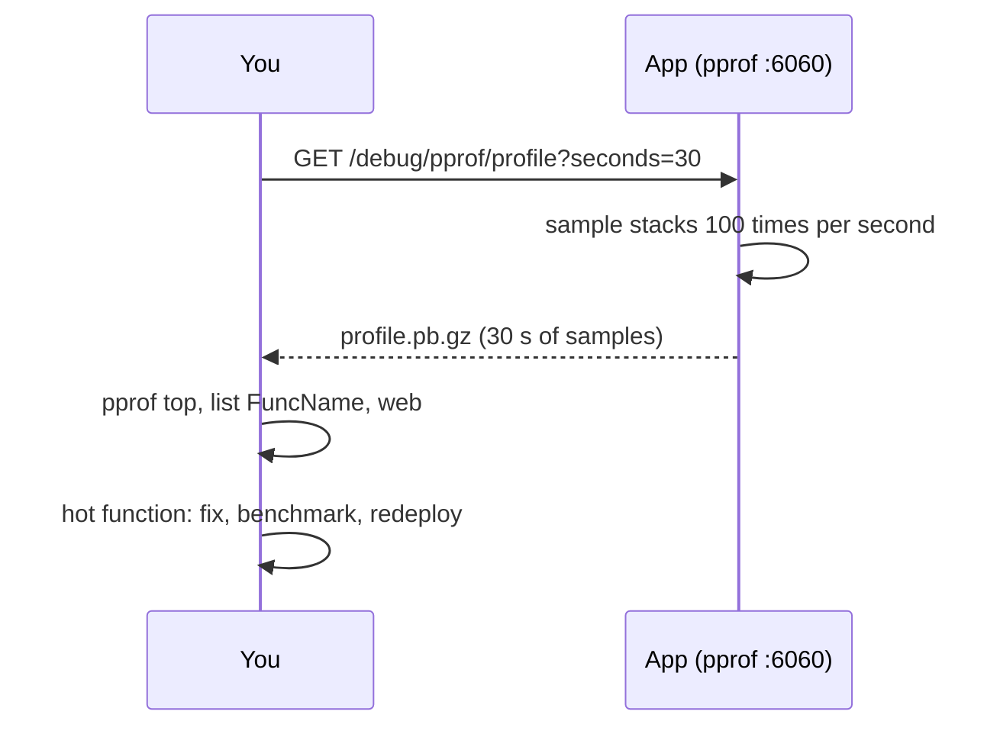

## 6. Trade-offs 🟡

### Fixes: immediate, proper, prevention

**In plain words:** quick fix today, real fix this week, and a guard so it doesn't happen again.

| Level | Action | Cost |
| --- | --- | --- |
| Immediate | Scale out; roll back; shed or rate limit; pause batch jobs; raise the CPU limit | Money; scale-out is useless if a shared dependency is the real bottleneck |
| Proper | Fix the hot path; cache results; reduce allocations; bound work per request; fix `GOMAXPROCS` | Engineering time and a release |
| Prevention | Load tests with a CPU profile, benchmarks in CI, throttling alert, autoscaling with headroom, capacity planning | Ongoing work |

### CPU limits: set them or not?

**In plain words:** a limit protects your neighbours but can pause your app. The table shows when each choice is better.

| Choice | Benefit | Risk |
| --- | --- | --- |
| Request only, no limit | No throttling; bursts use idle CPU | One runaway pod can starve neighbours (requests still guarantee a share) |
| Limit equal to request | Predictable; fair | Throttling during bursts |
| Limit well above request | Allows bursts, caps runaways | Still some throttling; harder capacity planning |

> [!warning] Common mistake
> Scaling out a service that is limited by a downstream (a database at 100 percent). More pods means more load on the database and no gain. Check the dependency's saturation before scaling.

### Autoscaling pitfalls

- HPA on CPU reacts in minutes, not seconds, and starts after the pod is already hot.
- New pods need warm-up time and may be slow at first (cold caches, JIT, connection pools).
- If the cause is a retry storm, adding pods only lets more retries in. Shed load first. See [[Autoscaling]].

## 7. In production 🔴

### Alerts that catch it early

**In plain words:** alert on waiting and pausing, not just on "CPU is busy". Busy alone is often fine.

| Alert | Fires when | Why |
| --- | --- | --- |
| `CPUThrottlingHigh` | Throttled periods above 25 percent for 15 minutes | Finds latency problems that CPU graphs miss |
| `NodeCPUHigh` | Node busy above 85 percent for 15 minutes | Capacity warning |
| `HPAMaxedOut` | HPA at max replicas for 10 minutes | The autoscaler cannot help any more |
| `LatencyP99High` | p99 above SLO for 5 minutes | User-visible symptom (see [[Latency, Percentiles and Bottleneck Analysis]]) |
| `NodeSteal` | Steal above 5 percent for 10 minutes | Noisy neighbour |

### Always-on profiling

**In plain words:** keep a light profiler running all the time, so you already have the data when trouble starts.

Continuous profilers (Pyroscope, Parca, Grafana Cloud Profiles) sample production at low overhead (usually a few percent) so you have a profile from before the incident. Without one, take the profile as early as possible during the incident, because the problem may vanish after a restart.

### Securing pprof

Expose `net/http/pprof` only on an internal port or via `kubectl port-forward`. It exposes stack traces, and a CPU profile request costs CPU, so it can be abused to make the problem worse.

```go
// Internal-only debug listener, separate from the public server.
go func() {
    log.Println(http.ListenAndServe("127.0.0.1:6060", nil)) // pprof registered via blank import
}()
```

This needs `import _ "net/http/pprof"`. Binding to `127.0.0.1` keeps it off the network; use `kubectl port-forward` to reach it.

### Typical hot spots

1. A tight loop over a huge list per request (accidentally O(n squared)).
2. JSON encoding and decoding of large payloads on every request.
3. Excess allocation causing GC work (string concatenation in loops, `fmt.Sprintf` everywhere).
4. Lock contention: threads spin or context-switch heavily.
5. A retry storm or a cache stampede making N times the work.
6. A bad actor: scraper, bot or a client with a bug calling in a loop.
7. Crypto (bcrypt, TLS handshakes) at high rate. Reuse connections and keep-alives.

## 8. Deep dive 🔴

### Why latency curves bend near 100 percent

**In plain words:** a line at a shop is fine at 50% busy, bad at 90%, and terrible at 99%. Waiting grows much faster than busyness near the top.

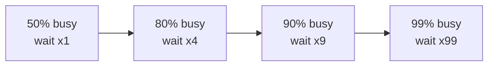

In queueing theory, mean wait grows roughly as `rho / (1 - rho)` for a single server, where `rho` is utilisation. At 50 percent the wait factor is 1; at 90 percent it is 9; at 95 percent it is 19.

This is why capacity planners aim for 60 to 70 percent peak CPU and why an autoscaler target of 50 to 70 percent is common. These are rule-of-thumb figures from queueing models, not measured values for your system.

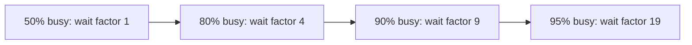

### CFS throttling subtleties

**In plain words:** the limit is checked in tiny time slices. Apps with many threads can use up their slice early and then sit paused.

- Quota is counted per period (100 ms by default), across all threads. A multi-threaded service burns quota faster than wall time.
- Throttling can happen at low average CPU because the burst consumes the quota in a few milliseconds.
- `cpu.stat` in cgroup v2 gives `nr_periods`, `nr_throttled`, `throttled_usec`. In cgroup v1 the same data is in `cpu.stat` as `nr_throttled` and `throttled_time`.
- A CPU request (not limit) sets `cpu.weight` (shares): relative priority when the node is busy, not a hard cap.

### Steal time

**In plain words:** on shared cloud machines, another customer can borrow your CPU. Your app waits even though it did nothing wrong.

In a VM, `st` is time the hypervisor ran another guest on your vCPU. On burstable instance types (such as AWS T-series), running out of CPU credits also appears as throttling at the instance level. Check the cloud provider's CPU credit metrics. The fix is a non-burstable instance type or a dedicated host.

### Single-thread bottleneck

**In plain words:** one worker can be at full speed while the rest sit idle. The total looks low, but that one worker is the line.

A service that is slow while total CPU is low (for example 12 percent on 8 cores) may have one thread at 100 percent: a global lock, a single-threaded event loop, or a single goroutine consuming a channel.

`top -H` shows it. Scaling out pods may not help if the bottleneck is per-process serialisation; shard the work or remove the lock.

### Spinning versus blocking

**In plain words:** threads fighting over the same lock burn CPU without doing real work.

High `sy` with high context switches (`pidstat -w`) means too many threads competing or lock ping-pong. In Go, a very high number of runnable goroutines raises scheduler latency; check `go tool trace` for scheduler delays and see [[Benchmarks, Profiling and Tracing]].

### When the CPU is a symptom

**In plain words:** sometimes the CPU is busy because something else is slow. Fix the slow thing, not the CPU.

CPU may be high because something else is slow: a slow database makes requests pile up, which means more concurrent goroutines and more context switching, which looks like a CPU problem. Always read the dependency dashboards alongside CPU.

## 9. Interview questions 🔴

> [!question]- Latency is high but CPU usage on the pod is only 50 percent. What do you check?
> CPU throttling first. If the pod has a CPU limit, the kernel can pause all its threads once the quota per 100 ms period is used, even when the average looks low. Check `container_cpu_cfs_throttled_periods_total` divided by `container_cpu_cfs_periods_total`, and `cpu.stat`. Also check `GOMAXPROCS` against the limit, node steal time, and whether a single thread is saturated.

> [!question]- Walk me through the first 5 minutes of a CPU saturation incident.
> Confirm the scope and user impact (which pods, nodes, latency and errors). Check what changed: deploy, traffic, config, dependency, batch jobs. Mitigate before diagnosing: roll back, scale out, or shed load; pause heavy background jobs. Communicate impact and next update time. After impact is under control, take a 30-second CPU profile.

> [!question]- How do you find which function is burning CPU in a Go service in production?
> Take a CPU profile through the internal pprof port: `go tool pprof 'http://host:6060/debug/pprof/profile?seconds=30'`, then use `top`, `list`, or the flame graph. Read `flat` for the function's own cost and `cum` for its callees. Compare with a baseline profile using `-base` to see what changed.

> [!question]- Why might scaling out not fix high CPU?
> If a shared dependency (database, cache, downstream API) is the real bottleneck, more pods add more load on it. If the cause is a retry storm, extra capacity lets in more retries. If the bottleneck is a single thread or a lock inside each process, more processes help only linearly. Also HPA is slow and cold pods are slow, so scale-out may not help in the first minutes.

> [!question]- Explain CPU requests versus limits and the throttling trade-off.
> A request is a scheduling guarantee and becomes relative weight under contention. A limit is a hard cap enforced by CFS quota; hitting it pauses the container until the next period. Limits protect neighbours but cause latency spikes through throttling. Many teams set requests and omit limits for latency-sensitive services, and keep limits for batch or untrusted workloads.

> [!question]- What is the difference between load average and CPU utilisation, and why do you care?
> Utilisation is the share of time cores are busy. Load average counts tasks that are running or waiting, including uninterruptible I/O waits on Linux, averaged over 1, 5 and 15 minutes. Load above the core count shows queueing even at 100 percent utilisation, and high load with low CPU suggests I/O wait. PSI (`/proc/pressure/cpu`) is a more direct measure of stalls.

## 10. Cheat sheet 🟢

- Saturation is waiting. Look at latency, run queue and throttling, not just CPU percent.
- Latency high with CPU low in a container: check CFS throttling first.
- Break down CPU: `us` is app, `sy` kernel, `wa` I/O, `st` steal.
- First 5 minutes: confirm scope, check what changed, mitigate (scale, rollback, shed load), communicate.
- 30-second profile: `go tool pprof 'http://host:6060/debug/pprof/profile?seconds=30'`.
- Go 1.25+ sets `GOMAXPROCS` from the cgroup limit; older versions need `automaxprocs`.
- Do not scale out blindly: check dependencies and retry storms.
- Alert on throttling and on HPA at max, not only on CPU percent.

### Post-incident checklist

- [ ] Timeline: first symptom, detection, mitigation, recovery.
- [ ] Root cause with evidence (profile saved, throttling graph, change log).
- [ ] Why detection took the time it did; add a throttling or latency alert.
- [ ] Capacity headroom, HPA max, CPU requests and limits reviewed.
- [ ] Benchmark or load test added for the hot path.
- [ ] Blameless postmortem with owners and dates: [[Postmortems and Root Cause Analysis]].

## Links

- **Before this:** [[Production Debugging Playbook]], [[Incident Response]]
- **Deep dive:** [[Benchmarks, Profiling and Tracing]], [[Runtime - Goroutine Scheduler (GMP)]], [[Performance Engineering and Capacity Planning]]
- **Platform:** [[Autoscaling]], [[Kubernetes Fundamentals]], [[Metrics and Prometheus]], [[Alerting and On-Call]]
- **Compare with:** [[Playbook - Memory Leak and OOMKilled]], [[Latency, Percentiles and Bottleneck Analysis]]
- **After:** [[Postmortems and Root Cause Analysis]]

### Watch on YouTube

- [USE: CPU Saturation](https://www.youtube.com/watch?v=_HEiug2msx4) · Ostsee-Pinguin · 33 min · 211 views
