# Playbook - Cache Outage and Stampede

> [!summary] TL;DR
> When a cache dies, fills up, or loses its keys, every request falls through to the database, which was never sized for that load, and a fast cache problem becomes a slow database outage.
>
> The playbook is: confirm the hit ratio collapsed, check what changed, protect the database first (shed load, collapse duplicate loads, rate limit), then restore the cache and warm it back slowly.
>
> A stampede is the same failure caused by one hot key or many keys expiring at once.

> [!abstract] Core idea
> - **A cache hides database load.** If 95 percent of reads hit the cache, the database sees only 5 percent. A drop to 0 percent hit ratio multiplies database read load by 20 in seconds.
> - **Three shapes, one symptom.** Outage (cache unreachable), eviction or memory pressure (cache up but empty), and stampede or avalanche (keys expire together). All show as a falling hit ratio and a rising database load.
> - **Protect the database first.** Restoring the cache while the database is drowning just sends a second wave of misses into the same wall.
> - **Fix is layered:** immediate (shed, degrade, restore cache), proper (request collapsing, TTL jitter, stale serving, circuit breakers), prevention (capacity, alerts, load tests with a cold cache).

### Whiteboard version

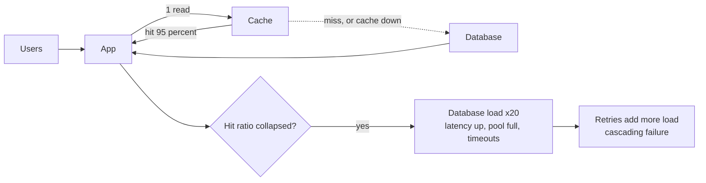

## Start here: the basics 🟢

> [!info] How to read this note (pick your level)
> - 🟢 **New to this?** Read "From zero" below, then sections 1, 2 and the cheat sheet (10). Stop there, that is a full first pass.
> - 🟡 **Know the basics?** Add section 3, then the on-call part (First 5 minutes, Diagnosis flowchart, Investigation steps, Fixes), then 4, 5 and 6.
> - 🔴 **Interview / SDE-3 prep?** Add 7, 8 and 9. Headings are tagged 🟢🟡🔴 so you always know where you are.

> [!note] Before this note
> - [[Production Debugging Playbook]]: check "what changed" first, and stop the damage before hunting the cause.
> - [[Incident Response]]: one person leads, and you post short updates on a fixed schedule.
> - [[Caching Fundamentals]]: a cache keeps copies of popular data in fast memory (often Redis), each copy expires after its TTL, and a miss goes to the database.

**From zero, in 60 seconds** 🟢

Reading from the main **database** is slow and costly.
So apps keep copies of popular data in a fast memory store. That store is the **cache**.
Normally 95 out of 100 reads are answered by the cache. Only 5 reach the database.
If the cache dies or forgets everything, all 100 reach the database.
That is 20 times the normal load. The database chokes.

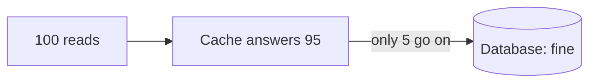

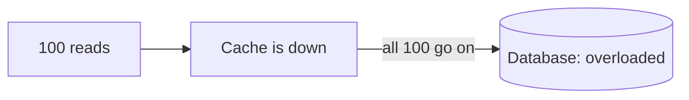

A **stampede** is a small version of this. One very popular item expires, and hundreds of requests rush to the database for it in the same second.

The rest of this note is just these 3 questions:
1. Why did the cache stop answering (down, full, or empty)?
2. How do you protect the database right now?
3. How do you refill the cache without a second crash?

**The problem in one story**

An online shop shows product pages. Most pages come from a fast memory store.
One morning that store restarts and forgets everything.
Now every page request goes to the slow main database at once.
The database chokes, pages time out, and users hit refresh, which makes it worse.

**Words you need first**

| Word | Plain meaning | Tiny example |
|---|---|---|
| Cache | A fast store that keeps copies of popular data | Redis holding `product:42` |
| Hit / miss | Hit: data found in cache. Miss: not found, go to the database | 95 hits out of 100 reads |
| Hit ratio | Share of reads served by the cache | 0.95 means 95 percent hits |
| TTL | Time to live: how long a cached copy is kept before it expires | `SET k v EX 300` keeps it 5 minutes |
| Eviction | Cache deletes keys to make room when memory is full | Redis `allkeys-lru` drops old keys |
| Stampede | Many requests miss the same key at once and all query the database | A hot key expires at noon |
| Connection pool | A fixed set of open database connections the app shares | Pool of 50, all busy means waiting |
| Load shedding | Rejecting some requests on purpose to save the system | Return 503 for low-priority calls |
| Avalanche | Many different keys expiring at the same moment | 500,000 keys all set with a 1-hour TTL at 03:00 |
| Hot key | One key that gets a huge share of all reads | the home-page banner |
| `maxmemory` | The memory cap you give Redis; past it, Redis evicts or refuses writes | 8 GB |
| Singleflight | A Go helper that lets only one request rebuild a missing key while others wait | 500 misses → 1 DB query |
| Warm-up | Refilling an empty cache on purpose, a bit at a time | load the top 5,000 keys first |
| Sentinel / Cluster | Redis's two ways of running copies with automatic failover | Sentinel promotes a replica |

**Picture it**

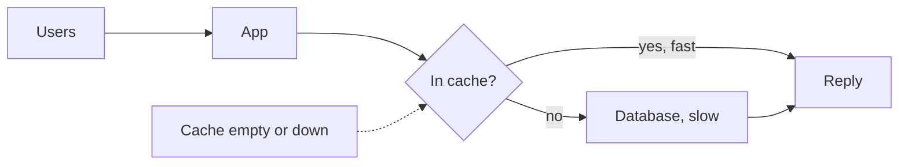

**Analogy**

A shop counter keeps popular items within reach, and a warehouse sits down a long corridor. If the counter is cleared, every customer walks to the warehouse and the corridor jams.

Where it breaks: real customers do not automatically retry, but software clients do, so the jam grows faster than in a shop.

**How the rest of this note builds up**

- First, **Why it exists** and **Mental model** explain why a cache hides database load.
- Then **How it works** covers the three shapes: outage, eviction, stampede.
- Next, **First 5 minutes**, **Diagnosis flowchart** and **Investigation steps** are the on-call playbook.
- Then **Fixes** and the **Worked example** show request collapsing, TTL jitter and stale serving.
- Finally, the SDE-3 **Deep dive** and **Interview questions** cover why stampedes feed themselves.

> [!tip] Remember
> When the cache fails, protect the database first, then refill the cache slowly.

## 1. Why it exists 🟢

Imagine a shop with a front counter that keeps the 100 most asked-for items within arm's reach, and a warehouse behind a long corridor. Almost every customer is served at the counter.

If the counter is suddenly cleared (or the counter staff are gone), every customer walks to the warehouse, the corridor jams, and even the customers who need rare items can no longer be served.

The analogy breaks down because in software the jam also causes retries, which are more customers lining up.

**Symptoms:**

- Latency jumps on read endpoints, then on everything that shares the database.
- Database CPU, active connections and replica lag (read copies falling behind) climb. Connection pool wait times grow.
- Error rate rises: timeouts, `too many connections`, 502 and 503 from the load balancer.
- Cache dashboards show hit ratio dropping, evictions spiking, connection errors, or `redis_up` at 0.
- The pattern often shows at a round time: a TTL boundary (for example every key set at 00:00 with a 1 hour TTL expires at 01:00).

**User impact:** slow or failing pages, checkout timeouts, sometimes a full outage when the database falls over. Writes can fail too, because the same database serves them.

> [!tip] Remember
> The cache is not the failing system you must fix first. The database behind it is the one that breaks.

### Real-life example: a sale banner expires 🟢

Think of the home page of a shopping app like Flipkart during a sale.
The sale banner data sits in Redis with a 5-minute expiry, and millions of people load the home page.
The moment it expires, thousands of requests miss at once and all ask the database for the same banner.
The database slows, so the banner stays missing longer, and even more requests pile in.
Letting just one request rebuild the banner, while the rest wait or get the old copy, stops the pile-up.

## 2. Mental model 🟢

The key quantity is **database read load = request rate x miss ratio**. Small changes in miss ratio near 0 have huge effects.

| Hit ratio | Miss ratio | DB reads at 20,000 requests per second |
|---|---|---|
| 99 percent | 1 percent | 200 per second |
| 95 percent | 5 percent | 1,000 per second |
| 80 percent | 20 percent | 4,000 per second |
| 0 percent (cache down) | 100 percent | 20,000 per second |

Going from 95 percent to 0 percent multiplies database load by 20. A database provisioned for 2,000 reads per second falls over.

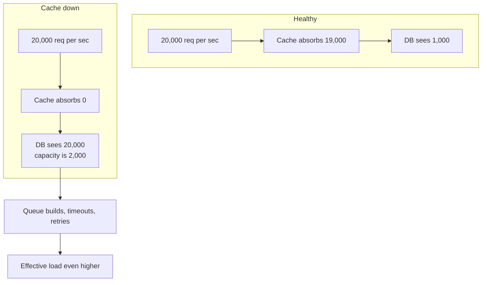

### The vocabulary, in plain words

| Term | Plain meaning | Trigger |
|---|---|---|
| **Cache outage** | The cache is unreachable or crashed | Node failure, network, OOM (out of memory), failover |
| **Cache stampede** (thundering herd) | Many requests recompute the same expired key at the same time | One hot key expires |
| **Cache avalanche** | Many different keys expire at the same time | Same TTL set in bulk, cold start, flush |
| **Cache penetration** | Requests for keys that never exist, so always miss | Bots, bad IDs, enumeration (trying ID after ID) |
| **Eviction storm** | Memory is full, so Redis deletes keys to make room, hit ratio falls | maxmemory hit, wrong policy |
| **Hot key** | One key gets a huge share of traffic | Viral item, celebrity profile |

> [!tip] Remember
> Different triggers, same failure path: misses go to the database. Fix the trigger, but always protect the database.

## Common beginner mistakes 🟢

- **Restarting the cache first while the database is drowning** → the empty cache sends a second wave of misses → protect the database first (rate limit, serve stale), then restore.
- **Giving every key the same TTL** → they all expire together → add random jitter to each TTL.
- **Letting every miss query the database** → one hot key becomes hundreds of identical queries → collapse them with singleflight.
- **Running `KEYS *` in production** → Redis does one command at a time, so everything stalls → use `SCAN`.
- **Giving Redis no memory headroom** → the fork for saving snapshots pushes it over and it gets OOMKilled → leave room for forks and buffers.

## 3. How it works 🟡

> 🟢 → 🟡 **You now know** that the cache hides most database load, and that losing it multiplies that load many times. **Next we open the box**: how a stampede, an avalanche, eviction and failover each empty the cache, how they cascade, and the checks for seven causes.

### The stampede, step by step

**In plain words:** A popular key expires. In the next few milliseconds, hundreds of requests all notice it is missing and all start the expensive database query to rebuild it. The database receives hundreds of identical queries at once.

**Step by step:**
1. Key `product:42` expires at 12:00:00.
2. In the next 40 ms, 32 requests ask for it, all miss, and all run the same database query.
3. Under load the query slows to 2 s, so about 1,600 requests miss before anyone refills the key.
4. The slower the database gets, the more requests miss: a loop that feeds itself.

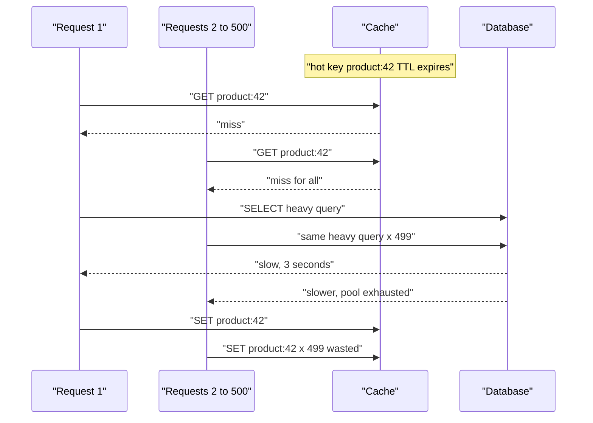

**Example with numbers:** a product page query takes 40 ms normally. At 800 requests per second on one hot key, a miss window of 40 ms lets about 32 requests miss before the first one refills the cache.

If the query slows to 2 s under load, the window is 2 s and about 1,600 requests miss. The slower the database, the longer the window, the more misses: a **positive feedback loop**.

### The avalanche

**In plain words:** if you save many items with the same expiry time, they all expire at the same moment. The database gets hit by all of them at once.

**Step by step:**
1. A job loads 500,000 keys at 03:00, each with a TTL of exactly 1 hour.
2. At 04:00 they all expire together, and the database gets a cliff of misses.
3. With a TTL of 1 hour plus a random 0-10 minutes, expiries spread over 10 minutes: about 830 per second instead of all at once.

Keys written together with the same TTL expire together. A job that warmed 500,000 keys at 03:00 with a fixed 1 hour TTL creates a cliff at exactly 04:00.

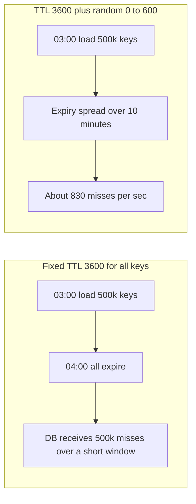

### Eviction when memory is full

**In plain words:** when the cache runs out of room, it throws old items away to make space. Thrown-away items become misses.

**Step by step:**
1. Redis reaches its `maxmemory` limit.
2. It checks its `maxmemory-policy`: `allkeys-lru` deletes the least recently used keys; `noeviction` refuses new writes.
3. Deleted keys become misses, so the hit ratio falls and `evicted_keys` climbs.
4. With a `volatile-*` policy, only keys with a TTL can be deleted; if none have one, writes fail.

When used memory reaches `maxmemory`, Redis applies the `maxmemory-policy`. With `noeviction`, writes fail with `OOM command not allowed`. With `allkeys-lru` or `allkeys-lfu`, Redis deletes keys to make room, which lowers the hit ratio, and `evicted_keys` climbs.

With `volatile-*` policies, only keys that have a TTL are candidates, so if keys have no TTL, nothing can be evicted and writes fail. See [[Cache Eviction Policies - LRU, LFU, TTL]].

### Failover pauses

**In plain words:** when the main cache server dies, a backup takes over. That swap takes a few seconds, and every read in those seconds misses.

**Step by step:**
1. The Redis primary dies.
2. Sentinel (or Cluster) notices after a few seconds and promotes a replica.
3. During that gap, reads fail or time out; slow client timeouts make requests pile up.
4. The new primary may be missing the last few writes, which look like extra misses.

During a Sentinel or Cluster failover the primary is unreachable for a few seconds to tens of seconds. Clients that time out slowly pile up. After failover, a promoted replica can lag behind, so some recent writes are missing: a miss that looks like data loss. See [[Redis Replication, Sentinel and Cluster]].

> [!warning] Common mistake
> Restarting a cache that held the whole working set, with no warm-up, creates a brand new stampede. A cold cache is a planned outage for the database unless you throttle the refill.

### The cascade

**In plain words:** one cache problem turns into a database problem, and retries make it worse.

**Step by step:**
1. The hit ratio falls.
2. Database reads jump, queries slow, and the connection pool fills.
3. Requests time out, and clients retry, adding even more load.
4. The database falls over, and now even pages that never used the cache fail.


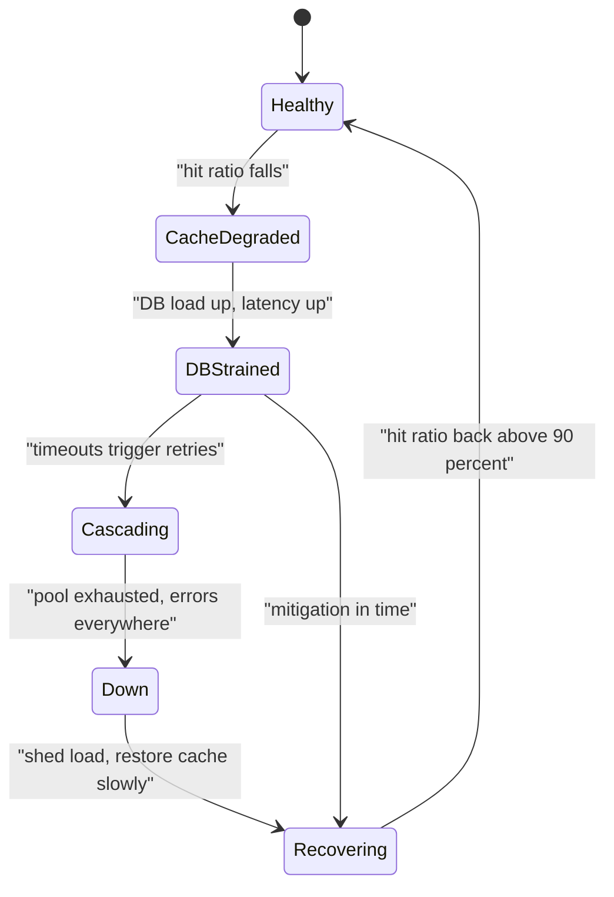

> [!tip] Remember
> Read load on the database is request rate times miss ratio. Anything that raises the miss ratio, or the request rate (retries), is a threat.

## First 5 minutes 🟡

1. **Confirm and scope.** Is the hit ratio down, the cache unreachable, or only the database slow? Look at cache hit ratio, `redis_up`, database load, and error rate side by side. Which endpoints and tenants? Which keys?
2. **Check what changed.** Deploy that changed keys, TTLs or serialization (new key prefix means a cold cache by design), a Redis restart or failover, a flush (`FLUSHALL` by mistake), a memory increase from a new feature, a traffic spike, a cron job that bulk-expires or bulk-loads, infrastructure events (node replaced, network partition).
3. **Mitigate, database first.**
   - **Protect the DB:** enable rate limiting or [[Load Shedding and Graceful Degradation]] on the expensive endpoints, return stale data or a degraded page, lower the app's DB connection limit so it cannot overwhelm the database, pause heavy batch jobs.
   - **Collapse duplicate loads:** if you have a feature flag for request coalescing (singleflight) or serving stale (returning the old value while refreshing), turn it on.
   - **Restore the cache:** fail over or restart the node if it is down, increase memory or fix the eviction policy if it is full. Roll back the deploy if it changed key formats.
   - **Do not** restart everything at once. Bring traffic back in steps so the cache refills while the database stays healthy.
4. **Communicate.** "Elevated latency on product and search pages since 10:42, cause is cache failure, database protected by rate limiting, next update 10:55."

## Diagnosis flowchart 🟡

**In plain words:** first check whether Redis is up, then whether it is full, empty, or slow, and then what shape the misses have.

**Step by step:**
1. `redis_up` is 0? Outage (cause 1).
2. Up but `evicted_keys` rising? Memory pressure (cause 2). Up but nearly empty? Cold cache (cause 3).
3. Misses on one key in bursts? Stampede (4). A cliff at a round time? Avalanche (5). Misses for keys that never exist? Penetration (6).
4. Hit ratio fine but slow? Slow Redis (7).

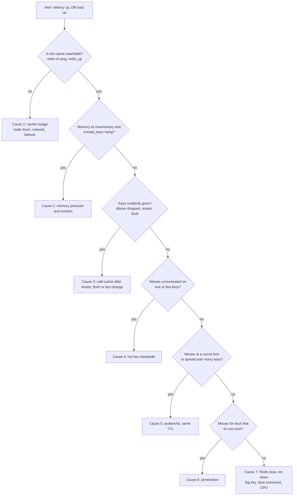

## Investigation steps 🟡

### Step 0: dashboards and PromQL

**In plain words:** before guessing, look at four graphs: is the cache up, how often it answers, how full it is, and how busy the database is.

**Step by step:**
1. Graph `redis_up`: 1 is up, 0 is down.
2. Graph the hit ratio: a drop from 95% to 4% is the headline.
3. Graph used memory against `maxmemory`, and the eviction rate.
4. Graph database reads and connections, and check which queries' `calls` jumped: those are the missed keys.

These use `redis_exporter` metric names. Verify against your exporter.

```promql
# Cache hit ratio (aim above 0.9 for read-heavy caches, estimate: your baseline varies)
rate(redis_keyspace_hits_total[5m])
  / (rate(redis_keyspace_hits_total[5m]) + rate(redis_keyspace_misses_total[5m]))

# Is Redis alive?
redis_up

# Memory use as a fraction of the limit (needs maxmemory set, otherwise max is 0)
redis_memory_used_bytes / redis_memory_max_bytes

# Evictions per second
rate(redis_evicted_keys_total[5m])

# Expired keys per second (a cliff here points at avalanche)
rate(redis_expired_keys_total[5m])

# Clients and rejections
redis_connected_clients
rate(redis_rejected_connections_total[5m])

# Command rate and slowest commands
sum(rate(redis_commands_processed_total[5m]))
topk(5, rate(redis_commands_duration_seconds_total[5m]) / rate(redis_commands_total[5m]))
```

On the database side (Postgres example, from [[Debugging Database Performance]]):

```promql
# Application pool pressure if you export sql.DBStats
go_sql_wait_count_total   # name depends on your collector; look for wait count and in-use connections
```

```bash
psql -c "select state, count(*) from pg_stat_activity group by 1 order by 2 desc;"
psql -c "select wait_event_type, wait_event, count(*) from pg_stat_activity where state='active' group by 1,2 order by 3 desc;"
# Top queries by total time (needs pg_stat_statements)
psql -c "select calls, round(total_exec_time) as ms, left(query,80) from pg_stat_statements order by total_exec_time desc limit 5;"
```

How to read the result: a sudden spike in `calls` for one or two queries that are normally cached means those are your cache-miss queries, which also tells you the hot keys.

### Cause 1: cache outage

**In plain words:** the cache server is down or can't be reached. Every read falls through to the database.

**Step by step:**
1. Run `redis-cli ping`: no `PONG` means it is unreachable.
2. Check the Redis pod: `OOMKilled` or restarting?
3. Check replication and Sentinel: is the app pointing at the current primary?
4. If `nc` (a simple "can I connect" tool) works but the app still fails, the problem is the app's client settings.

```bash
redis-cli -h redis-host -p 6379 ping                      # PONG expected
kubectl get pods -l app=redis -o wide
kubectl describe pod redis-0 | grep -iE "oomkilled|reason|restart"
kubectl logs redis-0 --previous | tail -50
redis-cli -h redis-host INFO replication | grep -E "role|connected_slaves|master_link_status|master_host"
redis-cli -p 26379 SENTINEL get-master-addr-by-name mymaster   # who does Sentinel think is primary
redis-cli --cluster check redis-host:6379                       # Cluster: slots covered?
# From an app pod: is it a network problem?
kubectl exec deploy/api -- sh -c 'nc -zv redis-host 6379; ss -tn dst redis-host | wc -l'
```

What results mean:

| Result | Meaning |
|---|---|
| `ping` times out, pod `OOMKilled` | Redis ran out of container memory (no headroom for fork or buffers) |
| Pod restarting | Crash loop: cold cache every time, so stampede each time |
| `master_link_status:down` on a replica | Replication broken, failover may be imminent |
| Sentinel points to a different primary than the app uses | App is using a stale address, restart or fix discovery |
| Cluster `[ERR] ... slots not covered` | Part of the keyspace is unavailable |
| `nc` works, app errors persist | App client pool or timeout config, not the network |

### Cause 2: memory pressure and eviction

**In plain words:** the cache is full and keeps throwing items away, so it answers less often.

**Step by step:**
1. Run `INFO memory`: is `used_memory` near `maxmemory`?
2. Run `INFO stats`: is `evicted_keys` rising fast?
3. Check `maxmemory-policy` against how your keys use TTLs.
4. Check `mem_fragmentation_ratio` (memory wasted in small gaps): well above 1.5 means waste.

```bash
redis-cli INFO memory | grep -E "used_memory_human|maxmemory_human|maxmemory_policy|mem_fragmentation_ratio"
redis-cli INFO stats  | grep -E "evicted_keys|expired_keys|keyspace_hits|keyspace_misses"
redis-cli CONFIG GET maxmemory-policy
redis-cli --bigkeys          # samples keyspace, shows largest key per type. Safe, but scans.
redis-cli --memkeys          # similar, by memory
redis-cli DBSIZE
```

What results mean:

- `used_memory` near `maxmemory` and `evicted_keys` rising fast: Redis is making room by evicting, so the hit ratio falls. Either the working set outgrew the instance or a new feature added data.
- Policy `noeviction` with write errors `OOM command not allowed`: writes fail but reads still work. Decide whether to evict or add memory.
- Policy `volatile-lru` but most keys have no TTL: almost nothing is evictable, so writes fail. Add TTLs or change the policy.
- `mem_fragmentation_ratio` well above 1.5: wasted memory, consider active defrag (Redis compacting memory while running) or restart in a quiet window.
- A big key (a list or hash with millions of entries) consuming memory and blocking: see cause 7.

### Cause 3: cold cache after a restart, flush or key change

**In plain words:** the cache is up but empty. It has to be filled again, and until then reads go to the database.

**Step by step:**
1. Check `uptime_in_seconds`: small means it just restarted.
2. Check `DBSIZE`: near zero means it is empty.
3. Check `cmdstat_flushall` for a flush, and recent deploys for a new key prefix.

```bash
redis-cli DBSIZE                                   # far below normal?
redis-cli INFO server | grep uptime_in_seconds     # just restarted?
redis-cli INFO persistence | grep -E "rdb_last_save_time|rdb_last_bgsave_status|aof_enabled|loading"
redis-cli INFO commandstats | grep -iE "flush"     # was FLUSHALL or FLUSHDB called?
```

What results mean: low `uptime_in_seconds` plus low `DBSIZE` means a restart without persistence (or `loading:1` while reading it). `cmdstat_flushall` with calls above 0 means someone flushed. A deploy that changed a key prefix or serialization version makes every old key unreachable: effectively a flush by design. Roll the deploy back or warm gradually.

### Cause 4: hot key stampede

**In plain words:** one very popular item expired. Hundreds of requests try to rebuild it at the same time.

**Step by step:**
1. Run `redis-cli --hotkeys` (or sample commands) to find the key with a huge share of reads.
2. In the database, count identical active queries with the same value.
3. A burst right after that key's TTL ended confirms a stampede.

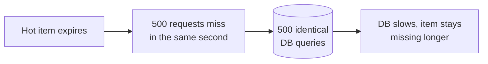

```bash
# Needs maxmemory-policy to be an LFU policy for --hotkeys to work
redis-cli --hotkeys
# Otherwise sample the traffic briefly. MONITOR is expensive: use for a few seconds only, never leave it on.
timeout 5 redis-cli MONITOR | awk '{print $5}' | sort | uniq -c | sort -rn | head
```

In the database, a burst of identical queries with the same parameter shows up in `pg_stat_activity` (`select query, count(*) from pg_stat_activity where state='active' group by 1 order by 2 desc limit 5;`). Many sessions running the same statement with the same literal is a stampede.

What results mean: one key with a large share of commands and a matching burst of identical DB queries right after its TTL means stampede. Fix with request collapsing (see Fixes).

### Cause 5: avalanche from the same TTL

**In plain words:** many items were saved together with the same expiry, so they all ran out together.

**Step by step:**
1. Sample keys and read their remaining TTL: many nearly identical values?
2. Graph `expired_keys`: a spike lining up with the latency spike?
3. Find the job or deploy that loaded them all at once.

```bash
# Sample TTLs of keys to see if they cluster
redis-cli --scan --pattern 'product:*' | head -200 | while read k; do redis-cli TTL "$k"; done | sort -n | uniq -c | head
```

```promql
rate(redis_expired_keys_total[1m])   # step cliff at a round time
```

What results mean: many keys with nearly identical remaining TTL, and an `expired_keys` spike that lines up with the latency spike, confirm an avalanche. A bulk warm-up job or deploy-time load that sets the same TTL on everything is the usual source.

### Cause 6: cache penetration

**In plain words:** people keep asking for things that don't exist. The cache never has them, so every request goes to the database.

**Step by step:**
1. Look for a high miss ratio while the database returns "not found".
2. Look at the requested IDs: random or counting up one by one means a bot or a buggy client.
3. Block or rate-limit that client, and cache "not found" for a short time.

Look for a high miss ratio with the DB returning empty results.

```bash
kubectl logs deploy/api --since=10m | grep -E "cache miss" | awk '{print $NF}' | sort | uniq -c | sort -rn | head   # adjust to your log format
```

If the missing keys are random or sequential IDs that do not exist, a bot or a client bug is scanning. Negative caching (store "not found" for a short TTL), a bloom filter (a compact structure that can say "definitely not present"), input validation, and rate limiting on that client fix it.

### Cause 7: Redis is up but slow

**In plain words:** the cache is alive but slow, often because one big command blocks everything else.

**Step by step:**
1. Run `SLOWLOG GET 10`: look for `KEYS *`, `HGETALL` or `LRANGE 0 -1` on big keys.
2. Check `latest_fork_usec`: hundreds of milliseconds means saving snapshots stalls Redis.
3. Check `connected_clients` against `maxclients`: near the max means clients are leaking connections.

```bash
redis-cli --latency -h redis-host                  # round trip ms, running min/avg/max. Ctrl-C to stop
redis-cli --latency-history -i 5                   # samples every 5 seconds
redis-cli SLOWLOG GET 10                           # commands slower than slowlog-log-slower-than
redis-cli LATENCY DOCTOR                           # needs latency monitor enabled
redis-cli INFO commandstats | sort -t= -k3 -nr | head   # which commands use time
redis-cli INFO clients | grep -E "connected_clients|blocked_clients"
redis-cli CONFIG GET maxclients
redis-cli INFO persistence | grep -E "latest_fork_usec|rdb_bgsave_in_progress"
```

What results mean:

| Evidence | Likely cause |
|---|---|
| `SLOWLOG` shows `KEYS *`, `SMEMBERS`, `HGETALL` or `LRANGE 0 -1` on a big key | Blocking command on a large collection. Redis is single threaded for commands, so one slow command stalls all others |
| `latest_fork_usec` large (hundreds of ms) | Fork (copying the process to save a snapshot) for RDB or AOF rewrite stalls the main thread |
| `connected_clients` near `maxclients`, `rejected_connections` rising | Connection exhaustion: clients leaking or no pooling |
| Latency spikes every N minutes | Snapshots, a cron job, or key expiry bursts |
| `blocked_clients` high | Blocking list commands, or a stuck script |

If Redis latency is the problem but the process is healthy, application timeouts convert slowness into misses and retries. Check the app side too:

```bash
kubectl exec deploy/api -- curl -s -o /dev/null -w "ttfb=%{time_starttransfer} total=%{time_total}\n" http://localhost:8080/products/42
go tool pprof -http=:8081 "http://api-pod:6060/debug/pprof/profile?seconds=30"   # is the app waiting on Redis or DB?
```

## Fixes 🟡

| Cause | Immediate fix | Proper fix | Prevention |
|---|---|---|---|
| Cache outage | Fail over or restart, shed load at the edge, serve stale or degraded data, circuit breaker on the cache client so a dead cache fails fast | Replicas with Sentinel or Cluster, client timeouts of tens of ms, fallbacks | Game day: kill the cache and watch the database |
| Memory pressure | Raise memory, set a sensible eviction policy, add TTLs, delete large unneeded keys | Right-size from the working set, cap value sizes, compress | Alert at 80 percent memory and on evictions |
| Cold cache | Warm gradually from the top keys, throttle refill, hold traffic or shed | Persistence (RDB or AOF) or a warm replica, deploy key changes with dual reads | Never flush without a plan, canary key format changes |
| Hot key stampede | Request collapsing, serve stale while refreshing | Singleflight, probabilistic early refresh, per-key lock with short TTL, local in-process cache for the hottest keys | Hot key alert, test with expiry under load |
| Avalanche | Add jitter to new TTLs, stagger the warm-up | TTL jitter everywhere, background refresh, tiered TTLs | Lint rule: no fixed TTL in bulk loaders |
| Penetration | Negative caching, block the abusive client | Bloom filter, ID validation, rate limits | Alert on miss ratio for non-existent keys |
| Slow Redis | Kill or rename the blocking command, scan with `SCAN` instead of `KEYS` | Split big keys, pipeline (send many commands in one round trip), avoid O(N) commands (ones whose time grows with the key's size), tune persistence | `rename-command KEYS ""` or ACLs, review slowlog regularly |

### Fix: request collapsing and jitter in Go

**In plain words:** let only one request rebuild a missing item while the others wait for its answer. And add a little random time to each expiry so items don't all expire together.

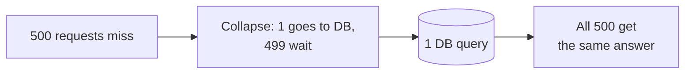

One concurrent loader per key, with randomized TTL. The `singleflight` package from `golang.org/x/sync` lets the first caller run the load while the others wait for its result.

```go
func (l *Loader) Get(ctx context.Context, key string) (string, error) {
	if v, ok := l.cache.Get(ctx, key); ok {
		return v, nil
	}
	v, err, _ := l.group.Do(key, func() (any, error) {
		val, err := l.load(ctx, key)
		if err != nil {
			return "", err
		}
		ttl := 300*time.Second + time.Duration(rand.IntN(60))*time.Second
		l.cache.Set(ctx, key, val, ttl)
		return val, nil
	})
	if err != nil {
		return "", err
	}
	return v.(string), nil
}
```

How it works: 1) check the cache. 2) On a miss, `group.Do(key, ...)` runs the function once per key even if 100 goroutines call it at the same time. 3) The others block and share the result, so the database sees one query instead of 100. 4) The TTL has up to 60 seconds of random jitter so related keys do not expire together.

Write a test with 100 concurrent goroutines and a slow fake loader to check that exactly one load runs, and run it with `go test -race`. Note this collapses requests inside one process only.

With 50 pods, the database still sees up to 50 loads per hot key, which is usually fine; a distributed lock (for example `SET lock:key token NX PX 5000`) can reduce it further at the cost of complexity.

### Warm-up after recovery

**In plain words:** refill the cache slowly, a bit at a time, so the database isn't flooded while it fills.

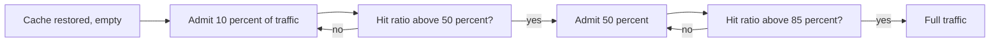

Pre-load the top N keys (from access logs or a recent snapshot) with jittered TTLs before admitting traffic, and keep rate limiting active until the database load is back to baseline.

## 4. Worked example 🟡

**Scenario:** a catalog service serves 20,000 requests per second, 96 percent cache hit ratio, so about 800 database reads per second. The Postgres primary comfortably handles 3,000. The product detail pages are the heaviest path.

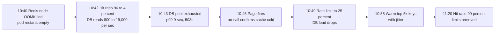

**Timeline:**

1. **10:40** Redis pod exceeds its container memory limit during a fork for a background save and is `OOMKilled`. Snapshots were written to the container's ephemeral disk (wiped on restart; no persistent volume), so the restarted pod starts empty.
2. **10:42** Hit ratio drops from 96 percent to 4 percent. Database reads rise from 800 to about 19,000 per second.
3. **10:43** The database connection pool saturates. Latency climbs to 9 seconds at p99 and the load balancer starts returning 503. Clients retry, so request rate rises further.
4. **10:46** The page fires on 5xx rate. The on-call engineer checks the hit ratio query (4 percent), `redis_up` (back to 1), and `DBSIZE` (near 0). Diagnosis: cold cache after restart, cause 3. `kubectl describe pod redis-0` confirms `OOMKilled`.
5. **10:49** Mitigation, database first: enable rate limiting at the gateway to 25 percent of normal traffic on product endpoints and turn on the stale-page fallback for the home page. Database reads drop to roughly 4,000 per second and the pool recovers.
6. **10:55** A warm-up job loads the 5,000 most requested product keys with TTL 3600 plus random jitter up to 600 seconds. Hit ratio climbs to 60 percent.
7. **11:05** Raise admitted traffic to 50 percent, then 100 percent as the ratio passes 85 percent.
8. **11:20** Hit ratio is 90 percent and database reads are 2,000 per second. Limits are removed. Total impact: about 40 minutes of degraded service, about 15 minutes of elevated errors.
9. **Follow-up:** raise the container memory limit to leave fork headroom, put RDB persistence on a persistent volume and add a replica for failover, add singleflight and TTL jitter, add alerts on hit ratio and `evicted_keys`, and schedule a game day that kills the cache under load.

Estimated figures in this example are illustrative, not from a real system.

## 5. Variants and comparison 🟡

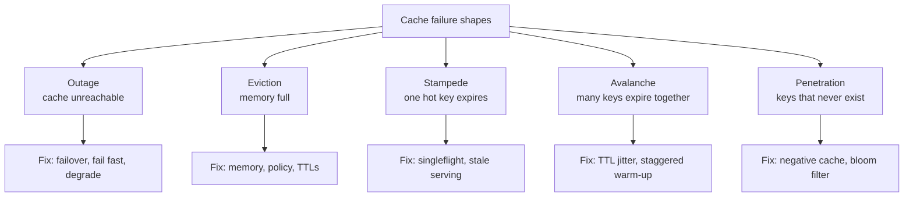

| Failure | Hit ratio pattern | Evidence | Scope |
|---|---|---|---|
| Outage | Drops to 0, errors on connect | `redis_up` 0, timeouts | Everything |
| Eviction | Slowly falls as memory fills | `evicted_keys` rising | Cold or large keys |
| Stampede | Dips and spikes on one key | Identical DB queries in bursts | One hot key |
| Avalanche | Cliff at a round time | `expired_keys` spike | Many keys |
| Penetration | Constant high miss | DB queries returning empty | Non-existent keys |

## 6. Trade-offs and when not to use 🟡

| Technique | Benefit | Cost |
|---|---|---|
| Rate limit during recovery | Protects database | Some users get errors or degraded pages |
| Serve stale on failure | Pages keep working | Users may see outdated data |
| Singleflight | Cuts duplicate loads | Waiters share one error, extra latency for waiters |
| TTL jitter | Spreads expiry | Slightly inconsistent freshness between keys |
| Local in-process cache | Absorbs hot keys, survives Redis outage | Per-pod inconsistency, memory use |
| Persistence on cache | Warm restart | Fork pauses, disk I/O, can load stale data |
| Never expire plus background refresh | No expiry cliff | Refresh worker complexity, stale if worker fails |
| Fail open (go to DB on cache error) | Availability | Database may be overwhelmed |
| Fail closed (error when cache down) | Protects database | Users see errors |

**When this playbook is not the right tool:** if the cache is behaving as designed and the database is slow for an unrelated reason, use [[Playbook - Database Overload and Connection Exhaustion]].

If Redis is used as a primary datastore or queue rather than a cache, an outage means data loss, which needs a different recovery plan (see [[Redis Persistence - RDB and AOF]]).

## 7. In production 🔴

> 🟡 → 🔴 **You now know** the seven ways a cache stops helping, how to find each, and how to refill the cache without a second crash. **Next is the advanced part**: alerts, client settings and capacity for real fleets, and the deeper ideas (why stampedes feed themselves, early refresh, stale-while-revalidate, forks, fail open vs closed).


- **Alerts:** hit ratio below baseline for 5 minutes, `redis_up == 0`, memory above 80 percent of max, eviction rate above a small threshold, p99 command latency, DB active connections above 70 percent.
- **Client settings:** short connect and read timeouts (tens of milliseconds for a cache), a connection pool sized deliberately (see [[Connection Pooling]]), and a circuit breaker so a dead cache fails fast. See [[Circuit Breaker]].
- **Capacity:** size the database for a cold-cache scenario at least for the critical paths, or have a tested load shedding mode.
- **Key design:** TTLs with jitter, versioned key prefixes with gradual rollout, bounded value sizes, no `KEYS` in production.
- **Persistence and HA:** at least one replica, tested failover, and decide on RDB or AOF based on whether a warm restart is worth the fork cost. See [[Redis in Production - Memory, Latency, Security]].
- **Game days:** kill the cache in staging under load and measure database load and recovery time.

## 8. Deep dive 🔴

**Why stampedes are self-reinforcing.** A miss triggers a slow query. The slow query keeps the key missing for longer. More requests miss in that longer window, adding more load, which makes the query slower.

This feedback loop explains why a mild trigger can tip a system over a cliff. Request collapsing breaks the loop by capping concurrent loads per key at one.

**Probabilistic early expiration.** Instead of waiting for expiry, each reader may refresh early with probability that rises as the key nears expiry, weighted by how long the load takes (the "XFetch" idea from a 2015 VLDB paper on optimal probabilistic cache stampede prevention). The refresh happens before the cliff, spreading load without locks.

**Stale-while-revalidate.** Store a soft TTL and a hard TTL. After the soft TTL, return the old value immediately and refresh in the background. Users never wait on a miss, and the database sees one refresh. The trade-off is bounded staleness, which you must accept per data type.

**Why a fork can look like an outage.** Redis saves snapshots by forking. On a large dataset, the fork itself can pause the main thread for milliseconds to hundreds of milliseconds, and copy-on-write (memory pages copied only when changed during the save) can raise memory use by up to the write rate times the save duration.

If the container limit has no headroom, the kernel OOM killer takes Redis, which is exactly the worked example.

**Fail open or fail closed.** On cache errors, falling through to the database keeps users served but risks the database. Failing closed returns errors but keeps the database alive. A hybrid, such as fall through for a small fraction of traffic using a token bucket (a rate limiter that hands out a fixed number of passes per second), gives a controlled trickle that also warms the cache.

**Multi-level caching.** A small in-process cache with a short TTL (seconds) in front of Redis protects against both hot keys and brief Redis blips, at the cost of per-pod staleness. See [[Caching Patterns]] and [[Cache Failure Modes - Stampede, Avalanche, Penetration, Hot and Big Keys]].

## 9. Interview questions 🔴

> [!question]- Your cache goes down in production. What happens and what do you do?
> Every read falls through to the database, whose load becomes request rate times miss ratio, often 10 to 20 times normal. First confirm hit ratio and database health, then protect the database (rate limit, shed, serve stale, lower pool size), restore or fail over the cache, and warm it gradually with jittered TTLs before returning to full traffic. Afterwards, add timeouts, circuit breaker, replica and game day.

> [!question]- What is the difference between a cache stampede and a cache avalanche?
> A stampede is many requests recomputing one hot key at once after it expires. An avalanche is many different keys expiring at the same moment, usually due to identical TTLs. Fixes differ: request collapsing and early refresh for stampedes, TTL jitter and staggered warm-up for avalanches.

> [!question]- How does singleflight help, and what are its limits?
> It makes concurrent callers for the same key share one in-flight load, so the database sees one query per key per process. It does not coordinate across pods, so with N pods you can still see N loads. Waiters also share the error if the load fails, so add timeouts and consider not caching errors.

> [!question]- Redis is healthy but hit ratio dropped from 95 percent to 40 percent. How do you investigate?
> Check evictions and memory (working set outgrew the instance), recent deploys that changed key format or TTLs, `DBSIZE` and uptime for a flush or restart, and the shape of misses (one key, many keys at a round time, or non-existent keys). Each pattern maps to a cause and a fix.

> [!question]- Trap: "Just restart Redis, it will fix itself." Why is that dangerous?
> A restart empties the cache (unless persisted), which causes a miss storm into the database. Restart only with the database protected and a warm-up plan, otherwise the restart converts a cache problem into a full outage.

> [!question]- Should the app fail open or fail closed when the cache is unavailable?
> It depends on whether the database can take the load. Fail open keeps users served but risks overload, so pair it with rate limiting and a circuit breaker. Fail closed protects the database but shows errors. A controlled fall-through (a token bucket letting only a fraction through) is a common middle path.

> [!question]- Why can `KEYS *` or `HGETALL` on a big hash cause an outage?
> Redis executes commands on one thread, so a command that takes 2 seconds blocks all other clients for 2 seconds. Use `SCAN` and `HSCAN`, split large keys, and review `SLOWLOG`.

## 10. Cheat sheet 🟢

- DB read load = request rate x miss ratio. Hit ratio falling from 95 percent to 0 multiplies read load by 20.
- First five minutes: confirm hit ratio and `redis_up`, check what changed, protect the DB, restore cache gradually, communicate.
- Seven causes: outage, eviction, cold cache, hot key stampede, avalanche, penetration, slow Redis.
- Commands: `redis-cli ping`, `INFO stats`, `INFO memory`, `INFO clients`, `INFO persistence`, `SLOWLOG GET`, `--latency`, `--bigkeys`, `--hotkeys`, `DBSIZE`.
- Hit ratio PromQL: `rate(redis_keyspace_hits_total[5m]) / (rate(redis_keyspace_hits_total[5m]) + rate(redis_keyspace_misses_total[5m]))`.
- Fixes: singleflight, TTL jitter, serve stale, negative caching, local cache, circuit breaker, gradual warm-up.
- Never restart or flush without a database protection plan.
- Give the container memory headroom for fork and buffers.
- Test the cold-cache scenario in a game day.

## Post-incident checklist 🟡

- [ ] Timeline with hit ratio, DB load and error rate graphs and exact times.
- [ ] Root cause: why did the cache fail or empty, and why could the database not absorb it?
- [ ] Verify no stale or inconsistent data remains after recovery (see [[Cache Invalidation, TTL and Consistency]]).
- [ ] Add alerts: hit ratio, memory, evictions, `redis_up`, DB connections.
- [ ] Add request collapsing, TTL jitter, stale serving and client timeouts where missing.
- [ ] Review Redis memory limit, persistence and replica setup.
- [ ] Run a cold-cache load test or game day.
- [ ] Blameless review: [[Postmortems and Root Cause Analysis]].

## Self-check 🟢🟡

🟢 Easy

> [!question]- What happens to the database when the cache goes down?
> Every read goes to it; at a 95% hit ratio that is 20 times its normal read load.

> [!question]- What do you protect first: the cache or the database?
> The database (rate limit, shed load, serve stale), then restore the cache.

> [!question]- What is a cache stampede?
> Many requests missing the same expired hot key at once and all querying the database.

🟡 Medium

> [!question]- 10,000 requests/s, hit ratio drops from 98% to 90%. Database reads go from what to what?
> From 200/s to 1,000/s, five times more.

> [!question]- How do you stop an avalanche of keys expiring together?
> Add random jitter to TTLs and stagger warm-up jobs.

> [!question]- Singleflight is on, but you run 50 pods. How many DB loads per hot key can still happen?
> Up to 50, one per pod; a distributed lock can cut it further.

## Links

- **Before this:** [[Production Debugging Playbook]], [[Incident Response]], [[Caching Fundamentals]]
- **Cache deep notes:** [[Cache Failure Modes - Stampede, Avalanche, Penetration, Hot and Big Keys]], [[Cache Eviction Policies - LRU, LFU, TTL]], [[Cache Invalidation, TTL and Consistency]], [[Caching Patterns]], [[Redis in Production - Memory, Latency, Security]], [[Redis Replication, Sentinel and Cluster]], [[Redis Persistence - RDB and AOF]]
- **Related playbooks:** [[Playbook - Database Overload and Connection Exhaustion]], [[Playbook - High Latency]], [[Playbook - Bad Deploy and Rollback]]
- **Resilience:** [[Circuit Breaker]], [[Load Shedding and Graceful Degradation]], [[Timeouts, Retries and Backoff]], [[Connection Pooling]]
- **Next:** [[Postmortems and Root Cause Analysis]], [[Debugging Database Performance]]

### Watch on YouTube

- [Why One Cache Expiry Can Crash Your System / Cache Stampede Explained](https://www.youtube.com/watch?v=GVyOZo__F70) · Tech Is Easy Actually · 6 min · 873 views
- [Major Caching Strategies Explained for Beginners in 5 Minutes / LRU, LFU, TTL, Cache Stampede & More](https://www.youtube.com/watch?v=Mx8tR03NVQc) · Learn with Whiteboard · 5 min · 1,155 views
