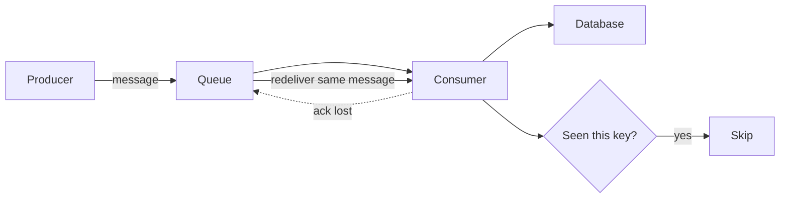
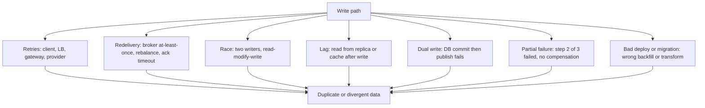
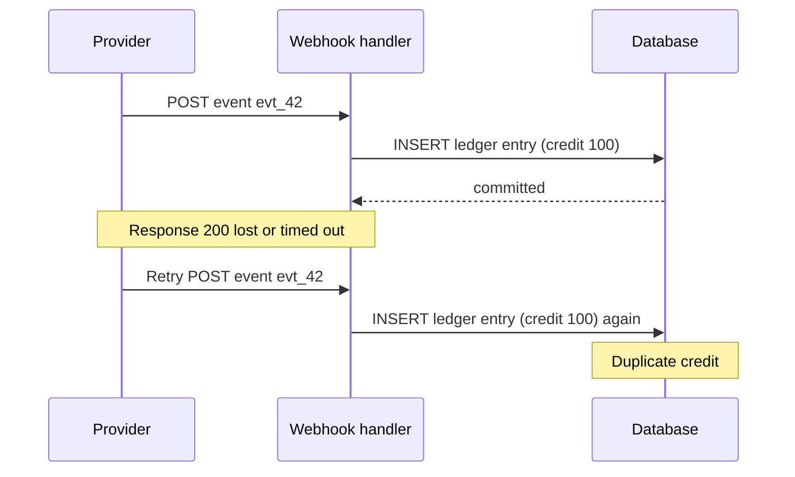
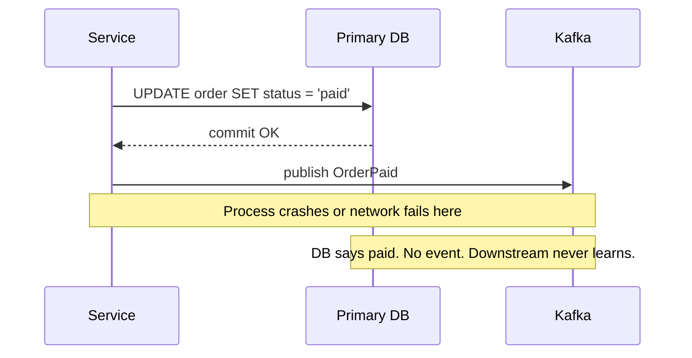
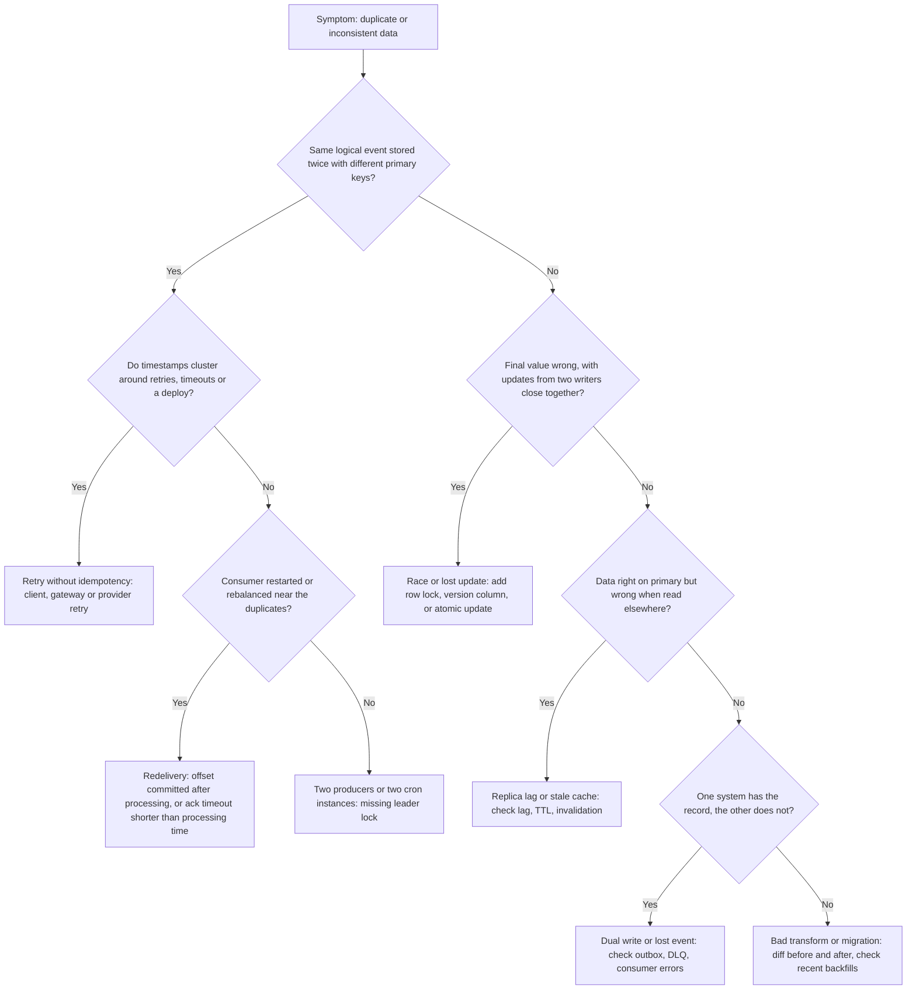
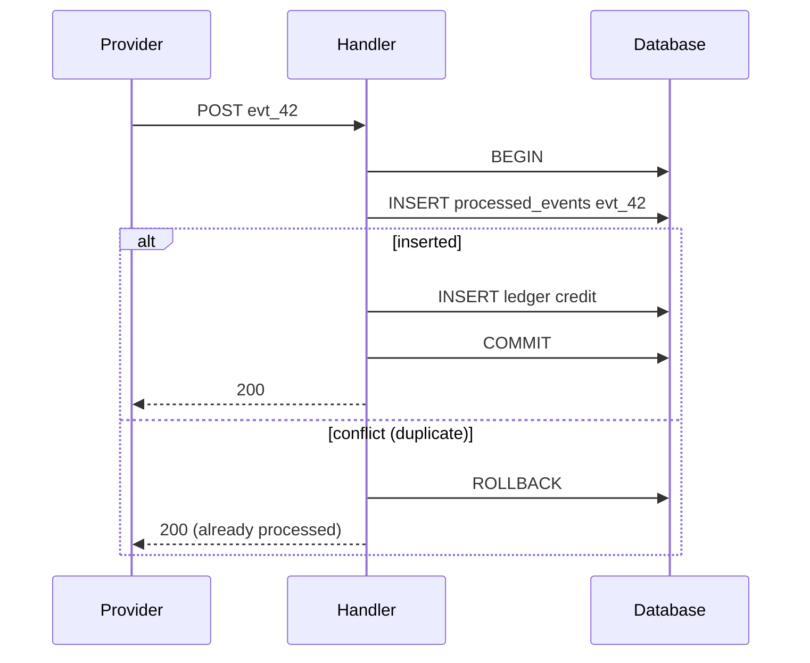
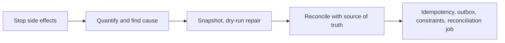

# Playbook - Data Inconsistency and Duplicate Processing

> [!summary] TL;DR
> Customers see double charges, double emails, missing orders, or two systems that disagree (the order service says "paid", the ledger says "pending"). The fix path is: stop the damage, find which write path produced the bad data (retries, redelivery, race, replication lag, or a partial failure), repair the data with a reviewed script, then make the write path idempotent so it cannot happen again.

> [!abstract] Core idea
> - **Stop the bleeding before you repair data.** Pause the consumer, flip a flag, or block the endpoint. Repairs on a moving target make things worse.
> - **At-least-once delivery plus a non-idempotent handler equals duplicates.** Almost every duplicate incident is this.
> - **Inconsistency has a finite list of causes:** retries, redelivery, race conditions, replica lag, dual writes, partial failures, bad migrations, clock problems.
> - **Repair is a data change in production.** Snapshot first, dry-run, run in small batches, reconcile afterward.

## Start here: the basics

**The problem in one story**

A customer pays once for an order.
The payment message is delivered twice because the first reply got lost.
The system charges them twice and sends two emails.
Another customer's order shows paid in one screen and unpaid in another.

**Words you need first**

| Word | Plain meaning | Tiny example |
|---|---|---|
| Duplicate processing | The same message or request is handled more than once | Two charges for one click |
| Idempotent | Doing it twice has the same effect as doing it once | `SET status=paid` is idempotent; `balance += 10` is not |
| Idempotency key | A unique ID sent with a request so repeats can be detected | `Idempotency-Key: ord-123` |
| At-least-once delivery | The queue promises every message arrives, maybe more than once | Kafka redelivers after a consumer crash |
| Retry | Sending a request again after a failure or timeout | Client retries after 2 s timeout |
| Source of truth | The one system whose data is considered correct | The payments ledger, not the cache |
| Reconciliation | Comparing two data sets and fixing mismatches | Nightly job compares orders with payments |
| Dual write | Writing the same change to two systems separately | Write DB, then publish event; one may fail |

**Picture it**



**Analogy**

A postal clerk stamps every letter that arrives. If the post office sometimes delivers the same letter twice, the clerk must check a ledger of letter numbers before stamping, or the same bill gets paid twice.

Where it breaks: letters are physical and rarely duplicate; in software, retries and redeliveries are normal and expected every day.

**How the rest of this note builds up**

- First, **Why it exists** and **Mental model** explain why duplicates are normal in distributed systems.
- Then **How it works** shows where duplicates and mismatches come from.
- Next, **First 5 minutes**, **Diagnosis flowchart** and **Investigation steps by cause** form the playbook.
- Then **Fixes** and the InvoiceOps **Worked example** show idempotency keys, outbox and repair.
- Finally, the SDE-3 **Deep dive** and **Interview questions** cover exactly-once myths and reconciliation.

> [!tip] Remember
> Assume every message can arrive twice; make handlers idempotent and keep one source of truth.

## 1. Why it exists

Symptoms and user impact:

- Customers report two charges, two shipping notifications, or two copies of the same record.
- Support sees an order "paid" with no payment, or a payment with no order.
- Dashboards disagree: the data warehouse count differs from the primary database.
- A user writes data, refreshes, and sees the old data.
- Counters, balances or inventory drift from the truth.

Example for this note: InvoiceOps processes payment webhooks. A deploy made the handler slower. The payment provider timed out waiting for the `200 OK`, retried delivery, and the handler (not idempotent) created a second ledger entry for each retried event. Roughly 3% of invoices were double-credited in 40 minutes.

Data incidents are slower and more dangerous than outages: bad data keeps spreading to downstream systems, emails and reports, and cannot be rolled back by redeploying code.

> [!tip] Remember
> Code rollback fixes behaviour; it does not fix the bad rows already written.

## 2. Mental model

Imagine a bank teller who receives a withdrawal slip, pays out cash, but the receipt printer jams. The customer, unsure, submits the slip again.

- If the teller records the **slip number**, the second slip is recognised and ignored (idempotent).
- If the teller just pays out again, the bank loses money (duplicate processing).
- If two tellers both look at the same account balance, both approve a withdrawal, and the balance is overdrawn (race condition).
- If the branch ledger is updated but head-office ledger is updated later, the two disagree for a while (replication lag or dual write).

The analogy breaks down because real systems have many "tellers" (consumers, pods, retries) acting in parallel without seeing each other.



## 3. How it works

### Where duplicates are born

**In plain words:** any time a message or request can be sent more than once, the receiver might process it more than once. Retries are a feature of reliable systems; duplicates are the price.



Fixed version: the handler first records `evt_42` in a unique-keyed table, in the same transaction as the ledger entry; the retry hits the unique constraint and returns `200` without writing.

### Types of inconsistency

| Type | How it looks | Typical cause |
| --- | --- | --- |
| Duplicate | Same logical event twice | Retry or redelivery without idempotency |
| Lost update | Final value ignores one writer | Read-modify-write race, no lock or version check |
| Stale read | Old value after write | Read from lagging replica or stale cache |
| Phantom or orphan | Child row without parent, payment without order | Dual write, partial failure |
| Divergence | Two stores disagree | Failed event publish, consumer error, bug in transform |
| Out-of-order | Older update overwrites newer | Unordered consumer, retries, clock skew |

### Dual write: the classic source of drift



The fix is the **transactional outbox**: write the event to an `outbox` table in the same transaction and publish it from there. See [[Transactional Outbox and CDC]].

> [!warning] Common mistake
> "We will just retry the publish." If the process crashes between the commit and the retry, the event is lost, and nothing retries it. The outbox survives the crash.

## 4. First 5 minutes

1. **Confirm and size it.** Pick two or three concrete examples (order IDs, invoice IDs). Count affected rows with a read-only query. Is it still growing? Which tenants, regions or time window?
2. **Check what changed.** Deploys, migrations, backfills, config, broker rebalances, consumer lag or restarts, replica failover, provider incidents, feature flags in the last 24 hours.
3. **Stop the damage first**, whichever applies:
   1. Pause the consumer group or scale it to 0 (messages wait in the broker; confirm retention is longer than the outage).
   2. Disable the endpoint or flag the feature off.
   3. Turn off downstream side effects (emails, payouts, webhooks out) first; those cannot be undone.
   4. Roll back the deploy if it introduced the bug.
   5. Do **not** start fixing data yet.
4. **Communicate.** Declare severity per [[Incident Response]]. Money, privacy or legal exposure usually raises severity. Inform support with the exact customer-facing wording and tell finance if money moved.

## 5. Diagnosis flowchart



## 6. Investigation steps by cause

### 6.1 Quantify and sample (all causes)

```sql
-- Duplicates by business key (adjust table and key)
SELECT provider_event_id, count(*) AS n, min(created_at), max(created_at)
FROM ledger_entries
GROUP BY provider_event_id
HAVING count(*) > 1
ORDER BY n DESC, max(created_at) DESC
LIMIT 50;

-- Growth over time: is it still happening?
SELECT date_trunc('minute', created_at) AS minute, count(*)
FROM ledger_entries
WHERE provider_event_id IN (
  SELECT provider_event_id FROM ledger_entries GROUP BY 1 HAVING count(*) > 1)
GROUP BY 1 ORDER BY 1;
```

What it means: if the duplicated rows cluster in one window, correlate with deploys and incidents in that window. If the second copy is usually 30-60 seconds after the first, think timeouts and retries. If it is milliseconds apart, think a race between concurrent consumers.

### 6.2 Retry-driven duplicates

Check provider and gateway retry behaviour and handler latency.

```promql
# Handler latency, p99 (look for crossing the provider timeout, e.g. 10 s)
histogram_quantile(0.99, sum by (le) (rate(webhook_handler_duration_seconds_bucket[5m])))

# Share of duplicate deliveries seen (if you track them)
sum(rate(webhook_duplicate_total[5m]))
```

```bash
# Same event ID appearing more than once in the access or app logs
grep -o '"event_id":"[^"]*"' app.log | sort | uniq -c | sort -rn | head
```

What it means: a handler p99 above the caller timeout guarantees retries. The fix is to acknowledge fast (store, then process asynchronously) and be idempotent.

### 6.3 Consumer redelivery (Kafka example)

```bash
kafka-consumer-groups.sh --bootstrap-server broker:9092 --describe --group payments-consumer
# Columns: GROUP, TOPIC, PARTITION, CURRENT-OFFSET, LOG-END-OFFSET, LAG, CONSUMER-ID, HOST, CLIENT-ID

kafka-consumer-groups.sh --bootstrap-server broker:9092 --describe --group payments-consumer --state
# Shows group state, e.g. Stable vs PreparingRebalance
```

```bash
kubectl logs deploy/payments-consumer --since=1h | grep -iE "rebalance|revoked|assigned|commit"
kubectl get pods -l app=payments-consumer -o wide     # restarts count
```

What it means:

- Frequent rebalances with partitions revoked while messages are in flight cause redelivery of uncommitted messages.
- Processing time longer than the consumer's `max.poll.interval.ms` makes the broker consider the consumer dead and reassigns its partitions (so another consumer reprocesses the same messages).
- Committing the offset **before** finishing work loses messages; committing **after** finishing gives duplicates when a crash happens in between. At-least-once with idempotent handlers is the standard answer.

For SQS the equivalent is a visibility timeout shorter than processing time; see [[AWS SQS, SNS and EventBridge]].

### 6.4 Races and lost updates

```sql
-- PostgreSQL: are transactions waiting on locks?
SELECT pid, wait_event_type, wait_event, state, left(query, 80)
FROM pg_stat_activity WHERE wait_event_type = 'Lock';

-- Who blocks whom
SELECT pid, pg_blocking_pids(pid) AS blocked_by, query
FROM pg_stat_activity WHERE cardinality(pg_blocking_pids(pid)) > 0;
```

Look for read-modify-write code such as:

```sql
-- Racy: two requests both read balance = 100, both write 100 - 30
SELECT balance FROM accounts WHERE id = 1;
UPDATE accounts SET balance = 70 WHERE id = 1;
```

What it means: two writers within milliseconds on the same key, and a final value reflecting only one, proves a lost update. Fixes: an atomic update (`SET balance = balance - 30 WHERE id = 1 AND balance >= 30`), `SELECT ... FOR UPDATE`, or a version column. See [[Locking - Optimistic vs Pessimistic]] and [[Isolation Levels and MVCC]].

For cron or scheduled jobs running twice, check how many instances run and whether a lock exists:

```bash
kubectl get pods -l app=billing-cron
kubectl get cronjob billing -o jsonpath='{.spec.concurrencyPolicy}'   # Allow, Forbid, Replace
```

`concurrencyPolicy: Allow` (the default) lets overlapping runs happen.

### 6.5 Replica lag and cache staleness

```sql
-- On the primary: replication lag per replica
SELECT application_name, state, replay_lag, write_lag, flush_lag
FROM pg_stat_replication;

-- On a replica: seconds behind (reads as a growing lag if the primary is idle, because it uses the last replayed commit time)
SELECT now() - pg_last_xact_replay_timestamp() AS lag;
```

```bash
redis-cli INFO replication | grep -E "role|master_repl_offset|slave_repl_offset|lag"
redis-cli TTL user:42:profile          # stale cache TTL
```

What it means: a replay lag of seconds explains "I saved but I still see the old value" if the read goes to a replica. Fixes include read-your-writes routing (read from the primary for a short time after a write), version tokens, or cache invalidation on write. See [[Replication]] and [[Cache Invalidation, TTL and Consistency]].

### 6.6 Lost events and divergence between systems

```sql
-- Outbox rows stuck unpublished
SELECT count(*), min(created_at) FROM outbox WHERE published_at IS NULL;
```

```bash
# Dead-letter queue depth and the failing payloads
kafka-console-consumer.sh --bootstrap-server broker:9092 --topic payments.dlq --from-beginning --max-messages 5
```

What it means: old unpublished outbox rows mean the relay is down. A growing DLQ means a consumer rejects some messages (schema change, bad data); see [[Dead Letter Queues and Poison Messages]].

Reconcile two systems by comparing counts and checksums per time bucket:

```sql
-- Run on both systems and diff
SELECT date_trunc('hour', created_at) AS h, count(*), sum(amount_cents)
FROM payments WHERE created_at >= now() - interval '24 hours' GROUP BY 1 ORDER BY 1;
```

### 6.7 Bad deploy or migration

```bash
git log --since="2 days ago" --oneline -- migrations/ internal/payments/
kubectl rollout history deploy/payments
```

Diff the shape of data before and after the deploy time. A transform bug (wrong rounding, timezone, unit) usually affects a deterministic subset: look for what the affected rows have in common.

## 7. Fixes

### Immediate: stop and contain

| Cause | Containment |
| --- | --- |
| Retry duplicates | Dedupe at the handler now (unique constraint on the event ID), block double-effects (emails, payouts) with a flag. |
| Consumer redelivery | Scale consumers to 0 or pin the group; fix the poll timeout or processing time. |
| Race | Serialise the hot path (single writer, advisory lock) as a stopgap. |
| Replica or cache lag | Route reads for the affected flows to the primary, shorten TTLs, flush the affected cache keys. |
| Lost events | Restart the outbox relay; replay from outbox or the broker offsets. |
| Bad deploy | Roll back; stop the backfill job. |

### Repair the data (a controlled production change)

1. **Snapshot** the affected tables (or copy the affected rows to an archive table).
2. **Write the repair as SQL or a reviewed script** with a dry-run mode that prints what it would change.
3. **Peer review** and have finance or the data owner confirm the logic for money data.
4. **Run in small batches** inside transactions, logging every change with the ID.
5. **Reconcile** after: counts, sums and a sample of customers against the source of truth.
6. **Handle side effects:** refund duplicate charges, send correction emails, update the warehouse.

Example repair for duplicate ledger entries, keeping the earliest:

```sql
BEGIN;
CREATE TABLE ledger_entries_dupes_backup AS
SELECT * FROM ledger_entries WHERE id IN (
  SELECT id FROM (
    SELECT id, row_number() OVER (PARTITION BY provider_event_id ORDER BY created_at, id) AS rn
    FROM ledger_entries) t WHERE rn > 1);

DELETE FROM ledger_entries WHERE id IN (SELECT id FROM ledger_entries_dupes_backup);
-- verify counts before committing; for a large table, run the DELETE in batches of a few hundred ids instead
COMMIT;
```

For financial systems, prefer adding a **reversing entry** over deleting rows, so the audit trail stays intact.

### Proper fix

- **Idempotency keys** on every write endpoint and consumer: store the event or request ID with a unique constraint, in the same transaction as the effect. See [[Idempotency and Idempotency Keys]].

```sql
CREATE TABLE processed_events (
  event_id     text PRIMARY KEY,
  processed_at timestamptz NOT NULL DEFAULT now()
);

-- In the handler's transaction:
INSERT INTO processed_events (event_id) VALUES ($1) ON CONFLICT DO NOTHING;
-- If 0 rows inserted: duplicate, skip. Otherwise apply the effect in the same transaction.
```

- **Transactional outbox** instead of dual writes.
- **Atomic updates or optimistic locking** (version column) for concurrent writers.
- **Leader locks** for cron jobs, with fencing tokens where a lock can expire; see [[Distributed Locks and Fencing Tokens]].
- **Sagas with compensations** for multi-step workflows; see [[Saga Pattern]].
- **Constraints in the database** (unique, foreign keys, check constraints) as the last line of defence.

### Prevention

- Reconciliation jobs that compare systems daily and alert on drift.
- Metrics: `duplicate_events_total`, consumer lag, outbox age, DLQ depth, replica lag.
- Chaos and failure-injection tests: kill the consumer mid-message, drop the response, replay the same event twice. The test must show one effect.

## 8. Worked example: InvoiceOps double credits

Times are illustrative.

| Time | Event |
| --- | --- |
| 14:02 | Deploy v2.31 adds a synchronous tax-service call inside the webhook handler. |
| 14:10 | Handler p99 climbs from 300 ms to 11 s. The provider's webhook timeout is 10 s (assumed for this example; check your provider's documented value). |
| 14:14 | Provider starts retrying. `webhook_duplicate_total` goes from about 0 to 40 per minute (the metric counts events with a repeated ID). The handler does not dedupe on event ID. |
| 14:35 | Support: "customer double-credited". Finance confirms the ledger has two entries for one provider event. |
| 14:38 | IC declared SEV2. Containment: feature flag disables credits posting from webhooks, events are queued instead. |
| 14:42 | Rollback of v2.31. Handler p99 returns to 400 ms. |
| 14:50 | Query shows 412 invoices with duplicate credits in the window 14:10-14:42. |
| 15:30 | Repair script reviewed. Dry-run prints the 412 reversing entries. |
| 16:10 | Reversing entries applied in batches of 50, balances reconciled against provider statements. |
| 16:30 | Webhook queue re-enabled with the unique constraint on `provider_event_id` already deployed. |
| Next day | Postmortem. Actions: idempotent handler, ack-then-process, reconciliation job, load test with duplicate events. |



## 9. Variants and comparison

| Approach | Guarantees | Cost | Use when |
| --- | --- | --- | --- |
| Unique idempotency key in same transaction | Exactly-once effect in one database | Extra table and index | Default for payments and webhooks |
| Optimistic locking (version column) | Detects concurrent update | Retry on conflict | Low contention, user edits |
| Pessimistic lock (`FOR UPDATE`) | Serialises writers | Waiting, deadlock risk | High contention, short transactions |
| Transactional outbox | No lost events from dual writes | Relay process, at-least-once downstream | DB change plus event |
| Kafka transactions (EOS) | Atomic produce and offset commit within Kafka | Complexity, only within Kafka | Stream processing pipelines |
| Reconciliation job | Detects drift after the fact | Compute, a source of truth | All multi-store systems |
| Saga | Eventual consistency with compensation | Complex state handling | Multi-service workflows |

## 10. Trade-offs

- **Idempotency tables** grow; expire old keys after the longest retry window.
- **Strict dedupe** can drop legitimate repeats if the key is chosen badly (use the provider's event ID, not "amount + user").
- **Pausing consumers** adds delay and may exceed broker retention; know the retention.
- **Deleting duplicates** is simple but destroys audit history; reversing entries are safer for money.
- **Exactly-once** across systems is not achievable in general; you build at-least-once plus idempotence.

## 11. In production

- Alert on `duplicate_events_total`, consumer lag, outbox oldest age, DLQ depth, replica lag, reconciliation diffs.
- Log the idempotency key and event ID on every write path so you can trace one event across systems.
- Store `created_at`, `source` and `request_id` on records for forensic queries.
- Failure modes: idempotency key stored after the effect (crash between them), TTL on the key shorter than the retry window, dedupe key derived from mutable data, consumer commits offset before write.

### Whiteboard version



## 12. Deep dive

### Why exactly-once delivery is a myth, and exactly-once effect is not

A network cannot tell "the request was lost" from "the response was lost", so a sender that wants reliability must retry, which means at-least-once. The receiver recovers an exactly-once **effect** by recognising repeats. See [[Delivery Semantics and Exactly-Once]].

### Commit ordering in consumers

| Order | Crash between steps | Result |
| --- | --- | --- |
| Commit offset, then process | After commit, before process | Message lost |
| Process, then commit offset | After process, before commit | Message redelivered, duplicate effect |
| Process and commit in one transaction (store offset in the same DB) | Either | No loss, no duplicate |

The third row is why some systems store consumer offsets in the same database as the results.

### Read-your-writes with replicas

A common pattern is to record the write's log position (such as a PostgreSQL LSN) and route the next read to a replica only if its replay position has passed that value, otherwise read from the primary. A simpler approximation is to pin the session to the primary for a few seconds after a write.

### Out-of-order updates

If events for the same entity can arrive out of order (two partitions, retries), an older event can overwrite a newer one. Store a version or sequence number on the row and apply updates only when the incoming version is greater. Partition by entity key to preserve per-key order; see [[Message Ordering and Partition Keys]].

### Cron and singleton jobs

A job scheduled on N replicas runs N times unless one acquires a lock. Use the scheduler's `concurrencyPolicy: Forbid`, a database advisory lock, or leader election; see [[Leader Election]].

## 13. Interview questions

> [!question]- Customers are being double charged. What do you do?
> Contain first: stop the source (pause the consumer or webhook, flag off the feature) and block further side effects. Size it with a query on a business key, find the cause (retry, redelivery, race), roll back if a deploy introduced it, then repair with a snapshotted, reviewed, batched script that issues refunds or reversing entries. Finally add idempotency keys and a reconciliation job.

> [!question]- How do you make a webhook handler idempotent?
> Store the provider's event ID in a table with a unique constraint, inserted in the same transaction as the business effect. A duplicate hits the constraint, the handler returns 200 without redoing the work. Acknowledge quickly to avoid timeouts, and expire keys after the longest retry window.

> [!question]- Why do duplicates appear with Kafka consumers, and how do you prevent them?
> Delivery is at-least-once: a crash, rebalance or poll timeout after processing but before the offset commit causes redelivery. Prevent duplicate effects with idempotent handlers (unique event IDs), commit after processing, tune `max.poll.interval.ms`, and use the transactional outbox for producing.

> [!question]- Two systems disagree. How do you find out which is right?
> Decide the source of truth (usually the system that accepted the original write), compare counts and checksums by time bucket to find where drift began, and trace one sample record through every hop with its request ID. Then check outbox, DLQ and consumer errors for lost events, and replay or repair from the source of truth.

> [!question]- A user saves a profile but sees the old value after refresh. Why?
> Likely reading from a lagging replica or a stale cache. Check replication lag and cache TTL. Fix with read-your-writes routing, invalidate or update the cache on write, or return the new value from the write response.

## 14. Post-incident checklist

- [ ] All side effects accounted for: money, emails, notifications, downstream systems, warehouse.
- [ ] Repair script, backup table and reconciliation results stored with the incident record.
- [ ] Customers and finance notified; legal consulted if personal data was exposed.
- [ ] Root cause and contributing factors documented, see [[Postmortems and Root Cause Analysis]].
- [ ] Idempotency, constraints and locks added to the write path.
- [ ] Reconciliation job and alerts in place for this class of drift.
- [ ] Failure-injection test (duplicate delivery, crash between steps) added to CI or game days.

## 15. Cheat sheet

- Stop side effects first; repair data second.
- Causes: retries, redelivery, races, lag, dual writes, partial failures, bad deploys.
- At-least-once plus idempotent handler gives an exactly-once effect.
- Unique key in the same transaction as the effect.
- Outbox instead of dual write.
- Atomic update or version column against lost updates.
- Repair: snapshot, dry-run, review, batch, reconcile; prefer reversing entries for money.
- Tools: `kafka-consumer-groups.sh --describe`, `pg_stat_activity`, `pg_stat_replication`, `redis-cli INFO replication`, `kubectl logs`.

## Links

- [[Incident Response]]
- [[Production Debugging Playbook]]
- [[Debugging Database Performance]]
- [[Idempotency and Idempotency Keys]]
- [[Delivery Semantics and Exactly-Once]]
- [[Transactional Outbox and CDC]]
- [[Dead Letter Queues and Poison Messages]]
- [[Kafka and Event Streaming]]
- [[Replication]]
- [[Locking - Optimistic vs Pessimistic]]
- [[Saga Pattern]]
- [[Webhooks - Sending and Receiving]]
- [[Postmortems and Root Cause Analysis]]

### Watch on YouTube

- [Lessons Learned From Etcd the Data Inconsistency Issues - Marek Siarkowicz & Benjamin Wang](https://www.youtube.com/watch?v=_nSJ_vozyqk) · CNCF (Cloud Native Computing Foundation) · 35 min · 493 views
- [Data Redundancy & Data Inconsistency // DBMS // Lecture In Urdu/Hindi](https://www.youtube.com/watch?v=r0z9_pmS0qM) · THE FACT SCHOOL · 3 min · 53,013 views
