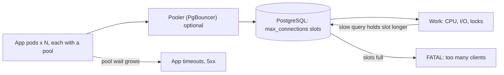
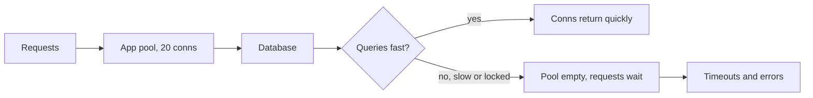
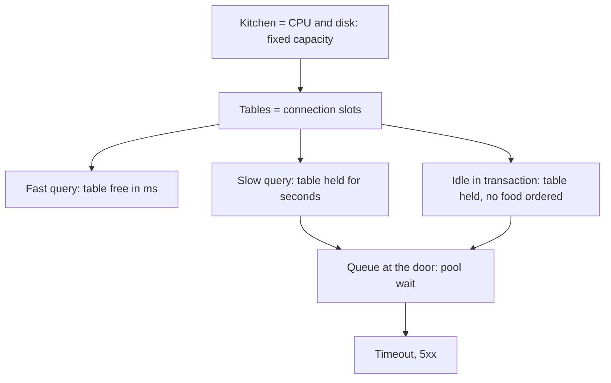
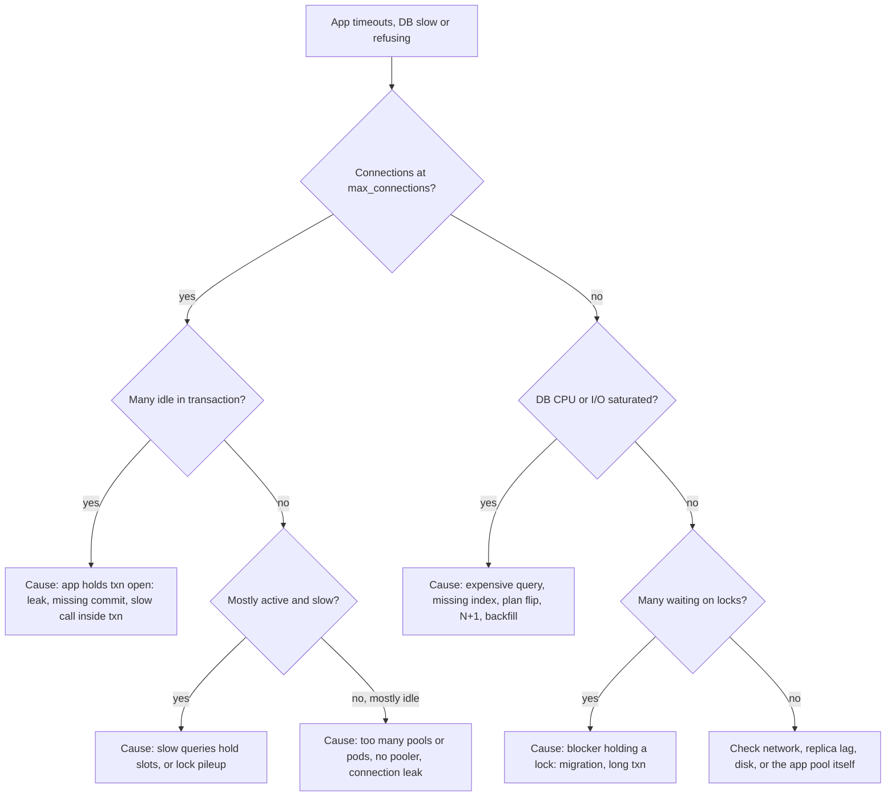
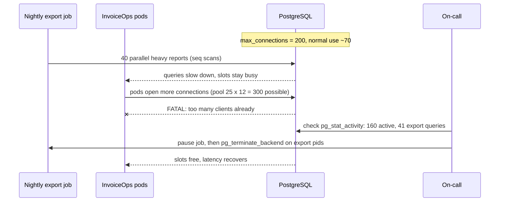
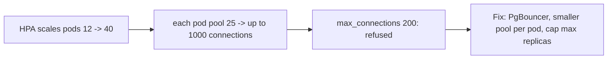
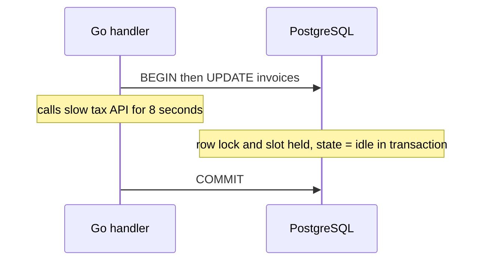

# Playbook - Database Overload and Connection Exhaustion

> [!summary] TL;DR
> The database is either **doing too much work** (CPU or I/O saturated by slow queries) or **has run out of connection slots** (every connection taken, new ones refused or queued).
>
> Both look like timeouts and 5xx from the app. In the first five minutes, confirm, check what changed, then relieve pressure: kill the worst queries and idle-in-transaction sessions, cap or pause the noisy caller, scale reads to replicas, and never "fix" it by adding more connections.

> [!abstract] Core idea
> - **Two different problems with one symptom:** a *busy* database (queries are slow) and a *full* database (no connection slots). The fix for one can worsen the other.
> - **More connections do not mean more throughput.** Past a small number, extra connections only add context switching and lock contention.
> - **A slow query holds a connection longer, so slowness causes exhaustion.** A pool of 50 connections each held 10x longer behaves like a pool of 5.
> - **Idle in transaction is the silent killer:** the session holds locks and a slot while doing nothing.
> - **Mitigate by reducing work or demand**, then find the one query, deploy or job responsible.

### Whiteboard version



Interview one-liner: "First I decide whether it is saturation (slow queries) or exhaustion (no slots), kill the worst offenders, cap demand, and only then fix the query or the pool sizing."

## Start here: the basics

**The problem in one story**

An app talks to one database through a small set of open connections.
A slow query starts holding connections for seconds instead of milliseconds.
Soon every connection is busy, new requests wait in line, then time out.
Users see errors even though the database is still running.

**Words you need first**

| Word | Plain meaning | Tiny example |
|---|---|---|
| Connection | An open line between the app and the database | One TCP session to PostgreSQL |
| Connection pool | A reusable set of connections the app shares | Go `sql.DB` with `SetMaxOpenConns(20)` |
| `max_connections` | The database's hard limit on open connections | PostgreSQL default is 100 |
| Pooler | A proxy that lets many clients share few database connections | PgBouncer in transaction mode |
| Lock | A rule that stops two transactions changing the same row at once | `UPDATE` holds a row lock until commit |
| Saturation | A resource is fully busy and work starts queuing | CPU at 100 percent, queries wait |
| Slow query | A query that takes much longer than normal | Missing index, full table scan |
| Query plan | The steps the database chooses to run a query | `EXPLAIN` shows Seq Scan vs Index Scan |

**Picture it**



**Analogy**

Connection slots are tables in a restaurant, and queries are diners. If diners linger, new guests wait at the door even when the kitchen is idle.

Where it breaks: a restaurant can add chairs cheaply; each database connection costs memory and CPU, so adding more can make things worse.

**How the rest of this note builds up**

- First, **Why it exists** and **Mental model** separate too much work from too many connections.
- Then **How it works** walks through checks for CPU, locks, slow queries and pool limits.
- Next, the **Worked example** traces a real-style incident end to end.
- Then **Variants and comparison**, **Trade-offs** and **In production** cover poolers and sizing.
- Finally, the SDE-3 **Deep dive** explains per-connection cost and pool sizing math.

> [!tip] Remember
> Find whether the database is doing too much work or just has too many waiters, then fix that one.

## 1. Why it exists

**Symptoms.**

- App errors: `FATAL: sorry, too many clients already`, or `FATAL: remaining connection slots are reserved for non-replication superuser connections`.
- Go pool symptoms: requests hang in `db.Conn` or `QueryContext` for seconds, then `context deadline exceeded`.
- Dashboards: database CPU near 100%, connection count flat at `max_connections`, p99 latency climbing, 504s from the proxy, queue depth growing.
- Replicas fall behind, backups or migrations stall.

**User impact.** Pages hang then fail. Writes may be lost if the app does not retry safely. Since almost every endpoint touches the database, a database incident usually becomes a **whole-product incident**.

**Example with numbers.** InvoiceOps runs 12 pods, each with `SetMaxOpenConns(25)`, so up to 300 connections hit PostgreSQL with `max_connections = 200`. It works at normal load because most pods use 5-8. During a surge, pods open more, hit 200, and every new request waits or fails. Each pod's pool is "fine" in isolation; the sum is not.

> [!tip] Remember
> Pool size is per pod. The database sees pods times pool size, plus jobs, plus humans with psql.

## 2. Mental model

### A restaurant with a fixed number of tables

In plain words: connection slots are tables, queries are diners. If diners linger (slow queries) or sit without ordering (idle in transaction), new customers queue at the door and eventually leave (timeouts).

Adding more tables than the kitchen can cook for does not feed anyone faster, because the kitchen (CPU and disk) is the real limit. The analogy breaks where a real kitchen can ignore a diner, while a database must keep serving every open session's locks and memory.



### Little's law, in one line

**Concurrent connections in use = request rate x time each holds a connection.** At 500 queries/s and 10 ms each, you need about 5 busy connections. If latency rises to 400 ms, you need about 200. Slowness alone can exhaust a healthy pool.

> [!tip] Remember
> Exhaustion is usually a latency problem wearing a connection-count costume.

## 3. How it works

### The first 5 minutes

1. **Confirm and scope.**
   - Is it the database or the app? Check DB CPU, connection count, and the app's pool wait.
   - Which services share this database? Which are failing?
   - Is it one cluster or all shards?
2. **Check what changed.** A deploy with a new query or missing index, a pool size or replica-count change (HPA scaled pods up), a cron job or backfill, a migration holding a lock, a traffic spike, a failover, a vacuum or stats problem.
3. **Mitigate first.** In this order of safety:
   - Stop the noisy source: pause the batch job, scale down the runaway deployment, disable the feature flag.
   - Terminate idle-in-transaction sessions and the worst long-running queries.
   - Shed load at the edge for low-priority endpoints; see [[Load Shedding and Graceful Degradation]].
   - Move read traffic to replicas, serve from cache.
   - Roll back if a deploy introduced it; see [[Playbook - Bad Deploy and Rollback]].
   - Last resort: raise `max_connections` or fail over; both have costs (below).
4. **Communicate.** "Database saturation, checkout latency high since 10:12 UTC. Killed 3 long queries, paused the nightly export. Monitoring."
5. **Verify** that CPU, connections and p99 return to baseline for 5 minutes.

> [!warning] Common mistake
> Raising `max_connections` or the app pool size first. More concurrent queries compete for the same CPU, each runs slower, holds its slot longer, and the database gets worse faster. Reduce demand first.

### The diagnosis flowchart



### Step A: How full is the database?

```sql
-- Connections by state
SELECT state, count(*) 
FROM pg_stat_activity
WHERE backend_type = 'client backend'
GROUP BY state
ORDER BY count(*) DESC;

-- Limit versus usage
SHOW max_connections;
SELECT count(*) AS used FROM pg_stat_activity WHERE backend_type = 'client backend';
```

| State | Meaning |
| --- | --- |
| `active` | Running a query right now; many of these means CPU or lock contention |
| `idle` | Open, connected, waiting for the app; many of these means too many pools or oversized pools |
| `idle in transaction` | Opened `BEGIN`, not finished; holds locks and snapshots, blocks vacuum |
| `idle in transaction (aborted)` | A statement errored and the app never rolled back |

### Step B: Who is using the slots?

```sql
-- By application and user (set application_name in your DSN so this is useful)
SELECT application_name, usename, client_addr, state, count(*)
FROM pg_stat_activity
WHERE backend_type = 'client backend'
GROUP BY 1,2,3,4
ORDER BY count(*) DESC
LIMIT 20;
```

If one `client_addr` or `application_name` owns most slots, that deployment or job is your suspect.

### Step C: Which queries are long or stuck?

```sql
SELECT pid, now() - query_start AS runtime, state, wait_event_type, wait_event,
       left(query, 120) AS query
FROM pg_stat_activity
WHERE state <> 'idle' AND backend_type = 'client backend'
ORDER BY runtime DESC
LIMIT 15;

-- Idle in transaction, oldest first
SELECT pid, now() - state_change AS idle_for, application_name, left(query, 120) AS last_query
FROM pg_stat_activity
WHERE state LIKE 'idle in transaction%'
ORDER BY idle_for DESC;
```

| `wait_event_type` | Meaning |
| --- | --- |
| `Lock` | Waiting for a lock held by another session: find the blocker |
| `IO` | Waiting on disk: cold cache, big scans, saturated storage |
| `LWLock` | Internal contention, often a symptom of too many active backends |
| `Client` | Waiting for the app to send or read data |
| empty (and `active`) | Using CPU |

### Step D: Who is blocking whom?

```sql
SELECT a.pid AS blocked_pid, pg_blocking_pids(a.pid) AS blocked_by,
       now() - a.query_start AS waiting_for, left(a.query, 100) AS blocked_query
FROM pg_stat_activity a
WHERE cardinality(pg_blocking_pids(a.pid)) > 0;
```

Find the root blocker (a pid that blocks others but is not itself blocked) and look at its query and `state`. An `idle in transaction` blocker is a classic: a forgotten transaction pins a row lock and everyone queues behind it.

A schema migration doing `ALTER TABLE` waits for a lock, and all new queries queue behind it; see [[Zero-Downtime Schema Migrations]].

### Step E: Which statements cost the most?

Requires the `pg_stat_statements` extension (PostgreSQL 13 and later use `total_exec_time`).

```sql
SELECT calls, round(total_exec_time::numeric, 0) AS total_ms,
       round(mean_exec_time::numeric, 2) AS mean_ms, rows,
       left(query, 100) AS query
FROM pg_stat_statements
ORDER BY total_exec_time DESC
LIMIT 10;
```

| Pattern | Meaning |
| --- | --- |
| Huge `calls`, tiny `mean_ms` | Death by repetition: N+1 or a hot loop; see [[N+1 Query Problem]] |
| Moderate calls, large `mean_ms` | One expensive query: missing index or bad plan |
| New query not seen yesterday | The deploy introduced it |

Then inspect the plan. `EXPLAIN ANALYZE` **executes** the statement, so use plain `EXPLAIN` first on writes, or run it inside a transaction you roll back:

```sql
EXPLAIN (ANALYZE, BUFFERS) SELECT ... ;   -- on a read, preferably on a replica
```

Look for `Seq Scan` on a big table, a large gap between estimated and actual rows, and `Sort` spilling to disk. See [[Query Plans and EXPLAIN]].

### Step F: Look at the app side

```promql
# If you register the Prometheus Go collector for database/sql (collectors.NewDBStatsCollector)
go_sql_in_use_connections{job="invoiceops"}
rate(go_sql_wait_count_total{job="invoiceops"}[5m])
rate(go_sql_wait_duration_seconds_total{job="invoiceops"}[5m])
  / rate(go_sql_wait_count_total{job="invoiceops"}[5m])   # average wait per blocked acquire
```

Database-side, with `postgres_exporter`:

```promql
sum by (state) (pg_stat_activity_count{datname="invoiceops"})
  / on() group_left() max(pg_settings_max_connections)
```

In Go, `db.Stats()` returns `sql.DBStats`: `InUse`, `Idle`, `OpenConnections`, `WaitCount`, `WaitDuration`. Rising `WaitCount` with `InUse` pinned at `MaxOpenConnections` means the app is starved for connections: either queries are slow or the pool is too small for the work.

### Step G: If you use PgBouncer

```bash
psql -h pgbouncer -p 6432 -U pgbouncer pgbouncer -c 'SHOW POOLS;'
psql -h pgbouncer -p 6432 -U pgbouncer pgbouncer -c 'SHOW STATS;'
```

| Column | Meaning |
| --- | --- |
| `cl_active` / `cl_waiting` | Clients using or waiting for a server connection; sustained `cl_waiting` means the pool is the bottleneck |
| `sv_active` / `sv_idle` | Server connections busy or free |
| `maxwait` | Seconds the oldest waiting client has waited; growing means saturation |

See [[Connection Pooling]] for transaction versus session pooling and what breaks (prepared statements, session settings, advisory locks).

### Step H: Host-level checks

```bash
# On the database host (or via your cloud's metrics): CPU, I/O wait
top -b -n1 | head -15
iostat -x 1 3            # high %util and await means disk-bound

# Connections to Postgres from an app host, by state
ss -tn state established '( dport = :5432 )' | wc -l
```

On managed databases (RDS, Cloud SQL) use the provider metrics: CPU, `DatabaseConnections`, read and write IOPS, burst balance, replica lag, freeable memory.

## 4. Worked example

### Incident walkthrough: a new report query exhausts the InvoiceOps database

All times UTC. Composite and realistic, not a specific company incident.



Step by step:

1. **03:10** Alert: API p99 above 3 s, 5xx at 12%. On-call opens the dashboard: DB connections flat at 200, DB CPU 98%.
2. **03:12 Scope and change.** Deploy list shows nothing. The scheduler shows the nightly export started at 03:00, the first run since the new "include line items" report shipped last week.
3. **03:14 Evidence.** `pg_stat_activity` grouped by `application_name`: `invoiceops-export` owns 41 connections, all `active` for over 6 minutes. `wait_event_type` empty, so they are burning CPU.
4. **03:15 Mitigate.** Pause the scheduler for the export job. Terminate the export sessions:

```sql
SELECT pg_terminate_backend(pid)
FROM pg_stat_activity
WHERE application_name = 'invoiceops-export' AND state = 'active';
```

5. **03:17 Verify.** Connections drop to 75, CPU to 35%, p99 back to 190 ms, 5xx under 0.3%. Status page resolved at 03:25.
6. **Next day, root cause.** `pg_stat_statements` shows the report query averaging 11 s with a `Seq Scan` over 38 million `line_items` rows because there is no index on `(invoice_id)`. The export ran 40 workers concurrently against the primary.
7. **Fixes.** Immediate: stopped the job. Proper: add the index with `CREATE INDEX CONCURRENTLY`, run exports against a replica with 4 workers and a `statement_timeout`. Prevention: a dedicated small pool for batch work (a bulkhead), a connection-count alert at 80% of `max_connections`, a plan check in code review for new queries.

> [!tip] Remember
> The batch job was not "using too many connections" by accident; each slow query held one for minutes. Latency became exhaustion.

## 5. Variants and comparison

### Variant 1: Slow queries (CPU or I/O saturation)

In plain words: the database has capacity for N units of work per second and is being asked for more. Connections are full because queries are slow.

| Sign | Check | Immediate fix | Proper fix |
| --- | --- | --- | --- |
| High CPU, many `active` | Step C, E | Terminate worst, pause batch | Index, rewrite, add caching |
| High `IO` waits, low cache hit | `iostat`, provider IOPS | Reduce scans, scale storage IOPS | Better indexes, more memory |
| Plan changed suddenly | Compare `EXPLAIN` to earlier | `ANALYZE` the table | Fix stats, pin plan with query change |

### Variant 2: Connection exhaustion with idle connections

In plain words: the database is calm (low CPU) but all slots are taken by idle sessions from too many pods or too large pools.



| Check | Meaning |
| --- | --- |
| `state = idle` dominates | Pools oversized or leaking |
| Count grows with pod count | Total = pods x pool size; shrink or add a pooler |
| Count grows over time, never falls | Connection leak: `rows` not closed, `Tx` not committed |

### Variant 3: Idle in transaction

In plain words: the app started a transaction and then went off to do something else (an HTTP call, a loop) before commit.



Fix: keep transactions short, no network calls inside them, set `idle_in_transaction_session_timeout`.

### Variant 4: Lock pileup

In plain words: one session holds a lock, others queue; each queued session holds a slot.

Look at Step D. Typical root blockers: a migration waiting for an `ACCESS EXCLUSIVE` lock (and blocking everything behind it), a long transaction, a `SELECT ... FOR UPDATE` on a hot row. See [[Locking - Optimistic vs Pessimistic]].

### Variant 5: Primary overloaded, replicas idle

In plain words: reads that could go to replicas are hitting the primary. Check routing; accept replica lag for reports and lists; see [[Replication]].

### Mitigation comparison

| Action | Speed | Risk | Wrong when |
| --- | --- | --- | --- |
| `pg_terminate_backend` on worst queries | Seconds | Rolls back in-flight work, clients see errors | The query is a critical write you can't redo |
| Pause or scale down the noisy caller | Seconds | Feature degraded | You don't know the caller |
| Route reads to replicas | Minutes | Stale reads | Read-your-writes required |
| Add PgBouncer | Hours | Session features break in transaction mode | Needed right now in an incident |
| Raise `max_connections` | Needs restart on PostgreSQL | More memory, more contention | CPU is already saturated |
| Failover to standby | Minutes | Brief downtime, possible data loss if async | The problem is the workload, not the host |
| Vertical scale | Minutes | Downtime or reboot | The root cause is a bad query |

## 6. Trade-offs

- **Smaller pools protect the database but queue requests in the app.** Better: a short, bounded queue that fails fast (with a context timeout) than an unbounded wait that melts the system.
- **Pooler in transaction mode** multiplexes thousands of clients onto tens of server connections, but disables session-level state (`SET`, advisory locks, some prepared-statement patterns).
- **Killing queries is fast but lossy.** The client sees an error and may retry, adding load. Make retries idempotent and backed off.
- **Read replicas add capacity** but bring replication lag and routing complexity.
- **Timeouts (`statement_timeout`) protect the database** but can cancel legitimate long reports; give batch roles different limits.

## 7. In production

### Alerts that catch this early

```promql
# Connection saturation above 80% for 5 minutes
max(sum by (instance) (pg_stat_activity_count)) / max(pg_settings_max_connections) > 0.8

# Application pool starvation
rate(go_sql_wait_count_total{job="invoiceops"}[5m]) > 0
```

Plus: DB CPU above 80% for 10 minutes, replica lag, long-running transaction age, idle-in-transaction count, and `maxwait` from PgBouncer.

### Safe defaults to configure

```sql
-- Per-role defaults; tune numbers for your workload
ALTER ROLE invoiceops_api SET statement_timeout = '5s';
ALTER ROLE invoiceops_api SET idle_in_transaction_session_timeout = '15s';
ALTER ROLE invoiceops_api SET lock_timeout = '3s';
ALTER ROLE invoiceops_export SET statement_timeout = '10min';
```

In Go, set the pool deliberately:

```go
db.SetMaxOpenConns(10)                 // per pod; total = pods x this
db.SetMaxIdleConns(10)
db.SetConnMaxLifetime(30 * time.Minute)
db.SetConnMaxIdleTime(5 * time.Minute)
```

Always pass a `context` with a deadline to `QueryContext`, `ExecContext` and `BeginTx` so a stalled query cannot hold a goroutine and a slot forever. See [[Database Access (database-sql, pgx, sqlc)]].

### Sizing a pool

A common starting rule of thumb, from the PostgreSQL and pooler community, is a pool size in the low tens per database server rather than hundreds, often quoted as about twice the CPU core count plus the number of effective disk spindles (the PostgreSQL wiki and HikariCP pool-sizing guidance).

This is a heuristic, not a law: start small, measure throughput and latency under load, and raise only if the database has CPU headroom.

### Separate pools for separate workloads (bulkheads)

Give batch jobs, interactive API traffic and admin tools different roles and different small pools, so one cannot starve the others; see [[Bulkheads and Concurrency Limits]].

## 8. Deep dive

### Why too many connections hurts

Each PostgreSQL connection is a separate backend process with its own memory (work memory per sort or hash node, caches, catalog data). Hundreds of active backends mean more context switching, more contention on shared structures, and a bigger lock table.

Throughput typically rises with concurrency up to roughly the core count, then flattens, then falls. That is why a pooler that queues excess clients outside the database often *improves* total throughput.

### Idle in transaction blocks vacuum

An old open transaction holds back the "oldest snapshot" so `VACUUM` cannot remove dead rows newer than it. Tables bloat, indexes bloat, scans slow, and the problem persists after the session is killed until vacuum catches up. Check the oldest transaction age:

```sql
SELECT pid, now() - xact_start AS xact_age, state, left(query, 80)
FROM pg_stat_activity
WHERE xact_start IS NOT NULL
ORDER BY xact_start LIMIT 5;
```

### Plan flips

A query that ran fast for months suddenly uses a different plan after stats change or a data skew event (for example a tenant uploads 10 million rows). Symptoms: sudden CPU jump with no deploy. Fix: `ANALYZE`, a better index, extended statistics, or a rewrite. Do not "fix" by killing it repeatedly.

### Thundering herd after recovery

When the database recovers, hundreds of waiting clients retry at once and knock it over again. Use jittered backoff, a gradual ramp (restart pods in batches), and a circuit breaker so the app stops sending traffic until it is healthy; see [[Circuit Breaker]].

### Failover is not a cure for overload

Failing over to a standby moves the same workload to a host with a cold cache. Use it for host failure, not for a runaway query. See [[Replication]].

### Cache as relief valve

Short-TTL caching of hot read endpoints can cut load by large factors quickly, at the cost of staleness and stampede risk when the cache expires; see the caching failure-modes note in 08.

## 9. Interview questions

> [!question]- Your API starts timing out and the database shows 200 of 200 connections used. What do you do?
> Confirm with `pg_stat_activity` grouped by state and application. Check what changed. Decide: are connections `active` and slow (saturation), `idle in transaction` (leak or slow call in a txn), or `idle` (oversized pools)? Mitigate by pausing the noisy caller, terminating worst sessions, and shedding load; do not raise `max_connections` first. Then fix the query, pool sizing or transaction scope.

> [!question]- Why can slow queries cause connection exhaustion even if request volume is flat?
> By Little's law, connections in use equal request rate times hold time. If each query takes 40x longer, you need 40x more concurrent connections for the same traffic, so the pool fills and requests queue. Exhaustion is often a latency symptom.

> [!question]- What is "idle in transaction" and why is it dangerous?
> A session that issued `BEGIN` and is waiting for the client to continue. It keeps its connection slot, any locks it took, and holds back vacuum through its snapshot. It usually comes from a missing commit or rollback, or from slow network calls inside a transaction. Fix with short transactions and `idle_in_transaction_session_timeout`.

> [!question]- Would you increase max_connections to fix exhaustion? What are the trade-offs?
> Rarely, and not first. It needs a restart, uses more memory, and adds contention, so a saturated CPU gets worse. It is acceptable when the database has CPU and memory headroom and connections are mostly idle, but a pooler such as PgBouncer is the better structural fix.

> [!question]- How do you size connection pools across many pods?
> Work backwards from the database: total allowed connections minus reserved for admin, replication and jobs, divided by the maximum number of pods the autoscaler can create. Keep per-pod pools small (single digits to low tens), cap HPA max replicas, or put a pooler in front. Measure with `DBStats.WaitCount` and database CPU.

> [!question]- The migration you ran caused an outage even though it was "only adding a column". How?
> `ALTER TABLE` needs a strong lock. If a long transaction held a conflicting lock, the ALTER waited, and every new query queued behind the waiting ALTER, filling all slots. Use `lock_timeout`, run migrations when no long transactions are open, and follow expand-and-contract patterns.

## 10. Cheat sheet

- Decide: busy database (slow queries) or full database (no slots)?
- `pg_stat_activity` by `state` and `application_name` answers who and what.
- `idle in transaction` and lock waits are the usual hidden causes; use `pg_blocking_pids`.
- Mitigate by reducing demand: pause jobs, terminate worst sessions, shed load, use replicas and caches.
- Do not raise connections first; slow queries multiply connection demand.
- Pool total = pods x per-pod pool; cap autoscaling and consider PgBouncer.
- Set `statement_timeout`, `idle_in_transaction_session_timeout`, `lock_timeout` per role, and use context deadlines in Go.
- Alert on connections above 80%, pool wait, CPU, long transaction age.

## 11. Post-incident checklist

- [ ] Timeline with the first bad signal, detection, mitigation and recovery times.
- [ ] Identified the exact query, job or deploy, and its `pg_stat_statements` entry.
- [ ] Immediate, proper and prevention fixes recorded with owners.
- [ ] Index or query fix tested with `EXPLAIN` on production-sized data.
- [ ] Pool sizes, timeouts and HPA caps reviewed and documented.
- [ ] Connection and lock alerts added or tuned.
- [ ] Batch and interactive workloads separated (roles, pools, replicas).
- [ ] Blameless review done, see [[Postmortems and Root Cause Analysis]].

## 12. Links

- Method: [[Production Debugging Playbook]], [[Incident Response]], [[Postmortems and Root Cause Analysis]]
- Database debugging: [[Debugging Database Performance]], [[Query Plans and EXPLAIN]], [[N+1 Query Problem]], [[Connection Pooling]], [[Locking - Optimistic vs Pessimistic]], [[Replication]], [[Zero-Downtime Schema Migrations]]
- Sibling playbooks: [[Playbook - Error Rate Spike (5xx)]], [[Playbook - High Latency]], [[Playbook - Bad Deploy and Rollback]]
- Resilience: [[Bulkheads and Concurrency Limits]], [[Circuit Breaker]], [[Load Shedding and Graceful Degradation]], [[Timeouts, Retries and Backoff]]
- Go side: [[Database Access (database-sql, pgx, sqlc)]], [[Observability in Go Services]]

## Links

### Watch on YouTube

- [Database Connection Pool Sizing - Demystified! by Jasmin Fluri](https://www.youtube.com/watch?v=Cp-aFYHLiCw) · Devoxx · 38 min · 4,628 views
- [Database Connection Pooling: Why It Matters? Essential OS-Level Insights](https://www.youtube.com/watch?v=Vq34xPYZwXg) · Denis Magda · 5 min · 16,899 views
