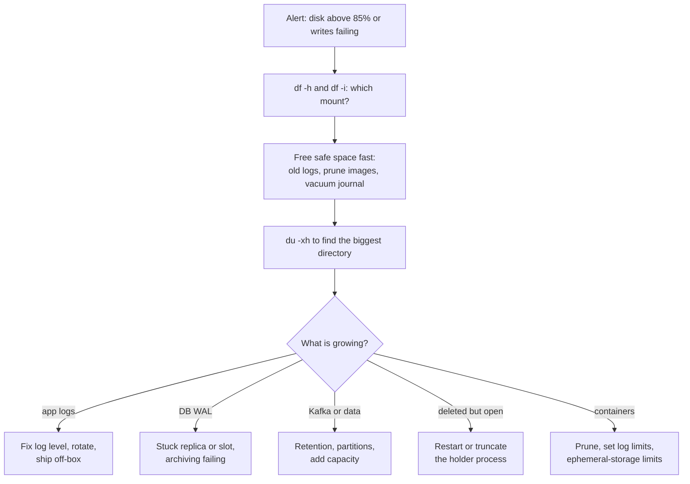
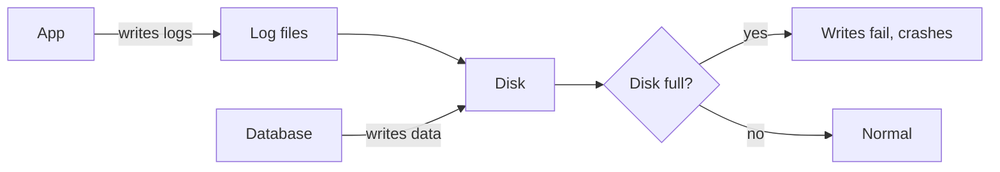
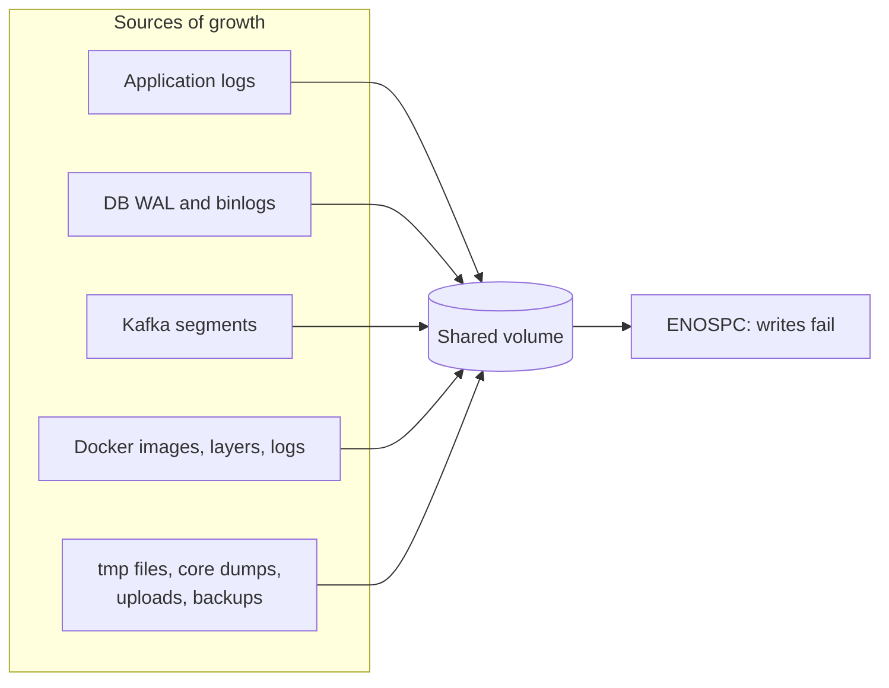
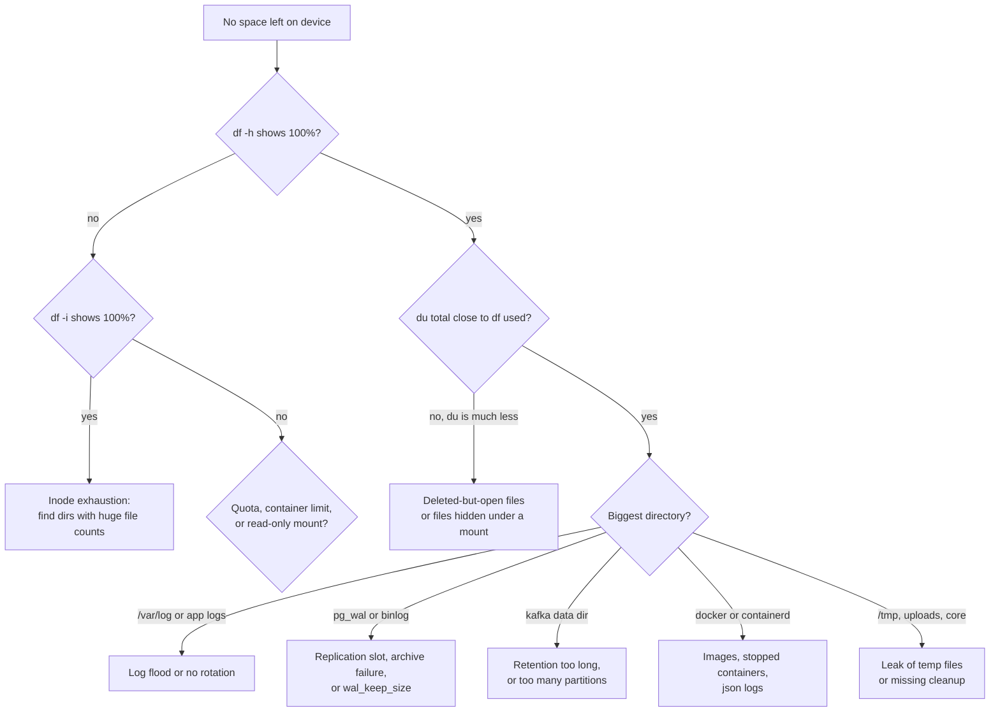
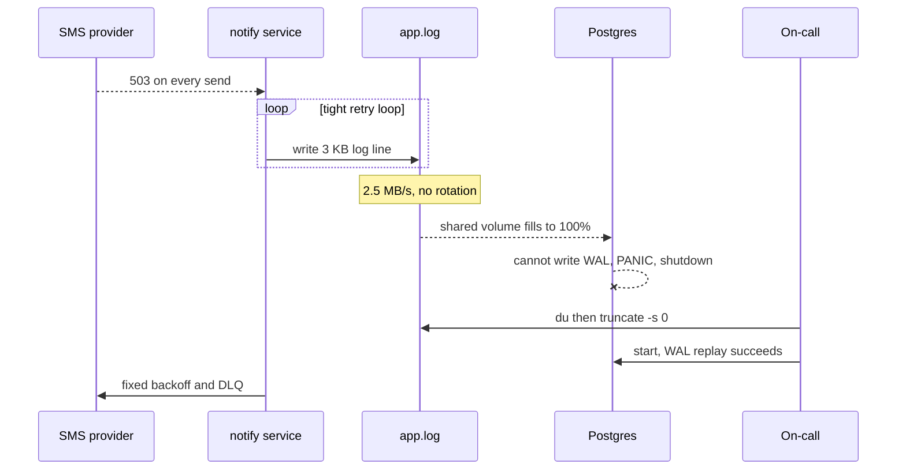
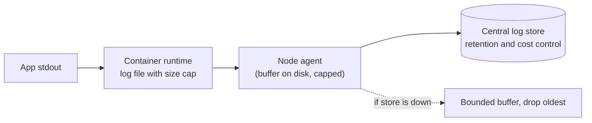
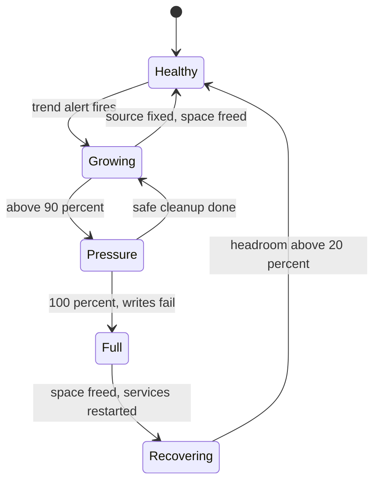

# Playbook - Disk Full and Log Floods

> [!summary] TL;DR
> A full disk does not degrade a service slowly. It makes writes fail all at once: databases stop, logs vanish, new files cannot be created, and sometimes even SSH login breaks.
>
> The playbook is: confirm which resource is full (space or inodes), free a safe amount of space in seconds, find the fast grower, fix the source, and add alerts that predict "full in 4 hours" instead of reporting "full now".

> [!abstract] Core idea
> - **Disks fail as a cliff, not a slope.** 79% full is fine, 100% is an outage. So alert on the trend, not only the level.
> - **There are two ways to be "full":** no free blocks (`df -h`) or no free inodes (`df -i`). Check both.
> - **Deleting a file does not always free space.** If a process still holds it open, the space stays used. Find it with `lsof +L1`.
> - **Logs are the usual culprit, but not the only one.** Also check database WAL, Kafka segments, Docker layers and logs, core dumps, temp files, and backups on the same volume.
> - **Free space safely first, then find the cause.** Do not delete database files by hand.

### Whiteboard version



## Start here: the basics

**The problem in one story**

A server keeps writing logs to its disk.
A bug starts logging the same error thousands of times a second.
In an hour the disk is full.
Now the database cannot save orders, and the app crashes on every write.

**Words you need first**

| Word | Plain meaning | Tiny example |
|---|---|---|
| Disk / volume | Storage where files live, with a fixed size | A 50 GB volume mounted at `/var` |
| Inode | A file-system entry for one file; there is a limited number | Millions of tiny files can run out of inodes |
| Log rotation | Closing a log file and starting a new one, deleting old ones | logrotate keeps 7 daily files |
| Log flood | A sudden huge burst of log lines | One error logged per request at 10k rps |
| Deleted but open file | A file removed from the folder but still held by a process, so space is not freed | `lsof +L1` lists them |
| WAL | Write-ahead log: a database's journal of changes written before data files | PostgreSQL `pg_wal` directory |
| Sampling / rate limiting logs | Keeping only some log lines | Log 1 in 100 identical errors |

**Picture it**



**Analogy**

A warehouse with one loading dock: if boxes arrive faster than they are shipped out, the floor fills and nothing new fits, not even urgent deliveries.

Where it breaks: a warehouse fills visibly and slowly; a disk can go from fine to full in minutes and gives no warning unless you alert on it.

**How the rest of this note builds up**

- First, **Why it exists** and **Mental model** show why a full disk fails hard, not slowly.
- Then **How it works** covers finding what filled the disk and freeing space safely.
- Next, the **Worked example** walks through a real-style log flood.
- Then **Variants and comparison**, **Trade-offs** and **In production** cover rotation, quotas and alerts.
- Finally, the SDE-3 **Deep dive** covers deleted-but-open files, inodes and WAL growth.

> [!tip] Remember
> Free space safely first, then stop whatever is filling the disk, then alert before it happens again.

## 1. Why it exists

Disk is the quietest resource. CPU and memory problems show up as slowness. A disk problem often shows nothing until the last minute, then everything breaks together.

**Symptoms:**

- Errors such as `No space left on device` (ENOSPC), `write: no space left on device`, or `Disk quota exceeded`.
- Database: Postgres cannot write WAL and shuts down with a PANIC; MySQL stops accepting writes; Redis returns `MISCONF` errors when it cannot persist.
- Pods evicted with `The node was low on resource: ephemeral-storage`; the node reports `DiskPressure`.
- Application hangs on a log write, because a synchronous logger blocks when the disk is full or the pipe is slow.
- Deploys fail: images cannot be pulled, new files cannot be created.
- No new logs appear in your tooling, so you are blind exactly when you need them.

**User impact (illustrative numbers).** A single-node Postgres has a 500 GB volume. Normal growth is 2 GB/day. A bug logs a 4 KB stack trace on every failed request. At 300 requests/second that is 300 x 4 KB = 1.2 MB/s, or about 100 GB per day.

The 120 GB of free space is gone in roughly 29 hours, with no alert, because the alert threshold was "above 95%". Then the database stops, and the whole product is down until space is freed.

> [!tip] Remember
> The failure is sudden, but the cause is slow. A trend alert such as "full in 4 hours" turns an outage into a ticket.

## 2. Mental model

**Analogy: a warehouse with a loading dock.** Boxes arrive faster than they leave. For weeks the warehouse looks fine. Then it is full, the dock is blocked, and trucks cannot unload even the urgent box (a database commit).

The analogy breaks down in one place: in a warehouse, you can see what is taking space. On a server, space can be hidden inside deleted-but-open files or in a different mount.

Four questions cover almost every case:

| Question | Tool |
| --- | --- |
| Which filesystem is full? | `df -h` |
| Are we out of space or inodes? | `df -h` vs `df -i` |
| Which directory is big? | `du -xh --max-depth=1` |
| Is the space held by a deleted file? | `lsof +L1` |



> [!tip] Remember
> Disk is shared. Many unrelated things write to the same volume, so the biggest directory is not always the one that changed.

## 3. How it works

### The first 5 minutes

1. **Confirm the problem and its blast radius.** Which host, volume or PVC? One pod, one node, or the whole fleet? Is the database affected? Check `df -h` and `df -i` on the affected host.
2. **Check what changed.** A deploy that raised log verbosity, a new feature, a traffic spike, a stuck replica, a failing backup job, a log shipper that stopped, an expired retention policy.
3. **Mitigate first.** Free 5 to 10 GB of safe space in seconds (see the table below). If the database is the critical writer, protect its volume first. Do not wait for root cause.
4. **Communicate.** State the affected system, the headroom now, and the next update time. If writes already failed, warn about possible data loss windows.
5. **Then find the cause** so the space does not fill again in an hour.

### Step 1: Confirm which resource is full

```bash
df -h
df -i
```

- `df -h` shows blocks. `Use%` at 100% means no space.
- `df -i` shows inodes. `IUse%` at 100% with plenty of blocks free means millions of tiny files (session files, mail queue, cache files, small log shards).

Two more cases that confuse people:

| `df -h` says | Real meaning |
| --- | --- |
| 100% but `du` adds up to far less | Deleted-but-open files, or a mount hiding files under it |
| Free space exists but non-root cannot write | ext4 reserves about 5% of blocks for root by default |
| Plenty free but `ENOSPC` | Out of inodes, or a quota, or a full overlay/ephemeral layer |

### Step 2: Free safe space fast (the mitigation)

Choose the first action that is safe for your host. Do these in order of safety.

| Action | Command | Notes |
| --- | --- | --- |
| Vacuum the systemd journal | `journalctl --vacuum-size=500M` | Safe. `journalctl --disk-usage` first |
| Delete old rotated logs | `rm /var/log/app/*.log.[2-9]*` or `find /var/log -name '*.gz' -mtime +7 -delete` | Check names first. Never `rm -rf /var/log` |
| Empty a huge active log | `truncate -s 0 /var/log/app/app.log` | Frees space even if a process has the file open |
| Force rotation | `logrotate -f /etc/logrotate.d/app` | Needs a valid config |
| Clean package caches | `apt-get clean`, `yum clean all` | Small but safe |
| Docker cleanup | `docker system df` then `docker system prune` | `prune -a` also removes unused images. Check first |
| Remove core dumps and temp | `ls -lh /var/crash /tmp` then delete | Confirm nothing needed for the investigation |
| Expand the volume | Cloud console, then `growpart` and `resize2fs` or `xfs_growfs` | Slower but safe. EBS volumes can be grown online |

> [!warning] Common mistake
> Using `rm` on a log file that is still open. The name disappears, but the process keeps writing to the deleted inode and the space is not freed. Use `truncate -s 0 file` (or `: > file`) instead, or restart the process.

### Step 3: Find what is big

```bash
sudo du -xh --max-depth=1 / 2>/dev/null | sort -h | tail -15
sudo du -xh --max-depth=1 /var 2>/dev/null | sort -h | tail -10
sudo find / -xdev -type f -size +500M -exec ls -lh {} \; 2>/dev/null
```

- `-x` stays on one filesystem, so you do not count other mounts.
- Drill down one level at a time. Each `du` is an order of magnitude faster than walking the whole tree.
- `ncdu /var` gives an interactive view if installed.

### Step 4: Find deleted-but-open files

```bash
sudo lsof +L1
sudo lsof -nP +L1 | sort -k7 -n -r | head
```

`+L1` lists open files with a link count below 1, meaning deleted files that are still open. The `SIZE/OFF` column shows how much space each holds. To free it: restart the owning process, or truncate it through `/proc`:

```bash
sudo truncate -s 0 /proc/<pid>/fd/<fd>
```

This is the classic case where `df` says 100% and `du` shows 40%.

### Step 5: Find the rate of growth

How fast is it growing and how long do you have?

```bash
df -PB1 /var | awk 'NR==2{print $4}'; sleep 60; df -PB1 /var | awk 'NR==2{print $4}'
```

The difference in available bytes over 60 seconds, times 60, is bytes per hour. This tells you whether you have 20 minutes or 20 hours.

PromQL (node_exporter):

```promql
node_filesystem_avail_bytes{mountpoint="/var", fstype!~"tmpfs|overlay"}
  / node_filesystem_size_bytes{mountpoint="/var", fstype!~"tmpfs|overlay"}
```

```promql
predict_linear(node_filesystem_avail_bytes{fstype!~"tmpfs|overlay"}[6h], 4 * 3600) < 0
```

The second query alerts when the 6-hour trend predicts the volume will be full in 4 hours.

Inodes:

```promql
node_filesystem_files_free{fstype!~"tmpfs|overlay"} / node_filesystem_files{fstype!~"tmpfs|overlay"} < 0.10
```

Kubernetes PVCs:

```promql
kubelet_volume_stats_available_bytes / kubelet_volume_stats_capacity_bytes < 0.15
```

### The diagnosis flowchart



### Cause A: Log flood

**What it looks like:** one log file or one service grows far faster than normal. The same message repeats thousands of times.

```bash
ls -lhS /var/log | head
sudo tail -n 20 /var/log/app/app.log
sudo awk '{print $5}' /var/log/app/app.log | sort | uniq -c | sort -rn | head
```

The `uniq -c` trick (adapt the column to your format, or use `jq` for JSON logs) shows which message repeats most:

```bash
jq -r '.msg' /var/log/app/app.log | sort | uniq -c | sort -rn | head
```

**Common reasons:**

| Reason | Example |
| --- | --- |
| Debug level left on | A deploy set `LOG_LEVEL=debug` |
| Error in a hot loop | Retrying a failing call with no backoff, one log per attempt |
| One failing dependency | Every request logs a 4 KB stack trace |
| Logging request bodies | Large payloads in each line |
| No rotation or wrong rotation | `logrotate` not configured, or app writes to a rotated-away file |
| Chatty library | Health checks logged at INFO each second |

**Fixes:**

- Immediate: set the log level back through config or a runtime flag; truncate the file; restart if needed.
- Proper: add rotation, cap size, and ship logs off-box. For Docker: `--log-opt max-size=50m --log-opt max-file=3` or the `daemon.json` equivalent (the default `json-file` driver has no limit unless configured).
- Prevention: sample repeated errors, rate-limit identical log lines, and keep logs structured ([[Structured Logging]]).

A minimal logrotate config:

```bash
/var/log/app/*.log {
    daily
    rotate 7
    maxsize 200M
    compress
    delaycompress
    missingok
    notifempty
    copytruncate
}
```

Important: logrotate is not a daemon. It only checks sizes when it runs (normally once a day from cron or a systemd timer), so `maxsize 200M` does not stop a flood that writes 200 MB in a minute. For fast-growing logs, run logrotate hourly (or more often) and also cap the log at the source.

`copytruncate` copies then truncates the file, which suits apps that cannot reopen their log on a signal, at the cost of possibly losing a few lines between the copy and the truncate.

### Cause B: Database WAL or binlog growth

**Postgres.** WAL (write-ahead log) files in `pg_wal` are removed only when they are no longer needed by checkpoints, archiving, or replication slots. A stuck consumer makes WAL pile up.

```sql
SELECT slot_name, active, restart_lsn,
       pg_size_pretty(pg_wal_lsn_diff(pg_current_wal_lsn(), restart_lsn)) AS retained_wal
FROM pg_replication_slots
ORDER BY pg_wal_lsn_diff(pg_current_wal_lsn(), restart_lsn) DESC;
```

```sql
SELECT count(*), pg_size_pretty(sum(size)) FROM pg_ls_waldir();
```

```sql
SELECT archived_count, failed_count, last_failed_wal, last_failed_time FROM pg_stat_archiver;
```

**What each result means:**

| You see | Meaning | Fix |
| --- | --- | --- |
| Inactive slot with a large `retained_wal` | A replica, CDC connector or consumer is down or lagging | Restore the consumer, or drop the slot: `SELECT pg_drop_replication_slot('slot_name');` after confirming it is dead |
| `failed_count` rising in `pg_stat_archiver` | `archive_command` failing (bucket, permissions, full target) | Fix archiving; WAL is kept until archived |
| Very old open transaction | Does not keep `pg_wal` files, but blocks vacuum so tables and indexes bloat (data files grow instead) | Find it in `pg_stat_activity` and end it |
| Heavy write burst, or large `max_wal_size` / `wal_keep_size` | WAL is legitimately large, or kept on purpose for replicas | Compare against settings; the WAL shrinks after the next checkpoints |

Set `max_slot_wal_keep_size` (available since PostgreSQL 13) so a dead slot cannot fill the disk; the slot is invalidated instead. 

> [!warning] Common mistake
> Deleting files in `pg_wal` by hand. This can corrupt the database and break recovery. Free space elsewhere, fix the cause (slot, archiving), and let Postgres remove WAL itself. If Postgres has already shut down after running out of space, free space on the volume and start it; it replays WAL and recovers.

**MySQL:** old binary logs. Check `SHOW BINARY LOGS;`, then purge with `PURGE BINARY LOGS BEFORE 'YYYY-MM-DD hh:mm:ss';` after confirming replicas have read them.

**Redis:** `MISCONF` errors mean it cannot write its RDB or AOF snapshot. Free disk, then writes resume. See [[Redis Persistence - RDB and AOF]].

### Cause C: Kafka and other data stores

```bash
du -sh /var/lib/kafka/data/* | sort -h | tail
kafka-log-dirs.sh --bootstrap-server broker:9092 --describe | head
kafka-configs.sh --bootstrap-server broker:9092 --entity-type topics --entity-name orders --describe
```

Kafka keeps data until `retention.ms` or `retention.bytes` is hit, per topic, and deletes whole segments only (`segment.bytes`), so the active segment is never deleted. If a topic has `retention.ms=-1` (infinite) or a huge value, disk grows without bound. Quick relief:

```bash
kafka-configs.sh --bootstrap-server broker:9092 --alter --entity-type topics --entity-name clicks \
  --add-config retention.ms=86400000
```

Only shorten retention if consumers do not need older data. See [[Kafka and Event Streaming]].

### Cause D: Containers and Kubernetes

```bash
docker system df
docker ps -s
sudo du -sh /var/lib/docker/containers/*/*-json.log | sort -h | tail
kubectl describe node <node> | grep -A6 -i "conditions\|DiskPressure"
kubectl get events -A --field-selector reason=Evicted | tail
```

- Kubelet evicts pods when `nodefs.available` drops under its threshold (default hard threshold is 10% on Linux) and when `imagefs.available` is low (default 15%). Look for `DiskPressure=True`.
- Set `resources.limits.ephemeral-storage` so one pod cannot fill the node with logs and temp files.
- Write large temporary data to a volume, not the container layer.

### Step 6: Make sure it is really fixed

- `df -h` shows safe headroom (aim for at least 20%).
- Growth rate is back to baseline: re-run the 60-second delta check.
- Processes that failed on ENOSPC have recovered; restart those that did not. Check database health, replica lag and queue backlogs.
- Alerts are green and logging is flowing to the central system again.

## 4. Worked example

### A real-world-style incident: the retry storm

**System:** a Go `notifications` service on a VM, writing JSON logs to `/var/log/notify/app.log` (no rotation configured), with Postgres on the same 200 GB volume that already holds about 50 GB of data. Times and numbers are illustrative.

| Time | Event |
| --- | --- |
| Mon 09:00 | An SMS provider starts returning 503. The service retries each message in a tight loop and logs each attempt with the full payload (about 3 KB) |
| Mon 09:05 | Log volume grows from almost nothing to about 2.5 MB/s (roughly 9 GB per hour) |
| Mon 14:00 | `/var` reaches about 47%. No alert, because the threshold is 90% |
| Mon 23:50 | 90% used. A warning ticket fires but nobody is on duty for tickets at night |
| Tue 02:11 | 100%. Postgres cannot write WAL and shuts down. Page: `PostgresDown` |
| 02:13 | On-call confirms: `df -h` shows `/var` at 100%, `df -i` is fine |
| 02:15 | `du -xh --max-depth=1 /var` shows `/var/log` at 148 GB |
| 02:16 | `ls -lhS /var/log/notify` shows `app.log` at 146 GB |
| 02:17 | Mitigation: save a small sample first (`tail -n 200 /var/log/notify/app.log > /root/sample.log`, a few KB), then `truncate -s 0 /var/log/notify/app.log`, which frees 146 GB at once |
| 02:19 | `systemctl start postgresql`. Postgres replays WAL and starts normally |
| 02:21 | Health checks pass. Incident communicated: "DB restored, notification delays expected" |
| 02:25 | The sample file shows the repeated message: `sms provider 503, retrying` |
| 02:40 | Immediate fix: log level raised to WARN and retry loop disabled by a flag. Space is now stable |
| Day 2 | Proper fix: exponential backoff with a cap and jitter, per-message retry limit, DLQ. logrotate hourly with `maxsize 200M`. Logs moved off the DB volume |



**Root cause:** an unbounded retry loop that logged every attempt, with no rotation, and the log shared a volume with the database.

**Contributing factors:** the disk alert was a static 90% threshold, only a ticket; the DB and logs shared a volume; no log-volume alert; no retry limits.

**Prevention:**

1. `predict_linear` alert: page if full within 4 hours.
2. Alert on log bytes per second as a separate signal.
3. Separate volumes for data, WAL and logs.
4. Cap retries with backoff and a DLQ ([[Timeouts, Retries and Backoff]]).
5. Log rotation and off-box shipping.

> [!tip] Remember
> The page fired at 100%, but the signal was visible for 17 hours. A `predict_linear` alert looking 4 hours ahead would have fired around 22:00 on Monday, four hours before the outage.

## 5. Variants and comparison

### What fills the disk

| Cause | Typical sign | First command | Immediate fix | Real fix |
| --- | --- | --- | --- | --- |
| App log flood | One log file growing fast | `ls -lhS /var/log` | Truncate, lower level | Rotation, sampling, fix error loop |
| No rotation | Many large old files | `du -xh /var/log` | Delete old, compress | logrotate or journald limits |
| Deleted-but-open file | `df` high, `du` low | `lsof +L1` | Restart or truncate holder | Rotate with reopen signal |
| Inode exhaustion | `df -i` at 100% | `find /path -xdev -type f \| wc -l` per dir | Delete tiny files | Cleanup job, tune filesystem |
| Postgres WAL | `pg_wal` huge | `pg_replication_slots` | Fix or drop dead slot | `max_slot_wal_keep_size`, monitor slots |
| Kafka retention | Data dir huge | `kafka-log-dirs.sh` | Shorten retention | Right-size retention and disks |
| Docker | `/var/lib/docker` huge | `docker system df` | `docker system prune` | Log limits, image cleanup |
| Core dumps, temp | `/var/crash`, `/tmp` | `du -xh /tmp` | Delete | Disable cores or ship them elsewhere |
| Backups on same disk | Large dumps | `ls -lh /backup` | Move off-box | Ship to object storage, retention |

### Logging destinations compared

| Where logs go | Disk risk | Notes |
| --- | --- | --- |
| Local file, no rotation | Very high | Avoid |
| Local file + logrotate | Medium | Fine with size caps |
| stdout to Docker `json-file` | High if unlimited | Set `max-size` and `max-file` |
| stdout to journald | Medium | Set `SystemMaxUse` in journald.conf |
| stdout to a node agent shipping to a central store | Low on the node | Handle agent backpressure; see [[AWS 10 - CloudWatch]] for a managed target |



### The disk-pressure lifecycle



Every state before `Full` is cheap to fix. The aim of the alerts is to act in `Growing`.

## 6. Trade-offs

- **Aggressive log retention saves disk but hurts debugging.** Keep enough for your typical investigation window (often 7 to 14 days online), archive the rest cheaply.
- **Low log levels save disk but hide context.** Use sampling and dynamic levels: INFO by default, DEBUG for one request or one tenant when needed.
- **Separate volumes add operational work but isolate failures.** A log flood then fills the log volume, not the database.
- **`copytruncate` is simple but can lose lines;** signal-based reopen is safer but needs app support.
- **Auto-pruning can delete what you need.** `docker system prune -a` removes unused images, which slows the next deploy because they must be pulled again.
- **Big disks hide growth.** A 2 TB volume buys time, not a fix. Do the trend alert anyway.

> [!warning] Common mistake
> Treating "grow the volume" as the fix. It is a valid mitigation and the right first move when no cleanup is safe. But if growth is 100 GB/day, the new space lasts a few extra days. Fix the source.

## 7. In production

### Alerts to have

| Alert | Rule | Severity |
| --- | --- | --- |
| Filesystem trend | `predict_linear(... [6h], 4*3600) < 0` | Page |
| Filesystem low | Free under 15% (warn), under 8% (page) | Warn, page |
| Inodes low | Free inodes under 10% | Warn |
| PVC low | `kubelet_volume_stats_*` under 15% | Warn |
| Log rate | `rate(log_bytes_total[5m])` above 3x baseline | Warn |
| WAL growth | Replication slot lag or `pg_wal` size above threshold | Page |
| Node DiskPressure | `kube_node_status_condition{condition="DiskPressure",status="true"} == 1` | Page |

### Protective defaults

- Separate mounts for OS, data, WAL and logs. Never let logs share a volume with a database.
- Log rotation and a size cap for every log source, including Docker and journald.
- Resource limits: `ephemeral-storage` requests and limits on pods.
- A runbook entry with the exact `du` and `lsof` commands and the safe cleanup list.
- Disk headroom in capacity planning: see [[Performance Engineering and Capacity Planning]].
- Test restore and PITR; disk-full incidents sometimes end in recovery from backup ([[Backup, PITR and Disaster Recovery]]).

### After the fire: recovery checks

- Databases: check replica lag, run integrity checks where relevant, confirm no data loss window.
- Queues: drain backlog, watch for duplicates after retries ([[Dead Letter Queues and Poison Messages]]).
- Logs: gaps exist for the period when the disk was full; note them in the timeline.

## 8. Deep dive

### Why df and du disagree

`df` reads filesystem metadata (blocks allocated). `du` walks directories and adds the size of files it can reach by name. They differ when:

1. A file was unlinked but a process holds it open. The inode and blocks remain allocated until the last handle closes.
2. Another filesystem is mounted over a directory that previously held files. The files still occupy space but are hidden. Unmount temporarily, or bind-mount the root filesystem to look underneath.
3. Filesystem overhead and reserved blocks exist (ext4 reserves 5% for root by default; `tune2fs -m` changes it).
4. Sparse files report a large apparent size but use few blocks (`du --apparent-size` vs `du`).

### Why a full disk can break even a small write

Creating a file or extending one needs a block and often a journal entry. At 100% there is none to give. Services that write PID files, lock files, sockets, session files or temp files fail in surprising ways. SSH can fail when it cannot write the login record or a temp file.

### Postgres behaviour at 100%

When WAL cannot be written, Postgres raises a PANIC and the server crashes, rather than risk inconsistent data. On restart, after space is freed, it replays WAL from the last checkpoint. This is why the data is usually safe, and why hand-deleting `pg_wal` files is both unnecessary and dangerous.

### Synchronous logging blocks request threads

If the logger writes synchronously to a slow or full destination, request goroutines block on write. Latency rises and goroutines pile up before the disk is even full. Prefer logging to stdout with a buffered, non-blocking agent, and drop on overflow rather than block the request path.

### Log volume as a cost and a signal

Log bytes per second per service is a good anomaly signal. A sudden 10x jump usually means a new error loop or a verbosity change. Track it as a metric from the log pipeline.

## 9. Interview questions

> [!question]- A server shows "No space left on device". Walk me through it.
> Run `df -h` and `df -i` to see whether space or inodes are exhausted. Free safe space quickly (journal vacuum, old logs, `truncate` on the giant file, docker prune). Use `du -xh --max-depth=1` to find the big directory and `lsof +L1` if `du` and `df` disagree. Identify the fast grower, fix the source, then add a predictive alert.

> [!question]- `df` says 100% but `du` shows half that. Why?
> A process holds deleted files open, so the blocks are still allocated. Another mount may also hide files beneath it. Use `lsof +L1` to find deleted-but-open files and restart or truncate the holder.

> [!question]- Why should you not `rm` a log file that is being written?
> The name is removed but the process keeps its file descriptor, so the inode and its space stay allocated and the process keeps writing into it. Use `truncate -s 0`, or rotate with a signal so the app reopens the file.

> [!question]- Postgres shut down because the disk filled up. What do you do, and what do you avoid?
> Free space on the volume (not in `pg_wal`), then start Postgres, which will replay WAL and recover. Avoid deleting WAL files manually. Then find the cause: inactive replication slot or failing `archive_command` (long transactions cause bloat in data files, not WAL growth), and set `max_slot_wal_keep_size` to protect against repeats.

> [!question]- How do you alert on disk usage properly?
> Use both a level alert and a trend alert. `predict_linear` over 6 hours projecting 4 hours ahead gives time to react. Also alert on inodes, PVCs, WAL or slot lag, and on log bytes per second.

> [!question]- How do you stop container logs filling a node?
> Set Docker `json-file` `max-size` and `max-file` (or use a runtime with log rotation), set `ephemeral-storage` limits on pods, ship logs with a node agent, and monitor `DiskPressure` plus image garbage collection.

## 10. Cheat sheet

- Two ways to be full: `df -h` (blocks), `df -i` (inodes).
- `df` high, `du` low: **`lsof +L1`** (deleted-but-open).
- Free safely first: `journalctl --vacuum-size`, truncate big logs, `docker system prune`, old rotated logs.
- Never `rm` an open log (use `truncate -s 0`). Never hand-delete `pg_wal`.
- Find big dirs: `du -xh --max-depth=1 / | sort -h`.
- Postgres WAL growth: check `pg_replication_slots` and `pg_stat_archiver`; set `max_slot_wal_keep_size`.
- Alert on trend: `predict_linear(node_filesystem_avail_bytes[6h], 4*3600) < 0`.
- Separate volumes for data and logs; cap every log; set pod ephemeral-storage limits.
- Fix the source (retry loop, log level, retention), not just the space.

## Links

- Before this: [[Production Debugging Playbook]], [[Incident Response]], [[Structured Logging]]
- Sibling playbook: [[Playbook - Bad Deploy and Rollback]]
- Signals and alerts: [[Metrics and Prometheus]], [[Alerting and On-Call]], [[AWS 10 - CloudWatch]]
- Data stores: [[Replication]], [[Backup, PITR and Disaster Recovery]], [[Redis Persistence - RDB and AOF]], [[Kafka and Event Streaming]]
- Containers: [[Docker 03 - CLI Essentials]], [[Kubernetes Fundamentals]]
- Resilience: [[Timeouts, Retries and Backoff]], [[Dead Letter Queues and Poison Messages]], [[Performance Engineering and Capacity Planning]]

### Post-incident checklist

1. Timeline: first growth, alert, page, mitigation, resolution.
2. Quantify: growth rate, time to full, data affected, lost log window.
3. Root cause and contributing causes (no rotation, shared volume, no trend alert).
4. Fix the source and add guardrails: caps, retention, `max_slot_wal_keep_size`, limits.
5. Add alerts: trend, inodes, log rate, WAL or slot lag.
6. Separate volumes if data and logs share one.
7. Blameless review: [[Postmortems and Root Cause Analysis]].

### Watch on YouTube

- [Linux Disk Full After Deleting Files? lsof +L1 Simply Explained](https://www.youtube.com/watch?v=xnfOynjv3SM) · DevOps Made Simple · 10 min · 33 views
