# Playbook - Error Rate Spike (5xx)

> [!summary] TL;DR
> Users are getting error pages: the share of responses with status 500, 502, 503 or 504 jumped. In the first five minutes, confirm the spike is real, scope it (which endpoint, pod, region), check what changed (usually a deploy), and **mitigate before you diagnose**: roll back, flip a flag, scale, or shed load.
>
> Then use the status code itself (500 vs 502 vs 503 vs 504) to pick the investigation branch.

> [!abstract] Core idea
> - **The status code is a clue.** 500 means your code failed. 502 means the proxy got garbage or nothing from your app. 503 means "refusing right now". 504 means the proxy gave up waiting.
> - **Mitigate first, root-cause later.** A rollback that takes 90 seconds beats a perfect diagnosis that takes 40 minutes.
> - **Scope before you dig:** one endpoint, one pod, one dependency, or everything? The answer cuts the search space by ten.
> - **Every fix has three layers:** the immediate fix (stop the bleeding), the proper fix (remove the cause), the prevention (so the same class of failure is caught earlier).

### Whiteboard version

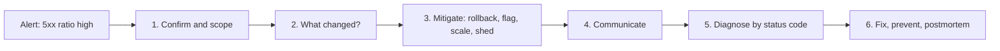

Say it out loud in an interview: "I confirm, scope, check what changed, mitigate, communicate, and only then diagnose, using the status code and the metrics to pick a branch."

## Start here: the basics 🟢

> [!info] How to read this note (pick your level)
> - 🟢 **New to this?** Read "From zero" below, then sections 1, 2 and the cheat sheet (10). Stop there, that is a full first pass.
> - 🟡 **Know the basics?** Add section 3 (first 5 minutes and steps), 4 (worked example), 5 (the four error codes) and 6.
> - 🔴 **Interview / SDE-3 prep?** Add 7, 8 and 9. Headings are tagged 🟢🟡🔴 so you always know where you are.

**From zero, in 60 seconds** 🟢

Every web reply comes with a number called a **status code**.
200 means "all good". Codes from 500 to 599, called **5xx**, mean "the server side failed".
Normally almost no replies are 5xx. Maybe 1 in 1,000.
Suddenly 8 in 100 are 5xx. That is an **error rate spike**.
Users see error pages and can't finish what they were doing.

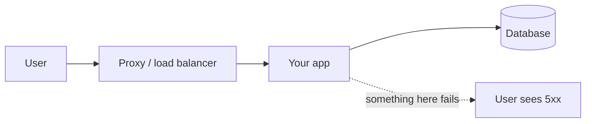

The number itself is a clue. Each code tells you *which hand* in the chain dropped the request.

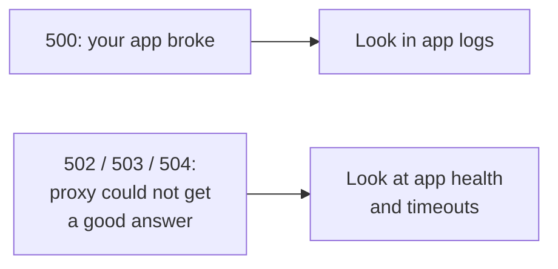

The rest of this note is just these 3 questions:
1. Is it real, and how big is it?
2. What changed just before it started?
3. Which code is it, and so which part of the chain is broken?

**The problem in one story**

Users open the app and see an error page.
A dashboard shows that 8 percent of requests now fail with server errors.
Ten minutes ago a new version was deployed.
You must decide fast: roll back, or find another cause?

**Words you need first**

| Word | Plain meaning | Tiny example |
|---|---|---|
| HTTP status code | A number the server returns with every reply | 200 OK, 404 Not Found, 500 Error |
| 5xx | Status codes meaning the server side failed | 500, 502, 503, 504 |
| Error rate | Failed requests divided by all requests | 40 errors / 1000 requests = 4 percent |
| Upstream / downstream | Upstream: a service you call. Downstream: who calls you | Your API calls the payments upstream |
| Load balancer | Spreads traffic over many servers and may return its own 5xx | 502 when no healthy backend |
| Rollback | Returning to the previous working version | Redeploy last good image |
| SLO / error budget | A target for reliability and how much failure is allowed | 99.9 percent success per 30 days |

**Picture it**

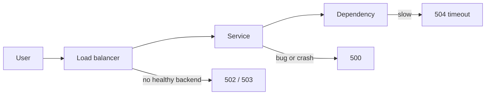

**Analogy**

A restaurant where some plates come back wrong. You check: did the chef change the recipe today (deploy), is a supplier missing ingredients (dependency), or is the kitchen overloaded (capacity)?

Where it breaks: a restaurant serves one table at a time; a service fails thousands of requests a second, so you act on the ratio, not single plates.

**How the rest of this note builds up**

- First, **Why it exists** and **Mental model** explain what a 5xx means and who produces it.
- Then **How it works** walks through the triage order: recent change, dependency, capacity.
- Next, the **Worked example** shows a deploy-caused spike end to end.
- Then **Variants and comparison**, **Trade-offs** and **In production** cover each 5xx code.
- Finally, the SDE-3 **Deep dive** covers ratio pitfalls and retries.

> [!tip] Remember
> Check what changed first; if a deploy lines up with the spike, roll back before debugging.

## 1. Why it exists 🟢

**Symptoms.** The 5xx ratio on a service crosses its alert threshold (for example above 2% for 5 minutes). Users see "Something went wrong", a blank page, a Bad Gateway page from the load balancer, or a mobile app spinner that ends in a retry toast. Support tickets and social posts follow within minutes.

**User impact.** Every 5xx is a request that failed for a reason that is not the user's fault. A checkout 5xx loses revenue. A login 5xx locks people out. Retries by clients make it worse: a 3x retry policy turns a 10% error rate into extra load that can push a struggling service over the edge.

The running example in this note is **InvoiceOps**, a Go invoicing API behind nginx, running as 12 pods on Kubernetes, talking to PostgreSQL, Redis and a third-party tax API.

> [!tip] Remember
> A 5xx is the server admitting fault. The fastest path is scope, change, mitigate, then decode the status.

## 2. Mental model 🟢

### Picture the request path as a chain of hands

In plain words: a request passes through several hands (CDN, load balancer, reverse proxy, your app, then a database or another service). Any hand can drop it and say "failed". The status code often tells you **which hand dropped it**.

Analogy: a package moving through a postal chain. "Return to sender: address unreadable" (502) is a different failure from "depot closed today" (503), "truck never arrived" (504) or "the parcel burst open inside the sorting machine" (500). It breaks down where the real system retries silently: a post office rarely re-sends, a proxy might.

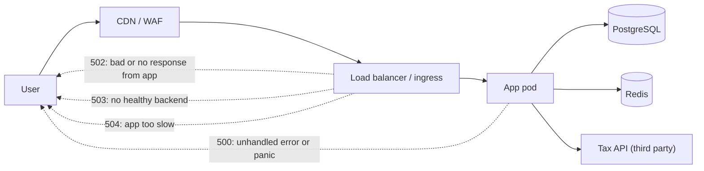

> [!tip] Remember
> Ask "which hop produced this status?" before "which line of code is wrong?".

## 3. How it works 🟡

### The first 5 minutes

Do these in order. Each step is short on purpose.

1. **Confirm the problem and the blast radius.**
   - Open the service dashboard. Is the 5xx ratio really up, or did traffic collapse (a ratio on tiny traffic is noisy)?
   - Break it down by `route`, `pod`, `region`, `status`. One route, one pod, or all?
   - Check a synthetic probe or `curl` from your laptop to see what a user sees.
2. **Check what changed.** In order of likelihood: deploy, feature flag, config or secret change, traffic surge, dependency change (database failover, a vendor outage), certificate expiry, cron or batch job.
3. **Mitigate first.** Pick the cheapest safe action:
   - Deploy started in the last hour: **roll back**.
   - A flag flipped: **flip it back**.
   - Pods saturated: **scale out**, or **shed load** (reject low-priority traffic early).
   - One pod bad: **delete that pod**.
   - Dependency down: **open the circuit breaker** or serve a degraded fallback.
4. **Communicate.** Post in the incident channel: "5xx spike on InvoiceOps since 14:02 UTC, about 18% of requests, cause unknown, investigating, rolling back the 14:00 deploy." Declare an incident per [[Incident Response]] if customer-facing.
5. **Verify the mitigation.** Watch the 5xx ratio for 5 minutes. If it does not drop, the mitigation was wrong, so keep diagnosing; do not assume.

> [!warning] Common mistake
> Spending 20 minutes reading logs while a one-command rollback sits unused. If a deploy happened within the error window, roll back first and investigate afterwards on the old build in a calm environment.

### Step A: Confirm with a query

**In plain words:** before acting, check the numbers: what share of requests fail, and on which routes and codes.

Overall 5xx ratio (assuming the common `http_requests_total` counter with a `code` label; adapt the names to your instrumentation):

```promql
sum(rate(http_requests_total{job="invoiceops",code=~"5.."}[5m]))
  /
sum(rate(http_requests_total{job="invoiceops"}[5m]))
```

Break it down by route to scope the blast radius:

```promql
topk(5,
  sum by (route) (rate(http_requests_total{job="invoiceops",code=~"5.."}[5m]))
)
```

Break it down by pod to find a single bad instance:

```promql
topk(5,
  sum by (pod) (rate(http_requests_total{job="invoiceops",code=~"5.."}[5m]))
)
```

Break it down by exact status code, which drives the diagnosis flowchart below:

```promql
sum by (code) (rate(http_requests_total{job="invoiceops",code=~"5.."}[5m]))
```

| Result | Meaning |
| --- | --- |
| One route has all the errors | A bug or slow dependency in that handler |
| One pod has all the errors | Bad node, poisoned pod, exhausted pool on that pod: delete it |
| All pods, all routes, started at a deploy time | Bad release |
| All pods, started with traffic growth | Capacity or a downstream limit |
| Mostly 502/504 and app pods look fine | Proxy to app problem (timeouts, keep-alive, readiness) |

### Step B: What changed

**In plain words:** most error spikes follow a change: a deploy, a setting, a feature switch. List what changed in the last hour.

```bash
# Recent rollouts of this deployment
kubectl rollout history deployment/invoiceops -n prod

# Cluster events, newest last (OOMKilled, probe failures, evictions, scheduling)
kubectl get events -n prod --sort-by=.lastTimestamp | tail -30

# Which image is each pod really running, and how old is it?
kubectl get pods -n prod -l app=invoiceops -o wide
kubectl get deploy invoiceops -n prod -o jsonpath='{.spec.template.spec.containers[0].image}{"\n"}'
```

Compare the deploy time on your CD dashboard with the moment the 5xx line left the floor in Grafana. A match within a minute or two is strong evidence; mitigate by rolling back (see [[Playbook - Bad Deploy and Rollback]]).

### The diagnosis flowchart

**In plain words:** follow the arrows from the symptom to the most likely cause, one question at a time.

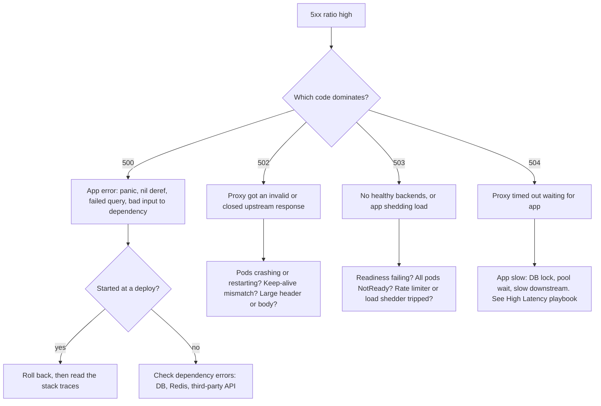

## 4. Worked example 🟡

### Incident walkthrough: InvoiceOps returns 502 after a Friday deploy

**In plain words:** a realistic incident, minute by minute, showing the steps above in order.

All times UTC. This is a composite, realistic scenario, not a real company incident.

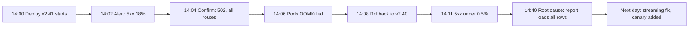

Step by step:

1. **14:02 Alert.** The 5xx ratio is 18% on InvoiceOps for 2 minutes. On-call acknowledges.
2. **14:04 Confirm and scope.** `sum by (code)` shows almost all 502s and a few 500s. `sum by (route)` shows errors on all routes, not one. `sum by (pod)` shows errors spread across all pods that are new. So it is not one bad pod and not one bad route.
3. **14:05 What changed.** The CD dashboard shows deploy v2.41 started at 14:00. The error line left the floor at 14:01.
4. **14:06 Cheap evidence.** `kubectl get pods -n prod -l app=invoiceops` shows RESTARTS climbing on new pods. `kubectl describe pod` shows `Last State: Terminated, Reason: OOMKilled`. Pods die, the proxy loses connections mid-request, nginx returns 502.
5. **14:08 Mitigate.** `kubectl rollout undo deployment/invoiceops -n prod`. Post to the incident channel: "Rolling back v2.41, suspected OOM from new release."
6. **14:11 Verify.** 5xx ratio returns to baseline. Status page updated to "resolved, monitoring".
7. **14:40 Root cause.** `kubectl logs --previous` on a crashed pod shows no panic (OOMKill sends SIGKILL, so no log line). A heap profile run on a staging pod with the new build shows the `/reports/export` handler reading all rows into a slice. Memory scales with report size, not with traffic.
8. **Follow-up.** Stream rows to the client, set a body-size cap, add a memory-limit load test to CI, add a canary stage that gates on 5xx ratio. Postmortem scheduled.

Total user impact: about 9 minutes of elevated errors. Without the rollback-first habit, the team would have spent most of that 40 minutes serving errors.

## 5. Variants and comparison 🟡

### Variant 1: 500 Internal Server Error (your code failed)

In plain words: the handler panicked, returned an error you mapped to 500, or a dependency returned something your code could not handle.

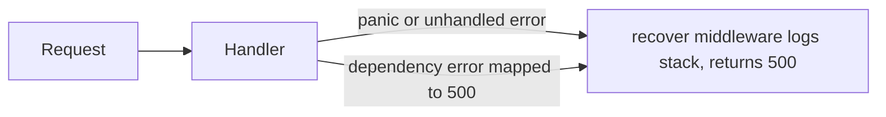

**Investigate.**

```bash
# Group error log lines by message; structured logs assumed (JSON with level and msg)
kubectl logs -n prod -l app=invoiceops --since=15m \
  | jq -r 'select(.level=="error") | .msg' | sort | uniq -c | sort -rn | head
```

| Result | Meaning |
| --- | --- |
| One message dominates, with a stack trace | A specific bug; fix or roll back |
| "connection refused" / "context deadline exceeded" to a dependency | Dependency outage; see variant below |
| "too many clients" or "pool exhausted" | See [[Playbook - Database Overload and Connection Exhaustion]] |
| Many different messages | Systemic: resource exhaustion, config break |

Go `net/http` recovers panics per request and logs them; a `recover` middleware (see [[Middleware]]) lets you return a clean 500 and count it. Check that the panic counter is exported as a metric.

### Variant 2: 502 Bad Gateway (proxy got a bad answer)

In plain words: nginx or the load balancer connected to your pod and got a closed connection, a reset, or malformed data. This usually means the pod died, restarted, or closed a keep-alive connection the proxy still thought was open.

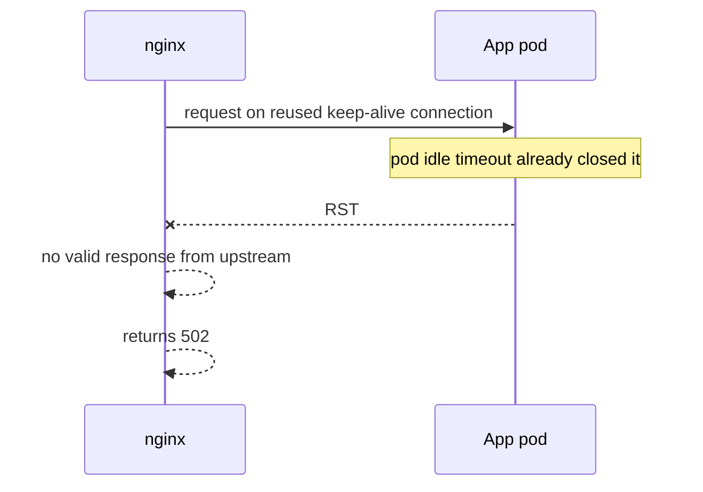

**Investigate.**

```bash
# nginx error log hints
kubectl logs -n ingress deploy/ingress-nginx-controller --since=10m | grep -E "upstream|502"
# Typical lines: "upstream prematurely closed connection", "connect() failed (111: Connection refused)"

# Are pods crashing?
kubectl get pods -n prod -l app=invoiceops
kubectl describe pod <pod> -n prod | sed -n '/Last State/,/Ready/p'
kubectl logs <pod> -n prod --previous --tail=100
```

| Result | Meaning |
| --- | --- |
| "Connection refused" | Nothing listening: pod down, wrong port, or still starting |
| "upstream prematurely closed connection" | Pod crashed mid-request, or closed the socket |
| 502 only during deploys | Missing graceful shutdown or readiness mismatch; see [[Graceful Shutdown and Health Checks]] |
| Sporadic 502 at low rate with long keep-alives | Server idle timeout shorter than proxy keep-alive; set the app idle timeout longer than the proxy's |

### Variant 3: 503 Service Unavailable (refusing right now)

In plain words: either there is no healthy backend to send to, or the app itself is deliberately rejecting work (rate limit, load shedding, circuit open).

```bash
# Endpoints behind the service; empty means zero Ready pods
# (Endpoints is deprecated in newer Kubernetes; `kubectl get endpointslices -l kubernetes.io/service-name=invoiceops -n prod` is the modern form)
kubectl get endpoints invoiceops -n prod
kubectl get pods -n prod -l app=invoiceops -o wide
kubectl describe pod <pod> -n prod | grep -A5 -i "readiness"
```

| Result | Meaning |
| --- | --- |
| Endpoints list is empty | All pods NotReady: probe failing, dependency check in readiness failing, or rollout stuck |
| Pods Ready, 503 from the app | App shedding load: look at limiter and breaker metrics |
| 503 with `Retry-After` | Intended behaviour: capacity reached, see [[Load Shedding and Graceful Degradation]] |

> [!warning] Common mistake
> Putting a database ping inside the readiness probe. When the database blips, every pod goes NotReady at once, the service has zero endpoints, and a partial outage becomes a total one. Keep readiness about "can this pod accept traffic", not "are all dependencies fine".

### Variant 4: 504 Gateway Timeout (proxy gave up waiting)

In plain words: the app is alive but did not answer before the proxy's timeout (for nginx, `proxy_read_timeout`, default 60 s). The cause is almost always slowness downstream.

```bash
# Time a real request, split by phase
curl -o /dev/null -s -w 'dns=%{time_namelookup} connect=%{time_connect} tls=%{time_appconnect} ttfb=%{time_starttransfer} total=%{time_total} code=%{http_code}\n' \
  https://api.invoiceops.example.com/invoices/123

# Latency percentile on the app itself
# histogram_quantile(0.99, sum by (le, route) (rate(http_request_duration_seconds_bucket{job="invoiceops"}[5m])))
```

| Result | Meaning |
| --- | --- |
| High `ttfb`, low connect | App is slow thinking: DB, downstream, lock wait |
| High `connect` | Network or SYN backlog, saturated listener |
| p99 high on one route only | A single query or downstream call; see [[Playbook - High Latency]] |

### Comparison of the four codes

**In plain words:** one row per code: who sent it, the usual cause, and the first thing to type.

| Code | Who produced it | Most likely cause | First command |
| --- | --- | --- | --- |
| 500 | Your app | Bug, unhandled dependency error | `kubectl logs ... \| jq` error grouping |
| 502 | Proxy | Pod crash, closed connection, port mismatch | `kubectl get pods`, `describe`, `--previous` logs |
| 503 | Proxy or app | Zero ready backends, shedding | `kubectl get endpoints` |
| 504 | Proxy | App or dependency too slow | `curl -w`, p99 per route |

## 6. Trade-offs 🟡

### Fixes and their costs

**In plain words:** each quick fix has a speed and a risk. The table tells you when each one is the wrong choice.

| Mitigation | Speed | Risk | When it is the wrong choice |
| --- | --- | --- | --- |
| Roll back | 1-3 min | Re-introduces old bugs; breaks if a DB migration is not backward compatible | Schema already migrated forward irreversibly |
| Flip feature flag | Seconds | Low | The flag is not the cause |
| Scale out | 1-5 min | Pushes more load onto the database, can make a DB-bound incident worse | Bottleneck is a shared dependency |
| Shed load | Seconds | Drops real traffic | You have no priority classes and would drop checkout first |
| Restart pods | Seconds | Hides the cause, loses evidence | You have not grabbed a profile or logs yet |
| Circuit breaker open | Seconds | Feature degraded | Dependency is on the critical path with no fallback |

> [!warning] Common mistake
> Restarting everything before collecting evidence. Grab `kubectl logs --previous`, a goroutine dump or a heap profile from **one** bad pod, then restart. Otherwise the next incident starts from zero.

## 7. In production 🔴

### Three layers of fix

1. **Immediate fix.** Roll back, flip a flag, delete a bad pod, scale, shed. Goal: user impact ends.
2. **Proper fix.** Patch the bug, raise a limit with evidence, add a timeout, add a missing index, make shutdown graceful.
3. **Prevention.** Canary deploys gated on 5xx ratio, load tests in CI, readiness probes that reflect reality, alert on the ratio and on burn rate, runbook updates, chaos or game-day testing.

### The alert you want

**In plain words:** page a human only when errors are eating your error budget fast, not on every small blip.

A multi-window burn-rate alert on the error SLO (see [[SLIs, SLOs, SLAs and Error Budgets]]) pages on real, sustained impact and stays quiet for one-minute blips. A flat "5xx above 1%" threshold is simpler but noisy at low traffic.

### Dashboards to have open

- RED panel per service: rate, errors by code, duration p50/p95/p99.
- Error ratio by route and by pod.
- Pod restarts and OOMKills.
- Dependency panel: DB pool wait, Redis latency, third-party API error rate.
- Deploy markers overlaid on every graph.

### Evidence to keep

Screenshots of the graph with deploy markers, the exact error log lines, the `kubectl describe` output and the timeline. The postmortem needs them and they vanish when pods are replaced.

## 8. Deep dive 🔴

### Why the ratio can mislead

**In plain words:** the error % is errors divided by all requests. If normal traffic drops, the % can jump even when nothing new broke.

A 5xx ratio is errors divided by total. If an upstream outage drops real traffic by 90%, the ratio can look worse while the absolute number of errors is unchanged, or look fine while users cannot reach you at all (traffic that never arrives has no status).

Always plot request **rate** next to the error ratio, and keep an external synthetic check.

### Retries amplify

**In plain words:** when callers retry failed requests, a struggling service gets even more traffic, and fails more.

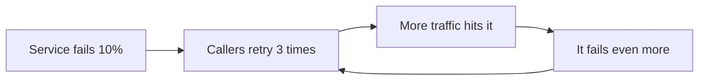

If clients retry failed requests 3 times, a 10% error rate becomes roughly 30% more traffic at the failing component. Use jittered exponential backoff with a retry budget; see [[Timeouts, Retries and Backoff]]. A retry storm often explains why a small fault became a large outage.

### Proxy timeouts must nest

**In plain words:** each layer should give up a little sooner than the layer in front of it. Otherwise the outer layer gives up first and the inner work is wasted.

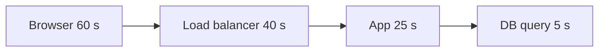

Make timeouts shrink as you go deeper (example values): browser 60 s, load balancer 40 s, app request 25 s, DB statement 5 s. If an inner timeout is longer than an outer one, the outer layer gives up first, returns 504, and the inner work keeps running for nobody.

### Health check versus real health

**In plain words:** "I am alive" is not the same as "I can do real work". A pod can pass its check and still fail every real request.

A pod that answers `/healthz` can still return 500 on every real request (for example it lost its database connection permanently). Liveness restarts only help if the check exercises the thing that breaks. Prefer metrics on real traffic outcomes for alerting.

### Panics and goroutines

**In plain words:** in Go, a crash in a side task you started yourself can take down the whole app.

An unrecovered panic in a goroutine you started yourself (not the request goroutine) crashes the whole process, because `net/http` only recovers panics on its own request goroutines. This shows up as pod restarts followed by 502s. Wrap long-lived goroutines with their own recover and a counter.

## 9. Interview questions 🔴

> [!question]- Your service's 5xx rate just spiked to 20%. Walk me through your first 5 minutes.
> Confirm with the dashboard and scope by route, pod and status code. Check what changed (deploy, flag, config, traffic, dependency). Mitigate first: roll back a recent deploy, flip a flag, delete one bad pod, scale or shed load. Communicate in the incident channel with impact and current action. Verify the ratio drops. Diagnose properly only after impact has stopped.

> [!question]- What is the difference between a 502, 503 and 504, and why does it matter during an incident?
> 502 means the proxy received an invalid or no response from the upstream (crash, reset, port mismatch). 503 means no healthy backend or deliberate refusal (not ready, shedding load). 504 means the upstream was too slow and the proxy timed out. They point at different hops: crash, readiness and capacity, and slowness. That saves minutes of guessing.

> [!question]- The 5xx spike started exactly at a deploy, but the new code looks fine. What now?
> Still roll back first; correlation at the minute level is strong evidence. Then look for non-code changes shipped with the deploy: config, environment variables, resource limits, dependency versions, schema migrations, or a new feature flag default. Reproduce on the old build, compare behaviour, and use a canary next time.

> [!question]- Errors are only on one pod out of twelve. What do you do?
> Delete or cordon that pod to restore service and keep a copy of its logs and a profile first. Then ask why only that pod: a bad node, noisy neighbour, stuck connection pool, stale cache, a leaked goroutine, or a poisoned local state. If it recurs on other pods, it is a systemic leak with a delay.

> [!question]- How can retries make a 5xx incident worse and what do you do about it?
> Each client retry adds load to the component that is already failing, so a 10% error rate can produce a large traffic multiplier and a retry storm. Use exponential backoff with jitter, cap retries with a budget, retry only idempotent calls, and add a circuit breaker so callers stop hammering a failing dependency.

> [!question]- Why is putting a database check in the readiness probe dangerous?
> A short database blip makes every pod NotReady at the same time. The service then has zero endpoints and returns 503 to everyone, turning a degraded dependency into a full outage. Keep readiness local and cheap; handle dependency failure inside request handling with timeouts, breakers and fallbacks.

## 10. Cheat sheet 🟢

- First 5 minutes: confirm, scope, what changed, mitigate, communicate, verify.
- 500 app bug, 502 bad upstream response, 503 refusing, 504 upstream too slow.
- Roll back first when a deploy matches the start of the errors.
- Scope with `sum by (route|pod|code)` on the 5xx rate.
- `kubectl get events`, `describe pod`, `logs --previous`, `get endpoints` answer most 502 and 503 questions.
- `curl -w` timing phases tells you where a 504 spends its time.
- Never restart before saving evidence from one bad pod.
- Fix in three layers: immediate, proper, prevention. Then write the postmortem.

## 11. Post-incident checklist 🟡

- [ ] Timeline written with deploy, alert, mitigation and recovery timestamps.
- [ ] Customer impact measured (error count, affected users, revenue estimate).
- [ ] Root cause and contributing factors recorded (detection delay, missing canary, noisy alert).
- [ ] Action items have owners and dates: proper fix, test, alert, runbook.
- [ ] Alert reviewed: did it fire fast enough, and was it actionable?
- [ ] Blameless postmortem held, see [[Postmortems and Root Cause Analysis]].
- [ ] Runbook and this playbook updated with anything learned.

## 12. Links

- Method: [[Production Debugging Playbook]], [[Incident Response]], [[Postmortems and Root Cause Analysis]]
- Sibling playbooks: [[Playbook - Bad Deploy and Rollback]], [[Playbook - Database Overload and Connection Exhaustion]], [[Playbook - High Latency]]
- Signals and alerting: [[Metrics and Prometheus]], [[Alerting and On-Call]], [[SLIs, SLOs, SLAs and Error Budgets]], [[Latency, Percentiles and Bottleneck Analysis]]
- Resilience: [[Circuit Breaker]], [[Timeouts, Retries and Backoff]], [[Load Shedding and Graceful Degradation]]
- Tools: [[Network Debugging Toolkit - dig, curl, ss, tcpdump]], [[Graceful Shutdown and Health Checks]], [[Debugging Memory Leaks and OOMs in Go]]

## Links

### Watch on YouTube

- [Familywise error rate (FWER) - explained](https://www.youtube.com/watch?v=8CuFKY45UXQ) · TileStats · 12 min · 16,746 views
- [Bit Error Rate - BER - explained (01-04-05)](https://www.youtube.com/watch?v=Xtb1EuAszHU) · HUBER+SUHNER  · 4 min · 7,195 views
