# Playbook - High Latency

> [!summary] TL;DR
> Users say "the site is slow" and your p99 latency graph has climbed. Confirm it with a number, find out what changed, mitigate first (roll back, scale, shed load, turn off the heavy feature), then split the request time into pieces (network, queue, CPU, database, cache, downstream call) to find which piece grew. Fix the cause only after users are safe.

> [!abstract] Core idea
> - Latency is a sum. Total time = waiting for a free worker + your own CPU + each call to a database, cache or other service + network. Find the piece that grew.
> - Look at percentiles (p50, p95, p99), not averages. An average hides the slow tail that real users feel.
> - Slow is usually "waiting", not "working": queues, locks, exhausted connection pools, retries and timeouts cause more latency than slow code.
> - Mitigate before you diagnose. Rolling back a bad deploy in two minutes beats a perfect root-cause analysis in two hours.

## Start here: the basics 🟢

> [!info] How to read this note (pick your level)
> - 🟢 **New to this?** Read "From zero" below, then sections 1, 2 and the cheat sheet (10). Stop there, that is a full first pass.
> - 🟡 **Know the basics?** Add section 3 (first 5 minutes, flowchart and causes A to F), 4 (worked example), 5 and 6.
> - 🔴 **Interview / SDE-3 prep?** Add 7, 8 and 9. Headings are tagged 🟢🟡🔴 so you always know where you are.

> [!note] Before this note
> - [[Latency, Percentiles and Bottleneck Analysis]]: p99 is the time the slowest 1 in 100 requests take, and request time is real work plus waiting.
> - [[Production Debugging Playbook]]: the fixed order: how bad, what changed, who is affected, then metrics, traces, logs; stop the pain before finding the cause.
> - [[Metrics and Prometheus]]: Prometheus stores request counts and latency histograms you can query with PromQL.

**From zero, in 60 seconds** 🟢

**Latency** is how long a user waits for an answer.
A request passes through many steps: network, a waiting line, your code, the database, other services.
Each step adds a little time. "High latency" means one of the steps got slower.
Usually most users are still fast, and only the slowest few wait a long time.
So we don't look at the average. We look at the slowest 1 in 100 requests, called **p99**.

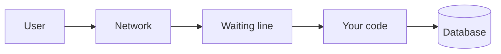

Your whole job in this playbook: find the step whose time grew.

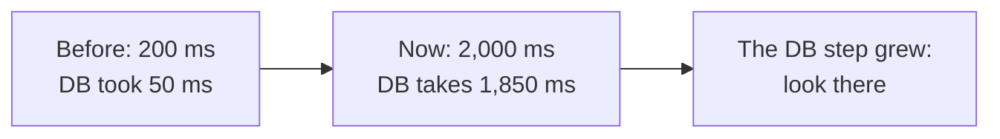

The rest of this note is just these 3 questions:
1. Is it really slower, for whom, and since when?
2. Which step of the request got slower?
3. How do you make users fast again now, then fix the cause?

**The problem in one story**

A checkout page usually loads in a fraction of a second.
Today some users wait 3 seconds, while most are still fast.
The average looks fine, but the slowest requests are much slower.
You need to find which part of the request is waiting.

**Words you need first**

| Word | Plain meaning | Tiny example |
|---|---|---|
| Latency | Time from sending a request to getting the reply | 80 ms |
| Percentile (p50, p99) | p99 is the time that 99 percent of requests beat | p99 = 1.2 s means 1 in 100 is slower |
| Tail latency | The slowest requests, the high percentiles | p99 and p99.9 |
| Throughput | Requests handled per second | 2,000 rps |
| Saturation | A resource fully busy, so work waits in a queue | Thread pool all busy |
| Timeout | Max time you wait before giving up | Client gives up after 2 s |
| Trace / span | A record of one request's path; a span is one step | DB query span took 900 ms |
| GC pause | Time the language runtime spends cleaning memory | Go GC assist slowing requests |
| Blast radius | How much is affected: which routes, regions, customers | only `/checkout`, all regions |
| Rollback | Going back to the previous working version | `kubectl rollout undo` |
| Connection pool | The fixed set of open database connections the app shares | 20 connections, all busy |
| CPU throttling | The container is paused because it used its CPU limit, even if the machine has spare CPU | limit 1 core, paused 30% of the time |
| Circuit breaker | Code that stops calling a failing service for a while and fails fast instead | skip `pricing` for 30 s |
| Retry storm | Retries piling extra load onto an already slow service | 1 click becomes 27 calls |

**Picture it**

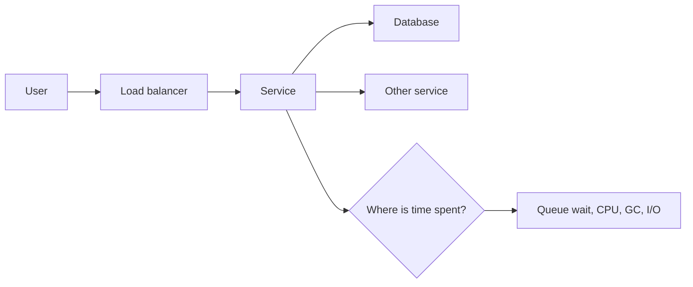

**Analogy**

A supermarket checkout: most people pass quickly, but if one till is slow or the queue is long, some customers wait far longer. Measuring the average hides those angry customers.

Where it breaks: in a shop you can see the queue; in software you need percentiles and traces to see it.

**How the rest of this note builds up**

- First, **Why it exists** and **Mental model** explain percentiles and why averages lie.
- Then **How it works** splits a request into parts: network, queueing, CPU, dependencies, GC.
- Next, the **Worked example** traces a slowdown to its cause.
- Then **Variants and comparison**, **Trade-offs** and **In production** cover timeouts and capacity.
- Finally, the SDE-3 **Deep dive** covers queueing theory, Little's Law and percentile aggregation.

> [!tip] Remember
> Look at p99, not the average, and find where requests wait.

## 1. Why it exists 🟢

Symptoms you will see:

- The alert says "p99 latency above 1 s for 10 minutes", or support says "checkout hangs".
- Dashboards show request duration rising, often with a rising count of in-flight requests.
- Users see spinners, timeouts (HTTP 504, "the gateway gave up waiting"), mobile apps retry, and some users give up.
- Sometimes error rate rises too, because timeouts turn slow responses into failures.

User impact: abandoned carts and sign-ups, support tickets, and a risk of a **retry storm** (clients retry slow requests, which adds load, which makes the system slower).

Example numbers (illustrative): an API normally answers in 80 ms at p50 and 250 ms at p99. After a deploy, p50 is still 90 ms but p99 is 4 s.

Only 1 request in 100 is slow, but a page that makes 20 API calls hits at least one slow call in about 18% of loads (1 - 0.99^20, a computed figure). This is why the tail matters.

> [!tip] Remember
> A small slow tail becomes a large share of user-visible pain once one page makes many calls.

### Real-life example: a slow seat page 🟢

Think of BookMyShow on the morning a big film opens.
Most people see the seat map in under a second, but some wait 5 seconds or more and close the app.
The average load time still looks fine, because most requests are fast.
The p99 graph shows the problem clearly, and a trace of one slow request shows the time stuck waiting on the seat-lock database.
That is exactly the hunt this playbook walks through.

## 2. Mental model 🟢

Think of a restaurant. A meal takes long if the kitchen is slow (CPU), if you wait for a table (queueing), if the kitchen waits for a supplier (a downstream service or database), or if the waiter walks far (network). Different problem, same complaint: "the food is slow."

Analogy limit: a restaurant has a visible queue. In software the queue can be invisible (goroutines blocked on a pool, requests sitting in a kernel socket backlog, the operating system's list of connections not yet picked up by the app), so you must measure it.

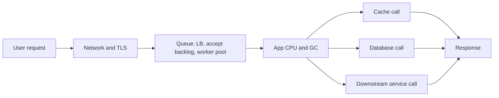

Each box adds time. The playbook's job is to find the box whose time grew.

## Common beginner mistakes 🟢

- **Reading code before checking "what changed"** → most slowdowns follow a deploy, config or flag change → check the change list first.
- **Looking at average latency** → it hides the slow 1% that users complain about → look at p50, p95 and p99 together.
- **Adding more servers when the database is the bottleneck** → more servers send more queries and make it slower → find the slow piece first.
- **Raising the connection pool size during a DB overload** → more connections fight for the same CPU and disk → fix the slow query or lock instead.
- **Calling other services with no timeout** → one slow service ties up every worker → give every outbound call a timeout shorter than your own.

## 3. How it works 🟡

> 🟢 → 🟡 **You now know** that latency is a sum of steps and that p99 shows the slow tail. **Next we open the box**: the first five minutes, a flowchart for picking the cause, and the checks for each cause (CPU, database, blocked workers, cache, slow dependency, network).

### 3.1 First 5 minutes

In plain words: do these four things in order, fast. They are about safety, not understanding.

1. **Confirm the problem and its blast radius.**
   - Look at the p50, p95, p99 request duration for the affected service. Is it real or a monitoring glitch?
   - Which routes, regions, customers, or versions are slow? All of them, or one slice?
   - Is the error rate also rising? Are timeouts (504) increasing?
   - Open one slow trace or slow log line to see an example.
2. **Check what changed.**
   - Deploys and config changes in the last hour (`kubectl rollout history deployment/api`, your deploy dashboard, feature flag changes).
   - Traffic: requests per second up? A new client, a marketing campaign, a bot?
   - Dependencies: database, cache, queue, third-party API status pages, cloud provider incidents.
   - Infrastructure: node autoscaling events, certificate renewals, a cron job or batch job that started.
3. **Mitigate first.**
   - Recent deploy correlates with the start: roll back (`kubectl rollout undo deployment/api`).
   - Traffic spike: scale out, enable rate limits, shed low-priority traffic.
   - One feature is heavy: turn off its feature flag.
   - One dependency is slow: open its circuit breaker, serve cached or degraded data, or fail over.
4. **Communicate.**
   - Open an incident channel, name an incident commander (the one person who coordinates and decides), post a first status update in 5 to 10 minutes: what users see, what you know, next update time.
   - Update on a fixed cadence, for example every 15 to 30 minutes, even if the update is "no change".

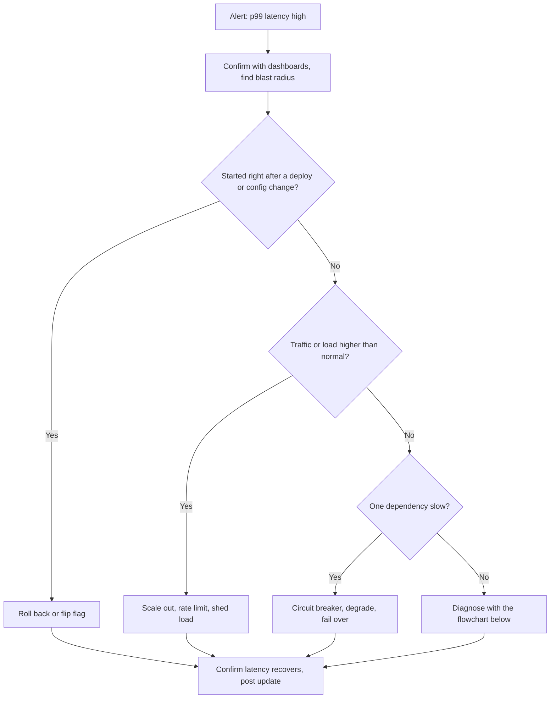

> [!warning] Common mistake
> Spending 30 minutes reading code before checking "what changed". Most incidents follow a change. The change list is the cheapest clue you have.

### 3.2 Diagnosis flowchart

In plain words: ask which box in the request path grew, then follow the arrow to the likely causes.

**Step by step:**
1. Are in-flight requests piling up? If yes, something inside is saturated.
2. Then: is CPU at its limit or throttled? That is cause A.
3. If not CPU: is database or pool wait time up? Cause B. Neither? Cause C (something blocked inside the app).
4. If requests are not piling up, open a trace: which outside call is slow? Database (B), cache (D), another service (E), or time spent before the app (F).

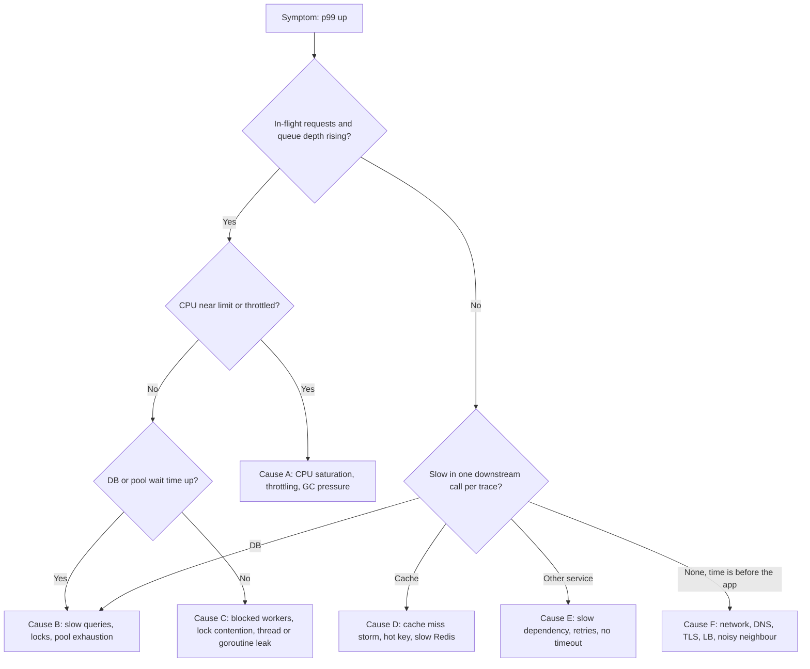

### 3.3 Step 1: Find where the time goes

In plain words: split a slow request into labelled pieces. A trace does this automatically. Without tracing, compare metrics at each layer.

**Step by step:**
1. Run the p99-per-route query: is it one route or all of them?
2. Compare p50 with p99: both up means everything is slower; only p99 means a slice.
3. Check request rate: up means load-driven; flat means each request got slower.
4. Run `curl -w` from outside to split DNS, connect, TLS and server wait.
5. Open one slow trace and write one sentence: "the extra time is in X".

**Dashboards and PromQL** (Prometheus's query language; metric names assume common client-library conventions such as `http_request_duration_seconds`; adjust to what your service exports):

```text
# p99 latency per route over 5 minutes
histogram_quantile(0.99,
  sum by (le, route) (rate(http_request_duration_seconds_bucket{service="api"}[5m])))

# Compare p50 vs p99 (a wide gap means a slow tail, not a uniform slowdown)
histogram_quantile(0.50, sum by (le) (rate(http_request_duration_seconds_bucket{service="api"}[5m])))

# Request rate and error ratio
sum(rate(http_requests_total{service="api"}[5m]))
sum(rate(http_requests_total{service="api",status=~"5.."}[5m]))
  / sum(rate(http_requests_total{service="api"}[5m]))

# In-flight requests (a queue growing shows here)
sum(http_requests_in_flight{service="api"})
```

What the results mean:

| Pattern | Meaning |
| --- | --- |
| p50 and p99 both rose | Everything got slower: CPU, a shared dependency, network, or a global lock |
| p50 flat, p99 rose a lot | A slice is slow: one route, one shard, one customer, GC pauses, or occasional timeouts and retries |
| Rate rose, latency rose | Load-driven: saturation, queueing |
| Rate flat or fell, latency rose | Something got slower per request: a deploy, a dependency, data growth |
| One route only | A query, a code path, or a downstream used only by that route |

**Measure from the outside with `curl -w`** (splits the time into DNS, TCP, TLS, wait for first byte (TTFB, time to first byte), total):

```bash
curl -s -o /dev/null -w \
'dns=%{time_namelookup} connect=%{time_connect} tls=%{time_appconnect} ttfb=%{time_starttransfer} total=%{time_total}\n' \
https://api.example.com/v1/orders
```

How to read it: the values are cumulative seconds. If `dns` is large, look at DNS. If `connect` minus `dns` is large, the network or a load balancer is slow.

If `ttfb` minus `tls` is large, the server is slow to respond (queue, CPU, database). If `total` minus `ttfb` is large, the response body is big or the network is slow.

**Trace example.** Open a slow trace in your tracing UI (see [[Distributed Tracing with OpenTelemetry]]). The longest span tells you the box. A trace with a long gap and no child span means time was spent waiting inside the service (queue, lock, GC) rather than in a call.

> [!tip] Remember
> The goal of this step is one sentence: "the extra time is in X."

### 3.4 Cause A: CPU saturation, throttling and GC

In plain words: if the CPU is full, every request waits its turn. In containers there is an extra trap: the kernel can **throttle** a container that hits its CPU limit, even if the node has idle CPU.

**Step by step:**
1. Run `kubectl top pod`: is CPU near the pod's limit?
2. Check throttling: if more than a few percent of CPU periods are throttled, the pod is being paused. (CFS is the Linux scheduler that enforces the limit in 100 ms slices.)
3. If CPU is high, take a 30-second CPU profile with pprof and look at the top function.
4. If much time is in the garbage collector, the app allocates too much memory; see the memory playbook.
5. Fix: scale out or raise the CPU limit now; optimize the hot code later.

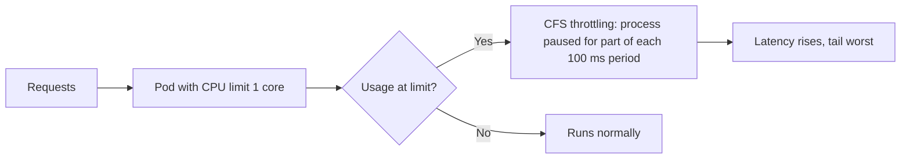

Commands and queries:

```bash
# Current CPU and memory per pod
kubectl top pod -n prod -l app=api

# Is the container being throttled? (cgroup v2 path; v1 uses cpu.stat under cpu,cpuacct)
kubectl exec -n prod deploy/api -- cat /sys/fs/cgroup/cpu.stat
# look at nr_throttled and throttled_usec growing between two reads

# On a VM: load, top CPU consumers
uptime
top -o %CPU
```

```text
# Share of CPU periods throttled (cAdvisor metrics)
sum by (pod) (rate(container_cpu_cfs_throttled_periods_total{namespace="prod",pod=~"api-.*"}[5m]))
  / sum by (pod) (rate(container_cpu_cfs_periods_total{namespace="prod",pod=~"api-.*"}[5m]))

# CPU use against the limit
sum by (pod) (rate(container_cpu_usage_seconds_total{namespace="prod",pod=~"api-.*"}[5m]))
  / sum by (pod) (kube_pod_container_resource_limits{namespace="prod",resource="cpu",pod=~"api-.*"})
```

For a Go service, take a CPU profile while it is slow (needs `net/http/pprof` enabled on an internal port):

```bash
go tool pprof -top "http://localhost:6060/debug/pprof/profile?seconds=30"
# interactive flame graph (one bar per function, wider = more CPU) in the browser:
go tool pprof -http=:8081 "http://localhost:6060/debug/pprof/profile?seconds=30"
```

GC check for Go:

```bash
GODEBUG=gctrace=1 ./api 2>&1 | grep '^gc '
```

What results mean:

| Result | Meaning | Action |
| --- | --- | --- |
| CPU near 100% of limit, throttled periods above a few percent | Container is starved | Raise or remove the CPU limit, scale out |
| CPU low, latency high | Not a CPU problem, look elsewhere | Go to cause B, C or E |
| `pprof` shows one function dominating | A hot code path, often a new regex, JSON encoding, or a loop | Fix or roll back |
| `pprof` shows much time in `runtime.gcBgMarkWorker` or `mallocgc` | GC pressure from allocation | Reduce allocations, reuse buffers, check memory growth |
| gctrace shows frequent GCs with a heap near the memory limit | Memory pressure | See [[Debugging Memory Leaks and OOMs in Go]] |

### 3.5 Cause B: Database slow queries, locks and pool exhaustion

In plain words: the database is the most common place where time hides. Three variants: one query got slow (a missing index or a plan change), queries wait on a lock, or the application waits for a free connection from its pool.

**Step by step:**
1. In the app, check pool wait (`WaitCount`, `WaitDuration` from `db.Stats()`). Rising means requests wait for a connection.
2. In Postgres, list running queries with `pg_stat_activity`, longest first.
3. Look for `idle in transaction` sessions or `wait_event_type = Lock`: someone holds a lock.
4. Find the heaviest queries in `pg_stat_statements` and run `EXPLAIN (ANALYZE, BUFFERS)` on the worst one.
5. A `Seq Scan` (reading the whole table) where you expected an index means a missing index or stale statistics.

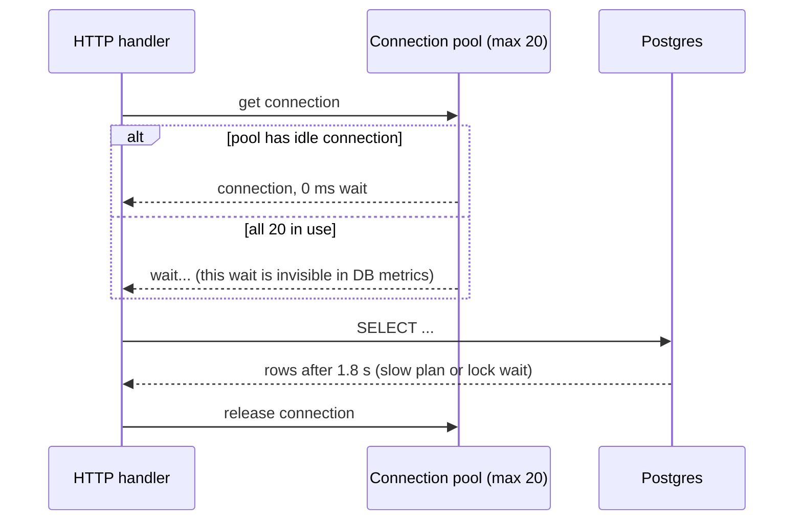

Application-side checks (Go `database/sql`): export `db.Stats()` as metrics and look at `WaitCount` and `WaitDuration`. If wait duration grows, the pool is too small or connections are held too long.

Database-side checks (PostgreSQL 17):

```sql
-- What is running now, longest first
SELECT pid, state, wait_event_type, wait_event,
       now() - query_start AS runtime, left(query, 100) AS query
FROM pg_stat_activity
WHERE state <> 'idle'
ORDER BY runtime DESC
LIMIT 20;

-- How many connections in each state
SELECT state, count(*) FROM pg_stat_activity GROUP BY state;

-- Who is blocked and who blocks them
SELECT blocked.pid AS blocked_pid, blocking.pid AS blocking_pid,
       left(blocked.query, 60) AS blocked_query, left(blocking.query, 60) AS blocking_query
FROM pg_stat_activity blocked
JOIN LATERAL unnest(pg_blocking_pids(blocked.pid)) AS b(pid) ON true
JOIN pg_stat_activity blocking ON blocking.pid = b.pid;

-- Why a query is slow (this runs the query: use with care on production)
EXPLAIN (ANALYZE, BUFFERS) SELECT ... ;
```

If `pg_stat_statements` is installed, find the heaviest queries (column names in PostgreSQL 13 and later):

```sql
SELECT calls, round(mean_exec_time::numeric, 1) AS mean_ms,
       round(total_exec_time::numeric, 0) AS total_ms, left(query, 80) AS query
FROM pg_stat_statements
ORDER BY total_exec_time DESC
LIMIT 10;
```

What results mean:

| Result | Meaning | Action |
| --- | --- | --- |
| Many sessions `idle in transaction` | Application opened a transaction and did not finish it, holding locks | Find and fix the code path, set `idle_in_transaction_session_timeout` |
| `wait_event_type = Lock` with a blocker | Lock contention | Cancel the blocker (`SELECT pg_cancel_backend(pid)`) if safe, then fix the long transaction |
| `EXPLAIN` shows `Seq Scan` on a large table where an index was expected | Missing index or a stale statistics or plan change | `ANALYZE table`, add an index (use `CREATE INDEX CONCURRENTLY`) |
| Connections near `max_connections` | Too many clients | Use a pooler (PgBouncer, a proxy that shares a few real DB connections among many clients), cap pool sizes per instance |
| App pool wait high but DB looks idle | Pool too small or connections leaked | Check for missing `rows.Close()`, raise pool size carefully |
| Many near-identical queries per request | N+1 query problem | Batch or join, see [[N+1 Query Problem]] |

Deeper: [[Debugging Database Performance]], [[Query Plans and EXPLAIN]], [[Connection Pooling]].

> [!warning] Common mistake
> Raising the pool size when the database is already saturated. More connections means more concurrent queries fighting for the same CPU and disk, so latency gets worse, not better.

### 3.6 Cause C: Blocked workers, lock contention and goroutine buildup

In plain words: the CPU is idle and the database is quiet, but requests still wait. Usually something inside the process blocks: a mutex held during I/O, a full worker pool, an unbuffered channel nobody reads, or goroutines piling up.

**Step by step:**
1. Check `go_goroutines`: is it climbing and never falling?
2. Dump goroutines with pprof (`debug=1`) and look for thousands stuck on the same line.
3. If they wait on `sync.(*Mutex).Lock`, a mutex (a lock only one goroutine can hold) is held too long, often during slow I/O.
4. If they wait on `chan receive` or `chan send`, a channel has nobody on the other end.

```bash
# Goroutine count and where they are blocked (Go with pprof)
curl -s "http://localhost:6060/debug/pprof/goroutine?debug=1" | head -n 40
go tool pprof -top http://localhost:6060/debug/pprof/goroutine

# Mutex and blocking profiles (need runtime.SetMutexProfileFraction and runtime.SetBlockProfileRate enabled)
go tool pprof -top http://localhost:6060/debug/pprof/mutex
go tool pprof -top http://localhost:6060/debug/pprof/block
```

```text
# Goroutines growing steadily (Go runtime metric from the Prometheus client)
go_goroutines{service="api"}
deriv(go_goroutines{service="api"}[15m]) > 0
```

What results mean: thousands of goroutines blocked on the same line (for example `sync.(*Mutex).Lock` or `chan receive`) point to the contention or leak. A goroutine count that climbs and never falls is a leak, and eventually leads to memory exhaustion. See [[Benchmarks, Profiling and Tracing]].

### 3.7 Cause D: Cache problems

In plain words: a cache hides slow work. If the cache is empty, cold, evicting too much, or one key is overloaded, the slow work returns all at once and latency jumps.

**Step by step:**
1. Check the hit ratio from `redis-cli INFO stats`. A sudden drop means many requests now go to the database.
2. Check `evicted_keys`: rising means Redis is full and throwing keys out.
3. Check `SLOWLOG GET 10`: a slow command blocks Redis, which handles one command at a time.
4. Fix now: warm the cache and protect the database. Later: add TTL jitter (random extra seconds on expiry so keys don't all expire together) and request coalescing (one request refills a key while others wait).

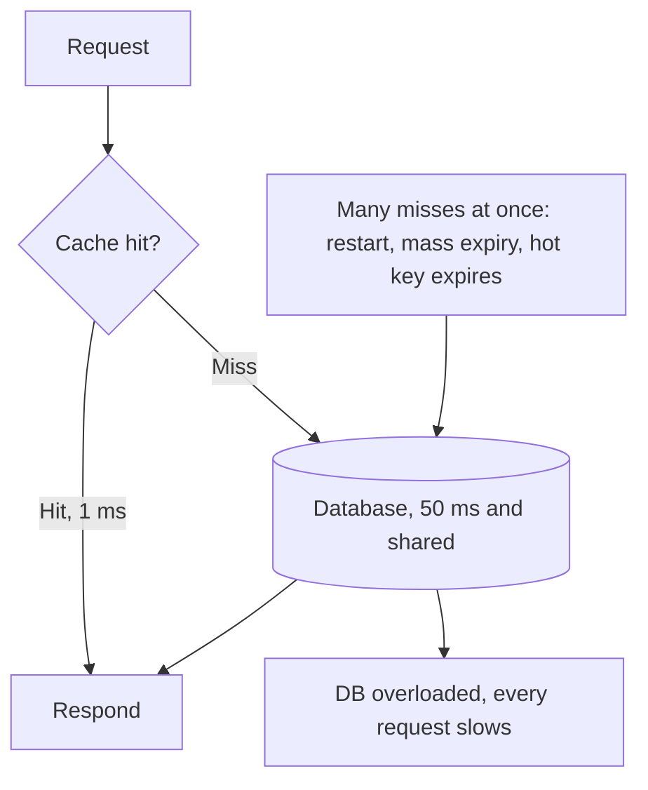

```bash
redis-cli -h redis-host INFO stats | grep -E 'keyspace_hits|keyspace_misses|evicted_keys|instantaneous_ops_per_sec'
redis-cli -h redis-host INFO memory | grep -E 'used_memory_human|maxmemory_human|mem_fragmentation_ratio'
redis-cli -h redis-host --latency            # round-trip time, Ctrl-C to stop
redis-cli -h redis-host --latency-history -i 5
redis-cli -h redis-host SLOWLOG GET 10       # slowest commands
redis-cli -h redis-host --bigkeys            # scans the keyspace, use off-peak
```

What results mean:

| Result | Meaning | Action |
| --- | --- | --- |
| Hit ratio dropped (`keyspace_hits / (hits + misses)`) | Cold cache, mass expiry, or a key-format change | Warm up, add TTL jitter, protect DB with a request coalescing lock |
| `evicted_keys` rising | Memory limit reached | Increase memory, shorten TTLs for low-value keys, check big keys |
| `SLOWLOG` shows `KEYS`, `SMEMBERS` on huge sets, or large `LRANGE` | Slow commands block the single-threaded server | Replace with `SCAN` and smaller structures |
| `--latency` shows spikes of tens of ms | Fork for persistence, swapping, or a slow command | Check persistence settings and memory headroom |

Deeper: [[Cache Failure Modes - Stampede, Avalanche, Penetration, Hot and Big Keys]] and [[Redis in Production - Memory, Latency, Security]].

### 3.8 Cause E: Slow dependency, retries and missing timeouts

In plain words: your service is only as fast as the slowest service it waits for. Without timeouts, one slow dependency ties up your workers until you run out. With careless retries, you triple the load on a service that is already struggling.

**Step by step:**
1. In a slow trace, find the long span and the service it calls.
2. Compare outbound p99 per target: which dependency got slower?
3. Compare outbound calls to inbound requests: if the ratio rose, retries or a loop are multiplying calls.
4. Mitigate: open the circuit breaker, cut retries, serve cached or default data.
5. Later: every outbound call gets a timeout, a few retries with backoff and jitter (random wait), and a bulkhead (its own limited pool of workers).

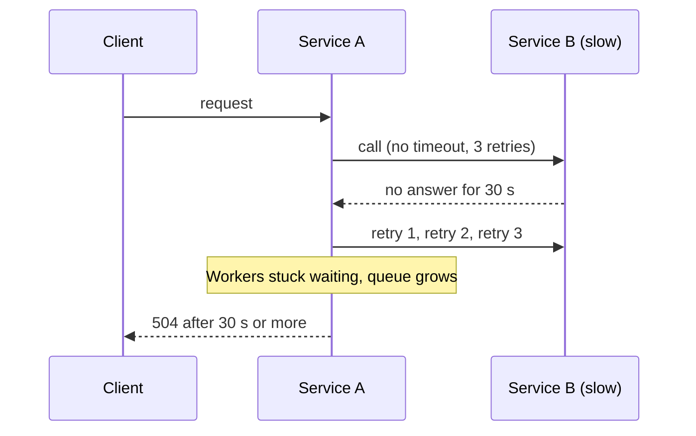

Checks:

- In a trace, find the span that is long and see which service it calls.
- From your service's metrics, compare latency of outbound calls per target:

```text
histogram_quantile(0.99,
  sum by (le, target) (rate(http_client_request_duration_seconds_bucket{service="api"}[5m])))
```

- Check retry volume: a rising ratio of outbound requests to inbound requests means retries are amplifying load.
- Verify every outbound call has a timeout, a budget smaller than the caller's own deadline, and retries with backoff and jitter. See [[Timeouts, Retries and Backoff]].

Mitigations: open the circuit breaker ([[Circuit Breaker]]), reduce or stop retries, serve stale or default data, bulkhead the dependency so it cannot consume every worker ([[Bulkheads and Concurrency Limits]]), shed non-essential traffic ([[Load Shedding and Graceful Degradation]]).

### 3.9 Cause F: Network, DNS, TLS and the load balancer

In plain words: the request spends its time before it even reaches your code, or between your pods.

**Step by step:**
1. `dig +stats`: is the DNS "Query time" hundreds of milliseconds?
2. `curl -w`: is `connect` large (network or load balancer) or `tls` large (handshake)?
3. `ss -ti`: are there many retransmits (packets sent again because they were lost)?
4. `mtr`: which hop on the path adds the delay?

```bash
# DNS resolution time and answer (look at "Query time")
dig +stats api.example.com

# TCP connection states and retransmits on a host
ss -s
ss -ti dst :443 | head          # per-connection round-trip time (rtt) and retransmits

# TLS handshake and certificate chain
openssl s_client -connect api.example.com:443 -servername api.example.com </dev/null

# Where on the path is time lost
mtr -rwc 50 api.example.com
```

What results mean:

| Result | Meaning | Action |
| --- | --- | --- |
| `Query time` of hundreds of ms, or intermittent timeouts | DNS resolver problem | Check resolver health, caching, `ndots` setting in Kubernetes (how many dots a name needs before it is tried as-is), CoreDNS (Kubernetes's DNS server) load |
| Large `connect` in `curl -w` | Network path or LB overloaded | Check LB metrics (active connections, surge queue), cross-zone traffic |
| Large `tls` portion | Handshake cost, no session reuse, or expired or odd certificate chain | Enable keep-alive (reuse open connections) and TLS session resumption (skip most of the handshake on reconnect) |
| High retransmits in `ss -ti` | Packet loss | Check node network, noisy neighbour (another workload hogging the same machine), MTU (the largest packet size allowed) |
| New connection per request | No keep-alive or connection reuse in the HTTP client | Reuse a shared `http.Client` |

Deeper: [[Network Debugging Toolkit - dig, curl, ss, tcpdump]].

### 3.10 Fix, proper fix, prevention

**In plain words:** for each cause: the quick fix today, the real fix this week, and the guard so it doesn't come back.

| Cause | Immediate fix | Proper fix | Prevention |
| --- | --- | --- | --- |
| Bad deploy | Roll back | Fix and re-release with canary (send the new version to a small share of traffic first) | Canary and automatic rollback on SLO burn, see [[Deployment Strategies - Rolling, Blue-Green, Canary]] |
| CPU saturation or throttling | Scale out, raise or drop CPU limit | Profile and optimize the hot path | Autoscaling on CPU or request rate, load tests, see [[Autoscaling]] |
| Slow query | Kill the long query, add index concurrently | Rewrite query, add right index, fix plan | Query review in CI, slow query log, `pg_stat_statements` alerts |
| Lock or idle transaction | Cancel the blocker | Shorten transactions, set timeouts | `lock_timeout` and `idle_in_transaction_session_timeout`, see [[Locking - Optimistic vs Pessimistic]] |
| Pool exhaustion | Restart is a stopgap, add capacity | Right-size pool, fix connection leaks, add PgBouncer | Alert on pool wait time |
| Cache miss storm | Warm cache, rate-limit the origin | Request coalescing, TTL jitter, stale-while-revalidate | Cache hit ratio alert, load test with a cold cache |
| Slow dependency | Circuit break, degrade | Timeouts, bounded retries with backoff and jitter, bulkheads | Dependency SLOs, chaos tests |
| Retry storm | Disable or cap retries, shed load | Retry budgets | Retry budget metric |
| Network or DNS | Switch resolver, restart affected component | Fix root path issue | Synthetic probes per region |

## 4. Worked example 🟡

**Incident: checkout latency after a "small" release (an illustrative walkthrough, not a real company's log).**

Setup: a Go `orders-api` behind an ALB (AWS's Application Load Balancer), Postgres 17 with PgBouncer, Redis cache, and a call to a `pricing` service. Normal p99 is 300 ms.

| Time | Event |
| --- | --- |
| 14:02 | Release `orders-api v2.14` finishes rolling out to all pods. |
| 14:09 | Alert: p99 of `/checkout` above 1 s for 5 minutes. The on-call engineer, Asha, is paged. |
| 14:11 | Asha opens the dashboard. p50 is 120 ms (was 90), p99 is 3.8 s. Error rate 2% (504). Only `/checkout` is slow. Traffic is normal. |
| 14:12 | First check, "what changed": the deploy 10 minutes earlier. She declares an incident in the channel and names herself commander. |
| 14:14 | Mitigation: `kubectl rollout undo deployment/orders-api -n prod`. This takes 3 minutes to roll. |
| 14:19 | p99 falls to 320 ms. Error rate returns to baseline. Status update: "Mitigated by rollback, investigating cause." |
| 14:25 | Cause search on a staging copy with the v2.14 image. A trace shows `/checkout` makes the `pricing` call once per cart item (the new code called pricing inside a loop). |
| 14:40 | Metrics confirm: outbound requests to `pricing` went up 12 times after the deploy; `pricing` p99 rose from 40 ms to 900 ms because of the extra load. |
| 15:30 | Fix: batch the pricing calls into one request, add a 300 ms timeout on the pricing call, add a circuit breaker with fallback to cached prices. |
| 16:00 | Canary release at 5% for 30 minutes shows p99 at 280 ms. Full rollout. |
| Next day | Postmortem written. Actions: alert on outbound call count per inbound request, add a load test for checkout with a 20-item cart, require timeouts on all outbound calls in code review. |

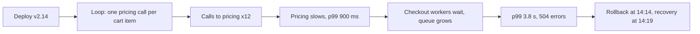

Lessons: mitigation took 10 minutes from the page; diagnosis finished later in a calm environment. The trace and the outbound-call metric found the cause. The missing timeout and the lack of a load test were the contributing factors.

### Whiteboard version

If an interviewer says "your API suddenly got slow, what do you do?", draw this and talk through it:

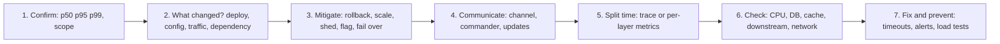

Say: "Latency is a sum, so I find which piece grew. I mitigate first, usually by rolling back, then use a trace to see whether the extra time is CPU, the database, the cache, a downstream call, or the network."

## 5. Variants and comparison 🟡

| Symptom pattern | Most likely cause | First check |
| --- | --- | --- |
| Started exactly at a deploy time | Bad release | Rollout history, diff |
| Slow only on one route | Query, N+1, one downstream | Trace for that route |
| Slow for everyone, CPU high | CPU or GC | `kubectl top`, pprof |
| Slow for everyone, CPU low | Wait: DB, pool, lock, dependency | Pool wait, `pg_stat_activity`, traces |
| Slow at fixed times each day | Cron or batch job, backups, traffic peak | Job schedule, DB load |
| Slow gradually over days | Data growth, leak, missing index | Table sizes, memory and goroutine trend |
| Slow only in one region or AZ | Infrastructure or network | Per-zone metrics, cloud status |
| Slow only for some customers | Large data per tenant, hot partition | Per-tenant latency |
| Slow plus rising errors and retries | Retry storm | Retry rate, shed load |

Related playbooks in this folder cover the neighbouring problems: [[Playbook - Error Rate Spike (5xx)]], [[Playbook - Database Overload and Connection Exhaustion]], [[Playbook - CPU Saturation]], [[Playbook - Memory Leak and OOMKilled]], [[Playbook - Queue and Kafka Consumer Lag]], and [[Playbook - Cache Outage and Stampede]].

### High latency vs error spike vs CPU saturation 🟡

| | High latency (this playbook) | Error rate spike (5xx) | CPU saturation |
| --- | --- | --- | --- |
| Main symptom | Requests are slow | Requests fail | CPU near 100% or throttled |
| First graph | p50 / p99 per route | 5xx rate per route and pod | CPU and throttling per pod |
| Often caused by | Waiting: DB, locks, pools, slow dependencies | Bad deploy, crashing pods, failing dependency | Hot code, GC, too little capacity |

## 6. Trade-offs and when not to use 🟡

- **Rollback vs roll forward.** Rolling back is fastest, but not safe if the release included an irreversible database migration. Check migration compatibility first, see [[Rollback and Safe Migrations]].
- **Scaling out as a mitigation.** It works for stateless CPU or queue problems. It makes things worse if the bottleneck is the database or a lock, because more instances add more load on it.
- **Load shedding.** It protects the core path but rejects some real users. Decide in advance what to shed (for example recommendations before checkout).
- **Killing queries.** It frees resources but may abort legitimate work. Prefer to cancel the clearly runaway query and keep a record.
- **Profiling in production.** CPU profiles have small overhead (commonly a few percent, an estimate), but `EXPLAIN ANALYZE` actually executes the query and mutation queries will make changes. Use a read replica or a transaction you roll back for writes.
- **When this playbook does not fit.** If the main symptom is errors rather than slowness, use the 5xx playbook. If one pod is restarting, look at OOM and crash loops. If latency is slow only in synthetic tests from one office, suspect the test path before the service.

> [!tip] Remember
> The safest first action is the one you can undo in minutes: roll back, flip a flag, or scale out.

## 7. In production 🔴

> 🟡 → 🔴 **You now know** how to confirm a slowdown, find which step grew, and fix each cause from CPU to network. **Next is the advanced part**: dashboards and alerts that make this fast, and the theory behind the tail (histograms, queueing, coordinated omission, Little's Law, retries, Go GC) that interviewers ask about.


Dashboards and alerts that make this playbook faster:

- A single service dashboard with the golden signals: latency (p50, p95, p99), traffic, errors, saturation (CPU, memory, pool use, queue depth). See [[Latency, Percentiles and Bottleneck Analysis]] and [[Metrics and Prometheus]].
- Alert on user-facing symptoms and SLO burn rate, not on every cause. For example, alert when the p99 SLO budget burns fast, not when CPU passes 70%. See [[SLIs, SLOs, SLAs and Error Budgets]] and [[Alerting and On-Call]].
- Deploy markers on every graph so "did this start at a deploy?" is answered in one glance.
- Exemplars or trace IDs in logs, so a slow request in the logs links to its trace.
- Runbook links in each alert, with the first five minutes copied into it.

Example alert (Prometheus alerting rule, thresholds are examples):

```yaml
groups:
  - name: api-latency
    rules:
      - alert: ApiP99LatencyHigh
        expr: |
          histogram_quantile(0.99,
            sum by (le) (rate(http_request_duration_seconds_bucket{service="api"}[5m]))) > 1
        for: 10m
        labels:
          severity: page
        annotations:
          summary: "API p99 above 1s for 10 minutes"
          runbook: "Playbook - High Latency"
```

Common production pitfalls: dashboards that show averages only, no per-route breakdown, no traces for the slow path, timeouts set longer than the caller's own timeout (so the work continues after the user is gone), and a pool size that was never tuned after the instance count grew.

## 8. Deep dive 🔴

### 8.1 Why averages lie and percentiles must be computed from histograms

**In plain words:** you can't average the "slowest 1%" of ten servers to get the total. You must combine the raw counts first, then compute it.

You cannot average percentiles across instances. The correct approach is to export histogram buckets, sum the buckets across instances (`sum by (le)`), then compute `histogram_quantile`. The quantile is an estimate whose accuracy depends on bucket boundaries: if your buckets jump from 1 s to 5 s, a reported p99 of "somewhere between" is only as precise as that gap. Choose buckets around your SLO threshold.

### 8.2 Queueing theory in one paragraph

**In plain words:** a server that is 50% busy has short waits. At 90% busy, waits are many times longer. Near 100%, they explode.

As utilization of a server approaches 100%, waiting time grows sharply, not linearly. For a simple single-queue model the wait grows roughly like utilization divided by (1 minus utilization) (a standard M/M/1 result).

Going from 50% to 90% busy makes the queue about nine times longer, and from 90% to 99% about eleven times longer again. This is why a system "suddenly" gets slow at high load even though traffic rose only a little. Keep headroom, see [[Performance Engineering and Capacity Planning]].

### 8.3 Coordinated omission

**In plain words:** if a test waits for each answer before sending the next request, it never sees the requests that would have waited during a stall. The test looks better than real life.

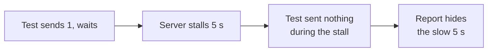

If your load test waits for each response before sending the next request, a stall hides the requests that would have been sent during the stall, and the measured tail looks better than reality. Use load tools that send at a fixed rate (open-loop), and record latency from the intended send time.

### 8.4 Little's law for finding pool sizes

**In plain words:** how many requests are in progress = requests per second x seconds each takes. Use it to size worker pools.

In-flight requests = arrival rate x average time in system. If you receive 500 requests per second and each holds a database connection for 40 ms, the average number of busy connections is 500 x 0.04 = 20.

A pool of 20 has no margin, and any slowdown in the query time makes requests queue. This also shows why a slow query so quickly empties a pool.

### 8.5 The retry amplification problem

**In plain words:** if every layer retries 3 times, one user click can become 27 calls at the bottom. Retry in one place only.

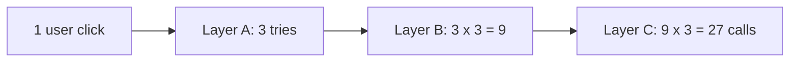

If each of 3 layers makes up to 3 attempts, one user request can become 27 requests to the bottom layer. Fix it with retries only at one layer, a retry budget (for example no more than 10% extra requests), exponential backoff with jitter, and idempotency so retries are safe. See [[Timeouts, Retries and Backoff]].

### 8.6 GC and the tail in Go

**In plain words:** Go's memory cleaner sometimes makes busy requests help clean up. That adds small pauses to the slowest requests.

A Go GC cycle runs mostly concurrently, but allocation-heavy services can see assists (goroutines forced to help the GC) that add latency to individual requests. Symptoms: p99 rises while p50 stays flat, and `gctrace` shows frequent cycles.

Remedies: reduce allocations (reuse buffers with `sync.Pool`, avoid needless conversions), and set a soft memory limit with `GOMEMLIMIT` to avoid both OOM and over-aggressive collection.

## 9. Interview questions 🔴

> [!question]- Your API's p99 doubled ten minutes ago. Walk me through what you do.
> Confirm with percentiles and find the blast radius (which routes, regions, customers). Check what changed: deploy, config, flag, traffic, dependencies. Mitigate before diagnosing: roll back the recent deploy, scale out if load-driven, shed load or open a circuit breaker if a dependency is slow.
>
> Communicate in an incident channel. Then split the request time using a trace or per-layer metrics (CPU, database, cache, downstream, network), fix the cause, and write a postmortem with prevention actions.

> [!question]- p50 is unchanged but p99 is ten times worse. What does that tell you?
> The slowdown affects a slice of requests, not all of them. Likely causes: one route or tenant, a slow shard or a lock, occasional GC pauses, a cache miss path, timeouts and retries on one dependency, or one bad pod.
>
> Break the percentile down by route, pod, and tenant, and look at traces of slow requests to find what they share.

> [!question]- The database CPU is fine, but the application shows database calls taking 2 seconds. Why?
> The time may be spent waiting for a connection from the application's pool, not in the database. Check pool wait metrics (`WaitDuration` in Go's `db.Stats()`), connections held in long transactions, and connection leaks (missing `rows.Close()`). Also check lock waits in `pg_locks` and `pg_stat_activity`, and network latency between the app and the database.

> [!question]- Why can scaling out make a latency incident worse?
> If the bottleneck is a shared resource, such as the database, a lock, or a slow dependency, more application instances send more concurrent requests to it, which raises its load and slows everything further.
>
> Scale out only when the bottleneck is stateless CPU or queueing at the app tier. Otherwise reduce load on the shared resource: shed traffic, cache, or cap concurrency.

> [!question]- Trap: "CPU is only at 60% so the service can't be CPU-bound." What can still be wrong?
> In Kubernetes a container with a CPU limit can be throttled by the CFS quota even while the node CPU is idle, and average usage hides bursts within each 100 ms period. Check `container_cpu_cfs_throttled_periods_total` against total periods and the `nr_throttled` counter in `cpu.stat`. Also, a single-threaded component (like Redis) can be saturated while overall machine CPU looks low.

> [!question]- How do retries and missing timeouts turn a small slowdown into an outage?
> Without timeouts, workers wait on the slow dependency and the pool of workers fills, so the service stops answering even unrelated requests. With retries, each failing call is multiplied, increasing load on the already weak dependency (a retry storm), and across several layers the multiplication compounds.
>
> The fix is deadlines on every call, bounded retries with backoff and jitter at one layer, circuit breakers and bulkheads.

> [!question]- How do you prove a fix worked and prevent a repeat?
> Compare p50, p95, p99 and error rate before and after, at the same traffic level, and keep the deploy marker on the graph. Roll out by canary with automatic rollback on SLO burn.
>
> Add the missing alert (for example outbound calls per inbound request), a load test that reproduces the pattern, and a code-review rule such as "every outbound call has a timeout". Record the actions in the postmortem and track them to completion.

## 10. Cheat sheet 🟢

- Four steps first: confirm and scope, check what changed, mitigate (rollback, scale, shed, flag, fail over), communicate.
- Latency is a sum: network, queue, CPU, database, cache, downstream. Find which piece grew.
- p50 and p99 both up means global slowdown; only p99 up means a slice, a tail or retries.
- `curl -w` splits DNS, connect, TLS, first byte and total; a trace shows which span is long.
- CPU: `kubectl top pod`, throttling ratio, `go tool pprof -top .../profile?seconds=30`.
- Database: `pg_stat_activity`, `pg_blocking_pids`, `pg_stat_statements`, `EXPLAIN (ANALYZE, BUFFERS)`, and the app pool wait time.
- Cache: `redis-cli INFO stats`, `--latency`, `SLOWLOG GET`, hit ratio and evictions.
- Dependencies: per-target outbound p99, retry volume, timeouts everywhere, circuit breakers, bulkheads.
- Network: `dig +stats`, `ss -ti`, `openssl s_client`, `mtr`.
- Scaling out does not help a database or lock bottleneck, and can hurt it.
- After the incident: postmortem, a new alert, a reproducing load test, and tracked actions.

## 11. Post-incident checklist 🟡

- [ ] Timeline written with exact times (detection, mitigation, recovery) and the time to detect and time to mitigate measured.
- [ ] Root cause and contributing factors identified, such as missing timeouts, missing alerts, or missing load tests.
- [ ] Customer impact quantified: how many users, how long, which routes, any lost orders.
- [ ] Postmortem written without blame and reviewed. See [[Postmortems and Root Cause Analysis]].
- [ ] Action items have owners and dates: alert improvements, timeouts, tests, runbook updates.
- [ ] This playbook updated with anything that was missing or wrong.
- [ ] Error budget impact recorded, see [[SLIs, SLOs, SLAs and Error Budgets]].

## Self-check 🟢🟡

🟢 Easy

> [!question]- Why look at p99 instead of the average?
> The average hides the slowest requests; p99 shows what the slowest 1 in 100 users feel.

> [!question]- What is the first thing to check after confirming the slowdown?
> What changed: deploys, config, flags, traffic, dependencies.

> [!question]- A deploy 10 minutes ago lines up with the slowdown. What do you do?
> Roll it back first, then investigate.

🟡 Medium

> [!question]- p50 is flat, p99 jumped. Everything slow, or a slice?
> A slice: one route, tenant, shard, pod, GC pauses or retries on one dependency.

> [!question]- Database CPU is low but DB calls take 2 s in the app. Where is the time?
> Probably waiting for a connection from the app's pool, or waiting on a lock.

> [!question]- 400 requests per second each hold a connection for 50 ms. How many connections are busy on average?
> 400 × 0.05 = 20 (Little's Law), so a pool of 20 has no spare room.

## Links

- **Before this:** [[Production Debugging Playbook]], [[Incident Response]], [[Latency, Percentiles and Bottleneck Analysis]]
- **Next:** [[Postmortems and Root Cause Analysis]], [[Alerting and On-Call]]
- **Compare with:** [[Playbook - Error Rate Spike (5xx)]], [[Playbook - CPU Saturation]], [[Playbook - Database Overload and Connection Exhaustion]]
- **Debugging deep dives:** [[Debugging Database Performance]], [[Debugging Memory Leaks and OOMs in Go]], [[Distributed Tracing with OpenTelemetry]], [[Network Debugging Toolkit - dig, curl, ss, tcpdump]], [[Benchmarks, Profiling and Tracing]]
- **Databases and caching:** [[Query Plans and EXPLAIN]], [[Connection Pooling]], [[N+1 Query Problem]], [[Cache Failure Modes - Stampede, Avalanche, Penetration, Hot and Big Keys]], [[Redis in Production - Memory, Latency, Security]]
- **Resilience:** [[Timeouts, Retries and Backoff]], [[Circuit Breaker]], [[Bulkheads and Concurrency Limits]], [[Load Shedding and Graceful Degradation]], [[Autoscaling]], [[Deployment Strategies - Rolling, Blue-Green, Canary]], [[Rollback and Safe Migrations]]

### Watch on YouTube

- [19 Milliseconds That Decide Wall Street / High-Frequency Trading & Latency Explained ](https://www.youtube.com/watch?v=dxlqEGGw3ns) · Axiom Explained · 9 min · 1,600 views
