# Playbook - Memory Leak and OOMKilled

> [!summary] TL;DR
> Pods restart with `OOMKilled` (exit code 137), or memory climbs on a graph until something dies.
>
> In the first five minutes, confirm which container is dying, check what changed, and mitigate by rolling back, raising the limit temporarily, or adding replicas. Then find the cause with a heap profile diff.
>
> This playbook is the checklist to run while the pager is ringing; [[Debugging Memory Leaks and OOMs in Go]] is the theory behind it.

> [!abstract] Core idea
> - Separate three different problems that look the same: a real leak (memory grows with time), a load-driven spike (memory grows with traffic), and a limit that was set too low (steady memory above the limit).
> - Mitigate before you diagnose. A restart loop hurts users now; a root cause can wait 30 minutes.
> - The kernel kills the container when the cgroup is over its memory limit and cannot reclaim enough. Kubernetes only reports it afterwards.
> - Two heap profiles taken minutes apart and diffed answer "what grew" better than reading code.
> - Prevention is a memory limit with headroom, `GOMEMLIMIT` below that limit, bounded caches and queues, and an alert that fires on the trend, not only on the kill.

## Start here: the basics 🟢

> [!info] How to read this note (pick your level)
> - 🟢 **New to this?** Read "From zero" below, then sections 1, 2 and the cheat sheet (10). Stop there, that is a full first pass.
> - 🟡 **Know the basics?** Add section 3 (how an OOM kill happens), 4 (first 5 minutes and the incident), 5 and 6.
> - 🔴 **Interview / SDE-3 prep?** Add 7, 8 and 9. Headings are tagged 🟢🟡🔴 so you always know where you are.

**From zero, in 60 seconds** 🟢

Every running app uses **memory** (RAM) to hold the things it is working on.
In Kubernetes, each app gets a fixed amount it may use. That is its **limit**.
A **memory leak** is when an app keeps grabbing memory and never gives it back.
Memory use creeps up and up, slowly, for hours.
When it hits the limit, the system kills the app at once. That is **OOMKilled** (Out Of Memory, killed).
The app restarts with clean memory, creeps up again, and dies again.

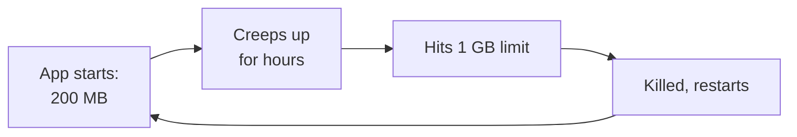

Not every memory problem is a leak. Sometimes the app just needs more for a big job, or the limit is set too low.

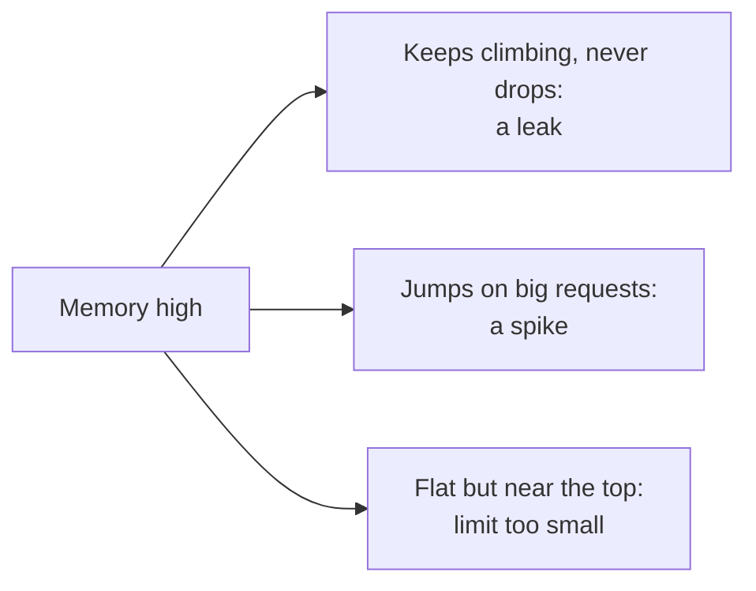

The rest of this note is just these 3 questions:
1. Is it a leak, a spike, or a limit that is too small?
2. How do you stop the crashes right now?
3. Which code is holding the memory?

**The problem in one story.**
Your order service runs fine all morning.
Slowly, its memory use creeps up, a few MB every minute.
At lunch peak it hits its allowed maximum, and the system kills it instantly.
It restarts, creeps up again, and dies again, while customers see errors.

**Words you need first**

| Word | Plain meaning | Tiny example |
| --- | --- | --- |
| Pod / container | One running copy of your service, packaged with its own limits | `orders-7d9f-abc` |
| Memory limit | The most RAM a container is allowed to use | `limits.memory: 512Mi` |
| Heap | Memory your program allocates while running | A map that holds cached users |
| Memory leak | Memory that is never freed, so usage keeps growing | A cache map that only adds, never deletes |
| OOM killer | The Linux kernel part that kills a process when memory runs out | Sends SIGKILL to your app |
| OOMKilled / exit 137 | How Kubernetes reports that kill afterwards | `Reason: OOMKilled  Exit Code: 137` |
| Heap profile | A snapshot of which code holds which memory | `go tool pprof heap.out` |
| Rollback | Going back to the previous working version | Redeploy yesterday's image |

**Picture it**

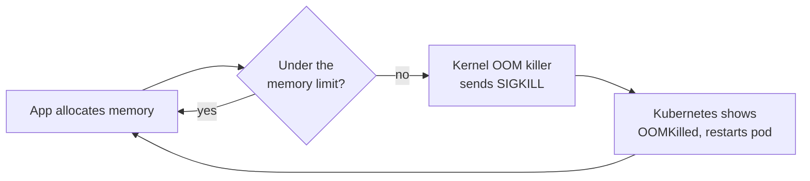

**Analogy.** A pod is a hotel room with a maximum number of guests. A leak is guests who never check out; eventually security throws someone out.
Where it breaks: you can see hotel guests, but you can only see heap memory through a profile, and the "guard" picks a victim by score, not guilt.

**How the rest of this note builds up**

- First, why memory incidents happen and what users feel (section 1), and the leak vs spike vs too-low-limit model (section 2).
- Then how an OOM kill actually happens in the kernel and the signals to read (section 3).
- Then the hands-on run: first 5 minutes, commands and heap diffs (section 4), plus variants and trade-offs (sections 5-6).
- Finally the SDE-3 depth: production alerts, kernel scoring, RSS vs heap, memory pprof cannot see, and Go leak patterns (sections 7-8).

> [!tip] Remember
> Memory that only grows is a leak; mitigate first (rollback, more room, more pods), then diff two heap profiles to find it.

## 1. Why it exists 🟢

Memory incidents are slow, quiet and then sudden. A service leaks 20 MB a minute, nobody notices for hours, and then pods restart every few minutes at peak traffic.

**Symptoms you will see:**
- `kubectl get pods` shows `RESTARTS` climbing and status `OOMKilled` or `CrashLoopBackOff`.
- A memory graph with a sawtooth shape: it rises for hours, drops to zero, and rises again.
- Latency rises before the kill, because the garbage collector runs constantly as the heap nears the limit.
- Evicted pods on a node (a different problem: the whole node ran short of memory).

**User impact:**
- In-flight requests are dropped when the pod dies (connection reset, 502 or 503 from the load balancer).
- When several pods die together, the remaining pods take more traffic, grow faster and die too. This is a **cascading failure**.
- A restart loop with exponential back-off (`CrashLoopBackOff`, up to 5 minutes between tries) can leave you under capacity.

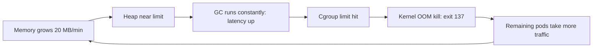

> [!tip] Remember
> The pod dying is the last step of the story. The first signs are rising latency and rising memory long before.

## 2. Mental model 🟢

Think of a pod as a hotel room with a fixed number of guests allowed (the memory limit). A **leak** is guests who check in but never check out. A **spike** is a convention arriving for one night.

A **too-low limit** is a room that was always too small.

The security guard (the kernel OOM killer) does not negotiate: when the room is over capacity, someone is thrown out, and it is often the process that happened to be allocating.

Where the analogy breaks down: guests in a hotel are visible, but heap memory is only visible through a profile. And the guard picks a victim by a score, not by who is guilty.

### The three situations

**In plain words:** three problems end the same way (the app gets killed). The shape of the memory graph tells you which one it is.

| Situation | Memory shape | Cause | Typical fix |
| --- | --- | --- | --- |
| Leak | Rises with time, drops only on restart | Goroutines stuck, unbounded map, pinned slices, listeners never removed | Fix the code |
| Load-driven spike | Rises with traffic, drops when traffic drops | Large request bodies, big result sets, many concurrent requests | Bound concurrency, stream data, scale out |
| Limit too low | Flat but near the limit from startup | Limit set below the real working set | Raise the limit, set requests equal to limits |

> [!warning] Common mistake
> Raising the limit and calling it fixed. If the shape is a leak, a bigger limit only makes the pod die later and at a worse time.

## 3. How it works 🟡

### How an OOM kill actually happens

**In plain words:** Every container lives in a **cgroup**, a kernel group that tracks and caps its resources.

When the container's memory reaches the cap and the kernel cannot free enough (page cache that can be dropped is freed first), the kernel's **OOM killer** picks a process in that cgroup and sends it SIGKILL.

SIGKILL cannot be caught, so the process gets no chance to log or flush.

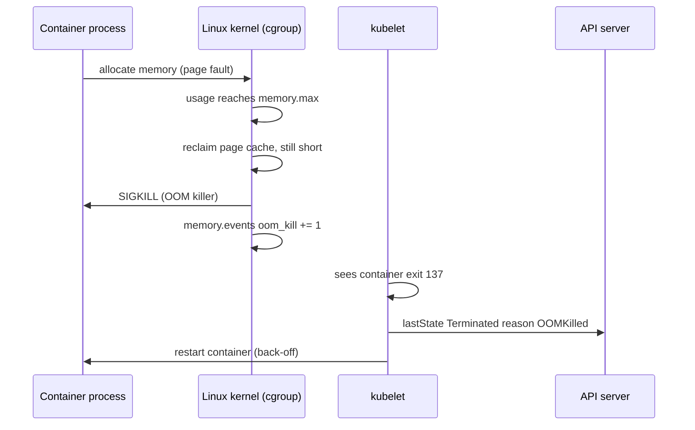

**Steps:**
1. The process allocates memory until the cgroup counter reaches `memory.max`.
2. The kernel tries to reclaim. Clean page cache is dropped; anonymous memory (heap, stacks) cannot be.
3. If reclaim fails, the OOM killer sends SIGKILL to the chosen process, usually the biggest in the cgroup.
4. The kubelet sees exit code 137 (128 + signal 9) and records `OOMKilled` in `lastState`.
5. The kubelet restarts the container with exponential back-off. Memory resets to zero, so the leak restarts too.

**Why it matters:** Exit code 137 means "killed by SIGKILL". It is usually OOM, but a failed liveness probe also ends in SIGKILL after the grace period. Always confirm the reason field.

> [!tip] Remember
> 137 plus reason `OOMKilled` is a memory kill. 137 with reason `Error` may be a probe kill or a manual kill.

### Container OOM versus node eviction

**In plain words:** either your app crossed its own limit, or the whole machine ran low and Kubernetes pushed some apps off. Different cause, different fix.

| | Container OOMKilled | Pod evicted |
| --- | --- | --- |
| Who decides | Kernel, cgroup limit | kubelet, node memory pressure |
| Trigger | One container over its own limit | The node is low on memory |
| Pod status | `OOMKilled` in lastState, container restarts | `Evicted`, pod is gone and rescheduled |
| Usual cause | Leak or low limit | Pods with no limits, or limits far above requests |
| Where to look | `kubectl describe pod` | `kubectl describe node`, Conditions: `MemoryPressure` |

### Which number to trust

**In plain words:** there are several "memory used" numbers and they disagree. The one the killer looks at is the one that matters.

Several memory numbers exist and they disagree. This is the most common source of confusion during an incident.

| Metric | What it is | Use it for |
| --- | --- | --- |
| `container_memory_working_set_bytes` | Memory in use minus easily reclaimable cache | The number closest to what triggers kills and evictions |
| `container_memory_rss` | Anonymous memory and swap cache | Heap and stacks, no file cache |
| `container_memory_usage_bytes` | Everything including page cache | Not reliable for alerts; includes cache |
| `go_memstats_heap_inuse_bytes` | Go heap spans in use | What the Go program thinks it holds |
| `process_resident_memory_bytes` | Process RSS | Compare with the heap to spot non-heap memory |

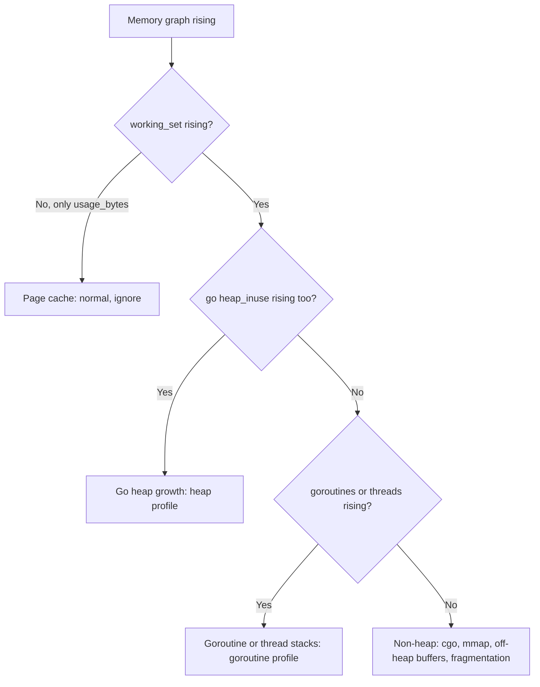

## 4. Worked example 🟡

### First 5 minutes

1. **Confirm and size the blast radius.** Which service, which pods, how many restarts, since when? Is it one pod or all of them? Are users seeing errors (check the error rate and 5xx dashboards)?
2. **Check what changed.** A deploy in the last day, a config change, a traffic jump, a new client, a dependency that got slower (slow dependencies keep requests in memory longer).
3. **Mitigate first.** Roll back if a deploy lines up with the start. If not, scale replicas so each pod takes less traffic, or raise the memory limit by 25 to 50 percent as a stopgap. Turn off the feature flag if you know the feature.
4. **Communicate.** Post in the incident channel: impact, what you are doing, next update time. Assign an incident commander if the incident is large (see [[Incident Response]]).

```bash
# 1. Which pods are restarting and why
kubectl get pods -n prod -l app=orders -o wide
kubectl describe pod orders-7d9f-abc -n prod | grep -A6 "Last State"
# Last State: Terminated  Reason: OOMKilled  Exit Code: 137

# 2. What changed
kubectl rollout history deployment/orders -n prod
kubectl get events -n prod --sort-by=.lastTimestamp | tail -20

# 3. Mitigate: rollback, or scale out
kubectl rollout undo deployment/orders -n prod
kubectl scale deployment/orders -n prod --replicas=10
```

### Real-world-style incident timeline

**In plain words:** a made-up but realistic incident, step by step, so you can see the playbook in order.

A checkout service in Go, 6 pods, memory limit 1 GiB. This is an illustrative scenario, not a real incident.

| Time | Event |
| --- | --- |
| 14:02 | A release ships a new "recent orders" cache, a `map[string][]Order` with no eviction |
| 14:40 | Memory per pod climbs from 300 MiB to 450 MiB. No alert fires |
| 17:30 | Evening peak. p99 latency rises from 120 ms to 900 ms (GC working hard) |
| 17:45 | First pod OOMKilled. Alert `PodRestarting` fires; on-call paged |
| 17:48 | On-call confirms `OOMKilled` and sees all 6 pods restarting every 25 to 40 minutes |
| 17:50 | Release at 14:02 matches the start of the climb. Rollback started |
| 17:56 | Rollback complete. Restarts stop. Memory flat at 310 MiB |
| 18:30 | Heap diff on a canary with the old build and the new build shows `recentOrders` growing |
| Next day | Cache replaced with an LRU capped at 10,000 entries. Alert on memory trend added |

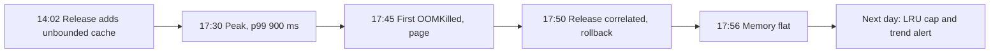

> [!tip] Remember
> The rollback took 6 minutes and ended the impact. Finding the exact line took another 35. Mitigate first.

### Whiteboard version

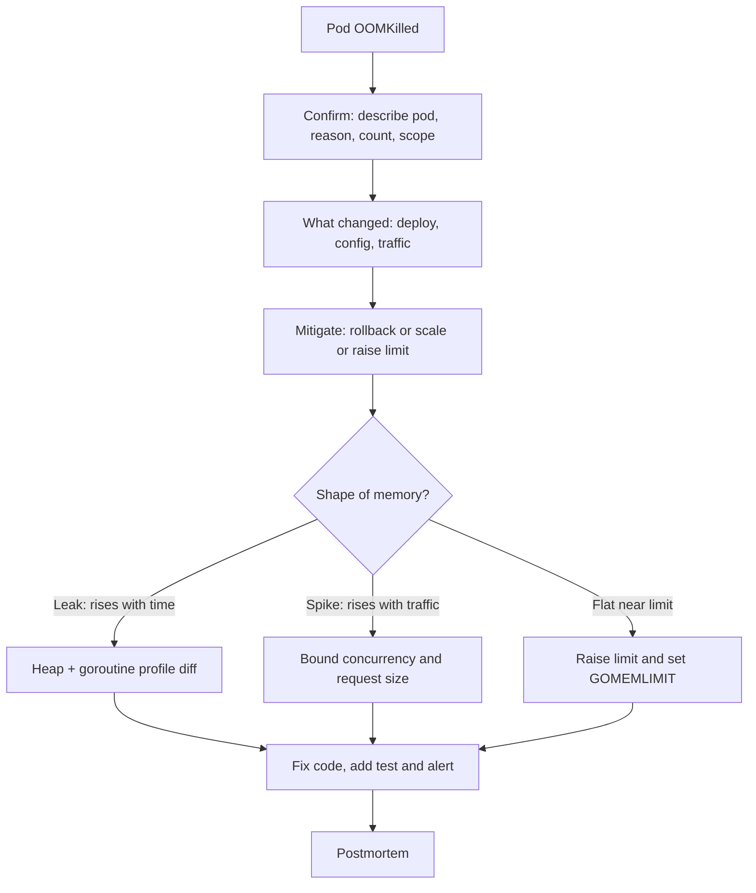

## 5. Variants and comparison 🟡

### Diagnosis flowchart: from symptom to cause

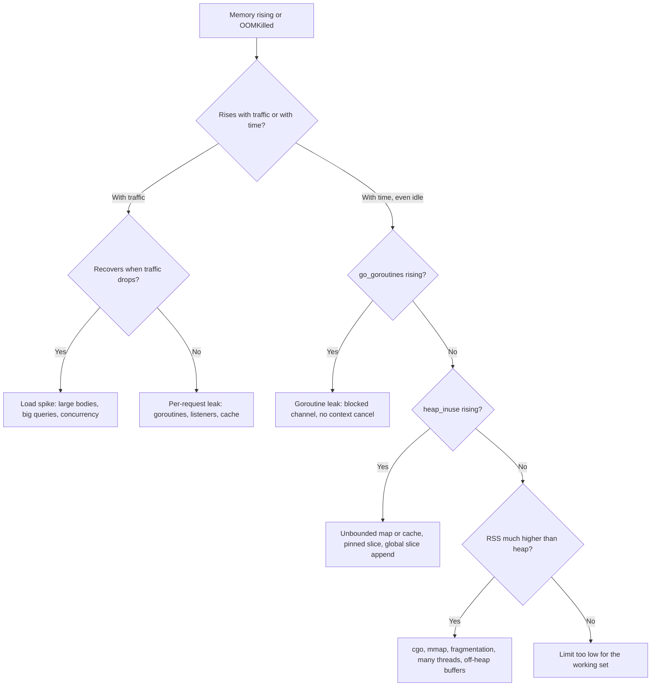

### Investigation steps for each likely cause

**In plain words:** one row per suspect: where to look, what to type, and what the answer means.

| Cause | Where to look | Command or query | What the result means |
| --- | --- | --- | --- |
| Goroutine leak | `go_goroutines` flat-lining up | `curl 'localhost:6060/debug/pprof/goroutine?debug=2' \| less` | Thousands of goroutines at the same stack line: that line is blocked forever |
| Unbounded cache or map | Heap profile | `go tool pprof -sample_index=inuse_space -base heap1.pb.gz heap2.pb.gz` | The top entries are what grew between snapshots |
| Large responses or bodies | Response size histogram (metric name is an example), heap profile under load | `topk(5, rate(http_response_size_bytes_sum[5m]) / rate(http_response_size_bytes_count[5m]))` | A few endpoints return huge payloads |
| Non-heap memory | RSS minus heap | `process_resident_memory_bytes - go_memstats_heap_sys_bytes` | A large gap means cgo, mmap, or stacks |
| Limit too low | Working set at idle versus limit | `container_memory_working_set_bytes / container_spec_memory_limit_bytes` | Ratio above 0.8 at idle: raise the limit |
| Node pressure | Node conditions | `kubectl describe node NODE \| grep -A5 Conditions` | `MemoryPressure True` means evictions, not OOMKilled |

### Dashboards and PromQL

**In plain words:** ready-made graph queries: memory over time, restarts, and how close each pod is to its limit.

```promql
# Containers killed for OOM in the last hour (kube-state-metrics)
sum by (namespace, pod, container) (
  kube_pod_container_status_last_terminated_reason{reason="OOMKilled"}
) * on (namespace, pod, container) group_left()
  (increase(kube_pod_container_status_restarts_total[1h]) > 0)

# Working set as a fraction of the limit (alert at 0.9)
max by (pod) (container_memory_working_set_bytes{container!="", container!="POD"})
/
max by (pod) (kube_pod_container_resource_limits{resource="memory"})

# Linear projection: will memory reach the limit within 4 hours?
predict_linear(container_memory_working_set_bytes{container="orders"}[2h], 4 * 3600)
  > on (pod) group_left() kube_pod_container_resource_limits{resource="memory", container="orders"}

# Go goroutine count and heap in use
go_goroutines{job="orders"}
go_memstats_heap_inuse_bytes{job="orders"}
```

> [!warning] Common mistake
> Alerting on `container_memory_usage_bytes`. It includes page cache, so it looks full on healthy services that read a lot of files. Use the working set.

### Commands on the pod and node

**In plain words:** commands to see why a pod died and to grab a memory snapshot while it is still running.

```bash
# Live usage per container
kubectl top pod -n prod --containers -l app=orders

# Why was the previous container killed
kubectl get pod orders-7d9f-abc -n prod \
  -o jsonpath='{.status.containerStatuses[0].lastState.terminated}'

# Previous container logs (the one that died)
kubectl logs orders-7d9f-abc -n prod --previous --tail=100

# cgroup v2: current usage, limit, and the OOM counter (inside the container)
cat /sys/fs/cgroup/memory.current /sys/fs/cgroup/memory.max
cat /sys/fs/cgroup/memory.events      # look at: oom_kill N

# On the node: kernel log shows who was killed and the cgroup
dmesg -T | grep -i -E "killed process|out of memory"

# Take profiles through a port-forward (pprof on an internal port)
kubectl port-forward -n prod pod/orders-7d9f-abc 6060:6060 &
curl -s localhost:6060/debug/pprof/heap > heap1.pb.gz
sleep 600
curl -s localhost:6060/debug/pprof/heap > heap2.pb.gz
go tool pprof -sample_index=inuse_space -base heap1.pb.gz heap2.pb.gz
```

Inside `pprof`, use `top`, `list FuncName`, and `web` to see the growing allocation site.

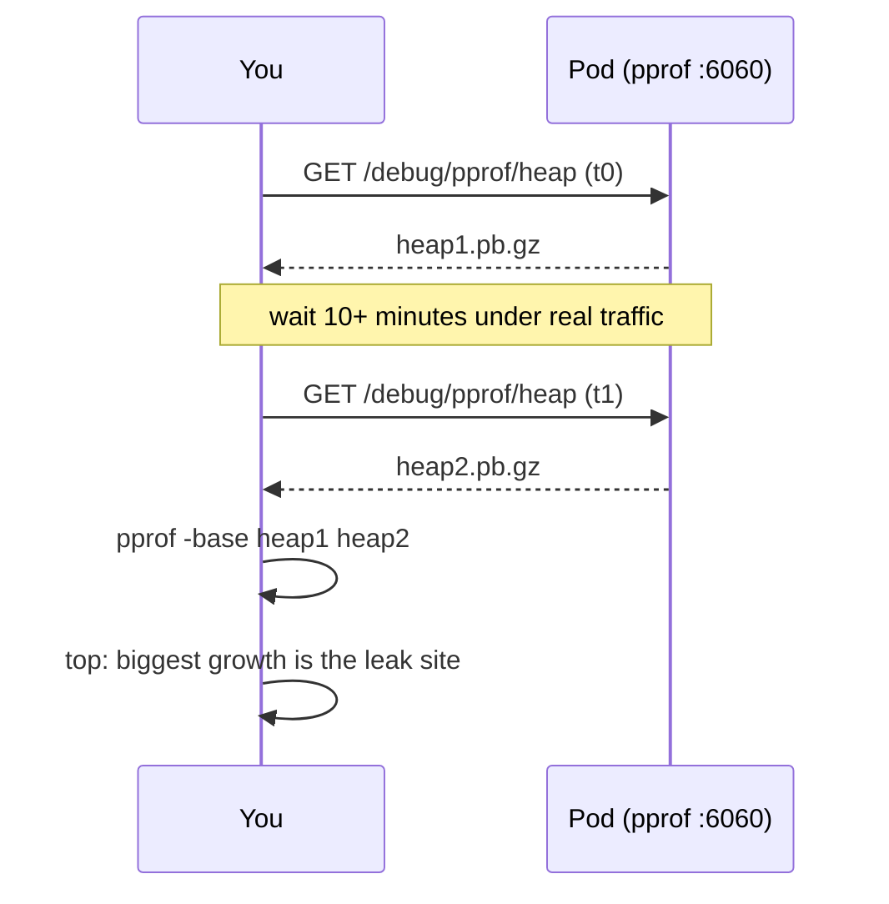

## 6. Trade-offs 🟡

### Fixes: immediate, proper, prevention

**In plain words:** quick fix today, real fix this week, and a guard so it doesn't happen again.

| Level | Action | Cost |
| --- | --- | --- |
| Immediate | Roll back; scale replicas; raise the limit; restart pods on a schedule (last resort) | Restart hides the leak and drops in-flight requests |
| Proper | Fix the leak (bound the cache, cancel contexts, stop goroutines), stream large payloads, bound concurrency | Needs a code change and a release |
| Prevention | `GOMEMLIMIT` at about 90 percent of the limit; memory request equal to limit; LRU caps; trend alert; load test with memory graphs | Some engineering time |

### Setting limits

**In plain words:** a limit protects the other apps on the machine, but too low a limit kills yours. The table weighs the choices.

| Choice | Benefit | Risk |
| --- | --- | --- |
| Request equal to limit (for full Guaranteed QoS, CPU request must equal CPU limit too) | Last to be evicted, predictable | Wastes memory if the limit is padded |
| Limit much above request (Burstable) | Efficient packing | Node pressure and evictions when many pods burst together |
| No limit | No OOMKilled for that pod | One leak can take down the whole node |

> [!warning] Common mistake
> A scheduled restart cron as the permanent fix. It hides the leak, and the leak speed will change with traffic until it kills the pod between restarts.

## 7. In production 🔴

### Go: GOMEMLIMIT and the limit

**In plain words:** tell Go how much memory it may use, so it cleans up harder before the system kills it.

Set `GOMEMLIMIT` so the garbage collector works harder before the kernel steps in. For a 1 GiB limit, use about 900 MiB. It is a soft limit on memory the Go runtime manages (heap, stacks, runtime structures); cgo allocations and mmapped files are not counted, so leave headroom.

```yaml
# Example. This pod is Burstable (no CPU limit); set cpu request = limit as well for Guaranteed QoS
resources:
  requests: { memory: "1Gi", cpu: "500m" }
  limits:   { memory: "1Gi" }
env:
  - name: GOMEMLIMIT
    value: "900MiB"
```

> [!warning] Common mistake
> `GOMEMLIMIT` does not fix a leak. When the live heap truly exceeds it, the GC spins and burns CPU while still ending in an OOM kill.

### Other runtimes

- **JVM:** `-XX:MaxRAMPercentage=75` so the heap respects the container limit; the rest is for metaspace, threads and direct buffers. Take a heap dump with `jcmd <pid> GC.heap_dump /tmp/heap.hprof`.
- **Node.js:** `--max-old-space-size=<MB>` below the container limit; take a snapshot with `--heapsnapshot-signal=SIGUSR2`.
- **Python:** `tracemalloc` snapshot diffs; check for unbounded caches and reference cycles with `gc`.

### Alerts that catch it early

**In plain words:** alert when memory gets close to the limit or keeps climbing, before the first kill.

| Alert | Fires when | Why |
| --- | --- | --- |
| `PodOOMKilled` | Increase in OOM restarts above 0 | You want to know on the first one |
| `MemoryTrendToLimit` | `predict_linear` says the limit is hit within 4 hours | Hours of warning instead of a page at peak |
| `MemoryNearLimit` | Working set above 90 percent of limit for 15 minutes | Catches the "limit too low" case |
| `GoroutinesHigh` | `go_goroutines` above baseline times 3 | Catches goroutine leaks |

See [[Alerting and On-Call]] for how to keep these actionable.

## 8. Deep dive 🔴

### Why the kernel kills the "wrong" process

**In plain words:** the system picks who to kill by a score. Sometimes an innocent app scores higher than the real culprit.

The kernel scores processes by memory use and an adjustable score (`oom_score_adj`). Kubernetes sets higher scores for BestEffort and Burstable pods so they die first on node pressure.

Inside a single container, the largest process dies, which for a one-process container is your app.

In a multi-process container (an app plus a sidecar script), a small helper process can be killed instead and the container stays "running" in a broken state.

### Why RSS stays high after the heap shrinks

**In plain words:** Go frees memory inside the app first and hands it back to the system slowly. The graph can stay high for a while.

Go releases freed memory to the OS lazily (the scavenger returns it in the background). After a spike, RSS can stay elevated while the heap is healthy. This is not a leak. Check `go_memstats_heap_released_bytes` and the gap between heap in use and RSS. See [[Runtime - Memory Allocator and Garbage Collector]].

### Memory that pprof cannot see

**In plain words:** the Go memory tool only sees memory Go itself handed out. Some memory comes from other places it can't see.

The heap profile only knows Go allocations. Memory from cgo, `mmap`ed files, goroutine stacks (see the goroutine profile), and runtime internals show up as RSS but not in `inuse_space`. If the heap profile is small and RSS is large, look at `go_memstats_stacks_inuse_bytes`, the thread count (`go_threads`), and any cgo library.

### Common Go leak patterns

**In plain words:** most Go leaks are the same few mistakes: a stuck background task, a map that only grows, or a timer never stopped.

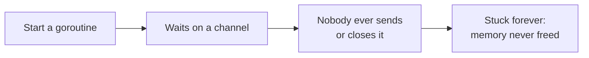

1. **Goroutine blocked on a channel** that nobody will ever send to or close. Fix: pass `context.Context`, use `select` with `ctx.Done()`.
2. **Unbounded map or slice** used as a cache or a dedupe set. Fix: LRU with a cap, TTL, or an external cache like Redis.
3. **A sub-slice pinning a big array.** `small := big[:10]` keeps the whole backing array alive. Fix: copy the part you need.
4. **Timers and tickers never stopped** (`time.NewTicker` without `Stop`). Fix: `defer t.Stop()`.
5. **Response bodies not closed** (`resp.Body.Close()` missing), which leaks connections and buffers.
6. **Per-request label values in metrics** (a user ID as a Prometheus label) which grows the metric registry without bound.

### Cascading failure arithmetic

**In plain words:** when one copy dies, the others take its share of work. They fill up faster and can die too.

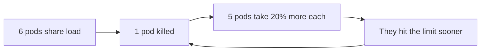

If 6 pods each handle 1/6 of traffic and one dies, the other 5 take 20 percent more each. A leak that grows with traffic then moves the next pod's kill time earlier. This is why you scale out first and diagnose after.

## 9. Interview questions 🔴

> [!question]- A pod is OOMKilled every 6 hours. What do you do in the first 10 minutes?
> Confirm the reason with `kubectl describe pod` (Last State Terminated, OOMKilled, 137), check how many pods are affected, and look for a recent deploy or traffic change. Mitigate: roll back if a deploy lines up, otherwise scale out or temporarily raise the limit. Only then take two heap profiles 10 minutes apart and diff them with `pprof -base`.

> [!question]- How do you tell a leak from a traffic spike from a limit that is too low?
> Look at the shape. Memory rising with time even when traffic is flat is a leak. Memory rising and falling with traffic is load. Memory flat near the limit from startup is a limit set too low for the working set. Confirm with the goroutine count and the heap profile.

> [!question]- Why can raising the memory limit make an incident worse?
> For a real leak it only delays the kill, so the pod now dies later and may die at peak traffic with more requests in flight. It also hides the problem so nobody fixes it. It is fine as a temporary stopgap while you roll back or fix, not as the fix.

> [!question]- Container OOMKilled versus pod Evicted: how do you tell them apart and what differs in the fix?
> OOMKilled is the kernel enforcing one container's cgroup limit, shown in `lastState.terminated.reason`. Eviction is the kubelet reacting to node-wide memory pressure and the pod object is removed and rescheduled. For OOMKilled fix the app or its limit. For eviction fix requests and limits across pods, node sizing, or pods with no limits.

> [!question]- Heap in use is flat but RSS keeps growing. Where do you look?
> Memory outside the Go heap: cgo allocations, `mmap`, goroutine stacks, thread count, or allocator fragmentation. Compare `process_resident_memory_bytes` with `go_memstats_heap_sys_bytes`, check `go_memstats_stacks_inuse_bytes` and `go_threads`, and review any native library.

> [!question]- What would you set to make Go behave well in a 1 GiB container?
> A memory request equal to the limit, `GOMEMLIMIT` around 900 MiB so the GC reacts before the kernel does, and a bounded cache and concurrency. Also a trend alert on the working set. `GOMEMLIMIT` does not fix a leak.

## 10. Cheat sheet 🟢

- Exit code 137 with reason `OOMKilled` is a memory kill; verify with `kubectl describe pod`.
- First 5 minutes: confirm scope, check what changed, mitigate (rollback or scale or raise limit), communicate.
- Use `container_memory_working_set_bytes`, not `usage_bytes`, for alerts.
- Shape decides the cause: rises with time is a leak; with traffic is load; flat near limit is a low limit.
- `go_goroutines` rising points to a goroutine leak; heap rising points to an unbounded cache.
- Two heap profiles 10 minutes apart, then `go tool pprof -base heap1 heap2`.
- `GOMEMLIMIT` around 90 percent of the limit; it does not fix leaks.
- Alert on `predict_linear` trend, not only on the kill.

### Post-incident checklist

- [ ] Timeline written: first symptom, detection, mitigation, resolution.
- [ ] Root cause found with evidence (profile diff saved).
- [ ] Why no alert fired earlier; add the trend alert.
- [ ] Limits, requests and `GOMEMLIMIT` reviewed.
- [ ] Regression test or load test with a memory assertion added.
- [ ] Postmortem held, blameless, with action owners: [[Postmortems and Root Cause Analysis]].

## Links

- **Before this:** [[Production Debugging Playbook]], [[Incident Response]]
- **Deep dive:** [[Debugging Memory Leaks and OOMs in Go]], [[Runtime - Memory Allocator and Garbage Collector]]
- **Platform:** [[Kubernetes Fundamentals]], [[Autoscaling]], [[Rollback and Safe Migrations]], [[Metrics and Prometheus]], [[Alerting and On-Call]]
- **Compare with:** [[Playbook - CPU Saturation]] (the other resource-exhaustion playbook)
- **After:** [[Postmortems and Root Cause Analysis]]

### Watch on YouTube

- [Fixing OOMKilled Pods in Kubernetes / Troubleshooting Memory Leaks Like a Pro 🚀](https://www.youtube.com/watch?v=Yh6tjHktLKU) · Platform Engineering hacks · 5 min · 556 views
- [What is memory leak?](https://www.youtube.com/watch?v=eu_kTGv61WQ) · codebasics · 3 min · 110,597 views
