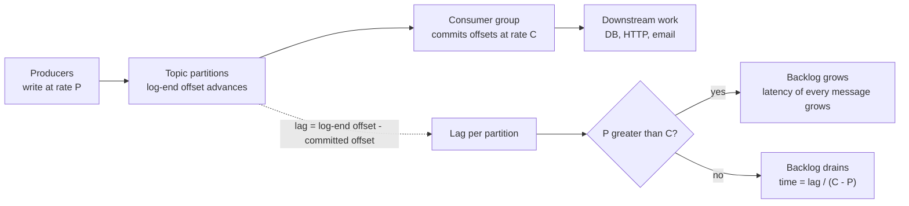
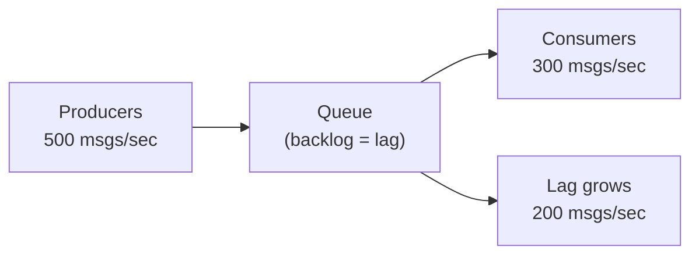
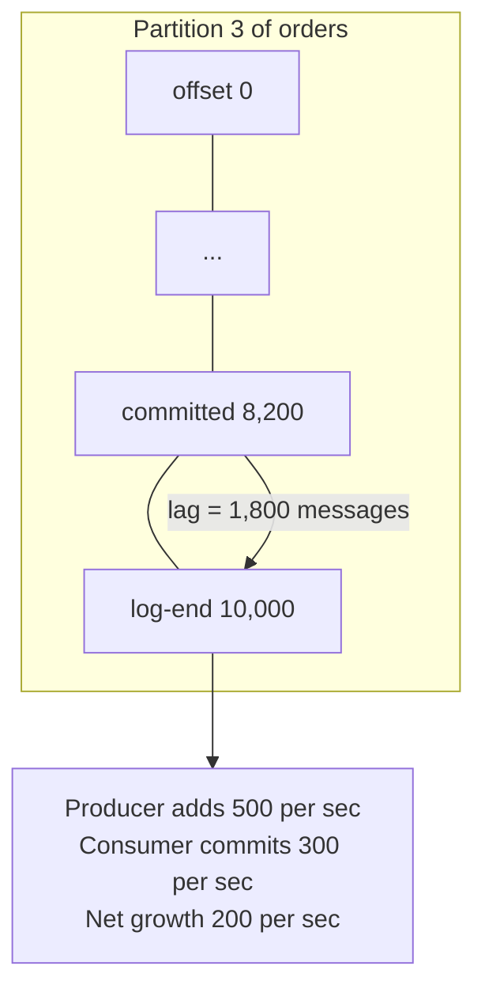
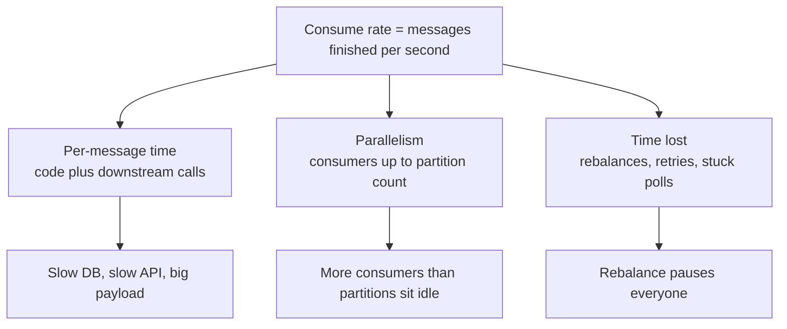
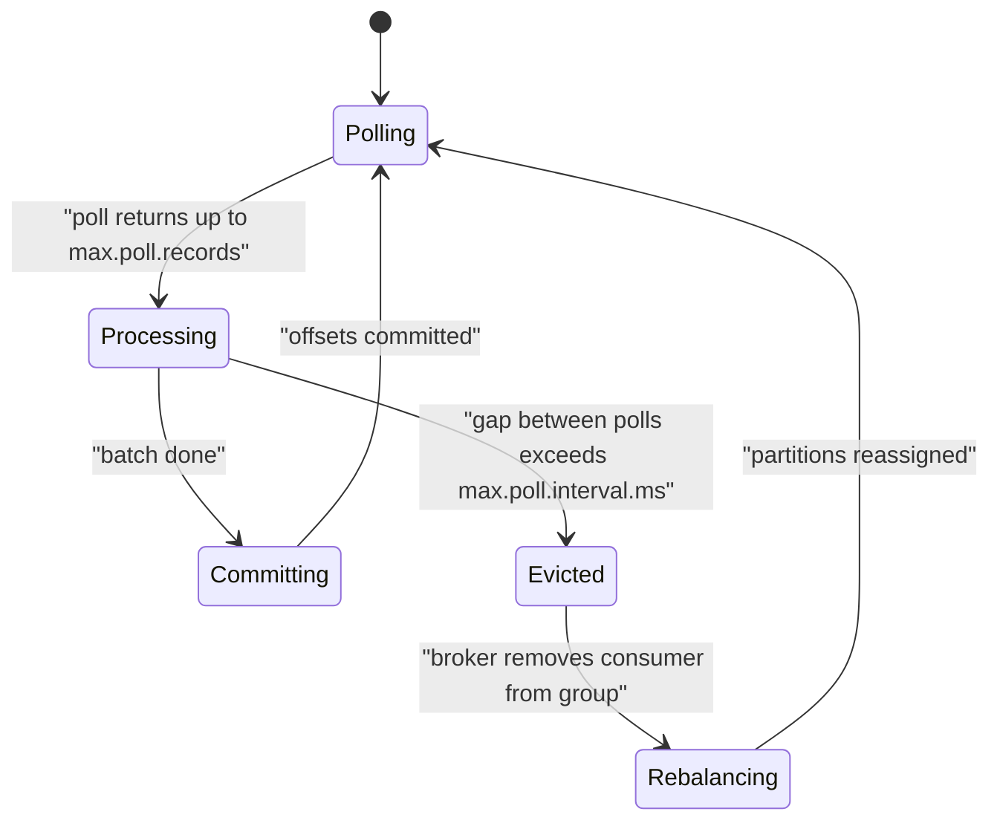
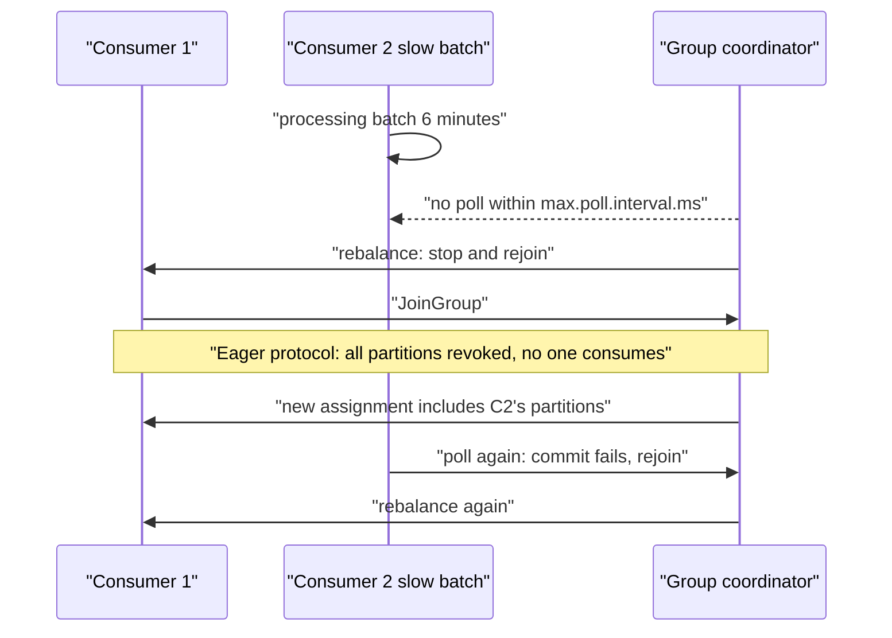
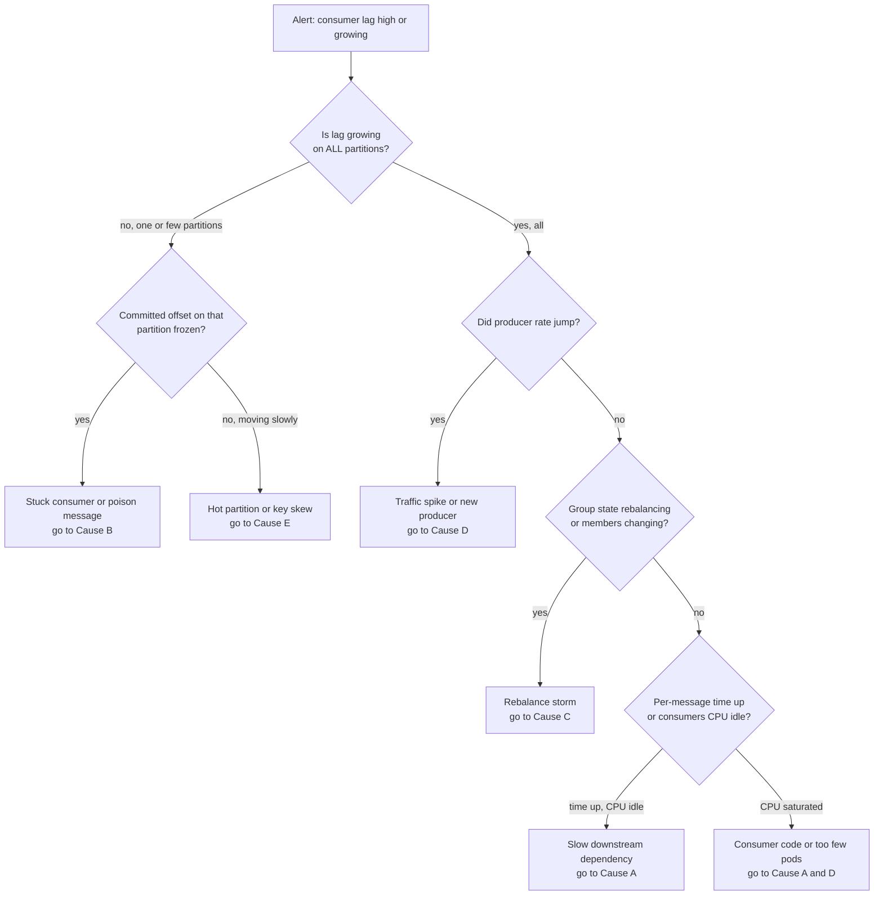
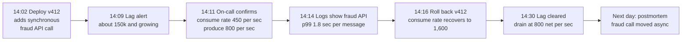
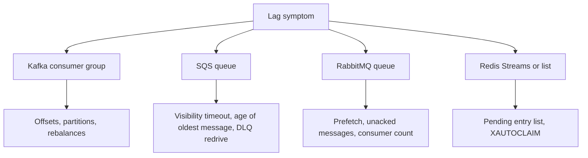

# Playbook - Queue and Kafka Consumer Lag

> [!summary] TL;DR
> Consumer lag means producers write messages faster than consumers finish them, so a backlog grows and every message is processed later and later.
>
> Confirm lag is growing (not just high), check what changed, find out whether consumers are slow, stuck, rebalancing, or simply outnumbered, mitigate by scaling or pausing producers, and only then fix the root cause.
>
> Do not reset offsets before you know what you would skip.

> [!abstract] Core idea
> - **Lag is a rate problem, not a size problem.** A backlog of 5 million that shrinks is fine. A backlog of 50 thousand that grows will become an incident.
> - **Time-to-drain = lag / (consume rate - produce rate).** If the denominator is zero or negative, the lag never clears on its own. Scale or shed work.
> - **Four causes cover most cases:** consumers are slow (downstream or code), consumers are stuck (poison message, deadlock), consumers keep rebalancing, or there are too few consumers or partitions.
> - **Mitigate before you root-cause.** Add consumers, pause low-value producers, or divert poison messages. Reset offsets only as a last resort because it drops or replays data.

### Whiteboard version



The whole playbook asks one question repeatedly: why is C smaller than P, and what is the cheapest way to make it larger or make P smaller?

## Start here: the basics

**The problem in one story.**
Every order your shop takes drops a message into a queue: "send confirmation email".
A worker program reads those messages and sends the emails.
One day orders arrive faster than the worker can send.
The pile grows, and customers get their email 40 minutes late.

**Words you need first**

| Word | Plain meaning | Tiny example |
| --- | --- | --- |
| Queue / topic | A list of messages waiting to be processed | Kafka topic `orders` |
| Producer | Code that writes messages | Checkout service writing "order placed" |
| Consumer | Code that reads and processes messages | Emailer service sending receipts |
| Partition | One slice of a topic; one consumer reads it at a time | `orders` has 12 partitions |
| Offset | The position number of a message in a partition | Message number 8,200 |
| Consumer group | The set of consumers sharing the work of one topic | `order-emailer` |
| Lag | How many messages are written but not yet processed | 10,000 - 8,200 = 1,800 |
| Rebalance | The group pausing to reshuffle who reads which partition | A pod restarts, everyone stops briefly |

**Picture it**



**Analogy.** A post office bin: letters come in, clerks take them out. If letters arrive faster than clerks work, the bin overflows and every letter waits longer.
Where it breaks: Kafka does not empty the bin when you read; it keeps the log and just moves a bookmark (the committed offset).

**How the rest of this note builds up**

- First, why lag hurts users (section 1) and the rate-based mental model with the drain formula (section 2).
- Then how lag is measured (section 3), and the on-call path: first 5 minutes, diagnosis flowchart, investigation steps and fixes.
- Then a worked example, variants across Kafka, SQS and RabbitMQ, and trade-offs (sections 4-6).
- Finally the SDE-3 depth: production practices, rebalance and partition internals, interview questions (sections 7-9).

> [!tip] Remember
> Lag is a rate problem: if consumers are slower than producers, the backlog never clears on its own.

## 1. Why it exists

Picture a post office sorting desk. Letters arrive in a bin, clerks take letters out, process them, and mark them done.

If letters arrive faster than clerks finish them, the bin overflows and every new letter waits behind the old ones. A letter that used to be delivered in 2 seconds is now delivered in 2 hours.

The analogy breaks down in one place: a Kafka log is not emptied when you read it, so "the bin" is really a pointer (the committed offset) that trails the end of the log.

**Symptoms you will see:**

- An alert on `consumer lag` or on `ApproximateAgeOfOldestMessage` (SQS) for a queue.
- Users report delayed effects: order confirmation emails arrive 40 minutes late, a balance update is stale, a search index misses new products, a "payment succeeded" webhook never reaches the merchant.
- Metrics that depend on the stream (dashboards, fraud scores) go flat or stale.
- Sometimes the consumer service looks completely healthy: CPU low, no errors, pods green. That is the dangerous version, because a stuck consumer produces no error logs.

**User impact depends on what the queue carries:**

| Queue carries | Lag impact | Severity guide |
|---|---|---|
| Emails, push notifications | Late, annoying | Low to medium |
| Order or payment events | Money moves late, customers retry and double-pay | High |
| Search index or cache updates | Stale reads | Medium |
| Audit or analytics events | Delayed reports, no user pain | Low unless retention is at risk |
| Anything with retention near expiry | Messages deleted before they are read, permanent data loss | Critical |

> [!tip] Remember
> Lag is the gap between "written" and "done". Always ask what business action is waiting in that gap.

## 2. Mental model

Think of three quantities: **log-end offset** (where the producers are), **committed offset** (where the consumers are), and **time** (how fast each moves). Lag is the distance between the first two. The trend of lag is the difference of the two speeds.



### The drain formula

**In plain words:** If you know how fast messages arrive and how fast they are processed, you can predict whether the backlog will clear and when.

**Example:** Lag is 1,200,000. Producers add 4,000 per second. Consumers process 3,000 per second. Net growth is +1,000 per second, so the backlog never clears and in an hour it is 1,200,000 + 3,600,000 = 4,800,000.

If you scale consumers to process 7,000 per second, net drain is 3,000 per second and the 1.2 million backlog clears in 1,200,000 / 3,000 = 400 seconds, and it keeps shrinking only while 7,000 stays above 4,000.

**Why it matters:** The formula tells you how much capacity to add, and it tells you whether "wait it out" is an option.

### What can limit the consume rate



> [!tip] Remember
> Consume rate = parallelism x (1 / time per message) minus time lost. Every cause of lag attacks one of those three terms.

## 3. How it works

### Step 1: how lag is measured

1. Each consumer group stores its **committed offset** per partition (in the `__consumer_offsets` topic for Kafka).
2. The broker knows the **log-end offset** per partition.
3. **Lag = log-end offset minus committed offset**, per partition. Group lag is the sum.
4. Tools such as `kafka-consumer-groups.sh`, Burrow, or an exporter read both numbers and publish them.

Lag in messages is not lag in time. 100,000 messages of lag on a topic doing 50,000 per second is two seconds. The same lag on a topic doing 10 per second is nearly three hours. Always convert to time: `lag / consume_rate`.

### Step 2: the consumer poll loop and where it can stall



A Kafka consumer must call `poll()` again within `max.poll.interval.ms` (default 300000 ms, five minutes). If processing a batch takes longer, the group coordinator assumes the consumer is dead, removes it, and triggers a **rebalance**. Separately, a background heartbeat thread must reach the broker within `session.timeout.ms`. These are two different failure clocks, and confusing them is a common diagnosis mistake.

### Step 3: why rebalances hurt



With the classic **eager** protocol, every rebalance revokes all partitions and nobody consumes until the group settles. If one slow consumer keeps getting evicted and rejoining, the group rebalances in a loop (a **rebalance storm**) and lag grows even though nothing is "down". The cooperative-sticky assignor (KIP-429) revokes only the partitions that move, which softens this.

### Step 4: the parallelism ceiling

Within one consumer group, a partition is read by at most one consumer. A topic with 12 partitions can use at most 12 active consumers in a group. A thirteenth consumer sits idle. So "just add pods" works only up to the partition count.

> [!warning] Common mistake
> Scaling a consumer deployment from 12 to 40 pods on a 12-partition topic does nothing for lag. The extra 28 pods are idle. Check `kafka-topics.sh --describe` before scaling.

> [!tip] Remember
> Lag has exactly two fixes: make each message faster, or run more parallel consumers (bounded by partitions).

## First 5 minutes

1. **Confirm and size it.** Is lag growing, flat, or shrinking? Which group, which topic, which partitions? Run the PromQL in the investigation steps below or `kafka-consumer-groups.sh --describe`. A lag graph that is a growing ramp is an incident. A sawtooth that clears is normal batch behavior.
2. **Find the business impact.** Which flow waits on this topic: emails, payments, inventory? Set severity using that, per [[Incident Response]].
3. **Check what changed.** Deploy of the consumer or of a service it calls, config change (pool size, timeout, `max.poll.records`), a feature flag, a traffic spike or a new producer, a partition count change, a broker restart or a downstream outage (database, third party API).
4. **Mitigate first.**
   - If a deploy preceded it: roll back the consumer (see [[Rollback and Safe Migrations]]).
   - If consumers are healthy but outnumbered: scale consumers up to the partition count.
   - If one poison message blocks a partition: route it to a dead letter topic and skip it (see [[Dead Letter Queues and Poison Messages]]).
   - If producers are flooding: throttle or pause the low-value producer, or enable [[Load Shedding and Graceful Degradation]].
   - If a downstream dependency is the bottleneck: do not scale consumers, because that makes the downstream worse. See [[Playbook - Database Overload and Connection Exhaustion]].
5. **Communicate.** Post "Consumer lag on orders-events, about 40 minutes of delay on order emails, mitigation in progress, next update in 15 minutes." Name the retention deadline if one is near.

## Diagnosis flowchart



## Investigation steps

### Step 0: look at the numbers (always do this first)

PromQL below assumes the common `kafka_exporter` (danielqsj) metric names: `kafka_consumergroup_lag`, `kafka_consumergroup_current_offset`, and `kafka_topic_partition_current_offset`. Other exporters name metrics differently, so adjust labels to your setup. These are label names from that exporter: `consumergroup`, `topic`, `partition`.

```promql
# Total lag for a group and topic
sum(kafka_consumergroup_lag{consumergroup="order-emailer", topic="orders"})

# Is lag growing? Positive means yes (messages per second of net growth)
deriv(sum(kafka_consumergroup_lag{consumergroup="order-emailer", topic="orders"})[15m:1m])

# Produce rate versus consume rate (messages per second)
sum(rate(kafka_topic_partition_current_offset{topic="orders"}[5m]))
sum(rate(kafka_consumergroup_current_offset{consumergroup="order-emailer", topic="orders"}[5m]))

# Partition skew: worst partition versus the average
max(kafka_consumergroup_lag{consumergroup="order-emailer", topic="orders"})
  / avg(kafka_consumergroup_lag{consumergroup="order-emailer", topic="orders"})

# Time-to-drain in seconds (only meaningful when consume exceeds produce)
sum(kafka_consumergroup_lag{consumergroup="order-emailer", topic="orders"})
  / (sum(rate(kafka_consumergroup_current_offset{consumergroup="order-emailer", topic="orders"}[5m]))
   - sum(rate(kafka_topic_partition_current_offset{topic="orders"}[5m])))
```

How to read the results:

| Observation | Meaning |
|---|---|
| Produce rate jumped, consume rate flat | Traffic cause. Scale or shed. |
| Produce rate flat, consume rate dropped | Consumers got slower or fewer. Go to causes A, B, C. |
| Both flat, lag still rising slightly | You were barely keeping up, small change tipped it. |
| Skew ratio far above 1 (for example 20) | One partition is hot or stuck. Go to causes B and E. |
| Consume rate drops to zero in steps | Rebalance pauses. Go to cause C. |

Now the broker's view:

```bash
# Lag per partition, consumer ids, and hosts
kafka-consumer-groups.sh --bootstrap-server broker:9092 --describe --group order-emailer

# Group state: Stable, PreparingRebalance, CompletingRebalance, Empty, Dead
kafka-consumer-groups.sh --bootstrap-server broker:9092 --describe --group order-emailer --state

# Members and how many partitions each holds
kafka-consumer-groups.sh --bootstrap-server broker:9092 --describe --group order-emailer --members --verbose

# Partition count and leaders
kafka-topics.sh --bootstrap-server broker:9092 --describe --topic orders
```

The `--describe` output has columns `GROUP TOPIC PARTITION CURRENT-OFFSET LOG-END-OFFSET LAG CONSUMER-ID HOST CLIENT-ID`. Read it like this:

- `CURRENT-OFFSET` identical across two checks 30 seconds apart, while `LOG-END-OFFSET` grows: that partition is **stuck** (cause B).
- `CONSUMER-ID` shows `-` for a partition: nobody owns it. The group is mid-rebalance or has too few members.
- State `PreparingRebalance` or `CompletingRebalance` seen repeatedly: **rebalance storm** (cause C).
- State `Empty`: no live consumers at all. Check that the pods are running.

### Cause A: consumers are slow (downstream or code)

**Why it happens:** each message takes longer, usually because a dependency is slow (database lock, third party API, DNS) or the code changed (new synchronous call, bigger payload, N+1 query).

**Check:**

```promql
# Per-message processing time p99, if your consumer exports a histogram (name is an example)
histogram_quantile(0.99, sum by (le) (rate(consumer_message_duration_seconds_bucket{group="order-emailer"}[5m])))

# CPU of the consumer pods versus request
sum(rate(container_cpu_usage_seconds_total{pod=~"order-emailer-.*"}[5m]))
  / sum(kube_pod_container_resource_requests{pod=~"order-emailer-.*", resource="cpu"})
```

```bash
kubectl get pods -l app=order-emailer
kubectl top pod -l app=order-emailer
kubectl logs deploy/order-emailer --since=15m | grep -iE "timeout|deadline|retry|connection refused" | tail -50
kubectl rollout history deploy/order-emailer

# Is the downstream slow? Time one dependency call from inside a pod
kubectl exec deploy/order-emailer -- curl -s -o /dev/null -w "dns=%{time_namelookup} connect=%{time_connect} ttfb=%{time_starttransfer} total=%{time_total}\n" https://email-provider.example.com/health

# If the consumer writes to Postgres: who is waiting?
psql -c "select state, wait_event_type, wait_event, count(*) from pg_stat_activity group by 1,2,3 order by 4 desc;"
```

**What results mean:**

- CPU near the limit and throttled: the consumer is CPU bound. Scale out (up to partitions) or profile with `go tool pprof http://pod:6060/debug/pprof/profile?seconds=30`.
- CPU low but processing time high: the consumer is waiting on something. Look at `curl -w` timings and `wait_event` values (`Lock` points to row or table locks, `Client` points to the app not reading).
- Timeouts and retries in logs: a dependency is failing and retries multiply the work. Retries without backoff turn a small slowdown into a large one (see [[Timeouts, Retries and Backoff]]).

### Cause B: a stuck consumer or a poison message

**Why it happens:** one message makes the handler panic, loop forever, or block on a lock. With ordered, single-threaded per-partition processing, everything behind it waits. If the consumer retries the same message forever, the offset never advances.

**Check:**

```bash
# Run twice, 30 seconds apart: does CURRENT-OFFSET move on the bad partition?
kafka-consumer-groups.sh --bootstrap-server broker:9092 --describe --group order-emailer | awk '$3==7'

# Look at the message at the committed offset (read one record from that partition)
kafka-console-consumer.sh --bootstrap-server broker:9092 --topic orders \
  --partition 7 --offset 8200 --max-messages 1 --property print.key=true --property print.headers=true

# Repeated error with the same key or offset in logs
kubectl logs deploy/order-emailer --since=15m | grep -E "partition=7|offset=8200" | head
```

If goroutines or threads are blocked rather than erroring, capture a dump: `curl -s "http://pod:6060/debug/pprof/goroutine?debug=2" | head -100`. Many goroutines parked in the same lock or channel receive points to a deadlock.

**What results mean:** one partition frozen, one message repeating in logs, and a payload that is huge, malformed, or references a missing record means a poison message. Fix per [[Dead Letter Queues and Poison Messages]].

### Cause C: rebalance storm

**Check:**

```bash
kafka-consumer-groups.sh --bootstrap-server broker:9092 --describe --group order-emailer --state
kubectl logs deploy/order-emailer --since=30m | grep -iE "rebalanc|revoked|assigned|CommitFailed|max.poll.interval|heartbeat"
kubectl get pods -l app=order-emailer -o wide        # restarts, ages
kubectl get events --sort-by=.lastTimestamp | grep -i order-emailer | tail
```

**What results mean:**

| Evidence | Likely cause |
|---|---|
| `CommitFailedException` or "poll() called too late" | Batch processing exceeds `max.poll.interval.ms` |
| Pods restarting every few minutes (OOMKilled, failing probes) | Every restart triggers a rebalance for the whole group |
| Autoscaler flapping replicas up and down | Each scale event is a rebalance |
| Heartbeat or session timeout errors, GC or CPU throttling pauses | `session.timeout.ms` too tight for the pause length |
| Rolling deploy in progress | Normal rebalances. Wait or use static membership and cooperative-sticky |

### Cause D: too few consumers or a producer spike

**Check:**

```bash
kubectl get hpa order-emailer
kubectl get deploy order-emailer -o jsonpath='{.spec.replicas}{"\n"}'
kafka-topics.sh --bootstrap-server broker:9092 --describe --topic orders | head -1   # PartitionCount
```

```promql
# Who is producing? Messages in per second by topic
sum by (topic) (rate(kafka_topic_partition_current_offset[5m]))
```

**What results mean:** replicas already equal partitions with high CPU means you hit the ceiling. Options are faster per-message work, batching, or adding partitions (plan carefully, see the deep dive). Replicas below partitions with high CPU means scale out now.

A producer jump after a deploy, a campaign, a retry loop, or a backfill job points at the source to throttle.

### Cause E: hot partition and key skew

**Check:** the skew PromQL above. Then sample which key dominates: consume a few hundred messages from the hot partition and count keys.

```bash
kafka-console-consumer.sh --bootstrap-server broker:9092 --topic orders --partition 7 \
  --offset latest --max-messages 500 --property print.key=true 2>/dev/null | cut -f1 | sort | uniq -c | sort -rn | head
```

**What results mean:** one key (a huge merchant, a null key hashed to one partition, a default tenant id) taking a large share means ordering by that key puts all its load on one consumer. See [[Message Ordering and Partition Keys]].

### Cause F: broker or network trouble

Brokers under-replicated, a leader election, or a disk full on a broker makes fetches slow for some partitions. Check `kafka-topics.sh --describe --under-replicated-partitions`, broker disk and request latency dashboards, and `ss -tn state established '( dport = :9092 )' | wc -l` from the consumer host. If lag appears on partitions led by one broker, escalate to the platform team.

### Other brokers, same method

| Broker | Lag signal | Quick command |
|---|---|---|
| Kafka | `kafka_consumergroup_lag` | `kafka-consumer-groups.sh --describe` |
| SQS | `ApproximateNumberOfMessagesVisible`, `ApproximateAgeOfOldestMessage` | `aws sqs get-queue-attributes --queue-url URL --attribute-names All` |
| RabbitMQ | `messages_ready`, `messages_unacknowledged` | `rabbitmqctl list_queues name messages_ready messages_unacknowledged consumers` |
| Redis Streams | pending entries | `XINFO GROUPS stream` and `XPENDING stream group` |

For SQS, a rising `ApproximateNumberOfMessagesNotVisible` with a flat visible count means messages are being received but not deleted: your visibility timeout is shorter than your processing time, so messages reappear and get processed twice. For RabbitMQ, a high `messages_unacknowledged` with consumers present means consumers hold messages without acking (prefetch too high, or handlers stuck).

## Fixes

| Cause | Immediate fix | Proper fix | Prevention |
|---|---|---|---|
| A: slow downstream | Roll back a bad change, shed or pause non-critical work, do not scale into a struggling dependency | Fix the slow call, add timeouts, a circuit breaker, batching or bulk writes | Per-message latency histogram, alert on it before lag |
| B: poison message | Send the message to a dead letter topic, commit past it | Validate on produce, bounded retries then DLQ, alert on DLQ depth | Schema registry, contract tests |
| C: rebalance storm | Stop the flapping cause (pin replicas, stop autoscaler, fix crashloop) | Lower `max.poll.records`, raise `max.poll.interval.ms` to a real upper bound, cooperative-sticky assignor, static membership (`group.instance.id`) | Alert on rebalance rate, keep handlers short |
| D: too few consumers | Scale to partition count | Add partitions with a plan, or make handlers concurrent inside one consumer with ordered commit | Autoscale on lag (for example KEDA), capacity test |
| E: hot key | Isolate the hot key to a separate topic or consumer | Better partition key, salting, or split heavy tenants | Track per-partition skew |
| F: broker | Escalate, move leaders, fix disk | Capacity plan, replication alerts | Broker SLOs |

**Resetting offsets (last resort).** This changes data semantics, so decide it deliberately.

```bash
# Group must have no active members. Always dry-run first.
kafka-consumer-groups.sh --bootstrap-server broker:9092 --group order-emailer --topic orders \
  --reset-offsets --to-datetime 2026-11-09T10:00:00.000 --dry-run

kafka-consumer-groups.sh --bootstrap-server broker:9092 --group order-emailer --topic orders \
  --reset-offsets --to-latest --execute
```

`--to-latest` skips every unprocessed message, which is only acceptable for data that is safe to lose (for example a stale metrics feed). For emails or payments, skipping means customers never get the message. `--to-earliest` or `--to-datetime` replays, which requires idempotent consumers (see [[Delivery Semantics and Exactly-Once]]).

## 4. Worked example

**Scenario:** an order platform has a topic `orders` with 12 partitions and an `order-emailer` group of 12 pods sending confirmation emails. Normal lag is under 500 messages. Normal produce rate is 800 per second.



**Timeline in detail:**

1. **14:09** Alert: `deriv(sum(kafka_consumergroup_lag{consumergroup="order-emailer"})[15m:1m]) > 100` fires. Lag is about 150,000.
2. **14:11** The on-call engineer runs the produce and consume rate queries. Produce is steady at 800 per second. Consume has fallen from about 1,600 to 450. So the cause is on the consumer side, not traffic. Net growth is 350 per second.
3. **14:12** `kafka-consumer-groups.sh --describe` shows all 12 partitions lagging evenly and moving, group state `Stable`. So it is not a poison message and not a rebalance storm. Even lag points at a uniform slowdown.
4. **14:13** `kubectl rollout history` shows v412 deployed at 14:02. That matches the time lag started growing.
5. **14:14** `kubectl logs` shows `fraud-check timeout` warnings and a per-message histogram p99 of 1.8 seconds, up from 0.05 seconds. The new version calls the fraud API synchronously on every message.
6. **14:16** Mitigation: `kubectl rollout undo deploy/order-emailer`. Consume rate climbs to 1,600 per second within two minutes. Net drain is 800 per second.
7. **14:30** Lag is zero. The oldest unprocessed email was about 7 minutes old at the worst point (lag divided by produce rate). Impact: confirmation emails were delayed by up to about 7 minutes for the orders created in that window.
8. **Next day** Postmortem finds the root cause: a synchronous fraud call inside the hot loop with no timeout and no per-message latency alert. Actions: move the call to a separate async consumer, add a timeout and circuit breaker, add a per-message latency alert, and add lag-growth alerting based on rate instead of size.

Drain check (illustrative estimate): from 14:02 to 14:09 lag grows at about 350 per second, giving about 150,000. By the rollback at 14:16 (another 420 seconds) it is about 150,000 + 420 x 350 = 297,000.

At a net drain of 800 per second that takes about 371 seconds, roughly 6 minutes at full speed.

Pod restarts, cold caches and a slower first few minutes stretch this, which is why the walkthrough says lag reached zero at 14:30.

## 5. Variants and comparison



| Aspect | Kafka | SQS | RabbitMQ |
|---|---|---|---|
| Parallelism limit | Partition count per group | None (add consumers) | Consumers per queue (prefetch matters) |
| Ordering | Per partition | FIFO queues only, per group id | Per queue, broken by requeue |
| Backlog retention | Retention time or size (default 7 days on many setups) | Up to 14 days maximum | Memory and disk limits per broker |
| Message loss when lagging | Data deleted at retention even if unread | Deleted at retention period | Broker may block publishers under memory alarm |
| Best lag metric | Offset lag and time lag | Age of oldest message | Ready plus unacked count |

## 6. Trade-offs and when not to use

| Choice | Benefit | Cost |
|---|---|---|
| Scale consumers | Fast, no code change | Capped by partitions, pushes load downstream |
| Raise `max.poll.interval.ms` | Stops false evictions | Hides truly stuck consumers longer |
| Lower `max.poll.records` | Shorter batches, fewer evictions | More poll overhead |
| Skip poison messages to DLQ | Unblocks the partition | Needs a replay and triage process |
| Reset offsets to latest | Instantly zero lag | Permanent data loss for skipped messages |
| Add partitions | More parallelism | Key to partition mapping changes, ordering guarantees break across the change |
| Autoscale on lag | Matches capacity to load | Rebalance cost on every scale event |

**When not to apply the standard playbook:** if lag is intentional (a batch consumer that runs nightly, or a replay job), alert on time lag against its own SLO, not a fixed message count.

If the queue carries data where order across partitions does not matter and per-message work is trivial, prefer a work queue such as SQS with many consumers over Kafka.

## 7. In production

- **Alert on lag trend and age, not only size.** Page on "oldest unprocessed message is older than X minutes" and on `deriv(lag) > 0` sustained for 10 minutes. A raw "lag > 100,000" alert is wrong for both high and low volume topics.
- **Define an SLO in time.** For example, "95 percent of order events are processed within 60 seconds." See [[SLIs, SLOs, SLAs and Error Budgets]].
- **Watch retention versus lag.** If lag in time approaches the topic retention, you are close to permanent loss. Add this as a separate alert.
- **Track rebalances.** Count rebalance events per hour per group. More than a few per hour outside deploys is an incident waiting to happen.
- **Keep DLQ depth on a dashboard** with an owner and a replay runbook.
- **Load test the consumer** at 2x peak produce rate, including a downstream slowdown, before launch. See [[Performance Engineering and Capacity Planning]].
- **Use static membership** (`group.instance.id`) and cooperative-sticky assignment so rolling deploys do not stop the world.

## 8. Deep dive

**Why adding partitions is risky.** Kafka picks a partition with `hash(key) mod partitions`. Increasing the count changes where a key lands.

For a while, events for the same key sit on two partitions, so per-key ordering is broken across the change, and a consumer holding in-memory per-key state sees keys move. Kafka only allows increasing the count, never decreasing.

Plan partition counts with headroom (for example, 2 to 3 times the consumers you expect to need) instead of adding them during an incident.

**`max.poll.interval.ms` versus `session.timeout.ms`.** The first measures how long between `poll()` calls (processing time). The second measures whether the heartbeat thread reaches the broker (liveness).

A handler that blocks for six minutes but runs a healthy heartbeat thread is still evicted by the first one. A long GC pause or CPU starvation can miss heartbeats and trigger the second.

Diagnose by reading the exception text, not by guessing.

**Why a stuck consumer produces no errors.** If a handler waits on a lock or a connection with no timeout, no log line is written, CPU is idle, and the pod stays Ready. The only symptom is the frozen committed offset. This is why you alert on offset movement and consume rate, and why every outbound call needs a timeout.

**Batch commits and duplicates.** If a consumer commits after processing a batch and crashes midway, messages after the last commit are redelivered. Reducing lag by replaying or resetting to an earlier offset therefore duplicates work. Idempotent handlers (see [[Idempotency and Idempotency Keys]]) make every fix in this playbook safe.

**Ordering versus throughput inside one consumer.** To raise the rate without more partitions, a consumer can hand messages to a worker pool, but then commit order must track the lowest completed offset, otherwise a crash can skip unfinished work. Per-key sharding of workers keeps key order. See [[Background Jobs and Worker Pools]] and [[Backpressure and Flow Control]].

**Estimate, not measured:** a single Kafka partition on commodity brokers can usually sustain tens of thousands of small messages per second, so consumer processing time, not broker throughput, is normally the limit. Treat that as a rough planning figure and verify with your own benchmark.

## 9. Interview questions

> [!question]- Consumer lag is rising on a Kafka topic. Walk me through how you respond.
> First, check whether lag is actually growing (derivative) and convert it to time. Check what changed: deploy, config, traffic, partitions. Compare produce rate and consume rate to separate "too much input" from "slow consumers".
>
> Use `kafka-consumer-groups.sh --describe` to see whether all partitions lag evenly (slowdown), one partition is frozen (poison message or stuck handler), or the group is rebalancing.
>
> Mitigate first by rolling back, scaling up to the partition count, or diverting a poison message. Reset offsets only deliberately.

> [!question]- I have 12 partitions and 30 consumers in a group. Why is lag not improving?
> A partition is assigned to one consumer per group, so only 12 consumers do work and 18 are idle. Either make each consumer faster, add partitions (understanding that key placement changes), or process messages concurrently inside each consumer.

> [!question]- What is a rebalance storm and how do you stop it?
> A loop where consumers are repeatedly evicted and rejoin, and each rebalance pauses consumption. Causes: batches slower than `max.poll.interval.ms`, pods crash looping, autoscaler flapping, missed heartbeats. Stop the trigger first, then lower `max.poll.records`, set static membership and the cooperative-sticky assignor.

> [!question]- Would you reset the consumer group offset to latest to clear lag?
> Only if skipped messages are safe to lose. It instantly zeroes lag but permanently drops unprocessed data, so it is wrong for payments, emails or anything customers expect. I would rather scale, fix the slow path, or divert bad messages. If I must skip, I record the skipped offset range so it can be replayed later.

> [!question]- Trap: lag is 2 million messages. Is that bad?
> You cannot say without the rate. 2 million at 100,000 per second is 20 seconds. 2 million at 50 per second is more than 11 hours. Convert lag to time and compare it with the SLO and the topic retention.

> [!question]- Lag only exists on one partition. What do you suspect?
> Either a stuck consumer on that partition (committed offset frozen, often a poison message), or a hot key that sends far more traffic there (offset moving but too slowly). Check whether the committed offset advances and sample the keys.

> [!question]- Scaling consumers made the incident worse. How is that possible?
> If the bottleneck is a downstream dependency such as a database, more consumers add more concurrent load, push connection pools and locks to their limits, and slow every call further. Fix or protect the dependency first, or limit concurrency.

## 10. Cheat sheet

- Lag = log-end offset minus committed offset. Convert to time: `lag / consume_rate`.
- Growing lag means produce rate exceeds consume rate. Compare the two rates first.
- All partitions evenly lagging: slow consumers. One partition frozen: poison message or stuck handler. Group state flapping: rebalance storm.
- Max useful consumers in a group equals partition count.
- `kafka-consumer-groups.sh --describe`, `--state`, `--members` are the first commands.
- `max.poll.interval.ms` (processing gap) and `session.timeout.ms` (heartbeat) are different clocks.
- Fix order: roll back or scale, divert poison messages, then root cause. Reset offsets last.
- Alert on age of oldest message and lag trend, and on lag versus retention.
- Make handlers idempotent so replays and redeliveries are safe.
- SQS: `ApproximateAgeOfOldestMessage` plus visibility timeout. RabbitMQ: ready plus unacked.

## Post-incident checklist

- [ ] Write the timeline with real numbers: when lag began, detection time, mitigation time, drain time.
- [ ] Quantify impact: delayed messages, oldest age, any data loss or duplicates.
- [ ] Confirm no messages were skipped, or list skipped offset ranges and replay them.
- [ ] Confirm idempotency held for any replayed messages.
- [ ] Add or tune: lag trend alert, age alert, rebalance alert, DLQ depth alert.
- [ ] Add a per-message latency histogram and downstream timeout if missing.
- [ ] Review partition count and autoscaling against peak load.
- [ ] Hold the blameless review. See [[Postmortems and Root Cause Analysis]].

## Links

- **Before this:** [[Production Debugging Playbook]], [[Incident Response]], [[Kafka and Event Streaming]]
- **Related playbooks:** [[Playbook - Database Overload and Connection Exhaustion]], [[Playbook - Bad Deploy and Rollback]], [[Playbook - High Latency]]
- **Messaging deep notes:** [[Backpressure and Flow Control]], [[Dead Letter Queues and Poison Messages]], [[Message Ordering and Partition Keys]], [[Delivery Semantics and Exactly-Once]], [[Background Jobs and Worker Pools]], [[AWS SQS, SNS and EventBridge]], [[Queues vs Streams and Broker Comparison]]
- **Resilience:** [[Timeouts, Retries and Backoff]], [[Load Shedding and Graceful Degradation]], [[Circuit Breaker]]
- **Next:** [[Postmortems and Root Cause Analysis]], [[Alerting and On-Call]], [[Metrics and Prometheus]]

### Watch on YouTube

- [Queueing Theory in Kafka / Consumer Lag, Partitions & Concurrency Explained](https://www.youtube.com/watch?v=YEWXkulUX50) · Industry Ready Coder · 4 min · 50 views
- [Apache Kafka Consumer Lag Analysis in-depth intuition](https://www.youtube.com/watch?v=-Dwb6RhNDNU) · Knowledge Amplifier · 14 min · 14,573 views
