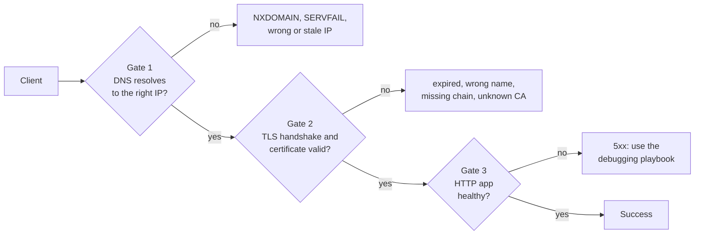
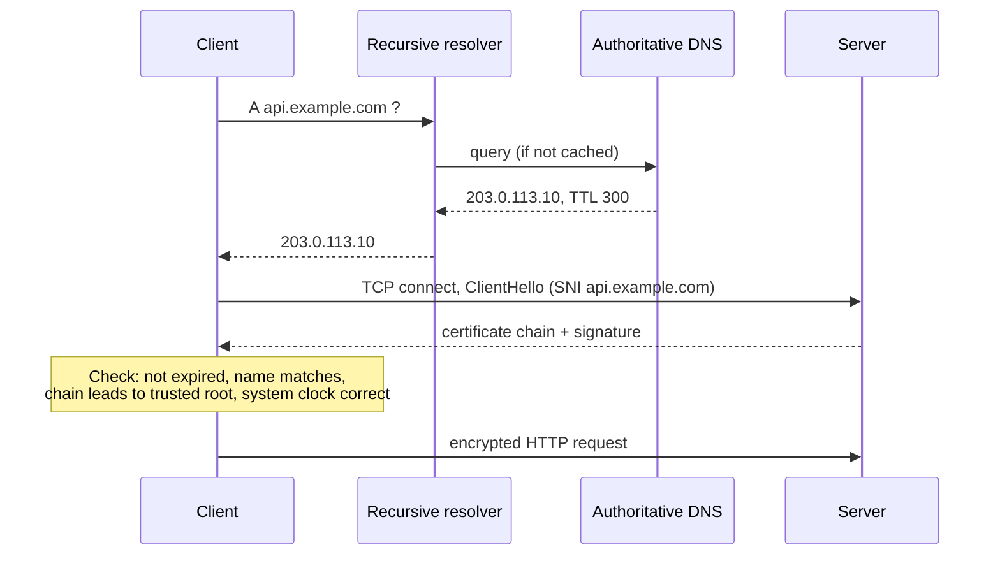
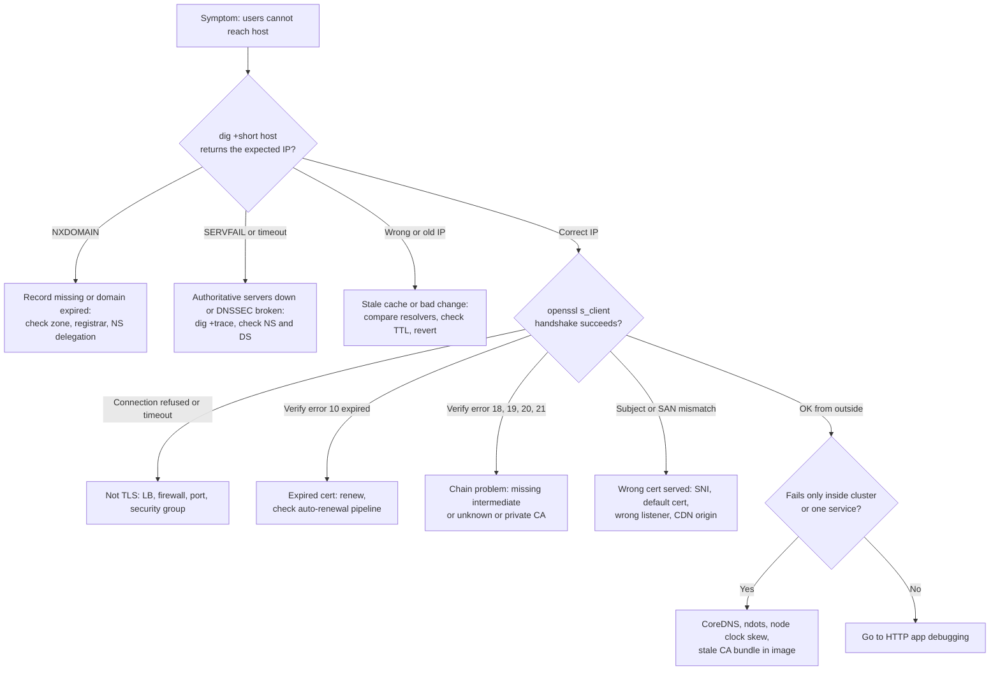
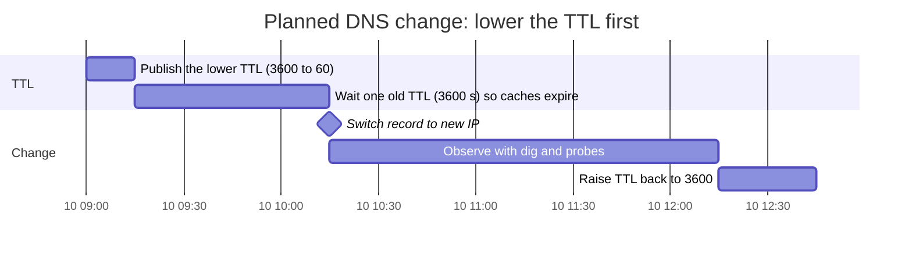
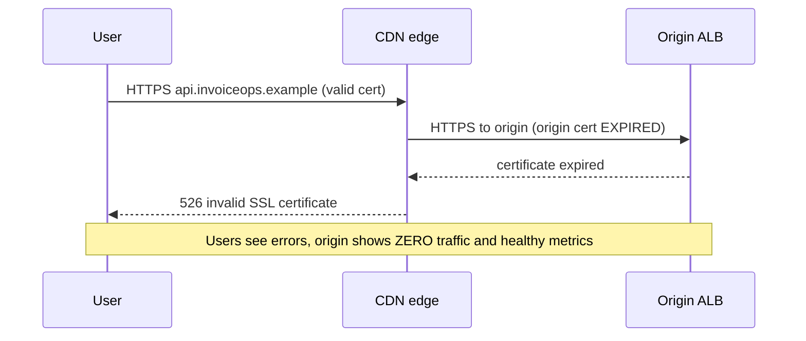
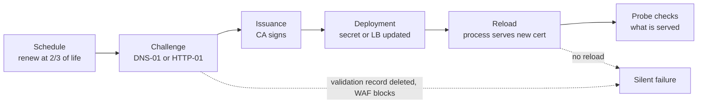

# Playbook - TLS Certificate and DNS Failures

> [!summary] TL;DR
> Two of the most avoidable outages in production: a TLS certificate that expired or does not match, and DNS that returns the wrong answer, no answer, or a stale answer. Both look like "the site is down" yet your servers are healthy. The fastest path is to ask two questions in order: **can the name be resolved (`dig`)?** then **does the TLS handshake succeed with a valid certificate (`openssl s_client`)?** The fix is usually renewing a cert or correcting a record, and the prevention is automation plus expiry alerts.

> [!abstract] Core idea
> - **Name first, then handshake, then application.** DNS failure shows as "cannot resolve host". TLS failure shows as a certificate or handshake error. Only after both pass is it an HTTP problem.
> - **Certificates fail on a date, not on load.** An expiry is a scheduled outage you can see 30 days ahead; nothing in your normal dashboards shows it unless you monitor it.
> - **DNS changes are slow to undo.** The TTL on the old record decides how long wrong answers keep living in caches around the world.
> - **Test from outside and inside.** A cert or record can be fine for browsers and broken for your Go services (missing intermediate, private CA, clock skew), or the reverse.
> - **Automate renewal and alert on the days left**, never rely on a calendar reminder.

### Whiteboard version

Every request passes three gates. The playbook is finding which gate is closed.



## 1. Why it exists

Certificates are issued with a fixed lifetime and DNS depends on records, caches and delegations spread across many parties. Both fail in ways that are sudden, global and confusing.

**Symptoms:**

- **Expired certificate.** Browsers show a full-page "Your connection is not private" (`NET::ERR_CERT_DATE_INVALID`). API clients log `x509: certificate has expired or is not yet valid`. Mobile apps simply fail with a generic network error. Traffic drops to near zero within minutes, while your CPU and error metrics at the server look suspiciously calm because requests never arrive.
- **Wrong name or missing chain.** `x509: certificate is valid for a.example.com, not b.example.com`, or `x509: certificate signed by unknown authority`. Often it works in a browser but fails in a Go service or `curl`, because browsers fetch missing intermediates and your service does not.
- **DNS failure.** `no such host`, `Temporary failure in name resolution`, `NXDOMAIN`, `SERVFAIL`, or a record pointing at an old IP. Inside Kubernetes you see intermittent 5-second delays or random "lookup failed" errors.

**User impact:** total outage for the affected hostname, including partners and mobile apps that cannot bypass the error. Certificate and DNS outages hit everyone at once and cannot be mitigated by scaling or restarting.

The real-world scale of this class: in September 2021 the expiry of Let's Encrypt's old root (DST Root CA X3) broke many older clients and some servers' chains; in October 2021 Meta's DNS servers withdrew themselves when the backbone failed, making its sites unresolvable (see Sources). Large companies get caught too, because renewal is rare enough to be forgotten.

> [!tip] Remember
> If your servers look healthy but traffic fell off a cliff, check DNS and certificates before anything else.

## 2. Mental model

Think of a request as mailing a letter to a company. **DNS is the phone book**: it tells you the street address. **The certificate is the company's ID card** shown at the door: it must be unexpired, issued by someone you trust, and show the name you came to visit. Only then do you walk in and talk to the receptionist (HTTP).

Where the analogy breaks: phone books are copied everywhere. Even after you publish a corrected address, copies (resolver caches) keep serving the old one until their time-to-live runs out, so a fix is not instant. ID cards, by contrast, are checked fresh by each client, but each client has its own trust list and clock.



> [!tip] Remember
> DNS decides where you connect. The certificate decides whether you trust what answered. Each has its own failure modes and its own clock.

## 3. How it works

### First 5 minutes

1. **Confirm the problem and the blast radius.** Which hostnames? Which clients (all browsers, only mobile, only one partner, only inside the cluster)? Is it every region? Check with an external probe (a synthetic check, `curl` from your laptop and from a second network) and from inside a pod.
2. **Check what changed.** Certificate renewed or replaced? DNS record edited, nameserver changed, domain moved registrar, Terraform apply, load balancer or ingress replaced, CDN config changed, cert-manager upgraded? Domain registration expired? Also check the system clock on affected hosts.
3. **Run the two quick tests.** `dig +short host` for DNS and `openssl s_client` for the certificate (steps below). They answer "which gate" in under a minute.
4. **Mitigate first.** Bad cert: install a valid cert (renew, redeploy the previous good one, issue a fresh one from your CA), or fail over to the CDN or load balancer that has a valid cert. Bad DNS: restore the previous record, fail over to a healthy IP, or point to the secondary. Do not wait for root cause.
5. **Communicate.** Post in the incident channel, update the status page (it should be hosted on a different domain and DNS provider, or it will be down too), tell partners who pin certificates or use IP allow-lists.

> [!warning] Common mistake
> Telling users to click "proceed anyway" or disabling certificate verification in clients as a quick fix. That turns an availability incident into a security incident. Fix the certificate; never ship `InsecureSkipVerify: true`.

### Diagnosis flowchart



### Investigation steps

#### A. DNS: is the name resolving to the right answer?

```bash
dig api.example.com A +noall +answer +comments   # answer, TTL, status
dig api.example.com A +short                       # just the IPs
dig @8.8.8.8 api.example.com A +short              # a public resolver
dig @1.1.1.1 api.example.com A +short              # a second public resolver
dig api.example.com NS +short                      # who is authoritative
dig @ns-123.awsdns-45.com api.example.com A +short # ask an authoritative server directly
dig +trace api.example.com                         # walk root > TLD > authoritative
```

| What you see | Meaning | Action |
| --- | --- | --- |
| `status: NXDOMAIN` | The name does not exist in the zone, or the domain expired or was delegated away | Check the zone for the record, the registrar for expiry, `NS` delegation |
| `status: SERVFAIL` | Resolver could not get a valid answer: authoritative servers down or unreachable, lame delegation, or broken DNSSEC | `dig +trace`; try `dig +cd` (checking disabled): if that works, DNSSEC is the problem |
| No answer, timeout | Resolver or network unreachable | Test another resolver, check firewall and UDP/TCP 53 |
| Different answers from different resolvers | Propagation or stale caches | Compare TTLs; the old TTL is how long it persists |
| Authoritative answer differs from your intended record | The change did not apply, or the wrong zone or view was edited | Check Terraform state, Route 53 hosted zone ID, split-horizon zones |
| Right IP but traffic goes to the wrong place | IP belongs to a different, decommissioned target | Check what the IP now is (released Elastic IP, old load balancer) |

> [!warning] Common mistake
> Assuming a DNS change is live because the console says saved. Always query an authoritative server directly and a public resolver, and remember that the previous TTL (for example 3600 s) is how long old answers persist.

**Negative caching.** A NXDOMAIN answer is also cached, for the time given by the zone's SOA (RFC 2308). If you create a missing record, resolvers that just saw NXDOMAIN may keep saying "does not exist" for up to that period. Check it with `dig example.com SOA +short`.

**DNS inside Kubernetes.** Pods use CoreDNS with `search` domains and `ndots:5`, so a short name like `api.vendor.com` may trigger several failed search-domain lookups before the real query, adding latency and load.

```bash
kubectl -n kube-system get pods -l k8s-app=kube-dns
kubectl -n kube-system logs -l k8s-app=kube-dns --tail=50
kubectl exec -it deploy/checkout -- cat /etc/resolv.conf
kubectl exec -it deploy/checkout -- nslookup api.vendor.example
kubectl top pods -n kube-system -l k8s-app=kube-dns
```

```promql
# CoreDNS SERVFAIL rate (CoreDNS exports coredns_dns_responses_total with an rcode label)
sum(rate(coredns_dns_responses_total{rcode="SERVFAIL"}[5m]))

# CoreDNS p99 latency
histogram_quantile(0.99, sum by (le) (rate(coredns_dns_request_duration_seconds_bucket[5m])))
```

Symptoms such as a steady 5-second delay on some lookups often come from a conntrack race on UDP DNS packets; common mitigations are NodeLocal DNSCache, lowering `ndots`, using fully qualified names with a trailing dot, or `single-request` resolver options.

#### B. TLS: what does the server actually present?

```bash
# Show the leaf certificate dates, subject, issuer and names (SNI matters!)
echo | openssl s_client -connect api.example.com:443 -servername api.example.com 2>/dev/null \
  | openssl x509 -noout -subject -issuer -dates -ext subjectAltName

# Show the full chain and the verification result
openssl s_client -connect api.example.com:443 -servername api.example.com -showcerts </dev/null 2>&1 \
  | grep -E 'Verify return code|depth=|verify error| s:| i:'

# Verbose HTTP-level view, including the certificate curl sees
curl -vI https://api.example.com 2>&1 | grep -E 'SSL|subject|expire|issuer|HTTP/'

# Test against a specific IP (bypass DNS) while keeping the right name
curl --resolve api.example.com:443:203.0.113.10 -vI https://api.example.com
```

| Result | Meaning | Fix |
| --- | --- | --- |
| `notAfter` in the past, or `Verify return code: 10 (certificate has expired)` | Expired | Renew and deploy; find why auto-renewal failed |
| `notBefore` in the future, `Verify return code: 9 (certificate is not yet valid)`, or `x509: ... not yet valid` | Either the cert was issued with a future start date or the client clock is wrong | Check `date -u` on the client; fix NTP |
| `Verify return code: 20 (unable to get local issuer certificate)` or `21 (unable to verify the first certificate)` | Missing intermediate certificate in the server's chain | Serve the full chain (leaf plus intermediates), for example `fullchain.pem` |
| `Verify return code: 18` or `19` (self-signed) | Self-signed or private CA | Add the CA to clients' trust store, or use a public CA |
| SAN does not include the host | Wrong certificate served | Check SNI, default certificate on the load balancer, correct listener, CDN origin cert |
| Handshake fails, `no peer certificate available` | No cert presented; listener not TLS, or SNI required but missing | Check the port, protocol, and that `-servername` is used |
| `alert handshake failure` / `protocol version` | TLS version or cipher mismatch | Check server minimum version and client support |

**Why SNI matters.** One IP can host many certificates. The client names the host in the handshake (**SNI**, server name indication). If you run `openssl s_client` without `-servername`, you may get the default certificate and a false alarm or a false all-clear.

**Chain problem pattern.** Browsers cache and fetch missing intermediates (AIA), so a broken chain looks fine in Chrome yet fails in Go, Java and `curl`. Always test with `openssl` or `curl`, not just a browser.

**Go error strings you will see in logs:**

| Go error | Cause |
| --- | --- |
| `x509: certificate has expired or is not yet valid` | Expired cert, or client clock wrong |
| `x509: certificate signed by unknown authority` | Missing intermediate or private CA not in trust store; slim images without `ca-certificates` |
| `x509: certificate is valid for X, not Y` | Name mismatch |
| `tls: failed to verify certificate` | Generic verification failure (wrapping one of the above) |
| `tls: handshake failure` / `remote error: tls: bad certificate` | The peer rejected our certificate (typically mTLS client cert) |

#### C. Where does the certificate live and why did renewal fail?

```bash
# Kubernetes with cert-manager
kubectl get certificate -A
kubectl describe certificate api-example-tls -n prod       # Ready? Not After? Events?
kubectl get certificaterequest,order,challenge -n prod     # stuck ACME steps
kubectl describe challenge -n prod <name>                  # HTTP-01 or DNS-01 failure reason
kubectl -n cert-manager logs deploy/cert-manager --tail=100

# What is inside the secret the ingress uses?
kubectl get secret api-example-tls -n prod -o jsonpath='{.data.tls\.crt}' \
  | base64 -d | openssl x509 -noout -dates -subject

# AWS ACM
aws acm describe-certificate --certificate-arn <arn> \
  --query 'Certificate.{Status:Status,NotAfter:NotAfter,Renewal:RenewalEligibility,InUseBy:InUseBy}'
aws acm describe-certificate --certificate-arn <arn> \
  --query 'Certificate.DomainValidationOptions[].{Domain:DomainName,Status:ValidationStatus,CNAME:ResourceRecord}'
```

Common renewal failures:

| Cause | Why |
| --- | --- |
| DNS validation CNAME was deleted | ACM and ACME DNS-01 need the validation record to stay in the zone; someone "cleaned up" DNS |
| HTTP-01 challenge blocked | WAF, redirect, ingress rule or auth in front of `/.well-known/acme-challenge/` |
| Rate limits at the CA | Too many issuances or failed validations for the same names |
| Certificate not attached to anything or not eligible | ACM only renews certificates that are in use or eligible; imported certificates do not auto-renew |
| Expired API credential for DNS provider | cert-manager cannot create TXT records |
| Renewed but not reloaded | New cert is on disk or in the secret but the process (nginx, Envoy, Go server) still serves the old one in memory |

> [!warning] Common mistake
> Checking that "the certificate was renewed" in the secret store and stopping there. The running process may still hold the old one. Always verify what is **served**, with `openssl s_client`, not what is stored.

#### D. Monitoring and the clock

```promql
# Days until the earliest certificate in the probe chain expires (blackbox_exporter)
(probe_ssl_earliest_cert_expiry - time()) / 86400

# Alert: fewer than 14 days left
(probe_ssl_earliest_cert_expiry - time()) < 14 * 86400

# Probe failing
probe_success{job="blackbox-https"} == 0
```

Also check time: `date -u`, `timedatectl status` on hosts, and `chronyc tracking` for offset. A node clock that is minutes or days off makes valid certificates look expired or not yet valid.

### Fixes

| Level | TLS | DNS |
| --- | --- | --- |
| **Immediate** | Install a valid certificate or restore the previous one; reload the server; fail over to a CDN or load balancer with a valid cert | Revert the record to the last known good value; add a second A record or failover; point to a healthy endpoint |
| **Proper** | Fix the renewal pipeline (DNS validation record, HTTP-01 path, credentials, reload hooks); serve the full chain | Fix delegation, DNSSEC chain (DS records), NS set; use multiple healthy authoritative servers |
| **Prevention** | Automate issuance (ACM, cert-manager), expiry alerts at 30, 14 and 7 days, inventory of every certificate including internal and mTLS, short TTL awareness | Lower TTL before planned changes, registrar auto-renew plus lock plus expiry alert, DNS changes via code review, second DNS provider for critical zones, canary resolution probes |



> [!tip] Remember
> The time to undo a bad DNS change equals the old TTL. Lower it before you touch anything important.

## 4. Worked example

**An expired certificate behind a CDN origin (fictional, but a real pattern).** (The error codes below are Cloudflare's; other CDNs use other codes, often a plain 502.) `InvoiceOps` serves `api.invoiceops.example` through a CDN, with the origin behind an ALB. The public certificate is on the CDN (managed, fine). The CDN-to-origin connection uses a separate certificate on the ALB, issued by an internal process.



| Time (UTC) | Event |
| --- | --- |
| 06:00 | Origin certificate expires. CDN starts returning 526 (invalid origin certificate, when the CDN is set to strict origin verification) for uncached routes. |
| 06:03 | Synthetic monitor alert: `probe_success == 0` for `/health` through the CDN. |
| 06:05 | On-call sees the CDN 526 rate at 100 percent for dynamic routes, while origin request rate is zero and CPU is flat. That mismatch points to "requests never reach the origin". |
| 06:07 | `dig +short api.invoiceops.example` returns CDN IPs (Gate 1 fine). `curl -vI https://api.invoiceops.example` shows the edge certificate valid but a 526. |
| 06:09 | `openssl s_client -connect origin.invoiceops.example:443 -servername origin.invoiceops.example` shows `notAfter` of 06:00 today and `Verify return code: 10`. Gate 2 is closed at the origin hop. |
| 06:11 | Declared SEV1. Mitigation chosen: issue an ACM certificate for the origin name and attach it to the ALB listener. |
| 06:18 | ACM certificate issued (DNS validation record already existed). Listener updated. |
| 06:20 | `openssl s_client` shows a new `notAfter` 13 months away. CDN 526 rate drops to zero. Origin traffic returns. |
| 06:35 | Resolved after one stable period. Status page updated. |

**Root cause:** the origin certificate was issued manually two years earlier, was not in the certificate inventory, and nobody had an expiry alert on the origin hop (only on the public hostname).

**Actions:** replace manual certificates with ACM (auto-renewing), add `probe_ssl_earliest_cert_expiry` probes for every origin and internal hostname, add a certificate inventory with owners, alert at 30, 14 and 7 days, add a monthly "list all certificates expiring within 60 days" report.

> [!warning] Common mistake
> Monitoring only the public edge certificate. Origin hops, internal mTLS certificates, database TLS, partner webhooks and client certificates expire silently on their own dates.

## 5. Variants and comparison

| Failure | Typical signal | First command | Usual fix |
| --- | --- | --- | --- |
| Expired public cert | Browser warning, `x509: ... expired` | `openssl s_client ... \| openssl x509 -noout -dates` | Renew, deploy, reload |
| Missing intermediate | Works in browser, fails in Go and curl | `openssl s_client -showcerts` | Serve `fullchain` |
| Name mismatch | `valid for X, not Y` | `... -ext subjectAltName` | Correct cert or SNI routing |
| Private CA not trusted | `unknown authority` in pods | Check image CA bundle | Add CA to trust store |
| mTLS client cert expired | Server logs `bad certificate` | Inspect client cert dates | Reissue and rotate |
| Clock skew | `not yet valid` on some hosts | `date -u`, `chronyc tracking` | Fix NTP |
| NXDOMAIN | `no such host` | `dig host` | Add record; check domain expiry |
| SERVFAIL | Intermittent resolution failure | `dig +trace`, `dig +cd` | Fix delegation or DNSSEC |
| Stale or wrong answer | Some users reach old target | `dig @resolver` comparisons | Revert; wait TTL |
| Cluster DNS | 5 s delays, random lookup errors | CoreDNS logs and metrics | NodeLocal DNSCache, scale CoreDNS, lower `ndots` |
| Domain expired | Everything down, parked page | `whois`, registrar console | Renew immediately; enable auto-renew |

**Certificate lifetime trend:** public TLS certificate lifetimes are shrinking. Let's Encrypt issues 90-day certificates, and the CA/Browser Forum approved a schedule (ballot SC-081v3, 2025) that cuts the maximum lifetime to 200 days from March 2026, 100 days from March 2027 and 47 days from March 2029. Manual renewal will not scale, so automation is no longer optional.

## 6. Trade-offs

- **Short-lived certificates** limit damage from key compromise but demand reliable automation and monitoring; a broken pipeline fails quickly.
- **Low DNS TTLs** make changes and failovers fast but increase query load and make you more exposed to a brief authoritative outage, since resolvers cache for less time.
- **A single DNS provider** is simple but a single point of failure for the whole company (as Dyn in 2016 showed); a second provider adds cost and sync complexity.
- **DNSSEC** protects answers from tampering but adds a new failure mode: a bad key rollover or missing DS record makes your domain return SERVFAIL for validating resolvers.
- **Wildcard certificates** reduce the number of certificates but widen the blast radius of a leaked private key.
- **Certificate pinning** (mobile apps, partners) prevents interception but makes certificate changes risky; plan pin rotation or pin to the CA/intermediate public key with backups.
- **Terminating TLS at the load balancer** centralises certificates but leaves internal traffic unencrypted unless re-encrypted; end-to-end TLS means more certificates to manage.

## 7. In production

- **Inventory everything with an expiry:** public hosts, origin hops, internal services, mTLS client and server certificates, database and Kafka TLS, SAML signing certificates, code-signing and APNs certificates, partner-provided certificates. Record owner and renewal method.
- **Automate.** ACM for AWS endpoints, cert-manager for Kubernetes, with the DNS-01 challenge where HTTP-01 is awkward. Make renewal hooks reload the process (cert-manager mounts update, but many servers need a reload or a restart; Go servers can use `GetCertificate` to reload without restart).
- **Alert on days remaining at several thresholds:** 30 days (ticket), 14 days (page during working hours), 7 days (page). Alert on the **earliest** expiry in the chain, not only the leaf.
- **Probe from outside** in multiple regions, hitting each hostname with SNI, on a short interval. Probe the origin as well as the edge.
- **DNS hygiene:** registrar lock, auto-renew with a payment method that is not expired, multiple contacts, expiry alerts at 60 and 30 days, change review for zone edits, and Terraform for records. Lock down who can change NS records.
- **Dangling DNS and takeover:** remove CNAMEs to deleted cloud resources, because attackers can claim the target and serve content on your domain.
- **Runbook:** where certs live, how to issue an emergency cert, how to reload, who owns the registrar and DNS accounts (and the 2FA recovery path), and where the status page is hosted (a separate domain and DNS provider).
- **Time:** run chrony or the cloud provider's time service on all hosts; alert on offset.

## 8. Deep dive

**How certificate validation actually works.** The client builds a chain from the leaf to a trusted root: the leaf's issuer must match an intermediate, whose issuer must match a root in the client's trust store. For each certificate it checks the validity window against its own clock, the signature, key usage and name constraints, and that the leaf's subject alternative names include the host (the common name is not used for matching in modern clients). It may also check revocation (OCSP stapling, CRLs); many clients soft-fail on revocation. This is why the same server can pass in one client and fail in another: different trust stores, different clock, different chain-building behaviour.

**Why the old Let's Encrypt root expiry broke things.** In 2021 the cross-signed chain used an expiring root (DST Root CA X3). Clients with an old trust store lacked the newer root (ISRG Root X1) and failed validation; some servers also served an alternate chain with the expired root which strict libraries (OpenSSL 1.0.x) rejected even when a valid path existed. The lesson: trust stores in old devices, container base images and custom bundles are part of your dependency graph.

**DNS resolution path and failure isolation.** A stub resolver (in your app or libc) asks a recursive resolver (CoreDNS, the VPC resolver, 8.8.8.8). The recursive walks root, TLD, then the authoritative servers for your zone and caches answers by TTL. Failures can occur at any hop: the registrar's delegation (NS and DS at the parent), authoritative servers (all down, or serving different data), the recursive resolver (overloaded, rate limited, SERVFAIL cached) or the stub. `dig +trace` from the outside and queries to individual authoritative servers separate those layers. The Meta 2021 outage is a notable example of the authoritative layer: the DNS servers were healthy but withdrew their own routes when they decided the network was unhealthy, so the world could not reach them.

**Why renewals fail silently.** Auto-renewal is a chain: schedule, challenge, issuance, deployment, reload. Each link can break without any user-visible effect until the old cert expires.


 Monitoring only that "renewal job ran" misses a missing reload. Monitoring what the endpoint **serves** closes the loop, which is why blackbox probes beat controller metrics.

**Choosing TTLs.** Short TTLs (60 to 300 s) suit endpoints that fail over (load balancer records, health-checked records). Longer TTLs (3600 s or more) suit stable records and reduce dependency on authoritative uptime. A common pattern is to lower the TTL a day before a planned migration and raise it afterwards.

**Go specifics.** The Go `crypto/x509` verifier uses the system roots by default (on Linux it reads files like `/etc/ssl/certs/ca-certificates.crt`); a `scratch` or distroless image without a CA bundle gives `unknown authority` for every public site. Go's pure-Go resolver and cgo resolver behave differently with `/etc/resolv.conf` options; set `GODEBUG=netdns=go+1` to print which one is in use and what it queries.

## 9. Interview questions

> [!question]- Users report the site is down but your dashboards look healthy and traffic dropped. How do you find out it is TLS or DNS?
> A traffic cliff with healthy servers means requests are not arriving. Test gate by gate: `dig +short host` from several resolvers for DNS, then `openssl s_client -connect host:443 -servername host` for expiry, chain and names, then `curl -vI`. External synthetic probes and the CDN or load balancer error rate (for example Cloudflare's 525 handshake failure or 526 invalid certificate) usually point to the gate quickly.

> [!question]- A certificate works in Chrome but fails in your Go service with "unknown authority". Why?
> Most likely the server does not send the intermediate certificate. Browsers fetch missing intermediates and cache them; Go and `curl` do not. Confirm with `openssl s_client -showcerts` and fix by serving the full chain. A second cause is a minimal container image without CA certificates or a private CA missing from the trust store.

> [!question]- How do you prevent certificate expiry outages?
> Automate issuance and renewal (ACM, cert-manager), inventory every certificate including origin hops and mTLS, alert on days remaining (30, 14, 7) using blackbox `probe_ssl_earliest_cert_expiry`, verify what is served rather than what is stored, make renewal reload the process, and run a periodic expiry report. Short-lived certs force the pipeline to be reliable.

> [!question]- You changed a DNS record and some users still hit the old IP an hour later. Why, and what could you have done?
> Resolvers cache the old answer for its TTL, and some ignore low TTLs or cache negatively. The undo time equals the previous TTL. Before a planned change, lower the TTL, wait for the old TTL to elapse, then switch, and raise the TTL afterwards. Verify with `dig` against authoritative servers and public resolvers.

> [!question]- What is the difference between NXDOMAIN and SERVFAIL, and how do you investigate each?
> NXDOMAIN is a definitive "this name does not exist" (missing record, wrong zone, expired or mis-delegated domain). SERVFAIL means the resolver failed to get a valid answer: dead authoritative servers, lame delegation or broken DNSSEC. Use `dig +trace`, query each authoritative server, and compare with `+cd` to test DNSSEC.

> [!question]- Trap: "We renewed the certificate, so we are done." What can still be wrong?
> The running process may still serve the old cert in memory, the load balancer or CDN origin may use another cert, the chain may be incomplete, or other copies (a replica, another region, a mTLS counterpart) are untouched. Verify with `openssl s_client` against every endpoint and check the `notAfter` served.

## 10. Cheat sheet

- Order of checks: DNS, then TLS handshake and certificate, then HTTP.
- DNS: `dig host +short`, `dig @8.8.8.8 host`, `dig NS`, `dig +trace`, `dig +cd` (DNSSEC test). NXDOMAIN means missing; SERVFAIL means broken upstream or DNSSEC.
- TLS: `echo | openssl s_client -connect host:443 -servername host | openssl x509 -noout -dates -subject -ext subjectAltName`; always pass `-servername`.
- Verify code 10 expired; 20 or 21 missing issuer or chain; 18 or 19 self-signed.
- Browser OK but Go or curl fails means missing intermediate or trust store.
- `not yet valid` often means a wrong clock: `date -u`, `chronyc tracking`.
- cert-manager: `kubectl get certificate,certificaterequest,order,challenge -A`; ACM: `aws acm describe-certificate`.
- Renewed is not served: verify the endpoint and reload the process.
- Undo time of a DNS change equals the old TTL; lower it before changes.
- Alert on `(probe_ssl_earliest_cert_expiry - time()) / 86400 < 14`; probe origins and internal hosts too.
- Never disable verification as a fix. Host the status page on a different domain and DNS provider.
- Registrar: auto-renew, lock, expiry alerts, 2FA recovery owners.

## Links

- **Before this:** [[TLS and HTTPS]], [[DNS - Resolution, Records and Caching]], [[Incident Response]]
- **Tools:** [[Network Debugging Toolkit - dig, curl, ss, tcpdump]], [[Production Debugging Playbook]], [[Metrics and Prometheus]]
- **Platform specifics:** [[AWS 09 - Route 53 and ACM]], [[Service-to-Service Auth - API Keys, HMAC, mTLS]], [[CDN and Edge]]
- **Related playbooks:** [[Playbook - Third-Party Dependency Outage]]
- **After the incident:** [[Postmortems and Root Cause Analysis]]
