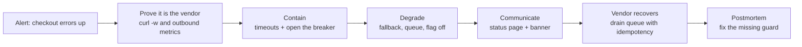
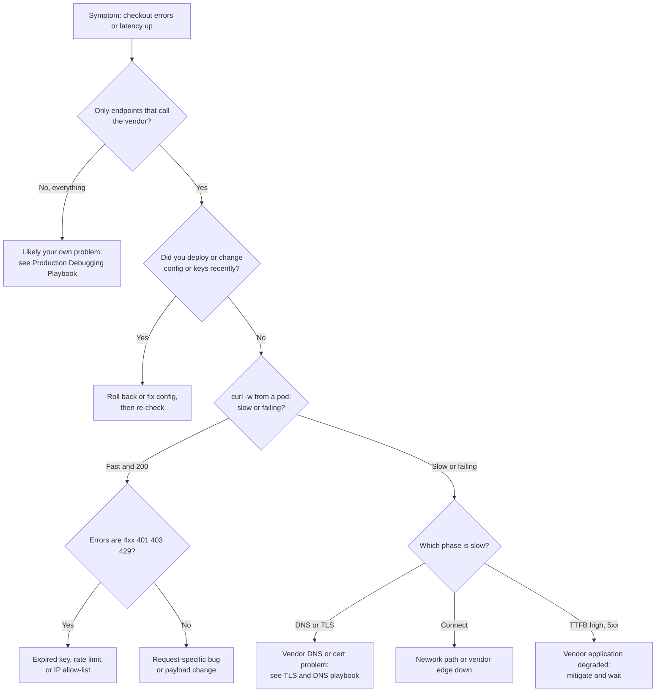
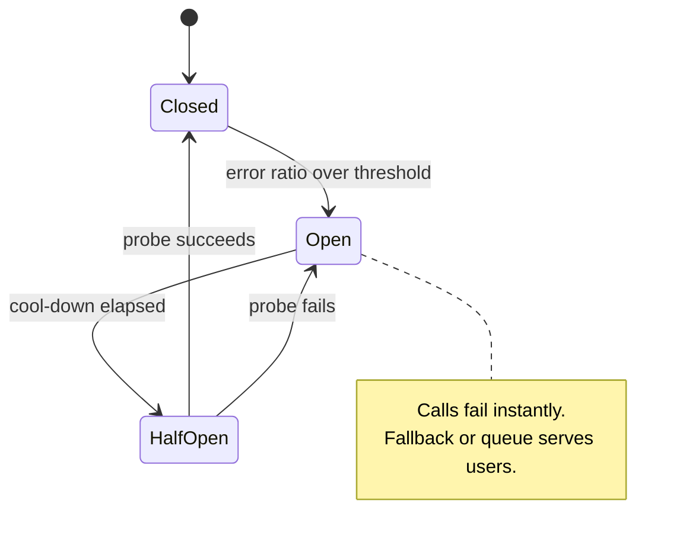
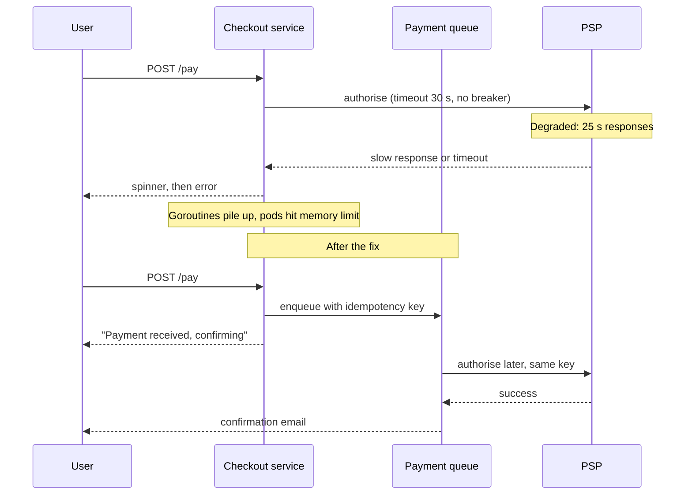
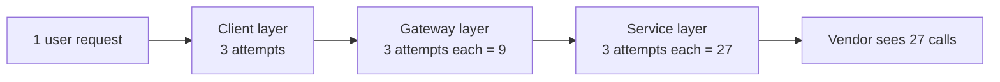

# Playbook - Third-Party Dependency Outage

> [!summary] TL;DR
> A third-party dependency (payment provider, SMS gateway, maps API, identity provider) is slow or down, and your service is hurting because of it. You cannot fix their system. Your job is to **stop their problem from becoming yours**: prove it is them in two minutes, cap how long you wait, stop sending traffic that will fail, switch to a fallback or queue the work, and tell users honestly what still works.

> [!abstract] Core idea
> - **Prove it is them, quickly.** One `curl -w` timing breakdown from a pod plus your outbound error and latency metrics tells you whether the dependency or your own code is at fault.
> - **Slow is worse than down.** A dead dependency fails fast. A slow one holds your goroutines, connections and threads, and takes your service down with it (a **cascading failure**).
> - **Mitigate with the four levers:** timeout, circuit breaker, fallback or queue, feature flag. Do not wait for the vendor.
> - **Retries can finish the job the outage started.** Retrying into a struggling vendor multiplies load by 3x or more. Cap retries and use a retry budget.
> - **Protect money first.** Queue payments with idempotency keys so recovery never double charges.

### Whiteboard version

The shape of the whole playbook in one picture: confirm, contain, degrade, recover.



## 1. Why it exists

Every modern product leans on vendors you do not control: a payment service provider (PSP), an SMS or email gateway, a maps or geocoding API, a KYC check, an auth provider. When one of them has a bad hour, your dashboards go red even though you deployed nothing.

**Symptoms you will see:**

- Errors or latency rise on exactly the endpoints that call the vendor (checkout, login with SSO, OTP sending), while unrelated endpoints stay healthy.
- Outbound call latency jumps from 200 ms to the full timeout value, or to 30 s if no timeout is set.
- Goroutine count, open connections and memory climb steadily as requests pile up waiting.
- Eventually the whole service looks unhealthy: health checks time out, pods restart, unrelated endpoints slow down.

**User impact:** customers cannot pay, cannot log in, or cannot get an OTP. Money may be taken by the vendor while your system believes the payment failed, which creates duplicates and reconciliation work later.

The hard part is human, not technical. Engineers keep digging through their own code because "we did not change anything". The playbook exists to shortcut that: if the vendor is the cause, the answer is containment, not debugging.

> [!tip] Remember
> A vendor outage is an incident for you even if the root cause is entirely theirs. Customers do not see the vendor, they see your product failing.

## 2. Mental model

Think of your service as a restaurant and the vendor as the only supplier of one ingredient. If the supplier's truck is late, a good restaurant does three things: stops promising dishes that need the ingredient, offers a substitute, and tells guests honestly at the door. A bad restaurant keeps taking orders for that dish, and the kitchen fills up with tickets nobody can complete until the whole kitchen is jammed.

Where the analogy breaks: a kitchen can see the empty shelf. Software only sees a slow response and cannot tell "slow" from "dead" without a timeout. That is why timeouts come first.

```mermaid
flowchart TB
    subgraph Without["Without guards: slow vendor"]
        R1["Requests arrive"] --> W1["Each handler waits 30 s"]
        W1 --> P1["Goroutines and connections pile up"]
        P1 --> X1["Memory and pool exhausted"]
        X1 --> D1["Whole service down"]
    end
    subgraph With["With guards: slow vendor"]
        R2["Requests arrive"] --> T2["Timeout 2 s"]
        T2 --> B2["Breaker opens after N failures"]
        B2 --> F2["Fast fallback or queue"]
        F2 --> OK2["Service stays up, one feature degraded"]
    end
```



The key insight: **the blast radius of a dependency should be the feature that uses it, not the service**. Everything in this playbook is about enforcing that boundary after the fact, and building it in beforehand.

> [!tip] Remember
> You are not fixing the vendor. You are shrinking the blast radius to one feature.

## 3. How it works

### First 5 minutes

1. **Confirm the problem and the blast radius.** Which endpoints, which percentage of users, is money or data at risk? Open the RED dashboard (rate, errors, duration) filtered to the outbound client. Declare severity using your table in [[Incident Response]]; a payment outage is usually SEV1 or SEV2.
2. **Check what changed.** Did you deploy, change a vendor API key, rotate a secret, change a timeout, or hit a vendor rate limit? Many "vendor outages" are your own expired key, a rate limit (HTTP 429) or an IP allow-list change. Check the vendor's status page, their status RSS or X account, and your team's vendor Slack channel.
3. **Prove it is the vendor.** Run one `curl -w` from a production pod (section below). If DNS, connect, TLS and first byte are slow or failing from your pod but fine from your laptop, it is the vendor or the network path, not your code.
4. **Mitigate first.** In this order of cheapness: lower the timeout, open the circuit breaker manually, flip the feature flag to the fallback, switch to the secondary vendor, queue the work. Do not wait for the vendor's ETA.
5. **Communicate.** Post "investigating, vendor dependency suspected" in the incident channel within minutes. Update the status page. Put a banner in the product if users are blocked. Open a support ticket with the vendor and record the ticket number.

> [!warning] Common mistake
> Restarting your own pods because "the service looks stuck". If the pods are stuck waiting on a vendor, a restart only clears the queue for 60 seconds before the new pods fill up again. It also drops in-flight payments.

### Diagnosis flowchart

From symptom to likely cause. Each leaf maps to an investigation step below.



### Investigation steps

#### A. Is the vendor slow or failing from our side?

Break one request into phases from inside a production pod. Use a pod that runs on the same network path as your service.

```bash
kubectl exec -it deploy/checkout -- sh   # or kubectl debug if the image has no shell
curl -sS -o /dev/null --max-time 10 \
  -w 'dns=%{time_namelookup} connect=%{time_connect} tls=%{time_appconnect} ttfb=%{time_starttransfer} total=%{time_total} code=%{http_code}\n' \
  https://api.vendor.example/health
```

The curl timings are **cumulative** from the start of the request, so the time spent in one phase is the difference from the previous one (for example, TLS time is `tls` minus `connect`).

| Result | Meaning | Next step |
| --- | --- | --- |
| `dns` over 1 s or the command fails to resolve | Vendor DNS or your resolver problem | Run `dig api.vendor.example` and see [[Playbook - TLS Certificate and DNS Failures]] |
| `connect` slow or times out | Network path, firewall, or vendor edge down | `curl` from a second region or node; check egress NAT and security groups |
| `tls` slow or certificate error | Vendor certificate or TLS handshake problem | `openssl s_client -connect api.vendor.example:443 -servername api.vendor.example` |
| `ttfb` high, `code=200` | Vendor application is slow | Mitigate with timeout and breaker; wait |
| `code=500/502/503` quickly | Vendor is failing fast | Open breaker, use fallback |
| `code=401/403` | Credential or allow-list problem on our side | Check key rotation, IP allow-list |
| `code=429` | You are being rate limited | Reduce rate, check retry storm, ask vendor for quota |

Then check your own outbound metrics. The metric names below are an example convention for an instrumented HTTP client (a counter `outbound_requests_total` and a histogram `outbound_request_duration_seconds`, each with a `dependency` label); use the names your client library emits.

```promql
# Outbound error ratio per dependency (5xx and timeouts counted as errors)
sum by (dependency) (rate(outbound_requests_total{outcome=~"error|timeout"}[5m]))
  /
sum by (dependency) (rate(outbound_requests_total[5m]))

# p99 latency of calls to each dependency
histogram_quantile(0.99,
  sum by (le, dependency) (rate(outbound_request_duration_seconds_bucket[5m])))
```

Reading it: if one `dependency` label spikes and the others stay flat, the vendor is confirmed. If all dependencies spike together, suspect your own egress (NAT gateway, DNS, node network).

#### B. Is the vendor failing fast or slowly?

This decides how fast your own service will fall over. Fast failure is annoying; slow failure is deadly.

```promql
# Goroutines are the early warning for "waiting on a slow dependency"
go_goroutines{job="checkout"}

# Requests currently in flight (if you export it)
sum(http_requests_in_flight{job="checkout"})
```

A goroutine count that climbs linearly while traffic is flat means handlers are blocked. Look at where they are blocked:

```bash
# Needs net/http/pprof exposed on an internal port
curl -s 'http://localhost:6060/debug/pprof/goroutine?debug=2' | head -60
go tool pprof -top http://localhost:6060/debug/pprof/goroutine
```

Thousands of goroutines in `net/http.(*persistConn).roundTrip` or `net.(*conn).Read` for the vendor's host mean you have no effective timeout. That is your proper fix, listed below.

#### C. Are our retries making it worse?

```promql
# Retry attempts as a ratio of first attempts
sum(rate(outbound_requests_total{dependency="psp",attempt!="1"}[5m]))
  /
sum(rate(outbound_requests_total{dependency="psp",attempt="1"}[5m]))
```

A ratio of 2 means each user request becomes 3 vendor calls (1 first attempt plus 2 retries); a ratio of 3 means 4 calls. Cap it now (flag or config), because an overloaded vendor cannot recover while you hammer it. See [[Timeouts, Retries and Backoff]].

#### D. Is it us after all? (auth, limits, network)

```bash
kubectl get events --sort-by=.lastTimestamp | tail -20
kubectl logs deploy/checkout --since=10m | grep -iE '401|403|429|x509|timeout|refused' | tail -30
kubectl top pods -l app=checkout
```

- `401/403` right after a secret rotation: you rotated the key but the vendor still has the old one, or the reverse. See [[Secrets Management]].
- `429`: your own traffic (or a retry storm) exceeded the quota. Check the `Retry-After` header and honour it.
- `x509` errors: see [[Playbook - TLS Certificate and DNS Failures]].
- `connection refused` from one node only: check egress NAT and security groups for that node group.

### Fixes

| Level | Action | Example |
| --- | --- | --- |
| **Immediate** | Lower timeout, open breaker, flip flag to fallback, shed non-critical calls | Set PSP client timeout to 3 s; route "pay later" to the queue |
| **Proper** | Enforce timeouts everywhere, add breaker and bulkhead per dependency, add queue plus idempotency keys, add secondary vendor | Per-vendor connection pool and concurrency limit of 50 |
| **Prevention** | Chaos test the failure (inject latency into the vendor client), synthetic monitoring of the vendor, vendor SLA review, runbook per vendor | Weekly game day that blackholes the SMS vendor |

**The four levers in detail:**

1. **Timeout.** Every outbound call gets a deadline shorter than your own caller's timeout. In Go, use `http.Client{Timeout: 3 * time.Second}` and pass `ctx` with a deadline.
2. **Circuit breaker.** After N consecutive failures or an error ratio over a threshold, stop calling the vendor for a cool-down period. Calls fail instantly. See [[Circuit Breaker]].
3. **Fallback or queue.** Return a cached value, a default, or a "we will confirm shortly" and put the work in a durable queue.
4. **Flag.** A feature flag that disables the dependency path so you can degrade in seconds without a deploy.



> [!tip] Remember
> Fix in three layers: stop the bleeding now, remove the missing guard this week, and rehearse the failure so it is boring next time.

## 4. Worked example

**A payment provider degrades during a sale (fictional, but typical).** `ShopLoop` is an e-commerce service. It calls a PSP to authorise card payments. A sale starts at 12:00.



**Timeline:**

| Time | Event |
| --- | --- |
| 12:04 | Alert: checkout 5xx ratio over 5 percent for 5 minutes. On-call acknowledges. |
| 12:06 | RED dashboard: only `/pay` is red. p99 is 28 s. Other endpoints are fine. |
| 12:07 | `curl -w` from a pod: `connect=0.02 tls=0.05 ttfb=24.1 code=200`. PSP application is slow. Vendor status page shows "investigating elevated latency". |
| 12:09 | `go_goroutines` has risen from 400 to 9,000. Pods are at 90 percent memory. Retry ratio is 3.1. |
| 12:10 | Declared SEV2. IC assigned. Comms posts "payment provider degraded, mitigating". |
| 12:12 | Mitigation 1: config flag cuts retries from 3 to 0 and PSP timeout from 30 s to 4 s. Goroutines stop growing. |
| 12:15 | Mitigation 2: breaker manually opened; flag routes "Pay" into the durable queue, UI shows "Payment received, confirming". |
| 12:20 | Error rate on non-payment endpoints back to baseline. Pods stable. |
| 12:48 | Vendor posts recovery. Breaker half-open probe succeeds. |
| 12:55 | Queue drains at a controlled 50 calls per second using the same idempotency keys. No duplicates. |
| 13:10 | Incident resolved after one stable traffic cycle; postmortem scheduled. |

**What the postmortem found:** no timeout on the PSP client (the Go default `http.Client` has none), a retry policy of 3 with no budget, no per-vendor concurrency limit, no queue path. Actions: timeouts everywhere, breaker per vendor, queue with idempotency keys, a synthetic PSP probe and a quarterly game day.

> [!warning] Common mistake
> Replaying a payment queue without idempotency keys. If the vendor did process some "failed" requests, replay charges those customers twice. Always send the same `Idempotency-Key` for retries of the same logical payment.

## 5. Variants and comparison

Different vendor types call for different degraded behaviour.

| Dependency | Degraded behaviour | Fallback |
| --- | --- | --- |
| Payment provider | Queue the charge, confirm asynchronously | Secondary PSP, "pay later" or UPI/COD |
| SMS or OTP gateway | Fail over to second gateway, then email or voice OTP | Allow password login temporarily |
| Maps or geocoding | Use cached coordinates, hide the map | Static address entry |
| Identity provider (SSO) | Keep existing sessions alive, extend token TTL briefly | Local login break-glass accounts |
| Email provider | Queue and retry later | Second provider |
| Analytics or ads | Drop silently, do not block the page | None needed |
| Feature flag service | Serve last known flag values from local cache | Hard-coded safe defaults |

**Failure mode comparison:**

| Vendor failure | Looks like | Danger to you | Best guard |
| --- | --- | --- | --- |
| Hard down | Fast errors, connection refused | Low: errors are cheap | Breaker plus fallback |
| Slow | Latency at timeout | High: resources pile up | Short timeout, bulkhead |
| Partial (some regions or tenants) | Errors for a subset | Medium: hard to spot | Per-dimension metrics |
| Wrong answers | 200s with bad data | Very high: silent corruption | Validation, reconciliation |
| Rate limiting you | 429s | Medium: caused by your retries | Retry budget, backoff |

## 6. Trade-offs

- **Short timeouts** protect you but can cut off requests that would have succeeded. Pick the timeout from the vendor's p99 plus margin, not from hope.
- **A secondary vendor** gives real resilience but costs integration effort, extra contract fees and two sets of behaviour to test. It is worth it for payments and OTP, not for analytics.
- **Queueing payments** keeps users moving but turns a synchronous "paid" into an asynchronous "pending", which affects stock reservation, UX and support load.
- **Aggressive breakers** can open on a blip and cut off a healthy vendor; lazy breakers react too late. Tune on error ratio over a minimum request count.
- **Caching vendor responses** (maps, prices, flags) hides short outages but risks stale data.
- **When not to degrade:** if correctness matters more than availability (for example, a regulatory KYC check), fail closed with a clear message rather than skipping the check.

## 7. In production

- **Per-vendor dashboards.** One panel group per dependency: error ratio, p99, breaker state, queue depth, retry ratio. The on-call should see "PSP red" in under 10 seconds.
- **Synthetic probes** that call the vendor's sandbox or health endpoint every minute from your network. You often learn of the outage before their status page does.
- **A vendor runbook** per critical dependency: contact, escalation path, support ticket template, secondary vendor switch steps, who may flip which flag.
- **Alert on your own symptoms, not the vendor's.** Alert on outbound error ratio and queue age. Vendor status pages lag reality, sometimes by an hour.
- **Contract and SLA.** Know what the vendor promises (an SLA of 99.9 percent allows roughly 43 minutes of downtime a month). Keep a log of vendor incidents for renegotiation.
- **Game days.** Blackhole a vendor in staging (iptables, a proxy that adds latency, a mock returning 503) and confirm the guards behave.
- **Egress allow-lists.** Some vendors allow only fixed IPs. A NAT change then looks like a vendor outage. Keep the list in version control.

## 8. Deep dive

**Why slow beats down in damage.** Little's Law says concurrent requests in the system equals arrival rate times time in system (L = lambda x W). With 500 requests per second and a normal 200 ms vendor call, you hold about 100 requests in flight. If the vendor slows to 20 s, you hold 10,000, which is 100 times more memory, connections and goroutines, with no change in traffic. This is why the cap on W (the timeout) matters more than almost any other setting.

**Retry amplification.** If each layer makes up to 3 attempts and there are 3 layers (client, gateway, service), a single user request can produce 27 vendor calls (3 x 3 x 3).



The fix is retries at one layer only, plus a **retry budget** (for example, retries may be at most 10 percent of normal traffic), as described in the SRE book's cascading failures chapter.

**Bulkheads.** Give each dependency its own connection pool or concurrency semaphore. When the SMS gateway hangs, it can exhaust only its 50 slots, not the shared pool the PSP and database use. See [[Bulkheads and Concurrency Limits]].

**Idempotency during recovery.** The danger window is a request that timed out on your side but succeeded on the vendor's side. Without an idempotency key your retry creates a second charge. With a stable key per logical payment, the vendor returns the original result. Also run a **reconciliation job** that compares your records against the vendor's settlement report, because no amount of retry logic removes all ambiguity.

**Fail open or fail closed.** Decide per dependency, in advance, in writing. Rate limiter backing store down: fail open (let traffic through). Fraud check down: maybe fail open below a transaction value and fail closed above. KYC down: fail closed. This is a product and risk decision, so involve those owners before an incident.

**Dependency inventory.** Many outages surprise teams because a transitive vendor (a CDN script, a font host, an analytics tag, a feature flag SDK) is on the critical path of page load. Keep a list of every third party and mark each as critical, degradable or optional. Load optional ones asynchronously with timeouts.

## 9. Interview questions

> [!question]- Your payment provider is returning slow responses and your whole service is degrading. What do you do?
> Confirm it is the vendor with a `curl -w` timing from a pod and outbound error and latency metrics. Mitigate before diagnosing: cut the timeout, cap retries, open the circuit breaker, queue payments with idempotency keys, and flip a flag to a fallback or secondary vendor. Communicate on the status page and in the product. After recovery, drain the queue at a controlled rate and run a postmortem on the missing guards.

> [!question]- Why is a slow dependency more dangerous than a dead one?
> A dead dependency fails fast, so resources are released immediately. A slow one holds goroutines, connections and memory for the full wait. By Little's Law, in-flight requests equal arrival rate times latency, so a 100 times slower vendor means 100 times more resources held, and the service collapses even though traffic did not change.

> [!question]- How do retries make a vendor outage worse, and how do you prevent it?
> Each retry adds load to a system that is already struggling, and stacked retries across layers multiply (3 layers with 3 attempts each can mean 27 calls). Use retries at one layer, exponential backoff with jitter, a retry budget (a percentage of normal traffic), and honour `Retry-After` on 429s.

> [!question]- How do you avoid double charging when replaying queued payments?
> Generate an idempotency key per logical payment, persist it before the first attempt, and send the same key on every retry and replay. The vendor returns the original result for a repeated key. Add a reconciliation job against the vendor's settlement report for anything ambiguous.

> [!question]- Trap: "The vendor's status page says all systems operational, so it is not them." Do you agree?
> No. Status pages lag and often reflect the vendor's own view, not your region or tenant. Trust your own evidence: outbound metrics and a direct probe from your network. Report with data to the vendor's support and escalate.

> [!question]- How would you design to survive this before it happens?
> Treat every vendor as an unreliable network call: deadlines on every call, a circuit breaker and bulkhead per vendor, an async queue for money-moving or non-urgent work, a secondary vendor for critical paths, cached fallbacks, per-vendor dashboards, synthetic probes and regular game days that inject latency.

## 10. Cheat sheet

- Scope first: only vendor-calling endpoints red means a dependency problem.
- Prove it: `curl -sS -o /dev/null -w 'dns=%{time_namelookup} connect=%{time_connect} tls=%{time_appconnect} ttfb=%{time_starttransfer} total=%{time_total}\n' URL` from a pod.
- Check your own changes first: key rotation, 401/403/429, allow-lists.
- Watch `go_goroutines` and in-flight requests; a linear climb means no effective timeout.
- Mitigate in order: timeout, retry cap, breaker, fallback or queue, flag, secondary vendor.
- Never restart pods as the fix; the queue refills in a minute.
- Idempotency key on every money-moving call; reconcile afterwards.
- Drain queues slowly after recovery to avoid hitting the vendor with a thundering herd.
- Talk: status page, in-product banner, vendor ticket number in the incident channel.
- Prevention: timeouts, breakers, bulkheads, queues, probes, game days.

## Links

- **Before this:** [[Incident Response]], [[Production Debugging Playbook]], [[Timeouts, Retries and Backoff]]
- **Mechanisms used here:** [[Circuit Breaker]], [[Bulkheads and Concurrency Limits]], [[Load Shedding and Graceful Degradation]]
- **Related playbooks:** [[Playbook - TLS Certificate and DNS Failures]]
- **Tools:** [[Network Debugging Toolkit - dig, curl, ss, tcpdump]], [[Debugging Memory Leaks and OOMs in Go]], [[Metrics and Prometheus]]
- **After the incident:** [[Postmortems and Root Cause Analysis]], [[Secrets Management]]
