# Playbook - Traffic Spike and DDoS

> [!summary] TL;DR
> Traffic suddenly jumps and the site gets slow or returns 5xx. First decide whether the extra traffic is real users (a launch, a sale, a viral post) or hostile (DDoS, scraping, a retry storm). Then protect the core: shed load, cache harder, block at the edge, scale only if the bottleneck can actually scale.

> [!abstract] Core idea
> - **Classify the traffic before you act.** Real users need capacity and degradation. Attackers need blocking. A retry storm needs the retries stopped.
> - **Mitigate at the outermost layer you control** (CDN, WAF, load balancer) so bad traffic never consumes origin capacity.
> - **Scaling out is not always the fix.** If the database is the bottleneck, adding web pods makes it worse.
> - **Protect the money path.** Checkout and login stay alive; recommendations and search may degrade.

## Start here: the basics 🟢

> [!info] How to read this note (pick your level)
> - 🟢 **New to this?** Read "From zero" below, then sections 1, 2 and the cheat sheet (15). Stop there, that is a full first pass.
> - 🟡 **Know the basics?** Add section 3, the on-call steps (4, 5, 6), fixes (7), the worked example (8), and 9-10.
> - 🔴 **Interview / SDE-3 prep?** Add 11, 12 and 13. Headings are tagged 🟢🟡🔴 so you always know where you are.

**From zero, in 60 seconds** 🟢

Your site is built to handle a normal amount of visitors.
Sometimes 10 times more arrive in one minute. That is a **traffic spike**.
It can be good news: a sale, or a famous person sharing your link.
It can be an attack: someone floods you with junk requests to knock you over. That is a **DDoS**.
It can even be your own apps retrying failed calls in a loop.
All three look the same at first: lots of requests, slow pages, errors.

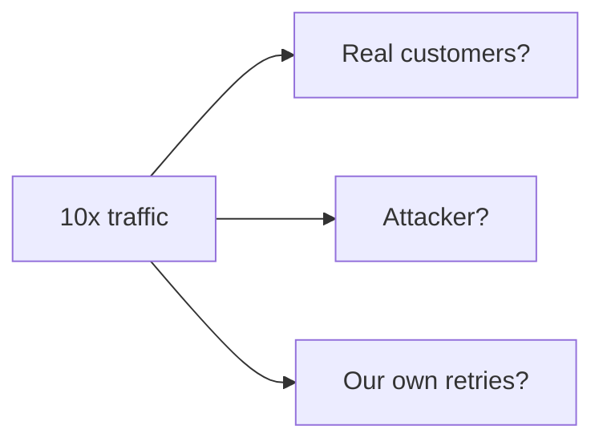

Each needs a different fix, so the first job is to tell them apart.

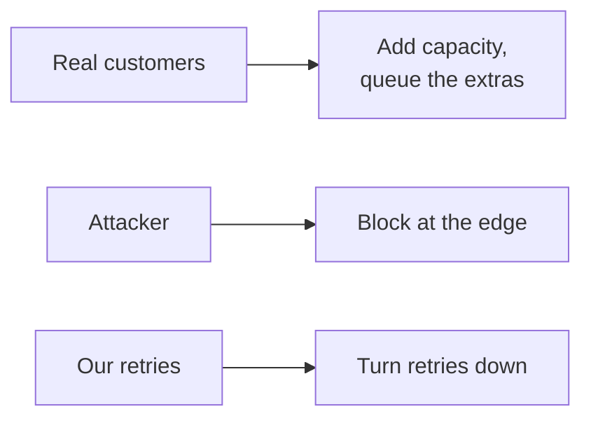

The rest of this note is just these 3 questions:
1. Who is sending all this traffic?
2. How do you keep the site up right now?
3. How do you get ready so the next spike is boring?

**The problem in one story.**
Your shop starts a flash sale and traffic jumps ten times in one minute.
Pages slow down, then show errors.
Is it happy customers, an attacker flooding you, or your own apps retrying in a loop?
Each needs a different fix, so you must tell them apart fast.

**Words you need first**

| Word | Plain meaning | Tiny example |
| --- | --- | --- |
| Request rate | How many requests arrive per second | 2,000 req/s normally, 20,000 now |
| DDoS | Many machines flooding you on purpose | 50,000 bots hitting `/login` |
| Retry storm | Clients retrying failures so load multiplies | 3 layers x 3 retries = 27 calls |
| CDN / edge | Servers near users that serve and filter traffic first | Cloudflare, CloudFront |
| WAF | Firewall that blocks bad HTTP requests by rules | Block one odd User-Agent |
| Rate limiting | Capping requests per client | 100 req/min per IP |
| Load shedding | Rejecting low-value work on purpose to save the core | Turn off recommendations |
| Bottleneck | The one part that runs out first | The database connection limit |

**Picture it**

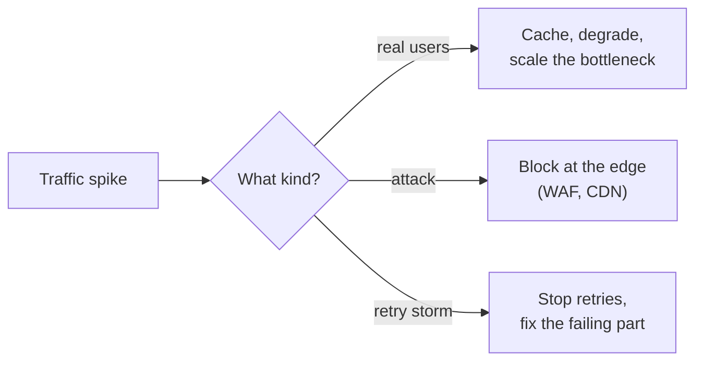

**Analogy.** A store with a crowd at the door. Shoppers need more tills; a mob needs security at the gate; a crowd re-queueing because the till is broken needs the till fixed.
Where it breaks: in a store you can see who is who; online, bots look like users until you study paths, IPs and User-Agents.

**How the rest of this note builds up**

- First, why spikes hurt (section 1), the classify-then-protect model (section 2) and how overload builds up (section 3).
- Then the on-call path: first 5 minutes, diagnosis flowchart, investigation by cause, and fixes (sections 4-7).
- Then a flash sale worked example, variants and trade-offs (sections 8-10).
- Finally the SDE-3 depth: production practice, SYN cookies, amplification, connection fan-out, slow attacks, retry amplification (sections 11-12).

> [!tip] Remember
> Classify the traffic first, block at the outermost layer, and scale only what can actually scale.

## 1. Why it exists 🟢

Symptoms the on-call sees:

- Request rate jumps to 5-50 times normal within minutes (the exact multiple varies; the alert fires on a ratio to the same hour last week).
- p99 latency climbs, then 502/503/504 appear. CPU, connection counts or database load saturate.
- Health checks start failing, pods restart, and capacity shrinks exactly when it is needed.

User impact: pages time out, checkout fails, logged-in users get kicked out, and legitimate customers are indistinguishable from the flood at the application layer.

Example for this note: ShopRight runs a flash sale at 12:00. Normal load is 800 req/s. At 12:00:30 it is 9,000 req/s, and half of that comes from a few thousand IPs hitting `/api/search` with random query strings. This mix of real and hostile traffic is the hard case.

> [!tip] Remember
> A spike has three possible faces: wanted, unwanted, or self-inflicted. The fix differs for each.

## 2. Mental model 🟢

Think of a nightclub on a night with a queue around the block.

- The **bouncer at the street door** (CDN/WAF) turns away obvious troublemakers before they enter.
- The **door count limit** (rate limit, load shedding) stops the room from becoming unsafe for everyone inside.
- **VIP rope** (priority classes) keeps regulars and paying customers moving.
- The **kitchen** (database) cannot serve 10 times the orders by adding waiters (web pods).

The analogy breaks down because attackers can look exactly like customers, and they can change their disguise every minute.

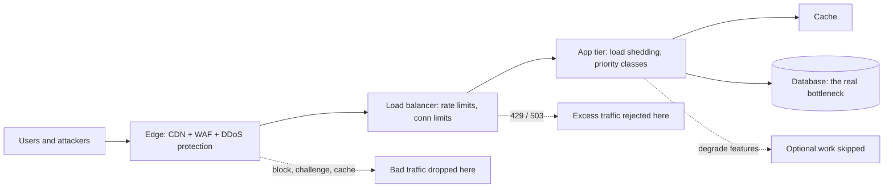

## 3. How it works 🟡

### The three attack families

**In plain words:** attackers can exhaust bandwidth, exhaust connection tables, or exhaust application work. Each needs a different defense.

| Layer | Name | Example | Tell-tale sign | Defended by |
| --- | --- | --- | --- | --- |
| L3/L4 volumetric | UDP/ICMP/DNS-amplification flood | Fills the network pipe | Link saturated, tiny packets, source IPs spoofed or reflector IPs | Upstream scrubbing (ISP, Cloudflare, AWS Shield) |
| L4 protocol | SYN flood | Fills the half-open connection queue | Many `SYN-RECV` sockets in `ss -s`, `conntrack` table full | SYN cookies, LB with SYN protection |
| L7 application | HTTP flood, slow requests (Slowloris), expensive endpoints | Real HTTP requests to `/search` | Normal-looking requests, high CPU or DB load, one path dominates | WAF rate rules, caching, challenges, auth |

**Why it matters:** an L7 flood will not show up as a saturated network link, so teams that only watch bandwidth miss it.

### Spike or attack: telling them apart

**In plain words:** real customers browse normally and buy things. Attackers hit the same page over and over from odd places.

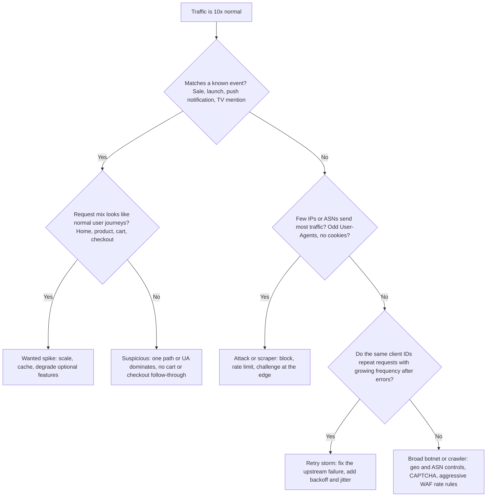

> [!warning] Common mistake
> Blocking by geography or User-Agent alone. Botnets use residential IPs across many countries and spoof User-Agent strings. Use behaviour (request rate per client, path mix, missing cookies) as the primary signal.

> [!tip] Remember
> Compare the request mix to a normal day. Real users browse then buy; bots hammer one URL.

## 4. First 5 minutes 🟡

1. **Confirm and size it.** Open the traffic dashboard. Is req/s up, and which status codes (`5xx`, `429`) are rising? Which regions, services and endpoints are affected? Is checkout alive?
2. **Check what changed.** Last deploy, config or feature-flag change, marketing campaign, push notification, partner integration, upstream outage that could cause retries. Ask the marketing channel directly.
3. **Mitigate first**, cheapest and most reversible first:
   1. Turn on the provider's "under attack" mode or a WAF rate rule at the edge.
   2. Enable aggressive caching on read-heavy endpoints (even 5-30 seconds helps).
   3. Shed load on non-critical paths (feature flag off recommendations, search suggestions).
   4. Only then scale out, and only the tier that is actually saturated.
4. **Communicate.** Declare the severity per [[Incident Response]], open the incident channel, name the Incident Commander, post a status-page update ("degraded performance, investigating") within about 10 minutes, and repeat every 15-30 minutes.

## 5. Diagnosis flowchart 🟡

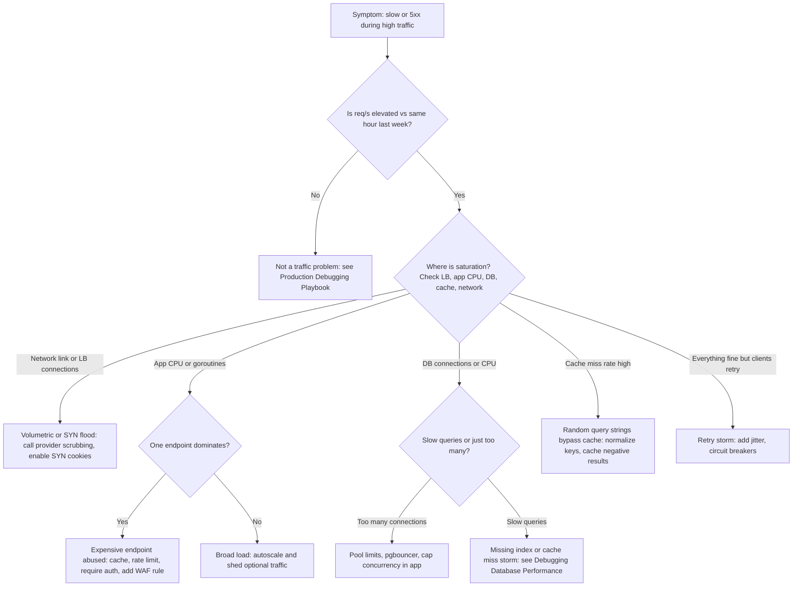

## 6. Investigation steps by cause 🟡

### 6.1 Is it real traffic? Dashboards and PromQL

**In plain words:** compare today with the same hour last week, and see which pages get the extra traffic.

Assume the standard HTTP metrics `http_requests_total{service,path,status}` and `http_request_duration_seconds_bucket` (names depend on your instrumentation; see [[Metrics and Prometheus]]).

```promql
# Total request rate
sum(rate(http_requests_total[1m]))

# Compare with the same time one week ago (spike multiple)
sum(rate(http_requests_total[5m])) / sum(rate(http_requests_total[5m] offset 1w))

# Which paths take the traffic?
topk(5, sum by (path) (rate(http_requests_total[1m])))

# Error ratio
sum(rate(http_requests_total{status=~"5.."}[1m])) / sum(rate(http_requests_total[1m]))

# p99 latency
histogram_quantile(0.99, sum by (le) (rate(http_request_duration_seconds_bucket[5m])))
```

What it means: a spike multiple of 10 with one path taking 80% of requests points at abuse of that endpoint or a flawed client. A spike evenly spread across home, product and cart points at real users.

### 6.2 Who is sending it? Access logs

**In plain words:** sort the request log by IP address, country and browser type. Attacks usually stand out.

```bash
# Top client IPs in the last 10000 nginx log lines (combined log format, IP is field 1)
tail -n 10000 /var/log/nginx/access.log | awk '{print $1}' | sort | uniq -c | sort -rn | head -20

# Top paths
tail -n 10000 /var/log/nginx/access.log | awk '{print $7}' | cut -d'?' -f1 | sort | uniq -c | sort -rn | head

# Top User-Agents (the quoted field)
tail -n 10000 /var/log/nginx/access.log | awk -F'"' '{print $6}' | sort | uniq -c | sort -rn | head
```

What it means: if 20 IPs account for 60% of requests, block them. If thousands of IPs each send a few requests with the same path pattern and the same odd User-Agent, you need a fingerprint-based WAF rule instead.

### 6.3 Network and connection table (host or node)

**In plain words:** check whether the machines are running out of open connections, not just CPU.

```bash
ss -s                                   # socket summary: estab, synrecv, timewait
ss -tn state syn-recv | wc -l           # half-open connections
ss -tn state established '( sport = :443 )' | awk 'NR>1{print $4}' | sed 's/:[0-9]*$//' | sort | uniq -c | sort -rn | head   # top peer IPs (peer is column 4 when a state filter is used)
conntrack -C                            # current conntrack entries (needs conntrack-tools)
sysctl net.netfilter.nf_conntrack_max   # table ceiling
sysctl net.ipv4.tcp_syncookies          # 1 = SYN cookies enabled when queue overflows
```

What it means: thousands of `syn-recv` sockets with a falling `estab` count indicates a SYN flood. `conntrack -C` close to `nf_conntrack_max` explains random packet drops (`dmesg | grep conntrack` shows "table full, dropping packet").

### 6.4 Kubernetes and the app tier

**In plain words:** check whether your app copies are full, restarting, or waiting to scale up.

```bash
kubectl top pods -n shop --sort-by=cpu | head
kubectl get hpa -n shop                 # is the autoscaler maxed out?
kubectl get events -n shop --sort-by=.lastTimestamp | tail -20
kubectl describe pod <pod> -n shop | grep -A5 -i "last state"   # OOMKilled or restarts?
```

Go service profile, taken from a pod with `net/http/pprof` enabled:

```bash
kubectl port-forward pod/<pod> 6060:6060 -n shop &
go tool pprof -top -seconds 30 http://localhost:6060/debug/pprof/profile
curl -s 'http://localhost:6060/debug/pprof/goroutine?debug=1' | head -40
```

What it means: a goroutine count that grows with request rate and sits in `net/http` or `database/sql` waits means requests pile up behind a slow dependency. The CPU profile shows whether the hot path is, for example, JSON encoding or regex on user input (a cheap request that costs the server a lot).

### 6.5 Database and cache

**In plain words:** more app copies mean more database connections. Make sure the database isn't the part that breaks.

```sql
-- PostgreSQL: how many connections and what are they doing?
SELECT state, count(*) FROM pg_stat_activity GROUP BY state ORDER BY 2 DESC;

-- Longest running queries
SELECT pid, now() - query_start AS runtime, left(query, 80)
FROM pg_stat_activity WHERE state <> 'idle' ORDER BY runtime DESC LIMIT 5;
```

```bash
redis-cli INFO stats | grep -E "keyspace_hits|keyspace_misses|instantaneous_ops_per_sec"
redis-cli INFO clients | grep connected_clients
```

What it means: many `active` or `idle in transaction` connections near `max_connections` means the database is the choke point. A falling cache hit ratio (`keyspace_hits / (hits + misses)`) during the spike often means attackers use unique query strings that bypass the cache. See [[Debugging Database Performance]] and [[Cache Failure Modes - Stampede, Avalanche, Penetration, Hot and Big Keys]].

### 6.6 Latency by hop

**In plain words:** time each step of the request to see where the extra traffic causes waiting.

```bash
curl -s -o /dev/null -w "dns:%{time_namelookup} connect:%{time_connect} tls:%{time_appconnect} ttfb:%{time_starttransfer} total:%{time_total}\n" https://shop.example.com/
```

What it means: a large `connect` time points at the network or LB queue, a large `ttfb` with a normal connect points at the application or database.

## 7. Fixes 🟡

### Immediate (minutes)

**In plain words:** the fastest moves to stay up: block bad traffic, slow down heavy users, and turn off non-essential features.

| Cause | Action |
| --- | --- |
| Volumetric / SYN flood | Enable provider DDoS mitigation (Cloudflare "Under Attack", AWS Shield Advanced response team, ISP blackhole/scrubbing). Confirm SYN cookies on. |
| L7 flood on an endpoint | WAF rate-based rule per IP on that path (AWS WAF rate-based rules, Cloudflare rate limiting). Challenge (CAPTCHA/JS) instead of hard block if unsure. |
| Expensive endpoint | Cache for 10-30 s at the CDN, disable the feature behind a flag, or require auth. |
| Real surge, DB bound | Shed non-critical traffic with a priority queue, raise pool limits carefully, add read replicas. |
| Real surge, stateless tier bound | Raise HPA max replicas; check node capacity so pods actually schedule. |
| Retry storm | Stop the failing upstream, add exponential backoff with jitter, open circuit breakers. |

Example AWS WAF rate rule (rate-based statement; the limit is evaluated per source IP over a sliding window that defaults to 5 minutes and can be set to 1, 2, 5 or 10 minutes with `EvaluationWindowSec`):

```json
{
  "Name": "rate-limit-search",
  "Priority": 1,
  "Statement": {
    "RateBasedStatement": {
      "Limit": 500,
      "AggregateKeyType": "IP",
      "ScopeDownStatement": {
        "ByteMatchStatement": {
          "SearchString": "/api/search",
          "FieldToMatch": { "UriPath": {} },
          "TextTransformations": [{ "Priority": 0, "Type": "NONE" }],
          "PositionalConstraint": "STARTS_WITH"
        }
      }
    }
  },
  "Action": { "Block": {} },
  "VisibilityConfig": {
    "SampledRequestsEnabled": true,
    "CloudWatchMetricsEnabled": true,
    "MetricName": "rate-limit-search"
  }
}
```

Start such rules in `Count` mode if you have time, to check for false positives, then switch to `Block`.

### Proper fix (days)

**In plain words:** put a protective layer (CDN and firewall) in front of everything, and hide your real servers behind it.

- Put every public endpoint behind a CDN/WAF; keep the origin's IP private (allow only CDN ranges in the security group).
- Rate limit per client and per user at the gateway, see [[Rate Limiting - Algorithms and Distributed Design]].
- Add load shedding with priority classes, see [[Load Shedding and Graceful Degradation]].
- Make expensive endpoints cheap: pagination limits, query timeouts, result caching, async jobs.
- Bot management for login, signup and search, see [[API Abuse and Bot Protection]].

### Prevention

- Load test to a multiple of expected peak and write down the breaking point per tier. See [[Performance Engineering and Capacity Planning]].
- Pre-scale before known events and warm caches.
- Agree on a degradation ladder ahead of time (what turns off first, second, third).
- Rehearse the DDoS runbook, including the provider's emergency contact.

## 8. Worked example: ShopRight flash sale incident 🟡

Times are illustrative.

| Time | Event |
| --- | --- |
| 12:00:00 | Flash sale starts. Marketing sent a push notification at 11:59. |
| 12:00:40 | Alert: error ratio above 5% for 1 minute. On-call opens the dashboard: req/s 9,000 vs 800 normal. |
| 12:02 | Top paths: `/api/search` is 55% of traffic. Cart and checkout traffic is only 6%, lower than a normal ratio. Top 40 IPs account for 35% of requests. |
| 12:04 | Database CPU is 95%. `pg_stat_activity` shows 180 active queries, mostly `SELECT ... FROM products WHERE name ILIKE ...`. |
| 12:05 | IC declared (SEV2). Status page updated. Decision: protect checkout. |
| 12:06 | Search suggestions feature flag turned off. DB CPU drops to 70%. |
| 12:08 | WAF rate rule on `/api/search`, 300 requests per 5 minutes per IP, plus a JS challenge for clients with no cookie. Bot traffic falls by about 60%. |
| 12:11 | CDN caches search result pages for 20 s, keyed by normalized query. Cache hit ratio rises from 12% to 70%. |
| 12:15 | Error ratio back under 0.5%. HPA had scaled web pods from 12 to 40, but this did not help until the DB load was reduced. |
| 12:30 | Declared mitigated. Monitoring continues. |
| Next day | Postmortem; actions below. |

Lessons: scaling web pods did nothing until the DB was protected; the `ILIKE '%term%'` query had no index; search had no rate limit.

Actions: trigram index or a search engine (see [[Search Engines and Inverted Indexes]]), per-IP rate limit, CDN caching rules, a load test of search at 10 times peak.

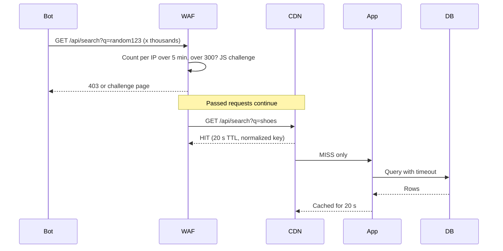

## 9. Variants and comparison 🟡

| Situation | Look like | Best first action | Wrong first action |
| --- | --- | --- | --- |
| Marketing surge | Even path mix, many unique real sessions | Scale the bottleneck tier, cache, degrade extras | Block IPs |
| L7 DDoS | One path, few IPs or fingerprints | Edge rate limit or challenge | Add web pods |
| Volumetric DDoS | Link saturated | Provider scrubbing | Anything at the app layer |
| Scraper | Steady, crawls all products | Bot management, auth for bulk data | Ignoring it (it costs money) |
| Retry storm | Requests per client rise after errors | Fix upstream, backoff and jitter | More capacity (it amplifies) |
| Credential stuffing | Spike on `/login`, high 401 rate | Per-account and per-IP limits, MFA | Caching |

## 10. Trade-offs 🟡

- **Aggressive blocking** protects the origin but may block real users behind shared NAT or mobile carrier IPs. Prefer challenges to hard blocks when unsure.
- **Caching** cuts load but serves slightly stale data and may leak personalized data if keys are wrong.
- **Autoscaling** costs money and can scale a bug or an attack, and it can stampede the database.
- **Load shedding** drops some valid requests on purpose so the rest succeed. Document which ones.
- **Always-on DDoS protection** costs more than on-demand but reacts in seconds.

## 11. In production 🔴

- Alert on the ratio to last week's same hour, not just an absolute number.
- Dashboards: req/s by path, 5xx ratio, p99, DB connections, cache hit ratio, HPA replicas against max, LB active connections.
- Keep a prepared WAF rule and a feature flag list labelled "emergency".
- Know your provider's escalation path before the day you need it.
- Failure modes: HPA at max with pending pods (no node capacity), connection pool exhaustion, an LB with idle timeouts shorter than the app's response time, health checks that are themselves expensive and cause restarts under load.

### Whiteboard version

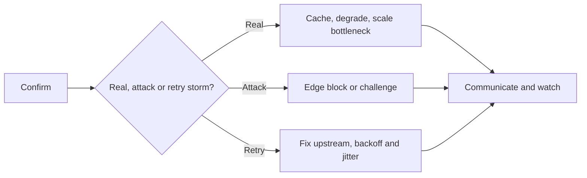

## 12. Deep dive 🔴

### Why scaling out can backfire

**In plain words:** more app copies each open their own database connections. The database can run out even if the apps are fine.

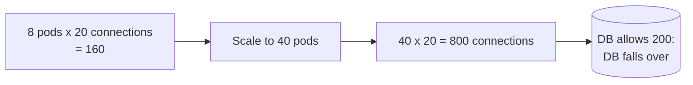

If each web pod holds 20 database connections and you go from 8 to 40 pods, you demand 800 connections from a database configured for `max_connections = 200`.

New pods queue for connections, request time rises, health checks fail, pods restart, and the cluster flaps. Fix by putting a pooler such as PgBouncer in front and by capping concurrency per pod.

### SYN cookies

**In plain words:** a Linux trick that lets a server survive a flood of fake "hello" messages without running out of memory.

With `net.ipv4.tcp_syncookies=1`, when the SYN backlog overflows the kernel encodes connection state in the sequence number of the SYN-ACK instead of storing it, so a flood cannot exhaust memory. The cost is that some TCP options are lost on the cookie path. It is a standard Linux defense, but it does nothing against bandwidth floods.

### Amplification and why upstream filtering is needed

**In plain words:** attackers trick other servers into sending you huge replies. The flood is too big for your own network, so it must be blocked before it reaches you.

In reflection attacks (DNS, NTP, memcached) the attacker spoofs your IP as the source of small requests; large replies from third-party servers land on you. The packets are filtered only before they reach your link, which is why scrubbing sits at the provider or CDN.

### The connection fan-out trap

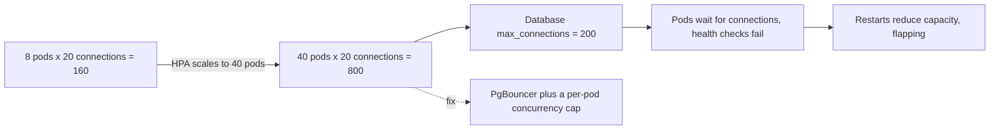

### Slow attacks

**In plain words:** instead of many requests, the attacker opens connections and sends data very slowly, so they stay open and hog your server.

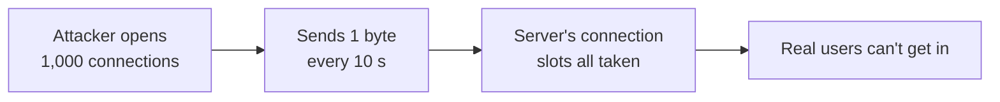

Slowloris keeps connections open by sending headers very slowly. Defenses are tight `ReadHeaderTimeout` and `ReadTimeout` on the server (in Go `http.Server`) and reverse proxy limits for header and body timeouts.

```go
srv := &http.Server{
    Addr:              ":8080",
    ReadHeaderTimeout: 5 * time.Second,
    ReadTimeout:       15 * time.Second,
    WriteTimeout:      30 * time.Second,
    IdleTimeout:       60 * time.Second,
}
```

### Retry amplification

**In plain words:** if every layer retries 3 times, one failure can turn into 27 calls at the bottom. Retry in one place only.

If each of 3 layers retries 3 times, one user failure produces up to 27 calls on the bottom service. Retry budgets and jitter keep the multiplier low; see [[Timeouts, Retries and Backoff]] and [[Circuit Breaker]].

## 13. Interview questions 🔴

> [!question]- Traffic jumps 10x and latency spikes. What do you do first?
> Confirm the metric and blast radius, check recent changes and campaigns, then classify the traffic (real, attack, or retry storm) using path mix and client distribution. Mitigate before diagnosing: edge rate limiting or caching, shed non-critical work, scale only the saturated tier. Announce the incident and keep the checkout path alive.

> [!question]- How do you distinguish a DDoS from a legitimate flash crowd?
> Compare the request mix with a normal day: real users follow journeys (browse, cart, pay), bots hit one or few paths. Check concentration by IP, ASN and User-Agent, cookie presence, and conversion rate. A matching business event (a sale, a notification) makes a flash crowd likely, but the two can overlap.

> [!question]- Why might adding more servers make the incident worse?
> A non-scalable shared dependency (database connections, a lock, a third-party rate limit) becomes the limit. More pods multiply demand on it. Fix the bottleneck with pooling, caching and load shedding, and then scale.

> [!question]- What defenses work at each OSI layer?
> L3/L4 volumetric floods need upstream scrubbing and anycast CDNs. SYN floods need SYN cookies and a protected LB. L7 floods need WAF rate rules, caching, challenges, auth and cheap endpoints. You layer them.

> [!question]- What is a retry storm and how do you stop one?
> When a dependency fails and many clients retry at once, retries multiply the load and keep the dependency down. Stop by fixing or isolating the failing service, using exponential backoff with jitter, retry budgets, circuit breakers and load shedding.

## 14. Post-incident checklist 🟡

- [ ] Timeline written and verified from logs.
- [ ] Blast radius quantified (requests failed, users affected, revenue, SLO burn).
- [ ] Temporary rules (WAF, flags, manual scaling) reviewed: keep, tune or remove.
- [ ] Root cause and contributing factors identified, see [[Postmortems and Root Cause Analysis]].
- [ ] Action items with owners and dates: indexes, rate limits, caching, load tests, runbook updates.
- [ ] Provider and contact details verified.
- [ ] Customer communication follow-up sent.

## 15. Cheat sheet 🟢

- Classify first: wanted, hostile, or self-inflicted.
- Edge first: WAF, CDN, rate limits stop traffic before it costs you.
- Protect the money path; degrade the rest.
- Scale only where the bottleneck scales; the database usually does not.
- Key tools: `ss -s`, `conntrack -C`, `kubectl top`, `pg_stat_activity`, `redis-cli INFO`, `go tool pprof`, `curl -w`.
- Key PromQL: spike multiple with `offset 1w`, `topk` by path, error ratio, `histogram_quantile`.
- Set server timeouts (`ReadHeaderTimeout`) against slow attacks.
- Communicate early; postmortem after.

## Links

- [[Incident Response]]
- [[Production Debugging Playbook]]
- [[Debugging Database Performance]]
- [[Latency, Percentiles and Bottleneck Analysis]]
- [[Load Shedding and Graceful Degradation]]
- [[Rate Limiting - Algorithms and Distributed Design]]
- [[API Abuse and Bot Protection]]
- [[CDN and Edge]]
- [[Network Debugging Toolkit - dig, curl, ss, tcpdump]]
- [[Cache Failure Modes - Stampede, Avalanche, Penetration, Hot and Big Keys]]
- [[Timeouts, Retries and Backoff]]
- [[Postmortems and Root Cause Analysis]]

### Watch on YouTube

- [How Modern Infrastructure Handles Traffic Spikes & DDoS Attacks](https://www.youtube.com/watch?v=k_lajv4pe18) · Intrilogi Optima Solusi · 72 min · 138 views
