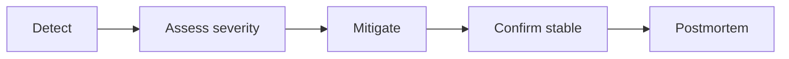
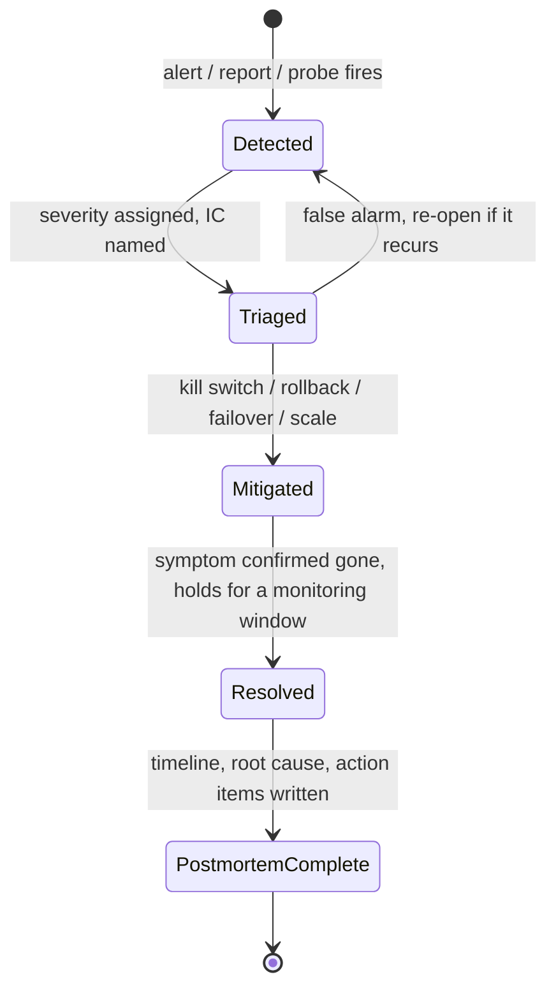
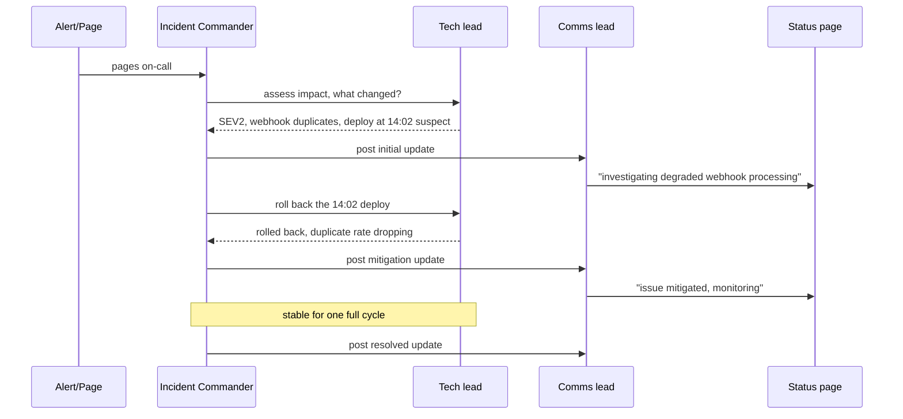

# Incident Response

> [!summary] TL;DR
> Incident response is the process a team runs while a system is actively failing: detect it, decide how bad it is, put one person in charge of the decision, stop the bleeding before explaining it, and only then find out why. A clear severity scale and named roles turn a stressful group scramble into a short, repeatable procedure.

> [!abstract] Core idea
> - **Mitigate before you understand.** Rolling back a bad deploy takes two minutes and is reversible; finding the exact root cause can take two hours. Do the cheap, reversible thing first.
> - **One person owns the decision, nobody else debugs for them.** The Incident Commander (IC) tracks state and makes calls; they do not open a terminal.
> - **Severity is a number tied to concrete criteria** (users affected, revenue, data loss), not a feeling. It decides who gets paged and how loudly.
> - **The incident ends at "stable," not at "understood."** Root cause and prevention are the postmortem's job, which starts after the pager goes quiet.

### Whiteboard version

The shape of every incident, regardless of size:



Everything in this note is about making each arrow fast and each box well-defined: what counts as "detected," who decides severity, what "mitigate" is allowed to mean before root cause is known, and how you know you are actually stable rather than just quiet for five minutes.

## 1. Why it exists

InvoiceOps's payment webhook handler commits the database update for an invoice, then returns `200 OK`. One day a load balancer timeout fires between the commit and the response: the handler's write succeeds, but the client never sees the `200`, so the payment provider's retry logic resends the same webhook. Within four minutes, the `webhook_duplicate_total` counter — normally near zero — is climbing by about 40 a minute, and support tickets about double-charged invoices start arriving.

Without an incident process, what typically happens is: three engineers independently notice the alert, two start reading unrelated parts of the code, nobody tells the on-call manager, and twenty minutes pass with no decision made about whether to disable the webhook endpoint. By the time someone finally flips the kill switch, the duplicate count has reached roughly 800 events — a bound almost entirely set by how long the group took to decide, not by how long the actual fix took to write (the kill switch was a five-line config change available from minute one).

With a defined process, the shape is different: the on-call engineer who takes the alert becomes IC by default, states "SEV2, webhook duplicates, kill switch going on now," flips it, and the duplicate count stops climbing within roughly a minute of the alert firing. The difference between the two timelines is not technical skill — it is that **mitigation did not wait for a decision about who was allowed to act.**

## 2. Mental model

An incident runs like an emergency room, not like a debugging session at a desk.

- **Triage** is the ER nurse's severity call at the door — not a diagnosis, just "how urgent is this, and who needs to see it right now."
- **The attending physician** is the Incident Commander: they coordinate who does what and make the calls, but they are not the one holding the scalpel.
- **Stabilizing the patient** comes before figuring out the underlying disease. You give fluids and stop the bleeding before you order the biopsy that explains why.
- **The discharge summary** — what happened, what was done, what to watch for — is the postmortem, written once the patient is stable, not during the emergency.

The mistake this model rules out: treating an incident like solo debugging, where one person reads code quietly until they understand the bug. An incident needs **coordination and a stop-the-bleeding action** before it needs understanding.

## 3. How it works

### Severity

| Severity | Criteria (any one qualifies) | Paging | Example |
| -------- | ----------------------------- | ------ | ------- |
| SEV1 | Full outage, data loss in progress, or a security breach | Page immediately, all hands, exec notified | Database primary down, no writes succeed anywhere |
| SEV2 | A major feature broken or degraded for most users; no data loss but user-visible | Page the on-call rotation | Checkout succeeds but confirmation emails never send for ~100% of orders |
| SEV3 | A feature broken for a minority of users, or fully broken but with a workaround | Ticket now, page only if it does not improve | One region's dashboard is slow; other regions fine |
| SEV4 | Cosmetic, internal-only, or a near-miss worth recording | Ticket, no page | A staging alert fired that should have been silenced |

Severity criteria must be concrete numbers agreed on ahead of time (what fraction of users, what dollar amount, which kind of data) — "it feels big" is not a severity level, because two different engineers will disagree about what feels big under stress, and that disagreement itself wastes the first five minutes of the incident.

### Detection

An incident starts the moment any of these fires, not the moment someone opens a laptop to look at it:

- An **alert** from the monitoring stack (see [[Alerting and On-Call]]) — the majority of SEV1/SEV2s.
- A **customer report**, through support, that matches no existing alert — often how slow-burn or partial-region issues are first seen.
- A **synthetic probe** or scheduled health check failing from outside the network, catching problems internal metrics miss (a DNS misconfiguration, a certificate expiry, a CDN edge issue).

### Roles

Borrowed from the Incident Command System (ICS) that emergency services use, and the model both PagerDuty and incident.io document for software incidents:

- **Incident Commander (IC).** Owns the incident's state and decisions: declares severity, decides what gets mitigated and when, decides when the incident is resolved. The IC does **not** read logs or write a fix themselves — the moment they start debugging, nobody is tracking the incident as a whole, and decisions stop getting made.
- **Tech/Ops lead.** The person actually in the code, dashboards, and terminals, reporting findings and options up to the IC.
- **Comms lead.** Owns the status page, the stakeholder updates, and the cadence of "we will update again in N minutes" — so the tech lead is never interrupted to answer "any update?" from six different channels.
- **Scribe.** Keeps a timestamped, factual log of what was tried and what was observed. This log becomes the postmortem's timeline verbatim, which is why it has to be written during the incident, not reconstructed from memory afterward.

For a SEV3/SEV4, one person often holds all four roles — the model does not require four separate humans, it requires that all four jobs get done by someone.

### Lifecycle



The transition most teams skip is **Mitigated → Resolved**: "the error rate just went back to zero" is not the same as "it will stay at zero." Resolved means the symptom held through at least one more full cycle of whatever caused it (one more deploy wave, one more traffic peak) before anyone stands down.

### Communication during the incident



Every arrow into Comms is the IC's job, not the tech lead's — this is the concrete reason the roles are split: without a Comms lead, "what's the status?" messages interrupt the one person actually fixing the problem.

## 4. Worked example

### Whiteboard version

The cheapest possible mitigation primitive: a boolean the code checks before doing the risky thing, flippable without a deploy.

```go
var webhookProcessingEnabled atomic.Bool // defaults false until Enable() is called

func Enable()  { webhookProcessingEnabled.Store(true) }
func Disable() { webhookProcessingEnabled.Store(false) }

func handleWebhook(w http.ResponseWriter, r *http.Request) {
    if !webhookProcessingEnabled.Load() {
        http.Error(w, "webhook processing paused", http.StatusServiceUnavailable)
        return
    }
    // ... normal processing ...
}
```

This is the entire mechanism behind "flip the kill switch" in the timeline above: a flag an IC can set from a config service or admin endpoint in seconds, with no deploy and no code change, buying time for the real fix.

### A timeline recorder for the scribe role

The scribe's timestamped log is the raw material the postmortem's timeline section is built from (see [[Postmortems and Root Cause Analysis]]). It has one real requirement: appends from multiple goroutines (the IC's handler, a Slack-bot integration, a status-page webhook) must never race or lose an entry.

```go
package incident

import (
	"fmt"
	"sync"
	"time"
)

// Entry is one factual, timestamped observation or action during an incident.
type Entry struct {
	At     time.Time
	Actor  string // "IC", "tech-lead", "auto:alertmanager"
	Action string
}

// Timeline is a concurrency-safe, append-only incident log.
// Multiple sources (a chat bot, a human, an alert webhook) append to the
// same timeline; readers always see a result sorted by arrival order.
type Timeline struct {
	mu      sync.Mutex
	entries []Entry
}

func (t *Timeline) Append(actor, action string) {
	t.mu.Lock()
	defer t.mu.Unlock()
	t.entries = append(t.entries, Entry{At: time.Now().UTC(), Actor: actor, Action: action})
}

// Since returns every entry at or after the given time, oldest first.
func (t *Timeline) Since(start time.Time) []Entry {
	t.mu.Lock()
	defer t.mu.Unlock()
	out := make([]Entry, 0, len(t.entries))
	for _, e := range t.entries {
		if !e.At.Before(start) {
			out = append(out, e)
		}
	}
	return out
}

// Render renders entries as the UTC timeline a postmortem pastes verbatim.
func (t *Timeline) Render() string {
	t.mu.Lock()
	defer t.mu.Unlock()
	s := ""
	for _, e := range t.entries {
		s += fmt.Sprintf("%s UTC  %-10s  %s\n", e.At.Format("15:04:05"), e.Actor, e.Action)
	}
	return s
}
```

Test, run with `go test -race`:

```go
package incident

import (
	"sync"
	"testing"
	"time"
)

func TestTimelineConcurrentAppendsAllRecorded(t *testing.T) {
	tl := &Timeline{}
	var wg sync.WaitGroup
	const writers = 20
	wg.Add(writers)
	for i := 0; i < writers; i++ {
		go func(n int) {
			defer wg.Done()
			tl.Append("bot", "observation")
			_ = n
		}(i)
	}
	wg.Wait()

	got := tl.Since(time.Time{})
	if len(got) != writers {
		t.Fatalf("got %d entries, want %d", len(got), writers)
	}
}

func TestTimelineSinceFiltersByTime(t *testing.T) {
	tl := &Timeline{}
	tl.Append("IC", "declared SEV2")
	cutoff := time.Now().UTC()
	time.Sleep(2 * time.Millisecond)
	tl.Append("tech-lead", "rolled back deploy")

	got := tl.Since(cutoff)
	if len(got) != 1 || got[0].Action != "rolled back deploy" {
		t.Fatalf("Since(cutoff) = %+v, want only the post-cutoff entry", got)
	}
}
```

Both tests pass under `go vet` and `go test -race` on Go 1.24.

### The InvoiceOps webhook incident, worked

| Time (UTC) | Actor | Event |
| ---------- | ----- | ----- |
| 14:02:00 | auto:deploy | New payment-service build rolled out |
| 14:06:40 | auto:alertmanager | `webhook_duplicate_total` burn-rate alert fires, SEV2 |
| 14:07:10 | on-call | Takes the page, declares self IC, posts "investigating" |
| 14:08:00 | IC | Checks "what changed": the 14:02 deploy is the only change in the last hour |
| 14:08:45 | IC | Orders rollback of the 14:02 deploy (cheaper and faster than a root-cause fix) |
| 14:10:30 | tech-lead | Rollback complete |
| 14:11:30 | IC | Duplicate rate back to baseline, confirms over one more polling cycle |
| 14:16:30 | IC | Declares Resolved after five stable minutes |

Total time to mitigation: 4 minutes 20 seconds from alert to rollback complete. Root cause (a changed timeout value that made the load balancer time out before the handler's response, not the handler being slow) was found afterward, during the postmortem, and took a further 40 minutes to isolate — confirming the mitigate-first order: a correct fix that takes 40 minutes would have let the duplicate count run roughly ten times longer than the rollback did.

## 5. Variants and comparison

| Model | How it works | Use when | Cost |
| ----- | ------------- | -------- | ---- |
| Full ICS roles (IC, tech lead, comms, scribe) | Four distinct people, each with one job | SEV1/SEV2 at a team large enough to staff it | Needs enough on-call headcount to fill four roles at 3 a.m. |
| Single on-call "do it all" | One engineer is IC, tech lead, comms and scribe at once | SEV3/SEV4, small teams, early-stage products | Nobody is dedicated to tracking state; easy to lose the timeline under pressure |
| Ad hoc "everyone jumps in" | Whoever sees the alert starts investigating, no declared IC | Anti-pattern even at small scale | No single decision-maker; duplicate effort; mitigation often delayed by debate |
| Follow-the-sun rotation | IC role handed off between timezones at shift boundaries | Incidents spanning many hours, global teams | Handoff itself is a failure point if the new IC does not get a clean timeline |

> [!warning] Interview trap
> "Who fixes the bug during an incident?" is the wrong question to lead with. The IC's job is to decide **whether and when** to mitigate, not to write the fix — conflating the two is the single most common mistake candidates make describing incident response.

## 6. Trade-offs and when not to use

- Formal roles add coordination overhead that is wasted on a SEV4 — a typo in an internal admin page does not need a four-person process.
- "Mitigate first" sometimes means rolling back a deploy that also contained an unrelated urgent fix; reverting always has an opportunity cost, which is why the IC's call must weigh user impact against it, not apply the rule blindly.
- A rigid severity rubric can be gamed (under-reporting severity to avoid paging), so the numbers behind each tier must be audited, and SEV levels should be reviewed when a SEV2 incident turns out to have hidden SEV1-level data loss discovered later.
- Running a full IC/tech/comms/scribe rotation requires enough on-call staff to fill it at any hour; a four-person team cannot realistically dedicate four people to every page.

## 7. In production

- **Real systems:** Google's SRE practice (the book's "Managing Incidents" chapter) formalized IC/Ops/Comms roles for software incidents from the ICS model; PagerDuty, Opsgenie and incident.io all ship IC-rotation tooling and status-page integrations built around the same roles; most companies run their live coordination in a dedicated chat channel (ChatOps) per incident, created automatically when a SEV1/SEV2 is declared.
- **Failure modes → fixes:**
  - No one declares IC → the paging tool auto-assigns the on-call engineer as IC by default, with an explicit hand-off command if someone else should take over.
  - The tech lead also tries to do comms → a bot posts "update in 15 minutes" automatically so the tech lead is not expected to answer ad hoc questions.
  - The incident drags for hours with the same IC → a scheduled handoff check-in (every 2 hours) forces a fatigue check and optional handoff.
  - Declared Resolved too early, symptom returns → require one full stable monitoring window (at minimum one alerting evaluation period) before declaring Resolved.
- **What to monitor:**
  - MTTD (mean time to detect) and MTTA (mean time to acknowledge) — separate numbers, because a fast detection with a slow page acknowledgment points at a paging-config problem, not a detection problem.
  - MTTR (mean time to mitigate, not mean time to root cause) — report the median and p90 together, since a single multi-day SEV1 can make the mean meaningless.
  - Repeat-incident rate: the fraction of incidents whose root cause matches a previous incident's, the clearest signal that postmortem action items are not being completed.
  - Pages per on-call shift, to catch alert fatigue before it causes a missed page.

## 8. Deep dive

**Why "mitigate before root cause" survives scrutiny.** The objection is "what if the rollback doesn't actually fix it, and we wasted time?" The answer is asymmetric cost: a rollback is a known, reversible, pre-tested state (the previous deploy was running minutes ago, under load, without this symptom), while a root-cause fix is unverified code written under pressure. Reverting to a known-good state is close to risk-free by comparison, even when it later turns out the deploy was not the actual cause — you lose a few minutes retrying, instead of risking a worse outage from an untested hotfix.

**Why the IC must not debug.** The instant the IC opens a terminal, two things degrade simultaneously: nobody is deciding whether to escalate severity, extend the incident, or bring in more people, and nobody is tracking whether "five more minutes" has turned into forty. Separating the roles is a scheduling discipline, not a skill hierarchy — the IC can be the most junior person in the room, because their job is coordination, not expertise.

**Severity as an evidence problem, not a vibe.** A useful discipline is writing the severity criteria as a table before any incident happens (as in section 3) and training the on-call rotation to match symptoms to rows, rather than asking "how bad does this feel" in the moment — under 3 a.m. stress, feelings run both too high (small cosmetic bugs declared SEV1) and too low (slow data corruption dismissed as SEV3 because nothing is "down" yet).

**Handoffs and fatigue.** An incident running past about 2 hours should trigger an explicit handoff conversation even if the current IC feels fine: decision quality degrades with fatigue in ways the fatigued person is bad at noticing in themselves, which is exactly why the check is scheduled rather than self-reported.

**"Investigating" is also an action.** The comms lead's first update should go out within minutes of declaration even with zero new information — "we are aware and investigating" sets expectations and stops a flood of "is anyone looking at this?" messages from both customers and internal stakeholders, which themselves consume the tech lead's attention.

## 9. Interview questions

> [!question]- Walk me through what you do in the first five minutes of a page.
> Acknowledge the page, assess impact against the severity table (not a gut feeling), declare yourself IC if no one else has, and check "what changed" (deploys, config, flags, traffic, data). If a cheap, reversible mitigation exists (rollback, kill switch, failover), do it before investigating further.

> [!question]- Why does the Incident Commander not debug the problem themselves?
> Because the moment they do, nobody is tracking overall state, deciding on escalation, or managing communication — the coordination job disappears. The IC's output is decisions (mitigate now? escalate? resolved?), not a diagnosis.

> [!question]- A rollback would also revert an unrelated urgent fix merged an hour ago. What do you do?
> Weigh user impact of the current incident against the cost of losing the other fix temporarily — usually still roll back, since the other fix can be re-applied in minutes once stable, while the ongoing incident is actively harming users. The IC makes this call explicitly rather than letting it block the decision.

> [!question]- How do you decide an incident is Resolved rather than just quiet right now?
> The symptom must hold through at least one full cycle of whatever drove it — one more deploy wave, one more alerting evaluation window, one more traffic peak — not just a single quiet metric reading. Declaring Resolved too early is how incidents "come back" an hour later.

> [!question]- What's the difference between MTTD, MTTA and MTTR, and why track all three?
> MTTD is detection speed (alerting quality), MTTA is acknowledgment speed (paging and on-call health), MTTR is mitigation speed (process and tooling). A slow MTTR with fast MTTD/MTTA points at the incident process itself, not at monitoring.

> [!question]- Trap: "Who is responsible for finding the root cause during the incident?"
> Nobody, by design — root cause is the postmortem's job, which starts after the system is stable. Trying to find it mid-incident is exactly the anti-pattern this process avoids; the trap is answering as if debugging and incident response are the same activity.

> [!question]- Tell me about an incident you led or participated in.
> Structure the answer around the lifecycle: what detected it, what severity and why, what the mitigation was and how fast, and one concrete number (duplicate count, users affected, minutes to mitigate). Name one thing the postmortem changed afterward.

## 10. Cheat sheet

- Mitigate first (rollback, kill switch, failover, scale, shed load, block abuser); root-cause after stable.
- Severity is a table with concrete criteria (users, revenue, data loss), not a feeling.
- Four roles: IC decides, tech lead investigates, comms lead updates, scribe records. One person can hold all four at low severity.
- The IC never debugs. The moment they do, nobody is coordinating.
- Lifecycle: Detected → Triaged → Mitigated → Resolved (one stable cycle) → Postmortem.
- Track MTTD, MTTA, MTTR and repeat-incident rate — separately, because each points at a different fix.
- Comms lead posts "investigating" immediately, even with zero new information.
- Handoff explicitly past about 2 hours; fatigue degrades judgment faster than people notice in themselves.

## Links

- **Before this:** [[Observability Fundamentals]], [[Alerting and On-Call]]
- **Next:** [[Production Debugging Playbook]], [[Postmortems and Root Cause Analysis]]
- **Compare with:** [[SLIs, SLOs, SLAs and Error Budgets]] (the numbers that often trigger detection in the first place)
