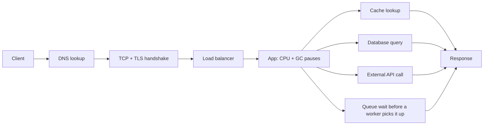
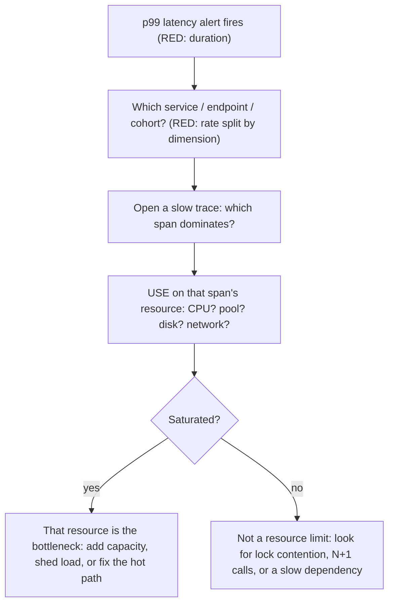
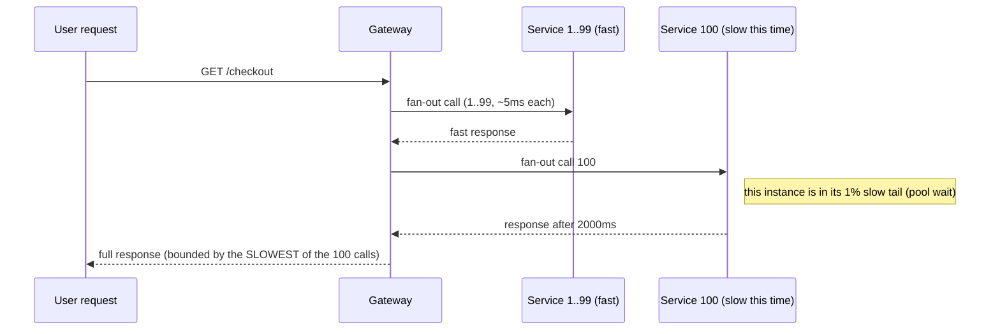

# Latency, Percentiles and Bottleneck Analysis

> [!summary] TL;DR
> Latency is how long one request takes; throughput is how many requests finish per second. A system can have great average latency and still be unusable, because the **average hides the tail**: the slice of requests (p95, p99, p99.9) that are far slower than typical. Bottleneck analysis is the discipline of finding which single stage — not a guess, a measured one — is responsible for that tail, instead of optimizing the component you assume is slow.

> [!abstract] Core idea
> - **Percentiles, not averages.** p50 is the typical request; p99 is the one in a hundred that is much worse. Averages can fall while p99 rises, and percentiles cannot themselves be averaged.
> - **Fan-out multiplies tail risk.** Call 100 services and even a rare 1%-slow dependency makes most requests hit a slow one somewhere.
> - **Little's Law (L = λW)** ties arrival rate, latency and concurrency together — it tells you how many workers or pool connections you need.
> - **Measure time, don't guess it.** The USE method (saturation of a resource) and the RED method (request-level symptoms) are the two lenses; traces show you which stage actually owns the time.
> - **How you measure latency can be wrong.** A naive load generator suffers "coordinated omission" and silently hides the exact stalls you are trying to find.

## 1. Why it exists

A checkout API has an average latency of 45ms — looks healthy on any dashboard that only plots the mean. But 1 request in 100 takes 2.1 seconds, because it happens to land on a connection pool that is momentarily full. That's 1% of users sitting on a loading spinner for two seconds, every minute, all day. The average told you nothing was wrong.

Worse: if that checkout page calls 20 downstream services to render (pricing, inventory, promotions, recommendations, ...), and each one independently has that same 1%-slow tail, the checkout page itself is slow for far more than 1% of its users — because it only needs *one* of 20 calls to be slow. That's **tail amplification**, and it's why "p99 is only slow for 1% of requests" is the wrong way to reason about a fan-out system.

Bottleneck analysis answers the next question correctly: of DNS, TLS, the load balancer, app CPU, GC, the database, a cache, an external API and a queue, which one actually owns the time in the slow 1%? Guessing wastes an afternoon optimizing a cache that was never the problem.

## 2. Mental model

Every request's total latency is a sum of two very different things:

- **Service time**: the work itself — a CPU instruction, a disk read, a network round trip.
- **Queueing time**: time spent waiting for a resource (a connection, a goroutine, a CPU core, a lock) that is busy serving someone else.

As a system's utilization climbs toward 100%, queueing time does not grow linearly — it grows **asymptotically**, because an almost-full resource occasionally has a long queue build up behind it. This is the **latency knee**: the point past which small increases in load cause disproportionate latency increases. A server at 60% CPU utilization and the same server at 95% CPU utilization can have wildly different p99s for the same average service time, because the 95%-loaded one is far more likely to have a queue.

Think of a single supermarket checkout lane. At 60% of capacity, a new customer almost never waits. At 95% of capacity, a slightly slow customer ahead of you (a wait that a 60%-loaded lane would absorb instantly) now creates a visible line. The register didn't get slower; it got closer to its limit.

## 3. How it works

### Where time goes

A single request's latency decomposes into every hop it takes:



A trace span exists for most of these hops. **The dangerous gap is the time that belongs to none of them** — the unaccounted time between the end of one span and the start of the next, which is almost always queueing: a goroutine waiting for a free OS thread, a request waiting in an HTTP server's accept queue, or a task waiting for a worker pool slot. If spans account for 30ms but the client measured 90ms, 60ms went somewhere your tracing isn't looking — usually a queue.

### The USE method and the RED method

Two complementary lenses, each answering a different question:

- **USE (Utilization, Saturation, Errors)** — Brendan Gregg's method for every *resource*: CPU, memory, disk, network, connection pools, locks. For each: what % of the time is it busy (utilization), how much work is queued waiting for it (saturation), and is it producing errors? USE finds *what is the bottleneck*.
- **RED (Rate, Errors, Duration)** — Tom Wilkie's method for every *request-driven service*: requests per second, error rate, and the duration distribution (not just the mean). RED finds *which service or endpoint is suffering*, and is usually where an on-call engineer starts before reaching for USE on the specific resource RED pointed at.



### Percentiles, and why averages lie

Given a sorted set of latencies, the p99 is the value below which 99% of requests fall (the "nearest-rank" method: for `n` samples, `rank = round(p/100 × (n-1))`, 0-indexed). The mean is dragged only a little by a rare huge value; the p99 is defined entirely by the tail. A system where 99% of requests take 10ms and 1% take 2000ms has a mean of about 29.9ms (`0.99×10 + 0.01×2000`) — looking almost fine — while its p99 is 2000ms: about 67× the mean, and 200× the typical (p50) request.

**Percentiles do not average.** `p99(A) ≈ 500ms` and `p99(B) ≈ 10ms` does **not** make the combined fleet's p99 `(500+10)/2 = 255ms`. The only correct way to combine percentiles from multiple instances is to merge the underlying samples (or histograms) and recompute the percentile on the merged distribution — see the worked example below for a case where naive averaging is off by 50×.

This is exactly why Prometheus's `histogram_quantile()` function requires **histograms**, not pre-computed per-instance quantiles: a histogram's bucket counts are additive across instances (`sum by (le) (rate(http_request_duration_seconds_bucket[5m]))`), so the merge is mathematically correct, while an average of summaries' quantiles is not. See the comparison table below.

### Tail amplification under fan-out

If a single dependency call is slow with probability `p`, and a request makes `n` independent calls to dependencies with that same slowness rate, the probability that *at least one* call is slow is `1 − (1 − p)ⁿ`. At `p = 1%` (a dependency with a clean p99) and `n = 100` fan-out calls:

```text
1 − 0.99^100 = 1 − 0.366 ≈ 0.634  →  about 63% of top-level requests hit a slow call somewhere
```

**Estimate** (model assumes independent dependency slowness; real systems share infrastructure, so correlated slowness — e.g. a shared database having a bad minute — pushes this even higher). The fix is never "make every one of the 100 calls p99 better" alone; it's bounding how much a single slow call can cost the whole request (timeout budgets, hedged requests, partial responses).



## 4. Worked example

### Whiteboard version

The core percentile computation, assuming latencies are already sorted:

```go
package wb

// Percentile returns the value at rank p (0..100) using the nearest-rank
// method. sorted must already be ascending.
func Percentile(sorted []float64, p float64) float64 {
	if len(sorted) == 0 {
		return 0
	}
	rank := int(p/100*float64(len(sorted)-1) + 0.5)
	if rank >= len(sorted) {
		rank = len(sorted) - 1
	}
	return sorted[rank]
}
```

The full version below adds the two traps that bite in production: averaging per-instance percentiles instead of merging them, and measuring latency with a load generator that suffers coordinated omission. It compiles and passes `go vet` and `go test -race` on Go 1.24.

```go
package latency

import "slices"

// MergedP99 computes the true p99 across every sample from every instance,
// as if all requests had gone through one shared histogram.
func MergedP99(perInstance [][]float64) float64 {
	var all []float64
	for _, s := range perInstance {
		all = append(all, s...)
	}
	slices.Sort(all)
	return Percentile(all, 99)
}

// AverageOfPerInstanceP99s computes each instance's own p99, then averages
// those numbers. This is the mistake: a dashboard that reports "average
// p99 across pods" is not the fleet's p99.
func AverageOfPerInstanceP99s(perInstance [][]float64) float64 {
	var sum float64
	for _, s := range perInstance {
		sorted := slices.Clone(s)
		slices.Sort(sorted)
		sum += Percentile(sorted, 99)
	}
	return sum / float64(len(perInstance))
}
```

**Measured** (this scratch module, Go 1.24, 2026-11-07): 9 instances each serve 10,000 requests at a flat 10ms; a 10th instance just started during a rollout and has served only 10 requests, one of which took 5000ms. `AverageOfPerInstanceP99s` = **509.0ms** (the low-traffic instance's p99 *is* its one slow sample, and it counts equally with 9 instances that served 1,000× more traffic). `MergedP99` on the pooled 90,010 requests = **10.0ms** (that one slow request is 1 of 90,010, nowhere near the true 99th percentile). The naive average overstates the real p99 by about 50×.

Coordinated omission, demonstrated the same way: an **open-loop** generator sends a request every fixed interval regardless of server load (what real traffic does); a **closed-loop** generator sends the next request only after the previous one completes (what a naive single-threaded benchmark does).

```go
// SimulateOpenLoop measures latency the way a real client population
// does: requests arrive at a fixed rate no matter how busy the server is.
// A request that must wait behind a slow one still gets counted, with its
// full wait time included.
func SimulateOpenLoop(serviceTimesMS []float64, intervalMS float64) []float64 {
	latencies := make([]float64, len(serviceTimesMS))
	var finish float64
	for i, svc := range serviceTimesMS {
		arrival := float64(i) * intervalMS
		start := arrival
		if finish > start {
			start = finish // queued behind the previous request
		}
		finish = start + svc
		latencies[i] = finish - arrival
	}
	return latencies
}

// SimulateClosedLoop measures the way a naive single-threaded load
// generator does: it sends the next request only after the previous one
// finishes, so the server is never behind and no queueing delay is ever
// observed — every request that *should* have piled up behind a stall is
// simply never sent, so it never appears in the sample.
func SimulateClosedLoop(serviceTimesMS []float64) []float64 {
	latencies := make([]float64, len(serviceTimesMS))
	copy(latencies, serviceTimesMS)
	return latencies
}
```

Test: 1,000 requests normally take 10ms, but request 500 hits a 2,000ms stop-the-world pause.

```go
func TestCoordinatedOmissionHidesTheStall(t *testing.T) {
	svc := make([]float64, 1000)
	for i := range svc {
		svc[i] = 10
	}
	svc[500] = 2000

	openLoop := SimulateOpenLoop(svc, 10)
	closedLoop := SimulateClosedLoop(svc)
	// ... sort both, take p99 ...
}
```

**Measured** (same module): closed-loop p99 = **10ms** — the generator was blocked waiting during the stall, so it never sent the requests that would have queued behind it, and the stall is invisible. Open-loop p99 = **2000ms** — and not just for the one stalled request: because this example's normal service time (10ms) exactly equals the fixed arrival interval (10ms), the server is running at 100% utilization even before the stall, so the 2000ms backlog never drains. The stalled request and every one of the 499 requests that arrive right after it (500 of the 1000 requests, half the sample) all end up at the full 2000ms, not a fraction of it (in a system with real slack — interval comfortably longer than service time — the backlog would instead shrink request by request back to baseline). This is why load-testing tools built for this (k6, wrk2, Gatling) use **constant-arrival-rate** execution, never "wait for the response before sending the next one."

Finally, Little's Law for pool sizing:

```go
// LittlesLawConcurrency returns L, the average number of in-flight
// requests, given an arrival rate lambda (req/sec) and average latency w
// (seconds): L = λW.
func LittlesLawConcurrency(lambdaPerSec, wSeconds float64) float64 {
	return lambdaPerSec * wSeconds
}
```

**Worked numbers:** a service handling 500 req/s at an average latency of 40ms needs `L = 500 × 0.040 = 20` requests in flight on average. A worker pool or connection pool sized below 20 *will* queue under this exact average load — size it with headroom (e.g. 30) to absorb bursts without crossing the latency knee.

## 5. Variants and comparison

| Approach | How it works | Use when | Cost |
| --- | --- | --- | --- |
| Client-side summary quantile (Prometheus `summary`) | Each process computes its own streaming quantile and exposes it | A single instance's own view is enough; low cardinality | Cannot be aggregated across instances or time windows — that's the averaging trap above |
| Histogram + `histogram_quantile()` (Prometheus `histogram`) | Fixed latency buckets per label set; counts are summed across instances, then quantile is computed on the sum | You need a fleet-wide or cross-window percentile (the common case) | Bucket boundaries must be chosen up front; precision is bounded by bucket width |
| Native histograms (Prometheus 2.40+) | Exponential bucket boundaries chosen automatically | You want histogram accuracy without hand-picking buckets | Newer feature; check your Prometheus version |
| HdrHistogram / t-digest (client library) | Mergeable, high-precision sketch kept in the app or a tracing backend | You need very precise, mergeable percentiles outside Prometheus | Extra library and memory per process |
| Open-loop load generator (k6, wrk2, Gatling) | Fixed arrival rate regardless of response time | Any latency benchmark that must be trustworthy | Needs a generator actually built for constant-arrival-rate; naive scripts default to closed-loop |
| Closed-loop load generator (naive `for` loop calling an HTTP client) | Waits for each response before sending the next | Never, for latency measurement (fine for pure throughput ceiling tests) | Silently hides tail latency (coordinated omission) |

## 6. Trade-offs and when not to use

- Percentiles need enough samples to be meaningful: a p99.9 computed from 50 requests is noise, not a measurement.
- Chasing p99.99 on an endpoint nobody waits for live (a nightly batch job) burns engineering time with no user-facing benefit — match the percentile you chase to what a human or SLA actually experiences.
- The USE method assumes you know the resource list; on an unfamiliar system, start with RED (which endpoint, which cohort) and let the trace tell you which resource to USE-check.
- Little's Law needs a stable average; during a traffic ramp or an incident the system isn't in steady state and L = λW will mislead you — use it for capacity planning, not for reading a live dashboard mid-incident.

## 7. In production

- **Real systems:**
	- Google's SRE book frames the four golden signals (latency, traffic, errors, saturation) around exactly this split between request symptoms and resource causes.
	- Envoy, Istio and most API gateways export p50/p90/p99 histograms per route out of the box, because a single "average latency" panel is considered insufficient for any serious on-call rotation.
	- Amazon's internal culture of "the customer experience is the tail, not the average" (popularized via the Dynamo paper's discussion of SLA-driven design) is the origin of designing explicitly for p99.9, not the mean.
- **Failure modes → fixes:**
	- Tail amplification under fan-out → bound the blast radius with per-call timeout budgets, hedged requests (send a second request to a different replica if the first hasn't returned by some threshold, cancel whichever finishes second), or return partial results instead of waiting for every dependency.
	- Pool exhaustion past the latency knee → size pools using Little's Law with headroom, add admission control (shed load) before every request queues, autoscale on saturation, not just CPU.
	- N+1 calls inside a hot path, missing index, lock contention → see [[Debugging Database Performance]] for the database-specific triage.
	- Retries without a budget turning one slow dependency into a retry storm → cap total retry time per request, never retry forever.
	- Large JSON payloads serialized synchronously on the hot path → stream or paginate instead of buffering the whole response.
	- Cold cache after a deploy or restart → warm the cache before serving traffic, or accept a brief, bounded p99 spike and alert on duration, not on a single breach.
- **What to monitor:** p50/p95/p99/p99.9 latency per endpoint and per dependency (never only the average); saturation per resource (CPU, pool `InUse`/`WaitCount`, goroutine count, disk queue depth); error rate alongside latency (a fast error is not a win); the gap between client-measured latency and the sum of server-side spans (unaccounted queueing time).

## 8. Deep dive

- **Why the knee happens.** This is a textbook queueing model, not a measured production curve: for a simple M/M/1 queue (Poisson arrivals, exponential service time — a simplification of a real server, which rarely matches either assumption exactly), average wait time scales with `ρ/(1−ρ)` where `ρ` is utilization (0 to 1). At `ρ = 0.5`, the factor is 1; at `ρ = 0.9`, it's 9; at `ρ = 0.99`, it's 99. Real systems don't follow this formula exactly, but they share its qualitative shape — the explanation for why a resource "at 90% CPU, still fine" can be one bad minute away from a latency cliff: the curve is not linear, it diverges as `ρ → 1`.
- **Coordinated omission, precisely.** Gil Tene's point is that most load-testing and even some in-process latency measurement (e.g. timing only requests a thread pool actually picked up) never samples the time *during which the measuring system itself was blocked*. The fix is always: decide the sampling schedule in advance (fixed-rate), and if a sample is "late" because the system was busy, record it as a very long latency rather than skipping it or compressing it.
- **Why percentiles don't average, formally.** A percentile is a quantile of a distribution, not a linear statistic; quantiles do not commute with averaging (`Q(mean(X, Y)) ≠ mean(Q(X), Q(Y))` in general). The only operation that is valid is merging the full sample sets (or additive histogram bucket counts) and computing the quantile once, on the merged distribution — exactly what `histogram_quantile(0.99, sum by (le) (...))` does in PromQL and what naive "average the per-pod p99 panel" does not.
- **Regression workflow.** When p99 jumps after a deploy: canary-compare the new version against the old one on identical traffic (not before/after on different days, which conflates time-of-day load); if that confirms a regression, take CPU profiles from both versions under the same load and diff the flame graphs — the function whose time share grew is almost always the regression's location.
- **Trace critical path.** In a trace with parallel spans, total latency is **not** the sum of every span's duration; it's the length of the longest chain of causally-dependent spans (the critical path). A span that ran in parallel and finished early is not on the critical path even if it was slow in isolation — don't "fix" it first.

## 9. Interview questions

> [!question]- p99 tripled but p50 is flat. What does that tell you, and where do you look?
> The typical request is unaffected, so this isn't a global slowdown (bad deploy to every request path, DB fully down). It's localized: a subset of requests (one cohort, one dependency, one node) or a resource near its saturation point where only the unlucky requests queue. Scope by endpoint, region, tenant and pod before touching anything; check the saturation (USE) of pools, locks and any single dependency on the slow trace's critical path.

> [!question]- How would you speed up a request that fans out to 6 downstream services?
> First measure whether the 6 calls are sequential or parallel — making them parallel (with a shared deadline) is usually the single biggest win and costs nothing. Then bound tail risk per call with a per-call timeout well inside the overall budget, consider hedged requests for the one or two calls that most often cause the tail, and design the response to degrade gracefully (return without a non-critical panel) instead of failing the whole request when one dependency is slow.

> [!question]- Why is "average the p99 across all our pods" the wrong way to get a fleet-wide p99?
> Percentiles are not a linear statistic, so they cannot be averaged; a low-traffic instance's single bad sample can dominate a naive average of per-instance p99s even though it represents a tiny fraction of total traffic. The correct method is to merge the underlying histograms (or raw samples) across instances and compute the percentile once on the pooled data — `histogram_quantile(0.99, sum by (le) (rate(...bucket[5m])))` in PromQL.

> [!question]- What is coordinated omission, and why does it matter for a load test?
> It's when the thing measuring latency only samples requests it was actually able to send, and a naive (closed-loop) load generator stops sending while the server is stalled — so the exact period you most want visibility into produces zero samples instead of very bad ones. It silently understates the real tail. Use tools built for constant arrival rate (k6, wrk2) instead of a hand-rolled "loop and wait for response" script.

> [!question]- A service's CPU sits at 55% average, but users report intermittent slow page loads. Is CPU the bottleneck?
> Not obviously — average utilization over a wide window hides short bursts to near 100% that are long enough to cause queueing (the latency knee is about instantaneous saturation, not the hourly average). Check saturation at a finer granularity (per-second, not per-5-minute) and check other resources (locks, pools, GC pauses) with the USE method before ruling CPU in or out.

> [!question]- What does Little's Law actually let you compute, and what does it assume?
> `L = λW`: the average number of requests in flight equals the arrival rate times the average time each spends in the system. Given a target throughput and measured average latency, it tells you the minimum concurrency (worker pool, connection pool size) needed to sustain that throughput without queueing. It assumes a stable, steady-state system — it will mislead you if applied to a traffic ramp or a system still recovering from an incident.

> [!question]- Trap: a teammate says "we're fine, average latency is only 40ms." What's wrong with that statement by itself?
> Nothing is necessarily wrong with the system, but the statement proves nothing: an average can be low even when a meaningful fraction of users have a terrible experience, because a few very slow requests pull the mean only slightly while percentiles expose them directly. Ask for the p95/p99/p99.9 and the sample count before accepting "we're fine."

## 10. Cheat sheet

- Latency = service time + queueing time; queueing time explodes near 100% utilization (the knee), it doesn't grow linearly.
- Never trust an average alone — always pair it with p95/p99/p99.9, and know your sample size.
- Percentiles cannot be averaged across instances or windows; merge histograms (or raw samples) and recompute.
- Tail amplification: `1 − (1−p)ⁿ` — fan-out makes a small per-call slow rate into a large top-level slow rate.
- USE method finds *which resource* is saturated; RED method finds *which request path* is hurting; use RED to scope, then USE to confirm.
- Little's Law (`L = λW`) sizes pools and worker counts from arrival rate and latency.
- A load generator that waits for each response before sending the next one suffers coordinated omission and hides exactly the stalls you're hunting.
- Trace the critical path, not the sum of every span — parallel work off the critical path isn't your bottleneck even if it looks slow alone.

## Links

- **Before this:** [[Latency Numbers Every Engineer Should Know]]
- **Next:** [[Debugging Database Performance]], [[Performance Engineering and Capacity Planning]]
- **Compare with:** [[Benchmarks, Profiling and Tracing]] (Go-specific profiling once you've localized the bottleneck), [[Back-of-the-Envelope Estimation]] (capacity math before the system exists), [[Observability in Go Services]] (how to emit the histograms this note assumes)
