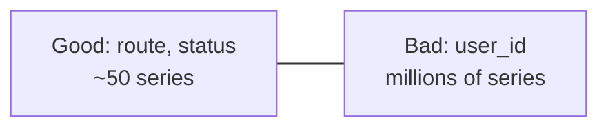
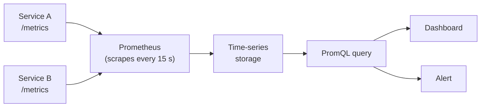
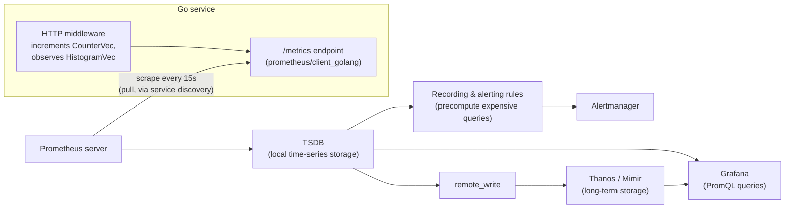
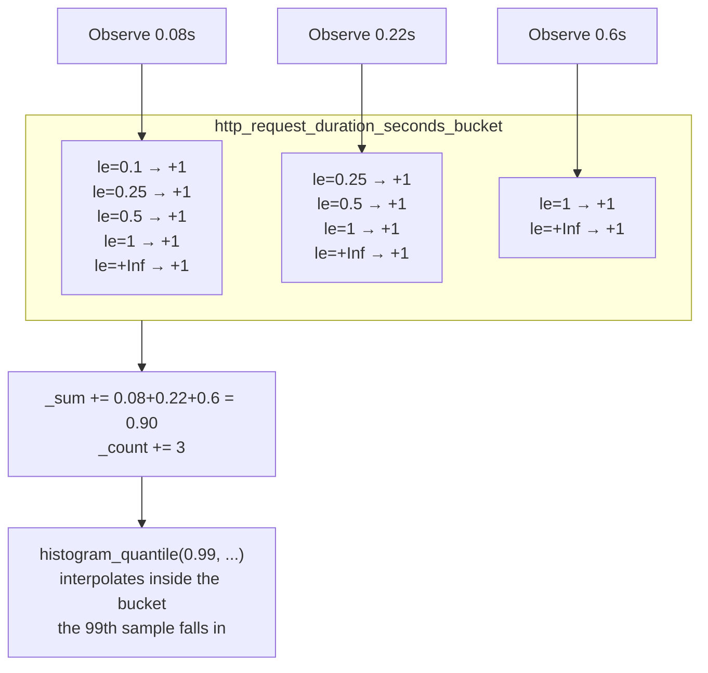

# Metrics and Prometheus

> [!summary] TL;DR
> A metric is a number that changes over time, stored as one time series per unique combination of its labels. Prometheus pulls these numbers from each service's `/metrics` endpoint on a schedule and lets you query trends, rates and percentiles over them with PromQL.

> [!abstract] Core idea
> - Prometheus has four metric types: **counter** (only goes up), **gauge** (goes up or down), **histogram** (bucketed observations, aggregatable across instances), **summary** (client-side quantiles, not aggregatable — usually the wrong choice).
> - A metric's cost is `number of distinct label-value combinations`, not the number of requests. Keep every label's possible values in a small, closed set.
> - Prometheus **pulls**: it scrapes each target's `/metrics` endpoint. Pushing is the exception (`Pushgateway`, for batch jobs that don't live long enough to be scraped).
> - Averages hide the tail. A p99 computed with `histogram_quantile()` tells you what your slowest 1% of users experience; an average can look fine while that 1% waits seconds.

### Whiteboard version

```go
var requests = prometheus.NewCounterVec(prometheus.CounterOpts{
    Name: "http_requests_total",
}, []string{"route", "method", "status"})

requests.WithLabelValues("/invoices/{id}", "GET", "2xx").Inc()
```

One counter, three bounded labels. The full version below adds a histogram, an HTTP middleware wrapper, and tests.

## Start here: the basics 🟢

> [!info] How to read this note (pick your level)
> - 🟢 **New to this?** Read "From zero" below, then sections 1, 2 and 10 (why, mental model and the cheat sheet). Stop there, that is a full first pass.
> - 🟡 **Know the basics?** Add sections 3, 4, 5 and 6 (how it works, a worked example, options and trade-offs).
> - 🔴 **Interview / SDE-3 prep?** Add sections 7, 8 and 9 (production, deep dive and interview questions). Headings are tagged 🟢🟡🔴 so you always know where you are.

**From zero, in 60 seconds** 🟢

A **metric** is a number your app keeps updating, like "requests served so far" or "how long each request took".
**Prometheus** is a tool that visits your app every 15 seconds or so, reads those numbers, and saves them over time.


Each metric can have **labels**, like route="/checkout" and status="500". Every new label combination is a separate line on the graph.
So never put user IDs in labels. That makes millions of lines and blows up memory.



The rest of this note is just these 3 questions:
1. What are the four kinds of metrics?
2. How do histograms give you percentiles like p99?
3. How do you write queries (PromQL) for rate, errors and latency?


**The problem in one story.**
Your service is slow, and you want to know since when and how often.
Reading every log line would take hours.
Instead you keep a few running numbers, like "requests so far" and "how many took over 1 second".
A tool called Prometheus collects those numbers every few seconds so you can graph and alert on them.

**Words you need first**

| Word | Plain meaning | Tiny example |
| --- | --- | --- |
| Metric | A named number tracked over time | `http_requests_total` |
| Label | A tag that splits one metric into groups | `route="/invoices"`, `status="2xx"` |
| Time series | One metric + one exact set of labels, with its values over time | Requests for `GET /invoices` returning 2xx |
| Scrape | Prometheus fetching the current numbers from a service | `GET /metrics` every 15 s |
| Counter | A number that only goes up | Total requests served |
| Gauge | A number that goes up or down | Requests in flight right now |
| Histogram | Counts of values falling into ranges ("buckets") | How many requests took ≤ 100 ms, ≤ 500 ms... |
| Cardinality | How many distinct time series exist | 5 routes × 3 statuses = 15 series |

**Picture it**



**Analogy.** A car dashboard: the odometer is a counter (only grows), the speedometer is a gauge (goes up and down), and someone writes them all down every 15 seconds.
Where it breaks: a car has a fixed handful of dials, but every new label value creates a new "dial" in Prometheus, and memory grows with each one.

**How the rest of this note builds up**

- First, why metrics exist (section 1) and a mental model of pull-based scraping (section 2).
- Then how it works: the four metric types, histogram buckets, and cardinality math (section 3).
- Then a worked Go example with middleware, tests and essential PromQL (section 4), plus variants and trade-offs (sections 5-6).
- Finally the SDE-3 deep dive: running Prometheus in production, its internals, and interview questions (sections 7-9).

> [!tip] Remember
> Use counters and histograms with a small, fixed set of label values; let Prometheus scrape them.

## 1. Why it exists 🟢

A log line can tell you one request was slow. It cannot efficiently answer "what fraction of all requests in the last 5 minutes were slower than 500ms" — that requires scanning and aggregating every log line in the window, which is exactly what metrics are built to avoid.

A Prometheus histogram pre-aggregates observations into buckets as they happen, so `histogram_quantile(0.99, ...)` over 5 minutes of traffic is a cheap query against pre-computed counters, not a scan over millions of log lines.

The trade is specificity for cheapness: a metric knows "47 requests took between 100ms and 250ms" but not which 47 requests, or anything else about them. That's why metrics and logs are both needed — see [[Observability Fundamentals]].

## 2. Mental model 🟢

A Prometheus metric is a tally board bolted to a wall: every unique label combination gets its own running tally (a time series), and Prometheus walks around every 15 seconds (by default) copying down every board's current numbers with a timestamp.

Querying is asking "show me how board X's number changed over the last hour" or "add up boards X, Y and Z."

The crucial constraint: **you only get as many boards as the label combinations you declared**. If a label can take a million different values, you get a million boards, and the wall runs out of room.

## 3. How it works 🟡

**In plain words:** your Go code bumps counters in memory, exposes them on a page, Prometheus collects them, and Grafana draws them.

The full path from one HTTP request in a Go process to a number in a Grafana panel:



Prometheus **pulls**: it holds the list of targets (via static config, Kubernetes service discovery, etc.) and initiates every scrape itself. This makes "is this target even reachable" a scrape-failure metric for free (`up == 0`), and lets Prometheus control its own load instead of being flooded by targets pushing at arbitrary rates.

### The four metric types

**In plain words:** counter only goes up, gauge goes up and down, histogram puts values into buckets, summary computes percentiles in the app.

| Type | Behavior | Example |
| --- | --- | --- |
| **Counter** | Only increases (or resets to 0 on restart) | `http_requests_total`, `errors_total` |
| **Gauge** | Goes up or down, a snapshot value | `goroutines_count`, `queue_depth`, `db_pool_in_use` |
| **Histogram** | Observations sorted into buckets, exposed as `_bucket{le="..."}`, `_sum`, `_count` | `http_request_duration_seconds` |
| **Summary** | Client-side quantiles computed in-process, exposed as `_sum`, `_count`, and per-quantile values | Rarely the right choice — see below |

A histogram exposes its raw bucket counts, so Prometheus can compute a quantile **across every instance of a service at query time** with `histogram_quantile()`. A summary computes its quantiles inside the client process, over only that one instance's observations, and those per-instance quantiles **cannot be averaged or combined across instances** — a p99 of five summaries from five pods is not the fleet's p99.

Prefer histograms; reach for a summary only when you need an exact quantile from one process and don't need to aggregate across instances.

> [!tip] Native histograms
> Newer Prometheus versions (verify the native-histogram feature's stability in your deployed version) add sparse, high-resolution histograms that avoid hand-picking bucket boundaries and cut storage cost. They are a drop-in improvement once your Prometheus and client library versions support them; the classic bucketed histogram above remains the portable default.

### A histogram's buckets, observation by observation

**In plain words:** each request's time drops into every bucket it fits under. Counting buckets later lets you estimate p95 or p99.

Three requests of 80ms, 220ms and 600ms, folded into `http_request_duration_seconds`'s buckets (each observation increments every bucket whose `le` it falls under or below, which is what makes `_bucket` values cumulative):



A 0.6s observation lands in the `le="1"` and `le="+Inf"` buckets (and every bucket above it), but **not** in `le="0.5"` — that's why the buckets are cumulative, and why `histogram_quantile()` has to walk from the smallest `le` upward to find where the target percentile falls.

### Cardinality: series count is a product

**In plain words:** multiply the number of values of each label. A few small labels are fine; one huge label ruins everything.

Series count for one metric = (number of values of label 1) × (number of values of label 2) × … For `http_requests_total{route, method, status}` with 20 routes, 4 methods and 5 status classes, that's `20 × 4 × 5 = 100` series — fine.

Swap `route` for the raw request path with unique IDs in it, and that number is unbounded. **Bounded labels** (route template, method, a 5-value status class) are the rule; **unbounded labels** (user ID, order ID, raw path, email) never belong in a metric.

## 4. Worked example 🟡

**In plain words:** Go code adding a request counter and a latency histogram to a handler, labelled by route pattern and status.

The Go code below instruments an HTTP handler with a request counter and a latency histogram, both labeled by a **route template** supplied by the caller — never the raw path — so the series count stays bounded regardless of how many distinct resources exist.

It compiles and passes `go vet` and `go test -race` on Go 1.24, using `github.com/prometheus/client_golang` v1.20.5.

```go
// Package metrics instruments an HTTP server with the three labels that make
// a dashboard useful without blowing up Prometheus's series count: route
// template, method and status class.
package metrics

import (
	"net/http"
	"strconv"
	"time"

	"github.com/prometheus/client_golang/prometheus"
)

// HTTPMetrics holds the request counter and latency histogram for one service.
type HTTPMetrics struct {
	requests *prometheus.CounterVec
	duration *prometheus.HistogramVec
}

// NewHTTPMetrics creates and registers the metrics against reg. Use a real
// *prometheus.Registry in main and prometheus.NewRegistry() in tests, so
// parallel tests never collide on the global default registry.
func NewHTTPMetrics(reg prometheus.Registerer) *HTTPMetrics {
	m := &HTTPMetrics{
		requests: prometheus.NewCounterVec(prometheus.CounterOpts{
			Name: "http_requests_total",
			Help: "Total HTTP requests, by route template, method and status class.",
		}, []string{"route", "method", "status"}),
		duration: prometheus.NewHistogramVec(prometheus.HistogramOpts{
			Name:    "http_request_duration_seconds",
			Help:    "HTTP request latency in seconds, by route template and method.",
			Buckets: prometheus.DefBuckets, // 5ms .. 10s; override per service if your p99 sits outside this range
		}, []string{"route", "method"}),
	}
	reg.MustRegister(m.requests, m.duration)
	return m
}

// statusClass collapses a status code to one of 5 values ("2xx".."5xx") so
// the "status" label stays bounded no matter how many distinct codes a
// handler can return.
func statusClass(code int) string {
	if code < 100 || code > 599 {
		return "xxx"
	}
	return strconv.Itoa(code/100) + "xx"
}

// Wrap instruments next with request count and latency, labelled by route —
// the literal pattern the caller registered it under (e.g. "/invoices/{id}"),
// never the raw request path.
func (m *HTTPMetrics) Wrap(route string, next http.HandlerFunc) http.Handler {
	return http.HandlerFunc(func(w http.ResponseWriter, r *http.Request) {
		start := time.Now()
		rec := &statusRecorder{ResponseWriter: w, status: http.StatusOK}

		next(rec, r)

		m.requests.WithLabelValues(route, r.Method, statusClass(rec.status)).Inc()
		m.duration.WithLabelValues(route, r.Method).Observe(time.Since(start).Seconds())
	})
}

type statusRecorder struct {
	http.ResponseWriter
	status int
}

func (s *statusRecorder) WriteHeader(code int) {
	s.status = code
	s.ResponseWriter.WriteHeader(code)
}
```

The test that proves the cardinality claim: two different invoice IDs hitting the same route template collapse into **one** series, not two.

```go
func TestWrapRecordsBoundedLabels(t *testing.T) {
	reg := prometheus.NewRegistry()
	m := NewHTTPMetrics(reg)

	handler := m.Wrap("/invoices/{id}", func(w http.ResponseWriter, r *http.Request) {
		w.WriteHeader(http.StatusCreated)
	})

	for _, id := range []string{"1", "2"} {
		req := httptest.NewRequest(http.MethodGet, "/invoices/"+id, nil)
		handler.ServeHTTP(httptest.NewRecorder(), req)
	}

	families, _ := reg.Gather()
	var counterFamily *dto.MetricFamily
	for _, f := range families {
		if f.GetName() == "http_requests_total" {
			counterFamily = f
		}
	}
	// Exactly one series, not one per invoice ID.
	if got := len(counterFamily.GetMetric()); got != 1 {
		t.Fatalf("got %d series for http_requests_total, want 1", got)
	}
	if got := counterFamily.GetMetric()[0].GetCounter().GetValue(); got != 2 {
		t.Fatalf("counter value = %v, want 2", got)
	}
}
```

**Measured:** the test above passes under `go test -race` (Go 1.24.4, `client_golang` v1.20.5, 2026-11-07).

### Essential PromQL

**In plain words:** a handful of queries cover most needs: requests per second, error ratio, and p99 latency.

| Query | Answers |
| --- | --- |
| `rate(http_requests_total{route="/invoices/{id}"}[5m])` | Requests/second to this route, averaged over the last 5 minutes |
| `sum by (status) (rate(http_requests_total[5m]))` | Request rate broken down by status class, summed across all instances |
| `histogram_quantile(0.99, sum by (le) (rate(http_request_duration_seconds_bucket[5m])))` | p99 latency across the whole fleet, over the last 5 minutes |
| `sum(rate(http_requests_total{status="5xx"}[5m])) / sum(rate(http_requests_total[5m]))` | Error rate (RED's "errors"), as a fraction |

`rate()` on a counter gives per-second change, correctly handling counter resets (a process restart zeroing the counter). `histogram_quantile()` needs `le` (less-than-or-equal, the bucket boundary label) grouped by `sum by (le) (...)` across instances first — summing the bucket counts across the fleet before computing the quantile, which is why a histogram (not a summary) is what makes a fleet-wide p99 possible at all.

**Representative output (Prometheus 2.54):**

```text
> histogram_quantile(0.99, sum by (le) (rate(http_request_duration_seconds_bucket{route="/invoices/{id}"}[5m])))
{} 0.812
```

## 5. Variants and comparison 🟡

| Approach | How it works | Use when | Cost |
| --- | --- | --- | --- |
| Pull scraping (`/metrics`) | Prometheus scrapes targets on a schedule via service discovery | The default for any long-running service | One scrape per target per interval; scrape failure is itself a signal |
| Pushgateway | A short-lived batch job pushes its final metrics once, Prometheus scrapes the gateway | Batch/cron jobs that exit before a scrape would ever happen | A gateway that must itself be monitored; stale metrics linger until explicitly deleted |
| `remote_write` to Thanos/Mimir | Prometheus forwards samples to long-term, horizontally scalable storage | Retention beyond local disk, or a global query view across many Prometheus instances | Extra infrastructure; query latency for very old data |
| RED (request-driven) | Rate, errors, duration, per service | APIs, RPC services | — |
| USE (resource-driven) | Utilization, saturation, errors, per resource | DB pools, queues, CPU, disk | — |
| Business metrics | Domain counters (e.g. `payments_succeeded_total`) | Answering "is the business working," not just "is the server up" | Needs product input on what to count |

## 6. Trade-offs and when not to use 🟡

- Prometheus's local storage is not built for years of high-resolution retention; use `remote_write` to Thanos or Mimir once you need more than local disk allows, or a global query view across many Prometheus servers.
- A histogram's bucket boundaries are fixed at instrumentation time; picking them wrong (e.g. `DefBuckets` topping out at 10s for a service whose p99 is 15s) silently loses resolution exactly where you need it — check and override per service.
- Metrics cannot answer "what happened on this one request" — that's what logs and traces are for; don't try to reconstruct per-request detail from aggregates.
- A summary's quantiles can't be aggregated across instances; if you ever need a fleet-wide percentile, a summary is close to useless for that purpose.

## 7. In production 🔴

- **Real systems:** Prometheus is the de facto standard scrape format, including when the client is OpenTelemetry's metrics SDK exporting in Prometheus format; Kubernetes, etcd, and most CNCF projects expose a native `/metrics` endpoint; Thanos (SoundCloud-originated) and Grafana Mimir are the two common long-term-storage layers bolted onto Prometheus; `client_golang`'s `promhttp` handler is the standard way to expose `/metrics` in a Go service.
- **Failure modes → fixes:**
  - Cardinality explosion from an unbounded label → remove the label or replace it with a bounded derivative (route template instead of path); Prometheus's own `prometheus_tsdb_symbol_table_size_bytes` and per-metric series count catch this before it pages anyone.
  - A summary used where a fleet-wide percentile was needed → switch to a histogram; it's the only type `histogram_quantile()` can aggregate across instances.
  - Expensive PromQL queries run on every dashboard load → precompute with a **recording rule** (a named, periodically-evaluated query stored as its own cheap-to-read metric).
  - Batch job's metrics never show up → it exited before Prometheus's next scrape; push to Pushgateway instead, and remember to delete its stale metric when the job is retired.
- **What to monitor:** Prometheus's own `up` metric per target (a failed scrape is itself the first alert), total active series count (catches cardinality growth before it becomes an outage), scrape duration, and WAL/TSDB disk usage.

## 8. Deep dive 🔴

- **One dashboard per service, in three rows:** a RED row (request rate, error rate, p50/p95/p99 latency for this service's own endpoints), a USE row (DB pool utilization and saturation, queue depth, CPU/memory), and a dependencies row (latency and error rate of each downstream call this service makes). This structure repeats identically across services, which is exactly what makes it fast to onboard a new on-call engineer to an unfamiliar service.
- **Detecting a slow leak from a gauge.** A connection-pool gauge (`db_pool_in_use`) that trends upward over hours without returning to baseline between traffic troughs is a leak signature — a healthy pool oscillates with load and returns near zero at low traffic. `deriv()` or a simple visual trend line over a long window (6–24h) surfaces this before the pool actually exhausts and starts failing requests.
- **Recording rules.** A rule like `record: job:http_request_duration_seconds:p99` evaluated every 30s turns an expensive `histogram_quantile()` over raw buckets into a cheap, pre-computed series any dashboard can read instantly — essential once a query is expensive enough to slow down dashboard loads or alert evaluation.
- **Business metrics alongside RED/USE.** A payment success rate (`payments_succeeded_total / payments_attempted_total`) answers "is the business working," which a healthy RED dashboard can mask entirely — a service can have 0% errors and perfect latency while silently declining every payment due to a logic bug, not an infrastructure failure.

## 9. Interview questions 🔴

> [!question]- Counter, gauge, histogram or summary: when would you use each?
> Counter for anything that only goes up (requests, errors). Gauge for a point-in-time value that moves both ways (queue depth, pool usage). Histogram for latency or size distributions you need to aggregate into a percentile across many instances. Summary only when you need an exact client-side quantile from one process and will never need to combine it across instances — which is rare.

> [!question]- Why can a summary's p99 not be averaged across instances, but a histogram's can?
> A summary computes its quantile inside the client process over its own observations only; that number has already lost the raw data, so combining five processes' p99s is not the fleet's p99 — percentiles don't average. A histogram exposes raw bucket counts (`_bucket{le=...}`), which Prometheus can sum across every instance first and only then compute the quantile from the combined buckets.

> [!question]- Why does Prometheus pull instead of receiving a push from every service?
> Pulling lets Prometheus control its own load and makes "is this target reachable" a free signal (`up == 0` on a failed scrape) without the target needing to know anything about monitoring. Pushing is kept only for Pushgateway, for jobs too short-lived to ever be scraped.

> [!question]- What determines a metric's cardinality cost?
> The number of distinct combinations of its label values — a product across every label, not the request volume. Twenty routes × four methods × five status classes is 100 series, fine; swapping the route for a raw path with unique IDs makes it unbounded.

> [!question]- Trap: "We added `user_id` as a label so we can see per-user latency in Grafana." What's wrong, and what's the fix?
> `user_id` is unbounded, so this creates one time series per user forever, and Prometheus's memory grows without limit as new users appear — a cardinality bug, not a feature. Keep per-user detail in logs or traces (which tolerate unbounded fields) and use a bounded dimension (plan tier, region) in the metric if a breakdown is genuinely needed.

> [!question]- How do you keep an expensive PromQL query from slowing down every dashboard load?
> Precompute it with a recording rule: Prometheus evaluates the expensive query periodically and stores the result as its own lightweight metric, which dashboards and alerts then read directly instead of recomputing the aggregation on every page load.

## 10. Cheat sheet 🟢

- Counter: only up. Gauge: up or down. Histogram: aggregatable buckets. Summary: client-side quantiles, not aggregatable — avoid unless you know why.
- Series count = product of each label's distinct values. Bound every label; never use an unbounded identifier.
- Prometheus pulls `/metrics`; Pushgateway is only for short-lived batch jobs.
- `histogram_quantile(0.99, sum by (le) (rate(x_bucket[5m])))` is the standard fleet-wide p99 query.
- Averages hide the tail; always look at p95/p99, not just the mean.
- Thanos/Mimir for retention beyond local disk; recording rules for expensive, frequently-read queries.
- One dashboard per service: RED row, USE row, dependencies row.
- Business metrics (payment success rate) catch logic failures that a healthy RED dashboard would hide.

## Links

- **Before this:** [[Observability Fundamentals]], [[Structured Logging]]
- **Next:** [[Distributed Tracing with OpenTelemetry]], [[SLIs, SLOs, SLAs and Error Budgets]], [[Alerting and On-Call]]
- **Compare with:** [[Observability in Go Services]] (metrics alongside logs and traces in one Go service)

### Watch on YouTube

- [Metrics SIMPLIFIED with OpenTelemetry & Prometheus](https://www.youtube.com/watch?v=tLSS2t7Md3w) · That DevOps Guy · 16 min · 9,397 views
- [How Prometheus Works - How to Collect Metrics](https://www.youtube.com/watch?v=q4fr0p-6JO0) · That DevOps Guy · 30 min · 19,344 views
