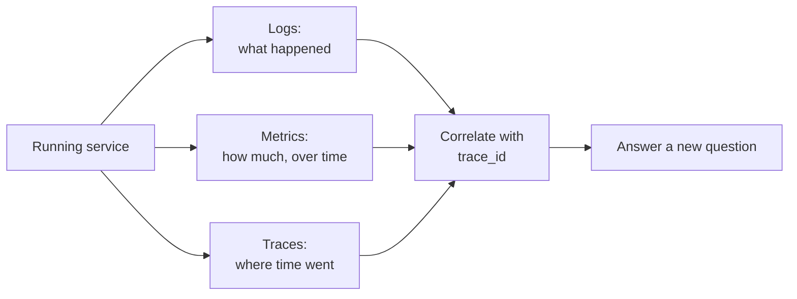
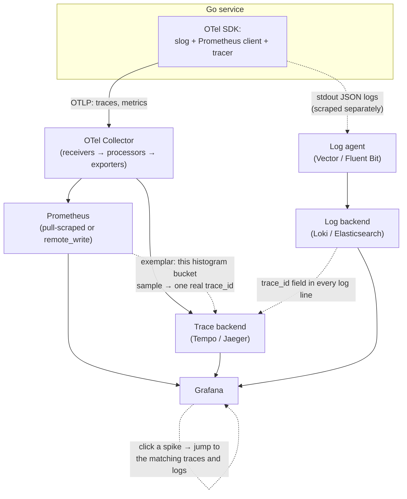
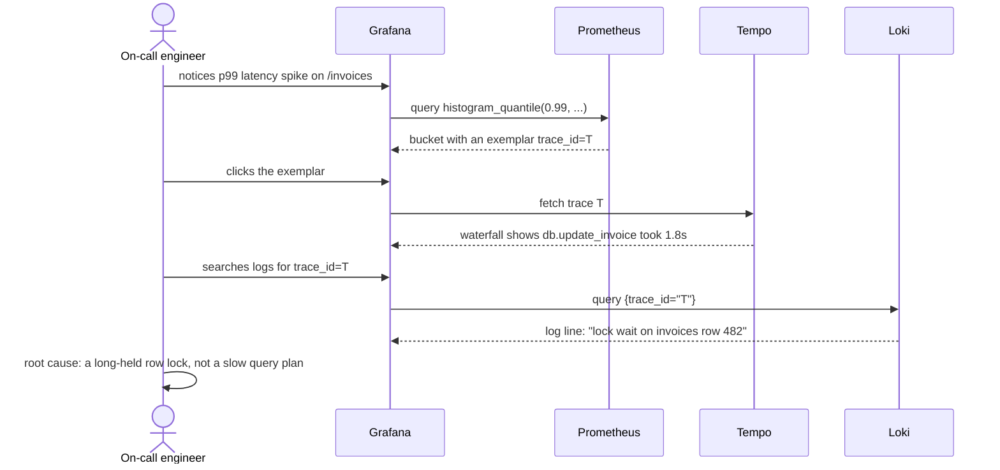

# Observability Fundamentals

> [!summary] TL;DR
> Monitoring tells you when something you already predicted goes wrong. Observability lets you ask a question you did not predict, by recording enough detail (logs, metrics, traces) that you can reconstruct what happened inside the system from its output, after the fact.

> [!abstract] Core idea
> - **Monitoring** watches known failure modes with pre-built dashboards and alerts. **Observability** is the ability to answer a new question about the system's internal state using only the telemetry it already emits — without shipping new code.
> - Three signals answer three different questions: **logs** ("what happened on this one event"), **metrics** ("how is the system behaving in aggregate, over time"), **traces** ("where did the time go, across every service one request touched").
> - **Cardinality** is the number of distinct values a label or field can take. A metric label built from something unbounded (a user ID, a raw path) creates one time series per value — Prometheus's memory grows with every new value, forever.
> - **Correlation** is what turns three separate signals into one investigation: put the same `trace_id` in every log line for a request, and the trace's slow span tells you exactly which log lines to read.

### Whiteboard version

The shape of one correlated event, before any pipeline or tooling:

```go
// One request. The trace_id ties the log line to the trace; the metric
// knows nothing about this one request at all — it only counts it.
slog.InfoContext(ctx, "invoice created",
    "invoice_id", 482, "amount_cents", 129900, "trace_id", traceID)

requestsTotal.WithLabelValues("/invoices", "POST", "2xx").Inc()
```

A log line names one event with full detail. A counter does not know this invoice's ID — only that one more POST to `/invoices` succeeded. Neither replaces the other; see [[Observability in Go Services]] for the full Go wiring.

## Start here: the basics

**The problem in one story.**
A customer says "the app was broken at 2 pm".
You can't attach a debugger to production, and the bug is gone now.
All you have is what the system wrote down while it ran.
Observability means writing down the right things so you can answer questions you didn't plan for.

**Words you need first**

| Word | Plain meaning | Tiny example |
| --- | --- | --- |
| Telemetry | Data a running system emits about itself | Logs, metrics, traces |
| Log | A timestamped record of one event | `invoice created id=482` |
| Metric | A number tracked over time, usually counts or averages | Requests per second |
| Trace | The path of one request through every service, with timings | API → billing → DB, 340 ms total |
| Span | One step inside a trace | The `db.query` step took 300 ms |
| Label / field | A key-value tag attached to data | `route="/invoices"` |
| Cardinality | How many distinct values a label can take | `status` has ~5; `user_id` has millions |
| Correlation | Linking signals with a shared ID | Same `trace_id` in the trace and the log line |

**Picture it**



**Analogy.** A flight recorder on a plane: investigators don't know in advance what will go wrong, so the recorder captures enough to reconstruct any accident.
Where it breaks: a flight recorder records everything for a short time; software telemetry costs money per byte and per label, so you must choose what to record.

**How the rest of this note builds up**

- First, why monitoring alone is not enough (section 1) and a mental model of the three signals (section 2).
- Then how it works: following a spike from metric to trace to log, push vs. pull, and sampling (section 3).
- Then a worked example (section 4), plus variants and trade-offs (sections 5-6).
- Finally the SDE-3 deep dive: production practice, cardinality and cost, and interview questions (sections 7-9).

> [!tip] Remember
> Metrics tell you something is wrong, traces tell you where, logs tell you exactly what; a shared trace_id ties them together.

## 1. Why it exists

InvoiceOps runs fine for months on four dashboards: request rate, error rate, p99 latency, and CPU. Then a customer reports "my invoice says pending for 20 minutes" — a question none of those four dashboards was built to answer, because nobody predicted "a single invoice gets stuck in the gap between the webhook handler and the worker that updates it."

A monitoring-only setup has no way to answer that: the dashboards show aggregates, not this one invoice. An observable system can answer it without a new deploy, because the telemetry was already detailed enough: filter the structured logs by `invoice_id=482`, follow its `trace_id` across the webhook handler, the database write and the worker's queue consumer, and see exactly which span took 20 minutes (queue consumer never fired — a dead consumer group, not a slow database).

The practical difference: **monitoring requires the question to be known in advance** (so a dashboard or alert can be built for it); **observability requires only that enough structured detail was recorded** that an unpredicted question can still be answered from it.

## 2. Mental model

Think of the system as a black box you cannot open, but it leaves three kinds of evidence behind:

- **Logs** are a diary: one dated entry per event, with as much detail as you wrote down.
- **Metrics** are a tally board: counts and gauges updated continuously, with no memory of any individual event, cheap to store for years.
- **Traces** are a relay baton: one request's path through every runner (service) it touched, timed leg by leg.

None of the three alone reconstructs the incident. The diary has no sense of trend ("is this normal?"); the tally board has no sense of one specific case; the baton has no sense of why — only where the time went. Observability is the discipline of keeping all three, and keeping them joinable.

## 3. How it works

The telemetry pipeline that gets data from a running service to a human looking at a graph, with the correlation links that make cross-signal debugging possible:



The solid arrows move data. The dashed arrows are **correlation**: an exemplar attaches one sampled trace ID to a histogram bucket, so clicking a latency spike in Grafana jumps straight to a real trace from that spike, and every log line carries the same `trace_id` the trace uses, so a trace's slow span names the exact log lines to read next.

### Following a spike from metric to trace to log

The debugging path the dashed correlation arrows above make possible, traced as a sequence:



Three clicks, three signals, no guessing: the metric said *when* and *how bad*, the trace said *where*, the log said *why*.

### Signals, side by side

| Signal | Answers | Cardinality | Typical cost |
| --- | --- | --- | --- |
| Logs | What happened on this one event, in full detail | Unbounded fields are fine (the event itself is the key) | Highest per-event cost; expensive to store at full fidelity for long |
| Metrics | How the system behaves in aggregate, over time | Must stay bounded (closed label sets only) | Cheapest to store for years; a bad label blows up cost instantly |
| Traces | Where time went, across every hop one request took | One trace per request; sampled, not kept in full | Moderate; controlled by the sampling rate |
| Profiles | Where CPU/memory time went, inside one process | Per-function, bounded | Low when continuous and sampled (see [[Benchmarks, Profiling and Tracing]]) |
| Events (wide structured logs) | Everything about one unit of work, as one row | High-cardinality by design, one row per unit of work | High, same as logs; the "fourth signal" in practice |

### Push vs. pull, and sampling

Metrics are usually **pulled**: Prometheus scrapes each service's `/metrics` endpoint on a schedule (see [[Metrics and Prometheus]]). Traces and logs are usually **pushed**: the SDK sends completed spans and log lines to a collector as they happen, because waiting to be scraped would mean holding a request's full trace in memory indefinitely.

A trace is either **sampled** or dropped before it is ever sent, because keeping every trace of a 10,000 RPS service is too expensive to store:

- **Head sampling** decides at the start of a trace, cheaply, often "keep 1% of traces" — simple, but a sampled-out trace might have been exactly the slow or failing one you needed.
- **Tail sampling** buffers a trace until it completes, then decides: this is why an OTel Collector exists in the middle of the pipeline — it can hold spans long enough to apply a rule like "always keep this trace if it errored or if it took over 1 second," which a head-sampling SDK cannot do, since it has not seen the outcome yet.
- The practical default: tail-sample at the collector, always keeping errors and slow traces, and apply a lower rate (1–10%) to ordinary successful traces.

## 4. Worked example

InvoiceOps's `/invoices` endpoint does 500 requests/second. A naive metric labels each request by raw path:

```text
http_requests_total{path="/invoices/482", method="GET", status="200"} 1
http_requests_total{path="/invoices/483", method="GET", status="200"} 1
...
```

**Estimate:** at 500 req/s with mostly unique invoice IDs, this metric grows by roughly 500 new time series per second. Prometheus holds each active series in memory (tens of KB of overhead per series, including its label set and chunk buffers); at that growth rate the service's own metrics exhaust Prometheus's memory within hours — a cardinality explosion caused by the instrumentation, not by traffic.

The fix is the same idea in `## 3`: label by the **route template**, never the raw path:

```text
http_requests_total{route="/invoices/{id}", method="GET", status="2xx"} 48213
```

Now the label set has exactly one entry per route × method × status class — bounded by the number of endpoints the service has, not by how many invoices exist. See [[Observability in Go Services]] for the Go middleware that records this correctly, and [[Metrics and Prometheus]] for how Prometheus stores and queries it.

## 5. Variants and comparison

| Model | What it groups metrics by | Use when |
| --- | --- | --- |
| Golden signals (Google SRE) | Latency, traffic, errors, saturation | A general-purpose starting set for any service |
| RED | Rate, errors, duration | Request-driven services (APIs, RPC) — "per request" framing |
| USE | Utilization, saturation, errors | Resources (CPU, disk, connection pools, queues) — "per resource" framing |

RED and USE are the same four golden signals split by what they're measuring: RED for things that handle requests, USE for things that get consumed. A service dashboard typically has a RED row for itself and a USE row for the resources it depends on (DB pool, queue, CPU).

> [!tip] The "three pillars" critique
> Logs, metrics and traces are useful, but splitting telemetry into three separately-stored pillars means a lot of duplicated fields (the same request ID, the same status code) copied into each one. The alternative some teams adopt is **wide structured events**: one row per unit of work, with dozens of fields, queryable like a log but aggregatable like a metric. It trades the cheapness of pre-aggregated metrics for the flexibility of asking an unpredicted question directly against the raw events — a genuine observability tool (e.g. Honeycomb), not a replacement for Prometheus-style metrics at high request volume.

## 6. Trade-offs and when not to use

- Full observability (traces on every request, wide events, long retention) costs real money and engineering time. A low-traffic internal tool may only need logs and a couple of metrics.
- More telemetry is not free: every span, every log line, every label value is a storage and processing cost. Cost control (sampling rates, retention tiers, drop rules in the collector) is part of the design, not an afterthought.
- Observability answers "what is happening inside my system," not "is my system meeting its promise to users" — that's the job of [[SLIs, SLOs, SLAs and Error Budgets]], built on top of these signals.

## 7. In production

- **Real systems:** Google's four golden signals (SRE Book, ch. 6); the OpenTelemetry Collector as the standard vendor-neutral pipeline hop between every major APM vendor (Datadog, Honeycomb, Grafana Cloud) and open-source backends (Prometheus, Tempo, Loki); Netflix and Uber's widely cited adoption of wide structured events for request-level debugging.
- **Failure modes → fixes:**
  - Cardinality explosion from an unbounded label → label by a closed set (route template, status class), never an ID; alert on Prometheus's own `prometheus_tsdb_symbol_table_size_bytes` or head series count.
  - No correlation ID → logs and traces are stuck as two separate investigations; inject `trace_id` into every log line at the framework/middleware level, not per call site.
  - Sampling too aggressively at the head → the one slow or failing trace you need was never kept; tail-sample at the collector and always keep errors and slow traces.
  - Telemetry cost grows unbounded → set retention tiers (7 days full-fidelity, 90 days downsampled) and drop rules for noisy, low-value spans/labels at the collector, not in application code.
- **What to monitor:** active time-series count per metric (catches cardinality growth early), trace sampling rate actually applied vs. configured, collector queue depth and dropped-span count, log/metric/trace ingestion cost per service.

## 8. Deep dive

- **Instrumenting a new Go service, in order:** (1) structured logs with `log/slog` and a request-scoped logger carrying `trace_id` — see [[Structured Logging]]; (2) RED metrics via `client_golang` middleware with bounded labels — see [[Metrics and Prometheus]]; (3) traces via the OpenTelemetry Go SDK with context propagated through every goroutine and queue boundary — see [[Distributed Tracing with OpenTelemetry]] and [[Observability in Go Services]]; (4) wire exemplars so a histogram bucket links to a sampled trace; (5) add the service to one dashboard with a RED row and a USE row for its dependencies.
- **Why pull for metrics, push for traces.** A pull model (Prometheus scraping `/metrics`) makes the monitoring system control its own load and makes "is this target up" trivially answerable (a failed scrape). It doesn't work for traces because a trace is a one-time event with an unpredictable duration, not a value you can re-read at the next scrape — it has to be pushed once it completes (or in a streaming fashion for very long traces).
- **Agent vs. gateway collector topology.** A collector can run as a sidecar/daemonset agent next to every service (handles local batching, local redaction, lower network hop) and/or as a central gateway cluster (does tail sampling, which needs to see every span of a trace in one place — sampling decisions can't be made correctly if spans are scattered across per-node agents making decisions in isolation).
- **Profiles as a fourth signal.** Continuous profiling (always-on, low-overhead CPU/memory sampling, e.g. pprof-based) answers "where in the code is the time going" at a level traces don't reach — a slow span says "this function call took 400ms," a profile says why, line by line. See [[Benchmarks, Profiling and Tracing]] for the Go tooling.

## 9. Interview questions

> [!question]- What is the difference between monitoring and observability?
> Monitoring answers questions you predicted in advance, with pre-built dashboards and alerts for known failure modes. Observability is the property that lets you answer a question you did not predict, using the telemetry the system already emits, without shipping new code to add a new measurement.

> [!question]- Why can't `user_id` be a metric label?
> Prometheus stores one time series per unique combination of label values. A label drawn from an unbounded set (user ID, raw path, order ID) creates a new series for every value ever seen, and series are never automatically removed — memory grows forever. Put high-cardinality identifiers in logs or trace attributes instead, where per-event storage is expected.

> [!question]- What ties logs, metrics and traces together into one investigation?
> A shared `trace_id` in every log line for a request, and an exemplar linking a histogram bucket to one sampled trace with that ID. Without the shared ID, the three signals are three separate, unconnected investigations.

> [!question]- Head sampling or tail sampling: which would you pick for traces, and why?
> Tail sampling, at least for errors and slow requests: it only keeps or drops a trace after seeing the full outcome, so it can guarantee every error and every slow trace is kept while still dropping most ordinary successful traces. Head sampling decides before the outcome is known, so it can accidentally discard exactly the trace you needed.

> [!question]- Trap: "We have Grafana dashboards for everything, so we're fully observable." What's wrong with that claim?
> Dashboards answer predicted questions — that's monitoring. Observability is being able to answer an *unpredicted* question from existing telemetry. A pile of dashboards with no way to drill from an aggregate metric down to one request's logs and trace is still just monitoring, however many dashboards there are.

> [!question]- What's the "three pillars" critique, and when would you reach for wide structured events instead?
> Storing logs, metrics and traces as three separate systems duplicates a lot of the same per-request fields and makes ad hoc, high-cardinality questions ("show me every request from this one tenant that touched this one feature flag") hard to answer from metrics (too coarse) or logs (not aggregatable). Wide structured events — one row per unit of work with many fields — trade metrics' cheapness for the ability to query and aggregate on any field after the fact; reach for them when debugging needs arbitrary high-cardinality slicing, not just a known dashboard.

## 10. Cheat sheet

- Monitoring = known questions, pre-built dashboards. Observability = can answer an unpredicted question from existing telemetry.
- Logs: one event, full detail. Metrics: aggregate trend, bounded labels. Traces: where time went, across hops.
- Cardinality = distinct label/field values. Never put an unbounded value in a metric label.
- Correlate with `trace_id` in every log line and exemplars on histograms.
- RED (rate, errors, duration) for request-driven services; USE (utilization, saturation, errors) for resources.
- Metrics are pulled (scraped); traces and logs are pushed to a collector.
- Tail-sample at the collector; always keep errors and slow traces.
- Telemetry has a real cost: set retention tiers and drop rules deliberately.

## Links

- **Before this:** none — start here.
- **Next:** [[Structured Logging]], [[Metrics and Prometheus]], [[Distributed Tracing with OpenTelemetry]]
- **Compare with:** [[Observability in Go Services]] (the Go implementation of these three signals), [[Latency Numbers Every Engineer Should Know]] (the raw numbers behind "why did this take so long")

### Watch on YouTube

- [Day-1 / Fundamentals of Observability / Observability Zero to Hero Course](https://www.youtube.com/watch?v=otY2_M_pTmU) · Abhishek.Veeramalla · 35 min · 179,945 views
- [Datadog Fundamentals in 1 Hour  Complete Observability Tutorial 2026](https://www.youtube.com/watch?v=0rSftRQEkGQ) · AiOps School · 104 min · 496 views
