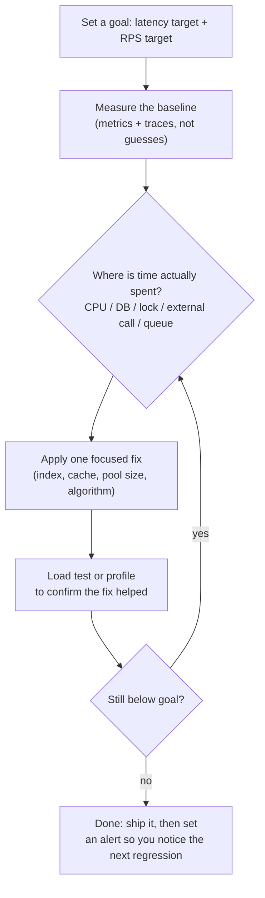
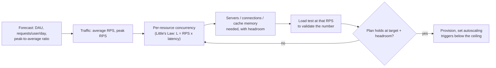

# Performance Engineering and Capacity Planning

> [!summary] TL;DR
> Performance engineering is the discipline of measuring where time and resources go in a system, fixing the biggest constraint first, and re-measuring. Capacity planning is the forward-looking half of it: turning a traffic forecast into "how many servers, how much database headroom, how much cache memory we need, and by when."

> [!abstract] Core idea
> - Measure before you optimize; the bottleneck is rarely where you guess.
> - A system has exactly one bottleneck at a time: the slowest serial stage under the current load. Fixing it reveals the next one.
> - Capacity planning turns a user/traffic forecast into a resource number using Little's Law and a safety margin (headroom).
> - Headroom is not waste. It absorbs node failures, traffic bursts, and slow deploys without breaching your SLO.
> - Load testing is how you validate a capacity plan before a real traffic spike tests it for you.

### Whiteboard version

A checkout service needs to survive a flash sale. The forecast says 2,000 peak requests/second, each handler takes 150ms end to end (mostly waiting on the payment gateway), and each pod can hold 80 requests in flight before its queue backs up.

```text
concurrency  = peak RPS x latency        = 2,000 x 0.15 = 300 requests in flight
pods needed  = concurrency / per-pod cap = 300 / 80     = 3.75 -> 4 pods
with 30% headroom (one pod can die)      = 4 x 1.3      = 5.2  -> 6 pods
```

That arithmetic — Little's Law plus a headroom multiplier — is the whole idea. Everything below is making it rigorous: how to get the inputs right, how to find the real bottleneck instead of guessing, and how to validate the plan with a load test before the sale starts.

## 1. Why it exists

A team ships a service that handles today's traffic fine. Six months later, the same code falls over during a marketing push, and nobody saw it coming because nobody asked "how much more can this take, and what breaks first?"

Concretely: a feed service runs comfortably at 200 requests/second (RPS) with p99 latency of 180ms. Marketing announces a sale expected to 10x traffic to 2,000 RPS. Without capacity planning, the team finds out whether the service survives by watching it happen live. With it, they compute in advance that the database connection pool (configured for 50 connections) looks fine at 450 RPS using idle-time query latency — concurrency = 450 x 0.025s = 11.25 connections in flight — but p99 query time itself degrades under load because of lock contention on a hot row, pushing effective query time to 120ms per query at 450 RPS: concurrency = 450 x 0.12s = 54 connections in flight, past the pool's 50-connection limit. That failure mode (a resource that gets slower as load rises, not just full) is exactly what capacity planning before a load test catches and a server-count spreadsheet alone misses.

Performance engineering is the process that finds this kind of answer: measure, find the one true bottleneck, fix it, measure again. Capacity planning is performance engineering pointed at the future instead of at today's incident.

## 2. Mental model

Picture the request path as a chain of stages: load balancer, API handler, cache, database, external payment API, response serialization. Under any fixed load, exactly one stage is the slowest — the **bottleneck** — and the whole request's latency is dominated by it. Speeding up a stage that is not the bottleneck does nothing to overall latency; it just means that stage now waits more.

This is why "optimize everything a little" is weaker than "find the bottleneck, fix it, repeat." Each fix typically exposes a new bottleneck one stage over, the same way widening one lane of a three-lane highway just moves the jam to the next bottleneck downstream.

Capacity planning adds a second axis: instead of asking "why is this slow right now," it asks "at what load does each stage become the bottleneck, and do I have enough of each resource before that load arrives." The answer for each resource (CPU, memory, DB connections, cache memory, bandwidth, worker pool slots) is a number, and **Little's Law** is the formula that turns "requests per second" and "time per request" into "how many of this resource must exist at once":

```text
L = λ × W
```
`L` is the average number of items in the system (in-flight requests, open connections, items in a queue). `λ` is the arrival rate (RPS). `W` is the average time each item spends in the system (latency). It holds for any stable system, regardless of the arrival pattern or the service-time distribution — that generality is why it is the right tool for the "how many servers" question.

## 3. How it works

### The bottleneck-finding loop



The loop only works if step 2 uses real signals instead of intuition. A trace that breaks a 420ms p99 request down into "12ms API handler, 8ms serialization, 35ms cache lookup, 365ms database query" tells you the database is the bottleneck; guessing "it's probably the network" wastes a sprint. See [[Latency, Percentiles and Bottleneck Analysis]] for how to build that breakdown from traces and percentiles, and [[Debugging Database Performance]] for the database-specific version of step 3.

### The capacity-planning pipeline

Capacity planning runs the same "measure, then compute" discipline against a forecast instead of a live incident:



Turning a user forecast into RPS (the leftmost arrow above) is the job of [[Back-of-the-Envelope Estimation]] — this note picks up from an RPS number and turns it into a resource count. Each box on the right is sized the same way: estimate the per-item cost (CPU-ms, bytes, connection-seconds), multiply by load, add headroom.

**Headroom** is the fraction of capacity kept deliberately unused. Three reasons to keep it, each sizing it differently:
- **N+1 / N+2 redundancy**: if one node can fail, the survivors must absorb its load without breaching the SLO. For a 4-node fleet at 70% average utilization per node, losing one node pushes the rest to 93% — still under 100%, but with no room for anything else. Losing two needs more slack or fewer average-utilization targets.
- **Burst absorption**: real traffic is not a flat line; a forecast's "peak RPS" is itself an estimate, and actual peaks can exceed it. 20-30% extra headroom above the forecast peak is a common starting point, tightened or loosened once you have measured how noisy your traffic actually is.
- **Deploy and scale-up lag**: autoscaling and rolling deploys take minutes, during which the fleet runs below its target size. Headroom covers the gap between "load increased" and "capacity caught up."

## 4. Worked example

The whiteboard version above gave the shape of the calculation. Here it is as tested Go, because a capacity plan that lives only in a spreadsheet does not get re-run when the forecast changes — a function does.

```go
// Package capacity turns a traffic forecast into a server count using
// Little's Law, the way a capacity planning doc does it before a launch.
package capacity

import "math"

// Traffic is a forecast expressed as requests per second.
type Traffic struct {
	AvgRPS  float64
	PeakRPS float64
}

// EstimateTraffic converts daily active users and a per-user request rate
// into average and peak RPS. peakFactor is the ratio of the busiest second
// of the day to the daily average (an estimate, usually 3x-10x for consumer
// traffic with a diurnal pattern and sale-day spikes).
func EstimateTraffic(dau int, requestsPerUserPerDay, peakFactor float64) Traffic {
	requestsPerDay := float64(dau) * requestsPerUserPerDay
	avg := requestsPerDay / 86_400 // seconds per day
	return Traffic{AvgRPS: avg, PeakRPS: avg * peakFactor}
}

// ServersNeeded sizes a fleet using Little's Law: the average number of
// requests in flight (concurrency L) equals arrival rate (RPS) times the
// time each request spends in the system (p99 latency, as a safety margin
// over the mean). Each server can hold concurrencyPerServer requests in
// flight (its worker/goroutine pool or connection limit) before it starts
// queueing. headroom is the extra fraction of capacity kept free so one
// node's failure or a traffic burst does not push the rest into overload
// (an N+1 or N+2 style margin), e.g. 0.3 for 30% headroom.
func ServersNeeded(peakRPS, p99LatencySeconds float64, concurrencyPerServer int, headroom float64) int {
	concurrency := peakRPS * p99LatencySeconds // Little's Law: L = λ * W
	required := concurrency * (1 + headroom)
	servers := required / float64(concurrencyPerServer)
	return int(math.Ceil(servers))
}
```

The test pins down the numbers from the worked example and checks the headroom math moves in the right direction:

```go
package capacity

import (
	"math"
	"testing"
)

func TestEstimateTraffic(t *testing.T) {
	// 1,000,000 DAU, 20 requests/user/day, 10x peak factor.
	tr := EstimateTraffic(1_000_000, 20, 10)

	wantAvg := 231.48 // 20,000,000 / 86,400
	if diff := math.Abs(tr.AvgRPS - wantAvg); diff > 0.5 {
		t.Fatalf("AvgRPS = %.2f, want ~%.2f", tr.AvgRPS, wantAvg)
	}
	wantPeak := wantAvg * 10
	if diff := math.Abs(tr.PeakRPS - wantPeak); diff > 5 {
		t.Fatalf("PeakRPS = %.2f, want ~%.2f", tr.PeakRPS, wantPeak)
	}
}

func TestServersNeeded(t *testing.T) {
	// 2,315 peak RPS, 200ms p99 latency, 50 in-flight requests per server,
	// 30% headroom for failover.
	got := ServersNeeded(2315, 0.2, 50, 0.3)
	// concurrency = 2315 * 0.2 = 463; with 30% headroom = 601.9;
	// 601.9 / 50 = 12.04 -> ceil = 13.
	if got != 13 {
		t.Fatalf("ServersNeeded = %d, want 13", got)
	}
}

func TestServersNeededNoHeadroomIsSmaller(t *testing.T) {
	withHeadroom := ServersNeeded(2315, 0.2, 50, 0.3)
	withoutHeadroom := ServersNeeded(2315, 0.2, 50, 0)
	if withoutHeadroom >= withHeadroom {
		t.Fatalf("expected headroom to increase the server count: %d vs %d", withoutHeadroom, withHeadroom)
	}
}
```

**Measured:** `go vet` and `go test -race` both pass on Go 1.24.4 (module built in a scratch directory outside the vault, 2026-11-07); `TestServersNeeded` confirms 2,315 peak RPS at 200ms p99 with 50 in-flight slots per pod and 30% headroom needs 13 pods, versus 10 with no headroom at all.

The same shape applies to every other resource, not just compute:
- **Database connection pool:** `L = query RPS x average query time`. If query time rises under load (lock contention, as in the "why it exists" example), re-run the calculation with the *loaded* query time, not the idle one — this is the trap most capacity plans fall into.
- **Cache memory:** `bytes needed = working-set keys x average value size x replication factor`, not total keys — only the keys actually read in a rolling window matter.
- **Message queue consumers:** `L = enqueue rate x average processing time`; see [[Queues vs Streams and Broker Comparison]] for how this interacts with partition count.

## 5. Variants and comparison

| Approach | How it works | Use when | Cost |
| --- | --- | --- | --- |
| Little's Law sizing | `L = λ × W`, divide by per-node capacity, add headroom | You have a traffic forecast and per-request latency | Needs an accurate latency figure; garbage in, garbage out |
| Load testing to find the ceiling | Drive real traffic at the service until a metric breaches its threshold | You want an empirical number instead of a model | Needs a prod-like environment; see [[Load and Performance Testing]] |
| Historical trend extrapolation | Plot RPS or resource use over months, extrapolate the curve | Steady organic growth, no step-function launches | Misses sudden shifts (viral growth, a new feature, a competitor's outage) |
| Queueing-theory models (M/M/1, M/M/c) | Model arrivals and service time as distributions, solve for wait time | You need the full latency *distribution* under load, not just a mean | Requires arrival/service patterns to roughly fit the model's assumptions |
| Chaos/game-day exercises | Deliberately remove capacity (kill a node, throttle a dependency) and watch what breaks | Validating that headroom and failover actually work, not just that they're planned | Operationally risky without blast-radius controls; see [[Chaos Engineering]] |

## 6. Trade-offs and when not to use

- Little's Law needs `λ` and `W` to be reasonably stable over the window you measure. A bursty workload (a cron job hitting every service at :00) breaks the "average" assumption; model the burst separately.
- Over-provisioning headroom is a real cost: cloud spend scales with reserved capacity whether or not it's used. [[Autoscaling]] trades static headroom for reactive headroom, at the cost of scale-up lag — size a smaller static floor plus autoscaling for the rest, not 100% static headroom for the worst case.
- A capacity plan is only as good as its latency inputs. If you plug in p50 latency instead of p99, the plan under-provisions for exactly the tail that causes incidents; always plan against a high percentile, not the mean.
- For a small, stable internal tool with predictable load, a full capacity-planning exercise is overkill — watch utilization metrics and scale manually when they trend up. Reach for the formal process when a launch, a sale, or a step change in traffic is coming and a surprise is expensive.

## 7. In production

- **Real systems:** Google's SRE workbook describes capacity planning as one of the four pillars of the SRE role, explicitly tied to a mandatory load test before any major capacity decision. AWS's Well-Architected Framework names "stop guessing capacity — monitor demand and automatically add/remove resources" as one of its Reliability pillar design principles (right-sizing itself sits under the separate Cost Optimization pillar). Large-scale retail and ticketing platforms run scheduled game days ahead of known traffic events (product launches, sales) that combine a capacity plan with a chaos exercise to validate it.
- **Failure modes → fixes:**
  - Plan based on p50 latency, breaches SLO at p99 under load → replan against p99/p999, and re-measure latency *under load*, not idle.
  - A resource that degrades with load (lock contention, GC pauses) was sized using its idle cost → load test at target RPS and read the loaded cost back into the formula.
  - Headroom computed once at launch, never revisited → tie capacity review to the same cadence as the SLO review ([[SLIs, SLOs, SLAs and Error Budgets]]) and to major feature launches.
  - Autoscaler configured to react only after saturation → set scale-out triggers at 60-70% utilization, not 95%, so new capacity is ready before the old capacity runs out.
- **What to monitor:** RPS (actual vs. forecast), p50/p95/p99 latency per stage, resource utilization (CPU, memory, connections, queue depth) against the planned ceiling, and the gap between forecast peak and observed peak after each traffic event (feeds the next forecast).

## 8. Deep dive

- **Why Little's Law holds regardless of distribution.** The proof (Little, 1961) only needs the system to be stable (arrivals equal departures over the long run) — it says nothing about Poisson arrivals or exponential service times, which is why it applies equally to a web server's connection pool, a warehouse's inventory, or a call center's queue. This generality is also its limit: it gives you the *average* number in the system, not the distribution of wait times. For the shape of the tail, you need either a load test or a queueing model with distributional assumptions (M/M/c, or simulation).
- **The USE method.** Brendan Gregg's framework for diagnosing a resource bottleneck: for every resource (CPU, memory, disk, network, each queue, each lock), check **U**tilization (percent busy), **S**aturation (work queued because the resource is full), and **E**rrors. A resource at 60% utilization but high saturation (long queue) is still a bottleneck — utilization alone hides queueing delay. This is the systematic version of the "where is time spent" question in the bottleneck loop above.
- **Why fixing the bottleneck can make things look worse briefly.** Removing stage A's bottleneck shifts load onto stage B, whose utilization rises even though nothing about B changed — it is now serving the throughput A used to hold back. Reviewers unfamiliar with this sometimes revert the fix to A, thinking it "caused" B's regression; the right move is to size B for the new throughput.
- **Forecasting the peak-to-average ratio itself.** `peakFactor` in the worked example is usually the least certain input. Build it from your own history (max 1-minute RPS over the trailing 90 days, divided by the same period's average RPS) rather than reusing an industry rule of thumb, and widen it for known step-changes (a marketing calendar, a new market launch).
- **Capacity planning for a stateful resource (storage) differs from a stateless one (compute).** Compute capacity can shrink back down after a traffic spike; storage growth is mostly one-directional, so its plan needs a retention/archival policy as much as a headroom number — see [[Index Types and Index Design]] for how index storage compounds with data growth.

## 9. Interview questions

> [!question]- Walk me through sizing a fleet for an expected traffic spike.
> Convert the user/traffic forecast into peak RPS (back-of-the-envelope), measure the realistic per-request latency under load (not idle), apply Little's Law to get required concurrency, divide by per-node capacity, and add headroom for node failure and burst absorption. Validate the resulting number with a load test before the real spike arrives.

> [!question]- Why does Little's Law apply here, and what does it not tell you?
> It holds for any stable system regardless of arrival pattern or service-time distribution, so it reliably converts throughput and latency into "how many in flight." It gives you the average concurrency, not the latency distribution's tail — a load test or a queueing model is still needed to see how wait times behave as the system approaches saturation.

> [!question]- Trap: your capacity plan says the database is fine, but it fell over during the sale anyway. What went wrong?
> Almost always, the plan used idle-time query latency instead of latency measured under the target load. Query time often rises with concurrency (lock contention, connection-pool queueing, cache hit-rate drops under a larger working set), so the real required concurrency is higher than the idle-latency math predicts. Re-measure latency at the target load, not at today's load.

> [!question]- How much headroom should a fleet carry, and why not just run at 100% utilization?
> Enough to survive the worst tolerable node loss without breaching the SLO, plus a margin for forecast error and autoscaler/deploy lag — 20-30% above forecast peak is a common starting point, tuned against your own traffic's variance. Running at 100% utilization means any blip, deploy, or single node failure immediately breaches the SLO; it trades a small, predictable infrastructure cost for a much larger, unpredictable incident cost.

> [!question]- How is capacity planning different from load testing, and when do you need both?
> Capacity planning computes a predicted resource need from a forecast; load testing empirically drives real traffic at the system to see where it actually breaks. You need both because the plan can be wrong (bad latency assumptions, an unmodeled bottleneck), and a load test before the real event is how you find that out safely. See [[Load and Performance Testing]].

> [!question]- What is the first thing you check when asked to find a system's bottleneck?
> Traces and percentile latency broken down by stage, not a guess. The bottleneck is whichever stage accounts for most of p99 latency, or whichever resource shows high saturation in the USE method even at moderate utilization. Optimizing a stage that isn't the bottleneck doesn't move overall latency.

## 10. Cheat sheet

- Measure first; the bottleneck is rarely where intuition says.
- Little's Law: `concurrency (L) = throughput (λ) × latency (W)` — use it to convert RPS + latency into "how many of this resource."
- Always plug in latency measured *under load*, at a high percentile (p99), not idle p50.
- Headroom covers three things: node failure (N+1), burst absorption (forecast error), and scale-up/deploy lag.
- A capacity plan is a hypothesis; a load test at the target RPS is how you validate it before a real event does.
- Fixing one bottleneck reveals the next, one stage downstream — this is expected, not a regression.
- USE method per resource: Utilization, Saturation, Errors — saturation at moderate utilization still means "bottleneck."
- Revisit the plan on the same cadence as your SLO review, and after every major traffic event (compare forecast peak to observed peak).

## Links

- **Before this:** [[Latency, Percentiles and Bottleneck Analysis]], [[Back-of-the-Envelope Estimation]]
- **Next:** [[Production Readiness Review]], [[Autoscaling]]
- **Compare with:** [[Load and Performance Testing]] (empirical validation of a capacity plan), [[SLIs, SLOs, SLAs and Error Budgets]] (the target a capacity plan is sized against)
