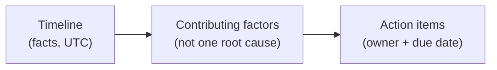
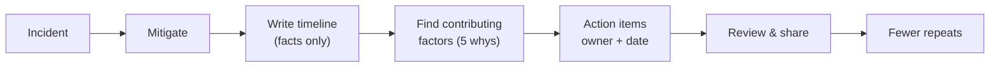
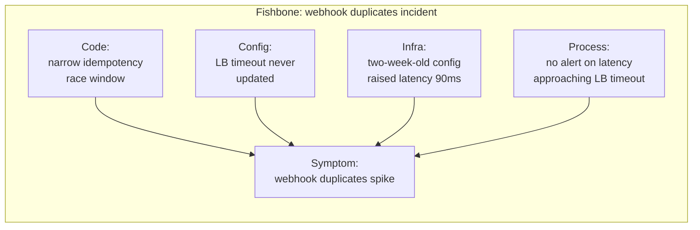
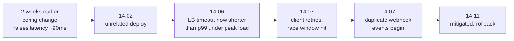

# Postmortems and Root Cause Analysis

> [!summary] TL;DR
> A postmortem is a blameless, written account of an incident — what happened, its impact, the factual timeline, the contributing factors, and concrete follow-up actions — written so the team gets better at avoiding and handling the next one. Root cause analysis is the technique inside it that turns "it broke" into the chain of conditions that let it break.

> [!abstract] Core idea
> - **Blameless, not toothless.** The postmortem asks "what about the system let a reasonable person make this mistake," never "who do we blame" — and still produces concrete, owned action items.
> - **There is rarely one root cause.** Complex systems fail through a chain of contributing factors, several of which were themselves masking each other; naming only one hides the rest.
> - **5 Whys is a starting technique, not a finish line.** It follows a single chain and stops at the first plausible-sounding answer unless you deliberately branch it.
> - **An action item that has no owner and no due date is not an action item.** It is a wish, and wishes do not survive the next sprint planning meeting.

### Whiteboard version

The shape every postmortem fills in, in this order:



Everything below is about doing each box honestly: a timeline that is facts only (no interpretation), a factors list that resists collapsing to one sentence, and action items that get tracked to closure rather than filed and forgotten.

## Start here: the basics

**The problem in one story.**
Your service broke yesterday and you fixed it by undoing a change.
If nobody writes down why it really broke, the same thing breaks again next month.
A postmortem is the short write-up after an outage: what happened, why, and what we change so it can't repeat.
It blames the system, not a person.

**Words you need first**

| Word | Plain meaning | Tiny example |
| --- | --- | --- |
| Incident | Something broke and users were affected | Duplicate invoices sent for 40 min |
| Mitigate | Stop the damage, even before you understand it | Roll back the deploy |
| Timeline | Timestamped facts of what happened, in order | 14:02 deploy, 14:09 first alert |
| Root cause | The underlying reason, not just the trigger | A timeout set shorter than the handler's latency |
| Contributing factor | One of several conditions that together caused it | A race window in the duplicate check |
| Blameless | Ask "what let this happen", never "who did it" | "The runbook link was stale", not "Sam forgot" |
| Action item | A concrete fix with an owner and a date | Add alert on latency near the timeout |
| SEV1 / SEV2 | Severity levels; lower number = worse | SEV1 = full outage |

**Picture it**



**Analogy.** An air-crash investigation: the goal is to change cockpits, checklists and training so the next crew is safe, not to punish the pilot.
Where it breaks: aviation reports are slow and formal; a software postmortem should be done within days, while memories are fresh.

**How the rest of this note builds up**

- First, why postmortems exist (section 1) and the blameless mental model (section 2).
- Then how it works: the template, 5 whys, contributing factors and good action items (section 3).
- Then a worked example on the InvoiceOps webhook incident with Go code (section 4), plus variants and trade-offs (sections 5-6).
- Finally the SDE-3 deep dive: why a single "root cause" is a trap, hindsight bias, and interview questions (sections 7-9).

> [!tip] Remember
> Facts first, several causes not one, blame the system, and every action item has an owner and a date.

## 1. Why it exists

After the InvoiceOps webhook-duplication incident is mitigated (see [[Incident Response]]), the team has stopped the bleeding but has learned nothing yet that prevents a repeat. Without a postmortem, the natural outcome is a one-line Slack message — "rolled back the bad deploy, duplicates stopped" — and the actual mechanism (a load-balancer timeout shorter than the handler's p99 latency, which made the client retry a request whose write had already succeeded) stays undiscovered.

Three weeks later, a different deploy introduces a slightly slower code path, the same timeout mismatch fires again, and the team re-discovers the same lesson from scratch.

With a postmortem: the timeline shows the deploy at 14:02 did not cause the symptom directly — the actual chain was (a) a config change two weeks earlier raised the handler's average processing time by 90 ms, (b) the load balancer's client timeout was never updated to match, (c) at 14:02 a minor, unrelated deploy added just enough latency to cross that threshold under peak traffic, and (d) the webhook handler's idempotency check had a narrow race window that let a few retried requests slip through before the duplicate check caught them.

Four contributing factors, not one. The action items fix the timeout mismatch, widen the idempotency window, and add an alert on handler-latency approaching the LB timeout — three real, different fixes a single sentence like "fixed the deploy" would never have produced.

## 2. Mental model

A postmortem is closer to an aviation incident report than a bug ticket: it is written assuming the people involved made locally reasonable decisions with the information and pressure they had at the time, and it looks for the **conditions** that made those decisions produce a bad outcome, rather than for a person to label at fault.

An investigator who writes "the pilot should have noticed X" has stopped investigating — the useful question is **why X was not noticeable**, given the displays, training, and workload at that moment, which is exactly transferable to "why didn't the on-call engineer notice the timeout mismatch before it mattered."

## 3. How it works

### When one is required

A postmortem is mandatory for any SEV1 or SEV2 (see [[Incident Response]] for the severity table), and strongly encouraged for a near-miss — an incident that almost happened, caught just before user impact, which is often cheaper to learn from than a real one because nobody is under pressure while writing it.

### Blameless, Just Culture

Blameless does not mean consequence-free or detail-free. It means the write-up never names an individual as the cause and never asks "who" — it asks "what about our systems, processes, or defaults let this happen," which is Sidney Dekker's Just Culture framing: accountability is owed to the organization that builds the conditions people operate under, not extracted from the individual who happened to be on shift.

A postmortem that says "the engineer forgot to check the dashboard" has identified nothing useful; one that says "the dashboard the runbook points to was three releases out of date" has identified something fixable.

### The template

| Section | Content |
| ------- | ------- |
| Summary | One paragraph: what broke, for how long, who was affected |
| Impact | Users affected, revenue/data impact, duration, SLO/error-budget burn if applicable |
| Timeline | UTC timestamps, facts only — no interpretation, no blame |
| Detection | How it was found (alert, customer report, synthetic probe) and how long after it started |
| Response | What was done, by whom, with what effect, referencing [[Incident Response]]'s roles |
| Root cause and contributing factors | The chain of conditions, not a single sentence |
| What went well / what went badly | Honest, specific, includes process and tooling, not just the bug |
| Where we got lucky | What would have made this worse, that happened not to be true this time |
| Action items | Owner, due date, priority, and category (prevent / detect / mitigate) |

### Trigger, root cause and contributing factors are three different things

- **Trigger:** the immediate event that started the incident (the 14:02 deploy).
- **Contributing factors:** the conditions that let the trigger cause harm (the mismatched timeout, the narrow idempotency race, the two-week-old config change that raised latency).
- **Root cause**, used loosely, usually means "the contributing factor that, if fixed alone, would have prevented this specific incident" — but naming only that one and stopping is the single most common postmortem mistake, because the other factors will cause a *different* incident later.

### RCA techniques

- **5 Whys.** Ask "why" five times, each answer becoming the next question. Fast and good for a single, linear chain, but it stops at whichever answer sounds complete and rarely branches — run it more than once from the same starting symptom, asking a different first "why" each time, to surface factors a single chain misses.
- **Fishbone (Ishikawa) diagram.** Groups candidate causes into categories (code, config, infrastructure, dependency, process, people) around the symptom, which is better than 5 Whys at surfacing *several* independent contributing factors at once rather than one linear chain.
- **Fault tree / causal-factor charting.** Builds an explicit AND/OR tree of conditions required for the failure, useful when the incident genuinely needed multiple independent things to go wrong simultaneously (as the InvoiceOps example did: latency-raising config change AND stale timeout AND a deploy AND a race window, all four present together).



### No single root cause, in complex systems

Richard Cook's *How Complex Systems Fail* argues that failures in complex systems are normally the result of several small, individually survivable conditions combining — the system already contains latent weaknesses (the stale timeout, the narrow race window) that sit harmless until a trigger (the deploy) lines them up.

Writing "root cause: the 14:02 deploy" treats a trigger as if it were the whole explanation and leaves the latent weaknesses in place for the next trigger.

### Action items

Every action item needs an **owner**, a **due date**, a **priority**, and a **category**:

- **Prevent** — stops this exact failure from recurring (fix the timeout mismatch).
- **Detect** — would have caught it faster next time, even if a similar bug slips through (alert on handler latency nearing the LB timeout).
- **Mitigate** — reduces impact if it does recur (widen the idempotency window so a retried request never double-processes, regardless of why the retry happened).

Action items without an owner and due date are the most common way postmortems fail to produce real improvement — they read well in the document and then nothing changes, which is also why **repeat-incident rate** (see [[Incident Response]]) is the metric that catches a team writing good postmortems that don't get acted on.

### Timeline, visually



### Review and follow-through

A postmortem is reviewed in a short meeting (or async review for a smaller incident), shared beyond the immediate team so the lesson generalizes, and archived searchably — a new on-call engineer hitting a similar symptom should be able to find it.

Teams that track postmortems in one place over time can run trend analysis: the same contributing factor (stale timeouts, missing alerts on a specific class of thing) appearing across several unrelated incidents is itself a signal worth its own action item.

## 4. Worked example

### Whiteboard version

The minimum structure an action item needs to be trackable rather than a wish:

```go
type ActionItem struct {
	Description string
	Owner       string
	DueDate     time.Time
	Category    string // "prevent", "detect", "mitigate"
}
```

The full version below adds validation — the concrete, checkable rule that turns "we wrote some action items" into "every action item is actually trackable" — plus a due-date-passed report a postmortem review meeting can run directly.

A small action-item validator. Compiles and passes `go vet` and `go test -race` on Go 1.24.

```go
package postmortem

import (
	"fmt"
	"time"
)

// ActionItem is one follow-up task from a postmortem.
type ActionItem struct {
	Description string
	Owner       string
	DueDate     time.Time
	Category    string // "prevent", "detect", "mitigate"
}

var validCategories = map[string]bool{"prevent": true, "detect": true, "mitigate": true}

// Validate reports every reason this action item is not actually trackable:
// a postmortem anti-pattern is an item with no owner or no due date, which
// reads well in the document and then never gets done.
func (a ActionItem) Validate() []string {
	var problems []string
	if a.Description == "" {
		problems = append(problems, "missing description")
	}
	if a.Owner == "" {
		problems = append(problems, "no owner: action items with no owner do not get done")
	}
	if a.DueDate.IsZero() {
		problems = append(problems, "no due date: action items with no due date do not get done")
	}
	if !validCategories[a.Category] {
		problems = append(problems, fmt.Sprintf("category %q must be prevent, detect or mitigate", a.Category))
	}
	return problems
}

// Overdue returns every item from items whose due date has passed and that
// is not yet known to be done (closedIDs holds the descriptions of items
// already closed out, as a stand-in for a real tracker's status field).
func Overdue(items []ActionItem, now time.Time, closed map[string]bool) []ActionItem {
	var out []ActionItem
	for _, a := range items {
		if closed[a.Description] {
			continue
		}
		if a.DueDate.Before(now) {
			out = append(out, a)
		}
	}
	return out
}
```

Test, run with `go test -race`:

```go
package postmortem

import (
	"testing"
	"time"
)

func TestValidateCatchesMissingFields(t *testing.T) {
	a := ActionItem{Description: "fix timeout"}
	problems := a.Validate()
	if len(problems) != 3 { // no owner, no due date, bad category
		t.Fatalf("got %d problems, want 3: %v", len(problems), problems)
	}
}

func TestValidatePassesCompleteItem(t *testing.T) {
	a := ActionItem{
		Description: "fix LB timeout mismatch",
		Owner:       "platform-team",
		DueDate:     time.Now().Add(7 * 24 * time.Hour),
		Category:    "prevent",
	}
	if problems := a.Validate(); len(problems) != 0 {
		t.Fatalf("got problems %v, want none", problems)
	}
}

func TestOverdueSkipsClosedItems(t *testing.T) {
	past := time.Now().Add(-24 * time.Hour)
	items := []ActionItem{
		{Description: "add latency alert", Owner: "sre", DueDate: past, Category: "detect"},
		{Description: "widen idempotency window", Owner: "backend", DueDate: past, Category: "mitigate"},
	}
	closed := map[string]bool{"add latency alert": true}

	got := Overdue(items, time.Now(), closed)
	if len(got) != 1 || got[0].Description != "widen idempotency window" {
		t.Fatalf("Overdue = %+v, want only the unclosed item", got)
	}
}
```

Both tests pass under `go vet` and `go test -race` on Go 1.24.

## 5. Variants and comparison

| Technique | How it works | Use when | Cost |
| --------- | ------------- | -------- | ---- |
| 5 Whys | Ask "why" repeatedly down one chain | A simple incident with one clear linear cause | Stops at the first plausible answer; misses parallel factors |
| Fishbone (Ishikawa) | Groups candidate causes by category around the symptom | You suspect several independent contributing factors | Takes longer; needs a facilitator to keep categories honest |
| Fault tree / causal-factor charting | Explicit AND/OR tree of conditions required for failure | The incident needed multiple things to go wrong together | Most rigorous, also the most time-consuming to build correctly |
| One-line "rolled back the bad deploy" (anti-pattern) | Names the trigger and stops | Never, as a substitute for a postmortem | Guarantees recurrence of the untouched contributing factors |

## 6. Trade-offs and when not to use

- A full postmortem for every SEV4 is wasted ceremony; reserve the full template for SEV1/SEV2 and near-misses worth the team's attention, and use a short note for the rest.
- Blameless culture requires organizational buy-in above the team writing the postmortem — if a manager reads one and reprimands an individual anyway, the next postmortem will quietly omit the honest details that made this one useful, and the practice collapses.
- 5 Whys alone, used as the *only* technique, systematically under-counts contributing factors in anything but the simplest incidents — treat it as a fast first pass, not the final analysis.
- Writing the postmortem too soon, before the facts are settled, risks a timeline built from memory rather than from logs/dashboards/the scribe's record from [[Incident Response]]; wait until the evidence is gathered, even if that is a day or two after resolution.

## 7. In production

- **Real systems:** Google's SRE book and workbook both describe blameless postmortems with this template as central practice; incident.io and similar tools automate pulling the timeline from the chat transcript and alert history directly into a draft; many companies publish selected postmortems externally (a practice that itself pressures the writing to be honest and specific, since it will be read outside the team).
- **Failure modes → fixes:**
  - Postmortem turns into blame, people get defensive and omit details → explicit blameless framing stated at the start of the review meeting, and a facilitator who redirects "who" questions to "what about the system."
  - Action items pile up undone → track them in the same system as regular work with real due dates, and report repeat-incident rate so undone action items become visible as a cost.
  - Root cause collapses to one sentence → require the contributing-factors section to list at least two or three factors, and challenge any postmortem that doesn't.
  - Nobody reads old postmortems → tag and archive them searchably, and reference relevant ones explicitly during the next incident's triage.
- **What to monitor:** repeat-incident rate (the clearest signal of unexecuted action items), postmortem completion rate for SEV1/SEV2 within an agreed window (for example, 5 business days), fraction of action items closed by their due date, and number of distinct contributing factors per postmortem (a value that is consistently 1 suggests analysis is stopping too early).

## 8. Deep dive

**Why "root cause" as a singular noun is itself a trap.** The word invites a one-sentence answer, which is convenient for a status update but wrong for an incident that needed several conditions to align.

The InvoiceOps example needed four: a latency-raising config change, a stale timeout, a deploy, and a race window. Removing any one of the four would have prevented this specific incident — which also means naming any single one as "the" root cause and fixing only it leaves three latent weaknesses in place for next time.

**Hindsight bias is the postmortem author's main occupational hazard.** Writing a week after the fact, with the answer already known, it is easy to write "the team should have seen the timeout mismatch coming" — a sentence that is true only because the outcome is now known.

The discipline is to reconstruct what was actually visible and known *at each point in the timeline*, not what is obvious now, which is also why the timeline section is kept strictly factual and separated from the contributing-factors analysis.

**"Where we got lucky" earns its section.** The InvoiceOps incident happened during a low-traffic window; had it occurred during a daily peak, the retry volume (and duplicate count) would likely have been several times higher before the kill switch caught it.

Naming that explicitly turns a day that "wasn't so bad" into a genuine warning about the ceiling of a similar future incident, rather than false reassurance that the system handled it fine.

**Action items need an SLO of their own.** A team that tracks action-item completion against a due date the same way it tracks an SLO (completed within N days, with a visible burn-down) treats follow-through as seriously as uptime — which is the practical difference between a postmortem that changes anything and one that is a well-written historical document.

## 9. Interview questions

> [!question]- What does "blameless" mean in a postmortem, concretely?
> It means the write-up never asks "who" and never names an individual as the cause — it asks what about the system, process, or defaults let a reasonable person produce this outcome. It is not consequence-free: it still produces specific, owned action items.

> [!question]- Why is "there is one root cause" usually the wrong framing?
> Complex-system failures are normally several latent, individually survivable conditions combining with a trigger. Naming only the trigger (or only one factor) as "the" root cause leaves the other latent weaknesses in place to cause a different incident later.

> [!question]- What's the difference between 5 Whys and a fishbone diagram, and when would you pick one over the other?
> 5 Whys follows one linear chain and is fast, but stops at the first plausible-sounding answer and misses parallel causes. A fishbone groups candidate causes by category (code, config, infra, process, people) around the symptom and surfaces multiple independent contributing factors at once — pick it when you suspect more than one thing had to go wrong together.

> [!question]- What makes an action item actually get done, versus sitting in a document forever?
> An explicit owner, a due date, and tracking it in the same system as regular work with visible overdue status — not writing it well. Teams measure this with repeat-incident rate: if the same root cause recurs, the action item from last time was not actually completed.

> [!question]- Trap: "The engineer should have checked the dashboard before deploying."
> That sentence identifies a person, not a fixable condition, and is exactly the kind of statement blameless postmortems are written to avoid. The useful version asks why checking the dashboard wasn't a built-in step (a pre-deploy check, an automated gate) rather than a thing to remember under time pressure.

> [!question]- When is a postmortem required, and when is a lighter-weight write-up enough?
> Required for SEV1/SEV2 and encouraged for near-misses; a SEV3/SEV4 typically gets a short note rather than the full template, since the ceremony cost of a full postmortem is not justified by a low-impact incident.

> [!question]- Tell me about a postmortem you wrote or participated in.
> Structure it around the template: impact and duration, the timeline, at least two distinct contributing factors (not one), and one or two action items with their actual owner and due date — and ideally, whether that action item was later completed.

## 10. Cheat sheet

- Template order: summary, impact, timeline (facts only), detection, response, contributing factors (plural), what went well/badly, where we got lucky, action items.
- Blameless asks "what about the system," never "who."
- Trigger ≠ root cause ≠ contributing factors — name all the factors, not just the trigger.
- 5 Whys is fast but single-chain; fishbone and fault trees surface parallel causes.
- "No single root cause" (Cook): complex-system failures are usually several latent conditions aligning.
- Every action item needs an owner, due date, priority, and category (prevent / detect / mitigate).
- Watch hindsight bias: write the timeline from what was knowable at each point, not from the now-known answer.
- Repeat-incident rate is the metric that catches postmortems that read well but changed nothing.

## Links

- **Before this:** [[Incident Response]], [[Production Debugging Playbook]]
- **Next:** [[Production Readiness Review]]
- **Compare with:** [[SLIs, SLOs, SLAs and Error Budgets]] (error-budget burn is often part of a postmortem's impact section)

### Watch on YouTube

- [What is Root Cause Analysis (RCA)?](https://www.youtube.com/watch?v=7t3lTYEd_PM) · IBM Technology · 8 min · 150,219 views
- [5 Root Cause Analysis Tools / RCA Tools](https://www.youtube.com/watch?v=K2yHOYeZsSQ) · Pharmaguideline · 3 min · 99,364 views
