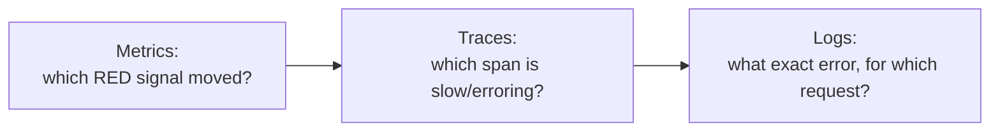
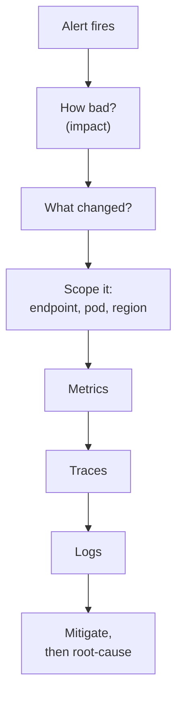
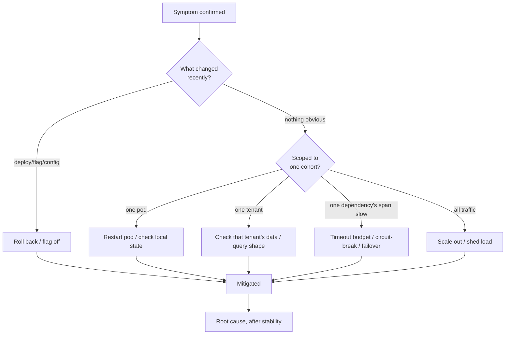

# Production Debugging Playbook

> [!summary] TL;DR
> Production debugging is narrowing down a failure with evidence instead of guessing: confirm impact, check what changed, scope who is affected, then walk metrics → traces → logs in that order until you find the one component actually misbehaving. The loop ends the moment you have a safe mitigation, not the moment you have a root cause.

> [!abstract] Core idea
> - **Scope before you dig.** "Is it one endpoint, one pod, one region, one tenant, or everything?" answers more in thirty seconds than reading logs for ten minutes does.
> - **Metrics find the symptom, traces find the slow component, logs find the exact error** — in that order, because each is more expensive and more specific than the last.
> - **"What changed?"** is the highest-value question in the whole playbook: deploys, config, feature flags, cron jobs and data backfills cause the overwhelming majority of incidents.
> - A **written hypothesis, checked against evidence, then kept or discarded** beats pattern-matching to "last time it was the database" — the fastest wrong answer is still wrong.

### Whiteboard version

The three-signal funnel that replaces "start reading logs":



Each step narrows scope by roughly an order of magnitude: metrics narrow "something is wrong" down to "latency, not errors, and only on `POST /invoices`"; traces narrow that down to "the `db.update_invoice` span"; logs narrow that down to the exact SQL error and the request ID that triggered it.

## Start here: the basics

**The problem in one story.**
At 2 am your phone buzzes: "checkout is slow".
You could open the logs and scroll, but there are millions of lines.
A playbook gives you a fixed order of questions: how bad, what changed, who is affected, then metrics, traces, logs.
Following it gets you to the cause faster than guessing.

**Words you need first**

| Word | Plain meaning | Tiny example |
| --- | --- | --- |
| Symptom | What users or alerts notice | p99 latency jumped to 3 s |
| Scope | How widely the problem spreads | Only `POST /invoices`, only one region |
| Cohort | A group you slice traffic by | One pod, one tenant, one app version |
| RED signals | Rate, Errors, Duration of requests | 5xx rate went from 0.1% to 4% |
| Trace / span | One request's path, and one step in it | `db.update_invoice` span took 2.8 s |
| Hypothesis | A guess you write down and then test | "The new index made writes slow" |
| Mitigate | Stop user pain before full understanding | Roll back, or turn off a feature flag |
| Deploy / feature flag | Shipping code / switching behaviour without shipping | Flag `new_pricing=on` at 01:50 |

**Picture it**



**Analogy.** A doctor in an emergency room: check how serious it is, ask "what did you eat or take?", narrow down where it hurts, then run the expensive scans.
Where it breaks: a patient can describe symptoms; a service can't, so you rely only on the telemetry it already emits.

**How the rest of this note builds up**

- First, why a playbook beats intuition (section 1) and the funnel mental model (section 2).
- Then how it works: the steps from impact to root cause, symptom patterns, a culprit catalogue, and debugging async work (section 3).
- Then the 02:14 incident worked with real numbers and Go code (section 4), plus variants and trade-offs (sections 5-6).
- Finally the SDE-3 deep dive: production habits, the deeper failure modes, and interview questions (sections 7-9).

> [!tip] Remember
> Impact, what changed, scope, then metrics → traces → logs; mitigate first, explain second.

## 1. Why it exists

At 02:14, InvoiceOps's p99 latency on `GET /invoices/:id` jumps from 180 ms to 2.1 s. p50 stays flat at 40 ms. Without a method, the natural instinct is to open the slowest-looking code path and start reading — which, on a 40,000-line service, is a search with no stopping condition.

With the playbook: metrics show p99 up but p50 and error rate flat, and request volume unchanged — so it is **not** a traffic spike and **not** every request, which rules out "capacity" and "a bad deploy affecting everyone" in under a minute.

Scoping by cohort shows the slow requests cluster on one Kubernetes pod. A trace from that pod shows 1.9 s of the 2.1 s sitting in a single span: `db.pool.acquire`. `sql.DBStats` on that pod shows `WaitCount` climbing and `MaxOpenConns` maxed out.

One pod's connection pool is exhausted — probably by a long-running query or a connection leak specific to that pod's recent restart — not a database-wide problem. The mitigation (restart the pod, which resets its pool) takes thirty seconds; finding that same fact by reading code would have taken much longer, if it was found at all.

## 2. Mental model

Debugging in production is **the scientific method under time pressure**: form a hypothesis from the cheapest evidence available, check it against slightly more expensive evidence, and discard it the instant it is contradicted — rather than committing to the first plausible story and hunting for evidence that confirms it.

The funnel in the whiteboard version encodes a cost ordering: a metrics query answers in milliseconds over already-aggregated data; a trace lookup answers in seconds over one request; grepping logs across a fleet can take minutes. Always spend the cheap step first, because it usually tells you exactly where to spend the next, more expensive one.

## 3. How it works

### Step 1: Impact and severity

Before anything else: how many users, which operation, and is data being lost? This decides whether you are debugging calmly or triggering [[Incident Response]] first. A 2 s p99 on a read endpoint and a payment webhook silently dropping events are both "slow," but only one needs a kill switch flipped in the next sixty seconds.

### Step 2: What changed?

In order of how often each one is the actual cause:

1. **Deploy** — a new build of this service or one it calls.
2. **Feature flag** — a flag flipped, even one that looks unrelated to the symptom.
3. **Config** — a timeout, pool size, or retry setting changed.
4. **Data** — a backfill, migration, or a new large customer's data shape.
5. **Dependency** — a downstream service's own deploy or degradation.
6. **Cron** — a scheduled job that just ran (backups, reports, reindexing) competing for the same resources.
7. **Traffic** — a genuine spike, bot traffic, or a retry storm from a client.

A changefeed that lists all of these on one timeline (see the Go example below) turns "what changed" from a round of Slack messages into a single query.

### Step 3: Scope by cohort

Compare a cohort that is failing against one that is not, varying one dimension at a time: endpoint, region/AZ, tenant, client version, pod, or client type. "Everyone, everywhere, right now" points at a global dependency or deploy.

"One pod only" points at that pod's local state (its connection pool, its memory, a bad local cache). "One tenant only" points at that tenant's data shape or request pattern (a hot key, a pathological query).



### Step 4–6: Metrics → traces → logs

- **Metrics** answer "which RED signal, for which route, since when" (see [[Metrics and Prometheus]]). This is where you learn p99-only-not-p50, or 5xx-only-from-one-pod, or 429s rising on calls to one dependency.
- **Traces** answer "which span, on an actual slow or erroring request" (see [[Distributed Tracing with OpenTelemetry]]). Read the waterfall for the critical path: a gap between spans with no span covering it is time lost to queueing, scheduling, or GC, not to any instrumented code.
- **Logs** answer "what exact error, for which request ID, with what payload shape" (see [[Structured Logging]]) — the most expensive signal to search, so it is read last, once traces have already pointed at the suspect component.

### Step 7–8: Mitigate, then root-cause

Pick the cheapest mitigation that removes user impact, in roughly this order of cost: feature flag off, rollback, failover to a healthy replica/region, scale out, shed low-priority load, block one abusive client. Root cause and prevention become the postmortem's job once the system is stable (see [[Postmortems and Root Cause Analysis]]).

### Symptom patterns worth recognizing on sight

| Pattern | Usual cause |
| ------- | ----------- |
| p99 up, p50 flat, errors flat | Tail-only issue: one bad node/pod, GC pauses, a hot partition, pool exhaustion for a minority of requests |
| 5xx from exactly one pod | That pod's local state: leaked connections, a stuck goroutine, a bad local cache entry, disk full on that node |
| Cascading timeouts across several services | One slow dependency with no timeout budget, backing up every caller above it |
| 429s or 5xxs from one dependency only | That dependency is overloaded, rate-limiting you, or itself mid-incident |
| Latency rising slowly over hours, no deploy | A slow leak (memory, goroutines, or an unbounded cache) rather than a single triggering event |

### A culprit catalogue for "nothing changed, but it's slow/broken anyway"

- **Connection pool exhaustion** — `sql.DBStats.WaitCount` climbing; see [[Debugging Database Performance]] and [[Connection Pooling]].
- **DNS** — a resolver cache expiring, or a DNS-based failover not propagating; check with `dig` (see [[Network Debugging Toolkit - dig, curl, ss, tcpdump]]).
- **TLS certificate expiry** — a silent cutover failure at a fixed, predictable time, easy to miss because nothing "changed" in your own deploys.
- **Clock skew** — breaks anything comparing timestamps across hosts: TTL checks, idempotency windows, token expiry.
- **Disk full** — the write path for logs, WAL, or temp files fails, often with a confusing downstream error far from the real cause.
- **Noisy neighbour** — another workload on the same node or shared database saturating CPU, memory bandwidth, or disk I/O.
- **Retry storm** — a client's own retries, with no backoff or circuit breaker, amplify a transient blip into sustained overload.
- **Cache stampede** — many requests miss the same cache key at once (on expiry or after a restart) and hit the backing store simultaneously.

### Debugging async work

Queues and background workers fail in their own characteristic ways, invisible to request-path metrics: **consumer lag** (the gap between produced and consumed offsets growing), a **poison message** stuck retrying forever and blocking everything behind it on an ordered partition, a **dead-letter queue (DLQ)** silently filling, and **consumer group rebalances** causing brief processing pauses whenever a worker joins or leaves.

### Tool cheat-sheet

| Tool | Answers |
| ---- | ------- |
| `kubectl describe pod`, `kubectl logs`, `kubectl top pod` | Is the pod healthy, restarted, OOMKilled, or resource-starved? |
| `curl -w '%{time_namelookup} %{time_connect} %{time_starttransfer}\n'` | Where in DNS/connect/TLS/first-byte did a single request's time go? |
| `dig`, `ss`, `tcpdump` | DNS resolution, socket/connection state, raw packet timing — see [[Network Debugging Toolkit - dig, curl, ss, tcpdump]] |
| `/debug/pprof` (Go) | CPU, heap, goroutine, block and mutex profiles — see [[Benchmarks, Profiling and Tracing]] |
| `EXPLAIN (ANALYZE, BUFFERS)`, `pg_stat_activity` | Query plan and actual execution; what every connection is currently doing/waiting on — see [[Debugging Database Performance]] |

## 4. Worked example

### Whiteboard version

The simplest possible answer to "what changed": a slice of recent events, filtered by time.

```go
type Change struct {
	At   time.Time
	Kind string // "deploy", "flag", "config", "cron"
	Desc string
}

func recentChanges(all []Change, since time.Time) []Change {
	var out []Change
	for _, c := range all {
		if c.At.After(since) {
			out = append(out, c)
		}
	}
	return out
}
```

The full version below bounds memory with a ring buffer (a production service cannot keep every change forever) and is safe for concurrent writers (deploy hooks, flag-service webhooks, and cron wrappers all append from different goroutines).

A bounded, concurrency-safe change feed, used in step 2 of the playbook. Compiles and passes `go vet` and `go test -race` on Go 1.24.

```go
package debugging

import (
	"sync"
	"time"
)

// Change is one recorded deploy, config edit, flag flip or cron run.
type Change struct {
	At   time.Time
	Kind string // "deploy", "flag", "config", "cron", "data"
	Desc string
}

// ChangeFeed keeps the most recent changes in a fixed-size ring buffer, so
// memory is bounded regardless of how long the service has been running.
type ChangeFeed struct {
	mu    sync.Mutex
	buf   []Change
	cap   int
	start int // index of the oldest entry
	n     int // number of valid entries
}

func NewChangeFeed(capacity int) *ChangeFeed {
	return &ChangeFeed{buf: make([]Change, capacity), cap: capacity}
}

func (f *ChangeFeed) Record(kind, desc string) {
	f.mu.Lock()
	defer f.mu.Unlock()
	idx := (f.start + f.n) % f.cap
	entry := Change{At: time.Now().UTC(), Kind: kind, Desc: desc}
	if f.n < f.cap {
		f.buf[idx] = entry
		f.n++
	} else {
		f.buf[f.start] = entry
		f.start = (f.start + 1) % f.cap
	}
}

// Since returns every recorded change at or after the given time, oldest first.
func (f *ChangeFeed) Since(t time.Time) []Change {
	f.mu.Lock()
	defer f.mu.Unlock()
	out := make([]Change, 0, f.n)
	for i := 0; i < f.n; i++ {
		c := f.buf[(f.start+i)%f.cap]
		if !c.At.Before(t) {
			out = append(out, c)
		}
	}
	return out
}
```

Test, run with `go test -race`:

```go
package debugging

import (
	"sync"
	"testing"
	"time"
)

func TestChangeFeedBoundsSize(t *testing.T) {
	f := NewChangeFeed(3)
	f.Record("deploy", "v1")
	f.Record("deploy", "v2")
	f.Record("deploy", "v3")
	f.Record("deploy", "v4") // evicts v1

	got := f.Since(time.Time{})
	if len(got) != 3 {
		t.Fatalf("got %d entries, want 3 (bounded by capacity)", len(got))
	}
	if got[0].Desc != "v2" {
		t.Fatalf("oldest surviving entry = %q, want %q", got[0].Desc, "v2")
	}
}

func TestChangeFeedConcurrentWriters(t *testing.T) {
	f := NewChangeFeed(100)
	var wg sync.WaitGroup
	const writers = 50
	wg.Add(writers)
	for i := 0; i < writers; i++ {
		go func() {
			defer wg.Done()
			f.Record("flag", "toggle")
		}()
	}
	wg.Wait()

	if got := len(f.Since(time.Time{})); got != writers {
		t.Fatalf("got %d entries, want %d", got, writers)
	}
}

func TestChangeFeedSinceFiltersByTime(t *testing.T) {
	f := NewChangeFeed(10)
	f.Record("deploy", "old")
	cutoff := time.Now().UTC()
	time.Sleep(2 * time.Millisecond)
	f.Record("config", "new")

	got := f.Since(cutoff)
	if len(got) != 1 || got[0].Desc != "new" {
		t.Fatalf("Since(cutoff) = %+v, want only the post-cutoff entry", got)
	}
}
```

### The 02:14 incident, worked with real numbers

Representative output (PostgreSQL 17) — `sql.DBStats` sampled on the affected pod during the incident:

```text
MaxOpenConnections: 20
OpenConnections:    20
InUse:              20
Idle:               0
WaitCount:          1,842
WaitDuration:       38.6s
```

Twenty connections, all in use, 1,842 goroutines having queued for one at some point — a pool that has run out, not a database that is slow to answer once a connection is acquired. `pg_stat_activity` on the database at the same moment showed no long-running or blocked queries, which rules out a database-side lock problem and points squarely at the pod's own pool or a connection leak.

## 5. Variants and comparison

| Approach | How it works | Use when | Cost |
| -------- | ------------- | -------- | ---- |
| Metrics → traces → logs funnel (this note) | Cheapest signal first, each step narrows scope | Any production incident with instrumentation in place | Needs the instrumentation to already exist |
| Binary search over deploys (`git bisect`-style) | Roll back/forward through recent deploys until the symptom disappears | A clear regression with no obvious trace signal | Slow: each step costs a full deploy cycle |
| Read-the-code-first | Start from the suspected function and reason about it | A bug reproducible locally, no production-only behaviour | Does not scale to "which of 40 services" or timing-dependent bugs |
| Differential/cohort comparison | Compare a failing cohort against a healthy one across every available dimension | The failure is scoped to something (a tenant, a pod, a version) but you don't yet know what | Needs enough cardinality in metrics/logs to slice by | 

## 6. Trade-offs and when not to use

- The funnel assumes metrics, traces and logs are already wired up and correlated by a shared ID; without that instrumentation, the method degrades back to "read logs and guess," which is why [[Observability Fundamentals]] is a prerequisite, not an afterthought.
- Mitigating before root-causing can mask a problem that will recur — a restarted pod with a connection leak will leak again; the playbook explicitly defers, not skips, root cause.
- For a bug with no production impact (caught in staging, no users affected), the formal scope-then-mitigate sequence is overkill; just read the code and fix it.
- Cohort comparison needs enough traffic volume per cohort to be statistically meaningful — comparing one request from a rare cohort against thousands from a common one is not a comparison, it's noise.

## 7. In production

- **Real systems:** this funnel (narrow by metric, confirm by trace, nail down by log) is the backbone of how Google's SRE practice describes effective troubleshooting, and matches how most APM vendors (Datadog, Honeycomb, Grafana) structure their own investigation UIs — metrics dashboard first, trace waterfall next, log search last.
- **Failure modes → fixes:**
  - No shared ID between logs/metrics/traces → instrument the trace ID into every log line and as a metric exemplar (see [[Observability Fundamentals]]) before the next incident, not during it.
  - Cohort scoping is impossible because labels are too coarse → add route-template, pod, and tenant-tier labels (never raw tenant ID) to the relevant metrics ahead of time.
  - Teams skip "what changed" and jump straight to code → put a visible changefeed (deploys, flags, config) on the same dashboard as the alert.
  - Mitigation gets skipped in favor of "just fixing it properly" → make the cheap mitigations (feature flag, rollback) a one-click action, so they are never slower than writing a patch.
- **What to monitor:** time-to-first-hypothesis (how long from alert to "I think it's X"), time-to-mitigation, how often the first hypothesis was actually correct (a low rate suggests scoping is being skipped), and dashboard/trace query volume during incidents as a proxy for how much the tooling is actually used.

## 8. Deep dive

**Why order matters, not just coverage.** Teams with all three signals still debug slowly when they read logs first. A log search across a fleet, even a fast one, returns ambiguous matches until you already know roughly where to look; a metrics query answers "where" in milliseconds, and a trace then answers "which exact span," which turns the subsequent log search from "grep everything" into "pull the five log lines with this request ID."

**Reading a waterfall for the unaccounted gap.** The most valuable trace-reading skill is noticing where there is **no span** — a 400 ms gap between two children of the same parent that no instrumented code covers.

That gap is time spent somewhere the SDK did not see: scheduler queueing, GC, a connection-pool wait, or a goroutine that never got scheduled. Finding it points straight at the next evidence to pull (a GC trace, `sql.DBStats`, a goroutine dump) without reading application logic at all.

**Why hypothesis-driven beats pattern-matching.** "Last time it was the database" is a prior, and priors are useful for ordering which hypothesis to check first — but the playbook's discipline is to still check it against evidence (this time's `pg_stat_activity`, this time's trace) and discard it in seconds if contradicted, rather than committing effort to a fix for the wrong cause because it matched a past incident.

**Tail amplification changes the "symptom pattern" table.** A service that fans out to 100 downstream calls and waits on all of them has its p99 dominated by the single slowest call, even if only 1% of individual calls are themselves slow (`1 − 0.99^100 ≈ 63%` of requests touch at least one slow call) — which is why "p99 up, p50 flat" so often points at one dependency or one shard, not a global problem (see [[Latency, Percentiles and Bottleneck Analysis]] for the full derivation).

## 9. Interview questions

> [!question]- p99 latency tripled but p50 is flat. Walk me through your investigation.
> p50 flat rules out a global slowdown; p99-only points at a tail cause: one bad pod/node, GC pauses, pool exhaustion affecting a subset of requests, or a hot partition. Scope by cohort (which pod, which tenant, which shard) before reading any code, then confirm with a trace from one of the slow requests.

> [!question]- What do you check before opening a single log line?
> Impact and severity, then "what changed" (deploy, flag, config, cron, data), then metrics to confirm the symptom's shape (which signal, which cohort, since when). Logs are the last, most expensive step, read only once a trace has pointed at a specific component.

> [!question]- A dependency starts returning 429s. What's your mitigation order?
> Circuit-break or back off calls to it, check if a timeout/retry budget is amplifying the load on it (a retry storm), and consider failing over if an alternative exists. Fix the root cause (why it's overloaded, whether it's actually a bug on your side triggering excess calls) afterward.

> [!question]- How do you debug a queue consumer that's falling behind?
> Check consumer lag (offset gap) first to confirm and quantify it, then check for a poison message stuck retrying on an ordered partition, a rebalance loop, or simply undersized consumer count versus produce rate. A DLQ filling up is the same symptom from the other side.

> [!question]- Trap: "The logs show nothing unusual, so it must not be a bug in our code."
> Absence of an error in logs only means nothing logged an error — it does not rule out a slow dependency, a scheduling/GC gap with no log line, or a problem in a component with insufficient logging. Check metrics and traces for a gap before concluding the code is innocent.

> [!question]- What makes "what changed" the highest-leverage question in production debugging?
> The large majority of incidents trace back to a deploy, config edit, flag flip, cron run, or a data backfill — all of which are cheap to check (a timeline query) compared to reading code, and all of which have a cheap, known-good reversal (rollback, flag off).

## 10. Cheat sheet

- Funnel: metrics (which signal, which cohort) → traces (which span) → logs (exact error) — cheapest, most-specific-last.
- Always ask "what changed" first: deploy, flag, config, cron, data backfill, dependency, traffic.
- Scope by cohort: endpoint, region/AZ, tenant, version, pod, client — "everyone" vs "one thing" points at very different causes.
- p99-up-p50-flat = tail cause (one bad pod, GC, pool, hot partition), not a global problem.
- A trace gap with no span covering it is time lost to queueing, GC, or scheduling.
- Mitigate with the cheapest reversible action; root cause is the postmortem's job.
- Async failures need their own signals: consumer lag, poison messages, DLQ growth, rebalance churn.
- Keep a hypothesis written down and falsifiable — discard it the moment evidence contradicts it.

## Links

- **Before this:** [[Observability Fundamentals]], [[Metrics and Prometheus]], [[Distributed Tracing with OpenTelemetry]]
- **Next:** [[Latency, Percentiles and Bottleneck Analysis]], [[Debugging Database Performance]], [[Debugging Memory Leaks and OOMs in Go]]
- **Compare with:** [[Incident Response]] (the coordination process this method runs inside of), [[Postmortems and Root Cause Analysis]] (what happens after mitigation)

### Watch on YouTube

- [Advanced Techniques for Production Debugging](https://www.youtube.com/watch?v=eghHZvffilA) · Ozcode · 60 min · 1,553 views
- [Guide to Debugging Production Issues 2026 / Debug Production Related Issues / SCALER](https://www.youtube.com/watch?v=1gqUbq5j9JU) · SCALER · 193 min · 4,210 views
