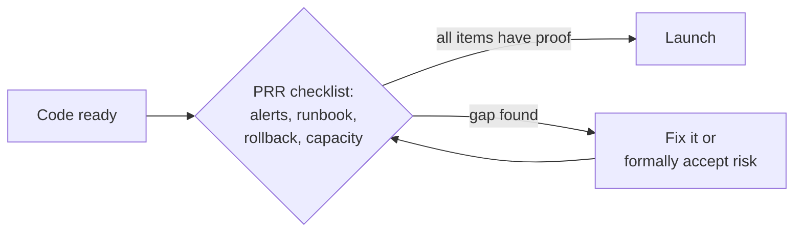
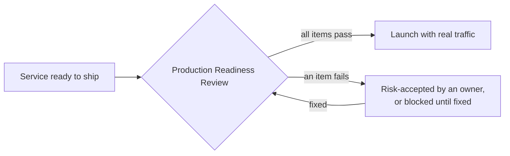
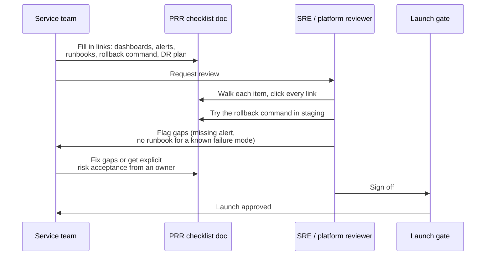
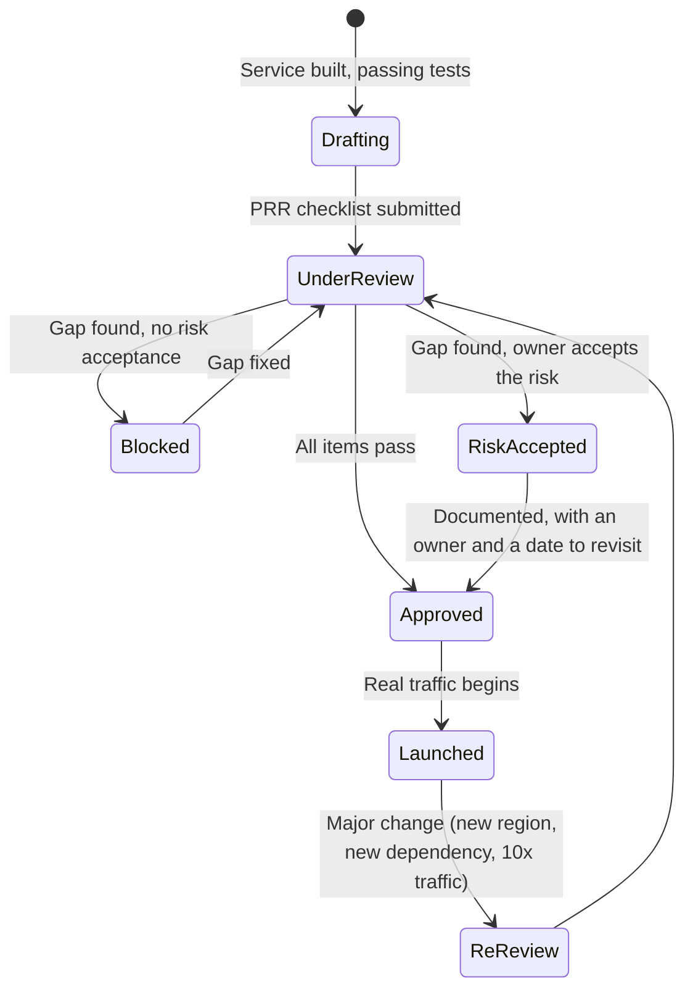

# Production Readiness Review

> [!summary] TL;DR
> A Production Readiness Review (PRR) is a structured checklist a service must pass before it takes real production traffic (or before a major change to one that already does): can it be observed, can it be alerted on, can it be operated by someone who didn't write it, and can it fail safely.
>
> It exists because "the code works" and "this is safe to run in production" are different questions.

> [!abstract] Core idea
> - A PRR is a gate, run once before launch and again before any architecturally significant change (new region, new dependency, major scaling event).
> - It checks operability, not correctness: the code can be bug-free and still fail the review for having no runbook, no alerts, or no rollback path.
> - Every checklist item should map to a concrete artifact (a dashboard link, a runbook doc, a tested rollback command), not a verbal "yes, we thought about that."
> - The review is owned jointly by the team shipping the service and an SRE/platform reviewer who did not write the code — a second set of eyes catches the blind spots the author has.
> - Failing a PRR item blocks launch (or is explicitly risk-accepted by someone with the authority to accept that risk), it does not become a follow-up ticket by default.

## Start here: the basics

**The problem in one story.**
Your team finishes a new payments service and wants to launch it on Friday.
The code works and all tests pass.
At 2 a.m. on Saturday it slows down, nobody gets paged, and when someone finally looks there is no dashboard and no guide for what to do.
A Production Readiness Review (PRR) is the checklist meeting that catches those gaps before launch.

**Words you need first**

| Word | Plain meaning | Tiny example |
| --- | --- | --- |
| Production | The real system that real users hit | The live checkout API |
| Operability | How easy it is to run, watch and fix a service | Can on-call tell it is broken in 1 minute? |
| Runbook | A written step-by-step guide for a known problem | "If queue lag > 10k, scale consumers" |
| Alert / page | An automatic message that wakes a human | PagerDuty call when error rate spikes |
| Rollback | Going back to the last working version | Redeploy yesterday's image |
| SLO | A target for how reliable the service should be | 99.9% of requests succeed |
| Dependency | Another service yours needs to work | The database or a payment gateway |
| SRE | Engineers who specialise in keeping services reliable | The platform reviewer in the PRR |

**Picture it**

**Analogy.** A PRR is the pilot's pre-flight checklist: the plane may be perfectly built, but you still check fuel, instruments and emergency exits before take-off.
Where it breaks: a pre-flight check is the same every flight, while a PRR is tailored to each service's risks and is redone only on big changes.

**How the rest of this note builds up**

- First, why PRRs exist (section 1) and the "gate, not a ticket" mental model (section 2).
- Then how the review runs and what each checklist area asks for (section 3), with a worked review (section 4).
- Then variants, trade-offs and how it looks in real companies (sections 5-7).
- Finally the SDE-3 deep dive and interview questions (sections 8-9).

> [!tip] Remember
> A PRR asks "can we run this at 2 a.m.?", not "does the code work?", and every "yes" needs a link as proof.

### Whiteboard version

A team is about to launch a new "instant refund" service. Before it gets real traffic, someone runs it through the gate:

Nine checklist areas fill in what "all items pass" means: SLOs, alerts, runbooks, dashboards, capacity, rollback, dependencies, security, and disaster recovery. The rest of this note is each of those areas done properly, with what "pass" looks like concretely.

## 1. Why it exists

A service passes every unit test, every integration test, and a code review. It gets deployed.

Three weeks later it has a slow memory leak that nobody notices because there's no memory dashboard; when it finally OOMs and restarts in a crash loop, the on-call engineer who gets paged has never seen this service before, there's no runbook, and the only rollback option is a manual `kubectl` command that isn't written down anywhere.

The incident that should have taken 15 minutes takes three hours.

None of that is a code bug.

It is an operability gap — the kind of gap that testing and code review are not designed to catch, because they check "does this do what it's supposed to," not "can a human on their worst night at 3 a.m. keep this running." The PRR exists to catch exactly this category of gap, before it's a live incident instead of a checklist item.

The review earns its cost by being concrete. "Do we have monitoring?" is a question anyone will answer yes to. "Paste the dashboard URL that shows p99 latency and error rate for this service, and show me the alert that fires if error rate exceeds the SLO's burn-rate threshold" is a question that either has an answer or doesn't.

## 2. Mental model

Think of a PRR as a pre-flight checklist, not a design review. A pilot's pre-flight checklist does not re-litigate whether the plane was built correctly — that happened in design and manufacturing (the equivalent of code review and testing).

It asks a fixed list of "is this specific safety-critical thing present and working, right now, on this airframe": fuel, flaps, instruments, radio.

A PRR plays the same role for a service: it assumes the code works and asks whether the *operational* surroundings — observability, alerting, human process, failure handling — are in place.

The nine areas below are not arbitrary; each one answers a specific question an incident responder will ask at 3 a.m.:

| Area | Question it answers at 3 a.m. |
| --- | --- |
| SLOs | Is this actually broken, or within normal variance? |
| Alerts | Would I have been paged if this got worse? |
| Runbooks | What do I do, step by step, right now? |
| Dashboards | Where do I look to see what's happening? |
| Capacity | Is this an overload, and how much headroom is left? |
| Rollback | Can I undo the last change safely? |
| Dependencies | What else breaks if I fix/restart this? |
| Security | Did we just expose something while firefighting? |
| Disaster recovery | What if the whole region/database is gone? |

## 3. How it works

A PRR is a document plus a meeting (or an async review for lower-stakes changes), walked through area by area against the service's actual artifacts — not against memory.

The reviewer trying the rollback command, not just reading that one exists, is the detail that makes this different from a rubber-stamp. A rollback script that was never run since someone edited the deploy pipeline six months ago is not a working rollback path.

### The lifecycle a PRR gates

A PRR is not one-and-done. The `Launched --> ReReview` transition matters as much as the initial gate: a service that passed its PRR at 50 RPS in one region needs another pass before it takes 10x the traffic or expands to a second region, because the capacity, dependency, and DR answers from the first review no longer hold.

## 4. Worked example

### The checklist, area by area

**SLOs.** Does the service have a defined SLI (what's measured: request success rate, latency under a threshold) and an SLO (the target: "99.9% of requests succeed," "99% of requests complete under 300ms")?

Is there an error budget, and does the team know its current burn rate? See [[SLIs, SLOs, SLAs and Error Budgets]] for the full math; a PRR just checks that the numbers exist and are wired into alerting, not that they're re-derived here.

**Alerts.** Do the SLOs have alerts attached, tuned to page on fast, sustained budget burn and only ticket on slow burn — not a flat "error rate > 1%" threshold that either never fires or fires on every blip?

[[Alerting and On-Call]] covers the full **multi-window, multi-burn-rate** mechanics (the worked Go, the four-tier burn-rate table, and the PromQL that evaluates it against live data) — a PRR item here does not re-derive that math, it checks that the service's alerts actually exist in that shape: a short window and a long window must both be burning the budget fast before paging, so a brief blip never wakes anyone and a real, sustained outage still pages within minutes.

A PRR checks that alerts: route somewhere a human will see them (see [[Alerting and On-Call]] for routing and escalation), have a linked runbook, and have been test-fired at least once (a synthetic breach, not just "the config looks right").

**Runbooks.** For every alert, is there a runbook: the specific steps to diagnose and mitigate *this* alert, not a generic "check the dashboards" pointer?

A good runbook entry names the dashboard to open, the query to run, the most likely causes in order of probability, and the mitigation (restart, failover, rollback, scale up) with the exact command.

See [[Production Debugging Playbook]] for the general diagnosis process a runbook should plug into.

**Dashboards.** Is there one dashboard that answers "is this service healthy right now" in under 10 seconds: request rate, error rate, latency percentiles (the **RED** method: Rate, Errors, Duration), and the one or two resource signals specific to this service (queue depth, cache hit rate, DB connection pool usage — the **USE** method: Utilization, Saturation, Errors, per resource)?

A PRR checks the dashboard exists and that someone other than the author can read it without a tour.

**Capacity.** Has the service been load tested at expected peak plus headroom, and is the result documented? See [[Performance Engineering and Capacity Planning]] for how that number is derived; a PRR checks the load test happened and the service held its SLO at the target load, not that the arithmetic is merely plausible.

**Rollback.** Is there a tested, fast rollback path for a bad deploy, and for a bad data migration separately (migrations often cannot simply be "rolled back")? See [[Rollback and Safe Migrations]]. A PRR item here is not "we can revert the deploy" in the abstract — it's "here is the exact command, last tested on this date."

**Dependencies.** Does the service have timeouts, retries with backoff, and a circuit breaker on every external call, so one slow dependency doesn't take the whole service down? See [[Timeouts, Retries and Backoff]] and [[Circuit Breaker]].

Is there a bulkhead so one dependency's problem can't exhaust the thread/connection pool shared with others? See [[Bulkheads and Concurrency Limits]]. A PRR traces the service's dependency graph and checks each edge, not just the happy path.

**Security.** Are secrets (API keys, DB credentials) in a secrets manager, not in config files or environment variables checked into git? See [[Secrets Management]]. Does every endpoint enforce authentication and authorization correctly? See [[Authentication vs Authorization]].

Has the service been checked against the relevant items in the [[OWASP API Security Top 10]] (broken object-level authorization, broken object property-level authorization, unrestricted resource consumption/rate limiting)? Is there protection against abusive clients? See [[API Abuse and Bot Protection]].

**Disaster recovery.** If the primary region, database, or a critical dependency disappears entirely, what happens?

Is there a documented and tested failover, and does it meet the business's Recovery Time Objective (RTO: how long until service is restored) and Recovery Point Objective (RPO: how much data can be lost)? See [[Multi-Region Architecture]] and [[High Availability and Failover]].

A PRR checks that DR has been exercised (a game day or a scheduled failover drill), not merely designed on a whiteboard.

## 5. Variants and comparison

| Review type | When it runs | Scope | Typical owner |
| --- | --- | --- | --- |
| Full PRR | Before first production launch | All nine areas, end to end | Service team + SRE/platform reviewer |
| Change-triggered PRR | Before a major change (new region, 10x traffic, new critical dependency) | Only the areas the change affects, plus capacity and DR | Service team, lighter-weight review |
| Self-service checklist | Small, low-risk services or internal tools | A short subset (alerts + runbook + rollback) | Service team, no separate reviewer required |
| Code review | Every pull request | Correctness, style, test coverage | Peer engineer |
| Architecture / design review | Before building, not before launching | Is the design sound, does it fit existing systems | Senior engineers / architects |
| Security review | Before launch, or on a schedule | Threat model, data handling, auth | Security team |

A PRR is deliberately narrower than an architecture review (it doesn't ask "was this the right design") and broader than a code review (it doesn't read the diff line by line). It complements both rather than replacing either.

## 6. Trade-offs and when not to use

- A full PRR has real process cost: it takes a reviewer's time and can delay a launch.

  Running the full nine-area review for every small internal tool or every minor config change is wasted ceremony; scale the checklist to the blast radius (a service with no external users and no SLA needs a lighter pass than a customer-facing payments path).
- A checklist can become theater if items are checked off without evidence. The discipline that makes it work — requiring a link to a real dashboard, a runbook, a tested command — is also what makes it slower than a verbal sign-off. Skipping that discipline removes most of the review's value while keeping its cost.
- It does not replace testing, code review, or a security review; it assumes those already happened and checks the operational surroundings they don't cover.
- For a service that will only ever run for days (a short-lived migration job, a one-off batch), most of the alerting/on-call/DR items don't apply — drop them explicitly rather than forcing a fit, per the vault convention of leaving out sections with nothing specific to say.

## 7. In production

- **Real systems:** Google's SRE book documents the Launch Coordination Checklist (Appendix E) used before any new service at Google takes production traffic, explicitly covering architecture, dependencies, capacity planning, and failure modes as a condition of launch.

  Large e-commerce and ticketing platforms run an equivalent gate before major sale events, often combined with a scheduled game day (a live failure-injection exercise) rather than a paper review alone.

  Many cloud-native teams implement the checklist as a template in their issue tracker (a "launch checklist" issue type) so every item has a linked artifact and an assignee.
- **Failure modes → fixes:**
  - Checklist items marked "done" with no linked artifact → require a URL (dashboard, runbook, PR) for every item; a review tool should refuse to approve an item with no link.
  - PRR run once at launch, never re-run → tie a re-review to specific triggers (new region, 10x traffic, new critical dependency, a major incident in a similar service) rather than relying on someone remembering.
  - Reviewer is the same person who built the service → require a reviewer from outside the immediate team; the whole point is a second set of eyes without the author's blind spots.
  - Rollback "exists" but has never been exercised → require the reviewer to actually run it in staging as part of sign-off, not just confirm the runbook mentions it.
- **What to monitor (after launch, to confirm the PRR's assumptions held):** actual SLO burn rate versus the budget assumed at review time, alert volume and false-positive rate in the weeks after launch, time-to-acknowledge and time-to-mitigate for the first real incidents (compares against what the runbook assumed), and whether the capacity plan's forecast peak matched the observed peak.

## 8. Deep dive

- **Why "risk accepted" needs a named owner and a date, not just a checkbox.** A PRR item that fails but is waived without an accountable owner tends to stay waived forever — there's no mechanism forcing a revisit.

  Recording who accepted the risk and when it will be reconsidered (tied to a specific trigger: "revisit before this service handles payment data" or "revisit by Q2") turns a permanent exception into a tracked, temporary one.
- **The connection between PRR and the error budget policy.** A mature SLO practice ties launch decisions to the budget itself: a service that is currently over budget (has burned more error budget than its policy allows for this period) can be blocked from shipping risky changes until the budget recovers, which gives the PRR teeth beyond the initial launch — it becomes an ongoing gate on risky work, not a one-time form.
- **PRR and chaos engineering are complementary, not redundant.** The PRR checks that a mitigation *exists* (there is a runbook, there is a rollback command); a chaos/game-day exercise checks that it actually *works* under the pressure of a real-feeling failure.

  A thorough review schedules the game day as a follow-up action rather than treating the written checklist as sufficient proof on its own. See [[Chaos Engineering]].
- **Scaling the process with an internal platform.** Teams that run many services typically codify the checklist as a template with required fields (dashboard URL, runbook URL, on-call rotation, rollback command, DR test date) enforced by their service catalog or deployment tooling, so the review is partially mechanical (the fields must be filled) and the human reviewer's time goes to judgment calls (is this runbook actually good, is this capacity number trustworthy) rather than chasing missing links.
- **The asymmetry between launch PRRs and change-triggered PRRs.** A full launch PRR is justified because the service has zero production history to lean on.

  A change-triggered PRR for a mature service should scope down to exactly what the change affects — a new region needs DR and dependency review, a 10x traffic increase needs capacity and alerting-threshold review — re-running the full nine areas every time creates checklist fatigue and teams start rubber-stamping.

## 9. Interview questions

> [!question]- What is a Production Readiness Review, and what does it not check?
> A checklist gate, run before a service takes real production traffic (or before a major change to one), covering SLOs, alerts, runbooks, dashboards, capacity, rollback, dependencies, security, and disaster recovery.
>
> It assumes the code is already correct — that's what tests and code review are for — and checks the operational surroundings instead: can this be observed, alerted on, operated, and rolled back.

> [!question]- Trap: a service passes code review and all its tests. Is it ready for production?
> Not necessarily. Code review and tests check correctness; they say nothing about whether there's a dashboard, a tuned alert, a runbook, a tested rollback path, or a plan for a dependency outage.
>
> A PRR exists precisely because "the code works" and "this is safe to operate in production" are different questions, and a service can pass the first and fail the second.

> [!question]- Why does a PRR need a reviewer outside the team that built the service?
> The author's blind spots are exactly the gaps most likely to cause an incident — things they assumed were "obviously fine" because they know the system intimately.
>
> An outside reviewer, typically from SRE or a platform team, asks the questions a 3 a.m. on-call engineer unfamiliar with the service would ask, which is the perspective the review exists to simulate.

> [!question]- How should alerting be designed so a PRR's "alerts" item actually passes?
> Alerts should be tied to the SLO's error budget using multi-window, multi-burn-rate checks (a fast window and a slow window both need to show the budget burning quickly before paging), not a flat threshold that either fires on every blip or misses a real sustained outage.
>
> Every alert should link to a runbook and should have been test-fired at least once before launch.

> [!question]- When should a service go through a change-triggered PRR instead of waiting for its next scheduled review?
> Before any architecturally significant change: moving to a new region, a major dependency change, an expected order-of-magnitude traffic increase, or after a significant incident that revealed a gap in a similar service. The scope narrows to what the change affects (a new region mainly needs DR and dependency review) rather than repeating the full nine areas every time.

> [!question]- What's the difference between a PRR and a chaos engineering game day?
> A PRR checks that mitigations exist on paper and as artifacts — a runbook is written, a rollback command is documented, an alert is configured. A game day checks that they actually work by inducing a real-feeling failure and watching the team respond.
>
> A mature readiness process uses both: the PRR as the gate, the game day as the proof that the gate's assumptions hold.

> [!question]- A checklist item is marked "done" but you can't find the linked dashboard or runbook. What's wrong, and what do you do?
> The item isn't actually done — a PRR item without a verifiable artifact (a real URL that resolves to a real dashboard, not a promise) provides no more assurance than skipping the review entirely.
>
> Block sign-off until the artifact exists, or if genuinely out of scope for this launch, require an explicit risk acceptance from a named owner with a date to revisit, not a silent pass.

## 10. Cheat sheet

- Nine areas: SLOs, alerts, runbooks, dashboards, capacity, rollback, dependencies, security, disaster recovery.
- Every item needs a linked artifact (dashboard URL, runbook doc, tested command) — "we thought about it" does not pass.
- Reviewer is someone outside the authoring team; they try the rollback command, not just read that it exists.
- Alerts should use multi-window, multi-burn-rate checks tied to the error budget, each with a linked runbook.
- A failed item is either fixed or explicitly risk-accepted by a named owner with a date to revisit — never silently waived.
- Re-run a scoped review before any architecturally significant change: new region, new critical dependency, a major traffic step-change.
- A PRR checks operability, not correctness — it assumes tests and code review already happened.
- Pair it with a chaos/game-day exercise to prove the mitigations work, not just that they're documented.

## Links

- **Before this:** [[SLIs, SLOs, SLAs and Error Budgets]], [[Alerting and On-Call]], [[Performance Engineering and Capacity Planning]]
- **Next:** nothing in 14; this is the capstone of the Observability & SRE learning path
- **Compare with:** [[Incident Response]] (what happens when the gate fails anyway), [[Chaos Engineering]] (proving a mitigation works under real failure, not just that it's documented)

### Watch on YouTube

- [What is Production Readiness Review ? ( With PRR Template )](https://www.youtube.com/watch?v=k4_gLceV4Vc) · CodeWithPrabesh · 4 min · 5,959 views
- [Service Meshes: The Production Readiness Checklist for the Rest... - Zachary Arnold & Austin Adams](https://www.youtube.com/watch?v=Ym095HaTkIo) · CNCF (Cloud Native Computing Foundation) · 40 min · 580 views
