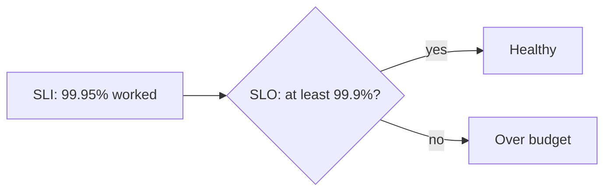
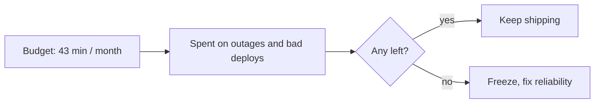
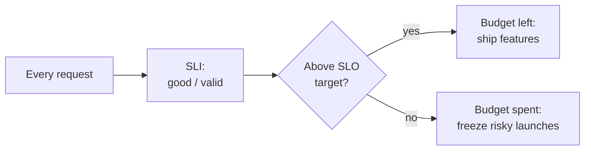
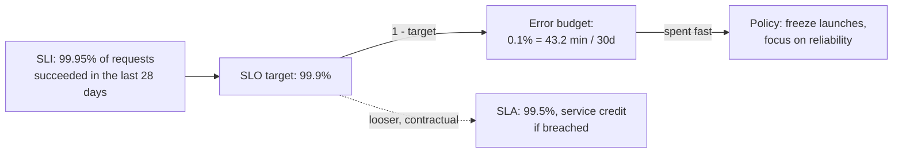
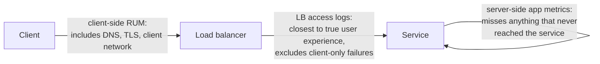
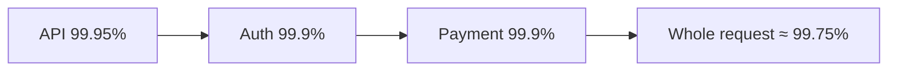
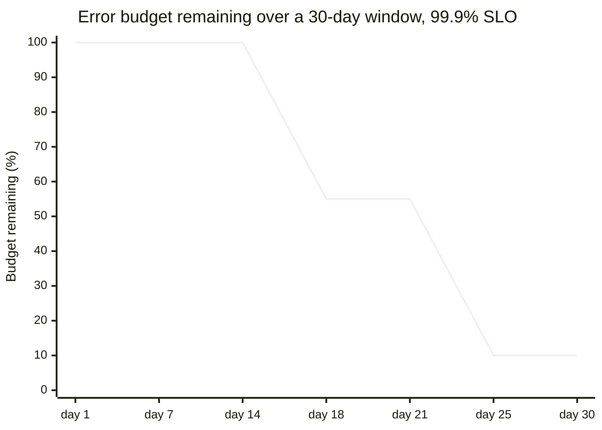

# SLIs, SLOs, SLAs and Error Budgets

> [!summary] TL;DR
> An **SLI** is a measurement ("what fraction of requests succeeded"), an **SLO** is the internal target for that measurement ("99.9% over 30 days"), and an **SLA** is the external, contractual promise with a penalty attached, usually looser than the SLO.
>
> The gap between 100% and the SLO is the **error budget**: the amount of unreliability you're allowed to spend before you must stop and fix reliability instead of shipping features.

> [!abstract] Core idea
> - SLI = good events ÷ valid events, measured continuously.
> - SLO = a target for that SLI plus a time window; it's a promise to yourself and the business, not to the customer.
> - SLA = the customer-facing promise, with a penalty, set looser than the SLO so breaches are rare.
> - Error budget = `1 − SLO`; spend it on risky launches, and freeze them when it runs out.
> - Burn rate turns the slow, 30-day budget into a number you can alert on in minutes (covered fully in [[Alerting and On-Call]]).

## Start here: the basics 🟢

> [!info] How to read this note (pick your level)
> - 🟢 **New to this?** Read "From zero" below, then sections 1, 2 and 10 (why, mental model and the cheat sheet). Stop there, that is a full first pass.
> - 🟡 **Know the basics?** Add sections 3, 4, 5 and 6 (how it works, a worked example, options and trade-offs).
> - 🔴 **Interview / SDE-3 prep?** Add sections 7, 8 and 9 (production, deep dive and interview questions). Headings are tagged 🟢🟡🔴 so you always know where you are.

> [!note] Before this note
> - [[Observability Fundamentals]]: a service records numbers about itself, like how many requests failed.
> - [[Metrics and Prometheus]]: those numbers are counters you can turn into "per second" and "share of failures" with simple queries.

**From zero, in 60 seconds** 🟢

No service is up 100% of the time. So the real question is: how reliable is reliable enough?
An **SLI** is what you measure, like "share of requests that worked".
An **SLO** is your goal for it, like "99.9% over 30 days". An SLA is a promise to customers, with money back if you miss.



The gap between 100% and the SLO is the **error budget**: how much failure you are allowed. 99.9% over 30 days is about 43 minutes.
Budget left? Ship features. Budget gone? Slow down and fix reliability.



The rest of this note is just these 3 questions:
1. How do you choose a good SLI and where do you measure it?
2. How do you pick a target and do the budget math?
3. How do dependencies and background jobs change the picture?


**The problem in one story.**
You run a food-delivery app. Some orders fail now and then.
Is that fine or a disaster? Without a number, the product team says "never fail" and engineers say "it's mostly fine".
SLIs and SLOs turn that argument into a shared number, and the error budget says how much failure you can still afford this month.

**Words you need first**

| Word | Plain meaning | Tiny example |
| --- | --- | --- |
| Request / event | One thing a user asked the system to do | One `POST /orders` call |
| Good event | An event that met the bar | Returned 2xx in under 300 ms |
| Percentage (nines) | Reliability written as a percent | 99.9% = "three nines" |
| Time window | The period the number is measured over | Last 30 days |
| SLI | The measured ratio of good to valid events | 999,000 good of 1,000,000 = 99.9% |
| SLO | Your internal target for the SLI | "99.9% over 30 days" |
| SLA | A contract promise to customers, with a penalty | "99.5% or we refund 10%" |
| Burn rate | How fast you are using up the allowed failures | 2x = budget gone in half the window |
| Error budget | The failures you are allowed: 100% minus the SLO | 99.9% SLO → 0.1% may fail |
| Valid event | A request that should count at all | a request the client cancelled does not count |
| Rolling window | A window that slides forward every minute | "the last 30 days", always |
| Load balancer | The front door that spreads requests across copies of your service | sees a 502 your app never logged |
| Availability | The share of requests that got a proper answer | 999 of 1,000 = 99.9% |
| SRE | Site Reliability Engineering: engineers whose job is keeping services reliable | the SRE who wants to block a risky deploy |

**Picture it**



**Analogy.** The error budget is a monthly phone data plan: 99.9% means you get about 43 minutes of "downtime data" per 30 days; spend it on risky launches, and when it runs out you slow down.
Where it breaks: unused data does not roll over, and a real outage can spend the whole budget in one go, which a data plan rarely does.

**How the rest of this note builds up**

- First, why SLOs exist (section 1) and the SLI → SLO → SLA ladder (section 2).
- Then how to pick SLIs, set targets and compute the budget (section 3), with a worked example (section 4).
- Then variants, trade-offs and real-world use (sections 5-7).
- Finally the SDE-3 deep dive on burn-rate alerting and budget policy, plus interview questions (sections 8-9).

> [!tip] Remember
> Measure good ÷ valid (SLI), aim for a target (SLO), promise less to customers (SLA), and spend the gap (error budget) wisely.

### Whiteboard version



The SLI is what you measure every minute. The SLO is the line you manage against day to day. The SLA is what legal and sales promised the customer — and it is deliberately looser than the SLO so a brief SLO miss never triggers a contractual penalty.

## 1. Why it exists 🟢

A team ships a checkout API with no explicit target. One engineer thinks "it should basically never be down." Another thinks "a few minutes a week is fine, we're not a bank." A product manager wants to ship a risky caching change (keeping copies of answers to serve them faster) Friday afternoon; an SRE wants to block it.

Nobody can settle the argument because there's no number to check it against.

With an SLO, the question becomes mechanical: **99.9% availability over 30 days means 1,000,000 requests can tolerate 1,000 failures.** If the team has only used 200 of that budget this month, the Friday deploy is fine. If they've used 950, it waits. The SLO converts a reliability argument into arithmetic.

### Real-life example: UPI payments 🟢

Think of a UPI app like Google Pay.
Its team might set "99.9% of payment requests get a proper answer within 30 days" as the SLO.
With 10 crore (100 million) payments a month, that allows about 1 lakh (100,000) failures.
After a bad release burns 80,000 of them in one evening, the team pauses new features and spends the rest of the month on reliability.
Nobody argues about it, because the number already said "you are nearly out of budget".

## 2. Mental model 🟢

Think of the error budget as a bank account funded monthly with a fixed amount of "allowed failure." Every bad request withdraws from it. Shipping features, taking risks, doing maintenance — all of that spends budget, same as an outage does.

The account resets each window (commonly a rolling 28 or 30 days). When the balance goes negative, the team's job shifts from "ship features" to "pay down reliability debt," because the budget — not someone's opinion — says reliability is the bottleneck right now.

## Common beginner mistakes 🟢

- **Setting the SLO to 100%** → there is no budget at all, so every tiny blip is a "breach" and people stop caring → pick a target below 100%, like 99.9%.
- **Using average latency as the SLI** → a fine average can hide many slow users → count "requests faster than 300 ms" divided by all valid requests.
- **Making the SLA the same as the SLO** → every small miss becomes a legal problem → keep the SLA looser, like 99.5% when the SLO is 99.9%.
- **Writing an SLO with no agreed policy** → when the budget runs out, nothing changes → agree in advance what happens (for example, pause risky launches).
- **Measuring only inside your app** → failures at the load balancer never show up → measure at the load balancer by default.

## 3. How it works 🟡

> 🟢 → 🟡 **You now know** what SLI, SLO, SLA and the error budget are. **Next we open the box**: how to pick a good SLI, where to measure it, how to choose the target and window, and how to do the budget math, including when your service depends on others.

### Choosing the SLI

**In plain words:** always a ratio: good events divided by all valid events. Pick what users actually feel, like success and speed.

**Step by step:**
1. Pick one user journey, say "place an order".
2. Decide what counts at all (valid): every `POST /orders` that reached us, minus ones the client cancelled.
3. Decide what is good: got a non-5xx answer (not a server error) in under 300 ms.
4. Divide: 998,500 good out of 1,000,000 valid = 99.85%. That is your SLI.

An SLI is always a ratio: **good events ÷ valid events**, expressed as a percentage, measured over a rolling window. Good SLIs are chosen per user journey, not per machine:

| SLI type | Example formula | What it answers |
| --- | --- | --- |
| Availability | `successful requests / total valid requests` | Did the request get a non-5xx, non-timeout response? |
| Latency | `requests faster than 300ms / total valid requests` | Threshold-based: "99% of requests are under 300 ms," not an average |
| Freshness | `data updated within N minutes / total data points` | Is the read-replica (a read-only copy of the database) or cache acceptably stale? |
| Correctness | `responses with correct content / total responses` | Did the response match expectations, not just "did it respond" |
| Durability | `objects retrievable / objects stored` | For storage systems: did we keep what we promised to keep |

**Valid events** matters: a request that never reached your load balancer (client-side network failure) usually shouldn't count against you, and a request a client cancelled isn't "bad" the way a 500 is. Define valid events precisely, in writing, or the SLI's meaning drifts.

### Where to measure

**In plain words:** the closer to the user, the more honest. Measuring inside your app misses failures at the load balancer.

**Step by step:**
1. A request leaves the user's phone and first needs DNS (turning the name into an address) and TLS (setting up the secure connection).
2. It reaches your load balancer, which writes an access log line with the status.
3. The load balancer passes it to one copy of your service, which records its own metrics.
4. If that copy is down, the load balancer answers 502 itself. Your app's metrics never see that failure; the load balancer's logs do.



Measuring at the **server** is cheapest and most common but is blind to anything that failed before the request arrived (DNS, TLS handshake failures, client timeouts).

Measuring at the **load balancer** is usually the best default: it sees everything that reached your infrastructure, including upstream 5xxs the app itself never logged.

Measuring at the **client** (real-user monitoring or synthetic probes) is the most honest but the most expensive and noisiest, and is reserved for the SLIs that matter most (checkout, login).

### SLO target and window

**In plain words:** a goal is a number plus a time window. "99.9% over the last 30 days" moves forward every day.

**Step by step:**
1. Pick the target: 99.9%.
2. Pick the window: the last 30 days.
3. With a rolling window, every minute the oldest minute drops off and the newest is added, so a bad day stays counted for 30 days.
4. With a calendar window, the budget refills fully on the 1st of the month, even if the 31st was terrible.

An SLO states a target **and** a window: "99.9% of requests succeed, measured over a rolling 30-day window." Two window shapes exist:

- **Rolling window** (e.g. "last 30 days, recalculated every minute"): the budget never resets to full on a fixed calendar date, so there's no "free" burn at the start of a new month. This is the Google SRE default.
- **Calendar window** (e.g. "this quarter"): simpler to reason about for business reporting, but creates a cliff — budget fully refills on day 1 regardless of how bad day -1 was.

### Error-budget math, worked

**In plain words:** take the minutes in the window, multiply by the allowed failure share. 30 days at 99.9% gives about 43 minutes.

**Step by step:**
1. Minutes in 30 days: 30 × 24 × 60 = 43,200.
2. Allowed failure share at 99.9%: 1 − 0.999 = 0.001.
3. Downtime budget: 43,200 × 0.001 ≈ 43 minutes.
4. Or count requests: 1,000,000 × 0.001 = 1,000 failed requests allowed.
5. 500 failed so far? Half the budget is gone.

For a **30-day window** (`30 × 24 × 60 = 43,200` minutes):

| SLO target | Allowed downtime per 30 days | Allowed bad events per 1,000,000 |
| --- | --- | --- |
| 99% | 7h 12m | 10,000 |
| 99.9% | 43m 12s | 1,000 |
| 99.95% | 21m 36s | 500 |
| 99.99% | 4m 19s | 100 |

**Worked example:** a service targets 99.9% over 30 days and serves 1,000,000 requests in that window. The allowed bad-event fraction is `1 − 0.999 = 0.001`, so the budget is `1,000,000 × 0.001 = 1,000` failed requests.

If 500 requests have failed so far this window, **50% of the budget is spent** — `BudgetConsumedFraction` in the code below returns exactly that.

### Dependency math

**In plain words:** if you need several services in a row, multiply their uptimes. Three services at 99.9% give you only about 99.7%.

**Step by step:**
1. A payment request needs the API, then Auth, then the payment provider, one after the other.
2. If any one fails, the whole request fails.
3. So multiply: 0.9995 × 0.999 × 0.999 ≈ 0.9975, about 99.75%.
4. To get back above that, add a backup path, like retrying on another copy (replica) or a fallback provider.



Availabilities of serial dependencies **multiply**, so a chain is never more reliable than its weakest-but-one link once you compose several 99.9%-ish services:

```text
API (99.95%) → Auth (99.9%) → Payment provider (99.9%)
0.9995 × 0.999 × 0.999 ≈ 0.9975  →  effective ~99.75%, not 99.9%
```

Three services each individually hitting their own 99.9% SLO can still compose into something below any one of their targets. Redundancy (retrying a different replica, a fallback path) is what buys that back — it's why a dependency's SLO alone doesn't tell you your own achievable SLO; the call graph does.

### SLOs for asynchronous work

**In plain words:** for background jobs, "good" means "finished in time", not "answered fast".

**Step by step:**
1. A job "send invoice email" goes into the queue at 10:00 (this is called enqueue).
2. A worker picks it up and finishes it at 10:03.
3. If the deadline is 5 minutes, this job counts as good.
4. SLI = jobs finished within 5 minutes ÷ all jobs. Queue age (how long the oldest waiting job has sat) is the early warning.


A background job queue doesn't have a per-request latency the way an API does, so its SLIs are usually: **"N% of jobs complete within T minutes of enqueue"** (a freshness-shaped SLI) and **"queue age stays under T minutes for N% of the window."** The event here is the job, and "good" means "finished within the deadline," not "returned 200."

## 4. Worked example 🟡

### Go: error-budget calculator

**In plain words:** the same math as Go code, handy for a dashboard or a "safe to deploy?" check.

The calculations above as tested Go, used to drive a dashboard or a CLI check before a risky deploy. It compiles and passes `go vet` and `go test -race` on Go 1.24.4.

```go
// Package slo computes error-budget math for a rolling-window SLO: the
// allowed downtime for a target, the budget consumed by a given error rate,
// and the burn rate that number represents.
package slo

import "time"

// AllowedDowntime returns how much of window may be "bad" at target
// (e.g. 0.999 for 99.9%) before the SLO is breached.
func AllowedDowntime(target float64, window time.Duration) time.Duration {
	return time.Duration(float64(window) * (1 - target))
}

// BudgetConsumedFraction returns the fraction (0..1+) of the error budget
// used up by badEvents out of totalEvents against target. Values over 1
// mean the budget is already exhausted.
func BudgetConsumedFraction(target float64, totalEvents, badEvents int64) float64 {
	if totalEvents == 0 {
		return 0
	}
	allowedBadFraction := 1 - target
	actualBadFraction := float64(badEvents) / float64(totalEvents)
	return actualBadFraction / allowedBadFraction
}

// BurnRate returns how many multiples of the sustainable rate the service is
// currently burning its budget at. A burn rate of 1 exhausts the budget
// exactly at the end of window; 14.4 exhausts a 30-day budget in ~50 hours (~2 days).
func BurnRate(target float64, shortWindowBadFraction float64) float64 {
	allowedBadFraction := 1 - target
	if allowedBadFraction == 0 {
		return 0
	}
	return shortWindowBadFraction / allowedBadFraction
}
```

```go
package slo

import (
	"testing"
	"time"
)

func TestAllowedDowntime_30DayWindow(t *testing.T) {
	cases := []struct {
		target float64
		want   time.Duration
	}{
		{0.999, 43*time.Minute + 12*time.Second},
		{0.9995, 21*time.Minute + 36*time.Second},
		{0.9999, 4*time.Minute + 19*time.Second + 200*time.Millisecond},
	}
	window := 30 * 24 * time.Hour
	for _, c := range cases {
		got := AllowedDowntime(c.target, window)
		diff := got - c.want
		if diff < -2*time.Second || diff > 2*time.Second {
			t.Errorf("AllowedDowntime(%v, 30d) = %v, want ~%v", c.target, got, c.want)
		}
	}
}

func TestBudgetConsumedFraction_OneMillionRequests(t *testing.T) {
	// 99.9% target over 1,000,000 requests allows 1,000 bad ones.
	got := BudgetConsumedFraction(0.999, 1_000_000, 1_000)
	if got < 0.99 || got > 1.01 {
		t.Errorf("BudgetConsumedFraction = %v, want ~1.0 (exactly at budget)", got)
	}
	got = BudgetConsumedFraction(0.999, 1_000_000, 500)
	if got < 0.49 || got > 0.51 {
		t.Errorf("BudgetConsumedFraction = %v, want ~0.5", got)
	}
}

func TestBurnRate_PageThreshold(t *testing.T) {
	// 99.9% target: allowed bad fraction is 0.001. A 1-hour window running
	// at 1.44% errors burns the 30-day budget in about 50 hours / ~2 days (rate 14.4).
	got := BurnRate(0.999, 0.0144)
	if got < 14.3 || got > 14.5 {
		t.Errorf("BurnRate = %v, want ~14.4", got)
	}
}
```

**Tested:** `go vet ./...` clean; `go test -race ./...` → `ok slo 1.4s`, all three tests pass (Go 1.24.4, scratch module, 2026-11-07).

### Budget burn-down over a window



A flat line means no errors are being recorded; the steep drop from day 14 to day 18 is an incident consuming budget fast.

The plateau that follows (day 18 to day 21, holding at 55%) means the service recovered and stopped spending further budget — until a second drop (day 21 to day 25) takes it down to 10%, where it plateaus again for the rest of the window.

This shape, not a single "are we up" boolean, is what an error-budget policy reacts to.

## 5. Variants and comparison 🟡

| Concept | Measures | Audience | Consequence of miss |
| --- | --- | --- | --- |
| SLI | A live ratio: good/valid events | Engineering | None directly; it's just a number |
| SLO | A target for the SLI, with a window | Engineering, product | Error-budget policy kicks in (freeze launches, prioritize reliability work) |
| SLA | A looser, contractual target | Customers, legal, sales | Service credits (money off the next bill), contractual penalty |
| Error budget | `1 − SLO`, consumed by bad events | Engineering + product, jointly | Decides whether risky launches proceed |

## 6. Trade-offs and when not to use 🟡

- An SLO with no error-budget **policy** behind it is decoration: the number only changes behavior if everyone has agreed in advance what happens when it's breached (freeze launches, mandatory postmortem, reliability sprint).
- Too many SLOs per service dilutes attention; Google's guidance is to pick the handful of SLIs that represent what users actually care about, not one per endpoint.
- 100% is never the right target: it has no error budget at all, which means zero room for planned maintenance, canary rollouts (releasing to a small share of users first), or any experimentation — and it's unachievable regardless, so it just produces permanent, ignored breach alerts.
- For a brand-new, low-traffic service, a tight SLO measured over a short window is statistically meaningless — 3 failed requests out of 40 looks catastrophic but is noise. Widen the window or wait for volume.

## 7. In production 🔴

> 🟡 → 🔴 **You now know** how to choose an SLI, where to measure it, how to set a target and window, and how to do budget and dependency math. **Next is the advanced part**: how real teams run SLOs, how they fail (missed breaches, gamed definitions), and the deeper choices interviewers ask about.


- **Real systems:** Google's internal SLO culture (the origin of this chapter, SRE book ch. 4); Sloth and Pyrra are open-source tools that generate Prometheus recording rules and alerts from an SLO spec; OpenSLO is a vendor-neutral YAML (a plain-text config format) format for defining SLOs portably across tooling.
- **Failure modes → fixes:**
  - SLO breached but nobody notices until the monthly report → wire burn-rate alerts (see [[Alerting and On-Call]]), don't rely on a dashboard someone has to remember to check.
  - Error budget chronically at zero → the target was set wrong (too strict for the architecture) or there's a real, unaddressed reliability problem; both require a decision, not more monitoring.
  - Teams game the SLI (narrow the definition of "valid request" until almost nothing counts against them) → review SLI definitions in the same forum that reviews the SLO target, not unilaterally.
- **What to monitor:** budget-remaining percentage per service, burn rate over multiple windows, and the count of launches delayed or allowed by the error-budget policy (this is a leading indicator the policy is actually being followed, not just written down).

## 8. Deep dive 🔴

- **Request-based vs window-based SLIs.** A request-based SLI (`good/valid` over all requests in the window) weights every request equally. A window-based SLI (e.g.

  "percentage of 1-minute windows where availability stayed above X") instead asks whether the service was ever "bad" for a sustained period — used more for latency/aggregate health checks than per-request correctness, and less precise for budget math, so most production SLOs use request-based SLIs.
- **Recording rules.** Computing `good/valid` live, per minute, directly from raw events is expensive at scale; Prometheus recording rules pre-aggregate `sli:good_events:rate5m` and `sli:valid_events:rate5m` so the SLO and burn-rate alert queries (next note) just divide two cheap series instead of scanning raw request metrics.
- **Why the SLA is looser than the SLO.** The SLO is what engineering manages against operationally — tight enough to catch problems before customers notice.

  The SLA is what's promised externally, with margin, so that normal operational variance (a 10-minute blip well within the SLO's error budget) never triggers a contractual penalty.

  If SLA == SLO, every SLO miss becomes a legal event, which pressures teams to hide or dispute misses instead of using the budget as intended.
- **SLOs and chaos engineering.** A chaos experiment's abort condition should be tied to the error budget, not a vague "stop if it looks bad" — see [[Chaos Engineering]] (breaking things on purpose to test resilience) for blast-radius control (limiting how many users an experiment can hurt) that uses exactly this number.

## 9. Interview questions 🔴

> [!question]- Define SLI, SLO and SLA in one sentence each, with a concrete number.
> SLI: a measured ratio, e.g. "99.95% of requests returned non-5xx in the last 5 minutes." SLO: an internal target for that SLI over a window, e.g. "99.9% over a rolling 30 days." SLA: a contractual, customer-facing promise looser than the SLO, e.g. "99.5%, with service credits below that."

> [!question]- A service serves 2,000,000 requests over 30 days with a 99.9% SLO. How many failures are in budget, and what if 1,800 have already failed?
> Allowed bad fraction is `1 − 0.999 = 0.001`, so budget is `2,000,000 × 0.001 = 2,000` failures. At 1,800 failed, `1,800/2,000 = 90%` of the budget is spent — close to triggering whatever policy kicks in at exhaustion (freeze risky launches, prioritize reliability work).

> [!question]- Three dependent services each have a 99.9% SLO. Does that guarantee your composed request also hits 99.9%?
> No. Availabilities multiply along a serial call chain: `0.999³ ≈ 0.997`, below any individual service's target. Redundancy (retries to another replica, a fallback) is what recovers the composed availability; the dependency SLOs alone don't guarantee it.

> [!question]- Why measure at the load balancer instead of inside the application?
> The load balancer sees every request that reached your infrastructure, including upstream errors the application itself never got to log (e.g. a rejected connection or a 502 from an unhealthy pod). Measuring only inside the app is blind to anything that failed before the app saw it, which understates real failure.

> [!question]- What's the difference between a request-based SLI and a window-based SLI?
> Request-based divides good events by valid events across every individual request in the window — precise, and the natural input to error-budget arithmetic. Window-based asks what fraction of short time-windows were acceptable overall, which is coarser and more common for availability-style "was the service up" checks than for budget math.

> [!question]- Trap: if the SLA says 99.5% and you're at 99.6%, are you safe?
> Not necessarily on the number that matters day to day: the internal SLO (commonly tighter, e.g. 99.9%) is what your error-budget policy manages against, and you could already be over budget against the SLO — and about to do real engineering damage-control — while still comfortably inside the looser, contractual SLA.
>
> Interviewers use this to check you understand the SLO/SLA gap is deliberate, not interchangeable.

## 10. Cheat sheet 🟢

- SLI = good events ÷ valid events, measured continuously, as a ratio not a count.
- SLO = target + window (commonly rolling 30 days); SLA = looser, contractual, with a penalty.
- Error budget = `1 − SLO`; 99.9%/30d = 43.2 min downtime = 1,000 failures per 1M requests.
- Measure at the load balancer by default; client-side for the journeys that matter most; server-side is cheapest but blind to pre-service failures.
- Serial dependencies multiply availabilities — three 99.9% services don't compose to 99.9%.
- An SLO without an agreed-upon policy for budget exhaustion is just a dashboard number.
- 100% target = zero error budget = no room for maintenance or rollout risk; never the right target.
- Burn rate turns the 30-day budget into a number you can alert on in minutes — the full mechanics are in [[Alerting and On-Call]].

## Self-check 🟢🟡

🟢 Easy

> [!question]- What is the difference between an SLO and an SLA?
> The SLO is your internal target; the SLA is the looser promise to customers, with a penalty.

> [!question]- What is the error budget for a 99.9% SLO?
> 0.1% of events, about 43 minutes of downtime per 30 days.

> [!question]- Why is 100% a bad SLO?
> It leaves no budget, so any small failure is a breach and there is no room for deploys or maintenance.

🟡 Medium

> [!question]- 4,000,000 requests in 30 days at a 99.9% SLO. How many may fail?
> 4,000,000 × 0.001 = 4,000.

> [!question]- Why measure the SLI at the load balancer instead of in the app?
> It also sees failures that never reached your app, like a 502 from a dead copy.

> [!question]- Your service calls two others at 99.9% each, in a row. Can you promise 99.9%?
> No. 0.999 × 0.999 ≈ 99.8% before your own failures, unless you add retries or fallbacks.

## Links

- **Before this:** [[Observability Fundamentals]], [[Metrics and Prometheus]]
- **Next:** [[Alerting and On-Call]], [[Incident Response]]
- **Compare with:** [[Chaos Engineering]] (validates whether the system actually survives within its error budget), [[Postmortems and Root Cause Analysis]] (the process a budget-exhausting incident feeds into)

### Watch on YouTube

- [SRE Fundamentals - Understanding SLIs, SLOs, SLAs & Error Budgets](https://www.youtube.com/watch?v=nsqHxEbNVcY) · MattOps / DevOps & SRE · 35 min · 565 views
- [SLOs, SLIs & Error Budgets Explained: The Framework Senior Engineers Actually Use](https://www.youtube.com/watch?v=2GVNfWcljkk) · Shubham Sahoo · 18 min · 171 views
