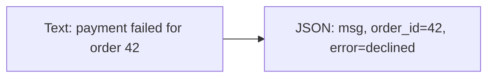
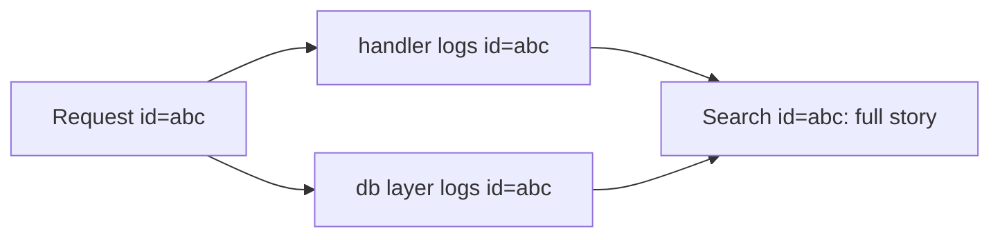
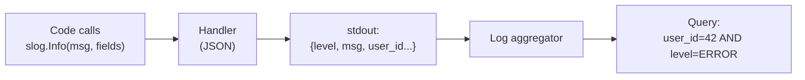
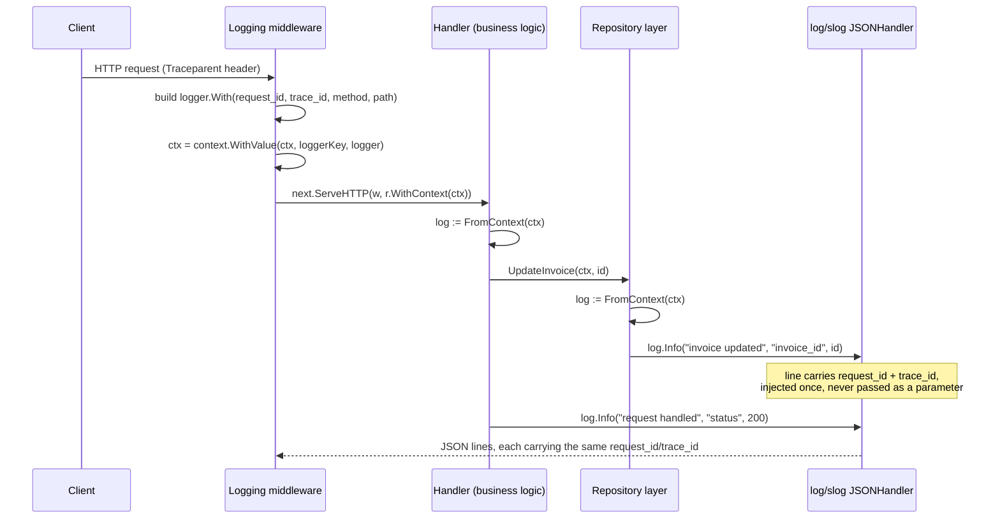
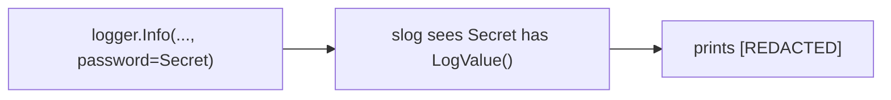
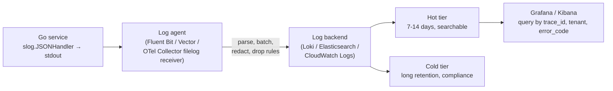

# Structured Logging

> [!summary] TL;DR
> A structured log is a line of key-value fields (usually JSON), not a formatted sentence — so a machine can filter, aggregate and join it with other telemetry, instead of a human having to parse free text with regular expressions.

> [!abstract] Core idea
> - A `printf`-style log (`"user 42 paid $19.99"`) is a sentence; a structured log (`{"event":"payment","user_id":42,"amount_cents":1999}`) is a row. Rows are queryable; sentences are not.
> - Go's `log/slog` (standard library since Go 1.21) gives every log line a level, a message and typed key-value attributes, written through a pluggable `Handler` — usually `JSONHandler` in production.
> - A field should be unloggable by construction when it must never appear: implement `slog.LogValuer` on the type and it always renders as `[REDACTED]`, no matter who logs the struct that holds it.
> - The fields worth standardizing across every service are the ones that let you filter and join: `trace_id`, `request_id`, `service`, and a few domain fields — not an unbounded dump of every variable in scope.

## Start here: the basics 🟢

> [!info] How to read this note (pick your level)
> - 🟢 **New to this?** Read "From zero" below, then sections 1, 2 and 10 (why, mental model and the cheat sheet). Stop there, that is a full first pass.
> - 🟡 **Know the basics?** Add sections 3, 4, 5 and 6 (how it works, a worked example, options and trade-offs).
> - 🔴 **Interview / SDE-3 prep?** Add sections 7, 8 and 9 (production, deep dive and interview questions). Headings are tagged 🟢🟡🔴 so you always know where you are.

> [!note] Before this note
> - [[Observability Fundamentals]]: an app leaves three kinds of clues (logs, metrics, traces), and one shared `trace_id` links them. This note zooms in on logs.

**From zero, in 60 seconds** 🟢

A normal log line is a sentence: "payment failed for order 42". Easy for a human, hard for a machine to search.
A **structured log** writes the same thing as named fields, usually JSON: {"msg":"payment failed","order_id":42}.
Now you can search "all failures for order 42" or "count errors per customer" in seconds.



Each request also gets a **request ID** added to every log line it writes. Then one search shows that request's whole story.



The rest of this note is just these 3 questions:
1. How does Go's log/slog library work?
2. How do you attach request IDs and keep secrets out of logs?
3. Which fields go on every line, and how do logs get shipped?


**The problem in one story.**
A customer says "my payment failed at about 3 p.m.".
Your server printed a million lines like `user 42 paid 19.99` that day.
To find the right one you grep and guess, because each line is a free-form sentence.
Structured logging writes each line as named fields, so you can just ask "show `event=payment` where `user_id=42`".

**Words you need first**

| Word | Plain meaning | Tiny example |
| --- | --- | --- |
| Log line | One record a program writes about something that happened | `payment failed` |
| Log level | How serious the line is | `DEBUG`, `INFO`, `WARN`, `ERROR` |
| Key-value pair | A named field and its value | `user_id=42` |
| JSON | A text format for named fields | `{"user_id":42}` |
| Log aggregator | A tool that collects and searches logs from all servers | Loki, Elasticsearch |
| `slog` | Go's standard structured logging package | `slog.Info("paid", "user_id", 42)` |
| Trace ID | One ID shared by every log of a single request | `trace_id=abc123` |
| PII | Personal data that must not leak | Email, card number |
| Middleware | Code that runs around every request before your handler | adds `request_id` to the logger |
| `context.Context` | A Go value passed down every function call for one request; it can carry extras like a logger | `FromContext(ctx)` |
| Handler (in `slog`) | The part that turns a log call into text and writes it somewhere | `JSONHandler` writes JSON to stdout |
| stdout | The program's normal output stream; containers collect it for you | what `fmt.Println` writes to |
| Log agent | A small program on each machine that reads logs and ships them to the store | Fluent Bit, Vector |
| Redaction | Hiding a secret value before it is written | password shows as `[REDACTED]` |

**Picture it**



**Analogy.** A printf log is a diary entry; a structured log is a row in a spreadsheet. You can sort and filter a spreadsheet, but you can only read a diary.
Where it breaks: a spreadsheet has fixed columns, while log fields can differ per line, so teams must agree on common field names.

**How the rest of this note builds up**

- First, why structured logs exist (section 1) and the "rows, not sentences" model (section 2).
- Then how `log/slog` works: levels, attributes, handlers, redaction (section 3), with a worked Go example (section 4).
- Then other libraries, trade-offs and production practice like sampling and cost (sections 5-7).
- Finally the SDE-3 deep dive and interview questions (sections 8-9).

> [!tip] Remember
> Log events as named fields, not sentences, so a machine can filter them and a trace ID can join them.

### Whiteboard version

```go
logger := slog.New(slog.NewJSONHandler(os.Stdout, nil))
logger.Info("invoice created", "invoice_id", 482, "amount_cents", 129900)
// {"time":"...","level":"INFO","msg":"invoice created","invoice_id":482,"amount_cents":129900}
```

One call, one JSON object, one event. Everything below adds what production needs: standard fields, request-scoped context, redaction, levels, sampling and a real pipeline.

## 1. Why it exists 🟢

🟢 **Plain version:** A sentence-style log is fine when you read one line on your screen. It is useless when you need to count "how many payments failed for one customer in the last hour", because a program has to cut each sentence apart to find the numbers. A structured log already stores each fact in its own named field, so a log search tool can filter and count straight away.


A `printf` log line like `log.Printf("payment failed for order %d: %v", orderID, err)` is fine to read once, by eye, in a terminal.

It fails the moment you need to answer "how many payment failures happened for tenant `acme` in the last hour, broken down by error code" — that requires parsing the sentence back apart with a regex (a text-matching pattern) that breaks the next time someone tweaks the wording.

A structured log line for the same event —

```json
{"time":"2026-11-07T10:02:03Z","level":"ERROR","msg":"payment failed","order_id":9123,"tenant":"acme","error_code":"card_declined","trace_id":"4bf92f..."}
```

— is already a row a log backend (a log search store: Loki, Elasticsearch, or AWS's CloudWatch Logs Insights) can filter on `tenant="acme" AND error_code="card_declined"` and count, without parsing anything. The cost is discipline: every field has a stable key, and nobody free-text-formats a value that should be its own field.

### Real-life example: a failed UPI payment 🟢

Think of a payments app like PhonePe or Paytm.
A user says "my UPI payment to a shop failed around 3 p.m.".
Support types `user_id=42 AND level=ERROR` into the log search and sees one line with `error_code=bank_timeout`.
They then count `error_code=bank_timeout` for the last hour and see thousands, all from one bank.
Two quick searches turned one complaint into "that bank is having trouble", which is only possible because every line has the same named fields.

## 2. Mental model 🟢

Think of `printf` logging as handwriting a diary entry and structured logging as filling in a form. The diary entry is natural to write and read once, but a thousand diary entries can only be searched by reading them.

A thousand filled-in forms can be filtered, sorted, counted and joined — because every entry put the same fact in the same named box.

`log/slog`'s job is to make filling in that form as easy as calling a function: `logger.Info(msg, key1, val1, key2, val2, ...)` builds one structured record; the `Handler` decides how it's rendered (JSON for machines, a human-readable line for a local terminal) and where it goes.

## Common beginner mistakes 🟢

- **Building the message with `fmt.Sprintf`** ("paid 42 by user 7") → the numbers are stuck inside a sentence and cannot be filtered → pass them as fields: `slog.Info("paid", "amount", 42, "user_id", 7)`.
- **Passing the request ID by hand to every function** → someone forgets, and their lines cannot be joined → put a logger with the IDs into the context once, in middleware.
- **Logging a whole struct that holds a password** → the secret ends up in the log store, where many people can read it → make the secret type implement `LogValuer` so it always prints `[REDACTED]`.
- **Leaving `Debug` on in production** → millions of extra lines slow the app and raise the bill → default to `Info`, and switch `Debug` on for a short time only when needed.
- **Using different names for the same field** (`userId`, `user_id`, `uid`) → searches miss lines → agree on one list of standard field names for all services.

## 3. How it works 🟡

> 🟢 → 🟡 **You now know** that a structured log is a row of named fields and why that makes searching easy. **Next we open the box**: how one request's IDs reach every log line without being passed around, what the parts of Go's `log/slog` do, and how lines travel to the search store.

**In plain words:** middleware makes one logger per request with the IDs already filled in, and every layer below uses that logger.

**Step by step:**
1. A request `GET /invoices/42` arrives with header `X-Request-Id: req-123`.
2. The logging middleware makes a logger that already holds `request_id=req-123`, the method and the path.
3. It puts that logger into the request's `context.Context`.
4. The handler, and the database code three layers down, each call `FromContext(ctx)` and get the same logger back.
5. Every line they write, like `"invoice updated"`, now carries `request_id=req-123` without anyone passing it by hand.

A request's logger is built once by middleware and carries `request_id` and `trace_id` into every layer that logs from then on, without every function needing to pass those fields explicitly:



(The `Traceparent` header in the diagram is the standard HTTP header that carries the trace ID from the caller.) Every log line from this one request — whether written by the handler or three layers down in the repository — carries the same `request_id` and `trace_id`, because both were attached to the logger once, in the context, not threaded through every function signature by hand.

### `log/slog`'s building blocks

**In plain words:** Logger is what you call, Handler decides the format (JSON or text), and Attrs are the key-value fields.

**Step by step:**
1. You call `logger.Info("invoice created", "invoice_id", 482)`. The **Logger** builds one record.
2. The record has a time, a level (`INFO`), a message and the fields (called **attributes**, or Attrs).
3. The **Handler** turns that record into text: one JSON line for production, or a readable line for your laptop.
4. `logger.With("request_id", "req-123")` gives you a new logger that adds that field to every future line.

- **`Logger`** is what you call (`Info`, `Warn`, `Error`, `Debug`, and their `*Context` variants that also record the current span, meaning one timed step of a trace, if one is active).
- **`Handler`** decides format and destination. `slog.NewJSONHandler(w, opts)` is the production choice; `slog.NewTextHandler` is readable for local development.
- **`With(key, val, ...)`** returns a new `*Logger` carrying those attributes on every future call — this is how a request-scoped logger is built once and reused.
- **`WithGroup(name)`** nests attributes under a JSON object, useful for a request's fields vs. a business event's fields staying visually and structurally separate.
- **`LogValuer`** is an interface a type implements to control how it renders when logged — the mechanism for redaction (see `## 4`).
- **`HandlerOptions.Level`**, backed by an `slog.LevelVar`, can be changed at runtime (e.g. via an admin endpoint, an internal-only URL for operators) without restarting the process — useful for turning on `Debug` logging on one instance during an incident.

## 4. Worked example 🟡

**In plain words:** Go code for request-scoped logging, plus a trick that makes a password field print as "[REDACTED]" no matter what.

The Go code below builds a request-scoped logger via middleware, and makes a password field unloggable by construction with `LogValuer`. It compiles and passes `go vet` (Go's built-in bug checker) and `go test -race` (tests run with a detector for unsafe sharing between goroutines) on Go 1.24.

**What this code does, in plain words:** `Secret` is a string type that always prints as `[REDACTED]`. `WithLogger` and `FromContext` put a logger into the request context and take it out again. `RequestLogger` is the middleware: for each request it builds a logger with the request ID, method, path and trace ID, and hands it down.



```go
package logging

import (
	"context"
	"log/slog"
	"net/http"
)

// ctxKey is an unexported type so no other package can collide with this context key.
type ctxKey struct{}

// Secret implements slog.LogValuer (Go 1.21+) so it is redacted by construction:
// logging the struct that holds it can never leak the real value.
type Secret string

func (s Secret) LogValue() slog.Value {
	return slog.StringValue("[REDACTED]")
}

// WithLogger returns a context carrying l as the request-scoped logger.
func WithLogger(ctx context.Context, l *slog.Logger) context.Context {
	return context.WithValue(ctx, ctxKey{}, l)
}

// FromContext returns the request-scoped logger injected by RequestLogger,
// or slog.Default() if none was injected (so callers never need a nil check).
func FromContext(ctx context.Context) *slog.Logger {
	if l, ok := ctx.Value(ctxKey{}).(*slog.Logger); ok {
		return l
	}
	return slog.Default()
}

// RequestLogger is middleware that builds one logger per request, carrying
// request_id, trace_id (when present), method and path, and injects it into
// the request's context so every layer below logs with the same fields.
func RequestLogger(base *slog.Logger) func(http.Handler) http.Handler {
	return func(next http.Handler) http.Handler {
		return http.HandlerFunc(func(w http.ResponseWriter, r *http.Request) {
			requestID := r.Header.Get("X-Request-Id")
			if requestID == "" {
				requestID = "unknown"
			}
			l := base.With(
				"request_id", requestID,
				"method", r.Method,
				"path", r.URL.Path,
			)
			if traceID := r.Header.Get("Traceparent"); traceID != "" {
				l = l.With("trace_id", traceID)
			}
			ctx := WithLogger(r.Context(), l)
			next.ServeHTTP(w, r.WithContext(ctx))
		})
	}
}
```

The test proves two things: a `Secret` field never appears in the rendered output, and the injected logger's fields actually make it into the JSON line.

```go
func TestSecretIsRedacted(t *testing.T) {
	var buf bytes.Buffer
	logger := slog.New(slog.NewJSONHandler(&buf, nil))

	logger.Info("login attempt", "user", "alice", "password", Secret("hunter2"))

	out := buf.String()
	if strings.Contains(out, "hunter2") {
		t.Fatalf("secret leaked into log output: %s", out)
	}
	if !strings.Contains(out, "[REDACTED]") {
		t.Fatalf("expected redacted marker in output: %s", out)
	}
}

func TestRequestLoggerInjectsFields(t *testing.T) {
	var buf bytes.Buffer
	base := slog.New(slog.NewJSONHandler(&buf, nil))

	var captured *slog.Logger
	handler := RequestLogger(base)(http.HandlerFunc(func(w http.ResponseWriter, r *http.Request) {
		captured = FromContext(r.Context())
		captured.InfoContext(r.Context(), "handled")
	}))

	req := httptest.NewRequest(http.MethodGet, "/invoices/42", nil)
	req.Header.Set("X-Request-Id", "req-123")
	req.Header.Set("Traceparent", "00-trace-span-01")
	rec := httptest.NewRecorder()
	handler.ServeHTTP(rec, req)

	var line map[string]any
	json.Unmarshal(bytes.TrimSpace(buf.Bytes()), &line)
	for _, field := range []string{"request_id", "method", "path", "trace_id"} {
		if _, ok := line[field]; !ok {
			t.Errorf("log line missing field %q: %v", field, line)
		}
	}
}
```

**Measured:** both tests above pass under `go test -race` (Go 1.24.4, 2026-11-07).

### Standard fields worth putting on every line

**In plain words:** a short list (time, level, service, request ID, trace ID...) that makes every line searchable and joinable.

| Field | Why |
| --- | --- |
| `time`, `level`, `msg` | `slog`'s own required fields |
| `service`, `version`, `env` | Which deployable and build this line came from |
| `trace_id`, `span_id` | Joins this line to a trace — the single most valuable correlation field |
| `request_id` | Joins lines within one request even without tracing wired up |
| `route` (templated), `method`, `status`, `latency_ms` | The RED facts about this request (Rate, Errors, Duration) |
| `tenant` | Lets support and on-call filter to one customer's traffic |
| `error_code` | A stable, grep-able code, separate from the free-text error message |

### The shipping pipeline

**In plain words:** the app just writes to standard output. An agent picks it up and sends it to the search store.

**Step by step:**
1. The Go service writes one JSON line per event to stdout. It never talks to the log store itself.
2. The container platform saves that output, and a log agent (Fluent Bit or Vector) on the same machine reads it.
3. The agent hides secrets, drops noisy lines, and sends lines in batches, say 500 at a time.
4. The log store (Loki or Elasticsearch) keeps the last 7-14 days fast to search (the **hot tier**).
5. Older lines move to cheap, slow storage for the long term (the **cold tier**), for legal or audit needs.

From a `slog.JSONHandler` writing to `stdout` to a line a human can search:



The agent is where redaction rules, batching and drop rules for low-value lines live — centrally, not re-implemented per service.

## 5. Variants and comparison 🟡

| Approach | How it works | Use when | Cost |
| --- | --- | --- | --- |
| `printf`/text logs | Free-text sentences, read by eye | Local scratch scripts, never production services | Unqueryable at any scale beyond one terminal |
| `log/slog` JSON | Key-value attrs through a pluggable `Handler` | The Go 1.21+ default for any production service | Small per-call allocation cost; see `## 8` |
| Wide structured events | One large event per unit of work (dozens of fields), often via OTel's Logs API | You need arbitrary ad hoc slicing across many fields (see [[Observability Fundamentals]]) | Higher per-event size; more valuable per byte for debugging |
| Audit logs | A separate, append-only (you can add but never edit or delete), long-retention stream of who-did-what | Compliance, security review, "who changed this invoice" | Must be tamper-evident (any change can be detected) and kept far longer than app logs |

> [!tip] Log or metric?
> If the question is "how many/how often," it's a metric — cheaper to store and query at scale. If the question is "show me exactly what happened on this one request," it's a log.
>
> Don't log a counter you could aggregate as a metric instead (e.g. don't log every cache hit just to count the hit rate), and don't try to reconstruct per-event detail from a metric's aggregates — it can't be done.

## 6. Trade-offs and when not to use 🟡

- JSON logs are heavier to eyeball in a local terminal than a formatted sentence; most teams keep a `TextHandler` for local development and `JSONHandler` only in deployed environments.
- Every attribute has an allocation (asking Go for new memory, which the garbage collector must later clean up) and encoding cost on the hot path (code that runs on every single request) (see `## 8`); logging at `Debug` level on every request in a high-traffic service is a real latency and cost problem, not just noise — set the level per environment and consider sampling.
- Structured logs are not a substitute for metrics or traces: computing "p99 latency over the last 5 minutes" by scanning log lines is far more expensive than reading it off a Prometheus histogram that was built for exactly that.
- Audit logs and application logs have different retention, access-control and immutability requirements; mixing them into one stream makes both harder to govern correctly.

## 7. In production 🔴

> 🟡 → 🔴 **You now know** how `slog` builds a line, how middleware puts IDs on every line, and how lines reach the search store. **Next is the advanced part**: what goes wrong at real traffic levels, what to watch, and the speed and safety details (allocation cost, live level switching, the OpenTelemetry bridge) interviewers ask about.


- **Real systems:** nearly every Go service post-2023 uses `log/slog` directly or through a thin wrapper; Loki, Elasticsearch and CloudWatch Logs Insights are the three most common JSON-log backends; the `otelslog` bridge (an adapter from the OpenTelemetry Go contrib repo, the set of extra add-on packages) attaches the active span's `trace_id`/`span_id` to every `slog` record automatically, so handlers don't have to do it by hand.
- **Failure modes → fixes:**
  - Logging a struct with a password or token field by accident → implement `LogValuer` on the secret type so it is redacted no matter which call site logs it.
  - No `request_id`/`trace_id` on a line → inject the request-scoped logger via middleware once (as in `## 4`), never expect every call site to pass it explicitly.
  - Logging the raw, unbounded request path or full payload on every request → fine for a log (logs tolerate unbounded fields), but never copy that same unbounded value into a metric label.
  - Debug-level logging left on in production under load → set the level per environment via `HandlerOptions.Level` backed by an `slog.LevelVar`, and sample noisy debug lines (e.g. log every 100th) instead of all of them.
- **What to monitor:** log volume (bytes/lines per minute) per service, so a logging regression shows up as a cost and ingestion-lag spike before it becomes a Loki/Elasticsearch outage; the ratio of `ERROR` lines to total requests, as a cheap proxy error-rate metric; dropped/throttled lines at the shipping agent.

## 8. Deep dive 🔴

- **The pipeline.** `stdout` (JSON lines) → a log-shipping agent (Fluent Bit, Vector, or the OpenTelemetry Collector's filelog/stdout receiver) → a backend (Loki, Elasticsearch, CloudWatch Logs) → retention tiers (7–14 days hot/searchable, longer cold storage for compliance).

  Shipping from `stdout` rather than writing to a file directly is standard in containerized deployments (apps packaged and run as containers, for example on Kubernetes): the container runtime already captures `stdout`, so the agent only needs to tail it.
- **Hot-path cost.** Every `slog` call with attributes allocates: `slog.Attr` values and the `[]any` varargs slice both cost. For very hot paths (millions of calls/second), prefer the `LogAttrs` method with pre-built `slog.Attr` values over the variadic `Info(msg, "k", v, ...)` form, and consider sampling (log 1 in N successful requests at `Info`, but always log every `Error`).
- **Runtime level switching.** `slog.HandlerOptions{Level: levelVar}` where `levelVar` is an `*slog.LevelVar` lets an operator flip a running process from `Info` to `Debug` via an internal admin endpoint during an incident, then flip it back — without a restart or redeploy.
- **The `otelslog` bridge.** Rather than manually pulling `trace_id`/`span_id` out of `context` at every log call, the OTel `otelslog` handler wraps your base handler and reads the active span from context automatically, attaching the IDs to every record — the same correlation as `## 3`'s manual middleware, done once at the handler level instead of per request.
- **Never log:** passwords, full auth tokens, card numbers (PCI, the card industry's security rules), and other PII in the clear. Hash or truncate an identifier if you need to correlate without storing the raw value (e.g. a hashed email for deduplication).

## 9. Interview questions 🔴

> [!question]- Why is a structured log better than a formatted sentence?
> A structured log is a row of named fields a backend can filter, aggregate and join without parsing free text. A formatted sentence like `"user 42 paid $19.99"` can only be searched by regex, which breaks the moment the wording changes, and can't be reliably aggregated (what if the amount format changes?).

> [!question]- How do you make sure a secret never ends up in a log line?
> Implement `slog.LogValuer` on the secret's type so `LogValue()` always returns a redacted placeholder. This makes the field unloggable by construction — logging the struct that holds it, or passing it to a log call directly, can never leak the real value, unlike relying on every call site to remember not to log it.

> [!question]- How does `request_id`/`trace_id` end up on every log line without every function passing it explicitly?
> Middleware builds one logger with `.With("request_id", ..., "trace_id", ...)` once per request and stores it in the request's `context.Context`. Every layer below calls `FromContext(ctx)` to get that same logger, so the fields ride along with the context instead of being threaded through every function signature by hand.

> [!question]- When should something be a log line instead of a metric?
> When the question is about one specific event's full detail ("what exactly happened on this request") rather than an aggregate trend ("how many, how often"). If you find yourself trying to compute a rate or percentile by scanning log lines, that's a metric you should have recorded directly instead.

> [!question]- Trap: "We log everything at Debug level in production so we never miss anything." What's wrong with that?
> Every `Debug` call on a hot path still allocates and gets shipped, parsed, indexed and stored — at production traffic, that's a real latency, ingestion-cost and storage-cost problem, not free insurance. Set `Debug` off by default, enable it narrowly and temporarily (via a runtime-switchable level) during an incident, and use sampling for anything noisy that must stay on.

> [!question]- What's the difference between an audit log and an application log?
> An audit log is an append-only, tamper-evident record of who did what, kept for compliance and security review, often for years. An application log is operational telemetry for debugging, usually retained for days to weeks. Mixing them into one stream makes both harder to govern: audit logs need stricter access control and immutability than routine debug noise needs.

## 10. Cheat sheet 🟢

- Structured = key-value rows (JSON), not formatted sentences. Rows are queryable; sentences aren't.
- `log/slog`: `Logger` + pluggable `Handler` (`JSONHandler` in prod); `.With(...)` builds a reusable logger carrying fixed fields.
- Inject a request-scoped logger via middleware and `context`, carrying `request_id` and `trace_id`.
- Implement `slog.LogValuer` to make a field unloggable by construction.
- Standard fields: `service`, `version`, `env`, `trace_id`, `span_id`, `request_id`, templated `route`, `status`, `latency_ms`, `tenant`, `error_code`.
- Log or metric? "How often" is a metric; "what exactly happened here" is a log.
- Pipeline: `stdout` → Fluent Bit/Vector/OTel Collector → Loki/Elasticsearch/CloudWatch → tiered retention.
- Never log passwords, tokens, card numbers or PII in the clear.

## Self-check 🟢🟡

🟢 Easy

> [!question]- What is a structured log?
> A log line made of named fields (usually JSON), like `{"msg":"payment failed","order_id":42}`, instead of a free sentence.

> [!question]- Which `slog` handler do you use in production?
> `slog.NewJSONHandler`, so machines can read every field.

> [!question]- Name one thing you must never log in plain form.
> Passwords, full auth tokens, card numbers or other personal data (PII).

🟡 Medium

> [!question]- How does `request_id` reach a log line written three layers deep?
> Middleware stores a logger that already holds it in `context.Context`; deeper code calls `FromContext(ctx)` and gets that logger.

> [!question]- Why is `LogValuer` safer than "remember not to log the password"?
> The type itself always prints `[REDACTED]`, so no call site can leak it, even one written later by someone else.

> [!question]- You want the p99 latency of an endpoint. Log scan or metric?
> A metric (a Prometheus histogram). Scanning log lines for that is slow and costly.

## Links

- **Before this:** [[Observability Fundamentals]]
- **Next:** [[Metrics and Prometheus]], [[Distributed Tracing with OpenTelemetry]]
- **Compare with:** [[Observability in Go Services]] (the full Go wiring across logs, metrics and traces together)

### Watch on YouTube

- [Stripe's Smarter Approach to Structured Logging - Canonical Log Lines](https://www.youtube.com/watch?v=9XJtEzmzG3g) · Arpit Bhayani · 7 min · 38,159 views
