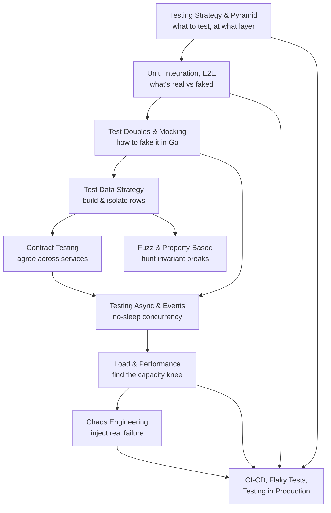

# 15 Testing

> [!summary] What this folder covers
> Test strategy: what kind of test to write, when, and how to run it in CI — independent of any one language. By the end you can design a test plan for a service, pick the right test double, build isolated test data, verify cross-service contracts, hunt edge cases with fuzzing, test async and event-driven code without flaky sleeps, load-test for capacity, break things on purpose with chaos engineering, and run all of it safely through CI into production.

## Before and after

- **Before this:** [[06 Backend Engineering in Go MOC]]
- **After this:** nothing; this is a starting point

## Learning path

1. [[Testing Strategy and the Test Pyramid]] · basic — Decide what kind of test to write and at what layer, using risk (not a coverage percentage) to choose.
2. [[Unit, Integration and E2E Tests]] · basic — What's real versus faked at each layer, and the Go tools (`httptest`, testcontainers) that exercise each one.
3. [[Test Doubles and Mocking in Go]] · basic — Dummy, stub, fake, spy, mock: five different tools for five different test questions.
4. [[Test Data Strategy]] · intermediate — Build rows with option builders, isolate them per test, and keep them deterministic so flaky-by-data bugs disappear.
5. [[Contract Testing]] · intermediate — Catch a breaking change between two independently-deployed services before the provider ships it.
6. [[Fuzz and Property-Based Testing]] · intermediate — State an invariant once and let a generator hunt for the input that breaks it, instead of hand-writing examples.
7. [[Testing Async and Event-Driven Systems]] · intermediate — Replace `time.Sleep` guesses with real signals (channels, fake clocks, polling) so concurrent code tests fast and never flakes.
8. [[Load and Performance Testing]] · intermediate — Find the capacity knee with percentiles and an open-model load generator, before a traffic spike finds it for you.
9. [[Chaos Engineering]] · advanced — Inject real failure on purpose to prove the resilience mechanisms you believe you have actually work.
10. [[Testing in CI-CD, Flaky Tests and Testing in Production]] · advanced — Stage the pyramid into a pipeline, kill flaky tests at the root, and ship safely with canaries, flags and synthetic checks.

## Concept map

## Interview focus

- Design the test strategy for a payments service like InvoiceOps → [[Testing Strategy and the Test Pyramid]]
- Trap: "95% code coverage means we're well tested" — what's wrong with that claim? → [[Testing Strategy and the Test Pyramid]]
- What's the difference between a stub and a mock, precisely? → [[Test Doubles and Mocking in Go]]
- Your tests pass locally but fail intermittently in CI — what do you check first? → [[Test Data Strategy]]
- A provider team wants to add a new required field — does contract testing catch the risk? → [[Contract Testing]]
- Trap: "property-based testing means I don't need example-based unit tests anymore" — true or false? → [[Fuzz and Property-Based Testing]]
- Why is `time.Sleep(100 * time.Millisecond)` a bad way to wait for a goroutine in a test? → [[Testing Async and Event-Driven Systems]]
- What is coordinated omission, and which tools avoid it? → [[Load and Performance Testing]]
- How do you keep a chaos experiment from becoming its own incident? → [[Chaos Engineering]]
- Trap: "if we have good E2E coverage, we don't need testing in production" — what's wrong with this? → [[Testing in CI-CD, Flaky Tests and Testing in Production]]

## Sources worth reading

- Mike Cohn, *Succeeding with Agile* (2009) — the original test pyramid.
- Martin Fowler, "TestPyramid" and "Mocks Aren't Stubs" (martinfowler.com).
- Google Testing Blog, "Just Say No to More End-to-End Tests" and "Flaky Tests at Google and How We Mitigate Them."
- Pact documentation (pact.io) — consumer-driven contract testing.
- Go documentation, Fuzzing (go.dev/doc/tutorial/fuzz; go.dev/security/fuzz).
- k6 documentation — thresholds and the constant-arrival-rate executor.
- Principles of Chaos Engineering (principlesofchaos.org).
- Cindy Sridharan, "Testing in Production" (medium.com/@copyconstruct).
