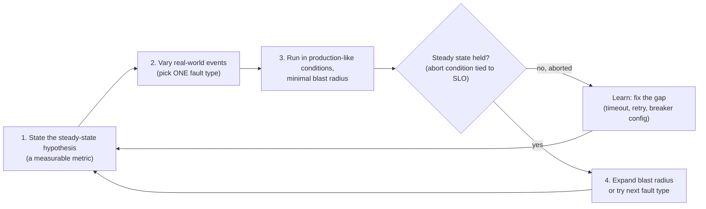
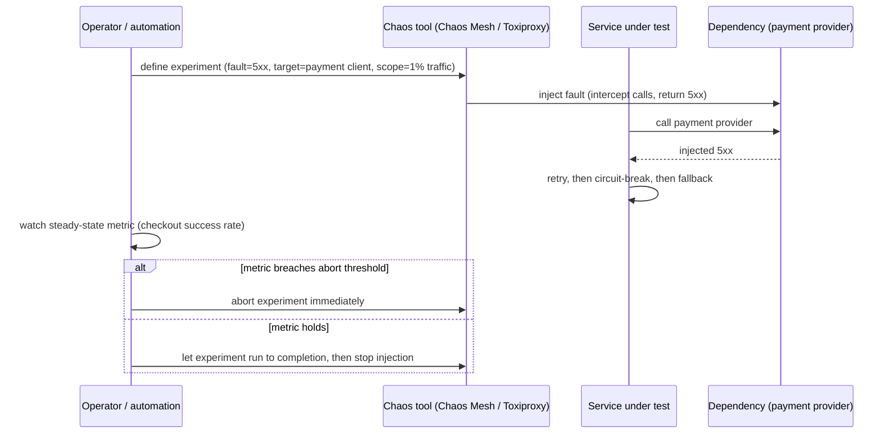

# Chaos Engineering

> [!summary] TL;DR
> Chaos engineering is deliberately injecting failure — latency, dependency errors, pod kills, clock skew — into a running system to prove it survives the way you believe it does, instead of hoping it does. Experiments start small (one instance, staging, a tiny percentage of traffic) and expand only once the system proves it holds up.

> [!abstract] Core idea
> - Start from a **steady-state hypothesis**: a measurable business or service metric that should stay normal (checkout success rate, p99 latency) during the experiment.
> - Inject one real-world failure at a time — don't combine faults in an early experiment.
> - Keep the **blast radius** small: one instance, one AZ, a single-digit percentage of traffic, with an automatic abort tied to an SLO.
> - A chaos experiment validates resilience mechanisms you already believe you have (timeouts, retries, circuit breakers, failover) — it does not replace unit or load testing, and it is not useful without observability and on-call already in place.

## 1. Why it exists

A checkout service has a documented retry-with-backoff policy for calls to its payment provider, a circuit breaker, and a fallback to a cached price. Nobody has ever actually unplugged the payment provider's connection to see what happens. A chaos experiment that injects a 100% failure rate on that one dependency, for five minutes, against 1% of staging traffic, either confirms the fallback works — or reveals that the circuit breaker's threshold is misconfigured and every request hangs for the full client timeout instead, which is exactly the finding you want before a real payment-provider outage happens in production, not during one.

## 2. Mental model

A chaos experiment is a scientific experiment, not random destruction:



The loop never starts with "inject everywhere, see what breaks" — it starts with a falsifiable prediction ("checkout success rate stays above 99.5% if the payment provider returns errors"), and only grows in scope once the smaller version has passed.

## 3. How it works



### The five principles

1. **Define steady state** as a measurable output metric (not an internal signal like CPU) — something a business or user actually cares about.
2. **Hypothesize** that steady state holds in both the control group and the experimental (faulted) group.
3. **Vary real-world events**: the fault types that actually occur — hardware failure, network partition, dependency errors, traffic spikes — not arbitrary code bugs.
4. **Run in production, or as close to it as possible** — staging with production-like traffic and data shape is the realistic minimum when running directly in prod isn't yet safe.
5. **Automate and minimize blast radius**: an abort condition tied to real SLOs, so a bad experiment can't become its own incident.

### Fault catalogue

| Category | Example faults |
| --- | --- |
| Compute | Pod/instance kill, CPU pressure, memory pressure, disk full |
| Network | Added latency, packet loss, DNS failure, partition between two services |
| Dependency | Forced 5xx/error responses, timeouts, slow responses from a downstream service |
| Infrastructure | AZ or region loss, clock skew between nodes |
| Application | Duplicate messages, poison messages in a queue, slow DB query injection |

### Blast-radius control

Every experiment should have: a scope (one pod, one AZ, N% of traffic — never "everything" on a first run), an abort condition (an SLO-tied metric breach that halts injection automatically, not just a human watching a dashboard), and a rollback path that's already tested independently of the experiment. Running this first in staging, then at 1% of production traffic, then higher, is the standard progression — "game days" (scheduled, team-wide chaos exercises) are often how the staging-to-small-percentage-of-prod step gets socialized across a team before it becomes routine.

### Tools

- **Chaos Mesh** — Kubernetes-native, CRD-based (`PodChaos`, `NetworkChaos`, `StressChaos`); experiments are declarative YAML applied to a cluster.
- **LitmusChaos** — CNCF, also Kubernetes-native (`ChaosExperiment`/`ChaosEngine` CRDs via a hub of pre-built experiments); a declarative alternative to Chaos Mesh with a similar scope.
- **Gremlin** — SaaS, UI-driven, supports host and container-level attacks plus a "halt all" safety switch.
- **AWS Fault Injection Service (FIS)** — native to AWS, targets EC2/ECS/EKS/RDS resources, integrates with CloudWatch alarms as automatic stop conditions.
- **Toxiproxy** (Shopify) — a TCP proxy you put in front of a dependency in tests or local/CI environments to inject latency, bandwidth limits, and connection resets; lightweight enough to run inside an integration test, unlike the cluster-level tools above.

### What an experiment validates

Timeouts actually firing instead of hanging indefinitely, retries with jitter instead of a retry storm, circuit breakers opening and the fallback path actually working, autoscaling reacting in time, failover to a secondary actually completing, and — critically — that the alerts you expect to fire during a real incident actually do fire during the experiment.

## 4. Worked example

### Whiteboard version

```go
// Inject wraps a dependency call so a fixed fault is applied before every
// call — this is the mechanism Toxiproxy-style fault injection represents
// in a Go integration test.
func Inject(dep Dependency, f Fault) Dependency {
    return func(ctx context.Context) (string, error) {
        if rand.Float64() < f.FailureRate {
            return "", ErrInjected
        }
        return dep(ctx)
    }
}
```

The full example below adds latency injection, a context-aware timeout, and two tests: one proving a caller gives up instead of hanging when the dependency is made artificially slow, and one proving the injector's failure rate is applied at roughly the configured proportion.

```go
// Package chaos shows a fault-injecting proxy, the kind of thing a
// Toxiproxy-wrapped integration test or a chaos experiment's "inject" step
// does to a dependency call.
package chaos

import (
	"context"
	"errors"
	"math/rand/v2"
	"time"
)

// ErrInjected is returned when the fault injector decides to fail the call.
var ErrInjected = errors.New("chaos: injected failure")

// Fault describes one experiment: extra latency and/or a failure rate,
// applied to every call that passes through Inject.
type Fault struct {
	Latency     time.Duration
	FailureRate float64 // 0..1, fraction of calls that return ErrInjected
}

// Dependency is the call being tested, e.g. a downstream HTTP client.
type Dependency func(ctx context.Context) (string, error)

// Inject wraps dep so a fixed Fault is applied before every call -
// the steady-state hypothesis is checked against this wrapped version,
// never against production traffic directly.
func Inject(dep Dependency, f Fault, rng *rand.Rand) Dependency {
	return func(ctx context.Context) (string, error) {
		if f.Latency > 0 {
			select {
			case <-time.After(f.Latency):
			case <-ctx.Done():
				return "", ctx.Err()
			}
		}
		if f.FailureRate > 0 && rng.Float64() < f.FailureRate {
			return "", ErrInjected
		}
		return dep(ctx)
	}
}

// CallWithTimeout is the resilience mechanism under test: a caller that
// gives up on a slow or failing dependency instead of hanging forever.
// This is what a chaos experiment validates - not the dependency itself.
func CallWithTimeout(dep Dependency, timeout time.Duration) (string, error) {
	ctx, cancel := context.WithTimeout(context.Background(), timeout)
	defer cancel()
	return dep(ctx)
}
```

```go
package chaos

import (
	"context"
	"errors"
	"math/rand/v2"
	"testing"
	"time"
)

func ok(ctx context.Context) (string, error) { return "ok", nil }

// TestCallWithTimeout_SurvivesInjectedLatency is a chaos-in-CI style test:
// it injects latency above the caller's timeout and asserts the caller
// fails fast instead of hanging - the steady-state hypothesis is
// "callers never block past their timeout budget."
func TestCallWithTimeout_SurvivesInjectedLatency(t *testing.T) {
	rng := rand.New(rand.NewPCG(1, 2))
	slow := Inject(ok, Fault{Latency: 50 * time.Millisecond}, rng)

	start := time.Now()
	_, err := CallWithTimeout(slow, 10*time.Millisecond)
	elapsed := time.Since(start)

	if !errors.Is(err, context.DeadlineExceeded) {
		t.Fatalf("want context.DeadlineExceeded, got %v", err)
	}
	if elapsed > 40*time.Millisecond {
		t.Fatalf("caller blocked for %s, want it to give up near the 10ms timeout", elapsed)
	}
}

// TestInject_FailureRateIsRoughlyRespected proves the injector's failure
// rate is applied at roughly the configured proportion, so an experiment's
// "10% of calls fail" setup can be trusted.
func TestInject_FailureRateIsRoughlyRespected(t *testing.T) {
	rng := rand.New(rand.NewPCG(42, 7))
	flaky := Inject(ok, Fault{FailureRate: 0.3}, rng)

	failures := 0
	const n = 10_000
	for i := 0; i < n; i++ {
		if _, err := flaky(context.Background()); errors.Is(err, ErrInjected) {
			failures++
		}
	}
	rate := float64(failures) / n
	if rate < 0.27 || rate > 0.33 {
		t.Fatalf("injected failure rate %.3f, want close to 0.30", rate)
	}
}
```

**Measured** (`go test -race ./...`, Go 1.24.4): both tests pass; `TestCallWithTimeout_SurvivesInjectedLatency` confirms the caller returns `context.DeadlineExceeded` in under 40 ms despite 50 ms of injected latency, and `TestInject_FailureRateIsRoughlyRespected` confirms the observed failure rate over 10,000 calls lands between 27% and 33% for a configured 30% rate.

A representative result from running the equivalent experiment with real infrastructure (Toxiproxy in front of a staging payment-provider client, 100% error injection, 5 minutes, 1% of staging traffic):

```text
representative output (Toxiproxy error injection, staging, 5 min, 2026-11-04)
steady-state metric: checkout_success_rate
  before injection:  99.92%
  during injection:  99.81%   (fallback to cached price absorbed most failures)
  after injection:   99.93%   (recovered immediately, no lingering errors)
circuit breaker opened at: 00:01:12 after injection start (5 consecutive failures)
alert fired: "payment-provider-error-rate-high" at 00:01:40 (within SLO)
```

Labeled **representative output** because no chaos-tooling cluster is available in this environment; the shape (small, bounded dip in the steady-state metric, breaker opening promptly, alert firing inside the expected window) is what a well-configured fallback and breaker should produce.

## 5. Variants and comparison

| Tool/technique | How it works | Use when | Cost |
| --- | --- | --- | --- |
| Chaos Mesh | Kubernetes CRDs (PodChaos, NetworkChaos, StressChaos) | Running on Kubernetes, want declarative, version-controlled experiments | Needs cluster-level access and RBAC care |
| Gremlin | SaaS UI, agent-based attacks, halt-all switch | Want a managed platform with a safety UI and less setup | Commercial cost; less version-controlled than YAML-based tools |
| AWS FIS | Native AWS actions on EC2/ECS/EKS/RDS, CloudWatch-alarm stop conditions | Already on AWS and want tight IAM and CloudWatch integration | AWS-only |
| Toxiproxy | TCP proxy injecting latency/loss/resets in front of a dependency | Local dev, CI integration tests, lightweight single-service experiments | Doesn't orchestrate cluster-wide or infra-level faults |
| Game days | Scheduled, team-run exercise combining several of the above with people on call | Rehearsing incident response itself, not just the system's resilience | Needs real people's time; run infrequently (quarterly is common) |

## 6. Trade-offs and when not to use

- Without observability (metrics, logs, traces) already in place, you can't tell whether the steady state held — fix observability gaps first.
- Without an on-call and incident process, an aborted-badly experiment becomes an unmanaged incident; chaos engineering assumes the operational basics already exist.
- Running large-blast-radius experiments directly in production before proving smaller ones hold up is how a chaos experiment itself causes an outage — always escalate scope gradually.
- A system with low traffic or few real users may get more value from load testing and code review first; chaos engineering pays off most once the basic resilience mechanisms (timeouts, retries, circuit breakers) already exist and need validating under real conditions, not when they don't exist yet.

## 7. In production

- **Real systems:** Netflix's Chaos Monkey (the originating tool, random instance termination) and the broader Simian Army; e-commerce and ticketing platforms run scheduled game days before known high-traffic events, combining dependency-failure injection with load testing.
- **Failure modes → fixes:**
  - Experiment reveals a client hangs past its intended timeout → audit `context.WithTimeout` usage on every outbound call, not just the one tested.
  - Circuit breaker never opens during the experiment → its failure threshold or window is misconfigured; tune and re-test.
  - Alert that should fire during the experiment doesn't → the alert's query or threshold has a gap; fix it before trusting it in a real incident.
- **What to monitor during an experiment:** the steady-state business metric (checkout success rate, booking completion rate), the abort-condition metric, and whether the expected alerts actually fire.

## 8. Deep dive

**Steady state must be a business-facing metric, not an infrastructure one.** "CPU usage" or "pod count" tell you the system is doing something, not that it's doing its job; "checkout success rate" or "search p99 under 300ms" directly reflect user experience and make the hypothesis falsifiable in a way that matters. A common mistake is choosing a metric that's easy to measure (CPU) instead of one that's meaningful (did the business function keep working).

**Chaos in CI, not just scheduled game days.** Toxiproxy's lightweight TCP-proxy model makes it practical to wrap a dependency inside an ordinary integration test — inject latency or a connection reset for one test case, assert the caller's timeout and fallback behavior, and run it on every PR. This turns a subset of chaos engineering into a correctness check rather than an occasional, manually-scheduled exercise, closing the loop faster than a quarterly game day would.

**Turning findings into action, not a one-off report.** An experiment that reveals a gap (a misconfigured breaker, a missing alert) is only valuable if the fix becomes a tracked action item with an owner, the way a postmortem action item would be tracked — otherwise the same gap resurfaces the next time the same dependency actually fails in production, and the experiment's cost (the engineering time, the controlled risk taken) was wasted.

## 9. Interview questions

> [!question]- What is the steady-state hypothesis, and why must it be a business metric?
> It's the measurable signal that should stay normal throughout the experiment — for example, checkout success rate staying above 99.5%. It must be business-facing (not an infrastructure metric like CPU) because the point of the experiment is to prove the system still does its job for users, not merely that it's technically running.

> [!question]- How do you keep a chaos experiment from becoming its own incident?
> Keep the blast radius small on the first run (one instance, one AZ, a single-digit percentage of traffic), wire an automatic abort condition tied to a real SLO rather than relying on a human watching a dashboard, and only expand scope once the smaller version has passed.

> [!question]- Trap: a team wants to start chaos engineering by randomly killing production pods across the whole fleet on day one. What's wrong with that plan?
> It skips the principle of minimizing blast radius and the prerequisite of having observability and on-call processes validated first. Chaos engineering starts with a narrow hypothesis and a tiny scope (staging, or a small percentage of production traffic) and expands only after the smaller experiment proves safe — not a full-fleet attack as the first experiment.

> [!question]- How would you prove a Redis outage won't take down checkout?
> Define the steady-state hypothesis (checkout success rate stays above some threshold), inject a Redis failure (connection errors or 100% timeouts) against a small percentage of traffic in staging first, watch whether the cache-miss fallback path and circuit breaker behave as designed, and confirm the expected alert fires — then, only after that passes, repeat at a larger scope.

> [!question]- What's the difference between Toxiproxy and Chaos Mesh, and when would you choose each?
> Toxiproxy is a lightweight TCP proxy you put in front of one dependency, ideal for unit/integration tests and local or CI environments. Chaos Mesh is a Kubernetes-native platform that orchestrates faults (pod kills, network partitions, stress) declaratively across a cluster, suited for larger, staging/production-scale experiments. Use Toxiproxy for fast, per-test fault injection; Chaos Mesh for cluster-level game days.

> [!question]- Is chaos engineering a replacement for load testing?
> No — they validate different things. Load testing proves capacity under expected, failure-free conditions at a given traffic rate. Chaos engineering proves resilience mechanisms (timeouts, retries, breakers, failover) actually work when a dependency or instance genuinely fails. A mature test strategy runs both.

## 10. Cheat sheet

- Five principles: steady-state hypothesis (business metric), vary real-world events, run in production-like conditions, automate, minimize blast radius.
- Fault catalogue: pod/instance kill, latency, packet loss, dependency errors, AZ/region loss, clock skew.
- Tools: Chaos Mesh (Kubernetes CRDs), Gremlin (SaaS UI), AWS FIS (native AWS + CloudWatch stop conditions), Toxiproxy (lightweight proxy, good for CI).
- Start in staging or at a tiny percentage of production traffic; expand scope only after passing.
- Prerequisites: observability and on-call already working — chaos engineering validates, it doesn't substitute for them.
- An experiment's findings only count once turned into a tracked, owned fix.

## Links

- **Before this:** [[Load and Performance Testing]], [[Testing Async and Event-Driven Systems]]
- **Next:** [[Testing in CI-CD, Flaky Tests and Testing in Production]]
- **Compare with:** [[Testing LLD Code]] (LLD-round test structure, a different scale of testing)
