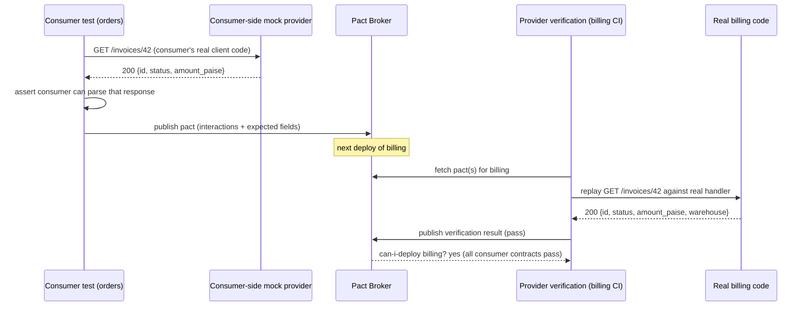
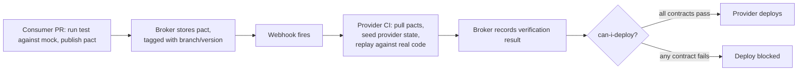

# Contract Testing

> [!summary] TL;DR
> Contract testing checks that a consumer and a provider agree on the concrete interactions the consumer actually uses, without either side needing the other running. It is faster and less flaky than end-to-end tests, and it catches a breaking provider change before that provider deploys.

> [!abstract] Core idea
> - A **consumer-driven contract** records the exact requests a consumer makes and the fields of the response it reads — not the whole schema, only what's used.
> - The consumer tests that recording against a mock; the provider later replays the same recording against its real code ("provider verification").
> - A broker stores every contract version and tells a provider, before it deploys, whether every consumer it has a contract with is still satisfied (`can-i-deploy`).
> - It is not schema testing: a schema check says the shapes match; a contract says this specific consumer's real usage still works, so additive, backward-compatible changes pass even though the schema changed.

## 1. Why it exists

Two services, `orders` and `billing`, deploy independently 10 times a day each. Three ways to catch a breaking change between them, and their actual cost:

- **End-to-end tests** spin up both services and a database, then hit a real HTTP endpoint. They catch the break, but a full E2E suite for every PR on both teams is slow (minutes, not seconds) and flaky (shared test environments, network timing).
- **No cross-service test at all**: `billing` renames a field `orders` reads, both services' own unit tests stay green, and the break is found in production.
- **Mocks on each side, written independently**: `orders`'s test mocks `billing`'s response by hand. When `billing` actually changes its response shape, `orders`'s mock silently keeps the old shape — the mock has drifted from the real service.

Contract testing is a fourth option: one test artifact, generated by the consumer, replayed against the real provider in the provider's own CI — so a provider change that would break a consumer fails the provider's build before it ships.

## 2. Mental model

A contract is a **recording**, not a schema document. The consumer plays back a real interaction against a mock while writing its own test; that recording becomes a file (a "pact") both sides later check against:



The consumer never talks to the real provider during its own test; the provider never talks to the real consumer. The broker is the only thing both sides depend on, and it is what makes "can I deploy?" answerable without either side running the other.

## 3. How it works

### Consumer-driven contracts, step by step

1. **Consumer test** drives its own client code against a mock HTTP server (pact-go sets this up for you). The test asserts the consumer's code can handle the mock's response.
2. Writing that test also **records a pact file**: the request made, and the fields of the response the consumer's assertions actually touched.
3. The consumer team **publishes the pact** to a Pact Broker (or PactFlow), tagged with the consumer's version.
4. **Provider verification**: the provider's CI pulls every pact tagged for it, and for each one, puts the provider into the **provider state** the interaction names (e.g. "order ord_1 exists and is refunded"), then replays the recorded request against the real provider code and checks the required fields are present.
5. The broker records pass/fail per contract version. Before deploying, the provider runs **`can-i-deploy`**: "do I still satisfy every consumer that depends on me?" A failing contract blocks the deploy, with a direct link to which consumer broke and why.
6. A **webhook** on the broker can trigger the provider's CI automatically whenever a consumer publishes a new or changed pact, so a provider team finds out about a new dependency immediately, not at their next deploy.

### Tolerant reader: the rule that makes "additive changes are safe" true

A contract only asserts the fields the consumer actually reads (`WantFields` below), not the full response shape. This is the **tolerant reader** pattern: the consumer's parsing code should ignore fields it doesn't know about, so the provider is free to add new fields without breaking anyone. Combined with a **deprecate-before-removal** policy — mark a field deprecated, wait until the broker shows no active contract still depends on it, then remove — provider and consumer can each ship independently.

### Contract testing vs schema testing

| | Contract testing (Pact-style) | Schema testing (OpenAPI diff / `buf breaking`) |
| --- | --- | --- |
| What it checks | This specific consumer's real interactions still work | The API's declared shape is backward compatible in general |
| Source of truth | A recording from the consumer's own test | A schema file (OpenAPI spec, protobuf `.proto`) |
| Catches | A provider change that breaks fields a consumer actually reads | Any shape change at all, even to fields nobody reads yet |
| Misses | A schema-compatible change that still breaks consumer *logic* (e.g. a status enum value the consumer's switch statement doesn't expect) | Whether any real consumer is actually affected |
| Tooling | Pact (pact-go), PactFlow/Pact Broker | `oasdiff` (OpenAPI), `buf breaking` (protobuf) |

**Bi-directional contract testing** (PactFlow's term) combines both: it verifies the Pact-style recorded interactions *and* diffs the provider's published OpenAPI schema, catching both "this consumer's usage still works" and "the general shape stayed compatible" without requiring the consumer to run against every historical interaction by hand.

### Message and event contracts

The same idea applies to Kafka/event payloads, with the registry doing the compatibility check instead of a broker:

| Schema Registry compatibility mode | Rule | Use when |
| --- | --- | --- |
| `BACKWARD` | New schema can read data written with the previous schema | Consumers upgrade before producers |
| `FORWARD` | Previous schema can read data written with the new schema | Producers upgrade before consumers |
| `FULL` | Both of the above | Producers and consumers upgrade independently, either order |

A consumer-driven contract for an event still records "the fields my consumer reads from this topic", the same as an HTTP contract; the Schema Registry additionally enforces compatibility at the serialization level for every message, not just the ones a contract test happened to record.

## 4. Worked example

### Whiteboard version

```go
type Interaction struct {
    Path       string
    WantFields []string // only fields the consumer reads
}

func Verify(interactions []Interaction, call func(path string) ([]byte, error)) error {
    for _, ia := range interactions {
        body, _ := call(ia.Path)
        var got map[string]any
        json.Unmarshal(body, &got)
        for _, f := range ia.WantFields {
            if _, ok := got[f]; !ok {
                return fmt.Errorf("missing field %q", f)
            }
        }
    }
    return nil
}
```

That is the entire idea: replay a recorded request, check only the fields the consumer named, same function run against a mock (consumer side) and the real provider (provider side).

### Full version: consumer side, provider side, and a breaking change caught

A minimal, dependency-free stand-in for pact-go's `Verify` step — tested below with `go vet` and `go test -race` clean on Go 1.24:

```go
// Package contract is a minimal, dependency-free stand-in for what a
// consumer-driven contract test does: the consumer states the fields it
// actually reads (a "pact"), and that same pact is replayed against the
// real provider in a separate verification step.
package contract

import (
	"encoding/json"
	"fmt"
)

// Interaction is one recorded expectation: a request the consumer makes,
// and the fields of the response it actually uses.
type Interaction struct {
	Description string
	Method      string
	Path        string
	// WantFields lists only the JSON fields the consumer reads. This is
	// the "tolerant reader" rule: the provider may add fields freely;
	// the contract only locks the fields in this list.
	WantFields []string
}

// ProviderCall performs the interaction's request and returns its body.
type ProviderCall func(method, path string) ([]byte, error)

// Verify replays each interaction against call and checks every field
// the consumer depends on is present. It does NOT require the response
// to match byte-for-byte or forbid extra fields — that would be schema
// testing, not consumer-driven contract testing.
func Verify(interactions []Interaction, call ProviderCall) error {
	for _, ia := range interactions {
		body, err := call(ia.Method, ia.Path)
		if err != nil {
			return fmt.Errorf("%s: request failed: %w", ia.Description, err)
		}
		var got map[string]any
		if err := json.Unmarshal(body, &got); err != nil {
			return fmt.Errorf("%s: response is not a JSON object: %w", ia.Description, err)
		}
		for _, field := range ia.WantFields {
			if _, ok := got[field]; !ok {
				return fmt.Errorf("%s: provider response is missing field %q the consumer reads", ia.Description, field)
			}
		}
	}
	return nil
}
```

The pact, shared by both test files below (in a real pipeline, this would be the JSON pact file pact-go generates and publishes to a broker):

```go
var pact = []Interaction{
	{
		Description: "get an order by id",
		Method:      http.MethodGet,
		Path:        "/orders/ord_1",
		WantFields:  []string{"id", "status", "amount_paise"},
	},
}
```

**Consumer side** — the consumer's own test, driven against a mock:

```go
func TestConsumerAgainstMockProvider(t *testing.T) {
	mock := httptest.NewServer(http.HandlerFunc(func(w http.ResponseWriter, r *http.Request) {
		_ = json.NewEncoder(w).Encode(map[string]any{
			"id": "ord_1", "status": "placed", "amount_paise": 19900,
		})
	}))
	defer mock.Close()

	call := func(method, path string) ([]byte, error) {
		req, _ := http.NewRequest(method, mock.URL+path, nil)
		resp, err := http.DefaultClient.Do(req)
		if err != nil {
			return nil, err
		}
		defer resp.Body.Close()
		buf := make([]byte, 4096)
		n, _ := resp.Body.Read(buf)
		return buf[:n], nil
	}

	if err := Verify(pact, call); err != nil {
		t.Fatalf("consumer-side check against mock failed: %v", err)
	}
}
```

**Provider side** — the same pact, replayed in the provider's CI against a handler that now adds an extra field. An additive change must stay compatible:

```go
func TestProviderVerification(t *testing.T) {
	provider := httptest.NewServer(http.HandlerFunc(func(w http.ResponseWriter, r *http.Request) {
		_ = json.NewEncoder(w).Encode(map[string]any{
			"id": "ord_1", "status": "placed", "amount_paise": 19900,
			"warehouse": "BLR-1", // new field no consumer has asked for yet
		})
	}))
	defer provider.Close()

	call := func(method, path string) ([]byte, error) {
		req, _ := http.NewRequest(method, provider.URL+path, nil)
		resp, err := http.DefaultClient.Do(req)
		if err != nil {
			return nil, err
		}
		defer resp.Body.Close()
		buf := make([]byte, 4096)
		n, _ := resp.Body.Read(buf)
		return buf[:n], nil
	}

	if err := Verify(pact, call); err != nil {
		t.Fatalf("provider broke a consumer contract: %v", err)
	}
}
```

**The negative case** — proving `Verify` actually catches a breaking rename, which is the entire point of running this in CI before a deploy:

```go
func TestVerifyCatchesABreakingRemoval(t *testing.T) {
	broken := httptest.NewServer(http.HandlerFunc(func(w http.ResponseWriter, r *http.Request) {
		// "status" was renamed to "state" without a deprecation period.
		_ = json.NewEncoder(w).Encode(map[string]any{
			"id": "ord_1", "state": "placed", "amount_paise": 19900,
		})
	}))
	defer broken.Close()

	call := func(method, path string) ([]byte, error) {
		req, _ := http.NewRequest(method, broken.URL+path, nil)
		resp, err := http.DefaultClient.Do(req)
		if err != nil {
			return nil, err
		}
		defer resp.Body.Close()
		buf := make([]byte, 4096)
		n, _ := resp.Body.Read(buf)
		return buf[:n], nil
	}

	if err := Verify(pact, call); err == nil {
		t.Fatal("Verify should fail: the provider dropped the 'status' field the consumer reads")
	}
}
```

Run: `go vet ./... && go test -race ./...` → 3 tests pass (measured, Go 1.24.4, 2026-11-04): the consumer-side and provider-side checks pass, and the breaking-rename case correctly fails `Verify`.



### CI wiring and environment matrix

| Stage | Who runs it | What it does |
| --- | --- | --- |
| Consumer PR | Consumer's CI | Runs the consumer test against the mock; publishes the pact to the broker tagged with the branch/commit |
| Provider PR | Provider's CI | Pulls pacts tagged for environments the provider is about to touch; verifies against the PR's code |
| Provider pre-deploy | Provider's CI, as a deploy gate | `can-i-deploy --pacticipant billing --version <sha> --to-environment production` |
| Consumer pre-deploy | Consumer's CI, as a deploy gate | Same check in reverse, using environment tags so a contract only gates the environments it actually applies to |

## 5. Variants and comparison

| Approach | How it works | Use when | Cost |
| --- | --- | --- | --- |
| Consumer-driven contract (Pact) | Consumer records usage, provider replays it | Two teams, independent deploys, HTTP/gRPC APIs | Broker to run/host; discipline to keep pacts current |
| Schema diff (`oasdiff`, `buf breaking`) | Diff two versions of a schema file for compatibility | You control the schema as the source of truth and want a CI gate with no broker | Misses consumer-specific logic bugs a compatible schema can still trigger |
| Bi-directional contracts | Pact-style verification plus schema diff together | Want both consumer-reality and general-shape guarantees | Requires both pact publishing and a schema file kept in sync |
| Schema Registry compatibility modes | Registry enforces `BACKWARD`/`FORWARD`/`FULL` on every message | Kafka/event-driven systems | Only covers serialization shape, not consumer logic |
| End-to-end test | Both services actually running, real HTTP call | Final confidence pass before a release, not every PR | Slow, flaky, needs a shared environment |

## 6. Trade-offs and when not to use

- Contract tests check interface compatibility, not business logic or performance — a provider can pass every contract and still compute the wrong total.
- They need both teams to adopt the practice: a consumer that never publishes a pact gives the provider no coverage for that consumer, and a provider that never runs verification gives no protection at all.
- For a single team owning both sides of a call, in the same deploy, the overhead of a broker and two test suites usually isn't worth it — a shared integration test is simpler.
- They don't replace end-to-end tests for critical user journeys that cross many services; contract tests prove pairwise compatibility, not that the whole chain produces the right business outcome.

## 7. In production

- **Real systems:** Pact and PactFlow are the standard CDC tooling across many languages including Go (`pact-go` v2, which wraps the Rust Pact FFI); API-shape diffing uses `oasdiff` for OpenAPI and `buf breaking` for protobuf; Confluent Schema Registry enforces compatibility modes for Kafka Avro/Protobuf/JSON Schema payloads.
- **Failure modes → fixes:**
  - A consumer's pact goes stale (team stopped maintaining it) → `can-i-deploy` keeps blocking the provider on a contract nobody cares about anymore → deprecate/retire pacts for consumers no longer in use, tracked in the broker.
  - A provider verifies against the wrong provider state (forgets to seed "order is refunded") → the interaction passes for the wrong reason → provider states must be explicit setup code per interaction, not assumed database content.
  - Contract drifts from the consumer's real code because the pact was hand-written instead of generated from an actual consumer test → always generate pacts from running the consumer's real client against the mock, never author them by hand.
- **What to monitor:** `can-i-deploy` pass rate per provider, number of stale pacts (no verification run in N days), time between a consumer publishing a new pact and the provider's webhook-triggered verification completing.

## 8. Deep dive

- **Why tolerant reader matters for schema evolution:** if a consumer's deserializer rejects unknown fields (strict mode), tolerant-reader contract testing doesn't help — the consumer breaks on any addition regardless of what the contract says. Contract testing assumes (and should also test) that consumer parsing is lenient by default; strict parsers need an explicit allow-list of consumer-known fields kept in sync separately.
- **Provider states are the hard part in practice.** A provider state like "order ord_1 exists and is refunded" needs the provider's CI to have a way to seed exactly that database state before each interaction — this is where [[Test Data Strategy]]'s builders and isolation techniques plug directly into contract verification: each provider state becomes a call to a test-data builder, not a hand-maintained SQL fixture.
- **Limits of schema-only approaches**: `buf breaking` can tell you a field's wire number didn't change and a new field was appended (both compatible by protobuf rules) but cannot tell you a consumer's `switch` statement over an enum doesn't have a `default` case and will silently drop a new enum value — that failure mode is exactly what a consumer-driven contract (which encodes the consumer's actual assertions) is positioned to catch, if the consumer's test exercises that switch.
- **Async contracts**: for a message consumer, the "interaction" is "given this message on the topic, my consumer's handler does X" rather than a request/response pair; Pact supports message pacts for this, verified by feeding the recorded message into the provider's message-producing code and checking the same tolerant-reader field list.

## 9. Interview questions

> [!question]- A provider team wants to add a new required field to their API. Does contract testing catch the risk here?
> A newly **required** field on an existing endpoint is a breaking change for any consumer that doesn't send it (if it's a request field) or isn't ready to always receive it (if it's a response field consumers assume may be absent). Tolerant-reader contracts only guard additions that are optional from the consumer's perspective; a required-field addition needs a deprecation-style rollout (add optional, migrate consumers, then make required) and should itself be caught by the schema-diff half of a bi-directional check, since a schema diff explicitly flags newly required fields as breaking.

> [!question]- How is this different from testing against a shared staging environment?
> Staging couples both services' deploy schedules and shares one mutable environment across every team's tests, which is a common source of flakiness. Contract testing verifies the provider against the consumer's **recorded expectations** without the consumer running at all, so each side tests independently and faster, at the cost of not proving the full system works together — which is what staging and a smaller set of E2E tests are still for.

> [!question]- Trap: "if the OpenAPI schemas match, the contract is satisfied." True or false?
> False. Schema compatibility is necessary but not sufficient. A provider can keep an endpoint schema-compatible while still changing the *values* it returns for a given state (changing an error code's meaning, reordering an array a consumer indexes into) in a way that breaks a specific consumer's logic, which a consumer-driven contract — built from that consumer's actual assertions — would catch and a schema diff would not.

> [!question]- What is a provider state, and why does provider verification need it?
> A provider state is the data setup an interaction assumes (e.g. "order ord_1 exists and is refunded"). Provider verification replays a captured request against the real provider code, so the provider must actually be in that state first — otherwise the response won't match what the consumer recorded, for reasons that have nothing to do with a real compatibility break.

> [!question]- When would you add bi-directional contract testing instead of plain Pact-style CDC?
> When you want both guarantees at low effort: Pact-style verification is cheap for the consumer (it already wrote the recording as part of its own tests) but only covers fields consumers currently use; a schema diff is cheap for the provider and covers the whole shape. Combining them catches consumer-specific logic breaks and general shape breaks, without needing every consumer to write a pact for every field.

> [!question]- Stop a provider deploy from breaking 5 consumers: what do you build?
> A Pact Broker (or PactFlow) all 5 consumer teams publish pacts to, a provider verification step in the provider's CI that pulls every pact tagged for the target environment and replays it with correct provider states, and a `can-i-deploy` gate in the deploy pipeline that blocks release unless every one of those 5 contracts currently passes. Add a broker webhook so each consumer team's new pact triggers provider verification immediately, not at the provider's next unrelated deploy.

## 10. Cheat sheet

- A pact is a recording of real consumer usage, not a schema document.
- Tolerant reader: consumer only asserts fields it reads; provider is free to add fields.
- `can-i-deploy` gates a provider's deploy on every consumer contract currently passing.
- Schema diff (`oasdiff`, `buf breaking`) catches general shape breaks; CDC catches consumer-specific usage breaks; bi-directional does both.
- Schema Registry compatibility modes (`BACKWARD`/`FORWARD`/`FULL`) do the same job for event/message payloads.
- Provider states need real test-data setup — reuse [[Test Data Strategy]] builders, don't hand-maintain SQL per interaction.
- Doesn't cover business logic or performance; still needs a few real E2E tests for critical journeys.

## Links

- **Before this:** [[Testing Strategy and the Test Pyramid]], [[Unit, Integration and E2E Tests]]
- **Next:** [[Testing Async and Event-Driven Systems]]
- **Compare with:** [[Test Data Strategy]] (provider states are a test-data problem), [[Fuzz and Property-Based Testing]] (checks an invariant across many inputs, not agreement between two services)
