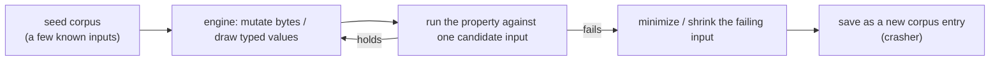
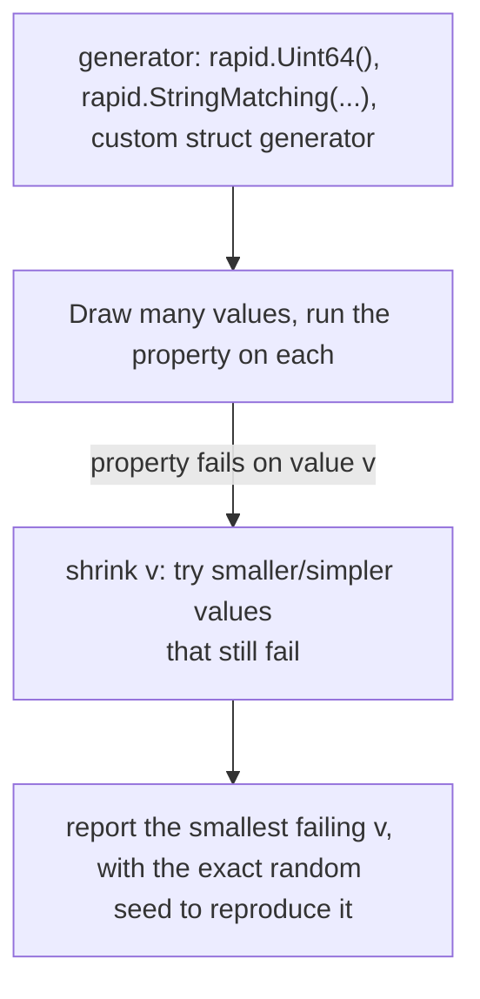

# Fuzz and Property-Based Testing

> [!summary] TL;DR
> Instead of writing one input and one expected output, you state a property that must hold for *every* input ("decoding an encoded value always returns the original") and let a tool generate many inputs, including ones a human wouldn't think to write, to try to break it. Go 1.18+ ships native fuzzing for exactly this; `pgregory.net/rapid` and `gopter` add property-based testing with richer generators and automatic shrinking.

> [!abstract] Core idea
> - A **property** is an invariant: something true for all valid inputs, not one example (e.g. "round-trip: decode(encode(x)) == x", "sorting is idempotent", "an idempotent request can be retried safely").
> - **Fuzzing** (Go's `testing.F`) mutates byte-level or typed seed inputs to search for a crash, panic, or failed assertion, and saves any failing input as a new corpus entry.
> - **Property-based testing** (rapid, gopter) generates structured values from typed generators and, when a property fails, **shrinks** the failing input to the smallest case that still fails — much easier to read than fuzzing's raw bytes.
> - Both replace a finite list of example tests with a generator plus an invariant; neither replaces unit tests for exact, known-answer cases.

## 1. Why it exists

A hand-rolled varint encoder (the scheme protobuf uses: 7 bits of payload per byte, top bit means "more follow") looks obviously correct from 3 example tests: `0`, `127`, `300`. But the interesting bugs live at boundaries nobody thought to write by hand:

- `n = 1<<63` (does a shift overflow?)
- a 10-byte-long garbage buffer with every continuation bit set (does decode loop forever or read past the buffer?)
- `n = ^uint64(0)` (does the encoding still round-trip at the very top of the range?)

Writing a table test for every such case by hand misses the ones you didn't think of. Fuzzing and property-based testing instead state the invariant once and let a search procedure hunt for the counterexample, which is exactly the class of bug (off-by-one, overflow, malformed-input panic) that example-based tests are worst at finding.

## 2. Mental model



Fuzzing (Go's `testing.F`) operates on raw bytes/primitive types and mutates them; a failure is saved verbatim under `testdata/fuzz/<FuzzName>/`, so the next `go test` run (no `-fuzz` flag needed) replays it forever as a regression test. Property-based testing (rapid) operates on **typed generators** (`rapid.Uint64()`, `rapid.SliceOf(...)`, a generator built from your own struct) and actively **shrinks** a failing case toward a minimal reproducer before reporting it, which fuzzing's raw-byte mutation does less precisely.

## 3. How it works

### Whiteboard version

The invariant under test, and the simplest possible way to check it with native fuzzing:

```go
func FuzzRoundTrip(f *testing.F) {
    f.Add(uint64(128)) // seed
    f.Fuzz(func(t *testing.T, n uint64) {
        got, _, err := Decode(Encode(n))
        if err != nil || got != n {
            t.Fatalf("round trip broke for %d", n)
        }
    })
}
```

`go test -fuzz=FuzzRoundTrip` runs this against the seed, then keeps mutating `n` (and any corpus files already saved) until it finds a failure or you stop it; a plain `go test` (no `-fuzz`) only replays the existing seed corpus and any saved crashers, so CI stays fast and deterministic.

### Go 1.18+ native fuzzing mechanics

- `testing.F` is a fuzz target: `func FuzzXxx(f *testing.F)`.
- `f.Add(...)` seeds the **seed corpus** with known-interesting inputs (edge cases you already thought of).
- `f.Fuzz(func(t *testing.T, args ...) {...})` is the property: argument types are restricted to strings, `[]byte`, and basic numeric/bool types — no structs directly, so structured data is fuzzed as bytes and parsed inside the function, or built via multiple primitive arguments.
- Running `go test -fuzz=FuzzXxx -fuzztime=30s` actually searches; any failing input is written to `testdata/fuzz/FuzzXxx/<hash>` as a **crasher**, and from then on every ordinary `go test` replays it — a fuzz bug you fixed can never silently regress.
- `go test` (default, no `-fuzz`) only runs the seed corpus plus saved crashers, so a fuzz target behaves like an ordinary fast test in CI; the expensive mutation search is something you (or a scheduled job) run separately, often continuously on a dedicated fuzzing CI step.

### Property-based testing: the general idea

A property-based test states "for all x matching this shape, P(x) holds" and the library both generates `x` and, on failure, searches for the smallest `x` that still fails:



Go has two mainstream options:

| Library | Style | Notes |
| --- | --- | --- |
| `pgregory.net/rapid` | `rapid.Check(t, func(t *rapid.T) { ... })`, draw values with `rapid.Uint64().Draw(t, "n")` | Integrates with `testing.T` directly (no separate runner), built-in shrinking, actively maintained |
| `leanovate/gopter` | `properties.Property("name", prop.ForAll(func(...) bool {...}, gen.Int()))` | Older, QuickCheck-style API, its own test runner (`properties.TestingRun(t)`) |

### Writing good properties

The hardest part of property-based testing is finding an invariant that's both true and useful. Common patterns:

- **Round-trip**: `decode(encode(x)) == x` for any serializer/deserializer pair.
- **Idempotency**: `f(f(x)) == f(x)` — normalizing a string, sorting a slice, applying the same migration twice.
- **Invariant under a transform**: sorting preserves the multiset of elements and produces a non-decreasing sequence; reversing twice returns the original.
- **Metamorphic relations** (when there's no simple oracle): instead of checking an exact output, check a *relationship* between two related inputs — e.g. "search(query) returns a superset of search(query + extra filter)". Useful when you can't easily compute the expected value by hand, only a property it must satisfy relative to another computation.
- **Model-based**: run the real implementation and a trivially-correct-but-slow reference implementation (e.g. a `map`-based reference against a custom tree) on the same generated inputs and assert they agree.

## 4. Worked example

### Whiteboard version

```go
func EncodeVarint(n uint64) []byte {
    var out []byte
    for {
        b := byte(n & 0x7f)
        n >>= 7
        if n != 0 {
            b |= 0x80
        }
        out = append(out, b)
        if n == 0 {
            break
        }
    }
    return out
}
```

The property: whatever `EncodeVarint` produces, `DecodeVarint` must return exactly the original `n`, consuming exactly that many bytes — and `DecodeVarint` must never panic or hang on arbitrary bytes, since it runs on untrusted wire input.

### Full example: encoder, two fuzz targets, two property tests

The varint codec under test (Go 1.24; `go vet` and `go test -race` clean):

```go
// Package fuzzdemo holds a tiny varint encoder, the kind of hand-rolled
// binary codec that fuzzing and property tests are built for.
package fuzzdemo

import "errors"

// EncodeVarint writes n as a little-endian base-128 varint (the same
// scheme protobuf uses): each byte holds 7 bits of n, and the top bit
// marks "more bytes follow".
func EncodeVarint(n uint64) []byte {
	var out []byte
	for {
		b := byte(n & 0x7f)
		n >>= 7
		if n != 0 {
			b |= 0x80
		}
		out = append(out, b)
		if n == 0 {
			break
		}
	}
	return out
}

// DecodeVarint reads one varint from buf and returns its value and the
// number of bytes consumed. It must reject truncated and over-long input
// instead of panicking or looping forever.
func DecodeVarint(buf []byte) (uint64, int, error) {
	var n uint64
	for i, b := range buf {
		if i >= 10 {
			return 0, 0, errors.New("varint too long")
		}
		n |= uint64(b&0x7f) << (7 * i)
		if b&0x80 == 0 {
			return n, i + 1, nil
		}
	}
	return 0, 0, errors.New("truncated varint")
}
```

**Native fuzz target for the round-trip property**, with a seed corpus of known edge cases:

```go
// FuzzVarintRoundTrip is a native Go fuzz test (testing.F, Go 1.18+).
// `go test -fuzz=FuzzVarintRoundTrip` mutates the seed corpus below to
// search for a uint64 whose encode/decode round trip breaks; any crash
// gets saved under testdata/fuzz/FuzzVarintRoundTrip as a new seed. A
// plain `go test` only replays the existing corpus, so this still runs
// in CI without a live fuzzing campaign.
func FuzzVarintRoundTrip(f *testing.F) {
	for _, seed := range []uint64{0, 1, 127, 128, 1 << 63} {
		f.Add(seed)
	}
	f.Fuzz(func(t *testing.T, n uint64) {
		enc := EncodeVarint(n)
		got, consumed, err := DecodeVarint(enc)
		if err != nil {
			t.Fatalf("Decode(Encode(%d)) error: %v", n, err)
		}
		if got != n {
			t.Fatalf("round trip broke: encoded %d, decoded %d", n, got)
		}
		if consumed != len(enc) {
			t.Fatalf("consumed %d bytes, encoding was %d bytes", consumed, len(enc))
		}
	})
}
```

**A second fuzz target for a safety property, on raw untrusted bytes** instead of a well-formed `uint64`:

```go
// FuzzDecodeVarintNeverPanics feeds DecodeVarint raw, unstructured bytes
// instead of only well-formed encodings. The property under test is
// narrower than correctness: decoding garbage must return an error, not
// panic or hang, because DecodeVarint runs on untrusted wire input.
func FuzzDecodeVarintNeverPanics(f *testing.F) {
	f.Add([]byte{})
	f.Add([]byte{0x80, 0x80, 0x80, 0x80, 0x80, 0x80, 0x80, 0x80, 0x80, 0x80, 0x01})
	f.Fuzz(func(t *testing.T, buf []byte) {
		_, _, _ = DecodeVarint(buf) // must not panic; an error is a fine outcome
	})
}
```

**The same round-trip property, as a property-based test with `pgregory.net/rapid`** — same invariant, different engine, with automatic shrinking to a minimal failing `n`:

```go
// TestVarintRoundTripProperty uses pgregory.net/rapid: instead of a fixed
// input list, rapid generates many uint64 values (biased toward edge
// cases like 0 and MaxUint64) and rapid.Check shrinks any failing case
// to a minimal reproducer.
func TestVarintRoundTripProperty(t *testing.T) {
	rapid.Check(t, func(t *rapid.T) {
		n := rapid.Uint64().Draw(t, "n")
		enc := EncodeVarint(n)
		got, consumed, err := DecodeVarint(enc)
		if err != nil {
			t.Fatalf("Decode(Encode(%d)) error: %v", n, err)
		}
		if got != n || consumed != len(enc) {
			t.Fatalf("round trip broke: n=%d got=%d consumed=%d len=%d", n, got, consumed, len(enc))
		}
	})
}
```

**A second, structural property** — not a single input/output pair, but a shape invariant over the encoding:

```go
// TestVarintIsPrefixFree checks that the "more bytes follow" bit on the
// last byte is always clear — exactly the kind of structural invariant
// property-based testing is suited to, as opposed to a single example.
func TestVarintIsPrefixFree(t *testing.T) {
	rapid.Check(t, func(t *rapid.T) {
		n := rapid.Uint64().Draw(t, "n")
		enc := EncodeVarint(n)
		last := enc[len(enc)-1]
		if last&0x80 != 0 {
			t.Fatalf("last byte of encoding has continuation bit set: %08b", last)
		}
	})
}
```

**Measured, Go 1.24.4, 2026-11-04:**
- `go vet ./... && go test -race ./...` → 12 sub-tests passed (3 rapid property checks, plus the 2 fuzz targets each replaying their seed-corpus entries as sub-tests).
- `go test -run=xxx -fuzz=FuzzVarintRoundTrip -fuzztime=5s .` → 1 passed, no crasher found in 5 seconds of active mutation.
- `go test -run=xxx -fuzz=FuzzDecodeVarintNeverPanics -fuzztime=5s .` → 1 passed, no crasher found.

### Whiteboard version of an idempotency property

A second common shape — checking `f(f(x)) == f(x)` — needs no new machinery, just a different assertion inside the same `rapid.Check`:

```go
func TestSortIsIdempotent(t *testing.T) {
    rapid.Check(t, func(t *rapid.T) {
        xs := rapid.SliceOf(rapid.Int()).Draw(t, "xs")
        once := slices.Clone(xs)
        slices.Sort(once)
        twice := slices.Clone(once)
        slices.Sort(twice)
        if !slices.Equal(once, twice) {
            t.Fatalf("sorting twice changed the result: %v -> %v", once, twice)
        }
    })
}
```

## 5. Variants and comparison

| Approach | What it generates | Shrinking | Use when |
| --- | --- | --- | --- |
| Native Go fuzzing (`testing.F`) | Mutated bytes/primitives from a seed corpus | Saves the failing input verbatim as a regression corpus entry; no further minimization beyond what the mutation already found | Parsers, codecs, anything taking untrusted bytes; you want the failure saved and replayed forever in normal `go test` |
| `pgregory.net/rapid` | Typed values from composable generators (`Uint64`, `SliceOf`, custom structs) | Actively shrinks to a minimal failing case, with the exact seed printed to reproduce | Business-logic invariants over structured data (not just bytes); you want readable minimal counterexamples |
| `leanovate/gopter` | Typed values, QuickCheck-style generators and combinators | Shrinks, with its own reporting format | Teams already familiar with Haskell QuickCheck-style APIs; existing `gopter` test infrastructure |
| Table test (example-based) | Nothing — a fixed list you wrote | N/A | The expected output needs a human-computed "right answer" per case; the inputs are few and known in advance |

## 6. Trade-offs and when not to use

- Neither technique replaces example tests for cases with a specific, hand-verified expected answer (e.g. "given this exact JSON, the parsed struct must have these exact field values") — fuzzing and property testing check invariants, not specific known-correct outputs, unless you also build a reference model to compare against.
- Finding a good property is real design work; a weak property (e.g. "doesn't panic") catches crashes but misses logic bugs that a stronger invariant (round-trip, idempotency) would catch.
- Fuzzing needs CPU time to be useful; a 5-second `-fuzztime` in a PR check mostly re-validates the existing corpus, not a genuine new search — real bug-finding fuzzing campaigns run for minutes to hours, usually in a scheduled job, not on every PR.
- `testing.F`'s argument types are limited to primitives/bytes/strings; testing an invariant over a rich domain struct means either encoding it as bytes and parsing inside the fuzz function, or switching to rapid/gopter's typed generators.
- A failing property only tells you the input that breaks the invariant, not *why* — you still have to read the shrunk counterexample and reason about the code, same as any other test failure.

## 7. In production

- **Real systems:** the Go standard library itself uses native fuzzing for packages like `encoding/json`, `compress/*`, and `net/http` internals; Go's OSS-Fuzz integration runs continuous fuzzing on stdlib and participating projects. Protobuf and other binary codec libraries commonly ship fuzz targets precisely because malformed-input-must-not-panic is a security property, not just a correctness one.
- **Failure modes → fixes:**
  - Fuzzing finds a crasher, the team deletes the saved corpus file instead of fixing the bug → the exact same bug reappears next release with no test catching it; always fix the code and keep the corpus entry.
  - A property is written so loosely it never fails (e.g. only checking the function returns *some* value) → add a stronger invariant (round-trip, idempotency, a reference-model comparison) once the shape of real bugs becomes clear.
  - CI runs `-fuzz` with a long `-fuzztime` on every PR → suite becomes too slow; run the seed corpus only (plain `go test`) on every PR, and run active fuzzing with a longer time budget on a schedule (nightly/weekly) against the same fuzz targets.
- **What to monitor:** number of corpus entries per fuzz target over time (should only grow, since passing corpus entries are regression tests), CPU-minutes spent on scheduled fuzzing campaigns, and whether any scheduled campaign is finding new crashers (a rising rate suggests a recent change introduced a new bug class).

## 8. Deep dive

- **Why Go's fuzzing argument types are restricted.** `f.Fuzz` only accepts `[]byte`, `string`, and basic numeric/bool types because the corpus format needs to serialize and deserialize arbitrary mutated values deterministically and portably across machines; a struct's mutation would need either reflection-based field-by-field mutation (fragile across Go versions) or a user-supplied encoding, so the stdlib instead asks you to encode structured input as bytes yourself inside the fuzz function, keeping the corpus format simple and stable.
- **How shrinking actually helps debugging.** A failing fuzz run might report `n = 9223372036854775811` with a 200-line input slice; rapid's shrinker instead tries smaller candidates (closer to 0, shorter slices, simpler strings) that still fail the same property, converging on something like `n = 1<<63`, which is both the minimal and the most informative case — shrinking matters because the *size* of a counterexample often has nothing to do with the *size* of the bug.
- **Metamorphic testing as an escape hatch.** When there's no cheap way to compute the "correct" output for a generated input (a search ranking function, a machine-learning inference step), you can't write `assert output == expected`. Metamorphic relations sidestep this: define a transform on the input (e.g. adding an irrelevant filter) and assert a *relationship* between the two outputs (e.g. the new result set is a subset) instead of checking either output against a known answer.
- **Fuzzing versus property testing is a spectrum, not a binary choice.** Native fuzzing is a property test where the "generator" is byte mutation and the "property" is usually just "doesn't crash" or a round-trip check you add yourself; rapid/gopter are property tests where the generator understands your domain's types directly. Many teams use both: native fuzzing on parsers and anything taking untrusted input, rapid for business-logic invariants over typed Go values.

## 9. Interview questions

> [!question]- Round-trip, idempotency, or model-based: your `EncodeVarint`/`DecodeVarint` pair, what's the right property?
> Round-trip: `Decode(Encode(n)) == n` for all `n`. Idempotency doesn't apply here (encoding isn't applied to its own output); model-based isn't needed because there's a cheap, obviously-correct check (compare to the original input) without a separate reference implementation.

> [!question]- Why does `go test` (without `-fuzz`) still run your fuzz targets, and what does it actually do?
> It replays the seed corpus (`f.Add` calls) and any saved crashers under `testdata/fuzz/<Name>/` as ordinary test cases — it does not perform new mutation search. This keeps fuzz targets fast and deterministic in normal CI runs while still acting as regression tests for every bug fuzzing has ever found; the expensive mutating search only happens when you explicitly run `-fuzz=<Name>`.

> [!question]- Trap: "property-based testing means I don't need example-based unit tests anymore." True or false?
> False. Property tests check an invariant holds across many generated inputs but are weak at verifying one specific, hand-computed expected output — you still want a handful of example tests for cases where you know the exact right answer (a specific parsed value, a specific error message), and property tests alongside them for the broader invariant.

> [!question]- Your fuzz target found a crasher. A teammate suggests deleting the saved corpus file so the suite goes green again. What's wrong with that?
> The corpus file *is* the regression test for that bug. Deleting it makes the suite pass by removing the evidence, not by fixing anything — the same bug can reappear in a later change with nothing to catch it. Fix the underlying code and keep the corpus entry; that's the entire value of Go's corpus-as-regression-test design.

> [!question]- You want to fuzz a function that takes a custom struct, but `testing.F` only accepts primitives, strings and `[]byte`. What are your options?
> Either encode the struct as bytes (e.g. JSON or a custom binary format) and decode it inside the fuzz function before running your property, or switch to a property-based library like `pgregory.net/rapid`, whose generators compose to build arbitrary typed values (including structs) directly, without a serialize/deserialize step.

> [!question]- What does "shrinking" give you that raw fuzzing's saved crasher doesn't always give as cleanly?
> Shrinking actively searches for a smaller or simpler input that still fails the same property, converging toward the minimal reproducer; a raw fuzz mutation's crasher is whatever byte sequence the mutator happened to be on when it found the failure, which can be far larger or noisier than necessary to demonstrate the bug.

## 10. Cheat sheet

- A property is an invariant true for all inputs (round-trip, idempotency, a structural rule) — not a single expected output.
- `testing.F` (Go 1.18+): `f.Add` seeds, `f.Fuzz(func(t *testing.T, args...){...})` is the property; `-fuzz=Name` actively searches, plain `go test` only replays the corpus.
- Any fuzz failure is saved under `testdata/fuzz/<Name>/` and becomes a permanent regression test — never delete a crasher without fixing the bug.
- `pgregory.net/rapid` (or `gopter`) generates typed values and shrinks failures to a minimal reproducer; use it for structured domain values, not just bytes.
- Parsers and anything taking untrusted bytes: fuzz for crash-safety first (must not panic/hang), then add a round-trip or domain invariant.
- Property tests complement, not replace, example-based tests with known-correct expected outputs.
- Run the seed corpus on every PR; run active, time-boxed fuzzing on a schedule, not inline on every commit.

## Links

- **Before this:** [[Testing Strategy and the Test Pyramid]], [[Unit, Integration and E2E Tests]]
- **Next:** [[Test Data Strategy]]
- **Compare with:** [[Contract Testing]] (checks agreement between two services on fixed examples, not an invariant over generated inputs)
