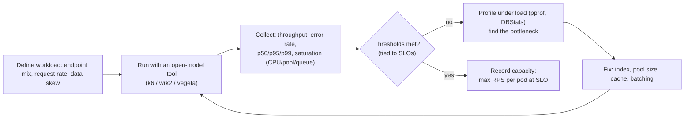
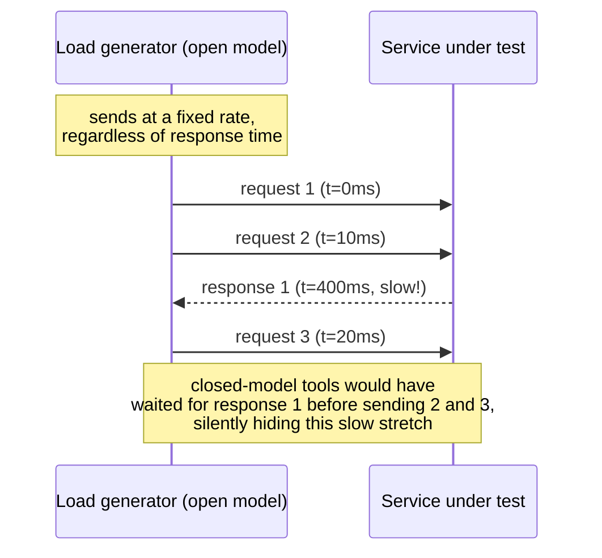

# Load and Performance Testing

> [!summary] TL;DR
> Load testing throws traffic at a system and measures how latency and errors behave as load rises, so you find the breaking point before customers do. Different test *types* answer different questions (can it handle normal load? peak load? load for hours? a sudden spike?), and the metric that matters is a percentile like p99, not an average.

> [!abstract] Core idea
> - Load, stress, soak and spike tests all throw traffic at a system, but each answers a different question — don't substitute one for another.
> - Percentiles (p50/p95/p99) show the tail; averages hide it. One slow endpoint at p99 can still fail SLOs even with a fine average.
> - Open-model tools (k6, wrk2, vegeta) keep sending requests at a fixed rate even while the system is slow; closed-model tools (plain wrk, ab) wait for a response before sending the next request, which hides exactly the tail latency you're trying to measure (coordinated omission).
> - Go's own benchmarking (`testing.B`, `-bench`, `-benchmem`) measures a single function's cost in isolation — a different, smaller-scale tool than a load test against a whole running service.

## 1. Why it exists

A checkout service handles 200 requests/second comfortably with a p99 of 80 ms. On sale day, traffic jumps to 2,000 requests/second. Without a load test, the first time anyone learns the connection pool caps out at 500 concurrent requests and new requests start queuing is during the actual sale — in production, with real money on the line. A load test run against a staging environment the week before, pushed to 2,500 requests/second, would have shown the queueing start at 1,800 and the p99 cross 500 ms well before the real spike, giving time to add replicas or fix a pool size.

## 2. Mental model

Think of four different questions, each with its own test type:

| Question | Test type |
| --- | --- |
| "Does normal daily peak traffic work?" | **Load test** — realistic steady traffic for tens of minutes |
| "Where does it actually break?" | **Stress test** — traffic rising past capacity until errors appear |
| "Does it degrade over hours (leak, disk fill, log growth)?" | **Soak test** — moderate load sustained for hours |
| "Can it survive a sudden burst (a flash sale, a notification blast)?" | **Spike test** — traffic jumping abruptly, then back down |

All four need the same measurement discipline: send load at a fixed, realistic rate (open model), and record the full latency distribution, not just the mean.

## 3. How it works





### Open vs closed workload models, and coordinated omission

A **closed-model** tool holds a fixed number of virtual users, each of which waits for a response before sending its next request. If the server slows down, the generator automatically slows down too — it never measures how bad things get, because it stops asking. This blind spot is called **coordinated omission**, and it makes p99 numbers from tools like plain `wrk` or Apache Bench optimistic exactly when things are going wrong.

An **open-model** tool sends requests at a fixed arrival rate no matter how slow responses come back, the way real user traffic does. `wrk2` (a wrk fork) and k6's `constant-arrival-rate` executor are built this way; `vegeta` (a Go tool) is open-model by design. Prefer these for any percentile you intend to trust.

### Percentile math

p50/p95/p99 mean: sort all recorded latencies, and take the value at the 50th/95th/99th position. With 10,000 requests, p99 is the 9,900th-smallest value — the 100 slowest requests are worse than it. Percentiles cannot be averaged across batches (averaging two p99s is not the combined p99); combine the underlying histograms instead, or recompute from raw data.

A sharp consequence for fan-out: if one downstream call has a 1% chance of being slow (p99 threshold), and a request fans out to 100 such calls in parallel, the chance *none* of them is slow is `0.99^100 ≈ 0.366`, so about 63% of top-level requests hit at least one slow downstream call. A single-call p99 understates what users actually feel once calls compose.

### Tools compared

See the table in section 5. k6 and Locust write test scripts (JS and Python respectively) and support thresholds that fail a CI job automatically; wrk/wrk2 and h2load are lightweight C binaries for raw HTTP/1.1 and HTTP/2 throughput; ghz is the gRPC equivalent of wrk; vegeta is a Go-native open-model tool useful when you want to script load generation in Go itself.

### Go micro-benchmarks vs load tests

A load test exercises the whole running service — network, serialization, database, connection pools — under realistic concurrent traffic. A Go benchmark (`go test -bench`) measures one function's CPU and allocation cost in a single process, with no network involved. Both matter, at different scales: a benchmark catches that a function allocates too much per call; a load test catches that the connection pool caps out at 500 concurrent requests. [[Benchmarks, Profiling and Tracing]] covers `testing.B`, `pprof`, and `go tool trace` in depth — this note only covers enough to place benchmarking in the test-type picture.

## 4. Worked example

### Whiteboard version

```go
func BenchmarkBuildCSV(b *testing.B) {
    rows := makeRows(1000)
    b.ReportAllocs()
    for b.Loop() { // Go 1.24: runs the loop, resets the timer, avoids dead-code elimination
        _ = BuildCSV(rows)
    }
}
```

Run with `go test -bench . -benchmem` to get `ns/op`, `B/op`, and `allocs/op` for the function in isolation — this is the smallest-scale performance test in the pyramid, one level below a load test against the whole service.

The full example below compares a naive string-concatenation CSV builder against a `strings.Builder` version, with a correctness test and two benchmarks.

```go
// Package bench shows a Go 1.24 benchmark for a function worth profiling.
package bench

import "strings"

// BuildCSV joins rows with commas, the naive way: string concatenation.
func BuildCSV(rows []string) string {
	out := ""
	for i, r := range rows {
		if i > 0 {
			out += ","
		}
		out += r
	}
	return out
}

// BuildCSVBuilder does the same with strings.Builder, avoiding the
// quadratic reallocation that += causes on each row.
func BuildCSVBuilder(rows []string) string {
	var b strings.Builder
	for i, r := range rows {
		if i > 0 {
			b.WriteByte(',')
		}
		b.WriteString(r)
	}
	return b.String()
}
```

```go
package bench

import (
	"strconv"
	"testing"
)

func rows(n int) []string {
	out := make([]string, n)
	for i := range out {
		out[i] = strconv.Itoa(i)
	}
	return out
}

func TestBuildCSVsAgree(t *testing.T) {
	r := rows(50)
	if BuildCSV(r) != BuildCSVBuilder(r) {
		t.Fatalf("outputs differ")
	}
}

// BenchmarkBuildCSV uses Go 1.24's b.Loop, which runs setup once, resets
// the timer automatically, and defeats the compiler's dead-code
// elimination (unlike the classic "for i := 0; i < b.N; i++" form).
func BenchmarkBuildCSV(b *testing.B) {
	r := rows(1000)
	b.ReportAllocs()
	for b.Loop() {
		_ = BuildCSV(r)
	}
}

func BenchmarkBuildCSVBuilder(b *testing.B) {
	r := rows(1000)
	b.ReportAllocs()
	for b.Loop() {
		_ = BuildCSVBuilder(r)
	}
}
```

**Measured** (`go test -run '^$' -bench . -benchmem`, Go 1.24.4, darwin/arm64, Apple M4, 2026-11-04), 1,000 rows per call:

| Benchmark | ns/op | B/op | allocs/op |
| --- | --- | --- | --- |
| `BuildCSV` (string `+=`) | 309,842 | 4,057,188 | 1,998 |
| `BuildCSVBuilder` (`strings.Builder`) | 4,233 | 12,536 | 12 |

The builder version is about 73× faster and allocates about 323× less in this run — exactly the kind of regression a load test alone wouldn't localize to one function, but a benchmark pinpoints immediately.

A representative load-test result for the same kind of service, run with k6's constant-arrival-rate executor against a staging checkout API:

```text
representative output (k6, constant-arrival-rate, 2000 req/s target, 10 min)
http_req_duration..........: p(50)=42ms p(95)=180ms p(99)=410ms
http_req_failed............: 0.12%  (24 / 20000)
vus.........................: 50 (min) 220 (max), growing as p99 rose
# knee observed near 1800 req/s: p99 crosses the 400ms SLO threshold
```

Labeled **representative output** because no load-test runner is available in this environment; the shape (p50 well under SLO, p99 approaching it, failure rate low until the knee) matches typical k6 runs against a service nearing its connection-pool limit.

## 5. Variants and comparison

| Tool | Protocol / workload | Model | Use when |
| --- | --- | --- | --- |
| k6 | HTTP/gRPC/WebSocket, scripted in JS | Open (constant-arrival-rate executor) or closed (VU executor) | Default choice: scriptable, CI-friendly thresholds, good percentile reporting |
| Locust | HTTP, scripted in Python | Closed by default (VUs) | Team is Python-native; complex stateful user flows |
| wrk / wrk2 | Raw HTTP/1.1 | wrk: closed; wrk2: open (`-R` sets rate) | Quick raw-throughput numbers; use wrk2, not wrk, when the p99 matters |
| h2load | HTTP/2, multiplexed streams | Configurable concurrency/streams | Testing HTTP/2-specific behavior (multiplexing, header compression) |
| ghz | gRPC | Open (`--rps`) | Load-testing gRPC services specifically |
| vegeta | HTTP, Go-native | Open (fixed rate) | Scripting load generation in Go, or embedding in a Go test harness |
| `testing.B` (Go) | One function, in-process | N/A — not a workload model | Micro-benchmarking a function, not a load test of a service |

## 6. Trade-offs and when not to use

- Closed-model tools (plain wrk, ab, Locust's default) understate tail latency under load (coordinated omission); don't trust their p99 for capacity decisions.
- Load tests against a cold cache or cold JIT/connection-pool state give pessimistic numbers; always include a warm-up period before measuring.
- Running load tests against production is risky without careful traffic shaping (shadow traffic, canary percentage) — most teams run against a prod-like staging environment first.
- A load test proves capacity under expected failure-free conditions; it does not prove resilience to a dependency actually failing mid-test — that's what [[Chaos Engineering]] is for.
- Micro-benchmarks (`testing.B`) can mislead if the benchmarked function isn't representative of real call patterns (e.g., always-warm caches, unrealistic input sizes); validate findings against a real load test too.

## 7. In production

- **Real systems:** e-commerce and ticketing platforms run load tests before known traffic events (sales, ticket drops), sized to several multiples of normal peak; SRE teams gate deploys on k6 thresholds (`http_req_duration{p(99)} < 500`) as a CI step before merge to a performance-sensitive service.
- **Failure modes → fixes:**
  - p99 degrades sharply at a specific RPS (the "knee") → profile under load (pprof, `sql.DBStats`) to find the saturated resource (CPU, pool, lock), then fix and re-test.
  - Soak test reveals latency creeping up over hours with flat RPS → look for a memory leak, unbounded cache growth, or log/connection accumulation.
  - Spike test reveals a slow scale-out (new pods not ready before load arrives) → tune autoscaler thresholds and pre-warm connection pools.
- **What to monitor during a run:** throughput, error rate, p50/p95/p99, CPU/memory/pool saturation (USE method), and database-specific signals like `sql.DBStats` wait count.

## 8. Deep dive

**Finding the knee precisely.** Run a ramping test (start low, step RPS up every few minutes) rather than one fixed rate, and plot p99 against RPS. Throughput and latency are flat up to a point, then p99 rises sharply — that inflection is the system's practical capacity at your SLO, not its theoretical maximum throughput (which is usually higher but with unacceptable latency). Little's Law (`L = λW`, concurrency = arrival rate × average time in system) explains why: as service time grows under contention, the required concurrency to sustain a given arrival rate grows too, until a connection pool or goroutine limit caps it and requests start queuing — that queueing is what shows up as the sharp p99 rise.

**Realistic workload shape matters as much as the rate.** A flat, uniform key distribution during a load test can hide a hot-partition problem that only appears when a small number of keys get most of the traffic (a Zipfian skew), which is the realistic case for things like trending-event ticket pages. Model the endpoint mix and data skew from real traffic logs, not a uniform synthetic distribution, or the test will pass while production doesn't.

**Benchmark statistical rigor.** A single `go test -bench` run on a shared or noisy machine can vary 10-20% run to run from scheduling noise alone. Run with `-count=10` and compare with `benchstat` to get a result with a reported confidence interval, rather than trusting one run's numbers — especially before claiming a regression or an improvement in a PR.

## 9. Interview questions

> [!question]- What's the difference between a load test, a stress test, and a soak test?
> A load test checks behavior at expected peak traffic. A stress test increases traffic past capacity to find where it breaks. A soak test runs moderate, steady traffic for hours to catch slow degradation — leaks, disk fill, unbounded growth — that a short test wouldn't reveal.

> [!question]- Why do percentiles matter more than averages for latency?
> An average can look fine while a meaningful fraction of requests are much slower — a p99 of 2s with an average of 80ms is common when 1% of requests hit a slow path (lock contention, a cold cache, a GC pause). Users feel the tail, and SLOs are usually defined on a percentile, not a mean.

> [!question]- What is coordinated omission, and which tools avoid it?
> It's the understatement of tail latency that happens when a closed-model load generator waits for each response before sending the next request — if the server slows down, the generator automatically "backs off" too, hiding exactly the slow period you wanted to measure. Open-model tools like wrk2, k6's constant-arrival-rate executor, and vegeta send at a fixed rate regardless of response time, avoiding this.

> [!question]- Trap: a team load-tests at a fixed 500 req/s for 5 minutes and declares the service ready for a sale expecting 2,000 req/s peak. What's wrong?
> The test never exercised the actual target load, so it proves nothing about behavior near or past the real peak — it needs to be re-run at (and somewhat above) the expected peak rate, ideally ramping up to find the knee, not just a flat run well below it.

> [!question]- How does a Go benchmark (`testing.B`) differ from a load test, and when do you need both?
> A benchmark measures one function's cost (CPU time, allocations) in a single process with no network — useful for catching an inefficient hot-path function. A load test exercises the whole running service under concurrent traffic, catching capacity limits (pools, locks, saturation) a benchmark can't see. Use a benchmark to optimize a function flagged by profiling under load; use the load test to confirm the fix actually raised the service's capacity.

> [!question]- A fan-out request calls 100 downstream services in parallel, each with a 1% chance of hitting its own p99 threshold. Roughly what fraction of top-level requests will be slow?
> About 63% (`1 − 0.99^100 ≈ 0.634`). Independent per-call tail probabilities compound quickly under fan-out, so a service's effective tail latency is much worse than any single dependency's p99 suggests.

## 10. Cheat sheet

- Load = expected peak. Stress = find the break point. Soak = hours, catch slow degradation. Spike = sudden burst.
- Use percentiles (p50/p95/p99), not averages; percentiles can't be averaged across batches.
- Prefer open-model tools (k6 constant-arrival-rate, wrk2, vegeta) over closed-model ones (plain wrk, ab) to avoid coordinated omission.
- k6/Locust: scripted, CI-friendly thresholds. wrk/h2load/ghz: lightweight, protocol-specific. vegeta: Go-native.
- Go micro-benchmarks (`testing.B`, `-bench`, `-benchmem`, `b.Loop` since Go 1.24) measure one function, not the whole service; see [[Benchmarks, Profiling and Tracing]] for the full toolchain.
- Fan-out compounds tail latency: `1 − (1 − p)^n` requests hit at least one slow call.
- Gate CI on thresholds tied to SLOs, not vibes.

## Links

- **Before this:** [[Testing Strategy and the Test Pyramid]], [[Testing Async and Event-Driven Systems]]
- **Next:** [[Chaos Engineering]]
- **Compare with:** [[Benchmarks, Profiling and Tracing]] (Go-level `testing.B`/pprof/trace depth, link don't repeat)
