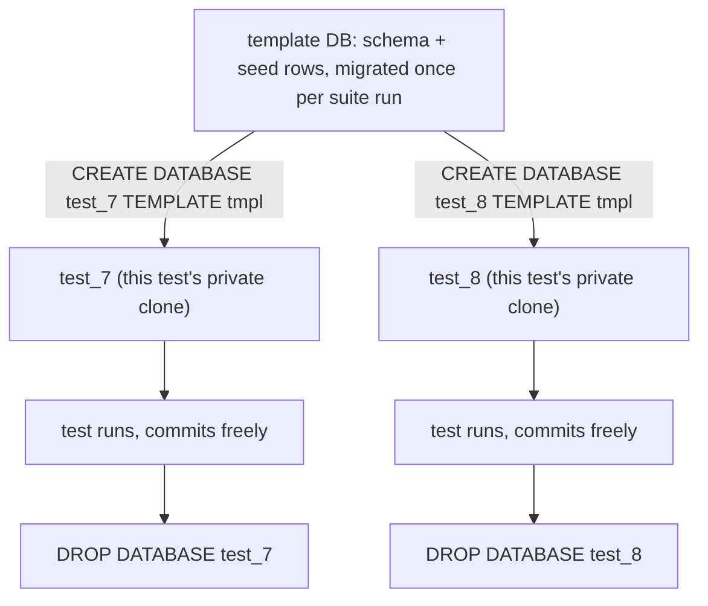
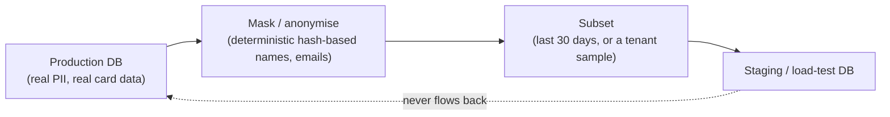

# Test Data Strategy

> [!summary] TL;DR
> Test data strategy is how you create, isolate and clean up the rows a test needs, so the test is fast, repeatable and does not leak state into the next test. Hand-written fixtures and ad-hoc factories both rot; a small builder plus a cloned database per test is the combination that scales.

> [!abstract] Core idea
> - Build test rows with functional-option builders, not giant fixture files: each test states only the fields it cares about.
> - Isolate each test's data: a transaction you roll back, a truncated table, or (fastest for Postgres) a database cloned from a template.
> - Make data deterministic: fixed clocks, seeded randomness, sequential IDs — never `time.Now()` or a random UUID a test then has to re-derive.
> - Never put raw production PII in a lower environment; mask or synthesize instead.
> - "Passes locally, fails in CI" is almost always test data leaking between tests or two tests racing on shared rows.

## 1. Why it exists

A test for "place an order" needs a customer, a product, a price, and a timestamp. Four ways to get that row show four different failure modes:

- **Copy-pasted literal values** in every test: when the `orders` table gains a required column, you edit 200 tests.
- **One shared fixture file** loaded once for the whole suite: test A inserts a discount that test B's assertion didn't expect, because they share one `customers` row.
- **Hand-rolled random values** (`rand.Int()`, `time.Now()`): the test is non-deterministic, so a failure that depends on a specific unlucky value cannot be reproduced from the CI log.
- **A copy of the production database**: it contains real card numbers and real people's names, which is a GDPR and PCI violation to put in a laptop's Docker volume.

The fix is a **builder** for shape, **isolation** for independence, and **fixed inputs** for determinism, chosen separately because they solve three different problems.

## 2. Mental model

Think of test data as having three independent knobs, and most "my tests are flaky" bugs are one knob left on the wrong setting:

1. **Shape** — what fields does this row need, and what are reasonable defaults? (builders / factories)
2. **Isolation** — can two tests touch this table at the same time without seeing each other's rows? (transactions, template databases, schema-per-test)
3. **Determinism** — given the same code, does the test produce the same data every run? (fixed clock, seeded RNG, sequential IDs)

## 3. How it works

### Fixtures vs factories vs builders

| Term | What it is | Problem it has |
| --- | --- | --- |
| Fixture | A static file (YAML/JSON/SQL) of rows, loaded as-is | Drifts from the schema silently; every test shares the exact same values, hiding bugs that only show up with different data |
| Factory | A function that returns a new row with defaults, usually taking a map/struct of overrides | Verbose call sites once a row needs many optional overrides |
| Builder (functional options) | A function with defaults, plus one small option function per field you might want to override | The pattern used below; each test reads as "an order, except its amount is 500" |

### Per-test isolation on PostgreSQL 17



Four isolation techniques, in increasing cost and increasing realism:

| Technique | How | Cost | Catches |
| --- | --- | --- | --- |
| Transaction rollback | `BEGIN`, run the test, `ROLLBACK` | Cheapest; one shared DB | Nothing that itself needs a committed transaction (e.g. testing `SERIALIZABLE` retries, triggers that fire `AFTER COMMIT`) |
| Truncate between tests | `TRUNCATE ... RESTART IDENTITY CASCADE` after each test | Cheap, but serial (one suite can't parallelize against one DB) | Commit-dependent code, at the cost of full serial runs |
| Template-database cloning | `CREATE DATABASE test_N TEMPLATE tmpl` per test/worker, drop after | A few ms per clone (`TEMPLATE` copies files, no migration re-run) | Full commit behaviour, safe parallel workers |
| Schema per parallel test | One physical DB, one Postgres schema (`search_path`) per worker | Cheapest way to parallelize without extra databases | Same as template cloning, minus cross-schema foreign keys if your schema design needs them |

Template cloning is usually the best default once a suite runs in parallel: each Go test worker (`go test -p N`) gets its own real, empty-of-other-tests database, so committed transactions and triggers behave exactly as in production, and clones are dropped at the end of the run.

### Determinism

- **Clock:** inject `func() time.Time` (or an interface) instead of calling `time.Now()` inside logic under test; tests pass a fixed `time.Date(...)`.
- **Randomness:** seed the RNG explicitly (`rand.New(rand.NewSource(1))`) so a failing run can be replayed with the same sequence.
- **IDs:** a sequential counter in tests, not `uuid.New()`, so assertions and golden files stay stable across runs.

## 4. Worked example

### Whiteboard version

```go
type Order struct {
    ID, CustomerID string
    AmountPaise    int64
    Status         string
}

type OrderOption func(*Order)

func WithAmount(paise int64) OrderOption { return func(o *Order) { o.AmountPaise = paise } }

func NewOrder(opts ...OrderOption) Order {
    o := Order{ID: nextID(), CustomerID: "cust_default", AmountPaise: 19900, Status: "placed"}
    for _, opt := range opts {
        opt(&o)
    }
    return o
}
```

Call sites read as intent: `NewOrder(WithAmount(500))` is "an order, except it costs ₹5" — every other field keeps a default a reader doesn't have to think about.

### Full builder with deterministic IDs

This is the exact code tested below (Go 1.24, `go vet` and `go test -race` clean):

```go
package testdata

import "time"

// Order is the entity under test. In a real suite this would be the
// production type; here it stands in for it.
type Order struct {
	ID          string
	CustomerID  string
	AmountPaise int64 // money kept as integer minor units, never float
	Currency    string
	PlacedAt    time.Time
	Status      string
}

// OrderOption customises one field of a built Order. Each test only
// names the fields it cares about; every other field gets a sane default.
type OrderOption func(*Order)

func WithCustomer(id string) OrderOption { return func(o *Order) { o.CustomerID = id } }
func WithAmount(paise int64) OrderOption { return func(o *Order) { o.AmountPaise = paise } }
func WithStatus(status string) OrderOption { return func(o *Order) { o.Status = status } }
func WithPlacedAt(t time.Time) OrderOption { return func(o *Order) { o.PlacedAt = t } }

// idSeq is swapped in tests for a deterministic sequence; production
// code would use a real ID generator.
var idSeq = sequentialIDs("ord_")

// NewOrder builds an Order with defaults, then applies each option in order.
func NewOrder(opts ...OrderOption) Order {
	o := Order{
		ID:          idSeq(),
		CustomerID:  "cust_default",
		AmountPaise: 19900,
		Currency:    "INR",
		PlacedAt:    time.Date(2026, 1, 1, 0, 0, 0, 0, time.UTC),
		Status:      "placed",
	}
	for _, opt := range opts {
		opt(&o)
	}
	return o
}

func sequentialIDs(prefix string) func() string {
	n := 0
	return func() string {
		n++
		return prefix + itoa(n)
	}
}

// ResetIDs restarts the sequence. Call it in TestMain or at the top of a
// test so IDs don't depend on test execution order.
func ResetIDs() { idSeq = sequentialIDs("ord_") }
```

Test proving defaults, overrides and determinism:

```go
func TestNewOrderDefaultsAreStable(t *testing.T) {
	ResetIDs()
	o := NewOrder()
	if o.ID != "ord_1" {
		t.Fatalf("ID = %q, want ord_1 (deterministic sequence, not a random UUID)", o.ID)
	}
	if o.AmountPaise != 19900 || o.Currency != "INR" {
		t.Fatalf("unexpected defaults: %+v", o)
	}
}

func TestNewOrderOptionsOverrideOnlyNamedFields(t *testing.T) {
	ResetIDs()
	o := NewOrder(WithCustomer("cust_42"), WithAmount(500))
	if o.CustomerID != "cust_42" || o.AmountPaise != 500 {
		t.Fatalf("overrides not applied: %+v", o)
	}
	if o.Status != "placed" {
		t.Fatalf("Status = %q, want default %q", o.Status, "placed")
	}
}

func TestResetIDsRestartsTheSequence(t *testing.T) {
	ResetIDs()
	first := NewOrder().ID
	ResetIDs()
	second := NewOrder().ID
	if first != second {
		t.Fatalf("ResetIDs did not restart the sequence: %q != %q", first, second)
	}
}
```

Run: `go vet ./... && go test -race ./...` → 3 tests pass (measured, Go 1.24.4, 2026-11-04).

### Edge-case data to include on purpose

A builder's defaults should be boring, but your test *suite* must also exercise:

- **Unicode:** customer names with combining characters, emoji, right-to-left text — a column with a byte-length limit can silently truncate a multi-byte character mid-codepoint.
- **Money precision:** always integer minor units (`AmountPaise int64`), never `float64`; a float total over many line items drifts from the sum of its parts.
- **Time zones and DST:** a booking that starts the day of a DST transition, and a customer timezone that differs from the server's — stored timestamps should be UTC with the zone attached only at render time.
- **Large payloads:** the biggest row your API accepts (max description length, max line items) to catch truncation and timeout bugs before customers do.

### Synthetic data and provider states

- **Synthetic data (gofakeit):** generates realistic-looking names, addresses and emails from a seeded RNG, so a seed-data script for a demo environment or a load test doesn't need real customer rows:
  ```go
  gofakeit.Seed(42)
  name := gofakeit.Name()
  email := gofakeit.Email()
  ```
- **Property-based generators:** instead of fixed example rows, generate a wide range of valid rows and check an invariant holds for all of them (see [[Fuzz and Property-Based Testing]]) — useful for finding the one amount or string length that breaks validation.
- **Provider states for contract tests:** a consumer contract often says "given an order ord_1 exists and is refunded, when I GET /orders/ord_1". The provider verification step must seed exactly that state before replaying the interaction — see [[Contract Testing]].



### Production data: never raw, always reduced

| Need | Technique | Rule |
| --- | --- | --- |
| Realistic distribution for load tests | Subsetting: copy a slice of real tables (e.g. last 30 days), at close to production row counts, not a handful of rows | Still contains PII — mask before it leaves the production network boundary |
| Realistic access pattern for load tests | Match production's key skew (a Zipf-like distribution: a few customers/products get most of the traffic) instead of uniformly random keys | Uniform synthetic keys hide hot-partition and hot-row bugs (lock contention, cache misses) that only show up when a handful of keys take most of the load — see [[Load and Performance Testing]] |
| Masking / anonymisation | Replace names, emails, phone numbers, card numbers with synthetic-but-plausible values, keep referential integrity (same customer id masks to the same fake name everywhere) | Deterministic masking (hash-based) so joins still work across tables |
| Regulatory constraints | GDPR, PCI-DSS | Raw PII and card data never leave production; a right-to-be-forgotten request must also purge any exported copy |

### Multi-tenant isolation and golden datasets

- **Multi-tenant fixtures:** always build at least two tenants in any fixture set that touches tenant-scoped tables, and assert that tenant A's test never reads tenant B's row — a single-tenant fixture hides the most common SaaS bug (a missing `WHERE tenant_id = ?`).
- **Golden datasets:** a fixed, version-controlled input set used for regression — "does this model/pipeline still produce the same output for this known input?" The same idea that AI evaluation suites use for LLM outputs (golden prompts and expected shapes), applied to deterministic pipelines like pricing or search ranking.

### Shared environments: namespacing and TTL

A staging environment shared by many CI runs needs row-level isolation too: prefix every created row's natural key with the CI run ID (`ord_run42_1`), and run a scheduled cleanup job that deletes anything older than a TTL (say 24h) so leaked rows from a crashed run don't accumulate forever.

## 5. Variants and comparison

| Approach | How it works | Use when | Cost |
| --- | --- | --- | --- |
| Static fixture file | Load a fixed YAML/SQL file before the suite | Tiny suites, reference/lookup tables (country codes) | Drifts from schema; shared state across tests |
| Factory function | Function returns a row, overrides via struct/map | Small number of optional fields | Verbose at the call site as fields grow |
| Functional-option builder | Defaults + one option func per field | Most Go test suites | Slightly more boilerplate to define, much less to call |
| Transaction rollback | `BEGIN` / `ROLLBACK` around each test | Fast unit-adjacent integration tests, no commit-dependent logic | Can't test triggers/constraints that fire on commit |
| Template DB clone | Clone a migrated template DB per test/worker | Parallel integration suites needing real commits | A few ms per clone, disk space for N clones |
| Masked production subset | Real data shape, real-looking distribution, PII removed | Load testing, data-skew-sensitive bugs | Pipeline to build and refresh the mask |

## 6. Trade-offs and when not to use

- Builders add a layer of indirection a one-off script doesn't need; for throwaway debugging, literal values are fine.
- Template-database cloning only pays off once you parallelize; for a small serial suite, transaction rollback is simpler and just as correct.
- Masked production data is more realistic than synthetic data but costs a pipeline to build, run, and keep in sync with schema changes — don't build one until synthetic data has demonstrably missed a bug class.
- Golden datasets lock in today's correct output; forgetting to regenerate them after an intentional behaviour change turns them into false failures.

## 7. In production

- **Real systems:** Rails' fixtures/factory_bot and Go's `go-faker/gofakeit` popularized factory-style test data; PostgreSQL's `CREATE DATABASE ... TEMPLATE` is the standard way Postgres-backed Go suites (e.g. using `testcontainers-go` or a local instance) get cheap per-test databases.
- **Failure modes → fixes:**
  - "Passes locally, fails in CI" → almost always two tests sharing one un-isolated table, or a test depending on wall-clock time; add isolation or inject a fixed clock.
  - Flaky test depending on row order → an unordered read (`SELECT * FROM orders`) with no `ORDER BY` has no defined order; either add one or sort in the assertion.
  - Suite slows down over months → fixture or seed script grown without bound; prefer builders that create only what a test needs.
- **What to monitor:** suite wall-clock time (template cloning should keep it roughly flat as the suite grows, since clones are cheap and parallel), flake rate per test, and disk usage from undropped clone databases after a crashed run.

## 8. Deep dive

- **Why `TEMPLATE` cloning is fast in Postgres:** `CREATE DATABASE ... TEMPLATE tmpl` uses the filesystem-level file copy Postgres already does for template databases, not a logical replay of DDL; it is close to a file copy, not a migration re-run, so timing scales with data size, not schema complexity.
- **Transaction rollback's blind spot:** code that relies on `pg_notify`, `AFTER COMMIT` triggers, or `SERIALIZABLE` retry logic only runs its real path after a commit. A test wrapped in an outer transaction that's always rolled back never actually commits, so that code path goes untested — this is why integration tests for exactly that logic need template cloning or truncation instead.
- **Why sequential test IDs, not UUIDs:** a UUID per test run makes `t.Fatalf` output ("expected customer 8f2a19e3-...") useless to compare across runs; a sequential counter reset per test makes failure output diffable and makes golden files for regression tests stable.
- **Masking and referential integrity:** naive per-column masking (independently randomizing each name column) breaks joins — the same customer must mask to the same fake name in every table. Deterministic masking (`fake_name = hash(real_id) -> lookup table`) keeps foreign keys meaningful while still removing the real PII.

## 9. Interview questions

> [!question]- Your tests pass locally but fail intermittently in CI. What do you check first?
> Shared, un-isolated state: two tests racing on the same table row (fix with transaction rollback or a cloned DB per test), or a test depending on wall-clock time or row order with no explicit sort. Ask whether the suite runs in parallel in CI but serially on your machine — that difference alone explains most of these failures.

> [!question]- Why use a functional-option builder instead of a struct literal for test data?
> A struct literal forces every test to specify every field, so a new required field means editing every test; a builder's defaults mean only the fields a test cares about appear at the call site, and adding a field only touches the builder's default, not every caller.

> [!question]- When would you choose transaction rollback over a cloned database per test?
> When the suite is small and serial, and nothing under test depends on a real commit (triggers, `SERIALIZABLE` retries, `pg_notify`). It's simpler and needs only one database. Switch to cloning once you parallelize or need commit-dependent behaviour to actually run.

> [!question]- Trap: is masked production data safe to put in a staging environment?
> Only if the masking is irreversible and covers every PII field, including ones that re-identify people indirectly (rare combinations of ZIP + birthdate + gender). A reversible or partial mask is not "safe" — treat masked data with the same access controls as a lower-trust copy of production, not as synthetic data.

> [!question]- How do you keep money fields exact across test and production code?
> Store and compare amounts as integers in the smallest currency unit (paise, cents), never `float64`. A float total over many line items can drift from the sum of its parts due to binary floating-point rounding, and that drift is exactly the kind of bug tests with real-looking amounts (₹199.00, not round numbers) are meant to catch.

> [!question]- What's wrong with one shared fixture file loaded once for the whole suite?
> Tests become coupled through that shared data: one test's insert or update changes what another test sees, so test order starts to matter and a failure in test B might really be caused by test A. It also can't parallelize safely. Prefer data built per test, isolated per test.

## 10. Cheat sheet

- Builder (functional options) for shape: each test names only the fields it overrides.
- Isolate per test: transaction rollback (cheap, no commit-dependent logic) or template-DB clone (real commits, parallel-safe).
- Determinism: fixed clock, seeded RNG, sequential IDs — never `time.Now()` or a random UUID in test data.
- Money as integer minor units, never float.
- Mask production data (deterministically, preserving joins) before it reaches a lower environment; raw PII never leaves production.
- Multi-tenant fixtures always include at least two tenants, to catch a missing tenant filter.
- Golden datasets pin known-good output for regression; regenerate deliberately when behaviour legitimately changes.
- "Passes locally, fails in CI" → check isolation and determinism first.

## Links

- **Before this:** [[Testing Strategy and the Test Pyramid]], [[Unit, Integration and E2E Tests]]
- **Next:** [[Contract Testing]], [[Load and Performance Testing]]
- **Compare with:** [[Fuzz and Property-Based Testing]] (generating many inputs instead of many fixture rows)
