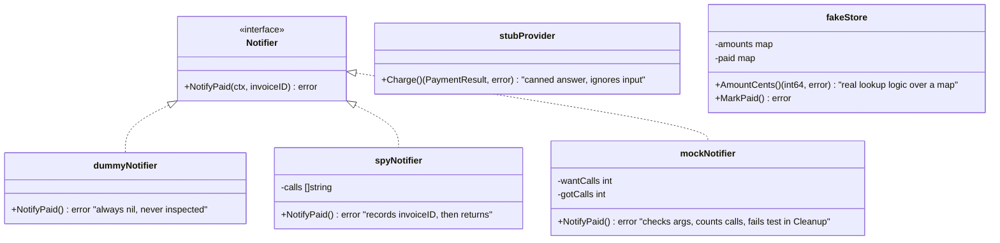
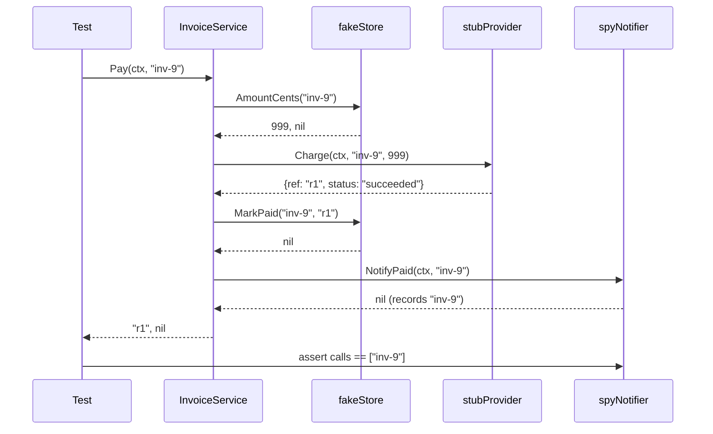

# Test Doubles and Mocking in Go

> [!summary] TL;DR
> A **test double** is any stand-in object used in place of a real dependency during a test. "Mock" is the word everyone uses for all of them, but the five kinds — dummy, stub, fake, spy, mock — behave differently, and in Go the easiest way to get any of them is to depend on a small interface **you** declare, not one the real implementation hands you.

> [!abstract] Core idea
> - Five kinds of double, not one: dummy (never used), stub (canned answers), fake (a working simplified version), spy (records calls), mock (pre-programmed expectations, verifies itself).
> - Declare interfaces on the **consumer** side (where they're used), sized to exactly what that consumer calls — that's what makes a type fakeable at all.
> - Table-driven tests plus a hand-written fake usually beat a generated mock for readability; reach for gomock/mockery when the thing under test is the *interaction itself*.
> - `httptest` fakes an HTTP boundary; sqlmock fakes a SQL boundary without a real database; a real Postgres via testcontainers-go is the ground truth both approximate.
> - A fake beats a mock whenever the test cares about *behaviour across several calls* (state that persists, like "mark paid and then the amount reads back as zero").

## 1. Why it exists

`InvoiceService.Pay` (the running InvoiceOps example) needs to charge a payment provider and notify the customer. In a test, actually calling a payment provider is unacceptable: it's slow, it costs money per call, it can fail for reasons that have nothing to do with the code being tested (network, the provider's own outage), and a test that occasionally fails because a third party is flaky is exactly the flaky-test smell covered in [[Testing Strategy and the Test Pyramid]].

Test doubles solve this: replace `PaymentProvider` with something that behaves predictably, in-process, for free, in under a millisecond — while still letting the test prove `Pay` handles a decline, a timeout, and a success correctly.

## 2. Mental model

Picture a stage play. A **dummy** is a prop that's there only because the script requires something to be in that hand — nobody looks at it closely. A **stub** is an actor who says the same line regardless of what's asked, because the scene only needs that one line. A **fake** is an understudy who actually performs the role, just more simply (a real conversation, just shorter). A **spy** is a stub with a clipboard, writing down everything said to it so the director can check afterward. A **mock** is an actor who was told exactly what cues to expect *before* the scene started, and who tells the director immediately if a different cue comes.

All five let the play (the test) go ahead without the real other actor (the real dependency). Which one to use depends on what the test needs to check.

## 3. How it works

### The vocabulary, on one interface

Every example below replaces this consumer-declared interface from InvoiceOps (full service in [[Unit, Integration and E2E Tests]]):

```go
type Notifier interface {
    NotifyPaid(ctx context.Context, invoiceID string) error
}
```



- **Dummy**: `dummyNotifier{}` — satisfies the interface so the code compiles and runs, but the test never looks at it. Used when `Notifier` is a required field but this particular test isn't about notification at all.
- **Stub**: `stubProvider{result, err}` — returns a fixed `PaymentResult` or error no matter what it's called with. Used to force a specific branch in `Pay` (declined, errored, succeeded) without any real charging logic.
- **Fake**: `fakeStore` — an in-memory map that behaves like the real `InvoiceStore`: `AmountCents` can actually return "not found," `MarkPaid` actually removes the invoice from the outstanding map. It has real (simplified) behavior, not canned answers, so it can support a sequence of calls that depend on each other (charge, then check it's no longer owing).
- **Spy**: `spyNotifier` — behaves like a stub, but also records what it was called with, so the test can assert *after the fact*: "`NotifyPaid` was called exactly once, with `inv-9`."
- **Mock**: a double whose expectations are declared *before* the call happens, and which fails the test itself (not just lets the caller inspect a log afterward) if the wrong thing happens. In Go this is usually generated code (gomock, moq) wired to a `*testing.T`.



### Consumer-side interfaces: what makes a type fakeable

`PaymentProvider` is declared inside the package that **uses** it (the invoice service), not inside a payment-provider SDK package:

```go
type PaymentProvider interface {
    Charge(ctx context.Context, invoiceID string, amountCents int64) (PaymentResult, error)
}
```

This is the single biggest lever for testability in Go. If `InvoiceService.Pay` instead took a concrete `*stripe.Client`, there would be no way to substitute a double short of running a real (or recorded) network call. Because the interface lives on the consumer side and lists only the one method `Pay` actually calls, *any* type — including a three-line struct defined only in a `_test.go` file — can stand in for it. This is the Go idiom usually summarized as "accept interfaces, return structs," and it's also why Go interfaces are satisfied implicitly: the real `HTTPPaymentProvider` never needs to import or know about this interface at all.

### Table-driven tests over the fakes

```go
func TestInvoiceService_Pay(t *testing.T) {
    t.Parallel()
    cases := []struct {
        name       string
        amounts    map[string]int64
        invoiceID  string
        chargeResp PaymentResult
        chargeErr  error
        wantErr    string
    }{
        {"happy path", map[string]int64{"inv-1": 5000}, "inv-1",
            PaymentResult{Reference: "ref-123", Status: "succeeded"}, nil, ""},
        {"unknown invoice", map[string]int64{}, "inv-missing",
            PaymentResult{}, nil, "load invoice"},
        {"provider declines", map[string]int64{"inv-3": 1200}, "inv-3",
            PaymentResult{Status: "failed"}, nil, "not successful"},
    }
    for _, tc := range cases {
        tc := tc
        t.Run(tc.name, func(t *testing.T) {
            t.Parallel()
            store := newFakeStore(tc.amounts)
            svc := &InvoiceService{
                Store:    store,
                Payments: stubProvider{result: tc.chargeResp, err: tc.chargeErr},
                Notify:   dummyNotifier{},
            }
            _, err := svc.Pay(context.Background(), tc.invoiceID)
            // ... assert against tc.wantErr
        })
    }
}
```

Each case mixes a **fake** (`fakeStore`, because the test needs real "is this invoice still owing" behavior afterward) with a **stub** (`stubProvider`, because only the canned response matters) and a **dummy** (`dummyNotifier`, because notification isn't the point of this test). The full, tested five-case version — plus a separate test using `spyNotifier` to assert `NotifyPaid` ran exactly once — is in the scratch module referenced below.

### `httptest` for the HTTP boundary

Covered in depth in [[Unit, Integration and E2E Tests]]; in double terms, `httptest.NewServer` running a hand-written stub handler is itself a **stub** for the external payment API, just one that happens to run over a real socket so the client code under test (`HTTPPaymentProvider.Charge`) is exercised faithfully.

### sqlmock vs a real test database

`sqlmock` replaces `*sql.DB`'s driver with one that matches query text against a regex and returns programmed rows — a **stub** at the SQL level:

```go
db, mock, _ := sqlmock.New()
rows := sqlmock.NewRows([]string{"amount_cents"}).AddRow(int64(4500))
mock.ExpectQuery(`SELECT amount_cents FROM invoices WHERE id = \$1`).
    WithArgs("inv-1").
    WillReturnRows(rows)

store := &SQLInvoiceStore{DB: db}
amount, err := store.AmountCents(context.Background(), "inv-1")
// amount == 4500
```

This proves `AmountCents` sends roughly the right query and parses the row correctly. It does **not** prove the query is valid against the real schema — a renamed column still "succeeds" here because sqlmock never plans SQL. The real-database alternative (testcontainers-go, detailed in [[Unit, Integration and E2E Tests]]) is the only one of the two that's a true integration test; sqlmock is better understood as a fast unit test of the Go code *around* the query.

### gomock / mockery codegen vs hand-written fakes

Generated mocks (`mockgen` for gomock, `mockery` or `moq` for a similar style) read an interface and emit a type with an `EXPECT()` builder:

```go
// what mockgen would generate for Notifier (illustrative shape):
ctrl := gomock.NewController(t)
mockN := mocks.NewMockNotifier(ctrl)
mockN.EXPECT().
    NotifyPaid(gomock.Any(), "inv-7").
    Times(1).
    Return(nil)

svc := &InvoiceService{ /* ..., */ Notify: mockN }
svc.Pay(ctx, "inv-7")
// ctrl verifies the expectation was met when the test ends
```

The hand-written equivalent used in this vault's tested example (`mockNotifier`, wired through `t.Cleanup` instead of a `*gomock.Controller`) has the same shape — expectations set up front, verified automatically at test end — without a code-generation step:

```go
mock := newMockNotifier(t, "inv-7", 1) // want: called once, with "inv-7"
svc := &InvoiceService{ /* ..., */ Notify: mock }
svc.Pay(context.Background(), "inv-7")
// t.Cleanup registered inside newMockNotifier fails the test if the count is wrong
```

**Codegen (gomock/mockery/moq) wins when**: the interface is large (many methods), shared across many test files, or changes often enough that hand-maintaining every double would be real toil — generating from the interface keeps the doubles in sync automatically when the interface changes (a regenerate step, usually via `go generate`).

**Hand-written fakes win when**: the interface is small (as in this InvoiceOps example — one or two methods), the test benefits from *real* behavior across a sequence of calls (a fake map that actually tracks state), or the team wants zero extra tooling and maximum readability for a newcomer reading the test.

## 4. Worked example

### Whiteboard version

```text
InvoiceService.Pay(ctx, invoiceID):
  1. Store.AmountCents(invoiceID)   -> amount
  2. Payments.Charge(invoiceID, amount) -> result
  3. Store.MarkPaid(invoiceID, result.Reference)
  4. Notify.NotifyPaid(invoiceID)

Which double for which test?

  "amount <= 0 is rejected"
    -> fakeStore{amounts: {"inv-2": 0}}, dummyNotifier, stubProvider (unused)
       only Store matters here; Payments/Notify are dummies.

  "provider decline surfaces as an error"
    -> fakeStore (real), stubProvider{Status: "failed"}, dummyNotifier
       Payments is the thing under test's branch; stub forces it.

  "NotifyPaid is called exactly once, with the right id"
    -> fakeStore (real), stubProvider{succeeded}, spyNotifier
       need to inspect AFTER the call -> spy, not stub.

  "NotifyPaid is called exactly once" as a pre-declared expectation
    -> same double role as the spy, but using gomock/mockery/moq's
       EXPECT()-style API, or the hand-written mockNotifier above.
```

### Full tested code

The service, four double kinds, table-driven tests, an `httptest` example for both directions (handler and client), and an sqlmock test all live together, compiled and tested, in a scratch Go module at `/private/tmp/claude-502/-Users-priyanshumidha-Documents-OBZEDIAN/00fc1435-48e1-42f0-9888-340e4e0fbca2/scratchpad/work/15-g1/testdoubles/` (`invoice.go`, `fakes.go`, `handler.go`, `sqlstore.go`, and their `_test.go` files). `go vet ./...` and `go test -race ./...` both pass (13 tests).

## 5. Variants and comparison

| Double | Behavior | Verified how | Use when |
|---|---|---|---|
| Dummy | Does nothing meaningful | Never inspected | The dependency is required by the type signature but irrelevant to this test |
| Stub | Fixed canned answer | Checked via the caller's return value | Forcing one specific branch (success/decline/error) |
| Fake | Real, simplified behavior (in-memory) | Checked via the caller's return value across multiple calls | The test needs state to persist correctly between calls |
| Spy | Canned answer + records calls | Checked by inspecting the double after the call | Asserting an interaction happened, discovered *after* the call |
| Mock | Pre-declared expectations | Verifies itself (fails the test on mismatch) | The interaction itself (call count, argument shape) is the thing under test |

## 6. Trade-offs and when not to use

- Over-using generated mocks for small interfaces adds a build step (`go generate`), a new dependency, and a layer of indirection a newcomer has to learn, for interfaces a 10-line hand-written fake would cover just as well.
- A fake that gets too clever (reimplementing constraint checking, transactions, concurrency control) turns into a second database to maintain and debug — at that point, switch to a real test database (testcontainers-go) instead of growing the fake further.
- Mocks that assert on call count and argument shape couple the test tightly to the exact sequence of calls; a harmless refactor (combining two calls into one, reordering independent calls) breaks the test even though behavior didn't change. Prefer asserting on *outcome* (a fake's final state, a spy's recorded summary) over *process* (a mock's exact call sequence) unless the sequence itself is the contract.

## 7. In production

- **Real systems**: gomock (`go.uber.org/mock`, the maintained fork of `golang/mock`) and `vektra/mockery` are the two most common Go mocking-codegen tools in production codebases; `DATA-DOG/go-sqlmock` is near-universal for a fast SQL-adjacent unit test layered on top of a slower testcontainers-go integration suite.
- **Failure modes → fixes**:
  - *A mock's expectations are so specific that every small refactor breaks dozens of tests* → switch the double to a fake or a looser stub, and assert on outcome instead of call sequence.
  - *A hand-written fake silently drifts from the real implementation's behavior* (e.g., the real store enforces "can't mark an already-paid invoice paid again," the fake doesn't) → add that same invariant to the fake deliberately, and add one integration test against the real store specifically for that invariant.
- **What to monitor**: how often a test breaks on an unrelated refactor (a proxy for over-specified mocks) and whether the fake's assumptions have ever diverged from a bug found only against the real dependency.

## 8. Deep dive

### Why "mock" became the catch-all word, and why the distinction still matters

Colloquially, "mock the database" usually means "replace the database with anything that isn't the database" — any of the five kinds. The distinction matters because it changes what a test can actually prove: a stub proves "my code handles this specific canned response correctly"; a fake additionally proves "my code's assumptions about state hold across a sequence of operations"; only a spy or mock proves "my code made this call, with these arguments, this many times." Reaching for the wrong one either under-tests (a stub where a spy was needed to catch a missing notification) or over-constrains the test (a mock's exact call-count assertion where a fake's final-state assertion would have been more robust to refactoring).

### When a fake beats a mock, concretely

The clearest case in this note's own example: testing that `Pay` correctly leaves the invoice no longer "owing" after a successful charge needs the store to behave like a real data store across two calls (`AmountCents` then, implicitly, whatever reads the state afterward) — a stub returning the same canned `AmountCents` forever can't model "this invoice is now paid," but `fakeStore.MarkPaid` deleting the entry from its map can. Any test whose assertion is "state X holds *after* a sequence of operations," rather than "call Y happened," is a fake's job.

## 9. Interview questions

> [!question]- What's the difference between a stub and a mock, precisely?
> A stub returns a fixed answer and is inspected (if at all) through the caller's own return value — the test checks what the *code under test* did with the stub's answer. A mock has its expectations declared up front (which calls, with what arguments, how many times) and verifies them itself, failing the test directly if the expectation isn't met — the test checks what happened *to* the mock.

> [!question]- Why declare the `PaymentProvider` interface in the invoice-service package instead of in the payment-provider SDK package?
> A consumer-declared interface lists only the methods the consumer actually calls, so any type — including a tiny struct defined only in a test file — can satisfy it without that type needing to know the interface exists. If the interface instead lived in and was exported by the SDK, a test double would need to implement the SDK's full concrete surface or the SDK's own (possibly large, unstable) interface, which is harder to fake and couples the test to the SDK's design.

> [!question]- Trap: "We mocked the repository, so this is an integration test of our data layer." What's wrong with that claim?
> If the repository itself is mocked, no real SQL or database behavior is exercised — this is a unit test of the code that *calls* the repository, not a test of the repository. A true integration test of the data layer runs the real repository against a real (or real-enough, e.g. testcontainers-go) database; mocking inside that repository's own test defeats the purpose.

> [!question]- When would you reach for gomock or mockery instead of a hand-written fake?
> When the interface is large or changes often enough that hand-maintaining doubles across many test files becomes real toil, or when many different tests need subtly different expectations on the same interface and a generated `EXPECT()` builder reads more clearly than many hand-written variants. For a small, stable, one-or-two-method interface, a hand-written fake is usually just as fast to write and easier for a newcomer to read.

> [!question]- Why use `httptest.NewServer` instead of simply calling the handler function directly in a test?
> `NewServer` exercises the client code over a real socket and real HTTP framing — header casing, chunked encoding, actual network timeouts — which calling a handler function directly in-process never does. It's specifically for testing a client (or any code that makes real HTTP calls) against a controllable fake, not for testing the handler itself (which `httptest.NewRecorder` handles more cheaply).

> [!question]- What does sqlmock verify that a real test database doesn't, and vice versa?
> sqlmock verifies that your Go code sends a query shaped the way you expect and correctly parses the rows it gets back — fast, no Docker required. It does not verify the query is valid against a real schema. A real test database (testcontainers-go) verifies the SQL is actually correct — catches a renamed column, a constraint violation, a query returning the wrong rows — but is slower and needs Docker. Use both: sqlmock for fast coverage of many query-shape variants, a real database for the handful of queries where correctness against the real schema matters most.

## 10. Cheat sheet

- Five kinds: dummy (unused), stub (canned answer), fake (working simplified version), spy (records calls), mock (pre-declared expectations, self-verifying).
- Declare interfaces on the consumer side, sized to exactly what's called — that's what makes a type fakeable in Go.
- Table-driven tests + a mix of fakes/stubs/dummies cover most unit tests; reach for a spy or mock only when the interaction itself is the thing under test.
- `httptest.NewRecorder` tests a handler you own; `httptest.NewServer` tests a client you own over a real socket.
- sqlmock is a fast stub at the SQL level; it can't catch a wrong schema — pair it with a real test database for queries that matter.
- gomock/mockery/moq earn their codegen step on large or frequently-changing interfaces; hand-written fakes are usually clearer for small ones.
- Prefer asserting outcome (a fake's final state) over process (a mock's exact call sequence) unless the sequence itself is the contract.
- Never mock the dependency a given test's whole job is to verify.

## Links
- **Before this:** [[Unit, Integration and E2E Tests]]
- **Next:** [[Test Data Strategy]]
- **Compare with:** [[Testing Strategy and the Test Pyramid]] for where unit tests (and their doubles) fit among the layers; [[Contract Testing]] for verifying a double's assumptions against the real dependency's actual behavior.
