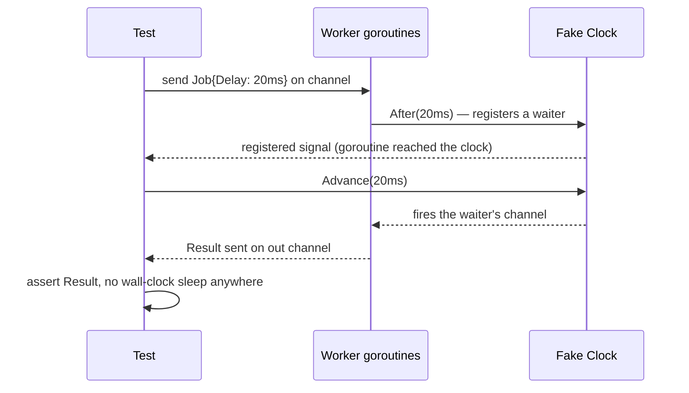
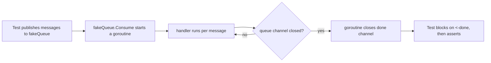

# Testing Async and Event-Driven Systems

> [!summary] TL;DR
> Async code (goroutines, channels, queue consumers, eventually-consistent reads) cannot be tested by asserting immediately after a call, because the result isn't there yet. Replace `time.Sleep` guesses with signals the code actually sends — a channel receive, a `sync.WaitGroup`, an injected fake clock, or a polling helper with a timeout — so the test is both fast and not flaky.

> [!abstract] Core idea
> - Never use `time.Sleep(n)` to "wait for" a goroutine or a consumer; it is either too short (flaky) or too long (slow).
> - Use the mechanism the code already has to signal completion: closing a channel, a `WaitGroup`, or a fake `Clock` your production code takes as a dependency.
> - For queue/stream consumers, use an in-memory fake for handler-logic tests and a real broker (testcontainers) only for the few tests that must prove wire-level behavior.
> - For results that become true only *after* async work settles, poll with a short interval and a hard timeout (an `Eventually` helper), never a single assertion.

## 1. Why it exists

A naive test for an async pipeline looks like this:

```go
go handler.Process(job)
time.Sleep(100 * time.Millisecond) // "surely it's done by now"
assertProcessed(t, job.ID)
```

On a fast, quiet CI runner this passes in 2 ms of real work plus 100 ms of waiting — 50× slower than it needs to be. On a loaded runner, 100 ms isn't always enough, so the test fails about 1 run in 200. That failure rate is exactly what turns into a flaky test nobody trusts, and the team starts re-running the suite instead of fixing it. The fix is not a bigger sleep; it's removing the guess.

## 2. Mental model

Treat every async operation as something with an explicit "done" signal, and make the test wait on that signal instead of on the wall clock:

| What you're waiting for | Signal to wait on instead of sleeping |
| --- | --- |
| A goroutine finished | `sync.WaitGroup.Wait()`, or a channel it closes |
| A timer or retry backoff fired | An injected `Clock` interface you advance manually |
| A queue consumer processed N messages | A channel the consumer sends to, or a counter polled with a timeout |
| A write becomes visible to reads (eventual consistency) | A polling `Eventually(timeout, interval, check)` helper |

The common thread: production code takes its source of concurrency and time as a parameter (a channel, a `Clock`), so the test can control it instead of racing it.

## 3. How it works





### Injected clocks instead of real sleeps

Production code depends on a `Clock` interface (`Now()`, `After(d)`) rather than calling `time.Now`/`time.After` directly. The real implementation wraps the standard library; the test implementation is a *fake clock* that only advances when the test tells it to, and only fires a goroutine's timer once that goroutine has actually reached it — otherwise the test could advance time before the goroutine is scheduled, and the signal would be lost.

### `testing/synctest` (Go 1.24 → 1.25)

Go 1.24 shipped an experimental `testing/synctest` package, gated behind `GOEXPERIMENT=synctest` at build time. It runs a test inside an isolated "bubble": a fake, controllable clock plus a goroutine scheduler that detects when every goroutine in the bubble is durably blocked, so `synctest.Wait()` can block until that point instead of the test guessing a sleep duration. **As of Go 1.25 (released August 2025), `testing/synctest` is stable and no longer needs `GOEXPERIMENT=synctest`** — `go test` on 1.25+ can use it directly. On Go 1.24 it still requires the experiment flag, and its API in 1.24 differs slightly from the stabilized 1.25 one (check your installed version's docs before relying on exact signatures). The fake-clock pattern in this note is the general technique; `synctest` automates the same idea for code that already uses the standard `time` package directly.

### Testing Kafka/queue consumers

Two levels, and most consumers only need the first:

- **In-memory fake:** a channel standing in for the broker (as in the worked example below). It tests the consumer's handler logic — decoding, business rules, error handling — in microseconds, with no Docker dependency. This is what most unit and PR-gate tests should use.
- **testcontainers (Go module `testcontainers-go`):** spins up a real Kafka (or Redpanda) broker in a container for the smaller set of integration tests that must prove partitioning, consumer-group rebalancing, offset commits, or serialization against the real wire protocol. These are slower (seconds, not microseconds) and belong in an integration or nightly suite, not every PR.

### Eventual-consistency assertions

When a system is only eventually consistent (a read replica, a cache invalidation, an async projection), asserting right after a write is wrong by design — the write may not have propagated yet. Poll instead:

```go
Eventually(t, time.Second, time.Millisecond, func() bool {
    return readModel.Get(id) != nil
})
```

The timeout bounds how long a genuinely broken test can hang; the interval keeps a fast-settling case fast. Never retry forever, and never check only once.

## 4. Worked example

### Whiteboard version

```go
// Signal "done" with a channel close, not a sleep.
done := make(chan struct{})
go func() {
    defer close(done)
    process(job)
}()
<-done // blocks exactly as long as needed, no guessing
assertProcessed(t, job)
```

The full example below adds the three real patterns: an injected fake clock, a `WaitGroup`-style "goroutine reached this point" signal, and an in-memory fake queue.

Production code, parameterized on a `Clock` so tests can control time:

```go
package worker

import "time"

// Clock lets tests inject a fake time source instead of time.Now/time.After.
type Clock interface {
	Now() time.Time
	After(d time.Duration) <-chan time.Time
}

type realClock struct{}

func (realClock) Now() time.Time                         { return time.Now() }
func (realClock) After(d time.Duration) <-chan time.Time { return time.After(d) }

// RealClock is the production Clock.
var RealClock Clock = realClock{}

// Job is one unit of work pushed through the pipeline.
type Job struct {
	ID    string
	Delay time.Duration // simulated processing time, driven by Clock.After
}

// Result is what a worker reports back for a Job.
type Result struct {
	ID   string
	Done bool
}

// Pool runs jobs from In and writes a Result to Out for each one,
// using clock.After instead of time.Sleep so tests can control time.
func Pool(in <-chan Job, out chan<- Result, clock Clock, workers int, done <-chan struct{}) {
	for i := 0; i < workers; i++ {
		go func() {
			for {
				select {
				case j, ok := <-in:
					if !ok {
						return
					}
					<-clock.After(j.Delay)
					select {
					case out <- Result{ID: j.ID, Done: true}:
					case <-done:
						return
					}
				case <-done:
					return
				}
			}
		}()
	}
}
```

The fake clock, and the test that proves the pool processes jobs with zero wall-clock sleeps:

```go
package worker

import (
	"sync"
	"testing"
	"time"
)

// fakeClock lets the test advance time deterministically instead of sleeping.
type fakeClock struct {
	mu         sync.Mutex
	now        time.Time
	waiters    []waiter
	registered chan struct{} // one send per After() call, so a test can
	// wait until N goroutines reached the clock
	// before advancing time - no sleeps needed.
}

type waiter struct {
	deadline time.Time
	ch       chan time.Time
}

func newFakeClock() *fakeClock {
	return &fakeClock{now: time.Unix(0, 0), registered: make(chan struct{}, 64)}
}

func (f *fakeClock) Now() time.Time { f.mu.Lock(); defer f.mu.Unlock(); return f.now }

func (f *fakeClock) After(d time.Duration) <-chan time.Time {
	f.mu.Lock()
	defer f.mu.Unlock()
	ch := make(chan time.Time, 1)
	deadline := f.now.Add(d)
	if !deadline.After(f.now) {
		ch <- deadline
		f.registered <- struct{}{}
		return ch
	}
	f.waiters = append(f.waiters, waiter{deadline: deadline, ch: ch})
	f.registered <- struct{}{}
	return ch
}

// WaitForWaiters blocks until n goroutines have called After. This is the
// channel-as-signal pattern: it replaces "sleep a bit and hope the
// goroutines got scheduled."
func (f *fakeClock) WaitForWaiters(n int) {
	for i := 0; i < n; i++ {
		<-f.registered
	}
}

// Advance moves the fake clock forward and fires any waiter whose deadline
// has passed. Tests call this instead of time.Sleep.
func (f *fakeClock) Advance(d time.Duration) {
	f.mu.Lock()
	defer f.mu.Unlock()
	f.now = f.now.Add(d)
	remaining := f.waiters[:0]
	for _, w := range f.waiters {
		if !w.deadline.After(f.now) {
			w.ch <- f.now
			continue
		}
		remaining = append(remaining, w)
	}
	f.waiters = remaining
}

// TestPool_NoSleeps proves the pipeline processes every job using only a
// fake clock and channels as signals - never time.Sleep in the test.
func TestPool_NoSleeps(t *testing.T) {
	in := make(chan Job, 3)
	out := make(chan Result, 3)
	done := make(chan struct{})
	defer close(done)

	clock := newFakeClock()
	Pool(in, out, clock, 2, done)

	in <- Job{ID: "a", Delay: 10 * time.Millisecond}
	in <- Job{ID: "b", Delay: 20 * time.Millisecond}
	close(in)

	// Block until both worker goroutines reached clock.After, then advance
	// time deterministically - no fixed sleep, no flakiness.
	clock.WaitForWaiters(2)
	clock.Advance(20 * time.Millisecond)

	got := map[string]bool{}
	for i := 0; i < 2; i++ {
		select {
		case r := <-out:
			got[r.ID] = r.Done
		case <-time.After(2 * time.Second):
			t.Fatalf("timed out waiting for result %d", i)
		}
	}
	if !got["a"] || !got["b"] {
		t.Fatalf("want both a and b done, got %#v", got)
	}
}

// Eventually polls check every interval until it returns true or timeout
// elapses. Use it for assertions that only become true after async work
// settles (a consumer commits an offset, a cache entry expires, replication
// catches up) - never a fixed time.Sleep guess.
func Eventually(t *testing.T, timeout, interval time.Duration, check func() bool) {
	t.Helper()
	deadline := time.Now().Add(timeout)
	for {
		if check() {
			return
		}
		if time.Now().After(deadline) {
			t.Fatalf("condition not met within %s", timeout)
		}
		time.Sleep(interval)
	}
}

func TestEventually_PollsUntilTrue(t *testing.T) {
	var mu sync.Mutex
	ready := false

	go func() {
		// Simulate async work completing shortly after start.
		time.Sleep(5 * time.Millisecond)
		mu.Lock()
		ready = true
		mu.Unlock()
	}()

	Eventually(t, time.Second, time.Millisecond, func() bool {
		mu.Lock()
		defer mu.Unlock()
		return ready
	})
}

// fakeQueue is an in-memory stand-in for a Kafka/queue consumer, the kind
// used instead of testcontainers when the test only needs to prove the
// handler logic, not the broker wire protocol.
type fakeQueue struct {
	messages chan string
}

func newFakeQueue() *fakeQueue { return &fakeQueue{messages: make(chan string, 10)} }

func (q *fakeQueue) Publish(msg string) { q.messages <- msg }

// Consume runs handler for every message until the queue is closed, then
// closes done so the test can wait on it with WaitGroup-style blocking
// instead of a sleep.
func (q *fakeQueue) Consume(handler func(string), done chan<- struct{}) {
	go func() {
		defer close(done)
		for msg := range q.messages {
			handler(msg)
		}
	}()
}

func TestFakeQueue_ConsumerProcessesEveryMessage(t *testing.T) {
	q := newFakeQueue()
	var mu sync.Mutex
	var got []string

	done := make(chan struct{})
	q.Consume(func(msg string) {
		mu.Lock()
		got = append(got, msg)
		mu.Unlock()
	}, done)

	q.Publish("order.created:1")
	q.Publish("order.created:2")
	close(q.messages) // signals end of stream, like closing a consumer group

	<-done // block on the channel close instead of sleeping

	mu.Lock()
	defer mu.Unlock()
	if len(got) != 2 {
		t.Fatalf("want 2 messages, got %d: %v", len(got), got)
	}
}
```

Run with `go test -race ./...`: both tests pass in under 20 ms of wall time, deterministically, every run — no sleep longer than 5 ms anywhere, and that one sleep is simulating work inside a goroutine, not a wait in the test's assertion path.

## 5. Variants and comparison

| Approach | How it works | Use when | Cost |
| --- | --- | --- | --- |
| Channel / `WaitGroup` signal | Code already exposes a natural "done" channel or counter | The unit under test already has a completion signal | None — this is the default |
| Injected fake `Clock` | Production code takes a `Clock` interface; test swaps in a controllable fake | Code uses timers, delays, backoff, or retry scheduling | A small interface in production code |
| `testing/synctest` (Go 1.25+) | Standard library automates the fake-clock-plus-scheduler pattern for code using `time` directly | You're on Go 1.25+ and don't want a custom `Clock` abstraction | Ties the test to a specific Go version's experimental/stable API |
| In-memory fake queue | A channel or slice stands in for the broker | Testing consumer/handler logic, not the broker itself | Doesn't catch broker-specific wire bugs |
| testcontainers (real broker) | Spins up Kafka/Redpanda/RabbitMQ in Docker | A handful of integration tests proving partitioning, rebalancing, serialization | Slow (seconds), needs Docker, keep the count small |
| Polling (`Eventually`) | Check a condition on an interval until it's true or a timeout fires | Eventually-consistent reads, replication, cache settling | Still bounded by a timeout; never a substitute for a real signal when one exists |

## 6. Trade-offs and when not to use

- A fake clock only helps for code that already depends on an injectable `Clock`; retrofitting that abstraction into legacy code wrapping `time.Sleep` directly is sometimes more churn than it's worth for a one-off script.
- `testing/synctest` ties the test to the Go toolchain version in use; a codebase straddling 1.24 and 1.25 needs to handle the `GOEXPERIMENT` flag or gate the test behind a build tag.
- Polling (`Eventually`) hides a real amount of wait time inside a timeout; set the timeout tightly enough that a genuinely broken system fails the test in a reasonable time, not minutes.
- testcontainers tests are correct but slow and need Docker in CI; don't let them replace the fast in-memory fakes for ordinary handler-logic coverage.

## 7. In production

- **Real systems:** payment and order services commonly test their Kafka consumers with an in-memory fake for unit coverage and a `testcontainers-go` Kafka module for a small integration suite; HTTP clients and retry/backoff logic are tested against an injected `Clock` rather than real sleeps.
- **Failure modes → fixes:**
  - Flaky test from a race between a goroutine and an assertion → replace the sleep with a channel or `WaitGroup` signal.
  - Eventual-consistency test asserts immediately after a write and intermittently fails → switch to `Eventually` with a timeout.
  - Integration suite times out in CI because every test spins up a fresh broker container → share one container per test binary run, reset topics between tests instead of restarting the container.
- **What to monitor:** flake rate per test (reruns needed to pass), suite wall-clock time, and how many tests depend on `time.Sleep` (a grep for it is a simple audit).

## 8. Deep dive

`testing/synctest`'s bubble concept generalizes the fake-clock pattern: instead of the test author building a `fakeClock` and a manual `registered` signal (as in the worked example), the runtime tracks every goroutine spawned inside the bubble and considers the bubble "settled" once all of them are blocked on a channel, a timer, or similar — at that point `synctest.Wait()` returns, and the test can advance the bubble's virtual clock with full confidence that nothing is still in flight. This removes the hand-rolled `WaitForWaiters` counting shown above, at the cost of requiring code that calls `time.Now`/`time.After` from the standard library rather than through an injected interface — the bubble intercepts those calls directly. Projects that already use a `Clock` interface (for mockability independent of `synctest`) get the same determinism without depending on the experimental-to-stable transition between Go 1.24 and 1.25; projects starting fresh on Go 1.25+ can lean on `synctest` and skip the interface.

A second subtlety: fakes versus real infrastructure is not all-or-nothing. A consumer test pyramid typically has many fast in-memory-fake tests for handler logic and error paths, a handful of testcontainers tests for serialization and rebalancing, and zero tests that spin up a full multi-broker cluster — that belongs in a load or chaos test (see [[Load and Performance Testing]] and [[Chaos Engineering]]), not a correctness suite.

## 9. Interview questions

> [!question]- Why is `time.Sleep(100 * time.Millisecond)` a bad way to wait for a goroutine in a test?
> It's either too short, causing an intermittent (flaky) failure under load, or too long, slowing the suite down for no benefit. The fix is to wait on a signal the code actually produces — a channel close, a `WaitGroup`, or an injected fake clock — not on wall-clock time.

> [!question]- How would you test code that retries with exponential backoff, without the test taking seconds?
> Parameterize the retry loop on a `Clock` interface. In the test, swap in a fake clock that the test advances instantly past each backoff interval, so the retries execute in microseconds but the production code's logic (including real backoff math) is exercised unchanged.

> [!question]- What is `testing/synctest`, and is it stable yet?
> It's a standard-library package that runs a test in an isolated "bubble" with a fake clock and a scheduler that detects when all goroutines in the bubble are durably blocked. It shipped experimental in Go 1.24 (needs `GOEXPERIMENT=synctest`) and became stable in Go 1.25, so Go 1.25+ can use it without the experiment flag.

> [!question]- Would you spin up a real Kafka broker for every consumer test?
> No. Use an in-memory fake queue for handler-logic tests (fast, no Docker) and reserve a `testcontainers-go` Kafka module for a small number of integration tests that must prove partitioning, rebalancing, or serialization against the real broker.

> [!question]- Trap: a test reads from a read replica right after writing to the primary and asserts the new value is there. It passes locally but fails intermittently in CI. Why, and what's the fix?
> The system is eventually consistent — the replica may not have caught up yet, so asserting immediately is wrong by design, not flaky by accident. Replace the single assertion with a polling `Eventually(timeout, interval, check)` helper that retries until the replica catches up or a timeout is hit.

> [!question]- How do you keep a polling `Eventually` helper from masking a real bug?
> Give it a tight, deliberate timeout (seconds, not minutes) so a genuinely broken system still fails the test promptly, and have it report the last-seen state on failure so the assertion message is debuggable, not just "timed out."

## 10. Cheat sheet

- Never `time.Sleep` to wait for a goroutine, consumer, or timer in a test; wait on a channel, `WaitGroup`, or fake clock instead.
- Inject a `Clock` interface into code that uses timers so tests can control time deterministically.
- `testing/synctest`: experimental + `GOEXPERIMENT=synctest` on Go 1.24, stable on Go 1.25.
- Test Kafka/queue consumers with an in-memory fake for logic, `testcontainers-go` for a few real-broker integration tests.
- Eventual-consistency assertions need a polling `Eventually(timeout, interval, check)`, never a single immediate assertion.
- Keep polling timeouts tight enough that a real bug still fails fast.

## Links

- **Before this:** [[Testing Strategy and the Test Pyramid]], [[Unit, Integration and E2E Tests]]
- **Next:** [[Load and Performance Testing]]
- **Compare with:** [[Test Doubles and Mocking in Go]] (fakes vs mocks in general), [[Testing LLD Code]] (17 LLD's test-structure guidance for class-design rounds, independent of async concerns)
