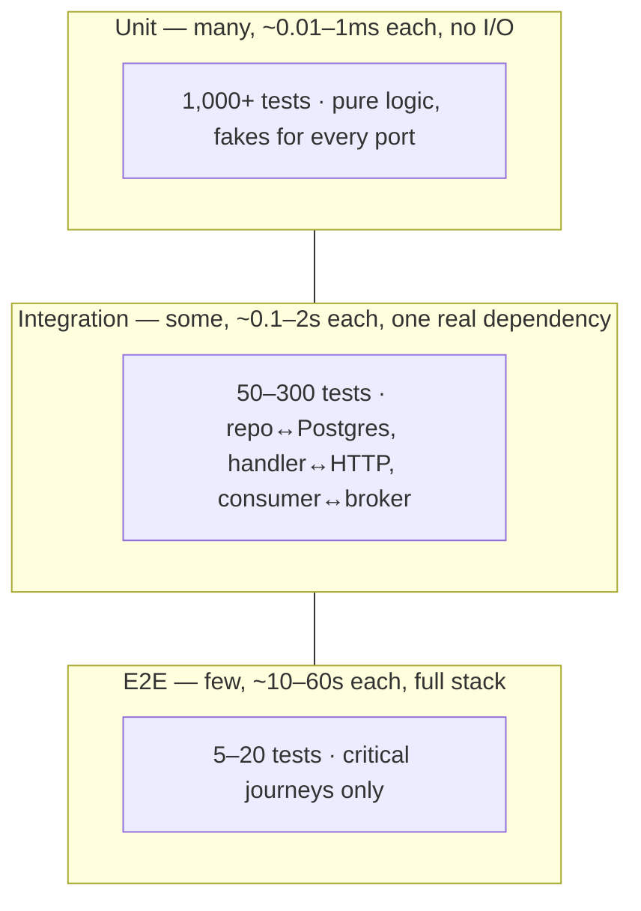
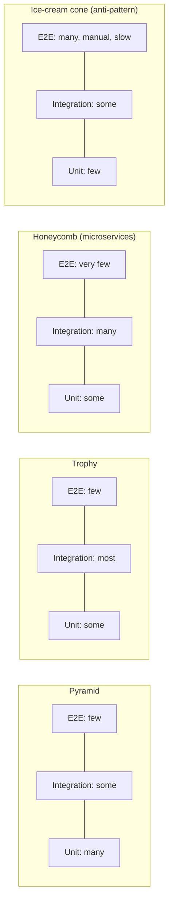
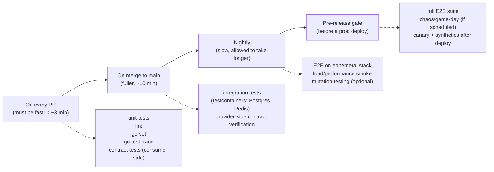

# Testing Strategy and the Test Pyramid

> [!summary] TL;DR
> A test strategy decides, for a given change, which **kind** of test to write, at what **layer**, and **when** it runs in CI — not just "write more tests." The test pyramid is the classic shape: many fast, narrow unit tests at the bottom, fewer broader integration tests in the middle, and a handful of slow, brittle end-to-end tests at the top.

> [!abstract] Core idea
> - Tests cost more and run slower the more of the real system they wire together; pick the cheapest layer that would actually catch the bug.
> - The pyramid is a **shape**, not a flow — each layer runs independently, it doesn't hand off to the next.
> - Flat services with few business rules but many integrations often need an "integration-heavy" shape (the trophy), not a classic pyramid.
> - Coverage percentage tells you what ran, not what was checked; a suite can hit 100% coverage and still miss every real bug.
> - What to test is a risk decision: money, data loss and the critical user journey get tested first and hardest.

## 1. Why it exists

InvoiceOps (the running example used across this folder) has one core rule: an invoice can only be marked paid once, and only after a successful charge. Say a bug lets `Pay` run twice concurrently on the same invoice, double-charging a customer.

If the only test for this is a manual click-through in staging, the bug reaches production, a customer is charged twice, support opens a ticket, and an engineer spends an afternoon tracing it through logs. If instead there's a unit test that calls `Pay` twice concurrently against a fake store and asserts the second call fails, the bug is caught in **under a second**, on the author's machine, before the code is even pushed.

The cost of a bug roughly multiplies by 10 at each stage it survives: free to catch while typing (the compiler, `go vet`), cheap in a unit test (seconds), more expensive in an integration test (the bug now needs a real dependency to reproduce), expensive in a manual QA pass (a human has to notice), and most expensive in production (an incident, a postmortem, customer trust). A test strategy is the plan for catching as much as possible as early as possible, without paying for exhaustive testing at every layer.

## 2. Mental model

Think of a change moving through concentric rings of confidence. The innermost ring — a single function or type — is cheap to test exhaustively: hundreds of cases, pure logic, no I/O, no network. Each ring further out (does this unit talk to Postgres correctly? does the whole request path work end to end?) is slower and more realistic, so you deliberately test less of it directly and rely on the inner rings having already caught most bugs.

The test pyramid names three of those rings and recommends a **count**, not a hard rule: lots of unit tests, a moderate number of integration tests, very few end-to-end tests. The shape is a consequence of cost and flakiness, not dogma — a service that is 90% "call these other six services correctly" and 10% business logic should look more like a **trophy** (integration-heavy) than a pyramid.

## 3. How it works

### The classic pyramid, with real numbers



The arrows in the old InvoiceOps note implied E2E tests "flow down into" integration and unit tests. They don't: **each layer is its own independent suite**, run on its own trigger, testing a different slice of the same code. The only real relationship is proportion and cost.

| Layer | What's real | What's faked | Typical run time (whole suite) | Catches |
|---|---|---|---|---|
| Unit | The function/type under test | Everything it depends on (stubs, fakes) | seconds | Logic bugs: off-by-one, wrong branch, bad validation |
| Integration | One real boundary (DB, cache, broker, another team's API via contract) | Everything further out | tens of seconds to minutes | Wiring bugs: wrong SQL, wrong serialization, a real driver quirk the fake didn't model |
| E2E | The deployed (or near-deployed) stack, through the real API | Nothing, except maybe third-party payment/SMS sandboxes | minutes | Journey bugs: a correct service composed incorrectly, config drift, an environment-only bug |

### Alternatives to the pyramid



- **Testing trophy** (Kent C. Dodds): when most of the value is in correctly gluing pieces together (a thin CRUD service, a BFF), integration tests give the best confidence per test written, so the middle layer is the biggest.
- **Microservice honeycomb** (Spotify engineering): for a small service with a lot of boundary surface relative to logic, integration tests dominate and E2E across services is replaced by contract tests (see [[Contract Testing]]) because spinning up N services for one assertion doesn't scale.
- **Ice-cream cone**: the anti-pattern this all guards against — most confidence resting on slow, manual or flaky E2E tests, because "it's easier to click through the UI than to write a unit test." It's slow to run, slow to diagnose (a failure could be anywhere in the stack), and it punishes refactoring.

### Mapping test sizes to architecture

A hexagonal/clean-style Go service (see `16 Software Architecture`) maps directly onto the pyramid:

- **Domain/use-case layer** (pure Go, no I/O) → unit tests, one fake per port (see [[Test Doubles and Mocking in Go]]).
- **Adapters** (Postgres repo, HTTP client to a payment provider, Kafka consumer) → integration tests against a real dependency.
- **Composition root / whole binary** → E2E, exercised through the real HTTP API.

### Risk-based selection: what to test, and how hard

Not everything deserves equal test investment. Order of priority for InvoiceOps:

1. **Money and data loss**: charging logic, idempotency keys, webhook signature verification. Heaviest testing: unit (every branch), integration (real Postgres constraint checks), and at least one E2E happy-path plus one E2E "provider is down" path.
2. **Security**: auth checks on who can mark an invoice paid. Unit tests for every denied case.
3. **Critical user journey**: "create invoice → pay → receive receipt." One E2E test, run on every merge to main, not on every PR (too slow).
4. **Everything else** (display formatting, non-critical admin screens): unit tests only, light integration, no dedicated E2E.

### CI placement



Fast feedback loops close to the developer (PR stage) catch the most bugs per minute spent waiting; slow, expensive suites move to merge/nightly/pre-release so they gate the risky step (a production deploy) without blocking every commit.

## 4. Worked example

InvoiceOps's `Pay(ctx, invoiceID)` method (defined fully in [[Test Doubles and Mocking in Go]]) loads the invoice, charges the payment provider, and marks the invoice paid. Its test plan, by layer:

- **Unit** (fakes for `InvoiceStore`, `PaymentProvider`, `Notifier`): invoice not found, nothing owing, provider declines, provider errors, notify fails after a successful charge, concurrent `Pay` calls on the same invoice only charge once. All of these run in milliseconds with no network.
- **Integration**: `SQLInvoiceStore.MarkPaid` against a real Postgres (via testcontainers-go) — this is the layer that catches "the `UPDATE` touches 0 rows because the `WHERE` clause has the wrong column," which a unit test using a fake store cannot catch because the fake doesn't have real SQL to get wrong.
- **E2E**: one test that starts the whole InvoiceOps binary against docker-compose Postgres + a stubbed payment sandbox, calls `POST /invoices/{id}/pay` over real HTTP, and asserts the invoice is paid and a receipt was queued. Run nightly, not per-PR.

### Whiteboard version

```text
Bug: double-charge on concurrent Pay() calls.

Pyramid answer — where do you catch it, and how fast?

  unit test (fake store, no I/O)         <1s    <-- write this first
    svc.Pay() x2 concurrently on inv-1
    assert: 1 success, 1 "already paid" error

  integration test (real Postgres)       ~0.3s  <-- confirms the DB-level lock holds too
    two goroutines, same invoice row
    assert: only one UPDATE ... WHERE status='pending' succeeds

  E2E (full stack, nightly)              ~20s   <-- confirms it holds through the real API
    two concurrent POST /invoices/{id}/pay
    assert: one 200, one 409

Rule of thumb: if the unit test alone proves it, stop there.
Add the integration test only because "fake store" and "real Postgres
row lock" are different mechanisms — the fake can't prove the DB
actually serializes the two updates.
```

## 5. Variants and comparison

| Shape | Best for | Trade-off |
|---|---|---|
| Classic pyramid | Logic-heavy services (pricing, risk rules, invoice math) | Under-tests integration points if followed blindly |
| Testing trophy | Thin services that mostly orchestrate calls to others | Integration suite gets slow if every test spins up real infra |
| Honeycomb | Microservice meshes with many small services | Needs contract testing to replace cross-service E2E, or integration confidence drops |
| Ice-cream cone | Nobody should choose this; it's what you get by defaulting to manual QA | Slow, flaky, diagnosis-hostile, blocks refactoring |

## 6. Trade-offs and when not to use

- A pure pyramid shape is the wrong target for a service whose job is almost entirely "call out to three other services and combine the results" — most of its real risk lives at the boundaries, so forcing a pyramid shape there under-tests exactly the part that breaks in production.
- Chasing a pyramid **ratio** (e.g., "70/20/10") as a KPI encourages padding with low-value unit tests to hit a number. The ratio is a description of a healthy suite, not a target to engineer toward.
- 100% unit coverage with zero integration tests gives false confidence: every line ran, but the real SQL, the real HTTP client, the real serialization format were never exercised.

## 7. In production

- **Real systems**: Google's internal size classification (small/medium/large, roughly unit/integration/E2E) gates which machines a test is allowed to run on and how long it may take. Spotify's "honeycomb" post documented moving away from cross-service E2E toward consumer-driven contracts as the service count grew past what E2E could cover. Netflix is a well-known adopter of chaos engineering as the layer above E2E for distributed failure modes (see `Chaos Engineering`).
- **Failure modes → fixes**:
  - *Suite is slow, PRs wait 20 minutes* → audit what layer each test is actually in; many "integration" tests that spin up a container per test case can often share one container per package (see [[Test Data Strategy]] for isolation techniques that make this safe).
  - *Suite is flaky* (see below) → the fix is almost never "add a retry"; it's removing the nondeterminism.
  - *High coverage, bugs still escape* → check whether coverage is measuring assertions or just execution; add mutation testing (e.g., `go-mutesting`) as a periodic (not per-PR) signal.
- **What to monitor**: suite duration trend per layer, flake rate (tests that fail then pass on rerun with no code change), and escaped-defect rate (bugs found in production that a test *could* have caught) as the real measure of whether the strategy is working.

## 8. Deep dive

### Flaky-test smells

A flaky test passes and fails on the same code, nondeterministically. Common causes, in order of frequency:

- **Real time**: `time.Sleep(100 * time.Millisecond)` hoping a goroutine finished. Fix: inject a clock (`time.Now` behind an interface, or `testing/synctest` for simulated time — new in Go 1.25, verify availability before relying on it) and an explicit "wait for condition" helper instead of a fixed sleep.
- **Shared mutable state between tests**: a package-level variable, a shared test database row, tests that assume a particular run order. Fix: `t.Parallel()` deliberately to surface these early, give every test its own data (unique IDs, its own DB transaction).
- **Unseeded randomness**: `rand.Intn` without a fixed seed producing a once-in-500-runs edge case. Fix: seed deterministically in tests; keep a property-based test (see `Fuzz and Property-Based Testing`) specifically to hunt these, run separately from the main suite.
- **External network calls**: a unit test that calls a real third-party API. Fix: replace with [[Test Doubles and Mocking in Go]]; nothing in a unit suite should touch the network.
- **Order-dependent assertions on unordered data**: asserting a specific order out of a map or a concurrent collector. Fix: sort before comparing, or assert set membership.

The fix for a flaky test is never "run it three times and take majority vote" in CI — that hides the bug and trains engineers to ignore red builds.

### Coverage as a signal, not a target

Line coverage says a line executed at least once; it says nothing about whether the test actually asserted the right thing. A test that calls `svc.Pay()` and asserts nothing about the result can produce 100% coverage of `Pay` and catch zero bugs. Use coverage to find **untested branches** ("the `amount <= 0` branch never ran in any test — that's a gap"), not as a merge gate with a hard percentage, and prefer mutation testing or a documented list of required cases (the Must-cover style used in this very note) as the stronger signal.

### "What runs on every PR" — the shared checklist this folder keeps once

- `go vet ./...` and `gofmt -l .` (or equivalent linter) — free, catches a class of bugs before any test runs.
- `go test -race ./...` for the unit layer — the race detector is cheap insurance against exactly the kind of concurrency bug in the worked example above.
- Consumer-side contract verification (fast, no network) — see [[Contract Testing]].
- Anything slower (integration, E2E, load, chaos) moves to merge/nightly/pre-release, per the CI diagram above.

## 9. Interview questions

> [!question]- Design the test strategy for a payments service like InvoiceOps.
> Start from risk: money-moving logic gets the heaviest unit coverage (every branch of charge/refund/idempotency) plus an integration test against a real Postgres for the row-locking behavior, plus one E2E happy path and one E2E "provider down" path. Everything runs at a CI stage matched to its cost: unit+lint on every PR, integration on merge, E2E nightly and pre-release. Add a flake-rate and escaped-defect dashboard to know if the strategy is working.

> [!question]- Why doesn't the test pyramid apply equally well to every service?
> The pyramid assumes most risk lives in business logic that can be tested in isolation. A service that's mostly "call five other services and combine results" has most of its risk at the integration boundary, so an integration-heavy "trophy" shape gives more confidence per test written than forcing a classic pyramid ratio.

> [!question]- Trap: "We have 95% code coverage, so we're well tested." What's wrong with that claim?
> Coverage measures execution, not verification — a line can run under a test that asserts nothing meaningful about it. High coverage with weak assertions, or coverage concentrated in low-risk code while a critical path is undertested, still ships bugs. Use coverage to spot gaps, not as proof of quality; pair it with mutation testing or an explicit must-cover list.

> [!question]- How do you stop a flaky test from undermining trust in CI?
> Diagnose the real cause (time, shared state, randomness, network) rather than retrying or deleting it. Quarantine it only temporarily, with an owner and a ticket, never silently; a suite where red builds are routinely ignored has already lost its value as a gate.

> [!question]- When would you choose the testing trophy over the classic pyramid?
> When the unit under test has little pure logic and mostly orchestrates calls to other systems — a BFF, a thin CRUD gateway. Unit tests there mostly test mocks calling mocks, which gives low confidence per test; integration tests exercising the real boundary (real HTTP client against a stubbed server, real DB) catch far more real bugs per test written.

> [!question]- What should run on every pull request versus nightly, and why?
> PR-stage tests must be fast enough that a developer doesn't context-switch away — unit tests, lint, `go vet`, `-race`, and fast consumer-side contract checks. Integration tests (needing real Postgres/Redis containers) move to merge-time; full E2E, load, and chaos move to nightly or pre-release, because their cost doesn't fit a tight per-PR feedback loop.

> [!question]- How would you test that a webhook handler correctly rejects a replayed or forged payment-provider request?
> Unit test the signature-verification function directly with a valid signature, a tampered body (invalid signature), and a replayed timestamp outside the allowed window — each as a table-driven case. Add one integration test posting a real HTTP request with a captured-but-expired signature to the actual handler to confirm the wiring (header parsing, status code) matches the unit-level logic.

## 10. Cheat sheet

- Pyramid = shape (many unit, some integration, few E2E), not a pipeline — layers run independently.
- Pick the shape that matches where the risk actually lives: pyramid for logic-heavy, trophy for integration-heavy, honeycomb + contracts for microservice meshes.
- Order testing effort by risk: money/data-loss → security → critical journey → everything else.
- CI placement follows cost: unit+lint on every PR, integration on merge, E2E/load/chaos nightly or pre-release.
- Flaky tests come from time, shared state, randomness, or network — fix the cause, don't retry-and-ignore.
- Coverage shows what ran, not what was verified; use it to find gaps, not as a quality score.
- "What hurts users or money" gets tested first and at every layer; low-risk code gets unit tests only.

## Links
- **Before this:** none — this is the entry point for `15 Testing`.
- **Next:** [[Unit, Integration and E2E Tests]]
- **Compare with:** [[Test Doubles and Mocking in Go]] for how each layer fakes its dependencies; `Testing in Go` (04 Go Language) for the `testing` package mechanics this strategy runs on top of.
