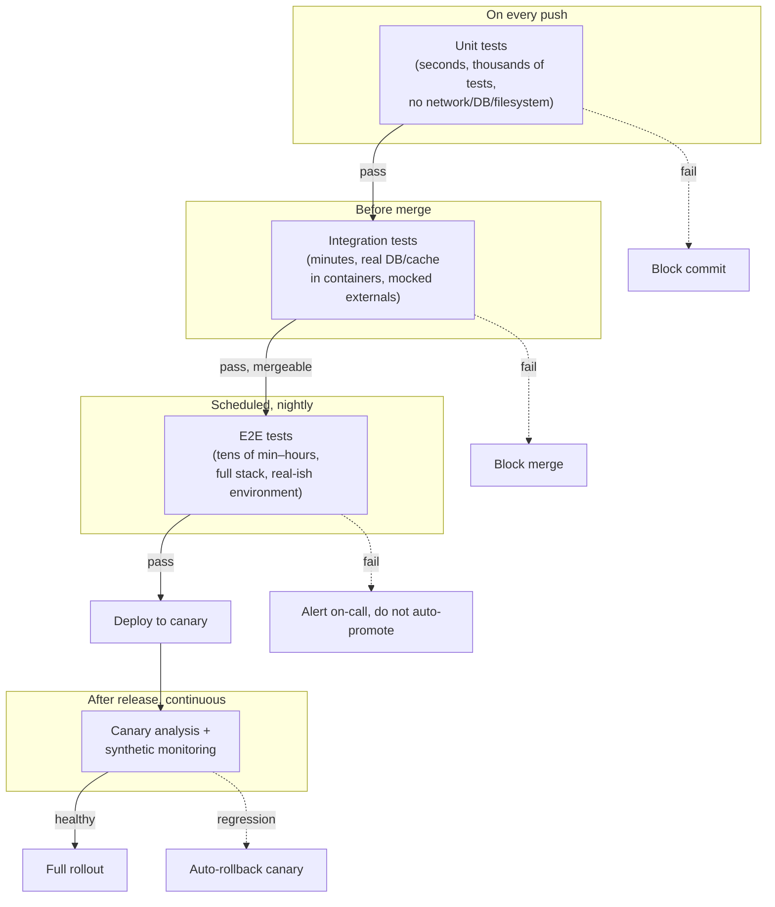
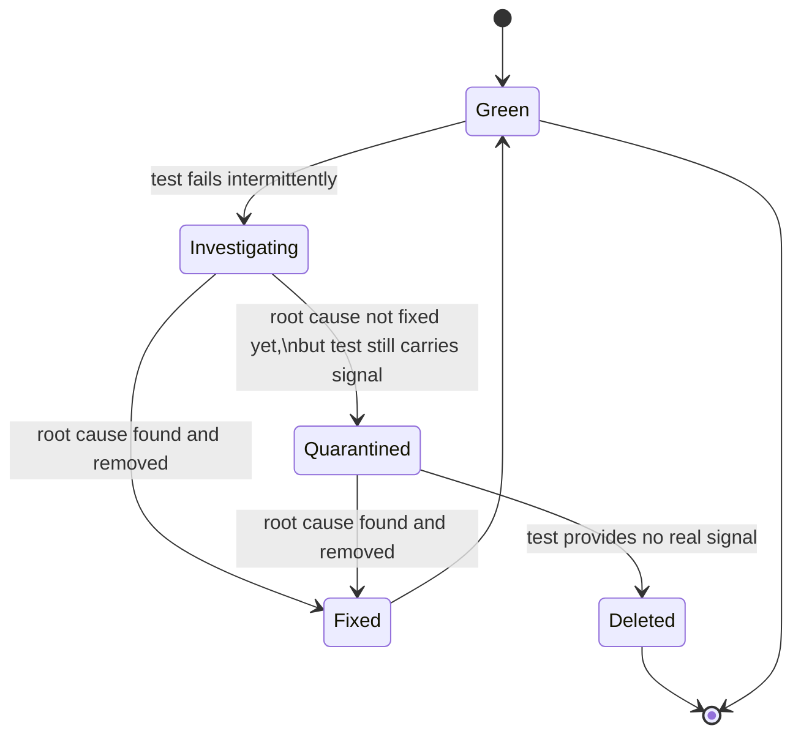
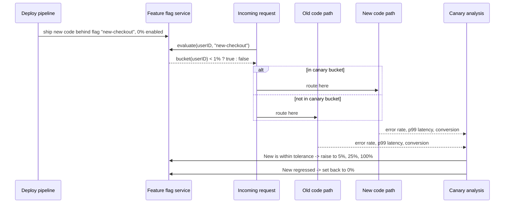

# Testing in CI-CD, Flaky Tests and Testing in Production

> [!summary] TL;DR
> A CI pipeline runs the test pyramid in stages of increasing cost: a fast unit gate on every commit, a slower integration stage before merge, and a nightly end-to-end (E2E) sweep. A **flaky test** passes and fails on the same code with no change of input, usually because it secretly depends on shared state, wall-clock time, randomness, network timing, or test order; the fix is to remove that dependency, not to retry until green. **Testing in production** (canary releases, feature flags, synthetic monitoring) is not a replacement for pre-release tests — it is the stage that catches what no pre-release test environment can reproduce: real traffic, real data, real infrastructure.

> [!abstract] Core idea
> - A CI pipeline is the test pyramid turned into stages: fast and narrow first, slow and broad later, so a bad commit fails in seconds, not hours.
> - Parallelizing and sharding tests cuts wall-clock time, but only if each shard is independent — shared state across shards reintroduces flakiness.
> - A flaky test has a root cause (shared state, time, randomness, network, order) that a retry hides instead of fixing; quarantine isolates it without blocking the team.
> - Feature flags and canary releases let you ship code to production dark, then expose it to 1% of real traffic before 100%, catching failures that staging never sees.
> - Synthetic monitoring runs test-shaped checks against production itself; it is a second, independent lookout, not a substitute for the pre-release test suite.

## 1. Why it exists

A team merges to `main` 40 times a day. Suppose the full test suite — unit, integration, and E2E — takes 45 minutes to run end to end. If every commit waits for the full suite before merging, the team can land at most `(8 hours × 60) / 45 ≈ 10` commits per engineer-day **(an estimate, for illustration)**, and two commits queued back to back delay every commit behind them by 45 minutes.

Splitting the suite into fast and slow stages fixes the queue: a unit-test gate that takes 90 seconds blocks a bad commit almost immediately, while the 45-minute E2E suite runs once overnight against everything merged that day. The team gets fast feedback on the common case (a genuine bug) without paying the full cost on every commit.

But speed creates two new problems this note is about:

1. **Flaky tests.** A test that sometimes fails for no code reason trains engineers to re-run and ignore red builds — which is worse than having no test, because a real regression now also gets re-run and ignored.
2. **The gap pre-release testing can't close.** No staging environment has production's real traffic shape, real data skew, or real third-party latency. Some bugs only show up after release, so "testing" has to include a safe way to test on production itself.

## 2. Mental model

Think of the pipeline as a series of checkpoints that get progressively more expensive to run and more expensive to skip:

- **Unit gate (seconds):** "does this function still do what it says," run on every push.
- **Integration stage (minutes):** "do these components still agree on the contract," run before merge.
- **Nightly E2E (tens of minutes to hours):** "does the whole system still work end to end," run on a schedule because it's too slow for every commit.
- **Production (ongoing):** "is the system still working for real users," watched continuously after release, because this is the only stage with real traffic.

A flaky test is a checkpoint that lies: it sometimes says "stop" or "go" independent of whether the code is actually broken. The fix is always to find why the checkpoint is non-deterministic, never to make the checkpoint louder (more retries) or quieter (skip it).

## 3. How it works

### 3.1 The pyramid mapped onto a pipeline



Each stage trades speed for scope. A unit test that touches a real database has quietly become an integration test wearing a unit test's clothes — this is the single most common reason unit stages get slow and flaky at the same time, because now they share the database with everything else running in parallel.

### 3.2 Parallelizing and sharding

A suite of 10,000 unit tests at 5 ms each takes 50 seconds serially. Split across 8 shards (for example, 8 CI runner containers, each taking roughly `10,000 / 8 = 1,250` tests), wall-clock time drops toward `50 / 8 ≈ 6.25` seconds **(an estimate — real speedup is lower because of fixed per-shard startup cost and uneven test duration)**.

Two sharding strategies:

| Strategy | How it splits | Failure mode if misused |
| --- | --- | --- |
| By file/package | Each shard gets a contiguous set of test files | A few huge files create one slow shard that no longer runs in parallel with the rest |
| By historical duration | A balancer (for example `go test -json` timing, or a CI feature like GitHub Actions' test splitting) assigns shards to equalize *time*, not test count | Needs timing data from previous runs; cold on a new suite |

Sharding only pays off if shards don't share mutable state — a shared test database, a shared temp directory, or a global counter turns "run in parallel" into "run in a race," which is itself a flaky-test root cause (3.3).

In Go, `go test -race` catches data races inside one test binary, and `t.Parallel()` marks subtests as safe to interleave within a package — but neither one protects you from two *processes* (two CI shards) stepping on the same external resource, like a shared Postgres database or a shared S3 bucket.

### 3.3 Flaky test root causes and fixes

| Root cause | What it looks like | Fix |
| --- | --- | --- |
| Shared state | Test B fails only when test A ran first and left a row in the DB / a file on disk / a package-level variable set | Give each test (or each shard) its own schema/namespace/tempdir; reset global state in `t.Cleanup` |
| Time and randomness | `time.Now()` crosses a day boundary mid-test; `math/rand` without a fixed seed occasionally hits an edge case | Inject a `Clock` interface (fake clock in tests); seed `rand` explicitly, or assert a tolerance band instead of an exact value |
| Network | A test makes a real HTTP call to a flaky dependency, or waits on a goroutine with no deadline | Use a fake/stub server (`httptest.Server`) for unit tests; keep real-network calls in integration/E2E only, with explicit timeouts |
| Ordering/isolation | Tests assume alphabetical or declaration order, or one test's side effect is a later test's precondition | Never depend on run order; each test sets up its own fixtures and tears them down |
| Resource limits | Test times out only on a loaded CI runner, not on a laptop | Separate "correctness" assertions from "performance" assertions; give CI timeouts real headroom, and move timing-sensitive checks to [[Load and Performance Testing]] |
| Concurrency bugs in the code under test | The test is correct; the production code has a genuine race, visible only sometimes | This is not a flaky test — `go test -race` existing to catch exactly this is why "just retry it" is the wrong first move |

### 3.4 Quarantine and retry, used correctly

Retrying a failed test before giving up is a tool for keeping CI usable while a flaky test is being fixed — never a substitute for fixing it:



- **Retry-on-failure** (re-run a failed test once or twice before marking the build red) buys time but must be paired with tracking: a test that needed a retry is logged, and a test that needs retries repeatedly is pulled out.
- **Quarantine** moves a known-flaky test out of the blocking gate (so it stops blocking merges) but keeps it running and reporting, usually tagged (`//go:build flaky` or a CI label) and owned by a named engineer with a deadline. A quarantined test must never be silently forgotten — track it the same way you'd track an open bug.
- Retrying blindly in a loop with no quarantine and no owner is the "fix" that makes a suite untrustworthy: engineers learn to re-run red builds instead of reading them, and the day a retry hides a real regression, it ships.

### 3.5 Feature flags and canary releases as testing in production

A **canary release** deploys the new version to a small slice of production traffic (a "canary," after the coal-mine sensor) and compares its error rate, latency, and business metrics against the rest of the fleet before rolling out further. A **feature flag** gates this at the request level instead of the deploy level: the new code is already deployed everywhere, dark, and a flag decides per-request whether to use it.



The bucketing must be **deterministic per identity** (the same user always gets the same bucket) so a user's experience doesn't flicker between old and new on every request, and so a regression can be attributed to "users in the canary" rather than "random requests." The worked example (section 4) builds exactly this bucketer.

### 3.6 Synthetic monitoring vs. real test suites

Synthetic monitoring runs test-shaped scripts (log in, search, add to cart) against the live production system on a schedule, from real or simulated external locations, and alerts when they fail or slow down — independent of any deploy.

| | Real test suite (unit/integration/E2E) | Synthetic monitoring |
| --- | --- | --- |
| Runs against | Code before/at merge, or a staging/E2E environment | Live production, continuously |
| Triggered by | A commit, a merge, a schedule tied to CI | A fixed schedule (for example every 1–5 min), independent of deploys |
| Catches | Logic bugs, contract breaks, regressions in behavior | Infra/config/DNS/certificate/third-party outages, regressions a deploy didn't cause (for example an expired cert) |
| Tells you | "The code is wrong" | "The user-facing system is down or slow, right now" |
| Blocks a release? | Yes, when run as a gate | No — it's an alert, not a gate; it fires after the fact |

Both are needed: a synthetic check would never have caught a canary rollback case from a bad feature flag default, and a pre-release suite would never catch "our TLS certificate expired at 3am."

## 4. Worked example

The bucketer from section 3.5, implemented so it is deterministic and testable without any real traffic:

```go
// Package testci demonstrates two patterns from this note: (1) an injected
// Clock so a test that depends on time never sleeps or flakes, and (2) a
// deterministic canary bucketer used for feature-flag / canary rollout,
// tested without any real traffic.
package testci

import (
	"crypto/sha256"
	"encoding/binary"
	"time"
)

// Clock is the seam that removes "depends on real time" flakiness: production
// code takes a Clock instead of calling time.Now() directly, so a test can
// pass a fixed fake clock and get the same result every run.
type Clock interface {
	Now() time.Time
}

// RealClock implements Clock with the real wall clock.
type RealClock struct{}

func (RealClock) Now() time.Time { return time.Now() }

// FakeClock implements Clock with a value the test controls.
type FakeClock struct{ T time.Time }

func (f FakeClock) Now() time.Time { return f.T }

// IsBusinessHours reports whether the clock's current time falls on a
// weekday between 09:00 and 18:00 in the given location.
func IsBusinessHours(c Clock, loc *time.Location) bool {
	t := c.Now().In(loc)
	if t.Weekday() == time.Saturday || t.Weekday() == time.Sunday {
		return false
	}
	hour := t.Hour()
	return hour >= 9 && hour < 18
}

// CanaryBucket deterministically assigns an identifier to a bucket in
// [0, 100) using a stable hash, so the same userID always lands in the same
// bucket. A canary release checks InCanary(userID, percent) to decide
// whether to route that user to the new version.
func CanaryBucket(id string) int {
	sum := sha256.Sum256([]byte(id))
	n := binary.BigEndian.Uint32(sum[:4])
	return int(n % 100)
}

// InCanary reports whether id falls inside the first percent of buckets.
// percent must be in [0, 100].
func InCanary(id string, percent int) bool {
	if percent <= 0 {
		return false
	}
	if percent >= 100 {
		return true
	}
	return CanaryBucket(id) < percent
}
```

The tests show three of the flaky-test fixes from section 3.3 in the same file — a fake clock in place of `time.Now()`, an exact-stability assertion for the hash, and a tolerance band instead of an exact count for the random-looking split:

```go
package testci

import (
	"testing"
	"time"
)

func TestIsBusinessHours(t *testing.T) {
	loc := time.UTC
	cases := []struct {
		name string
		at   time.Time
		want bool
	}{
		{"weekday morning", time.Date(2026, 11, 4, 9, 30, 0, 0, loc), true}, // Wed
		{"weekday before open", time.Date(2026, 11, 4, 8, 59, 0, 0, loc), false},
		{"weekday after close", time.Date(2026, 11, 4, 18, 0, 0, 0, loc), false},
		{"saturday", time.Date(2026, 11, 7, 12, 0, 0, 0, loc), false},
	}
	for _, c := range cases {
		c := c
		t.Run(c.name, func(t *testing.T) {
			t.Parallel() // each subtest uses its own FakeClock value: no shared state, safe to parallelize
			clock := FakeClock{T: c.at}
			got := IsBusinessHours(clock, loc)
			if got != c.want {
				t.Fatalf("IsBusinessHours(%v) = %v, want %v", c.at, got, c.want)
			}
		})
	}
}

func TestCanaryBucketIsStable(t *testing.T) {
	t.Parallel()
	ids := []string{"user-1", "user-2", "user-3"}
	for _, id := range ids {
		first := CanaryBucket(id)
		for i := 0; i < 100; i++ {
			if got := CanaryBucket(id); got != first {
				t.Fatalf("CanaryBucket(%q) not stable: got %d, want %d", id, got, first)
			}
		}
	}
}

func TestInCanaryRespectsPercent(t *testing.T) {
	t.Parallel()
	const n = 10000
	count := 0
	for i := 0; i < n; i++ {
		id := randomID(i)
		if InCanary(id, 20) {
			count++
		}
	}
	// A hash-bucketed rollout is an approximation, not an exact count: assert
	// a tolerance band instead of an exact number — itself a fix for the
	// "near-random split asserted as exact" flaky-test root cause.
	got := float64(count) / float64(n) * 100
	if got < 17 || got > 23 {
		t.Fatalf("InCanary(_, 20) selected %.1f%% of ids, want ~20%% (+/-3)", got)
	}
}

func TestInCanaryBoundaries(t *testing.T) {
	t.Parallel()
	if InCanary("any-id", 0) {
		t.Fatal("0% canary must never select anyone")
	}
	if !InCanary("any-id", 100) {
		t.Fatal("100% canary must always select")
	}
}

func randomID(i int) string {
	// Deterministic per-call id, not time.Now() or an unseeded math/rand:
	// keeps the test reproducible across runs and CI machines.
	return "user-" + time.Duration(i).String()
}
```

**Measured in this environment:** `go vet ./...` reports no issues; `go test -race ./...` passes all 8 test cases (`go1.24.4 darwin/arm64`).

## 5. Variants and comparison

| Approach | How it works | Use when | Cost |
| --- | --- | --- | --- |
| Test sharding by file | CI splits test files across N runners | Suite is large but tests are evenly sized | Imbalanced shards waste the fastest runner's idle time |
| Test sharding by timing | CI balances shards by historical duration | You have timing history and want even wall-clock time per shard | Needs a timing data source; useless on day one |
| Retry-on-failure (no quarantine) | Failed test reruns automatically, build only reds after N failures | Never, as a permanent policy | Hides real regressions; erodes trust in red builds |
| Quarantine | Flaky test tagged out of the gate, still runs and reports, owned with a deadline | A flaky test is identified and can't be fixed immediately | Needs process discipline or it becomes a graveyard |
| Canary release (deploy-level) | New binary version serves a % of traffic; old version serves the rest | Infra-level changes (new service version, new dependency) | Needs traffic splitting at the load balancer/service-mesh level |
| Feature flag (request-level) | One binary; a flag decides per-request which code path runs | Product-level changes, instant kill switch without a redeploy | Flag debt accumulates if flags aren't removed after full rollout |
| Synthetic monitoring | Scripted checks run against live production on a schedule | Catching infra/config/third-party failures a deploy didn't cause | Blind to logic bugs the script doesn't specifically check |

## 6. Trade-offs and when not to use

- **Sharding** costs CI minutes (N runners billed in parallel instead of 1 running longer) to save wall-clock time — not worth it for a suite that already runs in under a minute.
- **Quarantine** must have an exit: a quarantined test with no owner and no deadline is effectively a deleted test that still looks like coverage on a dashboard. Audit the quarantine list on a schedule.
- **Canary releases** need real traffic-splitting infrastructure (load balancer or service mesh support, consistent routing) — see [[Consistent Hashing]] for the general mechanism of routing the same identity to the same bucket, re-used here for canary assignment and for [[Load Balancing]].
- **Feature flags** add a runtime branch and a config dependency to every flagged code path; flags left in "launched" state forever are both a performance cost (an extra check) and a readability cost (dead branches). Remove a flag once its rollout finishes.
- **Synthetic monitoring** only tests what you scripted — it will not notice a new, unscripted user flow silently breaking. It complements alerting from real traffic metrics; it does not replace it.
- None of this replaces the pre-release stages: testing in production catches what pre-release tests structurally cannot (real traffic shape, real third-party behavior), but a canary still needs genuine production users behind it to mean anything, which is why it ships last, after the unit, integration and E2E gates — not instead of them.

## 7. In production

- **Real systems:** Google's test infrastructure auto-detects and reruns flaky tests while flagging them for investigation, rather than letting a single flaky run block a release train (Google Testing Blog, 2016). Automated canary analysis — rolling back a release automatically when it regresses on key metrics, without a human in the loop — is a widely used pattern at companies operating large-scale services, popularized in industry engineering blogs alongside Martin Fowler's canary-release write-up cited above.
- **Failure modes → fixes:**
  - *Flaky quarantine becomes permanent* → put an expiry/owner on every quarantined test; review the list in a weekly or sprint cadence.
  - *Canary bucket flips a user between old/new on every request* → use a deterministic hash of a stable identity (user ID, not session ID), as in section 4, never a fresh random draw per request.
  - *Feature flag default differs between environments* → treat flag defaults as code, reviewed in the same PR as the behavior they gate, not as a separate ops-only config.
  - *Synthetic check fails and nobody owns it* → route synthetic-check alerts to the same on-call rotation as production alerts, not to a separate, less-watched channel.
- **What to monitor:**
  - Flaky-test rate (how often a test needed a retry to pass) as a CI health metric, not just pass/fail of the final run.
  - Canary error rate, p99 latency, and a business metric (for example conversion) compared against the control group, not against a historical baseline alone.
  - Synthetic check latency and success rate, alerted independently of deploy events.
  - Time-to-fix for quarantined tests, to catch a quarantine list that only grows.

## 8. Deep dive

**Why retries alone make things worse.** A retry-on-failure policy without quarantine optimizes the metric "is the build green" while silently degrading the metric that actually matters, "does a red build mean something is broken." Once engineers learn that red sometimes means nothing, the expected cost of investigating a red build drops, and so does the probability anyone investigates the one time it's a real regression. This is the core argument for quarantine-with-ownership over blind retries: it keeps the signal (a named, tracked flaky test) without destroying trust in the gate.

**Canary analysis as a statistical test, not a vibe check.** A naive canary compares one metric's absolute value between canary and control, but with a small canary slice (1% of traffic), noise alone can produce a difference that looks like a regression. Robust canary analysis treats this as a hypothesis test: it compares distributions (not single numbers) between canary and control cohorts that are matched on confounders (same time window, similar traffic mix), and only flags a regression when the difference exceeds a threshold accounting for the sample size — otherwise a canary at 1% traffic will "detect" false regressions constantly on pure sampling noise.

**Order-dependent flakiness and Go specifically.** Go's `go test` runs tests within a package sequentially by default in the order they appear in source, except for tests calling `t.Parallel()`: each such test pauses at that call, and only once every non-parallel test in the package has finished running do all the paused parallel tests resume and run concurrently with each other. A test suite that happens to pass because test A's side effect sets up test B's precondition will break the moment someone reorders the file, adds `t.Parallel()` to test A, or a future Go release changes default ordering — `go test -shuffle=on` (available since Go 1.17) exists specifically to surface this class of bug early, by randomizing test order on each run and printing the seed used so a failure can be reproduced.

**The feature-flag "debt" problem.** Every flag is a second code path that needs to keep compiling, keep passing tests, and keep being reasoned about — a codebase with hundreds of stale 100%-rolled-out flags has effectively hundreds of untested `if` branches, because nobody writes new tests for a flag they assume is permanent. Treating flag removal as a required follow-up task (not an optional cleanup) is what keeps canary/flag infrastructure from becoming its own source of bugs.

**Synthetic monitoring's blind spot, precisely.** A synthetic check is a fixed script; it validates exactly the paths someone thought to write down, at the frequency it's scheduled, usually from a small number of vantage points. It will not notice a new feature silently failing for 2% of users in one region unless someone adds a check for that specific feature and region — which is why synthetic monitoring is paired with real-traffic observability (error rates and latency percentiles from production itself), not used alone.

## 9. Interview questions

> [!question]- What's the difference between a test being "flaky" and a test that fails because of a genuine intermittent bug (for example, a real race condition in the code under test)?
> A flaky test fails and passes on the *same* code with no code change, because the test itself is non-deterministic (time, randomness, shared state, network). A genuine intermittent bug is the production code that's actually non-deterministic — for example a real data race — and the test correctly surfaces it inconsistently. The fix differs: a flaky test gets rewritten to remove its own non-determinism; a genuine race gets fixed in the code under test (and `go test -race` is specifically there to catch this second case, not the first).

> [!question]- Why shouldn't a team just add automatic retries to every CI job and call it done?
> Because it hides regressions instead of fixing causes: once a build can go green after silently failing and retrying, "red means broken" stops being reliably true, and the one time a retry papers over a real regression, it ships to production unnoticed. Retries are acceptable as a stop-gap only when paired with tracking (which tests needed a retry) and a quarantine process with an owner and deadline for the root cause.

> [!question]- A test passes locally every time but fails about 1 in 20 runs in CI. What's your first move?
> Reproduce the failure mode before guessing at a fix: check whether CI runs tests in parallel/sharded in a way local runs don't, whether the test touches a shared resource (DB, filesystem, global variable), and whether it depends on timing (sleeps, timeouts) that's tighter under CI's load. `go test -race -count=100` locally, and `go test -shuffle=on`, often reproduce the exact class of bug (data race, order dependency) without needing CI access at all.

> [!question]- What is the actual difference between a canary release and a feature flag — aren't they both "test in production"?
> A canary release splits traffic at the *deploy/infrastructure* level — two running versions of a service, traffic-split by the load balancer or mesh. A feature flag splits behavior at the *request* level inside one running binary — one deployed version, with an if-branch gated by a flag service. Canary needs new infrastructure support per deploy; feature flags need an in-process flag check but can toggle instantly without any redeploy, including an instant kill switch.

> [!question]- Trap: "If we have good E2E test coverage, we don't need testing in production." What's wrong with this?
> E2E tests, however thorough, run against an approximation of production — synthetic data, a smaller or mocked set of dependencies, controlled traffic. They structurally cannot reproduce production's real traffic shape, real data skew, real third-party latency variance, or real infrastructure failures (an expired certificate, a misconfigured DNS record, a dependency's own outage). Testing in production (canary analysis, synthetic monitoring) exists precisely to catch the class of failure that only shows up with real traffic against real infrastructure — it's a different net, not a worse version of the same net.

> [!question]- How would you decide what percentage of traffic a canary should start at, and how fast to ramp it?
> Start small enough that a regression's blast radius is acceptable if it's wrong (commonly 1–5%), but large enough that your canary-analysis metrics aren't pure noise — a sample size too small can't statistically distinguish a real regression from random variance. Ramp in steps (for example 1% → 5% → 25% → 100%) with an automated health check gating each step, and keep each step live long enough to catch effects with a known delay (for example a metric that only regresses after cache warm-up, or after a batch job runs).

> [!question]- Why does it matter that canary bucketing is deterministic per user ID rather than randomized per request?
> If bucketing were randomized per request, the same user could hit the new code once and the old code the next request, making bugs show up as random-seeming inconsistency instead of a clean "canary users see X" signal — this breaks both the user's experience (flickering between versions) and the team's ability to attribute a regression to the canary cohort specifically. Hashing a stable identity (user ID) deterministically, as in this note's worked example, keeps one user on one path for the rollout's duration.

> [!question]- What's the single biggest risk of letting quarantined tests accumulate?
> They silently stop providing coverage while still appearing in test-count dashboards as "passing" or at least "present," so a team's confidence in its test suite diverges from the suite's actual ability to catch regressions — and because a quarantined test by definition isn't gating anything, a real regression in that exact area can ship with nobody noticing until a quarantine audit (if one ever happens).

## 10. Cheat sheet

- CI stages map to the pyramid: unit (seconds, every commit) → integration (minutes, before merge) → E2E (scheduled, full stack) → production (continuous).
- Sharding cuts wall-clock time only if shards share no mutable state; shared DBs/files across shards reintroduce flakiness.
- Flaky-test root causes: shared state, time, randomness, network, ordering, resource limits, or a genuine race in the code under test.
- Fix flakiness at the root (fake clock, isolated fixtures, stub servers, explicit timeouts, `go test -race`/`-shuffle=on`); retries and quarantine are stop-gaps with an owner and a deadline, never a permanent policy.
- Canary release = infra-level traffic split between two deployed versions; feature flag = request-level branch inside one binary; both need deterministic, identity-based bucketing to avoid flicker and to make analysis meaningful.
- Synthetic monitoring runs test-shaped checks against live production on a schedule — it catches infra/config/third-party failures pre-release tests can't, but only for the exact paths it scripts.
- None of production testing replaces pre-release gates; it catches a different, real-traffic-only class of failure, and it ships last, after the gates, not instead of them.

## Links
- **Before this:** [[Testing Strategy and the Test Pyramid]], [[Unit, Integration and E2E Tests]]
- **Next:** [[Chaos Engineering]], [[Load and Performance Testing]]
- **Compare with:** [[Testing in Go]] (the `testing` package mechanics this note's pipeline runs), [[Benchmarks, Profiling and Tracing]] (profiling a single run vs. this note's ongoing production monitoring), [[Testing LLD Code]] (LLD-round test structure — a different, interview-scoped scenario from this note's CI/production scope)
