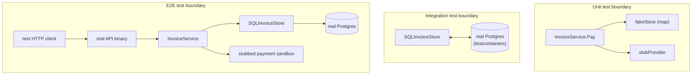
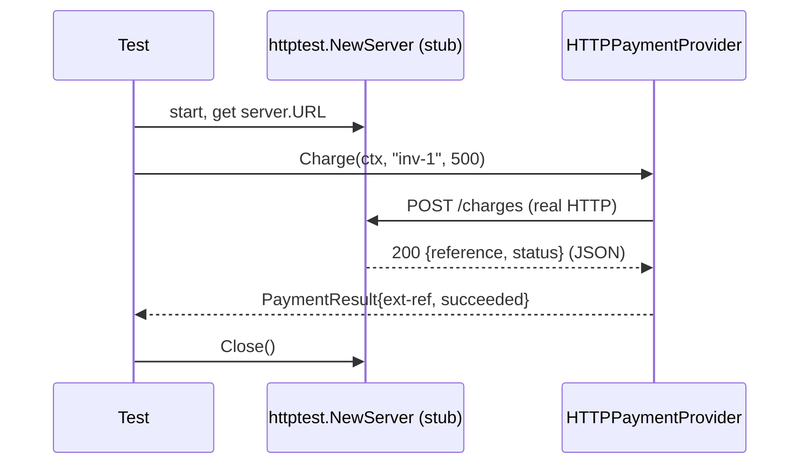

# Unit, Integration and E2E Tests

> [!summary] TL;DR
> Unit, integration and E2E tests differ in **what's real**: a unit test fakes everything the code under test depends on, an integration test makes one real dependency real (a database, a broker, an HTTP client), and an E2E test runs the whole deployed system through its real entry point. Each catches a different class of bug.

> [!abstract] Core idea
> - Unit tests catch logic bugs (wrong branch, off-by-one, bad validation) — fast, no I/O.
> - Integration tests catch wiring bugs (wrong SQL, wrong serialization, a real driver's quirks) — one real boundary, seconds.
> - E2E tests catch journey bugs (services composed incorrectly, config drift) — the full stack, slowest.
> - In Go, table-driven tests plus `t.Run`/`t.Parallel`/`t.Helper`/`t.Cleanup` are the backbone of all three levels.
> - Never mock a dependency inside its own repository test — an integration test exists specifically to use the real thing.

## 1. Why it exists

`SQLInvoiceStore.MarkPaid` (from [[Test Doubles and Mocking in Go]]) builds this query:

```sql
UPDATE invoices SET status = 'paid', payment_reference = $1 WHERE id = $2
```

A unit test that replaces `InvoiceStore` with a fake never runs this SQL — the fake is a Go map. If someone changes the column name in the table but forgets to update this query, every unit test still passes, because the fake doesn't know the real schema exists. Only a test that runs this exact query against a real (or real-enough) Postgres catches it. That's the gap integration tests close. E2E tests close a further gap: that the HTTP handler, the service, and the database are wired together correctly as one deployed binary, which no amount of testing any one piece in isolation proves.

## 2. Mental model

Three tests, same bug surface, different question each asks:

- Unit: "if I feed this function every input I can think of, does it do the right thing?" (assumes its dependencies behave correctly — they're faked)
- Integration: "does this component actually work with the real thing it depends on?" (assumes the rest of the system is fine — only this one boundary is real)
- E2E: "does the whole system, deployed, do the right thing from a client's point of view?" (nothing is faked, but you can't practically test every input)

## 3. How it works





### Unit: table-driven tests and the standard helpers

Go's idiom is one test function per behaviour, driving a table of cases through `t.Run` subtests:

```go
func TestInvoiceService_Pay(t *testing.T) {
    t.Parallel()
    cases := []struct{
        name      string
        amounts   map[string]int64
        wantErr   string
    }{
        {"unknown invoice", map[string]int64{}, "load invoice"},
        {"nothing owing", map[string]int64{"inv-2": 0}, "nothing owing"},
    }
    for _, tc := range cases {
        tc := tc
        t.Run(tc.name, func(t *testing.T) {
            t.Parallel()
            // ... exercise and assert
        })
    }
}
```

- `t.Run(name, fn)` gives each case its own pass/fail line and its own failure isolation — one case failing doesn't stop the others from reporting.
- `t.Parallel()` inside both the outer test and each subtest runs independent cases concurrently, which also *surfaces* hidden shared-state bugs (a flaky-test smell) instead of hiding them.
- `t.Helper()` inside a shared assertion function makes failure line numbers point at the caller, not the helper.
- `t.Cleanup(fn)` registers teardown that runs even if the test fails, in LIFO order — the modern replacement for a manual `defer` block when the cleanup is set up inside a helper the test itself didn't write.
- **Golden files**: for tests whose expected output is large (a rendered template, a JSON payload), write the expected output to a `testdata/*.golden` file and compare against it, regenerating with a `-update` flag rather than hand-editing a giant string literal in the test.

The full table-driven suite for `InvoiceService.Pay`, exercising five cases through `fakeStore`/`stubProvider`/`dummyNotifier`, is built out in [[Test Doubles and Mocking in Go]] — this note focuses on the layer boundary, that one on the doubles themselves.

### Integration: `net/http/httptest` for the HTTP boundary

`httptest` gives two different things real, for two different directions:

- **Testing a handler you own**: `httptest.NewRecorder()` plus `httptest.NewRequest` drives `http.Handler.ServeHTTP` in-process — no socket, no goroutine, just a fake `http.ResponseWriter` you inspect afterwards. This is usually still *called* a unit test of the handler, since nothing crosses a process boundary.
- **Testing a client you own, against a server you don't control**: `httptest.NewServer(handler)` starts a real listener on `localhost` and gives you a real `*url.URL` to point your HTTP client at. This is an integration test — the client's request-building and response-parsing code runs over an actual socket, catching bugs a hand-constructed response value never would (wrong header casing, a response body read twice, a timeout that only triggers over real I/O).

```go
server := httptest.NewServer(http.HandlerFunc(func(w http.ResponseWriter, r *http.Request) {
    json.NewEncoder(w).Encode(PaymentResult{Reference: "ext-ref", Status: "succeeded"})
}))
defer server.Close()

provider := HTTPPaymentProvider{BaseURL: server.URL, Client: server.Client()}
result, err := provider.Charge(ctx, "inv-1", 500)
```

### Integration: a real Postgres via testcontainers-go, vs sqlmock

Two different tools answer two different questions about `SQLInvoiceStore`:

- **sqlmock** (`github.com/DATA-DOG/go-sqlmock`) replaces the `*sql.DB` with a driver that matches queries against a regex and returns canned rows. It never parses or plans SQL, so it proves "my code sends roughly this query and handles these rows back correctly," but a column that doesn't exist, or a constraint violation, still passes.
- **testcontainers-go** starts an actual Postgres in a Docker container for the test, so the real query runs against the real schema: a renamed column, a `NOT NULL` violation, or a `WHERE` clause matching zero rows are all caught for real. This is slower (hundreds of milliseconds to seconds to start a container, usually shared per test *package* rather than per test case) but it's the only one of the two that's a true integration test.

```go
// testcontainers-go sketch (illustrative; requires Docker, not runnable in this vault's scratch module):
ctx := context.Background()
container, _ := postgres.Run(ctx, "postgres:17-alpine",
    postgres.WithDatabase("invoiceops_test"),
    postgres.WithInitScripts("testdata/schema.sql"),
)
defer container.Terminate(ctx)
dsn, _ := container.ConnectionString(ctx, "sslmode=disable")
db, _ := sql.Open("pgx", dsn)
store := &SQLInvoiceStore{DB: db}
// ... run the same assertions as the sqlmock test, against the real thing
```

Use sqlmock for a fast smoke test of simple, stable queries; use testcontainers-go for anything with a constraint, a transaction, or a query complex enough that "the SQL is syntactically plausible" isn't the same as "the SQL is correct" — see [[Test Doubles and Mocking in Go]] for the full tested sqlmock example and [[Test Data Strategy]] for isolating test data inside a shared container.

**Separating suites with build tags or `-short`**: integration tests that need Docker shouldn't run by default on a laptop with no Docker daemon. Two common patterns:
- A build tag: `//go:build integration` at the top of the file, run with `go test -tags=integration ./...`.
- `testing.Short()`: skip inside the test with `if testing.Short() { t.Skip("integration test") }`, and run the full suite with plain `go test ./...` but the fast subset with `go test -short ./...`.

### E2E: the full stack, sparingly

An E2E test for InvoiceOps starts the real API binary against a docker-compose stack (Postgres + a stubbed payment sandbox), sends a real `POST /invoices/{id}/pay` over HTTP, and asserts the invoice ends up paid and a receipt event was published. It is the only layer that proves the handler, service, repository, and database are wired together correctly as deployed — and the slowest and most failure-ambiguous layer (a failure could be the business logic, the wiring, or the environment), so it's reserved for the handful of journeys that matter most (see [[Testing Strategy and the Test Pyramid]] for the risk-based selection).

### `go test -race` and `testing/synctest`

`go test -race ./...` instruments every test with the race detector, catching concurrent unsynchronized access to shared memory — exactly the class of bug in "two goroutines call `Pay` on the same invoice concurrently." It should run at the unit layer, on every PR, because it's cheap and catches bugs that are otherwise nearly impossible to reproduce reliably.

`testing/synctest` (added in Go 1.24 as `GOEXPERIMENT=synctest`, stabilizing later — **verify the exact stabilization version against the Go release notes before depending on it in a real codebase**) runs a goroutine tree inside a fake, deterministic clock, so code that uses real timers (`time.After`, `context.WithTimeout`) can be tested without the test itself waiting in real time or racing on timing. It replaces the older pattern of injecting a fake clock interface everywhere purely for testability.

### Coverage profiles

`go test -coverprofile=cover.out ./...` followed by `go tool cover -html=cover.out` shows line-by-line coverage. As covered in [[Testing Strategy and the Test Pyramid]], treat this as a gap-finder ("this error branch never ran"), not a merge gate with a hard percentage — 100% coverage is not the goal.

## 4. Worked example

### Whiteboard version

```text
Bug class -> which layer catches it, concretely:

  "amount <= 0 should be rejected"
    -> UNIT. Pure logic, no I/O needed. fakeStore returns amount=0,
       assert err contains "nothing owing".

  "the UPDATE touches the wrong column"
    -> INTEGRATION. Needs a real schema to be wrong against.
       testcontainers Postgres + real SQLInvoiceStore.MarkPaid.

  "the HTTP handler returns 404 instead of 422 for a business error"
    -> can be either. httptest.NewRecorder() against the real handler
       is fast enough to call "unit" even though it drives real
       net/http routing (ServeMux path params, status codes).

  "after deploy, the payment webhook's signature check rejects
   all real traffic because env var PAYMENT_WEBHOOK_SECRET
   wasn't set in production"
    -> E2E / production-adjacent. No amount of unit or integration
       testing catches a missing production config value; this is
       what synthetics and canary deploys (shift-right) are for.
```

### Suite time budgets

A practical target for InvoiceOps: unit suite under 1 minute, integration suite under 10 minutes, E2E under 10–20 minutes but run far less often (nightly, pre-release) rather than per-PR. If the unit suite creeps past a minute, the fix is almost always "something that should be a unit test accidentally does real I/O" — move it down a layer or replace the real dependency with a double.

## 5. Variants and comparison

| Level | What's real | Go tools | Typical per-test time | Catches |
|---|---|---|---|---|
| Unit | Nothing but the code under test | `testing`, table-driven + `t.Run`, fakes/stubs | 0.01–1 ms | Logic bugs |
| Integration (HTTP) | A real socket, your own client or handler | `net/http/httptest` | 1–50 ms | Request/response wiring bugs |
| Integration (DB) | A real Postgres | testcontainers-go, or sqlmock for a fast partial check | 50 ms – 2 s | Schema/SQL/constraint bugs |
| E2E | The whole deployed stack | docker-compose + a real HTTP client | 1–60 s | Composition and config bugs |

## 6. Trade-offs and when not to use

- Mocking at a layer the test isn't about adds noise without adding confidence: a repository test that mocks the SQL driver proves nothing about the SQL — mock only at your own ports (`PaymentProvider`, `Notifier`), never inside the repository test whose entire job is to exercise the real database.
- sqlmock is faster than testcontainers-go but weaker; using it everywhere and never running the real-Postgres suite leaves schema and constraint bugs uncaught until production.
- E2E tests are the most realistic and the most expensive per assertion; writing E2E tests for cases already covered by a unit test duplicates cost for no extra confidence.

## 7. In production

- **Real systems**: testcontainers is widely used at companies running Go microservices against Postgres/Kafka/Redis in CI (the project's own adopter list includes many fintech-adjacent companies, consistent with InvoiceOps's domain); `httptest.NewServer` is the standard way the Go standard library itself tests `net/http` client code.
- **Failure modes → fixes**:
  - *Integration suite flakes because containers from different test packages collide on a port or share state* → one container per package (`TestMain`), not per test case; namespace data per test (see [[Test Data Strategy]]).
  - *E2E suite is the only thing that catches a class of bug repeatedly* → that's a signal the bug belongs at a lower layer; add an integration or unit test for it so the fast suite catches the next regression.
- **What to monitor**: per-layer suite duration over time (catches a slow test sneaking into the wrong layer), and which layer actually caught each production incident retroactively (if integration never catches anything, either it's redundant or it's testing the wrong things).

## 8. Deep dive

### Parallel-safe DB tests

Running integration tests with `t.Parallel()` against a shared Postgres container needs each test to own disjoint data — the two usual techniques (detailed further in [[Test Data Strategy]]) are: wrap each test in a transaction and roll it back in `t.Cleanup`, or give each test a unique ID namespace (`invoiceID = "inv-" + t.Name()`) so concurrent tests can't collide on the same row even without a transaction boundary.

### Mock only at your own ports

The temptation in an integration test is to mock the thing you're supposedly testing integration *with*. A test named "integration test for SQLInvoiceStore" that mocks `database/sql` isn't an integration test anymore — it's a unit test wearing an integration test's name, and it reintroduces the exact gap (wrong SQL passes silently) integration testing exists to close. The rule: in a test at layer N, only fake the things layer N doesn't own — InvoiceService (layer "unit") fakes its ports; SQLInvoiceStore's integration test fakes nothing except maybe the payment provider, which isn't Postgres's job to verify.

## 9. Interview questions

> [!question]- How would you test the payment webhook handler end to end, and which parts would you not re-test at the E2E layer?
> Unit-test signature verification and payload parsing exhaustively (valid, tampered, replayed, malformed cases) since those are pure logic. Integration-test the handler with `httptest` to confirm status codes and that a valid webhook actually calls the service. Reserve one E2E test for "a real-shaped webhook payload reaches the deployed API and the invoice ends up paid" — don't re-test every signature edge case there, since the unit layer already owns that.

> [!question]- What's the difference between `httptest.NewRecorder()` and `httptest.NewServer()`, and when do you use each?
> `NewRecorder` drives your own `http.Handler` in-process with a fake `ResponseWriter` — no real socket — good for testing a handler you own. `NewServer` starts a real listener and gives you a URL — good for testing a client you own, since the client's real request-building and response-parsing code needs an actual socket to exercise properly.

> [!question]- Trap: "Our repository has 100% unit test coverage, so the database layer is well tested." What's missing?
> If those "unit tests" replace the database with a fake or mock, no real SQL ever ran — a wrong column name, a missing index assumption, or a constraint violation would still pass. That coverage only proves the Go code around the query is logically consistent with itself; an integration test against a real Postgres (testcontainers-go) is the only thing that proves the SQL itself is correct.

> [!question]- Why separate integration tests with a build tag or `-short`, instead of just always running everything with `go test ./...`?
> Integration tests often need Docker or other local infrastructure that isn't available everywhere (a minimal CI runner, a laptop without Docker running) and they're slower; gating them behind a tag or `testing.Short()` lets `go test ./...` stay fast and runnable everywhere, while CI explicitly opts into the fuller `-tags=integration` run at the merge stage.

> [!question]- What does `go test -race` actually catch that a normal test run doesn't, and why run it at the unit layer specifically?
> It instruments memory accesses and detects unsynchronized concurrent read/write (or write/write) to the same location, even if the test happens not to produce a visibly wrong result that run. It belongs at the unit layer because concurrency bugs in business logic (like two goroutines racing to pay the same invoice) are cheapest to reproduce with fakes and no real I/O latency masking or exposing the race non-deterministically.

## 10. Cheat sheet

- Unit = fake everything, catches logic bugs, milliseconds, every PR.
- Integration = one real boundary (DB, HTTP), catches wiring bugs, seconds, merge-time.
- E2E = the whole deployed stack, catches composition/config bugs, slowest, nightly/pre-release.
- `httptest.NewRecorder` tests a handler you own in-process; `httptest.NewServer` tests a client you own over a real socket.
- sqlmock is fast but can't catch a wrong schema; testcontainers-go runs real SQL against a real Postgres.
- Table-driven tests + `t.Run`/`t.Parallel`/`t.Helper`/`t.Cleanup` are the Go-idiomatic backbone at every level.
- Never mock the thing an integration test exists to verify — mock only at your own ports.
- `go test -race` belongs in the unit-layer PR gate; it's cheap and catches a whole class of bug other layers can't reliably reproduce.

## Links
- **Before this:** [[Testing Strategy and the Test Pyramid]]
- **Next:** [[Test Doubles and Mocking in Go]]
- **Compare with:** `Testing in Go` (04 Go Language) for `testing` package mechanics this note builds on; `Testing LLD Code in Go` (17 LLD) for how these same three levels show up inside one LLD-round solution.
