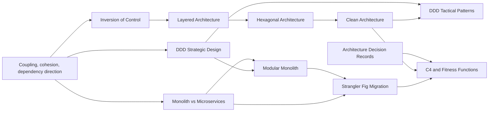

# 16 Software Architecture MOC

> [!summary] What this folder covers
> After this folder you can explain how to draw and defend boundaries in a backend system: coupling and dependency direction, layered, hexagonal and clean architecture, monolith versus microservices, Domain-Driven Design, and how to record, document and migrate architecture over time.

## Before and after

- **Before this:** [[06 Backend Engineering in Go MOC]]
- **After this:** [[11 System Design MOC]]

## Learning path

1. [[Architecture Fundamentals - Coupling, Cohesion and Dependency Direction]] · basic. The vocabulary every other note uses to judge a boundary.
2. [[Inversion of Control - Library vs Framework]] · basic. Who calls whom, and why the composition root owns the wiring.
3. [[Monolith vs Microservices]] · basic. What changes when a boundary becomes a network call.
4. [[Layered Architecture]] · basic. The default handler, service and repository split, and where it leaks.
5. [[Hexagonal Architecture (Ports and Adapters)]] · intermediate. Put the domain at the centre and push I/O behind ports.
6. [[Clean Architecture]] · intermediate. Concentric rings and the dependency rule, applied to InvoiceOps.
7. [[Architecture Decision Records]] · intermediate. Write down why a boundary exists so it survives team changes.
8. [[Domain-Driven Design - Strategic Design]] · intermediate. Bounded contexts and context maps as the natural split lines.
9. [[Domain-Driven Design - Tactical Patterns in Go]] · advanced. Aggregates, value objects, repositories and domain events in idiomatic Go.
10. [[Modular Monolith]] · advanced. Microservice-grade boundaries inside one deployable.
11. [[Strangler Fig Pattern and Legacy Migration]] · advanced. Replace a legacy system piece by piece behind a routing facade.
12. [[Documenting Architecture - C4 Diagrams and Fitness Functions]] · advanced. Draw the system at the right zoom level and enforce its rules in CI.

## Concept map

## Interview focus

- What are coupling and cohesion, and which way should dependencies point? See [[Architecture Fundamentals - Coupling, Cohesion and Dependency Direction]].
- When would you choose a monolith over microservices, and what does splitting cost? See [[Monolith vs Microservices]].
- How do hexagonal and clean architecture differ from a plain layered design? See [[Hexagonal Architecture (Ports and Adapters)]] and [[Clean Architecture]].
- What is a bounded context, and how do you find service boundaries? See [[Domain-Driven Design - Strategic Design]].
- What is an aggregate, and how do you enforce its invariants in Go? See [[Domain-Driven Design - Tactical Patterns in Go]].
- What is a modular monolith, and how do you stop its modules from coupling? See [[Modular Monolith]].
- How would you migrate a legacy system without a big-bang rewrite? See [[Strangler Fig Pattern and Legacy Migration]].
- How do you record and enforce architectural decisions on a team? See [[Architecture Decision Records]] and [[Documenting Architecture - C4 Diagrams and Fitness Functions]].

## Sources worth reading

- Robert C. Martin, *Clean Architecture* (2017).
- Alistair Cockburn, "Hexagonal Architecture" (alistair.cockburn.us).
- Eric Evans, *Domain-Driven Design* (2003), and Vaughn Vernon, *Implementing Domain-Driven Design* (2013).
- Sam Newman, *Building Microservices* (2nd ed.) and *Monolith to Microservices*.
- Martin Fowler, "StranglerFigApplication" and "MonolithFirst" (martinfowler.com).
- Michael Nygard, "Documenting Architecture Decisions" (cognitect.com).
- Simon Brown, The C4 model (c4model.com).
- Neal Ford, Rebecca Parsons and Patrick Kua, *Building Evolutionary Architectures*.
