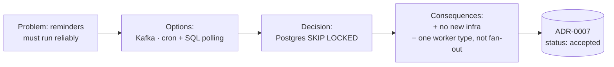
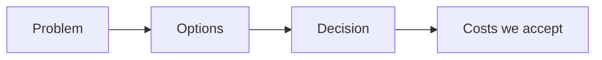
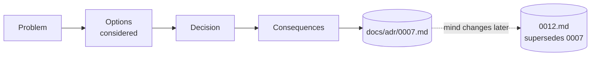
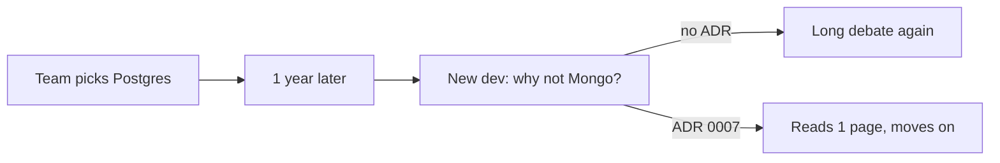
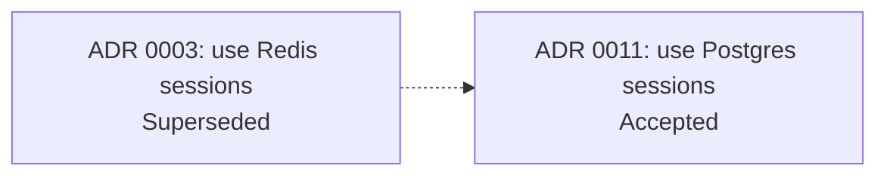
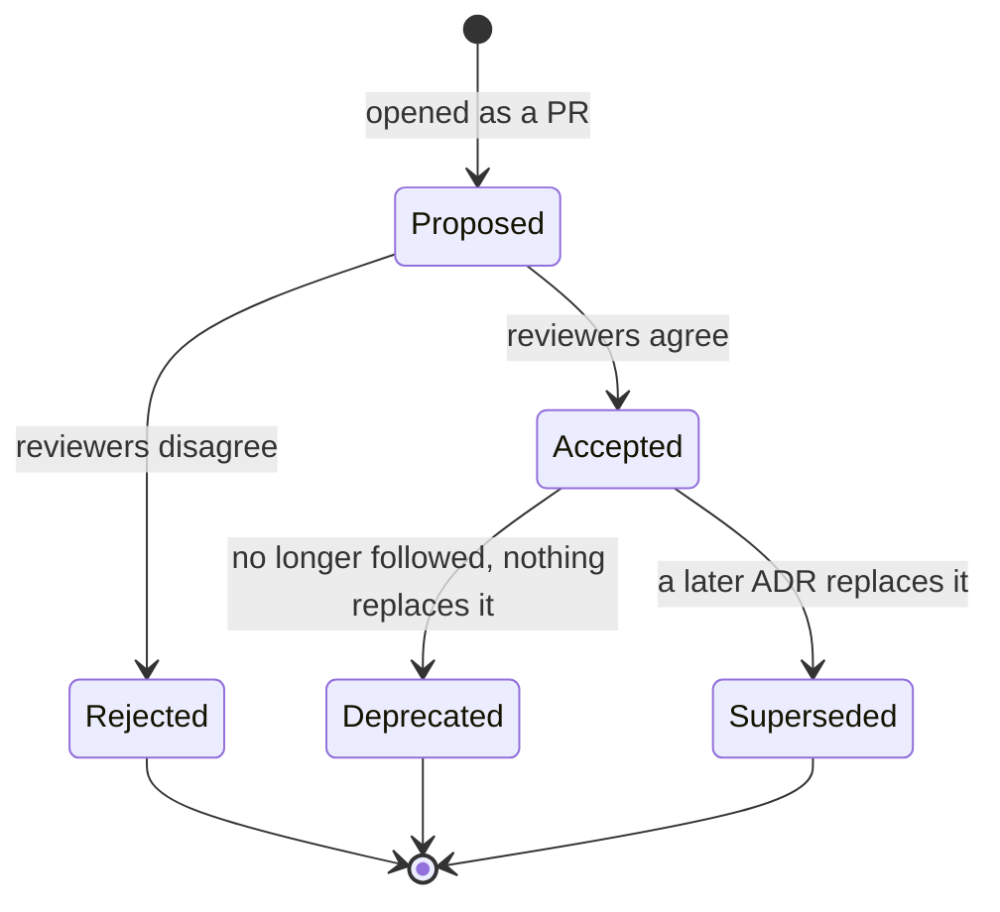
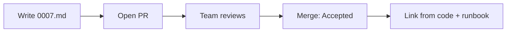
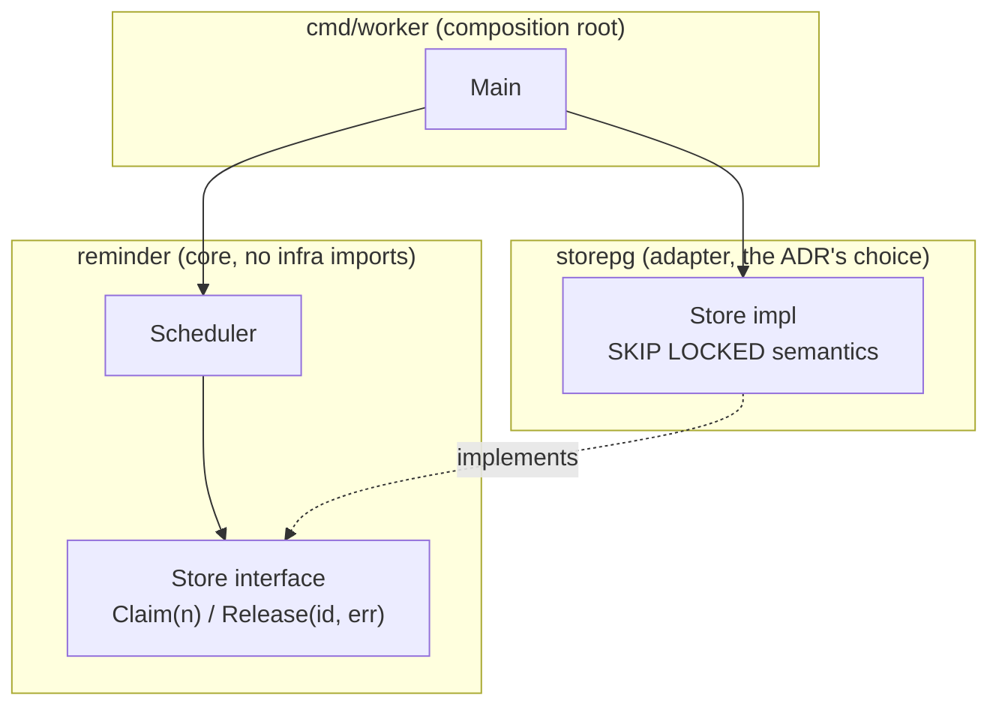

# Architecture Decision Records

> [!summary] TL;DR
> An Architecture Decision Record (ADR) is a short, numbered, immutable document that captures one significant architecture decision: the problem, the options considered, the choice made, and the consequences accepted. It exists so that six months later nobody has to reverse-engineer *why* the system looks the way it does.

> [!abstract] Core idea
> - An ADR is a record of a decision, not a design document: it explains context and trade-offs, not just the outcome.
> - ADRs are numbered and immutable. A changed mind gets a new ADR that supersedes the old one; nobody edits history.
> - Write one only for decisions that are hard or expensive to reverse ("one-way doors"), cross a team boundary, or will otherwise be re-litigated from memory.
> - The record lives next to the code it describes (`docs/adr/`) and is reviewed like code, through a pull request.

### Whiteboard version



InvoiceOps needed a way to run invoice reminders reliably without losing one or sending it twice. The team considered a **Kafka** consumer group (Kafka is a separate system that stores messages so a group of workers can read them) and a Postgres job table **polled** (asked again and again, "any work for me?") with `SELECT ... FOR UPDATE SKIP LOCKED` (a Postgres query where each worker grabs some rows and skips rows another worker already holds), picked the second, and wrote that choice down as ADR-0007 before building it.

Everything below is what goes inside that one document, and what the decision implies for the code.

## Start here: the basics 🟢

> [!info] How to read this note (pick your level)
> - 🟢 **New to this?** Read "From zero" below, then 1 (why it exists), 2 (mental model) and 10 (cheat sheet). Stop there, that is a full first pass.
> - 🟡 **Know the basics?** Add 3 (how it works), 4 (worked example), 5 (variants and comparison) and 6 (trade-offs).
> - 🔴 **Interview / SDE-3 prep?** Add 7 (in production), 8 (deep dive) and 9 (interview questions). Headings are tagged 🟢🟡🔴 so you always know where you are.

> [!note] Before this note
> - [[Architecture Fundamentals - Coupling, Cohesion and Dependency Direction]]: "coupling" means how much one part of the code breaks when another part changes, and "dependency direction" means which package imports which. Section 4 uses one idea from it: the core code depends only on an interface it owns, never on the database package.

**From zero, in 60 seconds** 🟢

Teams make big choices: which database, which message queue, one service or many.
Six months later, nobody remembers why. New people undo good choices by accident.
An **ADR** (Architecture Decision Record) is a short note that writes one choice down.
It says what the problem was, which options you looked at, what you picked, and what it costs you.
ADRs are numbered and never edited. If you change your mind, you write a new ADR that **supersedes** (replaces) the old one.
So the folder of ADRs becomes the diary of why the system looks the way it does.



The rest of this note is just these 3 questions:
1. What goes in an ADR?
2. How does an ADR move from proposed to accepted to replaced?
3. Where do ADRs live and who reviews them?


**The problem in one story.**
Your team picks a database queue instead of Kafka after a long debate.
Nobody writes down why.
A year later a new engineer sees the "odd" choice and starts replacing it.
A one-page note from the day of the decision would have saved a week of arguing.

**Words you need first**

| Word | Plain meaning | Tiny example |
| --- | --- | --- |
| Architecture decision | A choice about the system's structure that is costly to undo | "Use Postgres as the job queue" |
| Trade-off | Getting one benefit by giving up another | No new infra, but no fan-out |
| Context | The facts and constraints true when the choice was made | "Team of 3, no Kafka experience" |
| Consequence | What you accept as a result of the choice | "Workers must poll every second" |
| Immutable | Never edited after it is final | ADR-0007 stays as written |
| Supersede | Replace an old decision with a newer one | ADR-0012 supersedes ADR-0007 |
| Pull request (PR) | A proposed change that teammates review before merge | The ADR file gets reviewed like code |
| One-way door | A choice that is very costly or impossible to undo later | Picking the main database |
| Two-way door | A choice you can cheaply undo next week | Adding a small cache |
| Polling | A worker asks the database every few seconds "any jobs for me?" | Reminder worker checks every 1 second |
| Fan-out | One message delivered to many different readers | One "invoice paid" event read by 3 services |
| MADR | A popular fill-in-the-blanks template for ADRs (Markdown ADR) | Status, Context, Decision, Alternatives, Consequences |
| Interface (port) | A list of methods the core code needs, with no "how" inside | `Store` with `Claim` and `Release` |
| Adapter | The code that does the real "how" behind an interface | `storepg`, which talks to Postgres |

**Picture it**



**Analogy.** An ADR is like a court ruling: it records the facts, the arguments and the verdict, and a later court overturns it with a new ruling instead of rewriting the old one.
Where it breaks: courts are bound by precedent; a team can drop an ADR whenever the context changes, as long as it writes the superseding one.

**How the rest of this note builds up**

- First, why ADRs exist (section 1) and the "lab notebook" mental model (section 2).
- Then the template and lifecycle: status, context, decision, alternatives, consequences (section 3).
- Then a worked example, ADR-0007, with the Go code it implies (section 4), plus variants and comparisons (section 5).
- Finally the SDE-3 view: when not to write one, running ADRs in production teams, and the deep dive (sections 6-8).

> [!tip] Remember
> An ADR records *why*, once, and is never edited; a changed mind gets a new ADR.

## 1. Why it exists 🟢

A new engineer opens `reminder/` six months from now and finds a job table polled every second instead of a message queue, with no comment explaining why.

Two things can happen: they assume it was an oversight and "fix" it by introducing Kafka mid-project, or they waste a day asking around to find out it was deliberate. Both cost more than the paragraph it would have taken to write the decision down at the time.

An ADR is that paragraph, kept permanently. Teams that skip it do not avoid the decision-making cost — they just pay it again, from scratch, the next time someone touches the area, usually under more time pressure than the first time.



## 2. Mental model 🟢

Think of an ADR as a **lab notebook entry for the architecture**, not a design document. A design document describes how something works; an ADR captures why it was chosen over the alternatives, at the moment the choice was made, with the information available then.

It is deliberately short — a page, not a spec — and deliberately permanent: once accepted, nobody edits an ADR to match a later change of mind. If the decision is reversed, a new ADR is written that supersedes the old one, so the history of *why* stays intact.

This is the same instinct as a **database migration** (a numbered script that changes the database's tables, run once, in order): you don't edit migration 0003 after 0007 has shipped, you write 0008. ADRs apply that discipline to decisions instead of schemas.



### Real-life example 🟢

Picture the backend team of a food-delivery app like Swiggy deciding how restaurant payouts are sent each night.
They choose a simple database job table over a new message queue, because the team is small and payouts happen once a day.
They write ADR-0021 saying exactly that, plus the cost: "this will not scale to per-minute payouts".
Two years later the business wants payouts every 10 minutes. The new tech lead reads ADR-0021, sees the old reason no longer holds, and writes ADR-0045 that supersedes it.
Nobody wastes a week guessing whether the old choice was a mistake or a deliberate trade-off.

## Common beginner mistakes 🟢

- **Editing an old ADR when the decision changes** → the history of why is lost, and readers can't tell what was true at the time → write a new ADR and mark the old one "Superseded by ADR-00NN".
- **Writing only the decision, no alternatives** → the next engineer re-proposes the same rejected option → list each option you looked at and one line on why you passed it over.
- **Writing no downside in Consequences** → the ADR reads like an advert, and the cost surprises someone later → name at least one real cost, like "max a few hundred jobs per second".
- **Writing an ADR for tiny choices** → nobody reads a folder of 300 trivial ADRs → keep them for one-way doors: database, queue, API style, tenancy model.
- **Keeping ADRs in a wiki far from the code** → they drift out of sight → put them in `docs/adr/` in the repo and link them from the code they govern.

## 3. How it works 🟡

> 🟢 → 🟡 **You now know** what an ADR is and why it is never edited. **Next we open the box**: the exact headings inside one, how its status moves over time, and where the file lives and gets reviewed. Each subsection starts with a short step-by-step walk; the full detail follows.

### 3.1 The template (MADR-style)

**In plain words: a fixed set of headings, so every ADR reads the same way.**

**Step by step:**
1. Copy the template into a new file, `docs/adr/0007-use-postgres-skip-locked.md`. The number is simply the next free one.
2. **Context**: write the facts as they are today. "Reminders must go out exactly once. We run Postgres. We do not run Kafka."
3. **Decision**: one sentence someone can act on. "Store reminders as rows in a `reminder_jobs` table."
4. **Alternatives**: each option you did not pick, with one line on why. "Kafka: one more system to run for one queue."
5. **Consequences**: the good and the bad. "No new system to run, but not built for millions of jobs a second."
6. Set **Status** to Proposed and open a pull request.

Full detail:

```text
# ADR-0007: Use Postgres SKIP LOCKED for reminder jobs

## Status
Accepted

## Context
InvoiceOps must send a due-date reminder exactly once per invoice, even
across worker restarts and crashes. The team already runs Postgres; it
does not yet run Kafka or any message broker.

## Decision
Store reminders as rows in a `reminder_jobs` table. Workers poll with
`SELECT ... FOR UPDATE SKIP LOCKED LIMIT n` so that several workers can run
concurrently without claiming the same row, and delete or reschedule a row
after it is handled.

## Alternatives considered
- Kafka consumer group: at-least-once delivery, horizontal fan-out, but a
  new piece of infrastructure to run, monitor and operate for one queue.
- In-process timers: simplest, but lost on every restart and cannot run on
  more than one instance without duplicate sends.

## Consequences
- No new infrastructure; reminders live in the database that already has
  the invoice data, so a join at query time is free.
- Throughput is bounded by Postgres connections and poll frequency, not
  meant for millions of jobs per second.
- If InvoiceOps later needs a general-purpose event bus for other
  consumers, this decision will likely be revisited (and superseded, not
  edited).
```

Each field has one job: **Context** is the problem as it looked at decision time (including constraints like "no broker yet"); **Decision** is one sentence an engineer can act on; **Alternatives** names what was *not* chosen and why, which is often the part people actually come back to read; **Consequences** states the trade-off honestly, including the downside.

### 3.2 Lifecycle

**In plain words:** an ADR's status changes over time, but its text does not.

**Step by step:**
1. You open ADR-0007 as a pull request. Status: **Proposed**.
2. The team agrees in review and merges it. Status: **Accepted**.
3. If the team disagrees instead, it is closed. Status: **Rejected** (keep it, so the idea is not proposed blind again).
4. A year later the team moves to a queue and writes ADR-0012. ADR-0007 gets one new line: "Superseded by ADR-0012". Nothing else in it changes.
5. If the team just stops following a rule and nothing replaces it, the status becomes **Deprecated**.



An ADR's text is never rewritten once `Accepted`. "Superseded by ADR-0012" is added as a one-line status update; the original Context, Decision and Consequences stay exactly as written, because they were true at the time and that is the historical record being kept.

### 3.3 Where it lives and how it's reviewed

**In plain words: ADRs are plain files in the repo, reviewed in a pull request like code.**

**Step by step:**
1. Save the file under `docs/adr/` in the same repo as the code.
2. Open a pull request. Teammates comment on it like any code change.
3. Merge it when the team agrees. The review thread stays as a record of how you got there.
4. Add a comment in the `reminder` package pointing to `docs/adr/0007-*.md`, and link it from the on-call runbook.



Full detail:

- Files: `docs/adr/0001-use-postgres-for-sessions.md`, `0002-...`, numbered sequentially and never renumbered.
- Reviewed exactly like a code change: opened as a pull request, discussed in review comments, merged once the team agrees — the PR thread itself becomes part of the record of *how* the decision was reached.
- Linked from the code it governs (a comment pointing at `docs/adr/0007-*.md` in the `reminder` package) and from runbooks, so an on-call engineer debugging the job table at 2 a.m. can find the reasoning, not just the mechanism.
- RFC vs ADR: an RFC (or a design doc) is the *proposal*, written before a decision exists, inviting debate over several options. An ADR is the *record*, written once a decision has been made, even if that's the same document after discussion settles.

## 4. Worked example 🟡

The dependency-direction consequence of ADR-0007 is testable, not just stated. The core scheduler never imports a database package — it depends on a `Store` interface (a list of methods: "claim some jobs", "release a job") that the ADR's chosen **adapter** (the code that actually talks to Postgres) implements, so the decision can be swapped later (Kafka, SQS) by writing a new adapter, never by touching the scheduler.



In the diagram, `cmd/worker` is the **composition root**: the one `main` place that creates the real Postgres store and hands it to the scheduler.

**What this code does, in plain words:** `Scheduler` asks the store for up to `n` jobs, runs each one, and then tells the store "done" or "failed". It only knows the `Store` interface, so it never sees Postgres.

```go
// package reminder — the core. It never imports database/sql or pgx.
package reminder

type Job struct {
	ID      int64
	RunAt   time.Time
	Payload string
}

// Store is the port the ADR decision lives behind. The core defines this
// interface and depends only on it; an adapter depends on the core to
// implement it. Swapping the adapter (Postgres SKIP LOCKED today, maybe a
// queue tomorrow) never touches this file.
type Store interface {
	Claim(n int) ([]Job, error)
	Release(id int64, err error) error
}

type Scheduler struct{ store Store }

func NewScheduler(s Store) *Scheduler { return &Scheduler{store: s} }

func (s *Scheduler) RunBatch(n int, handle func(Job) error) (int, error) {
	jobs, err := s.store.Claim(n)
	if err != nil {
		return 0, err
	}
	done := 0
	for _, j := range jobs {
		herr := handle(j)
		if rerr := s.store.Release(j.ID, herr); rerr != nil {
			return done, rerr
		}
		if herr == nil {
			done++
		}
	}
	return done, nil
}
```

**What this code does, in plain words:** this is a pretend Postgres store kept in memory. `Claim` hands out jobs no other worker holds and marks them taken; `Release` deletes a finished job or frees a failed one so it can be tried again.

```go
// package storepg — the adapter the ADR picked. It implements
// reminder.Store with the claim semantics of:
//
//	SELECT id, run_at, payload FROM reminder_jobs
//	WHERE run_at <= now() AND claimed_at IS NULL
//	ORDER BY run_at
//	FOR UPDATE SKIP LOCKED
//	LIMIT $1;
//
// This file simulates that query's guarantee in memory, since no database
// runs in this environment; a real build issues the SQL above over
// *pgxpool.Pool inside one transaction per batch.
package storepg

import (
	"sync"

	"adrdemo/reminder"
)

type Store struct {
	mu      sync.Mutex
	jobs    map[int64]reminder.Job
	claimed map[int64]bool
}

func New(jobs []reminder.Job) *Store {
	m := make(map[int64]reminder.Job, len(jobs))
	for _, j := range jobs {
		m[j.ID] = j
	}
	return &Store{jobs: m, claimed: make(map[int64]bool)}
}

// Claim is the in-memory stand-in for "FOR UPDATE SKIP LOCKED LIMIT n": it
// skips any row another caller already holds instead of blocking on it.
func (s *Store) Claim(n int) ([]reminder.Job, error) {
	s.mu.Lock()
	defer s.mu.Unlock()
	var out []reminder.Job
	for id, j := range s.jobs {
		if len(out) == n {
			break
		}
		if s.claimed[id] {
			continue // SKIP LOCKED: another worker already holds this row
		}
		s.claimed[id] = true
		out = append(out, j)
	}
	return out, nil
}

func (s *Store) Release(id int64, err error) error {
	s.mu.Lock()
	defer s.mu.Unlock()
	if err == nil {
		delete(s.jobs, id) // DELETE FROM reminder_jobs WHERE id = $1
		delete(s.claimed, id)
	} else {
		s.claimed[id] = false // retry later
	}
	return nil
}
```

The test that matters is the one the ADR is really making a promise about: two or more workers can poll at the same instant and never claim the same job. This runs under `go test -race` (Go's test runner with its data-race detector switched on, which flags two goroutines touching the same memory unsafely).

**What this code does, in plain words:** it starts 10 **goroutines** (lightweight Go threads) as 10 workers, lets them claim 100 jobs in batches of 3 at the same time, and then checks that every job was claimed exactly once.

```go
func TestClaimNeverDoubleClaims(t *testing.T) {
	jobs := make([]reminder.Job, 100)
	for i := range jobs {
		jobs[i] = reminder.Job{ID: int64(i), Payload: "reminder"}
	}
	s := New(jobs)

	var mu sync.Mutex
	seen := make(map[int64]int)
	var wg sync.WaitGroup
	for w := 0; w < 10; w++ {
		wg.Add(1)
		go func() {
			defer wg.Done()
			for {
				got, err := s.Claim(3)
				if err != nil {
					t.Errorf("Claim: %v", err)
					return
				}
				if len(got) == 0 {
					return
				}
				mu.Lock()
				for _, j := range got {
					seen[j.ID]++
				}
				mu.Unlock()
				for _, j := range got {
					if err := s.Release(j.ID, nil); err != nil {
						t.Errorf("Release: %v", err)
					}
				}
			}
		}()
	}
	wg.Wait()

	if len(seen) != 100 {
		t.Fatalf("claimed %d distinct jobs, want 100", len(seen))
	}
	for id, n := range seen {
		if n != 1 {
			t.Fatalf("job %d claimed %d times, want exactly 1", id, n)
		}
	}
}
```

**Measured:** this test (10 goroutines, 100 jobs, batches of 3) passed `go vet` and `go test -race` on Go 1.24.4, with every job claimed exactly once across all runs.

And because `Scheduler` only ever sees the `Store` interface, its own unit test needs no database or in-memory ring buffer at all — a plain fake that returns a slice is enough, which is the whole payoff of the boundary the ADR drew:

```go
type fakeStore struct {
	jobs     []reminder.Job
	released map[int64]error
}

func (f *fakeStore) Claim(n int) ([]reminder.Job, error) {
	if n > len(f.jobs) {
		n = len(f.jobs)
	}
	out := f.jobs[:n]
	f.jobs = f.jobs[n:]
	return out, nil
}

func (f *fakeStore) Release(id int64, err error) error {
	if f.released == nil {
		f.released = make(map[int64]error)
	}
	f.released[id] = err
	return nil
}
```

## 5. Variants and comparison 🟡

| Format | How it works | Use when | Cost |
| --- | --- | --- | --- |
| MADR (shown above) | Context, Decision, Alternatives, Consequences | The team default; readable in a PR diff | None beyond writing it |
| Nygard's original 5-field | Title, Status, Context, Decision, Consequences (no explicit Alternatives section) | Minimal teams that want the shortest possible template | Alternatives often get folded into prose, easy to skip |
| Y-statement | One sentence: "In the context of X, facing Y, we decided Z to achieve A, accepting B" | Very short decisions, quick scanning | Cramped for anything with more than one real alternative |
| RFC / design doc | Long-form proposal, open questions, invites debate | Before a decision exists; several stakeholders must weigh in | Not immutable, not a record — needs an ADR once it resolves |
| Architecture log / decision log (wiki page) | One shared page, decisions appended as rows | Very small teams, low ceremony | No per-decision review trail; easy to edit history by accident |

## 6. Trade-offs and when not to use 🟡

- ADRs cost a few minutes of writing per decision. Writing one for every tiny, easily reversible choice ("use a `map[string]int` here") is pure overhead; save them for decisions that are expensive to reverse, cross a team or service boundary, or pick between genuinely different trade-offs (a database, a protocol, a consistency model).
- An ADR documents a decision already made; it does not replace the discussion that makes it. Teams that write one line per week on faith, with no real alternatives considered, get a paper trail without the reasoning that makes it useful.
- If nobody reads them, they rot: the fix is linking from the code and runbooks that depend on the decision, not making the format heavier.
- For a single-developer side project, a decision log is often enough; the overhead of numbering, superseding and reviewing ADRs pays off once more than one person has to live with the decision.

## 7. In production 🔴

> 🟡 → 🔴 **You now know** how to write, review and test an ADR. **Next is the senior view**: which real teams use them, how they go wrong over years, and how to judge which decisions deserve one at all. This is the part interviewers probe.


- **Real systems:** AWS, Spotify, GitHub, and most teams that publish engineering blogs describe using lightweight ADRs stored alongside code; the `adr-tools` CLI and `log4brains` (a static site generator for ADR logs) are the common tooling. ThoughtWorks has recommended ADRs on its Technology Radar since 2017.
- **Failure modes → fixes:**
  - Written long after the decision, from memory → the context section is reconstructed and often wrong; fix by writing the ADR *during* the PR that implements the decision, not after.
  - Too granular (an ADR per function signature) → the backlog of ADRs stops being read; fix by reserving them for one-way-door decisions.
  - No Consequences section, only the happy path → the next engineer repeats the mistake the trade-off was accepting; fix by requiring at least one real downside.
  - Never revisited → an ADR from three years ago is followed as gospel after its constraints changed; fix with a periodic architecture review that asks "does ADR-00NN still hold?" and supersedes the ones that don't.
- **What to monitor:** none of this is a runtime system, so "monitoring" is process health — are ADRs opened as PRs before the code that depends on them merges, are old ADRs marked superseded instead of silently ignored, can a new engineer find the ADR for the area they're touching within a minute.

## 8. Deep dive 🔴

- **One-way vs two-way doors.** Amazon's shorthand: a two-way door (adding a cache, renaming an internal function) is cheap to reverse, so deciding fast and writing nothing down is fine. A one-way door (choosing a primary database, a message-delivery guarantee, a multi-tenancy strategy) is expensive or impossible to reverse later, and that is exactly the set of decisions worth an ADR — the record pays for itself specifically because undoing the decision is costly.
- **ADRs are not architecture documentation.** An ADR explains *why* a choice was made at a point in time; it is deliberately silent on how the system works today, because "today" changes and the ADR must not. A current-state view (see [[Documenting Architecture - C4 Diagrams and Fitness Functions]] for that) is a different, living artifact that gets updated; an accepted ADR is the opposite — frozen, dated prose.
- **Granularity in practice.** A useful heuristic: write one ADR per noun that would appear in a system diagram and could plausibly be swapped (the database, the message broker, the auth provider, the API style) — not one per class or endpoint.
- **Cross-team decisions.** When a decision crosses a service boundary (API gateway's routing strategy, a shared event schema), review often needs a wider audience than one team's PR reviewers; some orgs route these through an architecture review board that approves the ADR before merge, turning the PR thread itself into the record of that approval.

## 9. Interview questions 🔴

> [!question]- What's the difference between an ADR and a design document?
> A design document (or RFC) is written before a decision exists, to propose options and invite debate. An ADR is written once a decision is made: it records the context, the choice, the alternatives considered, and the consequences accepted. A design doc evolves through edits; an accepted ADR does not.

> [!question]- Why are ADRs numbered and never edited after acceptance?
> Because the record's value is historical: it must say what the team believed and chose at that time, not what is true now. If the decision changes, a new numbered ADR supersedes the old one, which gets a one-line status update ("superseded by ADR-0012") but keeps its original text, the same way a database migration file is never rewritten after it has shipped.

> [!question]- Give an example of a decision that deserves an ADR and one that doesn't.
> Deserves one: choosing Postgres `SKIP LOCKED` job polling over Kafka for reminders — it's a one-way door that shapes the whole `reminder` package's dependencies. Doesn't: picking `map[string]int` over a custom struct for a local cache inside one function — cheap to change, no one else depends on the choice.

> [!question]- Where should ADRs live, and why does that matter?
> In the repository, under `docs/adr/`, reviewed as a pull request like any code change. Keeping them with the code means they travel with a clone, show up in blame and PR history, and get read by the people actually touching the area — a wiki page drifts out of sight and out of sync.

> [!question]- Trap: "We wrote one big ADR for our whole microservices migration. Good enough?"
> No — that's a design document wearing an ADR's name. One ADR per independently reversible decision (which message broker, which service-discovery mechanism, which data-ownership split) lets each be revisited and superseded on its own; a single giant ADR forces the whole migration to be re-argued to change any one part of it.

> [!question]- How does an ADR affect testing and dependency direction, concretely?
> An ADR that picks an adapter (a specific database, broker or provider) should leave the core code depending only on an interface the core itself defines. That is what let `reminder.Scheduler` in the worked example be tested with a two-line fake store and zero database — the ADR's decision is swappable precisely because nothing in the core imports it directly.

> [!question]- How do you make and communicate an architecture decision on a real team?
> Write the ADR as part of the same pull request that implements the decision, not after: Context (the constraints as they stood, including what infrastructure already existed), the Alternatives actually considered and why each was passed over, the Decision in one actionable sentence, and at least one honest Consequence. Open it for review like any code change, merge it once the team agrees, and link it from the code and runbooks it governs so the next engineer who touches that area finds the reasoning instead of having to ask around for it.

## 10. Cheat sheet 🟢

- ADR = Context + Decision + Alternatives + Consequences, one page, numbered, immutable once accepted.
- Write one for one-way-door decisions: expensive to reverse, cross-team, or genuinely trade-off-laden. Skip it for cheap, local, reversible choices.
- Status moves Proposed → Accepted → (Deprecated | Superseded); never rewrite an accepted ADR's body.
- Store them as `docs/adr/NNNN-title.md`, reviewed through a normal pull request.
- RFC/design doc = the proposal, written before the decision; ADR = the record, written once it's made.
- A good ADR states the downside, not just the choice — "Consequences" should include at least one real cost.
- The decision an ADR records should map to a real code boundary (an interface the core owns), so the choice stays swappable later.

## Self-check 🟢🟡

> [!question]- (easy) What four parts does every ADR have?
> Context, Decision, Alternatives considered, and Consequences (plus a Status line).

> [!question]- (easy) You changed your mind about ADR-0007. Do you edit it?
> No. You write a new ADR (say 0012) and add one line to 0007: "Superseded by ADR-0012".

> [!question]- (easy) Where should ADR files live?
> In the repo next to the code, under `docs/adr/`, reviewed through a pull request.

> [!question]- (medium) How is an RFC different from an ADR?
> An RFC is a proposal written before the decision to invite debate; an ADR is the record written once the decision is made.

> [!question]- (medium) Which needs an ADR: choosing Postgres over Kafka for jobs, or using a map inside one function?
> Postgres over Kafka. It is a one-way door that shapes the whole `reminder` package; the map is cheap to change.

> [!question]- (medium) Why does the worked example put the decision behind a `Store` interface?
> So the core scheduler never imports Postgres; a later ADR can swap in a queue by writing a new adapter without touching the core.

## Links 🟢

- **Before this:** [[Architecture Fundamentals - Coupling, Cohesion and Dependency Direction]]
- **Next:** [[Documenting Architecture - C4 Diagrams and Fitness Functions]]
- **Compare with:** [[Hexagonal Architecture (Ports and Adapters)]] (the kind of boundary an ADR like ADR-0007 draws), [[Strangler Fig Pattern and Legacy Migration]] (a sequence of ADRs usually accompanies a migration like this)

### Watch on YouTube

- [Architecture Decision Records (ADR) as a LOG that answers "WHY?"](https://www.youtube.com/watch?v=6H6zfCNeqek) · CodeOpinion · 10 min · 27,311 views
- [Lesson 55 - Architecture Decision Records](https://www.youtube.com/watch?v=LMBqGPLvonU) · Software Architecture Monday · 10 min · 17,777 views
