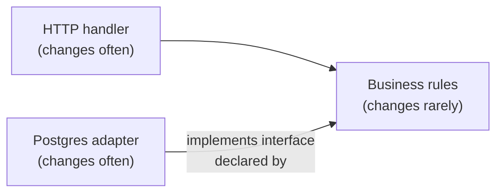
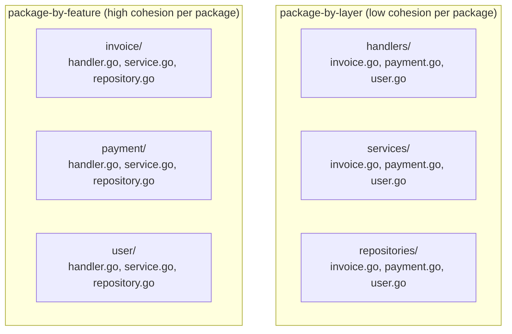
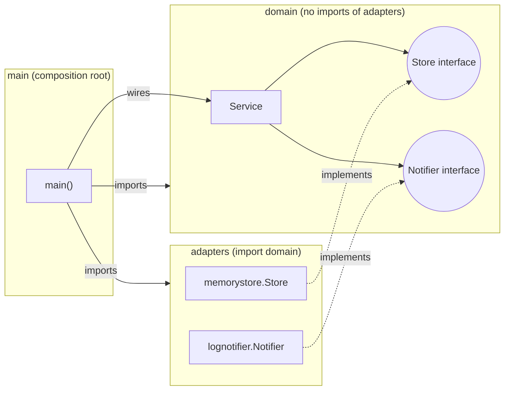
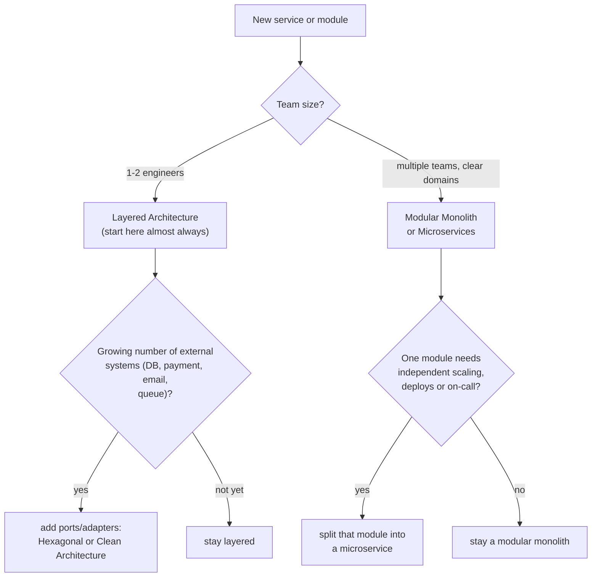

# Architecture Fundamentals - Coupling, Cohesion and Dependency Direction

> [!summary] TL;DR
> Software architecture is the set of decisions that are expensive to change later: where a system's boundaries are, which way dependencies point across them, how it is deployed, and who owns which data. Every named pattern in this folder — layered, hexagonal, clean, modular monolith, microservices — is one answer to the same two questions: where does a boundary go, and which side is allowed to depend on the other.

> [!abstract] Core idea
> - A **boundary** separates two things that change for different reasons or at different rates; a dependency crossing it should point from the thing that changes often toward the thing that changes rarely.
> - **Coupling** is how much one module must know about another to work; **cohesion** is how well the things inside one module belong together. Architecture is mostly the management of both, at the package/service level rather than the line-of-code level.
> - **Dependency inversion** flips a natural dependency: instead of your business logic importing a database driver, the business logic declares the interface it needs, and the database adapter imports and implements that interface.
> - Go gives you three structural tools for this: packages, the `internal/` directory, and interfaces declared where they are consumed, not where they are implemented.
> - There is no one correct architecture. The right one depends on domain complexity, team size and how many external systems you integrate with, and it is allowed to change as the service grows.

## Start here: the basics

**The problem in one story.**
You change how invoices are saved to the database.
Suddenly the email code, the PDF code and three tests break.
They all knew details they never needed.
This note is about drawing lines so one change stays in one place.

**Words you need first**

| Word | Plain meaning | Tiny example |
| --- | --- | --- |
| Module / package | A folder of code with one name you import | `internal/invoice` |
| Dependency | Code A needs code B to compile or run | `invoice` imports `database/sql` |
| Coupling | How much A must know about B | Handler reads SQL column names directly |
| Cohesion | How well the things inside one module belong together | All invoice rules in one package |
| Interface | A named list of methods, with no code behind it | `type Repo interface { Save(Invoice) error }` |
| Boundary | A line between parts that change for different reasons | Business rules vs. database code |
| `internal/` | A Go folder that only its parent tree may import | `svc/internal/domain` |

**Picture it**



**Analogy.** A wall socket: your lamp depends on the socket shape, not on the power plant. The power company can change plants without you buying a new lamp.
Where it breaks: a socket standard is fixed for decades; your own interfaces will need to change as the business changes.

**How the rest of this note builds up**

- First, why boundaries matter (section 1) and a mental model of coupling vs. cohesion (section 2).
- Then how dependency direction and dependency inversion work in Go packages (section 3), with a worked example (section 4).
- Then package-by-layer vs. package-by-feature and other variants (section 5), and when not to bother (section 6).
- Finally the SDE-3 view: Conway's law and team boundaries, production pitfalls, and the deep dive (sections 3, 7-8).

> [!tip] Remember
> Low coupling, high cohesion, and dependencies point toward the code that changes least.

## 1. Why it exists

A two-person team building InvoiceOps starts with one package: `main.go` calls the Postgres driver directly inside the HTTP handler that creates an invoice. For the first month this is the fastest way to ship.

By month four, three things have happened: a second engineer needs to add Razorpay webhook handling without breaking invoice creation; product wants an integration test that creates an invoice without a running Postgres; and a bug slips through because a handler silently skipped the "amount must be positive" rule that lived only in that one handler's `if` statement, not in a second handler that also creates invoices.

None of these are bugs in the code that exists — they are costs of *where the boundaries are*. The business rule "an invoice amount must be positive" has no single home, so it can be forgotten in a second handler.

The HTTP handler and the SQL driver are one unit, so testing one means running the other. These are architecture problems: who talks to whom, and in which direction.

**Measured, in this vault's own history:** the old note this one replaces (`Architecture Patterns Content Table`) scored about half "real content" against a template — roughly half its lines were definitions without ever drawing the dependency arrows a reader needs to apply them. This note exists to fix that: concrete arrows, not just names.

## 2. Mental model

Think of every package or service as a cell with a wall. The wall decides two things: what can cross it, and which side initiates the crossing.

- **What crosses:** data (DTOs, not ORM rows), calls (function calls, HTTP, events), and *knowledge* (business rules should cross once, as a decision, never as duplicated logic).
- **Direction:** draw an arrow from the caller to the callee. The rule that makes an architecture "good" is almost always: **make the arrow point from volatile code toward stable code**, never the reverse. A payment provider SDK changes on their schedule; your business rule that "a paid invoice cannot be edited" should not depend on it.

**Analogy:** a restaurant kitchen. The chef (your domain logic) does not know or care which supplier delivered today's tomatoes (a database, an email provider, a payment gateway) — a line cook (an adapter) deals with the delivery truck and hands the chef prepared ingredients in the shape the chef already expects. Swap suppliers and the chef's recipes do not change.

## 3. How it works

### What architecture actually decides

| Decision | Example for InvoiceOps |
| --- | --- |
| Where are the boundaries | `domain` (invoice rules) vs `adapters/postgres` vs `adapters/razorpay` |
| Which way do dependencies point | adapters import `domain`; `domain` imports nothing from adapters |
| What is a deployment unit | one binary today; maybe `billing` and `notifications` services later |
| Who owns which data | the billing module owns the `invoices` table; nothing else writes to it directly |

### Coupling: four kinds that matter at this level

- **Afferent coupling** (incoming): how many other packages depend on this one. A `domain` package with high afferent coupling and few dependencies of its own is a stable, trustworthy core.
- **Efferent coupling** (outgoing): how many other packages this one depends on. High efferent coupling on concrete adapters (a specific SQL driver, a specific HTTP client) means a change to any of them can break you.
- **Temporal coupling**: two components only work if called in a specific order or at the same time (service A must deploy before service B reads its new field). Invisible in the code, visible only at runtime or deploy time.
- **Data/schema coupling**: two components share a database table or wire format and must change together even though they are "separate" in the code or deploy graph. This is the coupling that survives a monolith-to-microservices split if nobody also splits the database (see [[Monolith vs Microservices]]).

Deployment coupling is a fifth, operational kind: if two packages must always be deployed together to work, they are one deployment unit whatever the repository layout says.

### Cohesion and Go package shape

Cohesion asks: do the things inside this boundary belong together? Two ways to slice the same InvoiceOps handlers:



Package-by-layer groups files that change for the *same reason* (all repositories change when the database driver is upgraded) but scatters files that change *together* for a feature (adding a field to `Invoice` touches three packages).

Package-by-feature is the common Go default once a service has more than a handful of entities: each feature package is cohesive, and only the handful of things every feature needs (a shared `Invoice` ID type, a logger) live in a small, genuinely shared package — never a catch-all `utils`.

### Dependency inversion with a consumer-defined interface

The direction that makes testable, swappable architecture possible: the package that *uses* a capability declares the interface, in its own package, in the shape it needs.

The package that *provides* the capability imports that interface's package and implements it — the dependency arrow points from the concrete adapter to the abstract core, which is the reverse of the call's data flow.



Three consequences fall out of this one picture:
- `domain` can be unit-tested with an in-memory fake, with no database, no network, and no test container.
- Swapping Postgres for a different store means writing a new adapter; `domain` does not change.
- `main` (or a `wire`/`fx` injector) is the only package allowed to know about every concrete type. This is the **composition root**: everywhere else, depend on the interface, not the concrete type.

### Go-specific boundary tools

- **`internal/`**: any package under a directory named `internal` is importable only by code rooted at its parent. `internal/domain` can be shared across your own `cmd/` binaries but never imported by another module — this is how Go enforces "this is ours, not a public API" at compile time, not by convention.
- **Import cycles are a compile error.** If `domain` imports `adapters/postgres` and `adapters/postgres` imports `domain`, `go build` refuses to build it. Go turns "we have a circular dependency" from an architecture smell into a build failure, which is why the arrow in the diagram above only ever points one way.
- **No `utils` dumping ground.** A package named `utils` or `common` that keeps growing is a sign that cohesion was never decided; split it by what each function is actually about (`timeutil`, `moneyutil`), or better, put the function next to its one caller until a second caller proves it is shared.

### Quality attributes this buys (and costs)

| Attribute | What a good boundary buys | What it costs |
| --- | --- | --- |
| Testability | `domain` tested with fakes, no infrastructure | writing and maintaining the fakes |
| Deployability | a module can become its own service later with its interface already in place | more packages and indirection than a 200-line script needs |
| Scalability | a hot module (e.g. search) can get its own resources once isolated | premature isolation adds network calls you did not need yet |

### Conway's law

> [!quote] Melvin Conway, 1968
> Organizations which design systems are constrained to produce designs which are copies of the communication structures of these organizations.

In practice: if two teams own "invoices" and "notifications" and talk to each other only through a ticket queue, the code boundary between those two concerns will end up matching that communication gap, whether or not anyone draws it on a diagram first.

Deliberately choosing module or service boundaries along team boundaries (the "inverse Conway manoeuvre") is often easier than fighting the organization's shape.

### Choosing a style



Domain-driven design is **orthogonal** to this chooser, not a branch on it: bounded contexts and the tactical patterns in [[Domain-Driven Design - Strategic Design]] apply inside a layered service, a hexagonal one, or a microservice, whenever the domain's rules are complex enough to deserve a rich model instead of a thin CRUD layer.

"Complex business rules" is a reason to add DDD's tactical patterns, not a fork that excludes hexagonal or clean.

The evolutionary path almost every real service takes: start layered, and once a second or third external integration shows up (a payment provider, then an email provider, then a file store), extract ports for exactly those integrations rather than adopting a full architecture up front.

[[Hexagonal Architecture (Ports and Adapters)]] and [[Clean Architecture]] cover what that extraction looks like in Go.

## 4. Worked example

### Whiteboard version

The smallest version of dependency inversion: a function that needs to save something, written against an interface it declares itself.

```go
package wb

type Saver interface {
	Save(id string, amountCents int64) error
}

// CreateInvoice depends only on the interface above. It does not know,
// and cannot be made to know, whether Saver is backed by Postgres, a
// file, or a map in a test.
func CreateInvoice(s Saver, id string, amountCents int64) error {
	if amountCents <= 0 {
		return ErrInvalidAmount
	}
	return s.Save(id, amountCents)
}

var ErrInvalidAmount = errBadAmount{}

type errBadAmount struct{}

func (errBadAmount) Error() string { return "amount must be positive" }
```

The full version below turns this into InvoiceOps' shape: a `domain` package with two ports, two real adapters, and a composition root, tested without touching either adapter.

A Go package graph (`domain`, `adapters/memorystore`, `adapters/lognotifier`, `main`) that compiles and passes `go vet` and `go test -race` on Go 1.24.

```go
// domain/invoice.go
package domain

import (
	"context"
	"errors"
)

type Invoice struct {
	ID          string
	AmountCents int64
}

var ErrInvalidAmount = errors.New("domain: amount must be positive")

// Store is a consumer-defined port: domain declares the interface it
// needs, in the shape it needs, instead of depending on a concrete
// database package.
type Store interface {
	Save(ctx context.Context, inv Invoice) error
	Get(ctx context.Context, id string) (Invoice, bool, error)
}

type Notifier interface {
	InvoiceSaved(ctx context.Context, inv Invoice) error
}

// Service depends only on the two interfaces above: zero efferent
// coupling to infrastructure.
type Service struct {
	store    Store
	notifier Notifier
}

func NewService(store Store, notifier Notifier) *Service {
	return &Service{store: store, notifier: notifier}
}

func (s *Service) CreateInvoice(ctx context.Context, id string, amountCents int64) (Invoice, error) {
	if amountCents <= 0 {
		return Invoice{}, ErrInvalidAmount
	}
	inv := Invoice{ID: id, AmountCents: amountCents}
	if err := s.store.Save(ctx, inv); err != nil {
		return Invoice{}, err
	}
	// Best-effort: a notifier outage must not undo a saved invoice.
	_ = s.notifier.InvoiceSaved(ctx, inv)
	return inv, nil
}
```

```go
// adapters/memorystore/store.go
package memorystore

import (
	"context"
	"sync"

	"note1/domain"
)

type Store struct {
	mu   sync.Mutex
	rows map[string]domain.Invoice
}

func New() *Store { return &Store{rows: make(map[string]domain.Invoice)} }

func (s *Store) Save(_ context.Context, inv domain.Invoice) error {
	s.mu.Lock()
	defer s.mu.Unlock()
	s.rows[inv.ID] = inv
	return nil
}

func (s *Store) Get(_ context.Context, id string) (domain.Invoice, bool, error) {
	s.mu.Lock()
	defer s.mu.Unlock()
	inv, ok := s.rows[id]
	return inv, ok, nil
}
```

```go
// adapters/lognotifier/notifier.go
package lognotifier

import (
	"context"
	"fmt"
	"io"

	"note1/domain"
)

type Notifier struct{ out io.Writer }

func New(out io.Writer) *Notifier { return &Notifier{out: out} }

func (n *Notifier) InvoiceSaved(_ context.Context, inv domain.Invoice) error {
	_, err := fmt.Fprintf(n.out, "invoice %s saved for %d cents\n", inv.ID, inv.AmountCents)
	return err
}
```

```go
// main.go - the composition root: the only package allowed to import
// both domain and its adapters.
package main

import (
	"context"
	"fmt"
	"os"

	"note1/adapters/lognotifier"
	"note1/adapters/memorystore"
	"note1/domain"
)

func main() {
	svc := domain.NewService(memorystore.New(), lognotifier.New(os.Stdout))
	inv, err := svc.CreateInvoice(context.Background(), "inv-100", 12500)
	if err != nil {
		fmt.Println("error:", err)
		return
	}
	fmt.Printf("created %+v\n", inv)
}
```

The tests that make the dependency direction a checked fact, not a diagram promise: `domain`'s tests use only fakes defined in its own test file, never an adapter.

```go
// domain/invoice_test.go
package domain

import (
	"context"
	"errors"
	"testing"
)

type fakeStore struct {
	saved   map[string]Invoice
	failSet error
}

func newFakeStore() *fakeStore { return &fakeStore{saved: map[string]Invoice{}} }

func (f *fakeStore) Save(_ context.Context, inv Invoice) error {
	if f.failSet != nil {
		return f.failSet
	}
	f.saved[inv.ID] = inv
	return nil
}

func (f *fakeStore) Get(_ context.Context, id string) (Invoice, bool, error) {
	inv, ok := f.saved[id]
	return inv, ok, nil
}

type fakeNotifier struct {
	calls []Invoice
	err   error
}

func (f *fakeNotifier) InvoiceSaved(_ context.Context, inv Invoice) error {
	f.calls = append(f.calls, inv)
	return f.err
}

func TestCreateInvoice_SavesAndNotifies(t *testing.T) {
	store := newFakeStore()
	notifier := &fakeNotifier{}
	svc := NewService(store, notifier)

	inv, err := svc.CreateInvoice(context.Background(), "inv-1", 4999)
	if err != nil {
		t.Fatalf("CreateInvoice: %v", err)
	}
	if _, ok := store.saved["inv-1"]; !ok {
		t.Fatal("invoice was not saved")
	}
	if len(notifier.calls) != 1 {
		t.Fatalf("got %d notifier calls, want 1", len(notifier.calls))
	}
	_ = inv
}

func TestCreateInvoice_RejectsNonPositiveAmount(t *testing.T) {
	svc := NewService(newFakeStore(), &fakeNotifier{})
	if _, err := svc.CreateInvoice(context.Background(), "inv-2", 0); !errors.Is(err, ErrInvalidAmount) {
		t.Fatalf("got err %v, want ErrInvalidAmount", err)
	}
}

// The dependency-direction guarantee made concrete: a broken notifier
// (simulating an adapter outage) must never undo a save that already
// succeeded, because the save already committed the business fact.
func TestCreateInvoice_NotifierFailureDoesNotRollBackSave(t *testing.T) {
	store := newFakeStore()
	notifier := &fakeNotifier{err: errors.New("smtp: connection refused")}
	svc := NewService(store, notifier)

	inv, err := svc.CreateInvoice(context.Background(), "inv-3", 1500)
	if err != nil {
		t.Fatalf("CreateInvoice returned an error from a notifier failure: %v", err)
	}
	if _, ok := store.saved[inv.ID]; !ok {
		t.Fatal("invoice should still be saved even though the notifier failed")
	}
}
```

```go
// adapters/memorystore/store_test.go - a concurrency test, run under
// go test -race, exercising the adapter's own mutex.
package memorystore

import (
	"context"
	"strconv"
	"sync"
	"testing"

	"note1/domain"
)

func TestStore_ConcurrentWrites(t *testing.T) {
	s := New()
	var wg sync.WaitGroup
	for i := 0; i < 100; i++ {
		wg.Add(1)
		go func(n int) {
			defer wg.Done()
			id := "inv-" + strconv.Itoa(n)
			_ = s.Save(context.Background(), domain.Invoice{ID: id, AmountCents: int64(n)})
		}(i)
	}
	wg.Wait()

	for i := 0; i < 100; i++ {
		id := "inv-" + strconv.Itoa(i)
		if _, ok, _ := s.Get(context.Background(), id); !ok {
			t.Fatalf("missing %s after concurrent writes", id)
		}
	}
}
```

**Run, Go 1.24, module `note1`:**

```text
go vet ./...
go test -race ./...
ok  	note1/adapters/memorystore	1.491s
ok  	note1/domain	4.635s
```

### InvoiceOps: the boundary that grows

```text
handler -> service -> repository -> database
```

is the starting layered shape. As soon as a second external system (Razorpay, an email sender, S3) shows up, the repository-shaped dependency becomes three named ports: `PaymentProvider`, `EmailSender`, `FileStorage`. The webhook path shows why a boundary per integration matters once more than one exists:

```text
Webhook handler -> Payment service -> Invoice service -> PaymentProvider verifier -> Repository transaction
```

Each arrow here is a boundary with a specific job: the webhook handler only parses and verifies the HTTP envelope; the payment service only decides what a verified event means; the invoice service only applies the business rule; the repository only persists it, inside one transaction. See [[Capstone - InvoiceOps]] for the full service this pattern comes from.

## 5. Variants and comparison

| Boundary tool | How it works | Use when | Cost |
| --- | --- | --- | --- |
| Package-by-feature | One package per entity/use case, all its layers inside | Most Go services past a handful of entities | A small shared package for genuinely cross-cutting types |
| Package-by-layer | One package per technical layer (handlers, services, repos) | Tiny services, or a strict team convention | Low cohesion per package; a feature change touches many packages |
| Consumer-defined interface | Interface declared beside its user, implemented by the adapter | Any time the core must not know about infrastructure | One interface per real need; resist interfaces with only one real implementation and no test need |
| `internal/` package | Compiler-enforced "do not import this from outside" | Marking code as intentionally private to a module or repo | None; it is free |
| Explicit composition root | One package (`main`, or a `cmd/` binary) wires every concrete type | Any service past the one-file stage | Slightly more boilerplate wiring code |

## 6. Trade-offs and when not to use

- Introducing ports and a composition root for a 150-line script that will never get a second adapter is pure overhead; a single `main.go` calling the database directly is the right call until a second real need for substitution appears.
- Package-by-feature can duplicate small helpers across features before a real, three-times-repeated need for a shared package is visible; resist extracting one on the first repetition (see [[Design Principles - DRY, KISS, YAGNI, Coupling and Cohesion]]).
- Every boundary you draw is a boundary someone has to cross in a debugger later; a boundary drawn around a guess at future requirements, rather than a requirement you have today, is usually a net cost (YAGNI applied to architecture).
- Dependency inversion fixes *coupling direction*, not quantity: a `domain` package with forty methods on one interface is just as hard to fake in a test as a direct dependency would have been. Keep ports narrow.

## 7. In production

- **Real systems:** Go's own standard library follows this rule throughout: `database/sql` defines `driver.Driver` as the port, and `lib/pq`, `pgx`'s `stdlib` shim and others are adapters that import `database/sql`'s types, never the reverse. `io.Writer` is the smallest and most reused Go port of all.
- **Failure modes → fixes:**
  - *Big ball of mud*: no boundary was ever enforced, so any package can call any other. Fix by introducing `internal/` boundaries and breaking import cycles one at a time, starting from the most-imported package outward.
  - *Distributed monolith*: boundaries exist on a diagram (or even as separate services) but share a database table or deploy in lockstep anyway, so none of the isolation benefits materialize. Fix by giving each boundary its own schema or table ownership, not just its own package or repo (see [[Monolith vs Microservices]]).
  - *Anemic domain model*: a `domain` package full of plain structs with no behaviour, while all the rules live in a `service` package that reads and writes their fields directly — no coupling problem is solved because the rules still touch infrastructure-shaped types. Fix by moving the rule onto the type that owns the data it needs (`invoice.MarkPaid()`, not `service.MarkInvoicePaid(inv)`).
  - *Interface pollution*: wrapping every concrete type in an interface "for testability" even when it has exactly one implementation and no test ever swaps it. Fix by writing the concrete type first and extracting an interface only when a second implementation (a fake, a different backend) actually appears.
- **What to monitor:** import-cycle and `internal/` violations are caught at compile time, not at runtime, so there is nothing to alert on directly; the proxy metrics are PR review time per change and how often a one-line business-rule fix touches more than one package.

## 8. Deep dive

**Measuring coupling in your own repo.** `go list -deps ./...` prints every package's full dependency tree; piping it through a short script that counts, per package, how many other packages import it (afferent) versus how many it imports (efferent) gives a rough, measurable coupling score without installing anything beyond the Go toolchain. A `domain`-style package should sit at high afferent, low efferent; an adapter sits at the opposite corner.

**Stable Dependencies Principle.** Robert Martin's formulation (predating his Clean Architecture book) is precise about the direction rule above: a package should depend only on packages that are more stable than itself, where "stable" means "has more incoming dependents and is harder to change safely". A `domain` package many adapters depend on, and which itself depends on nothing, is maximally stable — which is exactly why it is safe to put your most valuable business rules there.

**Why import cycles are a hard error in Go, not a lint warning.** The Go compiler builds packages in dependency order; a cycle has no valid order, so `go build` refuses outright with `import cycle not allowed`. This is stricter than languages that tolerate cycles (Python, Java with some build tools) and is one reason Go codebases tend to keep cleaner dependency graphs by default — the compiler, not a linter or a reviewer, is the enforcement mechanism.

**Connascence as a finer-grained lens.** Page-Jones' connascence taxonomy (name, type, position, meaning, algorithm, …) measures coupling strength between two pieces of code that must change together; [[Design Principles - DRY, KISS, YAGNI, Coupling and Cohesion]] covers it at the object/function level. The architecture-level coupling kinds in section 3 are the same idea at the package/service granularity this folder owns.

## 9. Interview questions

> [!question]- What does "architecture" actually mean, as opposed to "design"?
> Architecture is the set of decisions that are expensive to change later: boundaries, dependency direction, deployment units and data ownership. Design (a function's parameters, a class's methods) is cheap to change by comparison. The dividing line is cost of reversal, not file size.

> [!question]- What is dependency inversion, concretely, in a Go codebase?
> The package that uses a capability (e.g. `domain`) declares the interface it needs, in its own package. The package that provides the capability (e.g. an adapter) imports and implements that interface. The dependency arrow (import) points opposite to the natural "who provides this" direction, which is what lets you swap or fake the adapter without touching the consumer.

> [!question]- How would you structure a new Go service on day one?
> Start layered: `handler -> service -> repository -> database`, one package per feature once there is more than a handful of entities. Do not add ports, hexagonal boundaries or DDD tactical patterns until a second real integration or a complex business rule shows up — adding them earlier is YAGNI applied to architecture.

> [!question]- What is the difference between coupling and cohesion, at the package level?
> Coupling is how much one package must know about another to compile and work correctly (afferent/efferent/temporal/data coupling). Cohesion is how well the things inside one package belong together — whether they change for the same reason. You want low coupling between packages and high cohesion within each one.

> [!question]- Trap: "We split into microservices, so our coupling problem is solved." True or false?
> False. If the services still share a database table, or must deploy in lockstep, or call each other synchronously in a long chain, the coupling moved from the import graph to the network and the schema — it did not go away. This is the distributed-monolith anti-pattern; see [[Monolith vs Microservices]].

> [!question]- Why does Conway's law matter for architecture decisions, not just for org charts?
> Two teams that only communicate through a ticket queue will, in practice, end up with a code or service boundary that matches that communication gap whether or not it was planned, because fixing a shared boundary requires exactly the kind of fast communication the teams don't have. Choosing boundaries to match (or deliberately reshape) team communication is often more effective than choosing them by a "correct" domain model alone.

> [!question]- When is a `utils` package acceptable?
> Almost never as a growing dumping ground. A function used by exactly one caller belongs next to that caller. Once a second genuinely identical need appears, extract a narrowly named package (`timeutil`, `moneyutil`) for just that behaviour, not a catch-all.

## 10. Cheat sheet

- Architecture = boundaries + dependency direction + deployment units + data ownership; everything else is design.
- Dependency arrow points from volatile to stable: adapters depend on `domain`, never the reverse.
- Afferent coupling (who depends on me) should be high only for stable, rarely-changing packages; efferent coupling (who I depend on) should be low for your core business logic.
- Package-by-feature for cohesion; `internal/` and the Go compiler's import-cycle check for enforced boundaries.
- Composition root (`main`, or `wire`/`fx`) is the only place allowed to know every concrete type.
- Chooser: 1-2 engineers and few integrations → layered. Growing integrations → add ports (hexagonal/clean). Multiple teams/domains → modular monolith, split to microservices only when a module needs independent scaling or deploys. DDD is orthogonal, add it when the domain rules are genuinely complex.
- Big ball of mud, distributed monolith, anemic model and interface pollution are the four anti-patterns to name and avoid.

## Links

- **Before this:** [[Interfaces]], [[Design Principles - DRY, KISS, YAGNI, Coupling and Cohesion]]
- **Next:** [[Layered Architecture]], [[Hexagonal Architecture (Ports and Adapters)]], [[Clean Architecture]]
- **Compare with:** [[Modular Monolith]] (the same boundaries drawn at service scale), [[Monolith vs Microservices]] (what happens when a boundary crosses a process), [[Service Project Layout and Wiring]] (where these packages physically live in a Go repo)

### Watch on YouTube

- [Cohesion and Coupling: Write BETTER PYTHON CODE Part 1](https://www.youtube.com/watch?v=eiDyK_ofPPM) · ArjanCodes · 26 min · 231,837 views
- [Cohesion and Coupling in Software Engineering](https://www.youtube.com/watch?v=NweTzHYBgYU) · Gate Smashers · 12 min · 722,394 views
