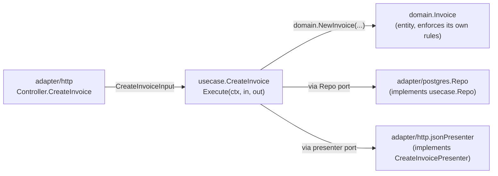
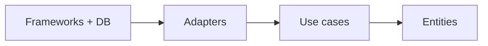
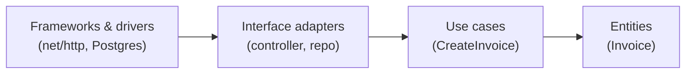
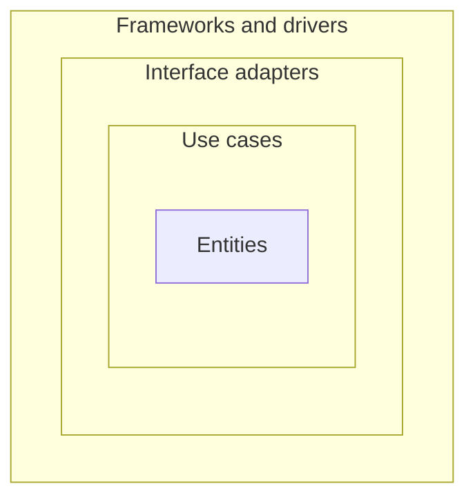
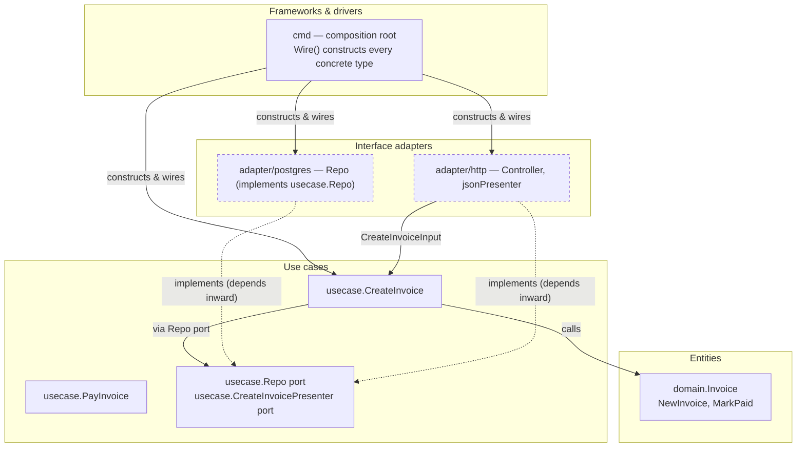
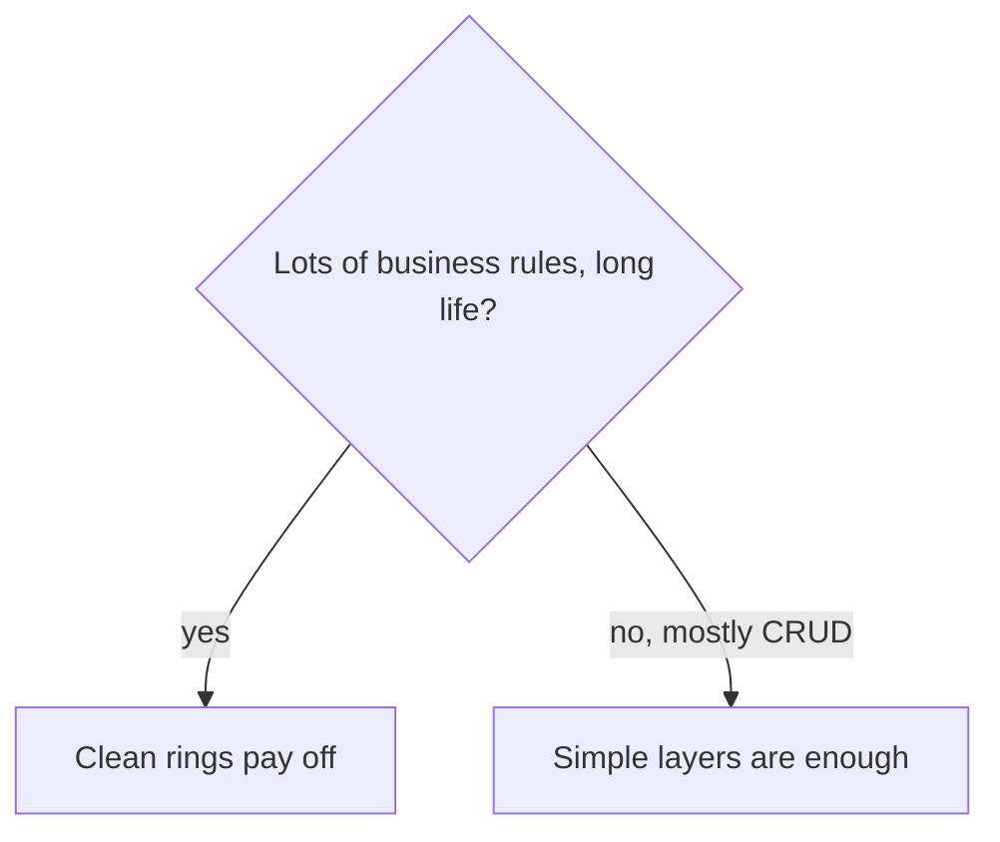

# Clean Architecture

> [!summary] TL;DR
> Clean Architecture (Robert C. Martin, 2012) organizes a system into concentric rings — entities, use cases, interface adapters, frameworks & drivers — with one rule that governs every ring boundary: **source-code dependencies only ever point inward.** Nothing in an inner ring may name anything in an outer ring, not even its type.

> [!abstract] Core idea
> - Four named rings, inside to outside: **entities** (enterprise-wide business rules) → **use cases** (application-specific business rules) → **interface adapters** (controllers, presenters, gateways) → **frameworks & drivers** (the web framework, the database, the UI).
> - **The Dependency Rule:** source-code dependencies can only point inward. An inner ring never imports, mentions, or knows about anything in an outer ring — including its data formats.
> - A **use case** (also called an interactor) is one application operation — `CreateInvoice`, `PayInvoice` — implemented as one type with one `Execute` method, calling out through **input/output ports** it declares itself.
> - Boundaries are crossed with **DTOs**, never by passing an inner-ring entity out to an outer ring or an outer-ring type in. A **presenter** is the output-port pattern specifically for handing a result back out without the use case knowing anything about HTTP, JSON, or a template.
> - It is the same dependency-inversion idea as [[Hexagonal Architecture (Ports and Adapters)]] (Cockburn, 2005) and the Onion Architecture (Palermo, 2008) — all three invert the "natural" call direction so outer layers depend on inner ones — but Clean Architecture is the most prescriptive: it names every ring and mandates the boundary DTO.

### Whiteboard version

InvoiceOps creating an invoice, one call per ring, inward on the left and the one place error mapping happens on the right:



The controller calls the use case; the use case calls the entity to enforce invariants, calls `Repo` to persist, and reports the outcome through a presenter port — never returning raw domain data to the controller directly.

## Start here: the basics 🟢

> [!info] How to read this note (pick your level)
> - 🟢 **New to this?** Read "From zero" below, then 1 (why it exists), 2 (mental model) and 10 (cheat sheet). Stop there, that is a full first pass.
> - 🟡 **Know the basics?** Add 3 (how it works), 4 (worked example), 5 (variants and comparison) and 6 (trade-offs).
> - 🔴 **Interview / SDE-3 prep?** Add 7 (in production), 8 (deep dive) and 9 (interview questions). Headings are tagged 🟢🟡🔴 so you always know where you are.

**From zero, in 60 seconds** 🟢

Picture your code as rings, like an onion.
The center holds the business rules, like "an invoice total cannot be negative". These are the **entities**.
The next ring holds the **use cases**: the actions the app does, like "create invoice".
Outer rings hold the web handlers, the database code and the frameworks.
The one rule: code only points inward. The center never imports the database or the web framework.
So you can swap the database or test the rules without starting anything.



The rest of this note is just these 3 questions:
1. What lives in each ring?
2. How does data cross a ring without breaking the inward rule?
3. When is all this worth it, and when is it too much?


**The problem in one story.**
Your invoice rules live inside an HTTP handler.
Now a nightly job must create invoices too.
You either copy the rules or call the HTTP handler from a cron job.
Clean Architecture puts the rules in the middle, where both can reach them.

**Words you need first**

| Word | Plain meaning | Tiny example |
| --- | --- | --- |
| Business rule | A rule the business cares about, no matter the tech | "Amount must be above zero" |
| Entity | A core business object that enforces its own rules | `domain.Invoice` |
| Use case | One thing the app does for a user | `CreateInvoice.Execute` |
| Adapter | Code that translates between the outside world and your app | HTTP controller, Postgres repo |
| Port | An interface the inner code declares for what it needs | `usecase.Repo` |
| DTO | A plain data struct for crossing a boundary | `CreateInvoiceInput{Amount: 500}` |
| Presenter | Code that turns a use case result into output | Writes JSON and a 201 status |

**Picture it**



All arrows point inward: outer rings know inner rings, never the reverse.

**Analogy.** An onion: you can peel and replace the outer skin (web framework, database) and the core stays the same.
Where it breaks: onion layers do not talk; here outer rings call inward and inner rings reach outward only through interfaces they own.

**How the rest of this note builds up**

- First, why it exists (section 1) and the four rings plus the Dependency Rule (section 2).
- Then ports, DTOs, presenters and error mapping (section 3), with a full Go worked example (section 4).
- Then how it compares with hexagonal and onion architecture (section 5), and when it is overkill (section 6).
- Finally the SDE-3 deep dive: production layouts, enforcing the rule, and interview questions (sections 7-9).

> [!tip] Remember
> Dependencies only point inward; the business rules never know about HTTP or SQL.

## 1. Why it exists 🟢

A `CreateInvoice` handler that builds a `*sql.Invoice` struct straight from `r.Body`, inserts it, and serializes the same struct back as JSON works fine until three things happen at once, which they eventually do: the API needs a field the database doesn't have yet (a computed due-date label), a second entry point (an internal gRPC call from the reminders worker) needs to create invoices too, and the business rule "an invoice amount must be positive" needs to be enforced regardless of which entry point created it.

Without a boundary, that rule either gets duplicated in both entry points or gets left in the database as a `CHECK` constraint that only produces a confusing SQL error instead of a clean validation message.

Clean Architecture's answer is structural: put the rule inside an **entity** that cannot be constructed in an invalid state (`domain.NewInvoice` returns an error instead of letting a bad `Invoice` exist), put the operation inside a **use case** that any entry point can call the same way, and make every entry point (HTTP, gRPC, a test) talk to the use case through the same input and output boundary — never by reaching into the entity's internals or the database row's shape directly.

## 2. Mental model 🟢

Four rings, drawn as circles, not a stack: **entities** in the center, **use cases** around them, **interface adapters** around that, **frameworks & drivers** on the outside. The rule is not "upper calls lower" (that's [[Layered Architecture]]'s mental model) — it's "nothing inside may know an outside ring exists."

An entity has never heard of a use case. A use case has never heard of HTTP or SQL.

An interface adapter (a controller, a presenter, a repository implementation) has heard of exactly one outer thing (its framework) and exactly one inner thing (the use case's ports) — it is the translation layer, by design, and nothing else gets to skip it.

Where this differs from hexagonal's single core/port/adapter split: Clean Architecture subdivides "the inside" into two named rings (entities and use cases) specifically so that enterprise-wide rules (an invoice can't have a negative amount, true in any application that has invoices) are separated from application-specific rules (an invoice becomes payment_failed after a declined charge — specific to this app's workflow, not a universal fact about invoices).



## 3. How it works 🟡



The dashed "implements" arrows are the Dependency Rule made visible: `adapter/postgres.Repo` and `adapter/http`'s presenter both *depend on* (import) `usecase`'s port types to implement them. `usecase` imports neither adapter package. `domain` (ring 1, the entities) imports nothing in this diagram at all — not even `usecase`.

### Crossing a boundary: input ports, output ports, DTOs

**In plain words: the use case says what it needs as interfaces, and data crosses rings as plain structs.**

A use case is called through an **input port** — in Go, simply its exported `Execute` method, taking a plain input struct with no JSON tags and no framework type in sight.

It reports its result through an **output port** — an interface the use case declares (`CreateInvoicePresenter` below), implemented by whichever adapter actually needs the result (a JSON presenter, a template renderer, a test's recording fake).

The use case never returns a `domain.Invoice` directly to its caller, and never accepts an `http.Request`: both directions cross the boundary as a plain DTO the use case itself defines.

### Error mapping across the boundary

**In plain words: inner rings return business errors; the outer ring turns them into HTTP codes.**

A `domain.ErrInvalidAmount` means nothing to an HTTP client; it needs to become a 400. A `postgres.ErrNotFound` needs to become a 404. That translation happens in exactly one place — the presenter, in `adapter/http` — using `errors.Is` against the domain and adapter packages' exported sentinel errors.

The use case itself never imports `net/http`, so it cannot (and must not) decide what status code anything maps to; it only ever calls `PresentError(err)` and lets the ring outside it decide what that means in that ring's vocabulary.

### Go layout

**In plain words: which folder each ring goes into.**

```text
clean/
  domain/              # entities: Invoice, invariants, MarkPaid
  usecase/             # interactors: CreateInvoice, PayInvoice, their ports
  adapter/
    http/              # interface adapter: Controller + jsonPresenter
    postgres/           # interface adapter: Repo implementation
  cmd/                 # frameworks & drivers: the composition root (Wire)
```

Each folder is one ring. `domain` imports nothing in this module. `usecase` imports only `domain`.

`adapter/*` imports `usecase` (and `domain`'s exported errors, for mapping) but never each other. `cmd` is the only package that imports every concrete type and wires them together — the same composition-root role [[Service Project Layout and Wiring]] gives `main.go` for an ordinary layered or hexagonal service.

## 4. Worked example 🟡

**Ring 1 — entities.** `domain.Invoice` cannot exist in an invalid state, and `MarkPaid` is a business rule, not a setter:

```go
// Package domain holds Clean Architecture's innermost ring: entities. An
// entity carries enterprise-wide business rules and depends on nothing —
// not the database, not JSON, not even this module's other packages.
package domain

import "errors"

type Status string

const (
	StatusPending Status = "pending"
	StatusPaid    Status = "paid"
)

var (
	ErrInvalidAmount = errors.New("amount must be positive")
	ErrAlreadyPaid   = errors.New("invoice already paid")
	ErrInvalidClient = errors.New("client id is required")
)

// Invoice is an entity: its invariants hold no matter which use case or
// adapter is calling it. NewInvoice is the only way to build one, so an
// invalid Invoice can never exist.
type Invoice struct {
	id       string
	clientID string
	amount   int64 // minor units
	currency string
	status   Status
}

func NewInvoice(id, clientID string, amount int64, currency string) (Invoice, error) {
	if clientID == "" {
		return Invoice{}, ErrInvalidClient
	}
	if amount <= 0 {
		return Invoice{}, ErrInvalidAmount
	}
	return Invoice{id: id, clientID: clientID, amount: amount, currency: currency, status: StatusPending}, nil
}

func (i Invoice) ID() string       { return i.id }
func (i Invoice) ClientID() string { return i.clientID }
func (i Invoice) Amount() int64    { return i.amount }
func (i Invoice) Currency() string { return i.currency }
func (i Invoice) Status() Status   { return i.status }

// MarkPaid is a business rule, not a setter: it guards the one legal
// transition (pending -> paid) and refuses to pay an invoice twice.
func (i Invoice) MarkPaid() (Invoice, error) {
	if i.status == StatusPaid {
		return i, ErrAlreadyPaid
	}
	i.status = StatusPaid
	return i, nil
}
```

**Ring 2 — use cases.** The ports (`Repo`, the two presenters) and the boundary DTO (`InvoiceOutput`) live here, next to the interactors that use them:

```go
// Package usecase is Clean Architecture's second ring: application
// business rules. It imports domain (the ring inside it) and defines the
// ports — input boundaries (the interactors below) and output boundaries
// (presenters) — that the next ring out, interface adapters, must satisfy.
// It never imports adapter or cmd.
package usecase

import (
	"context"

	"clean/domain"
)

// Repo is the port a use case needs from persistence. Interface adapters
// implement it (adapter/postgres here); the use case only ever calls it
// through this interface.
type Repo interface {
	Save(ctx context.Context, inv domain.Invoice) error
	ByID(ctx context.Context, id string) (domain.Invoice, error)
}

// InvoiceOutput is the boundary DTO a use case hands back across the ring.
// It is not domain.Invoice (entities never cross into an adapter) and not
// a JSON struct (adapters decide their own wire format from this).
type InvoiceOutput struct {
	ID       string
	ClientID string
	Amount   int64
	Currency string
	Status   string
}

func toOutput(inv domain.Invoice) InvoiceOutput {
	return InvoiceOutput{
		ID:       inv.ID(),
		ClientID: inv.ClientID(),
		Amount:   inv.Amount(),
		Currency: inv.Currency(),
		Status:   string(inv.Status()),
	}
}

// CreateInvoicePresenter is the output port for CreateInvoice. An interface
// adapter (adapter/http's JSON presenter, or a test's recording presenter)
// implements it; the interactor never knows which one it is talking to.
type CreateInvoicePresenter interface {
	PresentCreated(out InvoiceOutput)
	PresentError(err error)
}

// PayInvoicePresenter is PayInvoice's output port, following the same
// shape: one method per outcome the use case can produce.
type PayInvoicePresenter interface {
	PresentPaid(out InvoiceOutput)
	PresentError(err error)
}
```

```go
package usecase

import (
	"context"

	"clean/domain"
)

// CreateInvoiceInput is the input boundary DTO: what a driving adapter
// must supply, already stripped of transport concerns (no JSON tags here).
type CreateInvoiceInput struct {
	ID       string
	ClientID string
	Amount   int64
	Currency string
}

// CreateInvoice is the interactor: one use case, one method that runs it.
// It depends only on the Repo port and the presenter port, both declared
// in this package — never on a concrete adapter.
type CreateInvoice struct {
	repo Repo
}

func NewCreateInvoice(repo Repo) *CreateInvoice {
	return &CreateInvoice{repo: repo}
}

// Execute builds the entity (which enforces its own invariants), persists
// it through the Repo port, and reports the outcome through whichever
// presenter the caller supplied — the interactor never returns a Go error
// to its caller; that would make error handling look like a function
// result instead of a boundary-crossing event, which is the point of the
// presenter pattern.
func (uc *CreateInvoice) Execute(ctx context.Context, in CreateInvoiceInput, out CreateInvoicePresenter) {
	inv, err := domain.NewInvoice(in.ID, in.ClientID, in.Amount, in.Currency)
	if err != nil {
		out.PresentError(err)
		return
	}
	if err := uc.repo.Save(ctx, inv); err != nil {
		out.PresentError(err)
		return
	}
	out.PresentCreated(toOutput(inv))
}
```

A second interactor, `PayInvoice`, sharing the same `Repo` port and demonstrating idempotent handling of a domain rule (`ErrAlreadyPaid`):

```go
package usecase

import (
	"context"
	"errors"

	"clean/domain"
)

// PayInvoice is a second interactor sharing the same Repo port as
// CreateInvoice: both use cases sit in this ring and both only know Repo,
// never a concrete database type.
type PayInvoice struct {
	repo Repo
}

func NewPayInvoice(repo Repo) *PayInvoice {
	return &PayInvoice{repo: repo}
}

func (uc *PayInvoice) Execute(ctx context.Context, invoiceID string, out PayInvoicePresenter) {
	inv, err := uc.repo.ByID(ctx, invoiceID)
	if err != nil {
		out.PresentError(err)
		return
	}
	paid, err := inv.MarkPaid()
	if err != nil {
		if errors.Is(err, domain.ErrAlreadyPaid) {
			// Idempotent from the use case's point of view: report the
			// current (already paid) state rather than an error.
			out.PresentPaid(toOutput(paid))
			return
		}
		out.PresentError(err)
		return
	}
	if err := uc.repo.Save(ctx, paid); err != nil {
		out.PresentError(err)
		return
	}
	out.PresentPaid(toOutput(paid))
}
```

**Ring 3 — interface adapters.** The persistence adapter (named `postgres` for where it would point in production; kept in-memory here so the note's tests need no live database):

```go
// Package postgres is an interface adapter: it implements usecase.Repo.
// It is named for where it would point in production — pgx against
// Postgres — but this scratch build keeps it in-memory so the note's code
// runs without a live database; only InvoiceRow and the two methods below
// would change to real SQL (see the note's prose for the pgx version).
package postgres

import (
	"context"
	"errors"
	"fmt"
	"sync"

	"clean/domain"
)

// ErrNotFound is exported so an interface adapter above this one (like
// adapter/http's presenter) can map it to a transport-specific outcome
// (an HTTP 404) with errors.Is, without importing this package's internals.
var ErrNotFound = errors.New("invoice not found")

type Repo struct {
	mu   sync.Mutex
	rows map[string]domain.Invoice
}

func NewRepo() *Repo {
	return &Repo{rows: make(map[string]domain.Invoice)}
}

func (r *Repo) Save(ctx context.Context, inv domain.Invoice) error {
	r.mu.Lock()
	defer r.mu.Unlock()
	r.rows[inv.ID()] = inv
	return nil
}

func (r *Repo) ByID(ctx context.Context, id string) (domain.Invoice, error) {
	r.mu.Lock()
	defer r.mu.Unlock()
	inv, ok := r.rows[id]
	if !ok {
		return domain.Invoice{}, fmt.Errorf("%w: %s", ErrNotFound, id)
	}
	return inv, nil
}
```

And the HTTP adapter — a controller that decodes requests into input DTOs, and a presenter that is the one place mapping domain/adapter errors onto HTTP status codes happens:

```go
// Package http is the interface-adapters ring's driving side: it translates
// net/http into calls on the use cases, and the use cases' presenter
// callbacks back into an HTTP response. It imports usecase, postgres (to
// map its exported errors) and domain's exported errors — never the other
// direction.
package http

import (
	"encoding/json"
	"errors"
	"net/http"

	"clean/adapter/postgres"
	"clean/domain"
	"clean/usecase"
)

type Controller struct {
	create *usecase.CreateInvoice
	pay    *usecase.PayInvoice
}

func NewController(create *usecase.CreateInvoice, pay *usecase.PayInvoice) *Controller {
	return &Controller{create: create, pay: pay}
}

// jsonPresenter implements both usecase.CreateInvoicePresenter and
// usecase.PayInvoicePresenter: the interactor calls whichever method
// matches what actually happened, and this presenter is the one place
// that turns that outcome into status codes and a JSON body.
type jsonPresenter struct {
	w http.ResponseWriter
}

type invoiceJSON struct {
	ID       string `json:"id"`
	ClientID string `json:"client_id"`
	Amount   int64  `json:"amount"`
	Currency string `json:"currency"`
	Status   string `json:"status"`
}

func toJSON(out usecase.InvoiceOutput) invoiceJSON {
	return invoiceJSON{ID: out.ID, ClientID: out.ClientID, Amount: out.Amount, Currency: out.Currency, Status: out.Status}
}

func (p *jsonPresenter) PresentCreated(out usecase.InvoiceOutput) {
	p.w.Header().Set("Content-Type", "application/json")
	p.w.WriteHeader(http.StatusCreated)
	_ = json.NewEncoder(p.w).Encode(toJSON(out))
}

func (p *jsonPresenter) PresentPaid(out usecase.InvoiceOutput) {
	p.w.Header().Set("Content-Type", "application/json")
	p.w.WriteHeader(http.StatusOK)
	_ = json.NewEncoder(p.w).Encode(toJSON(out))
}

// PresentError is the error-mapping boundary: a domain or adapter error
// goes in, an HTTP status comes out. No other layer knows what an HTTP
// status is.
func (p *jsonPresenter) PresentError(err error) {
	switch {
	case errors.Is(err, domain.ErrInvalidAmount), errors.Is(err, domain.ErrInvalidClient):
		http.Error(p.w, err.Error(), http.StatusBadRequest)
	case errors.Is(err, postgres.ErrNotFound):
		http.Error(p.w, err.Error(), http.StatusNotFound)
	default:
		http.Error(p.w, "internal error", http.StatusInternalServerError)
	}
}

type createInvoiceRequest struct {
	ID       string `json:"id"`
	ClientID string `json:"client_id"`
	Amount   int64  `json:"amount"`
	Currency string `json:"currency"`
}

func (c *Controller) CreateInvoice(w http.ResponseWriter, r *http.Request) {
	var req createInvoiceRequest
	if err := json.NewDecoder(r.Body).Decode(&req); err != nil {
		http.Error(w, "malformed json", http.StatusBadRequest)
		return
	}
	c.create.Execute(r.Context(), usecase.CreateInvoiceInput{
		ID:       req.ID,
		ClientID: req.ClientID,
		Amount:   req.Amount,
		Currency: req.Currency,
	}, &jsonPresenter{w: w})
}

func (c *Controller) PayInvoice(w http.ResponseWriter, r *http.Request, invoiceID string) {
	c.pay.Execute(r.Context(), invoiceID, &jsonPresenter{w: w})
}
```

**Ring 4 — frameworks & drivers.** The composition root, the only place every concrete type is named:

```go
// Package cmd is the outermost ring, frameworks & drivers. In a real
// service this is `cmd/api/main.go`: the only file that imports every
// concrete adapter and constructs them in dependency order. It is kept as
// a plain (non-main) package here so this scratch module's tests can call
// Wire() directly; a real main.go would just call cmd.Wire() and then
// http.ListenAndServe.
package cmd

import (
	netHTTP "net/http"

	adapterhttp "clean/adapter/http"
	"clean/adapter/postgres"
	"clean/usecase"
)

// Wire constructs the whole dependency graph: postgres.Repo satisfies
// usecase.Repo, both interactors are built on top of it, and the HTTP
// controller is built on top of the interactors. Only this function knows
// every concrete type; everything inside the rings it wires together only
// knows the interfaces one ring in from itself.
func Wire() *adapterhttp.Controller {
	repo := postgres.NewRepo()
	create := usecase.NewCreateInvoice(repo)
	pay := usecase.NewPayInvoice(repo)
	return adapterhttp.NewController(create, pay)
}

// Mux builds the net/http.ServeMux a real main.go would pass to
// http.ListenAndServe. It is here, not in adapter/http, because routing
// table construction is also a wiring decision.
func Mux(c *adapterhttp.Controller) *netHTTP.ServeMux {
	mux := netHTTP.NewServeMux()
	mux.HandleFunc("POST /invoices", c.CreateInvoice)
	mux.HandleFunc("POST /invoices/{id}/pay", func(w netHTTP.ResponseWriter, r *netHTTP.Request) {
		c.PayInvoice(w, r, r.PathValue("id"))
	})
	return mux
}
```

A use-case-level test using a recording presenter fake (no HTTP, no database) plus the end-to-end test that drives the fully wired stack through the composition root. The fake itself is a few lines, implementing both presenter ports by recording whatever the interactor reported:

```go
// recordingPresenter is a test double implementing both
// usecase.CreateInvoicePresenter and usecase.PayInvoicePresenter: it
// records whatever the interactor reported instead of writing HTTP.
type recordingPresenter struct {
	outcomes []usecase.InvoiceOutput
	errs     []error
}

func (p *recordingPresenter) PresentCreated(out usecase.InvoiceOutput) {
	p.outcomes = append(p.outcomes, out)
}
func (p *recordingPresenter) PresentPaid(out usecase.InvoiceOutput) {
	p.outcomes = append(p.outcomes, out)
}
func (p *recordingPresenter) PresentError(err error) {
	p.errs = append(p.errs, err)
}

func TestCreateInvoice_InvalidAmountNeverReachesRepo(t *testing.T) {
	repo := postgres.NewRepo()
	uc := usecase.NewCreateInvoice(repo)
	p := &recordingPresenter{}

	uc.Execute(context.Background(), usecase.CreateInvoiceInput{ID: "inv_1", ClientID: "cl_1", Amount: -5, Currency: "INR"}, p)

	if len(p.outcomes) != 0 {
		t.Fatalf("expected no success outcome, got %+v", p.outcomes)
	}
	if len(p.errs) != 1 {
		t.Fatalf("errs = %v", p.errs)
	}
	if _, err := repo.ByID(context.Background(), "inv_1"); err == nil {
		t.Fatalf("invalid invoice should never have been saved")
	}
}

// TestWire_EndToEnd drives the fully wired stack (controller -> use cases
// -> repo) through the composition root, proving all four rings actually
// connect, not just compile in isolation.
func TestWire_EndToEnd(t *testing.T) {
	mux := cmd.Mux(cmd.Wire())

	createReq := httptest.NewRequest("POST", "/invoices", strings.NewReader(`{"id":"inv_1","client_id":"cl_1","amount":2500,"currency":"INR"}`))
	createRec := httptest.NewRecorder()
	mux.ServeHTTP(createRec, createReq)
	if createRec.Code != 201 {
		t.Fatalf("create status = %d, body = %s", createRec.Code, createRec.Body.String())
	}

	payReq := httptest.NewRequest("POST", "/invoices/inv_1/pay", nil)
	payRec := httptest.NewRecorder()
	mux.ServeHTTP(payRec, payReq)
	if payRec.Code != 200 {
		t.Fatalf("pay status = %d, body = %s", payRec.Code, payRec.Body.String())
	}
}
```

And the 50-goroutine concurrent-create test the "Measured" line below reports, proving `postgres.Repo`'s locking holds under concurrent `CreateInvoice.Execute` calls:

```go
func TestCreateInvoice_Concurrent(t *testing.T) {
	repo := postgres.NewRepo()
	uc := usecase.NewCreateInvoice(repo)

	const n = 50
	done := make(chan struct{}, n)
	for i := 0; i < n; i++ {
		go func(i int) {
			defer func() { done <- struct{}{} }()
			p := &recordingPresenter{}
			uc.Execute(context.Background(), usecase.CreateInvoiceInput{
				ID:       "inv_concurrent",
				ClientID: "cl_1",
				Amount:   int64(100 + i),
				Currency: "INR",
			}, p)
		}(i)
	}
	for i := 0; i < n; i++ {
		<-done
	}
}
```

**Measured:** `go test -race ./...` across `usecase` and `cmd` in a scratch module (Go 1.24.4, darwin/arm64, 2026-11-07): all tests pass, including a 50-goroutine concurrent-create test against `postgres.Repo` and the full `cmd.Wire()` end-to-end test above (create then pay through the real `net/http.ServeMux`), with no data race reported.

## 5. Variants and comparison 🟡

| Option | How it works | Use when | Cost |
| --- | --- | --- | --- |
| [[Layered Architecture]] | Fixed stack, one "bottom" persistence layer, no explicit use-case objects | Simple CRUD services, one kind of store | No vocabulary for separating enterprise-wide rules from application-specific workflow rules |
| [[Hexagonal Architecture (Ports and Adapters)]] | Core + ports + adapters, unopinionated about internal ring structure | You need isolation from infrastructure but don't need named sub-rings | Less prescriptive than Clean Architecture about where exactly a rule belongs |
| Clean Architecture | Four named rings, mandatory boundary DTOs, input/output ports per use case | Larger codebases/teams where "which ring does this belong in" needs a shared, enforceable vocabulary | More mapping boilerplate (input DTO, output DTO, presenter) per use case than hexagonal typically needs |
| Onion Architecture (Palermo, 2008) | Concentric rings very close to Clean Architecture's, domain model at the center, often paired with domain services and infrastructure rings | Interchangeable with Clean Architecture in practice; some teams prefer its naming | Same costs as Clean Architecture; the difference is largely vocabulary, not mechanics |

## 6. Trade-offs and when not to use 🟡

- Mapping boilerplate compounds: an input DTO, a domain call, an output DTO, and a presenter implementation exist for every single use case, even a trivial one. A `GetInvoice` read-only lookup pays nearly the same ceremony tax as `PayInvoice`.
- Over-engineering a small CRUD service is the single most common misuse: a two-endpoint internal tool rarely needs four named rings and a presenter interface per operation — [[Layered Architecture]] or even a flat package does the same job with far less code.
- Go-idiom tension: Go favors small, locally-defined interfaces and direct returns (`(Invoice, error)`), while Clean Architecture as originally described (in a Java/C# world) favors an explicit presenter callback instead of a return value. Go code following this pattern often feels more ceremonial than idiomatic Go elsewhere in the same codebase — a deliberate trade for the isolation this buys, not a sign something's wrong.
- Letting an ORM model or a request struct leak into `usecase` or `domain` — even "just this once," even just as a method parameter type — defeats the entire pattern. The Dependency Rule has no partial-credit version.



## 7. In production 🔴

- **Real systems:** this is the standard reference architecture cited across the Go, Java, and .NET ecosystems whenever a team wants to isolate business logic from a specific framework version or ORM; InvoiceOps uses the same ring structure for its payment and invoicing core (see [[Capstone - InvoiceOps]]).
- **Failure modes → fixes:**
  - A `usecase` package imports `encoding/json` or `net/http` "just for a helper type" → that is a Dependency Rule violation even if it compiles; move the JSON shape to the adapter and cross with a plain struct.
  - A repository implementation returns `*sql.Row` or an ORM-generated struct from a `usecase.Repo` method → the port leaked the adapter's shape; the port must return the domain type, and the adapter maps internally.
  - An entity gets a field added purely because the database added a column → the dependency is pointing the wrong way; add the column to the adapter's storage row and map it, or add it to the entity only if it's genuinely a business invariant.
  - Overengineering: a small internal tool gets a full four-ring structure for two endpoints, adding more files than the problem has ever needed → start with [[Layered Architecture]] and introduce rings only once a second use case or second adapter actually demands the isolation.
- **What to monitor:** import-direction violations are a static-analysis problem, not a runtime one — a lint rule or `go vet`-adjacent check that fails the build on an inward-ring package importing an outer one (several Go linters support "layer" or "boundary" import rules) catches drift long before a review does; also watch how much boilerplate a typical PR for "add one field to a use case" generates, as a proxy for whether the ceremony is earning its cost here.

## 8. Deep dive 🔴

**Is Clean Architecture worth it in Go?** For a service with one or two use cases and one storage engine, no — the input/output DTOs and presenter interfaces for `CreateInvoice` alone are already more code than a layered equivalent, for isolation the team isn't yet spending. It earns its cost once at least two of the following are true: multiple teams own different use cases in the same codebase and need an enforceable boundary vocabulary, the domain rules are complex enough that "enterprise-wide" (entity) and "this workflow" (use case) genuinely need to be told apart, or the service expects to swap its delivery mechanism (REST today, gRPC or an event consumer added later) without touching business logic.

**Why a presenter and not just a return value.** Returning `(InvoiceOutput, error)` from `Execute` would work and would be more idiomatic Go — and it's a reasonable simplification many Go teams make. The presenter pattern buys something specific in exchange for the extra interface: the use case can report a result through a view-specific shape decided by whichever adapter is driving it (a JSON presenter, a server-rendered HTML presenter, a test's recording fake), without the use case's signature changing per presentation need, and without the use case ever constructing a response shape it has no business knowing about.

**Relation to hexagonal and onion, precisely.** All three put source-dependencies pointing inward and keep infrastructure out of the core. Hexagonal says the least about internal structure: "core" and "ports," full stop — a port can be a database repository or a payment provider, undifferentiated. Onion Architecture (Palermo) draws rings very close to Clean Architecture's — domain model, domain services, application services, infrastructure — and in practice the two are treated as interchangeable by most engineers; the differences are mostly in naming and in which ring "domain services" formally live. Clean Architecture is the most opinionated of the three: it specifically separates entities from use cases (something hexagonal doesn't require and onion names differently), and it mandates the input/output port + DTO pattern at every use-case boundary rather than leaving that choice to the team.

**Transactions across use cases.** `CreateInvoice` here only writes through one `Repo`, so it needs no transaction coordination. The moment a use case needs to write to two repositories atomically — the exact situation [[Layered Architecture]]'s worked example covers, inserting a client and its audit row together — the fix is the same `UnitOfWork` port shown there: declared in `usecase`, implemented by the adapter that actually holds the connection, and injected into the interactor exactly like `Repo` is here. Clean Architecture doesn't invent a different transaction mechanism; it just insists the port for it lives in the use-case ring, never a `*sql.Tx` parameter threaded through `Execute`'s signature.

**Error mapping across layers, in full.** A `domain.ErrInvalidAmount` crosses two boundaries before it becomes an HTTP response: `usecase.CreateInvoice.Execute` calls `out.PresentError(err)` without inspecting it (the use case doesn't know or care what an HTTP status is), and `adapter/http.jsonPresenter.PresentError` is the one function in the whole codebase allowed to have an `errors.Is` chain mapping domain and adapter sentinel errors onto `http.StatusBadRequest`, `http.StatusNotFound`, and so on. If a second driving adapter (gRPC) is added later, it gets its own presenter with its own mapping to gRPC status codes — the use case and the domain never change.

## 9. Interview questions 🔴

> [!question]- State the Dependency Rule in one sentence.
> Source-code dependencies can only point inward, toward higher-level policy: an inner ring (entities, then use cases) must never import, reference, or know the existence of anything in an outer ring (interface adapters, then frameworks and drivers).

> [!question]- What's the difference between an entity and a use case in this architecture?
> An entity carries rules true for the business regardless of which application is using it (an invoice amount can't be negative). A use case carries rules specific to this application's workflow (a declined charge flips this app's invoice to `payment_failed`, which is a decision InvoiceOps makes, not a universal fact about invoices).

> [!question]- Why does a use case report results through a presenter instead of returning a value?
> So the use case never has to know what shape its caller wants the result in — JSON, HTML, a gRPC message, or a test's recorded struct — and so that choice can change (or a second driving adapter can be added) without touching the use case's signature. The trade-off is one more interface per use case than a plain return value would need.

> [!question]- Trap: is Clean Architecture just hexagonal architecture renamed?
> They share the same dependency-inversion mechanics, but Clean Architecture is more prescriptive: it names two inner rings (entities, use cases) where hexagonal just says "the core," and it mandates explicit boundary DTOs and presenter-style output ports at every use-case crossing, which hexagonal leaves up to the implementer.

> [!question]- Where does a repository implementation live, and which direction does it depend?
> In the interface-adapters ring (`adapter/postgres` here). It depends inward: it imports `usecase.Repo` to implement it. The use-case ring never imports the adapter package — that's what lets the adapter be swapped for an in-memory fake in tests with zero use-case code changing.

> [!question]- Is Clean Architecture worth it for a small Go service?
> Usually not for one or two use cases and one storage engine — the DTO and presenter boilerplate costs more than the isolation is worth yet. It earns its keep once multiple teams share the codebase, the domain rules are genuinely complex, or more than one delivery mechanism (REST and gRPC, say) needs to reuse the same use cases.

> [!question]- What specifically breaks if an ORM-generated struct is returned from a Repo port method?
> The use-case ring now has a compile-time dependency on the ORM package (to even name the struct's type), which violates the Dependency Rule outright — the use case has stopped being swappable or testable without that ORM present, regardless of whether a real database is actually hit in a given test.

## 10. Cheat sheet 🟢

- Four rings, inside to outside: entities → use cases → interface adapters → frameworks & drivers.
- The Dependency Rule: source-code dependencies only point inward, no exceptions, not even for a "convenient" type.
- Entity = enterprise-wide rule. Use case = this application's workflow rule. Keep them in separate rings.
- Cross every ring boundary with a plain DTO — never an entity out, never a framework type in.
- A presenter is an output port: it lets a use case report a result without knowing its caller's response shape.
- Error mapping (domain error → HTTP status) happens in exactly one place: the adapter, via `errors.Is` against exported sentinel errors.
- Same mechanics as hexagonal and onion; Clean Architecture is the most prescriptive about naming and boundary DTOs.
- Don't reach for it below one or two use cases and one storage engine — start layered, grow into rings when a second use case or delivery mechanism actually shows up.

## Links 🟢
- **Before this:** [[Hexagonal Architecture (Ports and Adapters)]]
- **Next:** [[SOLID in Go]]
- **Compare with:** [[Layered Architecture]] (the simpler default this pattern is an evolution of), [[Service Project Layout and Wiring]] (the composition-root pattern `cmd.Wire` follows), [[Capstone - InvoiceOps]] (the running example whose payment core uses this ring structure)

### Watch on YouTube

- [Understand Clean Architecture in 7 Minutes](https://www.youtube.com/watch?v=1OLSE6tX71Y) · Amichai Mantinband · 7 min · 227,606 views
- [The Clean Architecture / Simply Explained / .NET Core](https://www.youtube.com/watch?v=_1cJ0JOLe8Y) · The Code Switch · 6 min · 55,726 views
