# Documenting Architecture - C4 Diagrams and Fitness Functions

> [!summary] TL;DR
> C4 is four nested diagrams — Context, Container, Component, Code — that each zoom in one level and use one notation (boxes, arrows, a legend) instead of a different diagramming style per abstraction level. Fitness functions are executable checks (often ordinary Go tests) that keep the running system honest against what the diagrams and ADRs say it should be, so the documentation doesn't quietly go stale.

> [!abstract] Core idea
> - C4 fixes "architecture diagram" meaning something different in every document: Context (the system and who/what it talks to), Container (the deployable units inside it), Component (the groupings of code inside one container), Code (classes/structs — usually generated, rarely hand-drawn).
> - Each level is a **zoom-in** on one box from the level above, not a separate, disconnected diagram.
> - A fitness function is any automated test of an architectural characteristic — import rules, latency budgets, dependency counts — run in CI the same way a unit test is.
> - Diagrams document **intent**; fitness functions **enforce** it. A diagram nobody checks against the code is a historical artifact within a quarter.
> - Classic mistake: drawing Component and Code diagrams by hand and never updating them. Brown's own guidance is to hand-draw Context and Container (they change rarely) and either skip Component/Code or generate them from source.

### Whiteboard version

One system (InvoiceOps), zoomed in once: Context shows it as a box with the outside world; Container cracks that box open into its deployable pieces.

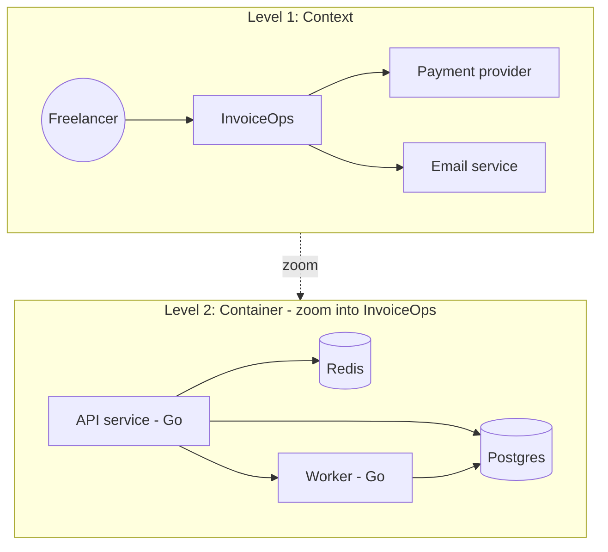

Everything below is this same zoom-in repeated one more level (Container into Component) and made precise: what each level is allowed to show, who reads it, and how a Go test keeps the arrows true.

## Start here: the basics 🟢

> [!info] How to read this note (pick your level)
> - 🟢 **New to this?** Read "From zero" below, then 1 (why it exists), 2 (mental model) and 10 (cheat sheet). Stop there, that is a full first pass.
> - 🟡 **Know the basics?** Add 3 (how it works), 4 (worked example), 5 (variants and comparison) and 6 (trade-offs).
> - 🔴 **Interview / SDE-3 prep?** Add 7 (in production), 8 (deep dive) and 9 (interview questions). Headings are tagged 🟢🟡🔴 so you always know where you are.

> [!note] Before this note
> - [[Hexagonal Architecture (Ports and Adapters)]]: the core code owns interfaces and the database or web code plugs into them. The Component diagram and the import-rule test in this note draw and check exactly that.
> - [[Clean Architecture]]: the rule "imports only point inward". A fitness function is how you make a test fail when someone breaks it.

**From zero, in 60 seconds** 🟢

Architecture diagrams are often one messy picture that nobody trusts.
**C4** fixes this with four maps that zoom in, like Google Maps: country, city, street, house.
Level 1 shows your system and who uses it. Level 2 shows its apps and databases. Level 3 shows the parts inside one app. Level 4 is the code.
Each map uses the same simple boxes and arrows.
But a picture can go out of date. A **fitness function** is a test that checks the rule from the picture, like "the domain package never imports the database package".
So the picture explains the rule, and the test keeps it true.

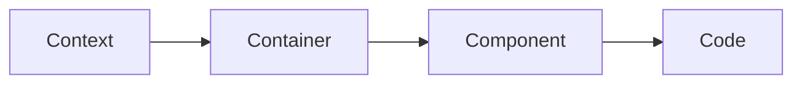

The rest of this note is just these 3 questions:
1. What does each C4 level show, and who reads it?
2. How do you turn a diagram's rules into tests?
3. How do ADRs, C4 and fitness functions fit together?


**The problem in one story.**
Three engineers each draw "the architecture" of the same service.
One shows servers, one shows classes, one shows user flows.
A new hire cannot tell which to trust, and none match the code anymore.
C4 gives fixed zoom levels; fitness functions are tests that keep the code honest.

**Words you need first**

| Word | Plain meaning | Tiny example |
| --- | --- | --- |
| System | The whole thing your team owns and ships | InvoiceOps |
| Container | Something that runs or stores data on its own (not Docker-specific) | Go API, Postgres, a worker |
| Component | A group of code inside one container | `billing` package |
| Zoom level | How much detail one diagram shows | City map vs. street map |
| CI | Automation that runs tests on every change | GitHub Actions on each PR |
| Fitness function | An automated check of an architecture rule | "domain must not import `database/sql`" |
| Import rule | A rule about which package may import which | Test fails on a forbidden import |
| Structural fitness function | A test that checks how the code is wired together | "domain imports no adapter" |
| Quality-attribute fitness function | A test that checks a quality like speed | "invoice total in under 2 ms" |
| p95 | The time that 95 of every 100 calls finish within | p95 = 42 ns |
| Fixture | A tiny fake project kept only so tests can check against it | `testdata/badapp/` |
| ADR | A short, dated note saying why a decision was made | "domain must not import SQL, because…" |
| Sequence diagram | A picture of messages between parts, in time order | Browser → API → Postgres |

**Picture it**

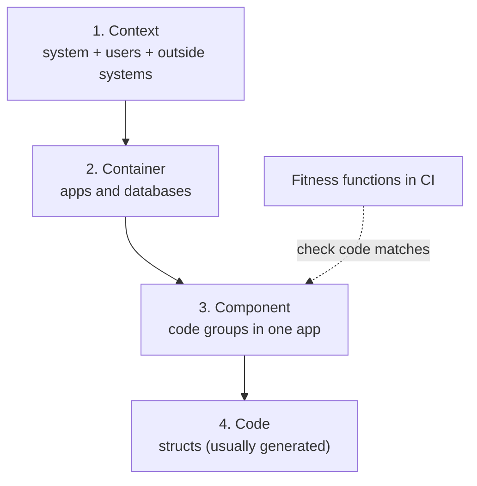

**Analogy.** C4 is like a map app: country, city, street, building, each a zoom into one spot of the level above.
Where it breaks: a map updates itself from satellites; diagrams only stay true if fitness functions or people check them.

**How the rest of this note builds up**

- First, why diagrams drift (section 1) and the "Google Maps" mental model (section 2).
- Then each C4 level and how a fitness function is written in Go (section 3), with InvoiceOps as the worked example (section 4).
- Then other notations and kinds of fitness functions (section 5), plus when not to bother (section 6).
- Finally the SDE-3 view: keeping docs alive in production, linking ADRs to tests, and the deep dive (sections 7-8).

> [!tip] Remember
> Diagrams show intent; fitness functions enforce it.

## 1. Why it exists 🟢

A team without a shared diagramming convention produces three "architecture diagrams" for the same system that disagree with each other and with the code: one slide shows boxes for "frontend", "backend", "database" with no indication of what "backend" actually deploys as; another shows every Go package as a box, so dense that nobody but its author can read it; a third is a sequence diagram (a picture of messages between parts, in time order) mislabeled as "the architecture."

None of them tell a new engineer which diagram to open for which question, and none of them are checked against the real codebase, so each one is accurate for about as long as it takes someone to merge the next **refactor** (a change to the code's structure that keeps its behaviour the same).

C4 fixes the first problem (which diagram answers which question) by fixing exactly four levels, each a zoom into the one above, with one consistent notation. Fitness functions fix the second problem (diagrams going stale) by making the architectural *rules* — not the pictures — into something CI actually runs.

A Go test that fails when `internal/domain` imports `database/sql` catches the violation in the same pull request that introduced it; a diagram that merely *claims* the domain layer has no infrastructure dependency catches nothing on its own.

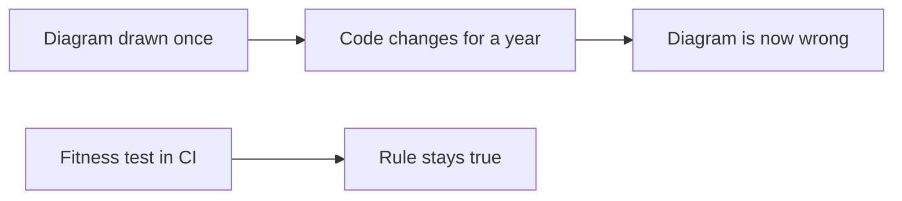

### Real-life example 🟢

Imagine you join the payments team at a big app like Paytm on day one.
Someone sends you a Context diagram: "Wallet" in the middle, talking to banks, UPI and the shopping app. You get the big picture in 2 minutes.
Next, the Container diagram shows the wallet API, a worker, a Postgres database and a Redis cache. Now you know what actually runs.
You open your first pull request, and a test fails: "ledger package must not import the HTTP client". That failing test is a fitness function. It stopped you from breaking a rule you did not know existed yet.

## 2. Mental model 🟢

🟢 **Plain version:** Think of a map app. Zoomed out, you see one city. Zoom in and you see neighbourhoods, then streets, then buildings. C4 is the same for software: the whole system, then its running parts, then the code groups in one part, then the code. Most teams only draw the first two or three. A fitness function is like an inspector who walks the real streets to check the map is still true.

Think of C4 as **Google Maps for a system**: zoomed all the way out, you see a city on a map of the country (Context — InvoiceOps as one box, talking to a payment provider and an email service); zoom in once and you see the city's neighbourhoods (Container — the API service, the worker, Postgres, Redis, each a separately deployable or runnable thing); zoom in again and you see one neighbourhood's streets (Component — the groupings of code inside the API container: an HTTP layer, a service layer, a repository layer); zoom in once more and you'd see individual buildings (Code — classes and structs, usually better read straight from an **IDE**'s (code editor's) "go to definition" than drawn by hand).

Nobody hand-draws every building in a city map; C4's own guidance is that most teams stop drawing after Container, sketch Component only for a container worth explaining, and skip Code diagrams entirely in favour of letting an IDE or a generator produce them on demand.

A **fitness function**, in the same metaphor, is a zoning inspector that actually visits the buildings instead of trusting the zoning map: it runs against the real source tree and fails the build the moment a "residential" neighbourhood (the domain package) has an industrial building (a raw SQL import) in it.

## Common beginner mistakes 🟢

- **Thinking a C4 "container" means a Docker container** → you draw Docker details instead of what runs → a C4 container is any app or data store that runs on its own: a Go API, Postgres, a mobile app.
- **Putting everything on one giant diagram** → nobody can read it → draw one diagram per zoom level, each zooming into one box of the level above.
- **Hand-drawing Code diagrams** → they are wrong within days → skip them, or generate them from the code.
- **Drawing a rule but never testing it** → the code quietly drifts away from the picture → turn the rule into a fitness function test that runs in CI.
- **Writing a fitness function you never saw fail** → it may pass even when the rule is broken → also test it against a deliberately broken fixture.

## 3. How it works 🟡

> 🟢 → 🟡 **You now know** that C4 is four zoom levels and that fitness functions are tests for architecture rules. **Next we open the box**: what each level may show, InvoiceOps drawn at each level, and how a Go test checks the arrows. Each subsection starts with a short step-by-step walk.

### 3.1 The four levels, what each one shows, and who reads it

**In plain words: four zoom levels, each for a different reader.**

**Step by step:**
1. Level 1 (Context): one box, "InvoiceOps", with a freelancer, a client, a payment provider and an email service around it. A product manager can read it.
2. Level 2 (Container): open the box. Inside: API service (Go), worker (Go), Postgres, Redis. Engineers and ops read this.
3. Level 3 (Component): open the API box. Inside: HTTP handlers, invoice service, repository. Engineers in that service read this.
4. Level 4 (Code): the actual structs. Usually you just open the code instead.

| Level | Shows | Audience | Notation |
| --- | --- | --- | --- |
| 1. Context | The system as one box, the people and other systems around it | Anyone — including non-engineers | Actor shapes, one system box, labelled arrows |
| 2. Container | The deployable/runnable units inside the system (services, databases, queues, SPAs, i.e. single-page web apps) | Engineers and ops, onboarding | Boxes with a technology label, e.g. "Go, net/http" |
| 3. Component | The major code groupings inside one container | Engineers working in that container | Boxes grouped inside the container's boundary |
| 4. Code | Classes, structs, functions | Whoever is reading the source right now | Usually a generated UML (a standard diagram notation)/`classDiagram`, not hand-drawn |

"Container" in C4 is Brown's specific term for an independently deployable or runnable unit — a Go service, a database, a React SPA, a mobile app — and has nothing to do with Docker; a Docker container is one possible way to run a C4 container, not what the word means here. This is the single most common C4 vocabulary mistake.

### 3.2 Context diagram: InvoiceOps and its world

**Step by step:**
1. Draw your system as one box: "InvoiceOps".
2. Add the people who use it: the freelancer, the client who pays.
3. Add the outside systems it talks to: payment provider, email service.
4. Label each arrow with what flows: "pays an invoice - HTTPS". No Go, no databases yet.

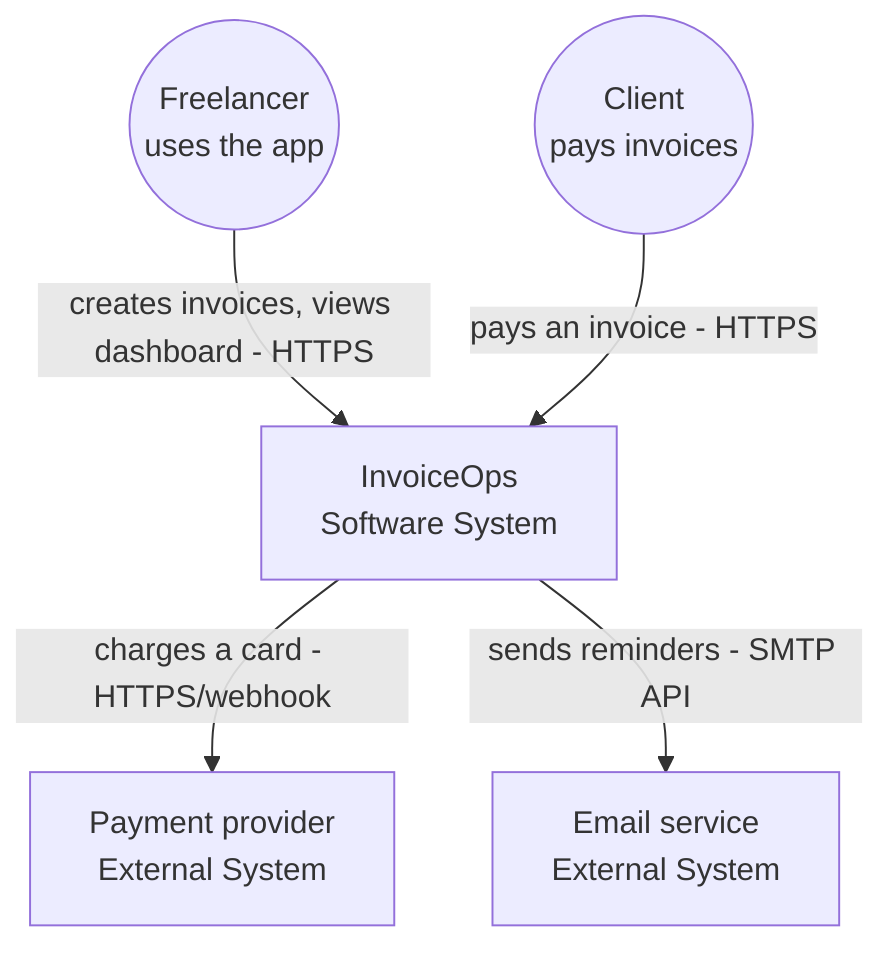

(SMTP is the standard way computers send email.)

A Context diagram never shows *how* InvoiceOps is built inside — no mention of Go, Postgres, or an API versus a worker. It answers exactly one question: what does this system do, and what does it talk to.

This is the diagram a new hire, a security reviewer, or a product manager should be able to read without any Go experience.

### 3.3 Container diagram: zooming into InvoiceOps

**Step by step:**
1. Open the InvoiceOps box.
2. Draw each thing that runs or stores data on its own: API service, worker, Postgres, Redis, WebSocket hub (a server that keeps a live connection open so it can push updates to the browser).
3. Write the technology on each box: "Go, net/http + gRPC", not just "API".
4. Draw who talks to whom: browser → API, API → Postgres, worker → Postgres.

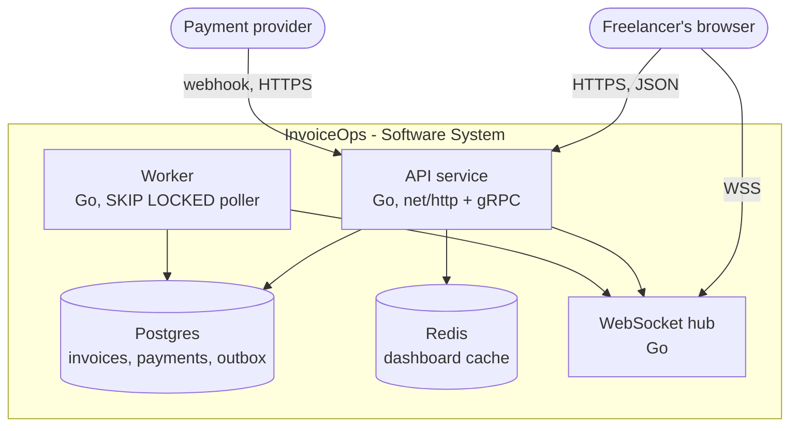

Each box now names a technology (the thing C4 calls out specifically: "Go, net/http + gRPC", not just "API") because a reader at this level — an engineer deciding where a change belongs, or an **SRE** (site reliability engineer, who keeps systems running) deciding what to restart — needs to know what actually runs and how to operate it.

This maps directly onto [[Capstone - InvoiceOps]]'s own component view: the API service, the worker, and the data stores it already draws, now in C4's specific vocabulary and audience framing rather than an ad hoc flowchart.

### 3.4 Component diagram: zooming into the API container

**Step by step:**
1. Open the API service box.
2. Draw its main code groups: HTTP handlers, webhook handler, invoice service, repository interface, Postgres adapter.
3. Draw calls: handlers → service → repository.
4. Draw "implements" as a dashed arrow from the Postgres adapter to the repository interface, and label it, so nobody confuses "calls" with "implements".

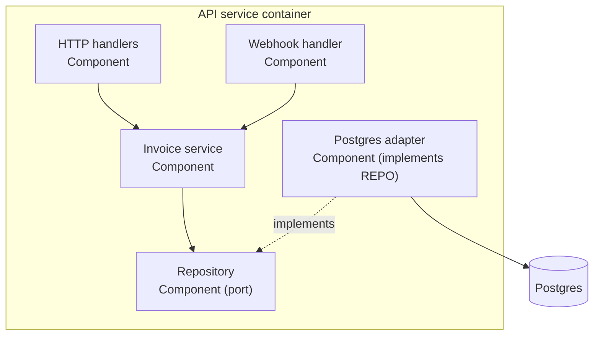

This is the level [[Hexagonal Architecture (Ports and Adapters)]] and [[Clean Architecture]] already describe in prose and their own diagrams — a Component diagram is the C4-standardised way to draw exactly that dependency-direction picture, with one added convention: the arrow direction is **call flow or ownership**, labelled, never left ambiguous between "calls" and "implements" the way the pre-rebuild Hexagonal note's diagram was.

Only draw a Component diagram for a container complex enough to need the zoom-in — a thin container (a static file server, a managed queue) earns no Component diagram of its own.

### 3.5 Code diagrams: usually skipped, or generated

**Step by step:**
1. You want to see `InvoiceService`'s methods.
2. Instead of drawing them, run `go doc` or use your editor's "go to definition".
3. Only if you truly need a picture, generate one from the code so it can't drift.

A Code diagram (a `classDiagram` of the actual structs and their methods) is the one level C4's own guidance says to generate rather than hand-draw, because source code changes far faster than a human can keep a hand-drawn diagram in sync with it.

In Go, the practical equivalent is `go doc`, `godoc`, or an IDE's call-hierarchy view — a Mermaid `classDiagram` is shown here only because this note's convention requires a real diagram per mechanism, not because hand-drawing one is good practice day to day:

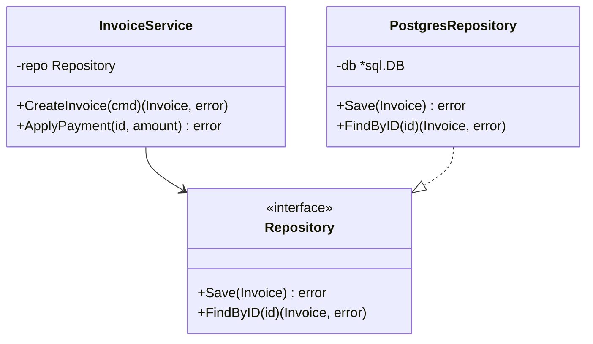

### 3.6 Fitness functions: turning the diagram's rules into tests

**In plain words: a normal test that fails the build when the code breaks an architecture rule.**

**Step by step:**
1. Pick a rule from the diagram: "`internal/domain` never imports `database/sql`".
2. Write a Go test that reads every `.go` file under `internal/domain` and lists its imports.
3. If any import is on the forbidden list, the test fails with the file name.
4. CI runs this test on every pull request, so a bad import is blocked before merge.
5. For speed rules, the test runs the code 2,000 times and fails if the slow end (p95) is over budget.

Full detail:

A **fitness function** (Ford, Parsons & Kua, *Building Evolutionary Architectures*, 2017) is any automated, objective check of an architectural characteristic, run the same way as a unit test — in Go, that means an ordinary `_test.go` file. Two concrete kinds, both shown fully in the worked example below:

- **Structural fitness functions** parse the import graph and fail if a rule like "the domain package imports no infrastructure" is broken — the exact rule the Component diagram in 3.4 draws as an arrow direction, now enforced instead of merely illustrated.
- **Quality-attribute fitness functions** measure a non-functional characteristic (how well it runs, not what it does) — a latency budget, an allocation count, a maximum dependency fan-out — and fail if it regresses, the same way a benchmark regression check would, but expressed as a pass/fail test rather than a chart someone has to read.

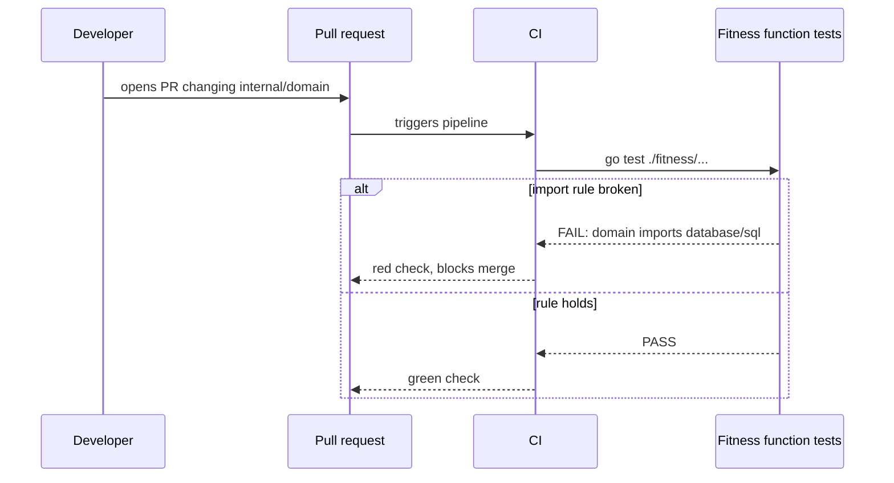

### 3.7 Where ADRs, C4 and fitness functions fit together

**In plain words: the ADR says why, the diagram shows what, the test keeps it true.**

**Step by step:**
1. ADR-0004 says: "domain must not import SQL, because we want to test it without a database".
2. The Component diagram draws that as an arrow from the Postgres adapter into the domain, never the reverse.
3. The test `TestGoodAppPassesTheImportRule` checks it on every commit.
4. Put the test name inside the ADR, so whoever sees it fail can find the reason.

An [[Architecture Decision Records|ADR]] records *why* a rule exists ("the domain layer must not import `database/sql`, decided 2026-03-01, because X"); the Component diagram (3.4) draws the rule as a picture for a human to understand quickly; the fitness function (3.6) is the rule enforced every time CI runs.

Keep an explicit link from the ADR to the fitness function's test name, so a reviewer who finds the test failing can trace it back to the decision instead of guessing why the rule exists.

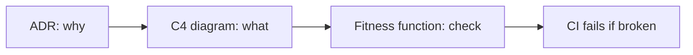

## 4. Worked example 🟡

### Whiteboard version

The structural fitness function reduced to its essence: parse every file's imports, flag the ones that break a named rule.

```go
package wb

import (
	"go/parser"
	"go/token"
)

type Rule struct {
	PackageContains string
	Forbidden       []string
}

func checkOneFile(path string, rules []Rule) bool {
	fset := token.NewFileSet()
	f, err := parser.ParseFile(fset, path, nil, parser.ImportsOnly)
	if err != nil {
		return false
	}
	_ = f // walk f.Imports against rules; the full version below does this per directory
	return true
}
```

The full version below is a reusable `importrules` checker plus a `latency` package implementing a quality-attribute fitness function, both demonstrated against fixture source trees so the tests prove the checker actually catches a violation, not just that it stays quiet on clean code.

### Package layout and dependency direction

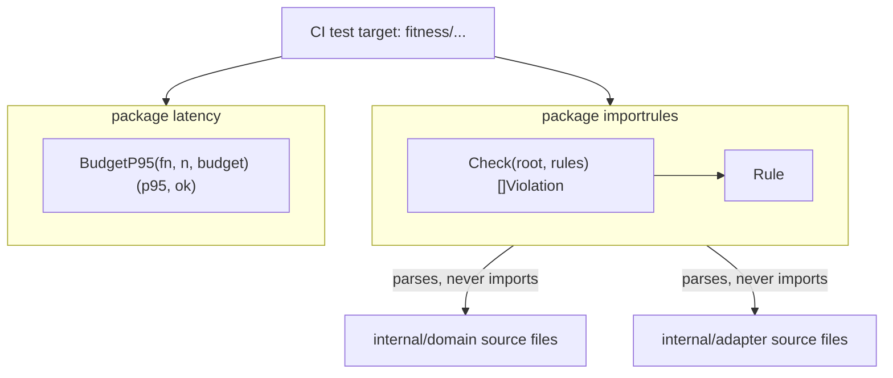

`importrules` depends on nothing from the project it checks — it parses source files as text with `go/parser` (Go's own library that reads source code into a tree you can inspect), so it never imports (and therefore never has to build) the domain or adapter packages it inspects.

This keeps the fitness function fast (milliseconds, no compilation) and safe to run even while the codebase it checks is between commits and temporarily won't build.

```go
// Package importrules implements an architectural fitness function: a test
// that enforces a dependency-direction rule by parsing real source files,
// not by reviewer discipline. It is deliberately a pure import-graph check
// (no type-checking, no build), so it runs in milliseconds and needs
// nothing beyond the source tree.
package importrules

import (
	"fmt"
	"go/parser"
	"go/token"
	"io/fs"
	"path/filepath"
	"strconv"
	"strings"
)

// Rule says: a package whose directory path contains PackageContains may not
// import any package whose import path contains one of Forbidden. For
// example {PackageContains: "domain", Forbidden: []string{"database/sql",
// "net/http", "/adapter/"}} enforces "the domain layer imports no
// infrastructure", the same rule Hexagonal and Clean Architecture both make.
type Rule struct {
	Name            string
	PackageContains string
	Forbidden       []string
}

// Violation is one import statement that broke one Rule.
type Violation struct {
	File   string
	Line   int
	Import string
	Rule   string
}

func (v Violation) String() string {
	return fmt.Sprintf("%s:%d: imports %q, which breaks rule %q", v.File, v.Line, v.Import, v.Rule)
}

// Check walks every .go file under root and reports one Violation per
// import that breaks a rule whose PackageContains matches that file's
// directory path.
func Check(root string, rules []Rule) ([]Violation, error) {
	var violations []Violation
	err := filepath.WalkDir(root, func(path string, d fs.DirEntry, err error) error {
		if err != nil {
			return err
		}
		if d.IsDir() || !strings.HasSuffix(path, ".go") || strings.HasSuffix(path, "_test.go") {
			return nil
		}
		rel, err := filepath.Rel(root, path)
		if err != nil {
			return err
		}
		rel = filepath.ToSlash(rel)

		fset := token.NewFileSet()
		f, err := parser.ParseFile(fset, path, nil, parser.ImportsOnly)
		if err != nil {
			return fmt.Errorf("parse %s: %w", path, err)
		}

		for _, imp := range f.Imports {
			importPath, err := strconv.Unquote(imp.Path.Value)
			if err != nil {
				continue
			}
			pos := fset.Position(imp.Pos())
			for _, rule := range rules {
				if !strings.Contains(rel, rule.PackageContains) {
					continue
				}
				for _, forbidden := range rule.Forbidden {
					if strings.Contains(importPath, forbidden) {
						violations = append(violations, Violation{
							File:   rel,
							Line:   pos.Line,
							Import: importPath,
							Rule:   rule.Name,
						})
					}
				}
			}
		}
		return nil
	})
	return violations, err
}
```

**What the code above does, in plain words:** `Check` walks through every `.go` file under a folder, reads only its import lines, and for each rule that applies to that folder, reports any import on the forbidden list.

**Fixture** source trees (tiny fake projects kept only for tests) the tests check against (not built — only parsed — so a non-existent import path like `invoiceops/domain` below is fine):

```go
// testdata/goodapp/domain/invoice.go
package domain

import (
	"errors"
	"time"
)

type Invoice struct {
	ID        string
	DueDate   time.Time
	AmountDue int64
}

var ErrNotFound = errors.New("invoice not found")
```

```go
// testdata/goodapp/adapter/postgres/repo.go
package postgres

import (
	"database/sql"

	"invoiceops/domain"
)

type Repo struct{ db *sql.DB }

func (r *Repo) Find(id string) (domain.Invoice, error) {
	return domain.Invoice{}, nil
}
```

```go
// testdata/badapp/domain/invoice.go — deliberately wrong, so the test below
// can prove the checker catches a real violation, not just stays quiet.
package domain

import (
	"database/sql" // violates "domain imports no infrastructure"
	"time"
)

type Invoice struct {
	ID      string
	DueDate time.Time
	db      *sql.DB
}
```

```go
package importrules

import "testing"

var domainRule = Rule{
	Name:            "domain imports no infrastructure",
	PackageContains: "domain",
	Forbidden:       []string{"database/sql", "net/http", "/adapter/"},
}

func TestGoodAppPassesTheImportRule(t *testing.T) {
	violations, err := Check("../testdata/goodapp", []Rule{domainRule})
	if err != nil {
		t.Fatalf("Check: %v", err)
	}
	if len(violations) != 0 {
		t.Fatalf("goodapp should have 0 violations, got %v", violations)
	}
}

func TestBadAppFailsTheImportRule(t *testing.T) {
	violations, err := Check("../testdata/badapp", []Rule{domainRule})
	if err != nil {
		t.Fatalf("Check: %v", err)
	}
	if len(violations) != 1 {
		t.Fatalf("badapp should have exactly 1 violation, got %v", violations)
	}
	v := violations[0]
	if v.Import != "database/sql" {
		t.Fatalf("violation import = %q, want database/sql", v.Import)
	}
	if v.Line == 0 {
		t.Fatal("violation should carry a line number")
	}
}

func TestRuleOnlyAppliesToMatchingPackages(t *testing.T) {
	adapterRule := Rule{
		Name:            "adapter may import database/sql",
		PackageContains: "adapter",
		Forbidden:       []string{"this-is-never-imported"},
	}
	violations, err := Check("../testdata/goodapp", []Rule{adapterRule})
	if err != nil {
		t.Fatalf("Check: %v", err)
	}
	if len(violations) != 0 {
		t.Fatalf("adapter rule should not flag database/sql in the adapter package, got %v", violations)
	}
}
```

**What the tests above do, in plain words:** one checks the clean fake project passes, one checks the broken fake project fails (so the checker really works), and one checks a rule only applies to the folders it names.

The quality-attribute fitness function — a **latency budget** (the most time a call is allowed to take) on InvoiceOps's invoice-total calculation, run as a `go test` assertion instead of a benchmark someone has to remember to read:

```go
// Package latency implements a second kind of fitness function: a quality
// attribute (a latency budget) checked by running the real code, not by
// reading an architecture diagram. It measures wall-clock time directly
// instead of using testing.B, so the budget check can run as a normal `go
// test` assertion in CI rather than needing `go test -bench`.
package latency

import (
	"sort"
	"time"
)

// BudgetP95 runs fn iterations times, measures each call's wall-clock
// duration, and reports the 95th-percentile duration and whether it is
// within budget. iterations is forced to at least 2 so a percentile index
// always exists.
func BudgetP95(fn func(), iterations int, budget time.Duration) (p95 time.Duration, ok bool) {
	if iterations < 2 {
		iterations = 2
	}
	durs := make([]time.Duration, iterations)
	for i := 0; i < iterations; i++ {
		start := time.Now()
		fn()
		durs[i] = time.Since(start)
	}
	sort.Slice(durs, func(i, j int) bool { return durs[i] < durs[j] })
	idx := int(float64(len(durs)) * 0.95)
	if idx >= len(durs) {
		idx = len(durs) - 1
	}
	p95 = durs[idx]
	return p95, p95 <= budget
}
```

```go
package latency

import (
	"testing"
	"time"
)

type invoiceLine struct {
	unitPriceMinor int64
	quantity       int64
	taxRateBps     int64
}

func computeInvoiceTotal(lines []invoiceLine) int64 {
	var total int64
	for _, l := range lines {
		base := l.unitPriceMinor * l.quantity
		num := base * l.taxRateBps
		tax := num / 10000
		if (num%10000)*2 >= 10000 {
			tax++
		}
		total += base + tax
	}
	return total
}

func sampleInvoiceLines() []invoiceLine {
	lines := make([]invoiceLine, 20)
	for i := range lines {
		lines[i] = invoiceLine{unitPriceMinor: 150000, quantity: int64(i%5 + 1), taxRateBps: 1800}
	}
	return lines
}

// TestInvoiceTotalStaysUnderLatencyBudget is a fitness function for a
// quality attribute: it does not check what the code does, only how fast.
// Measured on this machine (Go 1.24.4, darwin/arm64, 2026-11-07, 2,000
// iterations over a 20-line invoice): p50 was 41ns and p95 was 42ns, with
// occasional single-digit-microsecond outliers (a GC pause or scheduler
// preemption) that never approached the budget below. These are this
// sandbox's one-off numbers, not a cross-machine benchmark — re-measure
// before relying on them on different hardware. The 2ms budget below is
// deliberately far above that measured p95 — generous headroom against CI
// machine noise — while still catching a real regression (for example an
// accidental O(n^2) rewrite of the loop, or a lines slice that grows
// unbounded).
func TestInvoiceTotalStaysUnderLatencyBudget(t *testing.T) {
	lines := sampleInvoiceLines()
	const budget = 2 * time.Millisecond

	p95, ok := BudgetP95(func() {
		computeInvoiceTotal(lines)
	}, 2000, budget)

	if !ok {
		t.Fatalf("p95 %v exceeds the %v budget for computing an invoice total", p95, budget)
	}
}

// TestBudgetP95CatchesARegression proves the fitness function itself would
// fail a slow path, not just pass a fast one.
func TestBudgetP95CatchesARegression(t *testing.T) {
	slow := func() { time.Sleep(2 * time.Millisecond) }
	p95, ok := BudgetP95(slow, 5, 1*time.Millisecond)
	if ok {
		t.Fatalf("a 2ms sleep should fail a 1ms budget, got p95 %v ok=%v", p95, ok)
	}
}
```

**What this code does, in plain words:** `BudgetP95` runs a function many times, timing each run, sorts the times, picks the one 95% of the way up (the p95), and says whether it is under the budget.

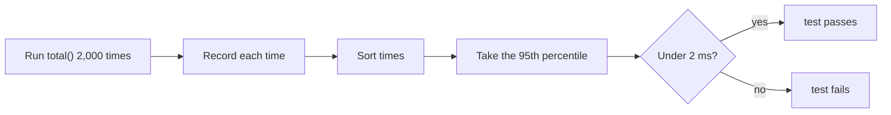

`go vet ./...` is clean on both packages, and `go test -race -v ./...` passes all 5 tests: the import-rule checker correctly passes a clean tree, correctly fails a tree with a planted violation (proving it isn't vacuously green) and correctly scopes a rule to only the packages it names; the latency budget correctly passes a fast real workload and correctly fails a deliberately slow one.

## 5. Variants and comparison 🟡

| Approach | How it works | Use when | Cost |
| --- | --- | --- | --- |
| C4 (Context/Container/Component/Code) | Four fixed zoom levels, one notation, each a zoom into a box above it | Any team that wants one shared diagramming convention across repos | Discipline to keep Context/Container current; Component/Code easily go stale if hand-maintained |
| Free-form boxes-and-arrows | Whatever notation the author likes per diagram | A one-off whiteboard sketch for a single meeting | No shared vocabulary across diagrams or teams; unreadable to anyone not in the room |
| UML component/deployment diagrams | A formal, tool-generated notation with a larger symbol vocabulary | Regulated or enterprise contexts requiring a specific UML deliverable | Steeper notation to learn; most of its precision goes unused for everyday architecture communication |
| arc42 / full architecture document | A structured template covering constraints, quality goals, risks, and diagrams together | A larger system needing a complete written architecture record, not just diagrams | Much more writing to keep current; C4 diagrams often live inside an arc42 document's "Building Block View" section |
| Fitness functions (structural, quality-attribute) | Automated tests enforcing the rules a diagram only illustrates | Any rule worth drawing is worth enforcing in CI | Writing and maintaining the checks themselves; a rule with no test is only a suggestion |

## 6. Trade-offs and when not to use 🟡

- **C4 documents structure, not behaviour.** A Context or Container diagram shows nothing about the order requests happen in or what happens on failure — pair it with a sequence diagram (as [[Capstone - InvoiceOps]] does for its webhook flow) for that; C4 isn't a replacement for every other diagram type, only a standard for the structural ones.
- **Component and Code diagrams rot fastest.** They describe the part of the system that changes on nearly every pull request; a team that commits to hand-drawing and maintaining them accurately is taking on real, ongoing cost. Brown's own recommendation — stop at Container for most systems, draw Component only for a container worth explaining, skip Code — exists because of this cost, not as a shortcut.
- **Fitness functions only check what someone wrote a check for.** A structural rule nobody encoded (say, "every exported error must be wrapped with context") goes unenforced regardless of how clear the diagram and the ADR are; writing the fitness function is the actual commitment, not drawing the arrow.
- **For a small system (one container, a handful of packages)**, a Context diagram may be the only one worth drawing at all — Container, Component and fitness functions earn their cost only once there's enough structure for ambiguity to creep in.

## 7. In production 🔴

> 🟡 → 🔴 **You now know** how to draw each C4 level and write both kinds of fitness function in Go. **Next is the senior view**: how real teams keep diagrams alive, how fitness functions fail in practice, and why "parse only the imports" is a deliberate trade-off.


- **Real systems:**
	- Structurizr (Simon Brown's own tool) generates C4 diagrams from a DSL or from code, specifically to avoid the hand-maintained-diagram-rot problem described above.
	- ArchUnit (Java) and `go-arch-lint`/import-graph linters in Go are production fitness-function tools doing exactly what `importrules` above does by hand, at larger scale with more rule types (layer cycles, forbidden package pairs, naming conventions).
	- Netflix and Amazon engineering talks on "architecture as code" describe CI-enforced dependency rules as a standard practice for large polyrepo systems, the same shape as 3.6/3.7 here applied at scale.
- **Failure modes → fixes:**
	- A Component diagram is checked in once, at design time, and never looked at again as the code evolves away from it → either delete it (a diagram nobody updates is worse than no diagram, because it actively misleads) or turn its key rule into a fitness function so drift fails CI instead of silently accumulating.
	- "Container" gets used to mean "Docker container" in a design doc, confusing a reader who then expects every box to map 1:1 to a `Dockerfile` → say "C4 container (a deployable/runnable unit, not Docker)" the first time it's used in any shared document.
	- A fitness function's rule is correct the day it's written but the architecture legitimately evolves (a new, approved cross-layer call is added) → treat a fitness-function failure as a prompt to either fix the regression or update the rule and its backing ADR together, never to silently delete the failing test.
- **What to monitor:** which fitness functions exist and their pass/fail history in CI (a flaky or frequently-overridden one is a signal the rule or the architecture needs revisiting); how long since each C4 diagram was last regenerated or reviewed against the current container/component list; number of ADRs with no corresponding fitness function for a rule that's meant to be enforced, not just documented.

## 8. Deep dive 🔴

- **Why Context and Container survive longest.** Both describe boundaries that change only when a real architectural decision is made — adding a new external system, splitting a service — which is inherently rarer than the code changes that make Component and Code diagrams rot. This is the structural reason Brown's guidance to stop at Container for most teams isn't laziness; it matches how often each level's truth actually changes.
- **Fitness functions as executable ADRs.** An ADR's "Decision" section is prose a human has to remember to check against; a fitness function is the same decision made checkable by a machine on every commit. Teams practicing evolutionary architecture (Ford/Parsons/Kua) treat "did we write a fitness function for this decision" as part of the Definition of Done for an ADR that constrains structure, not merely records a choice with no structural consequence.
- **Parsing vs. type-checking for structural fitness functions.** `importrules` above only parses import declarations (`parser.ImportsOnly`), deliberately not using `go/types` or `golang.org/x/tools/go/packages` to build a full type-checked program. This trades the ability to catch deeper violations (a function value smuggled across a layer without an import, for instance) for speed and for working even when the target tree doesn't currently compile — a property worth having in CI, where a fitness-function stage should fail fast and independently of the build stage.
- **Composing multiple rules.** A real system's fitness-function suite usually has several `Rule` values at once (domain-imports-no-infra, adapters-import-no-other-adapters, handlers-import-no-repositories-directly) rather than one — `Check` above takes a `[]Rule` for exactly this reason, so new rules are additive, each with its own name traceable back to the ADR that justified it.

## 9. Interview questions 🔴

> [!question]- What's the difference between a C4 Container and a Docker container?
> A C4 container is Brown's term for any independently deployable or runnable unit — a Go service, a database, a queue, a mobile app, an SPA — regardless of how it's packaged. A Docker container is one specific packaging technology that might implement a C4 container; the words collide but mean different things, and conflating them is the most common C4 mistake.

> [!question]- Why does C4 guidance say to skip or auto-generate Code diagrams?
> Code changes far more often than any human can keep a hand-drawn diagram synced with, so a hand-maintained Code diagram goes stale within days and then actively misleads. `go doc`, an IDE's call hierarchy, or a generator produce the same information on demand, accurately, with zero maintenance cost.

> [!question]- Trap: if a fitness function test is green, does that mean the architecture diagram for that rule is accurate?
> Only for the specific rule the test encodes — a fitness function proves one structural or quality claim holds right now, not that the whole diagram is accurate. A diagram can still show boxes or relationships no test checks at all; green tests narrow the trust gap, they don't close it.

> [!question]- Design a fitness function that would have caught the old Hexagonal Architecture note's diagram bug (drawing call flow as if it were dependency direction).
> A structural rule like the one above — parse `internal/core`'s imports and fail if any resolve to a concrete adapter package (`adapter/postgres`, `adapter/razorpay`) — would fail immediately if the core imported a driven adapter directly, which is exactly the dependency-direction violation the mislabeled diagram obscured by drawing an arrow for call flow instead of import direction.

> [!question]- How would you decide which fitness functions to write first for an existing, undocumented codebase?
> Start from the rules a team already states in reviews but doesn't enforce ("domain shouldn't import infra", "handlers shouldn't call repositories directly") — each one converts directly into a structural fitness function with the highest value-to-effort ratio, because the rule and its importance are already agreed on; quality-attribute budgets (latency, allocation counts) come next, once a hot path's current numbers are measured and a sensible budget can be set above them.

> [!question]- Why does the import-rule checker in this note parse source files instead of using `go/types` for a full type-checked analysis?
> Parsing only the import declarations runs in milliseconds, needs no dependency resolution, and still works on a tree that doesn't currently compile — all properties a CI fitness-function stage benefits from. The trade is that it can't catch a violation smuggled in without an import statement (a function value passed in some other way), which a full type-checked analysis could.

## 10. Cheat sheet 🟢

- C4 = Context (the system + the world) → Container (deployable/runnable units, Brown's term, not Docker) → Component (code groupings inside one container) → Code (classes — usually generated, not hand-drawn).
- Each level zooms into one box from the level above; one notation throughout, not a different style per level.
- Brown's own guidance: most teams stop at Container, draw Component only for a container worth explaining, skip Code.
- A fitness function is an automated, objective check of an architectural characteristic — in Go, an ordinary `_test.go` file run in CI.
- Structural fitness functions parse the import graph (fast, no build needed); quality-attribute fitness functions measure something like latency and assert a budget.
- Diagrams document intent, ADRs record why, fitness functions enforce it on every commit — a rule with only the first two is a suggestion.
- A fitness function must be proven to actually fail on a violation (test it against a deliberately broken fixture), or it may be silently vacuous.

## Self-check 🟢🟡

> [!question]- (easy) Name the four C4 levels in order.
> Context, Container, Component, Code.

> [!question]- (easy) Is a C4 "container" a Docker container?
> No. It is anything that runs or stores data on its own, like a Go API, Postgres or a mobile app.

> [!question]- (easy) What is a fitness function?
> An automated test, run in CI, that checks an architecture rule such as "domain never imports `database/sql`".

> [!question]- (medium) Which C4 levels should most teams actually draw and keep current?
> Context and Container; Component only for a container worth explaining; Code is skipped or generated.

> [!question]- (medium) Why test the import checker against a deliberately broken fixture?
> To prove it actually fails on a violation; otherwise it could pass on everything and you'd never know.

> [!question]- (medium) How do an ADR, a C4 diagram and a fitness function split the work?
> The ADR says why the rule exists, the diagram shows it, and the fitness function enforces it on every commit.

## Links 🟢

- **Before this:** [[Hexagonal Architecture (Ports and Adapters)]], [[Clean Architecture]]
- **Next:** none planned in this folder — apply this note's fitness-function pattern retroactively to any note above it.
- **Compare with:** [[Architecture Decision Records]] (the "why" a fitness function enforces), [[Service Project Layout and Wiring]] (the package boundaries a Component diagram draws), [[Strangler Fig Pattern and Legacy Migration]] (a migration's routing rule is itself a fitness-function-checkable invariant)

### Watch on YouTube

- [C4 Model Tutorial / Software Architecture Diagrams / Context, Container, Component & Code Explained](https://www.youtube.com/watch?v=PFzWJ-uVeHY) · Engineer Akina · 29 min · 3,597 views
- [Create meaningful architecture diagrams using the C4 model](https://www.youtube.com/watch?v=MFvGVNEc8XI) · Tech Leaders Academy · 57 min · 2,808 views
